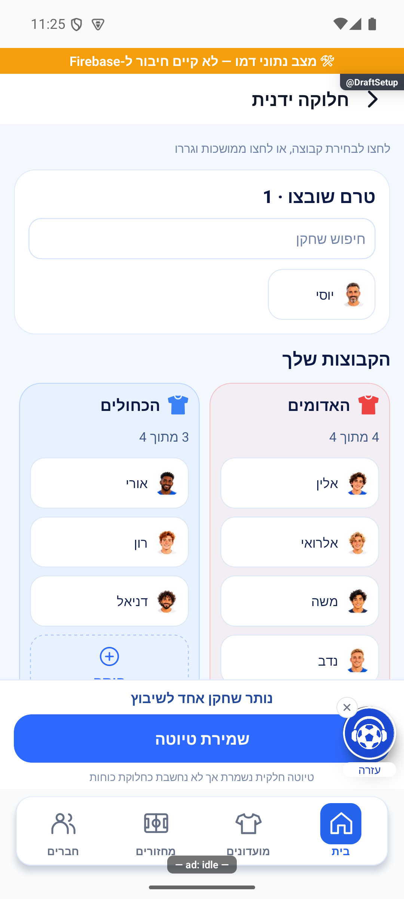

# הגדרת חלוקת כוחות — הסבר פשוט

## הרחבת אבחון דיווחים, 27.10.2026

הדיווחים יוכלו לכלול מה ניסו לבצע, מה היה מצב האפליקציה ומה החזיר השרת. פרטים חסרים מוצגים כלא ידועים, ומספר מוגבל של מופעים נשמר בלי למחוק את המופע הראשון. השינוי מקומי וטרם הופץ, ואינו משלים פרטים לדיווחים ישנים. [היקף, ראיות ומגבלות](../../changes/2026-10-27-diagnostic-context.md).

בדיקות הקוד הושלמו, אך השינוי עדיין מקומי ולא הופץ. פרטים שלא נאספו בדיווחים ישנים אינם משוחזרים בדיעבד.

## שעון מדויק וכיתוב פנדל - 25.10.2026

במקורות המשותפים נוסף שימור השעון המדויק של פנדל במהלך משחק, וכיתוב ההבקעה ביומן קוצר. אין שינוי במונים או בתהליך העצמאי המתואר כאן; לא נערכה לו בדיקת ממשק חדשה במסגרת העדכון. השינוי מקומי וטרם הופץ. [פרטים וראיות](../../changes/2026-10-25-in-play-penalties.md#שעון-מדויק-וכיתוב-אירוע).

## פנדל במהלך משחק חי - 25.10.2026

עודכנו מקורות משותפים לצורך פנדלים במהלך משחק. אין שינוי מכוון בתהליך העצמאי המתואר במסמך הזה, ולא נערכה לו בדיקת ממשק חדשה במסגרת המשימה.

השינוי מקומי. נדרשת פריסת שרת לפני הפצת לקוח שמשתמש באפשרות; לא בוצעו פריסה או שינוי הרשאות. [חוזה הנתונים, התהליך, הבדיקות ומגבלות ההפצה](../../changes/2026-10-25-in-play-penalties.md).

## חזרה מארון התארים לכרטיס המקורי — 24.10.2026

לערימת הניווט המשותפת נוסף רישום מקומי של ארון התארים, כדי שחזרה מכרטיס שחקן לא תחליף לשונית. אין שינוי מכוון בהתנהגות העצמאית המתוארת כאן, ואין בדיקת ממשק חדשה שלה. התיקון מקומי ולא הופץ. [מסלול הניווט, בדיקות, צילומים ומגבלות](../../changes/2026-10-24-cabinet-back.md).

## עדכון הפצה פנימית — 24.10.2026

נכלל בגרסה הפנימית `1.1.59/293`, ממקור `7c6f98e`. שני שירותי היסטוריית ההשוואות ועדכון הצבעים בשני נתיבי החלוקה המתוזמנת נפרסו ואומתו. אין היסטוריית השוואות ישנה; רק לקוחות חדשים מתעדים ביקורים. הייצור בחנות נשאר `1.1.57/291`, והכללים נשמרו לתאימות. טענות ״מקומי״ או ״טרם הופץ״ בהמשך מתארות את שלבי הפיתוח שקדמו להפצה זו. [מקור, בדיקות, פריסה ומגבלות](../../changes/2026-10-24-internal-1.1.59.md). אין בסבב זה אימות ממשק או התקנה חדשים.

## צילומים מהאימולטור — 24.10.2026

נוספו צילומי המסכים המקוריים באימולטור אנדרואיד: ארבע שיטות החלוקה, בחירת צבע והחלפת צבע תפוס. הצילום נעשה בנתוני הדגמה בלבד, בלי לשמור צבעים או ליצור כוחות; הוא מאמת את המראה ואת מיקום הכפתורים, ולא שמירה מול מסד חי. [ששת הצילומים וגבולות האימות](draft-setup.md#צילומי-המסכים-המקוריים-באימולטור--24102026).

## בחירת צבעים לפני חלוקת השחקנים — 24.10.2026

אפשר לבחור צבעים לפני שמשבצים שחקנים, בכל ארבע שיטות החלוקה. באוטומטית ובאקראית הכפתור מתחת לחולצה, בידנית ליד שם הקבוצה, ובקפטנים מופיעות חולצות מתחת לסדר הבחירה. צבע תפוס מאפשר החלפה מאושרת בין שתי קבוצות; ביטול אינו שומר.

הצבעים נשמרים למחזור וממשיכים להכנה וללייב. שינוי צבע בלבד שומר על טיוטת שיבוץ ידנית חלקית. מקומי וטרם הופץ; נבדקו רכיבי המקור בדפדפן ובדיקות שמירה מבודדות, ללא מכשיר או מסד חי. [פרטים וצילומים](draft-setup.md#צבעים-לפני-שיבוץ-ובכל-שיטת-חלוקה--24102026).

## חלון השלמות בעיצוב המשותף — 24.10.2026

חלון בחירת המשלימים לקבוצות שנוצרו עם השלמות קיבל פינות, מסגרת וצל התואמים לחלונות התחתונים האחרים. חישוב הכוחות, בחירת המשלימים והפעלת השעון נשארו כפי שהיו. רכיב החלון המקורי נבדק במציג מבודד באימולטור אנדרואיד בדמו; מסלול יצירת הכוחות והשלמתם בשמירה לא הורץ מחדש. השינוי מקומי וטרם הופץ.

[החלון לאחר התיקון](../screenshots/night-balanced-fill-after-2026-10-24.png) · [דוח הסריקה ומגבלות האימות](../../audits/2026-10-24-night-scan.md).

## תיעוד כשלים — 20.10.2026

נוסף תיעוד אוטומטי לנקודות כשל במסלול הזה, עם מקור התקלה. הפעולה המקורית שומרת על ערכי החזרה והודעות השגיאה שלה. השינוי מקומי, טרם הופץ, ואין אימות מסירה חיה לפולס.

[דוח דיווח השגיאות והראיות](../../changes/2026-10-20-error-reporting-audit.md).

## נוסח לשחקן יחיד — 18.10.2026

כשנשאר רק אדם אחד לשיבוץ ידני, נכתב ״נותר שחקן אחד לשיבוץ״. אם נשארו כמה שחקנים או שכולם שובצו, הנוסחים הקיימים נשמרים. אין שינוי בשיבוץ או בשמירה.

הנוסח נצפה בדמו מקומי בלבד, בלי לשמור טיוטה או לשנות מחזור אמיתי.

## חלוקה מחדש אחרי יציאה — 18.10.2026

שחקן שסומן ״הלך הביתה״ נשאר מחוץ לחלוקה גם אם יוצרים כוחות חדשים, בכל שיטה. אפשר להחזירו דרך פעולת ההחזרה המפורשת בלייב. אם מישהו יצא בזמן שמסך העריכה פתוח, השמירה מבקשת לרענן את ההרכב במקום להחזירו בטעות. התיקון נבדק בחישוב ובשמירת השירות המבודדת; תצוגת המכשיר אינה מאומתת בסעיף הזה.

## השלמת דיווחי הפולס — 17.10.2026

אישור איפוס החלוקה משתמש בחלונית הכדורגל של האפליקציה, עם כפתורים מלאים והסבר שאפשר לבטל את השינוי.

[צילומים, בדיקות ומגבלות](../../changes/2026-10-17-roster-recruitment-and-pulse.md).

## בדיקות הפולס והגרסה הפנימית 1.1.55 — 17.10.2026

בחירת הקפטנים ובחירת סדר התורות הן שני שלבים נפרדים. בוחרים בדיוק את מספר הקפטנים הנדרש, ממשיכים לבחירת סדר ורק לאחר בחירתו עוברים ללוח. חזרה שומרת את הבחירות. קפטן שעזב את רשימת המשתתפים מוסר מהבחירה ונדרשת השלמה.

[ראיות, בדיקות ומגבלות](../../changes/2026-10-17-internal-1.1.55.md).

## סיכום של הכוחות החדשים — 17.10.2026

יצירת כוחות חדשים או יצירה מחדש פותחת סיכום רק אחרי שהחלוקה נשמרה ונטענה מהשרת. בזמן טעינת התוצאה לא מוצגת חלוקה קודמת של אותו מחזור. המסך יכול להמתין עד שמונה שניות לתוצאה המדויקת וממשיך כשזו מגיעה בלי לחיצה נוספת. אם התוצאה החדשה אינה זמינה בגלל כשל או תום ההמתנה, אפשר לנסות לטעון אותה שוב בלי לבחור קפטנים מחדש. יציאה מהמסך מבטלת את ההמתנה. שיטת החלוקה והשמירה לא השתנו.

השינוי מקומי; בדיקות אוטומטיות עברו. גבולות האימות במכשיר מפורטים במסמך המעמיק ובדוח המשימה.

## חולצות תואמות ללוח המשחק — 16.10.2026

איור החולצה שמופיע בתצוגת הקבוצות לפני החלוקה משמש מעתה גם בלוח המשחק. בתצוגת החלוקה נשמרו הצורה, הגודל וצבעי ברירת המחדל. בלייב כל חולצה מציגה את צבע הקבוצה שנבחר. [צילום מהלייב והבדיקות](../../changes/2026-10-16-live-shirt-centering.md).

## גישה לכוחות ובחירת הלייב — 16.10.2026

כפתור יצירת הכוחות נשאר זמין למנהל גם אחרי שעברו יותר משעתיים מתחילת המחזור, כל עוד המחזור לא הסתיים ויש מספיק שחקנים. תצוגת הלייב נקראת מחדש כשחוזרים אליה; אם טעינת ההגדרות נכשלה מופיע ניסיון חוזר, במקום לעבור בטעות ללייב רגיל. קבוצות שמורות לבדן אינן מפעילות את הלייב המתקדם: הגדרת המחזור ממשיכה לקבוע, לצד מצב ההשלמות הקיים.

## חלוקה שמורה אחת — 15.10.2026

במחזור יש חלוקת כוחות שמורה אחת. שמירת חלוקה חדשה, בכל שיטה, מחליפה את הקודמת גם בזמן לייב. פתיחת שיטה אחרת לבדה אינה משנה את הכוחות. טיוטה ידנית חלקית נשארת במכשיר ואינה מחליפה חלוקה מלאה. התוצאה והשעון של המשחק הפעיל נשמרים; תוצאות משחקונים שכבר נשמרו אינן נערכות מחדש.

בסבב הבדיקה תוקנו שמירת צבעי הקבוצות בעריכה והגנה מפני שמירת סגל שכבר השתנה. אם אין לפחות שחקן לכל קבוצה, מוסבר מדוע עדיין אי אפשר ליצור כוחות. דירוג חסר מקבל דירוג בסיס 3 מתוך 5.

אפשר להמשיך לערוך כוחות ולהחליף שחקנים גם בזמן משחק. לפי החלטת הבעלים, כרגע ההרכב בסיום קובע למי נזקפות ההשתתפות והתוצאה, עם ההגנה הקיימת לכובשים ולמבשלי שערים. אין עדיין חישוב מלא של השתתפות דרך חילופים; הוא יצריך אפיון בהמשך.

נתוני הכוחות מוצגים בשלוש משבצות ברורות עם אייקונים: שחקנים, קבוצות ופורמט המשחק. העיצוב מופיע גם בכוחות אוטומטיים וגם בחלוקה אקראית.

כותרת הפתיח במסכי ההכנה הוקטנה ומוצגת בשורה אחת.

התצוגה נבדקה באימולטור במצב חלוקה אקראית לאחר חידוש חיבור הפיתוח.

מסכי ההכנה לכוחות אוטומטיים ולחלוקה אקראית מציגים מעתה את כמות השחקנים, מספר הקבוצות, הפורמט והקבוצות שייווצרו. בכוחות אוטומטיים החלוקה מתבססת על הדירוג הפנימי; באקראית השחקנים מוגרלים ללא דירוג, עם מספר שחקנים דומה בכל קבוצה. כשיש שארית מוצג טווח גדלים עד ליצירת הכוחות. אפשר לחזור לבחירת השיטה דרך החץ העליון ולערוך את הקבוצות לאחר יצירתן.

כאן מחלקים את השחקנים לקבוצות לפני המשחק. אפשר לבחור חלוקה מאוזנת לפי דירוג, חלוקה אקראית או בחירה של קפטנים. לפני שממשיכים בודקים את מספר הקבוצות ואת דרך הבחירה.

[להסבר המעמיק ולמפת הקוד](draft-setup.md)

## צילום והיקף ההוכחה

הצילומים מציגים רק את המצבים המתועדים במסמך המעמיק. חלקם נתוני דמו, חלקם הוכחות מתיקון קודם, ובכמה מהם טעינה או הודעת הגנה; הם אינם אישור שכל התהליך או השרת נבדקו.

## תיקוני סבב הבאגים — 8.10.2026

אורחים שממתינים למקום אינם מופיעים בבחירת קפטנים.

## תיקוני עיצוב ונגישות — 10.10.2026

מקור: `a348b9f235f1e1433497600555303231512a0834` עם שינויים מקומיים. אין בסעיף זה הוכחת גרסת חנות.

בחירת קפטנים, שיטה וסדר בחירה מזוהות בקורא מסך עם שם ומצב נבחר.

## תיקון זמן תגובה — 12.10.2026

חלוקת הכוחות מבצעת פחות חישובים חוזרים בזמן חיפוש קבוצות. כללי האיזון והגיוון נשארו זהים. התיקון נבדק מקומית, ועדיין אינו כלול בגרסה שהופצה.

## בחירת שיטה בעיצוב החדש — 14.10.2026

מקור: `4a3cb346` עם שינויים מקומיים. בחלק העליון מוצגים מספר הרשומים, מספר הקבוצות והפורמט ללא שם המועדון. הרשומים כוללים אורחים פעילים בהרכב ולא כוללים המתנה. מספר הקבוצות מגיע מהגדרת המחזור בגבולות הנתמכים; בהגדרה חסרה נשמרת ברירת שתי קבוצות הקיימת. פורמט חסר מוצג כלא מוגדר.

ארבע אפשרויות מוצגות כבחירה יחידה: כוחות אוטומטיים לפי דירוג, בחירת קפטנים, חלוקה ידנית חופשית וחלוקה אקראית. לא נוצרת חלוקה בלחיצה על הכרטיס: הבחירה מסומנת ורק הכפתור ״לחלוקת הקבוצות״ מעביר לשלב הקיים. ללא בחירה הכפתור מושבת. כוחות אוטומטיים מוצגים מושבתים עם הסבר כשאין דירוג פנימי; כשהוא פעיל מוצג תג ירוק. שם האפשרות האקראית מתאר את ההתנהגות הקיימת, ולא את המלל ״ידנית״ שבסקיצה. כוחות קיימים עדיין ניתנים לעריכה מקישור נפרד.

`selectedMode` הוא בחירה מקומית מקדימה, ו־`chooseSplitMode` ממשיך ל־`splitMode` הקיים. האלגוריתם, סדר בחירת הקפטנים, מסך הכוחות וכתיבת טיוטות לא השתנו. פעולת הכפתור בודקת מחדש שיש מחזור ושדירוג פנימי פעיל לבחירה אוטומטית.

המסך צולם באמולטור עם נתוני דמו: 10 רשומים, 2 קבוצות ו־5 על 5; נבדקה בחירת קפטנים וחיווי כפתור פעיל. לא נוצרו ולא נשמרו כוחות. מצב דירוג פעיל לא צולם, ואין הוכחת בדיקה באייפון. בדיקת טיפוסים וכל 3706 הבדיקות עברו.

### כותרת ומיקום עריכת כוחות — 14.10.2026

כותרת התקציר שונתה ל״נתוני הכוחות״. הקישור ״ערוך את הכוחות הקיימים״ הועבר מתחת לתקציר ומעל ״איך נחלק היום?״; הוא ממשיך להופיע רק כשיש כוחות קיימים. נבדק חזותית באימולטור, בלי פתיחת העורך או שמירת כוחות.

כרטיס עריכת הכוחות עוצב כרקע לבן עם מסגרת עדינה ופינות מעוגלות, אייקון בעיגול תכלת מימין וחץ משמאל. הצילום האחרון לעיל עודכן ונבדק באימולטור. הפעולה נשארה זהה.

## חלוקה ידנית חופשית — 14.10.2026

נוספה אפשרות ״חלוקה ידנית״ לצד קפטנים, אוטומטית ואקראית. מספר הקבוצות והמקומות נקבע לפי המחזור. שתי קבוצות מוצגות זו לצד זו, ומשלוש קבוצות ומעלה גוללים ביניהן למטה.

אפשר לבחור כמה שחקנים יחד לקבוצה, ללחוץ על שחקן כדי להעביר אותו, או ללחוץ ממושכות ולגרור. בקבוצה מלאה בוחרים את מי להחליף. אפשר להחזיר שחקנים לאזור ״טרם שובצו״ ולבטל את השינוי האחרון.

טיוטה חלקית נשמרת במכשיר הזה בלבד. אחרי שכולם שובצו ואין קבוצה ריקה, השמירה מעבירה את הכוחות למחזור כטיוטה ומחזירה לפרטי המחזור. השמירה אינה מפרסמת לשחקנים. שינוי בהרכב בינתיים מבקש לטעון מחדש את המסך.

התצוגה נבדקה באימולטור, כולל העברה בלחיצה ובגרירה; תצוגות שלוש וארבע קבוצות נבדקו עם נתוני דמו מבודדים. לא נשמרו כוחות למחזור בבדיקות אלו.

### ליטוש כרטיסי שחקנים — 14.10.2026

כרטיס ״נתוני הכוחות״ הוסר מתוך העורך הידני בלבד. אזור ״טרם שובצו״ מוצג בשלוש עמודות, ובכל כרטיס האייקון מימין והשם משמאל באותה שורה. השם יכול להתפרס לעד שתי שורות, עם גובה שמור ואחיד המותאם לגודל הגופן במכשיר. מעבר לכך השם מתקצר בשלוש נקודות; חלונית בחירת הקבוצה מציגה את השם המלא ללא מגבלת שורות. שני קווי הגרירה הוסרו מכל הכרטיסים; מחוות הגרירה עברה ללחיצה ממושכת. המונים בכל קבוצה ובמאגר נשמרו.

הצילום מאמת את הפריסה והכיווניות באמולטור אנדרואיד עם השמות הקיימים. שם ארוך במיוחד ומחוות הגרירה החדשה לא נבדקו בפועל בצילום זה; לא שונו שיבוצי המשתמש ולא בוצעה שמירה למחזור.

### חלונית איפוס מעוצבת — 14.10.2026

אישור האיפוס משתמש כעת בחלונית האפליקציה `appAlert` במקום חלונית המערכת. כרטיס מעוגל, אייקון אזהרה, טקסט לימין, כפתור ״להמשיך בעריכה״ וכפתור ״איפוס החלוקה״. ההסבר כולל את האפשרות לבטל דרך ״בטל שינוי אחרון״. פעולת האיפוס המקומית לא השתנתה; סגירה או ביטול אינם משנים שיבוצים. החלוניות האחרות במסך לא שונו במשימה זו.

נבדק וצולם באנדרואיד בתצוגת דמו מבודדת; האיפוס עצמו לא אושר בבדיקה. טיפוסים וכל 3715 הבדיקות עברו.

### אישורי יציאה וחזרה באותו עיצוב — 14.10.2026

גם ״לצאת בלי לשמור?״ ו״לחזור לבחירת שיטה?״ משתמשים כעת ב־`appAlert` בגוון אזהרה, כמו אישור האיפוס. תנאי ההצגה, חסימת יציאה בזמן שמירה והפעולות לאחר אישור נשארו זהים. ״המשך עריכה״ וסגירה משאירים את השיבוצים ללא שינוי.

שתי החלוניות נפתחו וצולמו באמולטור אנדרואיד; ביטול החזרה נבדק. לא אושרה יציאה שמאבדת שינויים ולא נשמרו נתונים למחזור. טיפוסים וכל 3715 הבדיקות עברו.

### הגדלה קלה של שורת החזרה — 14.10.2026

״חזרה לבחירת שיטה״ בעורך הידני הוגדלה מעט: טקסט 15 במקום 14, חץ 20 במקום 18, ריווח אנכי 9 במקום 6 וגובה לחיץ מינימלי 44. השינוי ממוקד בשורה זו בלבד. נבדק חזותית באנדרואיד; פעולת החזרה לא השתנתה ולא שונו שיבוצים.

### יישור זהויות בקבוצות — 14.10.2026

בפריסה של שלוש קבוצות ומעלה, האייקון ממורכז מעל השם ומוגדל מ־28 ל־34. השם ממורכז ברוחב הכרטיס ומקבל מקום קבוע לעד שתי שורות, ללא כיווץ אנכי. הריווח אחיד גם כששם עברי קצר ושם לטיני ארוך מופיעים בקבוצות שונות. הפריסה באזור ״טרם שובצו״ ובשתי קבוצות לא השתנתה. אין שינוי בשיבוץ, בגרירה או בשמירה.

נבדק בצילום האימולטור עם שלוש קבוצות, שמות בעברית ושם לטיני בשתי שורות. לא שונו שיבוצים ולא בוצעה שמירה. הגדלת גופן מערכת לא נבדקה בפועל.

### חזרה לטיוטה ידנית חלקית — 14.10.2026

פרטי המחזור בודקים במיקוד המסך את הטיוטה המקומית במפתח `manual-allocation:userId:gameId`. טיוטה תקינה מפעילה כפתור ״המשך חלוקה ידנית״ למנהל במחזור שאינו סופי, גם מעבר לחלון הזמן של הצעת יצירת כוחות. לשונית המידע מציינת שמדובר בטיוטה, ולא בכוחות מוכנים. הכפתור מעביר `resumeManual` למסך החלוקה, שפותח ישירות את העורך ומשחזר את השיבוץ. הפרמטר רשום בשלוש מחסניות הניווט המארחות. זיהוי הטיוטה אינו משנה הרשאות או מפרסם כוחות; טיוטה חלקית עדיין נשמרת במכשיר בלבד. קריאה מאוחרת אחרי החלפת משתמש או מחזור מתעלמת מהתוצאה הישנה.

בדיקות `manualDraftResume.test.ts` מכסות טיוטה חלקית, טיוטה ריקה שמורה ונתונים לא תקינים. באימולטור אומתו הכפתור ופתיחת הטיוטה הקיימת עם השיבוצים, ללא שמירה חדשה או שינוי נתוני מחזור. טרם הופץ.

### הודעה כשמכסת הבחירה מלאה — 14.10.2026

בבחירת שחקנים לקבוצה, ניסיון לבחור מעבר למספר המקומות הפנויים מציג הודעה בולטת בתוך החלונית: ״לא ניתן לבחור עוד שחקנים — כל המקומות הפנויים נבחרו. כדי לבחור שחקן אחר, בטל קודם בחירה.״ ההודעה נעלמת בביטול בחירת שחקן או בסגירת החלונית. `toggleBatchPlayer` שומר על המכסה `capacity - teams[batchTarget].length`; ניסיון נוסף אינו משנה את הבחירה. ההודעה מוכרזת גם לקורא מסך. אין שינוי בקיבולת או באישור השיבוץ.

אומת באימולטור: בחירת שלושה שחקנים לשלושה מקומות וניסיון לבחור רביעי. לא אושר שיבוץ ולא נשמרו נתונים.

### עיצוב אחיד לשחקנים משובצים ולא משובצים — 14.10.2026

לבקשת הבעלים, העיצוב האנכי בקבוצות הוחלף: בכל כרטיס אייקון בגודל 28 מימין ושם משמאל באותה שורה, בדיוק כמו באזור ״טרם שובצו״. גם בקבוצות שלוש עמודות ברוחב 31%, ושם מוגבל לשתי שורות בגובה המותאם לגופן. בשתי קבוצות נשמר הכרטיס האופקי ברוחב עמודת הקבוצה. כפתור ההוספה מתאים לרוחב הכרטיס החדש. זה מחליף את עיצוב האייקון מעל השם שתואר קודם; פעולות השיבוץ והגרירה לא השתנו.

נבדק בצילום באימולטור עם הקבוצות והשמות הקיימים, ללא שמירה או שינוי שיבוצים לצורך הבדיקה.

### שמירה במחזור פעיל ועדיפות לחלוקה האחרונה — 14.10.2026

לבקשת הבעלים, החלוקה הידנית מאפשרת שמירה גם כאשר המחזור התחיל, בדומה לאוטומטית. הוסרה חסימת `liveMatch.startedAt` וקיום `rotation.baseTeams`; מחזור שסיים או בוטל עדיין חסום. בדיקות שינוי ההרכב, מספר הקבוצות והפורמט נשמרו. בשמירה מועבר `originalTeams` הקיים כדי ששירות השמירה ישמר את היסטוריית פתיחת המחזור כשהוא פעיל. אין שינוי ברוטציה או בתוצאות משחקים.

טיוטה מקומית שומרת `baseDraftRevision`, חתימה על זמן יצירת הכוחות והרכבי הקבוצות שעליהם התבססה. פרטי המחזור והעורך משתמשים ב־`hasManualDraft(raw, savedRevision)`; חלוקה חדשה שנשמרה בשרת, גם בשיטה אחרת או במכשיר אחר, מבטלת את העדיפות של הטיוטה הישנה. הקובץ המקומי אינו נמחק, אך אינו משוחזר אוטומטית. טיוטות ישנות ללא חתימה משוחזרות רק כשאין חלוקה שמורה בשרת. פרסום בלבד אינו מבטל טיוטה. אין צורך בשדה חדש במסד או בממיר.

בדיקות `manualDraftResume.test.ts` מכסות את העדיפות, תאימות הטיוטות הישנות, שינוי הרכב עם אותו זמן יצירה ושמירת הגנות מצב סופי. צילום האימולטור מאמת שכפתור ״נהל כוחות״ מופיע במקום המשך ידני לאחר החלוקה האוטומטית הקיימת. לא בוצעה שמירה חדשה לשרת או בדיקת כתיבה במחזור פעיל באימולטור.

### תיקון החלפת כוחות ידניים והסבר הטיוטה — 14.10.2026

התיקון הקודם ששמר את `fresh.draftTeams.originalTeams` הוחלף: הוא גרם לפרטי המחזור להמשיך להציג את החלוקה הישנה למרות ששדה `teams` כבר הכיל את החדשה. כעת `createManualDraft` בונה גם `teams` וגם עותק נפרד `originalTeams` מהחלוקה הידנית החדשה, כמו חלוקה חדשה אוטומטית. `resolveSplitTeams` מציג אותה גם כשהרוטציה מכילה הרכב ישן; שינויים שוטפים בהרכב אינם משנים את העותק הקפוא החדש. לא משתנים הרכבי משחקים קודמים או נתוני הרוטציה.

פתיחת העורך מעדיפה טיוטה מקומית תקפה; בהיעדרה נטענת החלוקה השמורה מ־`draftTeams.teams`, ולא העותק הישן המיועד לתצוגה. היא מסוננת לפי המשתתפים הפעילים ומותאמת לקיבולת. כך אפשר לפתוח שיבוץ שכבר נשמר ולשמור אותו שוב בלי לבנותו מחדש. התיקון חל על שמירות חדשות; לא בוצעה הסבה של מסמכי מחזור קיימים.

משמעות השמירה: חלוקה חלקית נשמרת במכשיר בלבד ואינה מחליפה כוחות במחזור; חלוקה מלאה נשמרת בשרת עם `published:false`, מחליפה את הכוחות ומוצגת למנהל. פרסום חושף אותה לשחקנים. בדיקות `manualDraftReplacement.test.ts` מכסות החלפה עם רוטציה ישנה, תצוגה לפני ואחרי פרסום ועצמאות העותק הקפוא. לא בוצעה שמירה לשרת באימולטור לצורך הבדיקה; אין שינוי עיצוב.

### השבתת בחירות כשהמכסה מלאה — 14.10.2026

ההודעה אינה ממתינה עוד לניסיון לבחור שחקן נוסף. כאשר מספר הבחירות מגיע למקומות הפנויים (`capacity - teams[batchTarget].length`), מוצג מיד: ״כל המקומות הפנויים נבחרו. כדי לבחור שחקן אחר, בטלו אחת מהבחירות.״ תיבות הסימון של שחקנים שלא נבחרו אפורות והבחירה בהם חסומה; השם והאווטאר שומרים על מראם. השחקנים שנבחרו נשארים פעילים לביטול בחירה. ביטול מפנה מקום, מסתיר את ההודעה ומאפשר שוב לבחור אחרים. הנגישות כוללת תפקיד תיבת סימון ומצב בחירה והשבתה.

אומת באימולטור בתצוגת הדגמה מבודדת עם מקום פנוי אחד ושלושה מועמדים, ללא אישור שיבוץ או שמירה.

### עריכת כוחות קיימים במסך הידני — 14.10.2026

הכפתור ״ערוך את הכוחות הקיימים״ במסך בחירת השיטה אינו פותח עוד `TeamsEditModal`. הוא קורא מחדש את המחזור, ואז פותח `ManualAllocation` עם `preferSaved` ומספר הקבוצות בחלוקה השמורה. כך `draftTeams.teams` המעודכן מקבל עדיפות על טיוטה מקומית בכניסה זו. הכפתור מושבת בזמן הקריאה, ובכשל מוצגת הודעה ונשארים בבחירת השיטה. חזרה לבחירת שיטה מבטלת את מצב העדיפות; מסלול ״המשך חלוקה ידנית״ ממשיך לשחזר טיוטה מקומית תקפה כרגיל.

אין מסך ניווט חדש; חלונית העריכה הוסרה ממסך בחירת השיטה בלבד, ושימושיה במסכים אחרים לא שונו. מנגנוני השיבוץ והשמירה נשארו במסך הידני. נבדק באימולטור: לחיצה על הכפתור פתחה שתי קבוצות של חמישה עם כל השיבוצים. לא נשמרו כוחות בבדיקה.

### חזרה מבחירה ידנית דרך החץ העליון — 14.10.2026

שורת ״חזרה לבחירת שיטה״ הוסרה. `ManualAllocation` מציג כעת את `ScreenHeader` ומעביר את פעולת `back` לחץ העליון. ללא שינויים חוזרים לבחירת שיטה; עם שינויים שלא נשמרו נשאר אישור החזרה המעוצב; בזמן שמירה החזרה נחסמת. רכיב הכותרת תומך ב־`onBack` אופציונלי, וברירת המחדל בשאר המסכים נשארת `navigation.goBack`. מסלול ההדגמה שומר על פעולת החזרה שלו. אין שינוי בכפתור החזרה של מערכת ההפעלה.

נבדק באימולטור: שורת החזרה הנוספת אינה מופיעה, ולחיצה על החץ העליון מחזירה למסך בחירת השיטה. לא אושרה יציאה עם שינויים ולא נשמרו נתונים.

## קבוצות עם השלמות

בכוחות אוטומטיים בלבד, כשאין מספיק שחקנים למלא את כל הקבוצות, אפשר ליצור קבוצות בסיס מאוזנות עם השלמות לפני המשחקים. למשל, 13 שחקנים מחולקים ל־5, 4 ו־4. האיזון מתחשב גם בשחקנים שיוכלו להשלים, ולא רק בממוצע קבוצת הבסיס. לפי החלטת הבעלים, האפשרות אינה מתרחבת לחלוקה ידנית או אקראית.

לפני משחק עם חוסרים המנהל בוחר בעצמו את המשלימים לשני הצדדים, ללא המלצה או בחירה מוקדמת. מי שנבחר לצד אחד לא ניתן לבחירה בצד השני. המשלימים חוזרים לקבוצת הבסיס לפני המשחק הבא, ומוצגת כמות המשחקים וההשלמות שכבר עשו. אישור ההרכבים אינו מפעיל את השעון; המנהל מפעיל אותו בנפרד. אם אין מספיק שחקנים, מופיעה הודעה ונדרש אישור מפורש למשחק בהרכבים חסרים.

הנתונים האישיים נזקפים לפי הצד שבו השחקן שיחק בפועל. לא מתווסף לו מחזור נוסף בגלל השלמה. השינוי מקומי ונבדק ברכיבי דמו ובבדיקות אוטומטיות; טרם הופץ למשתמשים.

## תיקון מיקום גרירה — 15.10.2026

בגרירה ידנית כרטיס השחקן עוקב אחרי האצבע או העכבר באותו כיוון, גם בממשק עברי. תוקן גם היסט שנגרם כאשר המסך עוד סיים את אנימציית הכניסה. נבדקה גרירה באימולטור ושחרור לקבוצת דמו, ללא שמירה לשרת. התיקון ייכלל בגרסה הפנימית שבהכנה.

עדכון הפצה 15.10.2026: תיקון הגרירה נכלל בגרסה הפנימית באנדרואיד 1.1.51 / 284, ואומת מול קוד האריזה ומסלול החנות. בדיקת התצוגה והשיבוץ היא בדמו באימולטור בלבד; לא נבדק באייפון.

## תיקוני דיווחים חדשים — 15.10.2026

החיפוש בחלוקה הידנית ובבורר השחקנים מוצג בצבע ברור. כשאין שחקנים בקבוצות, איפוס החלוקה מושבת ומוצג באפור. ההסבר לטיוטה חלקית מבהיר שאינה נחשבת חלוקת כוחות.

שינויים מקומיים אחרי גרסה 1.1.51; אינם כלולים בבינארי שכבר הועלה. תצוגה שנבדקה היא בדמו אנדרואיד בלבד, ללא בדיקת אייפון או חשבון המדווח.

## שורה אחת בבחירת קפטנים — 15.10.2026

התמונה, השם, תג הקפטן והבחירה נשארים בשורה אחת. שם ארוך מתקצר בסוף במקום לדחוף את התמונה והשם לשורות נפרדות.

הפצה 15.10.2026: השינויים המקומיים המתוארים בסבב זה נכללו בגרסה הפנימית 1.1.52 / 285 באנדרואיד. [ראיות וגבולות](../../changes/2026-10-15-internal-1.1.52.md).

## אימות מרונדר — 16.10.2026

באימולטור דמו הוצג מחזור עם 10 שחקנים ללא קבוצות חמש שעות אחרי תחילה; כפתור צור כוחות פתח את בחירת השיטה. בכשל קריאה חד־פעמי הופיע ניסיון חוזר, ולחיצה עליו פתחה את הלייב המתקדם עם שתי קבוצות ותוצאה 2:1 מתוך נתוני הדמו. לא הוזנו שערים ולא נוצרו כוחות במהלך בדיקה זו. בדיקת טיפוסים נקייה; 330 חבילות ו־3,909 בדיקות עברו. אין בדיקת מכשיר הבעלים או אייפון.

[צילום 1](../screenshots/live-mode-no-teams-fixed-2026-10-16.png) · [צילום 2](../screenshots/live-mode-draft-entry-2026-10-16.png) · [צילום 3](../screenshots/live-mode-error-2026-10-16.png) · [צילום 4](../screenshots/live-mode-advanced-after-retry-2026-10-16.png)

## כניסה ללא תוכן זמני — 17.10.2026

בכניסה דרך ״נהל כוחות״ המסך ממתין לנתוני המחזור לפני הצגת שיטות החלוקה והמספרים. כך לא מופיעים לרגע אפס שחקנים, שתי קבוצות כברירת מחדל או מסך בלי אפשרות העריכה הקיימת. גם בחזרה למסך ממתינים לנתונים מעודכנים. אם הטעינה נכשלת אפשר לנסות שוב במקום לפעול מתוך נתונים ישנים.

נבדק באימולטור עם קריאת דמו מושהית: הוצגה הודעת טעינה, ואחריה המסך הנכון עם 15 שחקנים, שלוש קבוצות והכוחות הקיימים. הכוחות לא נערכו. [אימות הטעינה](../screenshots/draft-entry-loading-2026-10-17.png) · [המסך שהתקבל](../screenshots/draft-entry-ready-2026-10-17.png).

## עיצוב הסיכום אחרי יצירה — 17.10.2026

סיכום הכוחות השמורים המשותף ליצירה אוטומטית ואקראית עודכן לכרטיסי הקבוצות של פרטי המחזור. מסלולי היצירה, השמירה וטעינת הגרסה נשארו כפי שהיו. [התנהגות, צילום ומגבלות האימות](draft-board.md#סיכום-חלוקה-אחיד-לאוטומטי-ולאקראי--17102026).

## הפצה פנימית — 17.10.2026

שינויי הלקוח האחרונים המתועדים כאן נכללו בבינארי הפנימי `1.1.53 / 286` באנדרואיד. המסלול אומת בגוגל; הייצור נשאר בגרסה הקודמת. זה אינו אימות חדש של תרחיש ייצור או של מכשיר אפל. [מקור הבינארי, פריסת השרת, בדיקות ומגבלות](../../changes/2026-10-17-internal-1.1.53.md).

## תלות בעדכון העונות — 19.10.2026

קובץ תשתית משותף עודכן במסגרת העונות. שינוי זה אינו מוסיף פעולה חדשה למסך המתואר כאן; פרטי העונות והבדיקות מופיעים במסמך העונות.

[מצב המימוש, הבדיקות ומגבלות האימות של העונות](../clubs/seasons.md). מקומי בלבד; לא בוצעה פריסה במסגרת המשימה.

## תלות במידע על סגירת עונה — 23.10.2026

נוסף מידע משותף שמאפשר להסביר מדוע עונה מתעכבת בסגירה. אין שינוי נוסף בפעולות המתוארות כאן; השינוי מקומי וטרם הופץ. [המסלול, הבדיקות והמגבלות](../../changes/2026-10-23-season-automatic-recovery.md).

## עריכת קבוצות מהלייב - 25.10.2026

בתפריט הלייב נוסף למנהל כפתור "עריכת קבוצות". הוא פותח את חלוקת הכוחות, שבה אפשר ליצור חלוקה חדשה בכל אחת מהאפשרויות הקיימות או לערוך את הקבוצות השמורות. השמירה מעדכנת את הקבוצות בלייב. חזרה מבחירת השיטה חוזרת למסך שממנו נכנסו; גם בסיום השמירה אפשר לחזור ללייב המקורי. השינוי מקומי וטרם הופץ.

אימות המשימה: בדיקת טיפוסים נקייה וכל 520 החבילות ו-5850 הבדיקות עברו. בתפריט הלייב המתקדם בדמו אנדרואיד נצפה הכפתור החדש ונבדקה כניסה וחזרה לאותו מסך. לא נשמרו כוחות באימות המכשיר; אין אימות שרת או אייפון. [צילום מעודכן](../screenshots/live-draft-entry-menu-after-2026-10-25.png), [היקף וראיות](../../changes/2026-10-25-live-draft-entry.md).

## תאימות לשמירת פקודת רכיב הבית - 25.10.2026

נוספה הגנה פנימית מפני ביצוע חוזר של פעולת רכיב הבית. התהליך המתואר בעמוד זה לא השתנה במכוון, ונתונים ישנים נשארים נתמכים. התיקון מקומי וטרם הופץ. [מקור הבדיקה והמגבלות](../../changes/2026-10-25-widget-completion.md).
