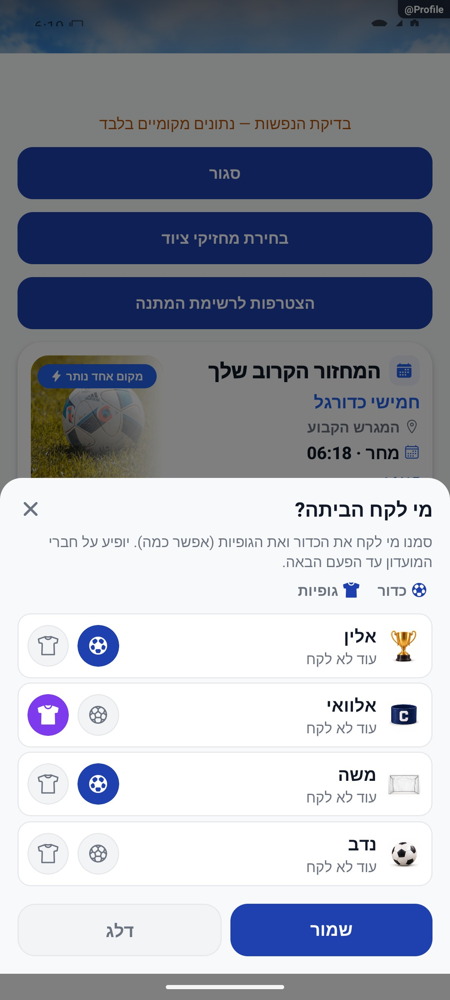
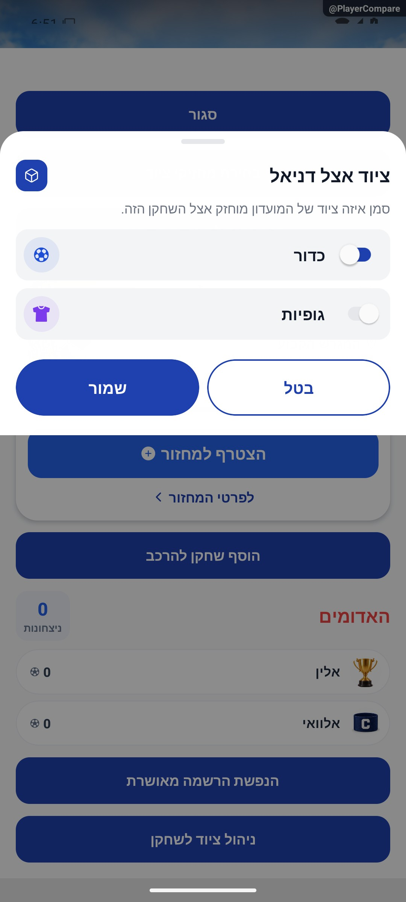

# מסירת כדור וחולצות בסיום

## מדידת פעולות ואמינות נתונים, 5.11.2026

במיפוי מקור הרכיבים המוזכרים במסמך נמצאו 5 נקודות מטפל ו-5 מזהי פעולה. הספירה מתארת קוד וכוללת רכיבים משותפים; אין לחבר אותה לספירות של מסמכים אחרים ואין לראות בה הרצת כל המסך. המדידה מפורטת לפי גבול פקד מקורי, פעולה עסקית ומצב חשבון. תשובה מאוחרת נבדקת מול בעל הפעולה, ומצב קיים או בקשה חוזרת אינם תמיד הצלחה חדשה. רשימת המקרים שהורצו ומגבלות המסד, המכשיר והכיסוי נשמרות [בדוח המדידה](../../audits/2026-11-04-system-night/product-measurement.md) ובדוחות המקושרים אליו. המימוש מקומי; לא בוצעה בדיקה חדשה של כל מצבי הפיצר.

## חיפוש שחקנים וזמני טעינה, 4.11.2026

קריאת מחזורים עתידיים של מועדון יכולה להעביר כשל גישה לחלונית ההזמנה כשהיא מבקשת תשובה מאומתת. ברירת המחדל של יתר הקוראים נשמרת. בדיקה זו תחומה למקור המשותף, ללא הרצה חדשה של כל המסך העצמאי. מימוש מקומי שטרם הופץ. [השינוי, המדידות והבדיקות](../../changes/2026-11-04-player-discovery-speed.md).

## ציר פעילות פרטי בפולס, 4.11.2026

נבדקו התוספות במקורות המשותפים לצורך ציר פעילות פרטי בפולס: דיווח ניווט והקשר, תיעוד ניסיון הרשמה ותוצאתו וגבולות זהות ומחיקת חשבון. התוספת היא תיעוד ברקע במקומות הנתמכים; אין מכך אימות חדש של כל מצבי הפיצר הזה או שינוי בחישוביו. מקומי וטרם הופץ או נפרס. [היקף, מקורות, בדיקות ומגבלות](../shared/usage-activity.md).

## השפעת שיפורי הטעינה המשותפים, 4.11.2026

מסכי המחסניות נרשמים באמצעות טעינת מודול לפי צורך, וכל שמות המסלולים נשמרו. הבית מורכב מתחת לספלאש. אין מסלול חדש או שינוי בתנאי ניווט של הפיצר הזה.

מקורות משויכים שנבדקו בהיקף השינוי: `src/navigation/GameStack.tsx`, `tests/logic/clientAuditRecovery.test.ts`.

מימוש מקומי וטרם הופץ. אין בכך אימות מכשיר חדש של הפיצר הזה או מדידת מהירות של כל מסלוליו. [המדידות התחומות, הבדיקות והמגבלות](../../changes/2026-11-04-screen-performance.md).

## אימות פרסום קבוצות בפולס, 2.11.2026

נבדק ההפרש התחום בשירות המשותף של המחזורים: נוספה בדיקת אישור לפרסום קבוצות כאשר תשובת הפעולה אובדת. אין שינוי בחישוב, במכנים או בפעולות העצמאיות של הפיצר המתואר כאן. התיקון מקומי וטרם הופץ; אין בדיקת מכשיר חדשה לפיצר זה.

השינוי ב-`src/services/gameService.ts` מוגבל ל-`publishDraftTeams` ולתלות בסיווג כשלים זמניים. נבדקו גבולות קבלת השרת, התאמת החשבון והחלוקה, ושימור השגיאה כאשר האימות נכשל. `tests/logic/publishTeamsReceipt.test.ts` מפעיל את פונקציית השירות מול תחליפי קריאה וכתיבה; אין בכך הרצת כל המסלולים של המסמך הזה.

[דוח הטיפול, הבדיקות והמגבלות](../../changes/2026-11-02-pulse-sweep.md).

## בקשות לשיחה אישית, 2.11.2026

נבדקה השפעת תוספת בקשות השיחה במקורות המשותפים. השינוי ממוקד בהרשאת שיחה, בשדות פרטיות ההודעות ובחיבורי הבדיקות; אין מכך אימות חדש של מסך זה במכשיר. המימוש מקומי וטרם הופץ או נפרס. [התנהגות, בדיקות ומגבלות](../chat/message-requests.md).

מקורות משותפים שנבדקו בהיקף השינוי הזה: `src/firebase/firestore.ts`, `src/types/index.ts`, `tests/logic/clientAuditRecovery.test.ts`. אין בסעיף זה טענה להרצת כל המסלולים ההיסטוריים של הפיצר. [מסירת המימוש](../../changes/2026-11-02-message-requests.md).

## החלפת הקבוצה הבועטת בפנדלים, 30.10.2026

נבדק ההבדל התחום במשימה במקורות המשותפים `src/services/gameService.ts`, `src/types/index.ts` ו-`src/firebase/firestore.ts`: הוא מוסיף ומשמר תור מפורש לפנדלי ההכרעה ומעדכן אותו ברישום ובביטול בעיטה. אין שינוי בשדות, בחישובים או במסלול הנתונים העצמאי של הפיצר המתואר כאן. בדיקת הקורא והעסקאות מפורטת בדוח; אין בכך הרצה מחדש של המסך הזה. [התנהגות, בדיקות ומגבלות](../../changes/2026-10-30-shootout-turn.md).

## התאוששות משגיאות בפולס, 28.10.2026

עודכנו מתאמי בדיקה בקובץ משותף כדי לספק את תלות הניסיון החוזר ובדיקת בעלות החשבון שנוספו לקריאת הפרופיל או המחזור. אין שינוי מכוון בהתנהגות הפיצר המתואר כאן, במידע שלו או בניווט. השינוי במתאם אינו הוכחה להפעלה של המסך במכשיר.

השינוי מקומי וטרם הופץ או נפרס. אין שינוי חזותי ואין צילום מכשיר חדש. [ממצאים, בדיקות ומגבלות](../../changes/2026-10-28-pulse-errors.md).

## הרחבת אבחון דיווחים, 27.10.2026

נוספה מעטפת אבחון מקומית עם מצב בזמן הכשל, שלבים בעלי מזהה ותזמון, מצב רשת ובנייה ומופעים נפרדים לשגיאה. נקודת הכניסה לתעבורת השרת עוברת כעת דרך העטיפה המשותפת; תשובות, חריגות, אפשרויות קריאה ומדיניות הפיצר נשמרות. אין כאן שינוי בהרשאות או בחישובי המוצר. הבדיקות המלאות ומגבלות האימות מתועדות בדוח המקושר; אין טענה לאימות מכשיר או להפצה. [היקף, ראיות ומגבלות](../../changes/2026-10-27-diagnostic-context.md).

באימות הסופי עברו כל 6,231 הבדיקות ב-555 חבילות, ובדיקות הטיפוסים של הלקוח, השרת והפולס נקיות. צילום הדפדפן והידור מקורות האנדרואיד הם בדיקות מקומיות; אין הוכחת מכשיר, הידור אייפון או מסירה חיה של הבנייה החדשה. רישום יומן השחרור נחשב מאומת רק לפי קבלת הקריאה החוזרת בדוח השינוי.

## שעון מדויק וכיתוב פנדל - 25.10.2026

במקורות המשותפים נוסף שימור השעון המדויק של פנדל במהלך משחק, וכיתוב ההבקעה ביומן קוצר. אין שינוי במונים או בתהליך העצמאי המתואר כאן; לא נערכה לו בדיקת ממשק חדשה במסגרת העדכון. השינוי מקומי וטרם הופץ. [פרטים וראיות](../../changes/2026-10-25-in-play-penalties.md#שעון-מדויק-וכיתוב-אירוע).

## פנדל במהלך משחק חי - 25.10.2026

נבדק השינוי הממוקד במקורות המשותפים: נוספו חוזי אירועי פנדל במהלך משחק, קוראים ומוני סטטיסטיקה, והגנות בעסקאות סיום ואיפוס משחק. מסלול הפיצר המתואר כאן אינו נקודת הכניסה להזנה החדשה. בדיקות המאגר עברו, אך אינן הוכחת הרצה חדשה של כל מצבי התהליך או של פריסה.

השינוי מקומי. נדרשת פריסת שרת לפני הפצת לקוח שמשתמש באפשרות; לא בוצעו פריסה או שינוי הרשאות. [חוזה הנתונים, התהליך, הבדיקות ומגבלות ההפצה](../../changes/2026-10-25-in-play-penalties.md).

## חזרה מארון התארים לכרטיס המקורי — 24.10.2026

לערימת הניווט המשותפת נוסף רישום מקומי של ארון התארים, כדי שחזרה מכרטיס שחקן לא תחליף לשונית. אין שינוי מכוון בהתנהגות העצמאית המתוארת כאן, ואין בדיקת ממשק חדשה שלה. התיקון מקומי ולא הופץ. [מסלול הניווט, בדיקות, צילומים ומגבלות](../../changes/2026-10-24-cabinet-back.md).

## עדכון מקומי — 10.10.2026

הבחנה בחוזה השמירה: `ManageEquipmentSheet` דרך סגל המועדון משתמשת כעת ב־`setPlayerEquipment`, עסקה לשחקן יחיד, כמפורט ב־[ניהול שחקן](../clubs/player-management.md). מסירת הציוד ב־`AdvancedLiveScreen` ממשיכה להפעיל `setEquipmentHolders` עם מערכי המחזיקים המלאים שאושרו. זו פעולה מפורשת של החלפת סגל מחזיקים, ולא עדכון חלקי לשחקן. חישוב ההוגנות, ההנפשה, `initial/lastTaken` ודילוג לא שונו. מבחן הרגרסיה לעדכון שחקן מוודא שמירת מחזיקים אחרים ודגלי שינוי; מסירת הרשימה המלאה לא הורצה מול מסד.

**מצב האימות:** תיקון מקומי, 10.10.2026. ראיות השירותים ופונקציות המקור ב־`tests/logic/clientAuditRecovery.test.ts`; הריצה הממוקדת המתועדת עברה 417 בדיקות ב־8 חבילות; השלמת שחזור מאוחר תועדה בדוח התיקון. [דוח התיקון והגבולות](../../../artifacts/pre-release-2026-10-10/client-fixes.md). לא הורצו כאן פעולות מול מסד אמיתי ולא צולמו מצבי כשל רשת חדשים; התמונות ההיסטוריות אינן הוכחה לתיקון זה.

עודכן: 7.10.2026. מקור הקוד: `8e8fde5`, גרסה `1.1.35`. מסמך זה מתאר את הקוד; מצב חנות ופריסת שרת דורשים ראיה נפרדת.

## כניסה ותפקידים

סיום מחזור מועדון → חלונית מסירת ציוד

מנהל; רק חברי מועדון רשומים מוצעים, ללא אורחים ידניים.

## רכיבים ומצבים

| רכיב / מצב | התנהגות וחוזה |
|---|---|
| שני פריטים | בחירה עצמאית בכדור ובחולצות, עם אפשרות לכמה מחזיקים |
| סדר | מיון לפי זמן לקיחה אחרון; ללא היסטוריה קודם; המינימום בין שני פריטי הציוד משמש לסידור |
| בחירה מוקדמת | בחירת ההוגנים ביותר לכל סוג, עם אותו מספר מחזיקים כמו קודם; ללא היסטוריה נופל למחזיקים הקודמים |
| מידע | lastTaken מתוך communityEvents; תאריך יום.חודש, ובשנה ישנה גם שנה |
| שמירה | onSave → setEquipmentHolders; מזהי מחזיקים ו־updatedAt נכתבים לקבוצה |
| דלג | onSkip אינו משנה מחזיקים; עדכון חנות הקבוצה אחרי שמירה |

## מסלול נתונים ומקומות שינוי

[`src/components/match/EquipmentHandoffModal.tsx`](../../../src/components/match/EquipmentHandoffModal.tsx)

נתוני group ו־communityEvents, setEquipmentHolders ב־groupService; ballHolderIds ו־jerseysHolderIds. הוגנות מחושבת בנפרד לפריט ולא רק על בסיס סדר רשימה.

ממיר המחזור: [`src/firebase/firestore.ts`](../../../src/firebase/firestore.ts), `gameDocConverter.fromFirestore`; סוגים: [`src/types`](../../../src/types). שינוי שדה דורש מעקב כתיבה → ממיר → שירות/חנות → רכיב. ניווט: [`GameStack.tsx`](../../../src/navigation/GameStack.tsx), ובמסכים משותפים גם המחסניות שמארחות אותם.

## בדיקות וראיות

לא נמצאה בדיקה ייעודית למסירת ציוד. להשלים תרחישים: אפס/אחד/רבים, ללא היסטוריה, חבר לא משתתף, דילוג וכשל שירות.

בעת המיפוי הראשוני לא נאסף צילום. צילום חלונית המסירה נוסף בסעיף השלמת ההנפשות להלן; שאר תרחישי השרת נשארים ללא הוכחה.

## גבולות והערות תחזוקה

עדכון 8.10: חלונית המסירה צולמה בדמו מקומי, ללא שמירת שירות. מסך ManageEquipmentSheet במועדון הוא הקשר נוסף למסירת ציוד.

לפני שינוי פתח את הקוד המקושר ואת [כללי הפרויקט](../../../AGENTS.md). לאחר שינוי עדכן במסמך זה את התאריך, נקודת הקוד, המצבים שהתעדכנו, הבדיקות והצילום. אין לטעון שכל מצב/תפקיד נבדק רק משום שקיים צילום אחד.

## פירוט טכני ממוקד: זרימה, חישוב ונקודות שינוי

[הסבר פשוט למשתמש](equipment.simple.md)

העמקה: 07.10.2026, מול קוד המקור שב־`8e8fde5`. בעת הכתיבה HEAD הוא `50d508f`; בדיקת ההפרש בין הנקודות ב־`src` וב־`functions` לא מצאה שינוי קוד. הסעיפים וההסתייגויות הקיימים נשמרו. זו קריאת קוד ותיעוד, בלי הרצת תרחישי כתיבה חדשים.

החלונית מקבלת `players/initial/lastTaken`; היא אינה טוענת לבדה היסטוריית ציוד. `took(id,item)` מחזיר זמן או 0; מיון השורות משתמש במינימום זמן הכדור והחולצות, בעוד המלצה נעשית בנפרד לכל פריט.

לדוגמה שחקן א לקח כדור אתמול ולא חולצות, ושחקן ב לקח חולצות אתמול ולא כדור: לשניהם המינימום 0, אך ההמלצה לכדור תעדיף את ב ולחולצות את א. `fairest(item,k)` משמר את מספר המחזיקים הקודם ככל שהקלט מאפשר; בהיעדר היסטוריה הבחירה חוזרת למחזיקים הראשוניים.

`onSave` מעביר `ballHolderIds/jerseysHolderIds` ל־`setEquipmentHolders`; `onSkip` אינו מסירת ציוד חדשה. יש לבדוק שהשירות מחזיר כתיבה מוצלחת לפני עדכון חנות/סגירה. מערכי מחזיקים אינם מונה מצטבר ואין להציג שמירת מערך כאידמפוטנטיות של אירועי ההיסטוריה. עדכון מקביל משני מנהלים דורש בדיקה ממוקדת.

נקודות שינוי: הוגנות בחלונית, הרשאה/שמירה בשירות המועדון, וחיבור סיום הערב במסך. הבדיקה הייעודית עדיין חסרה; יש לכסות אפס/אחד/רבים, ללא היסטוריה, דילוג וכשל.

## השלמת הנפשות — 8.10.2026

EquipmentChoiceRow מודדת onLayout של תמונת השחקן ושל שני כפתורי הציוד באותה שורה. בחירה שאינה מסומנת יוצרת IconFlight עם key חדש, נקודת מקור ונקודת יעד במידות השורה. TransferIcon נע 340 אלפיות שנייה עם קשת בגובה 12 ועוצמת Math.sin(progress*PI); ביטול בחירה אינו יוצר העברה הפוכה. תנועת האווטאר נובעת מצמד ballOn/jerseyOn. אלה מצבי טיוטה בלבד; onSave עדיין מעביר מערכי ballHolderIds/jerseysHolderIds והאלגוריתם fairest לא השתנה. ManageEquipmentSheet מדגישה את אייקון הפריט לפי value בלי לשנות שאר מחזיקים. מצב הפחתת תנועה מבטל את העברת האייקון והפעימה; החלונית המקורית עדיין משתמשת בפתיחת Modal slide הקיימת. הצילום וההקלטה הם חלונית המסירה עם כמה בחירות, ללא שמירת שירות. ניהול ציוד לשחקן נבדק בנפרד בחלונית בדיקה מקומית.

[פרטי האימות והמגבלות](../../changes/2026-10-08-motion-completion.md). מקור: `9ec0dfd` עם שינויים מקומיים; טרם פורסמה גרסה.

## אימות חלונית המסירה — 13.10.2026

תוקן סדר כפתורי הרגל: `flexDirection:'row'` תחת כיווניות המערכת מציב דילוג מימין ושמירה משמאל, לפי סדר המקור ולפי שאר חלוניות האישור. אין שינוי במערכי המחזיקים, בחירה, הוגנות או כתיבה. נצפתה החלונית האמיתית דרך `OverlayAuditPreview` מאחורי שערי פיתוח ודמו, עם 12 שחקנים סינתטיים. [תחילת הרשימה](../screenshots/overlays-tenth-equipment-2026-10-13.png) · [סוף הרשימה](../screenshots/overlays-tenth-equipment-scroll-2026-10-13.png). שחקן 12 נגיש בגלילה; הכותרת, הסגירה ושתי הפעולות נשארות נראות. חזרת המכשיר סגרה. לא נלחצה שמירה ולא נבדקו שירות מחזיקים, היסטוריית הוגנות, אייפון או גופן מוגדל בסבב זה.

## ניהול ציוד לשחקן — המשך אחד־עשר

ב־ManageEquipmentSheet אומת שהחלונית נמצאת בראש תחום הפאנל במקום בתחתית: SpringSheet מקצה תחום מוגדר של 90%, והילד ללא יישור תחתון התחיל למעלה. נוסף panelStyle עם justifyContent:flex-end במארח הזה בלבד. titleRow ו־toggleRow הועברו ל־row, כך שהסמלים קודמים למלל מימין. סדר המקור של הפעולות הוחלף לביטול ואז שמירה והוסר row-reverse; המיקום החזותי הקודם של שתי הפעולות נשמר. לא שונו דגלי ball/jerseys, חישוב dirty, callbacks או חסימות saving.

נצפו [טיוטה ללא שינוי](../screenshots/overlays-eleventh-manage-fixed-2026-10-13.png) ו־[טיוטה ששונתה](../screenshots/overlays-eleventh-manage-changed-2026-10-13.png). שינוי גופיות מפעיל שמירה; חזרת מכשיר ביטלה בלי שמירה. מצב קודם נשמר ב־artifacts/home-carousel-height/night-eleventh-manage-before.png. אימות אנדרואיד בדמו בלבד, לא שרת/אייפון/מצב כהה/כל גדלי גופן. אין שינוי אפיון הציוד.

## תלות בעדכון העונות — 19.10.2026

נבדק ההפרש בקבצים המשותפים הרשומים כאן: `src/firebase/firestore.ts`. השינוי ממוקד במדיניות העונות, קריאת מצבן, שיוך מחזור ופקודות ניהולן; אין שינוי מכוון בחוזה העצמאי המתואר במסמך זה. אין להסיק מכך שהמסך הזה הורץ מחדש.

[מצב המימוש, הבדיקות ומגבלות האימות של העונות](../clubs/seasons.md). מקומי בלבד; לא בוצעה פריסה במסגרת המשימה.

## תלות במידע על סגירת עונה — 23.10.2026

בדיקת ההבדל ב־`src/firebase/firestore.ts` וב־`src/types/index.ts` מראה שהשינוי מוגבל לקריאת `seasons.closureStatus` בחוזה `GroupSeasons`. יתר ממירי הנתונים והמסלולים המתועדים כאן לא שונו במשימה זו. אימות הריצה החדש מתייחס להתאוששות ולכרטיס העונה, ולא להרצה חדשה של כל מצבי המסך הזה. [המסלול, הבדיקות והמגבלות](../../changes/2026-10-23-season-automatic-recovery.md).

## תלות בשמירת צבעי המחזור — 24.10.2026

במסגרת בחירת צבעים לפני שיבוץ עודכנו מקורות משותפים הרשומים לפיצ׳ר: `src/firebase/firestore.ts`, `src/types/index.ts`. השינוי מוסיף מפת צבעים למחזור, קריאה וכתיבה שלה ושימורה במסלולי הכוחות וההכנה. אין כאן פעולת ממשק חדשה במסך זה. זו בדיקת השפעת התוספת הממוקדת, ולא חקירה או אימות חזותי מחודש של הפיצ׳ר. כל 480 חבילות הבדיקה ו־5,343 הבדיקות עברו; טיפוסי הלקוח והשרת נקיים. השינוי מקומי וטרם הופץ. [מסלול הנתונים, ראיות ומגבלות](../rounds/draft-setup.md#צבעים-לפני-שיבוץ-ובכל-שיטת-חלוקה--24102026).

## התאמת בדיקת המקור המשותפת בלילה של 25.10.2026

ההבדל החדש ב-`tests/logic/clientAuditRecovery.test.ts` מוגבל לשלוש בדיקות הסטטיסטיקה: איתור `useFocusEffect` במקום `useEffect`, חילוץ גוף `React.useCallback`, ומתאם לקריאת `pairStats` המקבילה. התרחישים והתנאים של יתר בדיקות המקור בקובץ נשמרו. אין שינוי בקוד המוצר של התחום המתואר כאן במסגרת התאמת המבחן, ואין אימות מכשיר חדש שלו. [תיקוני הטעינה, תוצאות הבדיקות ומגבלות](../../changes/2026-10-24-loading-performance.md).

## המשך קיצור טעינות בלילה של 25.10.2026

ב-`tests/logic/clientAuditRecovery.test.ts` נוסף למתאם בדיקת כשל ההישגים גם מקור ההזמנות שמתחיל כעת במקביל. בדיקות התחומים האחרים וציפיית זריקת הכשל נשמרו. אין אימות מכשיר חדש של כל מצבי הפיצר המתואר כאן. [בדיקות, ראיות ומגבלות](../../changes/2026-10-24-loading-performance.md).

## תלות בניווט עריכת קבוצות - 25.10.2026

נבדק השינוי הממוקד במקורות המשותפים: `src/navigation/GameStack.tsx`. נוסף מעבר מתפריט הלייב לחלוקת הכוחות עם שימור מפתח מסך המקור. אין שינוי נוסף בתהליך העצמאי המתואר כאן ולא נערכה לו בדיקת מסך חדשה. [היקף, בדיקות ומגבלות](../../changes/2026-10-25-live-draft-entry.md).

## תאימות לשמירת פקודת רכיב הבית - 25.10.2026

השינוי התחום במקורות המשותפים `src/types/index.ts` ו-`src/firebase/firestore.ts` מוסיף ומשמר את `liveMatch.lastWidgetCommandId`, מזהה אטום למניעת ביצוע חוזר של פקודת רכיב הבית. הוא אופציונלי במסמכים ישנים ואינו משנה מונים, הכרעות, ניווט או הרשאות של הפיצר המתואר כאן. בדיקה מפעילה את ממיר הקריאה המקורי ומאמתת שימור ערך והיעדרו. אין בכך בדיקת מכשיר חדשה לכל מצבי הפיצר. [מקור הבדיקה והמגבלות](../../changes/2026-10-25-widget-completion.md).

## שלמות החלוקה המתוזמנת, 29.10.2026

נבדק השינוי הממוקד במקורות המשותפים: נוספו אזורי קבוצה שש ושבע למתאמי החלוקה ולקורא ההשמות, וסוננו אורחים ממתינים בשני מסלולי היצירה בשרת. אין שינוי בליבת האיזון או בחישובים העצמאיים של המסלול המתואר כאן. 15 בדיקות ממוקדות של החלוקה וקורא הנתונים עברו, וכן בדיקות הטיפוסים של הלקוח והשרת. אין אימות מכשיר חדש, שינוי חזותי מתוכנן או פריסה.

[היקף, בדיקות, פערים פתוחים ומגבלות](../../changes/2026-10-29-scheduled-balance-integrity.md).

## איזון ופיזור רמות לפני גיוון, 30.10.2026

נבדק שינוי תחום במקורות המשותפים של חלוקת הכוחות ומדדי השמירה. החישוב נותן עדיפות לפער ממוצעים, אחריו לפיזור הקצוות ולפרופיל הרמות, ולבסוף לציוותים חוזרים. התג rating_priority_v3 נוסף בלי להסיר קריאת דורות ישנים. אין שינוי מכוון בחישובים העצמאיים או בניווט המתוארים כאן. 112 בדיקות ממוקדות ובדיקות הטיפוסים של הלקוח והשרת עברו; אין בכך הרצה של המסך במכשיר או הפצה.

[מימוש, נוסחאות, בדיקות ומגבלות](../../changes/2026-10-30-rating-balance-priority.md).

## אימות כשלים בקבלת פרסום, 2.11.2026

בבדיקת אישור פרסום הקבוצות, כשל שלא ניתן לאמת כהצלחה נשאר כשל גלוי ונשמר באבחון. הבדיקה אינה שולחת הודעות שוב ואינה משנה הרשאות. השינוי תחום לשירות המשותף, מקומי וטרם הופץ.

נוסף תיעוד תצפית בנקודות הכשל של אימות קבלת הפרסום ב-`src/services/gameService.ts`. בדיקת `tests/logic/authTransientReads.test.ts` סופרת כעת גם את קריאת הקבלה, עם הרשאת ניסיון חוזר לקריאה בלבד; כתיבת תחילת העונה נשארת ללא ניסיון חוזר זמני. אין שינוי בזרימות העצמאיות האחרות המתוארות במסמך זה.

[דוח הטיפול והראיות](../../changes/2026-11-02-pulse-sweep.md).

## תיקו בשתיים או בשלוש קבוצות, 6.11.2026

נבדק שינוי תחום במקורות המשותפים `src/services/gameService.ts`, `src/types/index.ts`: נוסף מסלול סיום משחק בתיקו בשתיים או בשלוש קבוצות, עם בחירה ידנית של הקבוצה שנשארת ושמירה במוני התיקו הקיימים. אין שינוי מכוון בפעולות העצמאיות של הפיצר המתועד כאן. בדיקות המסלול מפעילות שירות לקוח, ממירים וגוף שרת במאגר זיכרון; אין בכך הרצה חדשה של מסך זה. המימוש מקומי, ללא הפצה או פריסת שירות השמירה החדש. [התנהגות, נתונים, בדיקות ומגבלות](../../changes/2026-11-06-manual-draw.md).

## תלות משותפת בציון המחזור החדש, 6.11.2026

נוספה תמיכה מקומית בגרסת ציון למחזורי העתיד ובקריאת הרף הקפוא, תוך שמירת המודל של מחזורים קודמים. השינוי כאן תחום לתלות במקורות המשותפים, ואינו אימות חדש של כל המסלול העצמאי. המקורות המשותפים שנבדקו בהפרש התחום: src/firebase/firestore.ts, src/types/index.ts. אין פריסה, הסבת נתונים או שינוי ציוני עבר. [התנהגות, בדיקות ומגבלות](../../changes/2026-11-06-shared-evening-score.md).
