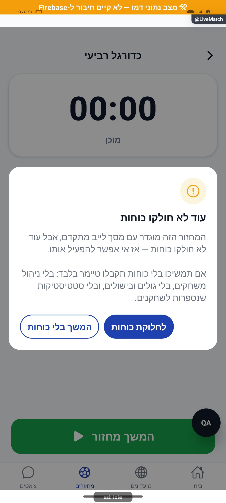
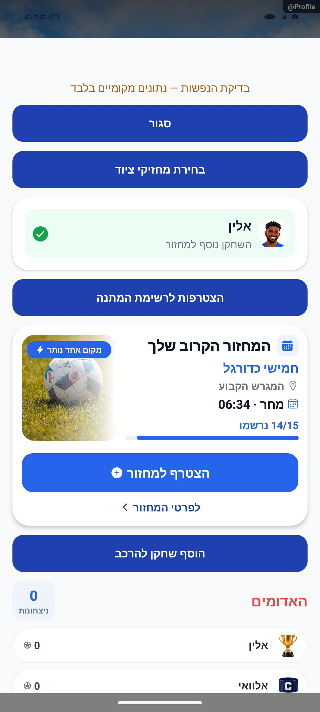
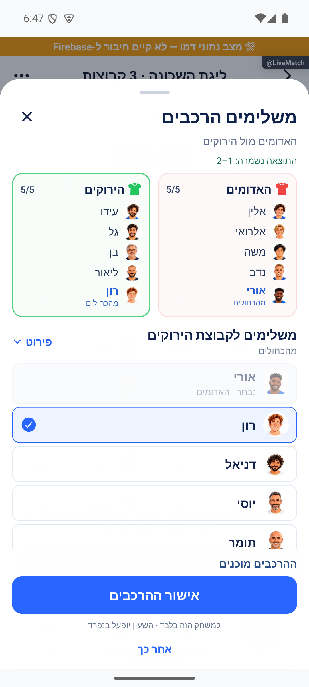
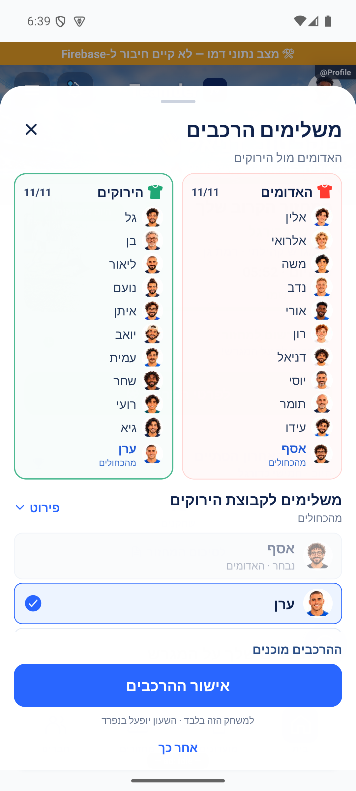

# ממלאים, השאלה ורוטציה

## הפצה פנימית, 6.11.2026

גרסת האנדרואיד 1.1.77/309 הופצה ואומתה בפנימי עם כרטיס בקשות השלמה ותיבה תואמת. שירות הקריאה ליוצר, יצירת הבקשה, האישור, הדחייה, ההתראה וסיום מועמדות שהוחלפה ברישום נפרסו ואומתו. לא אושר מועמד בדיקה בייצור ולא בוצע אימות התקנה במכשיר. [קבלות, מקור ומגבלות](../../changes/2026-11-06-internal-1.1.77.md).

## עצירת מחזור קבוע ללא פעילות, 6.11.2026

נבדק השינוי התחום ב-`functions/src/index.ts`: בדיקת חוסר פעילות לפני יצירת מחזור קבוע ושמירת שלוש החלטות בזמן ניקוי מחזורים ריקים. ההכרעה משתמשת במקור הקיים לקיום מחזור ומגינה על מחזור עם הרשמה שנותר לא מוכרע. עסקאות היצירה והניקוי נשארות מוגנות מפני שינוי מקביל ומועדון חסר. אין שינוי מכוון בחישובים, במכנים, בהרשאות, בניווט או בפעולות העצמאיות האחרות של הפיצר הזה. בדיקות מקור השרת הורצו במאגר זיכרון; הפריסה הממוקדת של שני שירותי התזמון אומתה בייצור מול המקור שנבדק, ותועדה הרצת שירות חמש הדקות ללא שגיאות. אין בכך אימות חדש של המסך או של יתר פעולות הפיצר. [ההתנהגות, מסלול הנתונים, הבדיקות ומגבלות ההפעלה](../../changes/2026-11-06-inactive-recurring-rounds.md).

## סף תפוסה פעיל בשרת, 6.11.2026

באישור הבעלים נפרס תיקון ממוקד ל-`cronEvery15Min`, ל-`fillerPulseTask` ול-`startGameFillerPulse`. החבילה נגזרה מהמקור הפעיל מ-3.10, ולא מעץ העבודה המקומי הכולל שינויים נוספים. עודכנו רק `src/index.ts`, `lib/index.js`, `src/fillerRules.ts`, `lib/fillerRules.js` וקובצי הגדרת החבילה לצורך מעבר מאושר לסביבת הרצה בגרסה 22. שאר 104 קובצי החבילה זהים למקור הייצור שנקרא. התזמון, הזיכרון, מקביליות הבקשות, חשבון השירות, הפניות הסודות ומגבלת עשרת המופעים נשמרו; לא שונו הרשאות.

`occupancyOf` מחבר את מספר `players` למספר האורחים שאינם מסומנים `waitlisted`. המתנה, אישור ממתין ואורח בהמתנה אינם מגדילים תפוסה. המכנה הוא `maxPlayers`. `canOfferFiller` דורש קיבולת חיובית, `taken < maxPlayers` וגם `taken * 10 >= maxPlayers * 7`. כך 10 מתוך 15 נחסמים, 11 מתוך 15 ו-14 מתוך 20 עוברים, ומחזור מלא או מעבר לקיבולת נחסם. אין עיגול כלפי מטה של מספר השחקנים הנדרש.

המסלול הוא קריאת המחזור מתוך `games`, בדיקת התפוסה, סינון המועמדים הקיים ויצירת `fillerOpportunity` דרך מנגנון ההתראות הקיים. הבדיקה מופעלת ב-`runFindFillerCandidates` ובכל `runFillerPulseBatch`; `startGameFillerPulse` מחזיר `INSUFFICIENT_OCCUPANCY` לפני יצירת שרשרת מתחת לסף ו-`GAME_FULL` כשהמחזור מלא. גם מספר המקומות החסרים בפעימה מחושב כקיבולת פחות התפוסה הפעילה. אין שינוי בניווט או במלל ההתראה. ההפעלה האוטומטית הניסיונית נשארת כבויה כפי שהיתה, והשליחה הידנית ממשיכה לעבור בדיקה בכל פעימה.

כל שלוש הגרסאות נקראו חזרה במצב פעיל, עם כל התעבורה לגרסה החדשה, ונבדקה התאמה של כל 110 קובצי המקור לחבילה שנבדקה. סקירת 40 השגיאות האחרונות לפני הפריסה לא מצאה שגיאה שקשורה לשירותים האלה. ביומני הגרסאות החדשות נמצאו שתי דחיות לבקשות קריאה לא תקינות; שתיהן הותאמו לפי מזהה עקבה לבקשת `GET` עם תשובת `400`, לפני המטפל העסקי. לא נמצא כשל עסקי בלתי צפוי בסבב הקריאה הזה. נבדקו 72 שילובים של גבולות תפוסה ושלושת המסלולים בקוד המקור ובקוד המורץ, ללא רשת או משלוח אמיתי. טיפוסי היישום והשרת נקיים. הסדרה המלאה כללה 7,206 בדיקות: שתי בדיקות נזקקו לטיפול ממוקד, האחת להתאמת ציפיית הספירה החדשה והאחרת לסף זמן תחת עומס; כל 66 הבדיקות בהרצה החוזרת עברו. כל 647 החבילות מכוסות בהרצות שעברו. בדיקת החבילה המבודדת מול תלויות מקומיות חדשות מצאה אותה שגיאת טיפוסים כמו במקור הייצור הישן, ללא שגיאה חדשה מהתיקון; בניות הפריסה עצמן הסתיימו בהצלחה עם קובץ נעילת התלויות המקורי.

הפריסה אינה כוללת את `hasFillerConflict` או את סינון ההרשמה המתנגשת שתועדו ב-28.10, ואינה מפיצה את שינויי החלוקה והמדידה המקומיים. לקוח קיים עשוי עדיין לחסום בקשת מנהל באופן שמרני כשיש אורח בהמתנה; זה אינו משנה את סף השליחה בשרת. לא נערכה בדיקת התראה אמיתית או בדיקת מכשיר חדשה, אין נעילה עם הרשמה מקבילה אחרי הקריאה, והתראות שכבר נוצרו אינן מבוטלות. אין מזהה פריט בפולס לבקשה בשיחה; נשמרה מסירה מקומית והעדכון בפולס לא בוצע. [גרסאות, חותמות, בדיקות ויומן מאומת](../../changes/evidence/2026-11-06-filler-70-server/verification.json).

## דירוג בסיס לשחקן ללא דירוג, 6.11.2026

נבדק שינוי תחום במקורות המשותפים של הכוחות האוטומטיים: שחקן ללא דירוג מחושב כ-2.5 מתוך 5, וההסברים תואמים. דירוג מפורש נשמר. אין כאן אימות חדש של כל מצבי הפיצר העצמאי; השינוי מקומי וטרם הופץ. המקורות המשותפים שנבדקו בהפרש זה: `functions/src/fillerRules.ts`, `functions/src/index.ts`, `tests/logic/fillerEligibility.test.ts`. [ההתנהגות, הבדיקות ומגבלות האימות](../rounds/draft-setup.md#דירוג-בסיס-לשחקן-ללא-דירוג-6112026).

## סבב תיקוני הפולס, 5.11.2026

בבדיקת מטא נתונים חיה נמצא ש-`getMyRoundFillerNotices` אינו קיים בשרת. בקשות השלמה של יוצר שאינו מנהל מועדון דורשות את הפריסה המתואמת המתועדת ב-4.11. אין החזרת רשימה ריקה במקום הכשל ואין שינוי הרשאות. [ממצאים, בדיקות ומגבלות](../../changes/2026-11-05-pulse-sweep.md).

נבדק השימוש המשותף ב-`AdvancedLiveMatchScreen`, `RotationPanel` ו-`TeamScore`: שחקן שמחוץ למגרש פותח תפריט עם עוגן מדוד, ואינו מקבל פעולת החלפה. חישוב המשלימים, ההרכבים, זהות האורחים והזקיפה לא השתנו.

מקומי וטרם הופץ. הבדיקה החזותית היא של רכיבי מקור במתאם דפדפן עם נתוני הדגמה, ולא בדיקת מכשיר או שרת חדשה. [מקורות, בדיקות ומגבלות](../../changes/2026-11-05-pulse-sweep.md). הבדיקות הן בדיקות הרכיבים והמסלולים הממוקדים ובדיקות הפרויקט המלאות; אין בכך הרצה חדשה של כל מצבי המסך הזה.

## מדידת פעולות ואמינות נתונים, 5.11.2026

במיפוי מקור הרכיבים המוזכרים במסמך נמצאו 54 נקודות מטפל ו-50 מזהי פעולה. הספירה מתארת קוד וכוללת רכיבים משותפים; אין לחבר אותה לספירות של מסמכים אחרים ואין לראות בה הרצת כל המסך. המדידה מפורטת לפי גבול פקד מקורי, פעולה עסקית ומצב חשבון. תשובה מאוחרת נבדקת מול בעל הפעולה, ומצב קיים או בקשה חוזרת אינם תמיד הצלחה חדשה. רשימת המקרים שהורצו ומגבלות המסד, המכשיר והכיסוי נשמרות [בדוח המדידה](../../audits/2026-11-04-system-night/product-measurement.md) ובדוחות המקושרים אליו. המימוש מקומי; לא בוצעה בדיקה חדשה של כל מצבי הפיצר.

## מקום אחרון וביטול לאחר אישור, 4.11.2026

במדידת שימוש, החלטה על מועמד נרשמת רק בתשובה המאשרת יעד חדש בסגל או בהמתנה, או בתשובת דחייה עם `declined: true`. דחייה שהוחלפה בהרשמה רגילה, שגיאה ותשובה משרת ישן שלא ציין אם דחה בפועל אינן נספרות. `src/services/fillerReview.ts` משמש את כרטיס המחזור ואת תיבת הבקשות. אין מזהה או שם של המועמד באירוע. [הבדיקה](../../../tests/logic/fillerReviewDecisionMeasurement.test.ts).

בקשת השחקן עצמו נרשמת בתור `FillerInterestExpressed` ולא כהצטרפות. בסביבת שרת מתקבלת ספירה רק אם הקבלה קבעה במפורש שזו בקשה חדשה.

באמצעות `functions/registrationContention.emulator.test.mjs` הופעלו פעולת אישור ההשלמה והמטפל בבקשת רישום רגילה בשלושה סדרים. בכל אחד נתפס מקום אחד, נותר ממתין אחד, והיעד בקבלה ובהתראה התאים לסגל. הצעת מקום פעילה ואורח פעיל שמרו על שני המקומות שלהם. אין כאן מדידת קבלת התראה בטלפון.

בקשת ביטול ישירה של המועמד יכולה לשכתב את המצב מאושר למצב מבוטל גם אחרי שנוסף לסגל. זהו פער פתוח בכללים המקומיים. ההצעה היא להגביל ביטול למעבר ממצב ממתין ולהשתמש במסלול ביטול רישום עבור מי שכבר נכנס. כללי ההרשאות לא שונו. [ראיות ומגבלות](../../audits/2026-11-04-system-night/registration.md).

## בקשות השלמה משחקנים מבחוץ, 4.11.2026

במסלול ההשלמה, src/services/fillerReview.ts מסנן את איחוד הסגל, רשימת ההמתנה והבקשות הרגילות מתוך הבקשות הממתינות. אין סינון לפי חברות לבדה. functions/src/fillerRosterReview.ts מסיים בקשה קיימת שנעקפה על ידי רישום, ובודק את זמן עדכון המסמך לפני סיום כדי שאירוע מאוחר לא ידרוס בקשה חדשה. אין שינוי בהשאלת שחקנים בין קבוצות בזמן המשחק. מקומי וטרם הופץ. [הראיות והמגבלות](../../changes/2026-11-04-filler-requests.md) · [דרכי הכניסה וההמלצות](../../specs/2026-11-04-outside-round-players.md).

## חיפוש שחקנים וזמני טעינה, 4.11.2026

הבדיקה המאוגדת מתייחסת לאיתור הידני לפי מחזור. מסירת פעימות והצטרפות עצמה נשארות תהליכים נפרדים. מימוש מקומי שטרם הופץ. [השינוי, המדידות והבדיקות](../../changes/2026-11-04-player-discovery-speed.md).

## ציר פעילות פרטי בפולס, 4.11.2026

בציר הפעילות, תשובת שרת על מצב הרשמה קיים אינה נספרת כהרשמה חדשה. קבלה ללא סימון יצירה מפורש מוצגת עם מגבלת אמינות.

נבדקו התוספות במקורות המשותפים לצורך ציר פעילות פרטי בפולס: דיווח ניווט והקשר, תיעוד ניסיון הרשמה ותוצאתו וגבולות זהות ומחיקת חשבון. התוספת היא תיעוד ברקע במקומות הנתמכים; אין מכך אימות חדש של כל מצבי הפיצר הזה או שינוי בחישוביו. מקומי וטרם הופץ או נפרס. [היקף, מקורות, בדיקות ומגבלות](../shared/usage-activity.md).

## השפעת שיפורי הטעינה המשותפים, 4.11.2026

מסכי המחסניות נרשמים באמצעות טעינת מודול לפי צורך, וכל שמות המסלולים נשמרו. הבית מורכב מתחת לספלאש. אין מסלול חדש או שינוי בתנאי ניווט של הפיצר הזה.

עדכוני תצוגת השעון והעצירות וסנכרון הזמן המחזורי מוגבלים למיקוד המסך. בחזרה הזמן מחושב מהעוגן המשותף, ללא שינוי בתוצאת המשחק או בכתיבות.

מקורות משויכים שנבדקו בהיקף השינוי: `src/navigation/GameStack.tsx`, `src/screens/AdvancedLiveMatchScreen.tsx`, `tests/logic/profileIdentityLoading.test.ts`.

מימוש מקומי וטרם הופץ. אין בכך אימות מכשיר חדש של הפיצר הזה או מדידת מהירות של כל מסלוליו. [המדידות התחומות, הבדיקות והמגבלות](../../changes/2026-11-04-screen-performance.md).

## תיקוני דיווחי הפולס, 3.11.2026

נבדק ההפרש התחום ב-functions/src/index.ts, באתר index:20a83f91b9 בלבד: קוד כפילות של joinCredited נבדק לפני observeCaughtError. הסמן וההגדלה נשארים אטומיים, ושגיאות אחרות נשארות נצפות. אין שינוי מכוון בחישובים, במכנים, בניווט או בהרשאות של הפיצר המתואר כאן. בדיקת הלולאה הממוקדת מתועדת ב-shared/data-and-state-contracts; אין כאן בדיקת מסך או מסלול ייצור חדש של הפיצר הזה.

[פירוט התיקונים, הבדיקות, הצילומים והמגבלות](../../changes/2026-11-03-pulse-sweep.md).

## העברת אורח לרשימת המתנה, 3.11.2026

נבדק ההפרש הממוקד במקור המשותף `functions/src/index.ts`: תנאי `guestSeatFreed` ב-`onGameRosterChanged` מבחין כעת בין הסרת אורח פעיל לבין העברה ידנית להמתנה. אין שינוי מכוון בחישובים, בנתונים, בניווט או בפעולות העצמאיות של הפיצר המתואר כאן. בדיקות גילוי העזיבה והקידום מכסות את השינוי המשותף; אין בדיקת מסך חדשה לפיצר זה. התיקון מקומי וטרם נפרס או הופץ.

[היקף, בדיקות ומגבלות](../../changes/2026-11-03-guest-waitlist.md).

## שלדי טעינה בשלושה אזורים, 2.11.2026

עודכנה נקודת הכניסה של תרחיש הסגל ב-`tests/logic/profileIdentityLoading.test.ts`, לאחר שמסלול הטעינה הועבר לרכיב משותף. תרחיש הסגל מפעיל כעת גם את בדיקת המיקוד והבעלות בתחילת טעינה. תרחישי המשחקים וההוספה נשארו פעילים באותה בדיקה: שינוי שם, תמונה או נתון סטטיסטי אינו מפעיל שוב קריאה; שינוי חשבון, מצב אורח והקשר גישה כן מפעיל. אין שינוי בקוד המימוש של הפיצר המתואר כאן ואין מכך בדיקת מכשיר חדשה שלו. השינוי מקומי וטרם הופץ. [מימוש, בדיקות, צילומים ומגבלות](../../changes/2026-11-02-loading-skeletons.md).

## אימות פרסום קבוצות בפולס, 2.11.2026

נבדק ההפרש התחום בשירות המשותף של המחזורים: נוספה בדיקת אישור לפרסום קבוצות כאשר תשובת הפעולה אובדת. אין שינוי בחישוב, במכנים או בפעולות העצמאיות של הפיצר המתואר כאן. התיקון מקומי וטרם הופץ; אין בדיקת מכשיר חדשה לפיצר זה.

השינוי ב-`src/services/gameService.ts` מוגבל ל-`publishDraftTeams` ולתלות בסיווג כשלים זמניים. נבדקו גבולות קבלת השרת, התאמת החשבון והחלוקה, ושימור השגיאה כאשר האימות נכשל. `tests/logic/publishTeamsReceipt.test.ts` מפעיל את פונקציית השירות מול תחליפי קריאה וכתיבה; אין בכך הרצת כל המסלולים של המסמך הזה.

[דוח הטיפול, הבדיקות והמגבלות](../../changes/2026-11-02-pulse-sweep.md).

## בקשות לשיחה אישית, 2.11.2026

נבדקה השפעת תוספת בקשות השיחה במקורות המשותפים. השינוי ממוקד בהרשאת שיחה, בשדות פרטיות ההודעות ובחיבורי הבדיקות; אין מכך אימות חדש של מסך זה במכשיר. המימוש מקומי וטרם הופץ או נפרס. [התנהגות, בדיקות ומגבלות](../chat/message-requests.md).

מקורות משותפים שנבדקו בהיקף השינוי הזה: `functions/src/index.ts`, `functions/src/socialPlayers.ts`, `src/firebase/firestore.ts`, `src/types/index.ts`. אין בסעיף זה טענה להרצת כל המסלולים ההיסטוריים של הפיצר. [מסירת המימוש](../../changes/2026-11-02-message-requests.md).

## הסרת מגבלת החברים במועדון, 1.11.2026

נבדקה השפעת השינוי הממוקד במקורות המשותפים: הוסרה מגבלת החברים במועדון. אין שינוי מכוון בהתנהגות העצמאית של המסך המתואר כאן או במספר המקומות במחזור. התיקון מקומי וטרם הופץ; אין בדיקת מכשיר חדשה לפיצר זה.

מקורות ששונו בהיקף המשימה: `functions/src/index.ts`, `functions/src/socialPlayers.ts`. מספרי החברים אינם משמשים עוד כתנאי תפוסה במועדון. שדות התאימות הישנים אינם נאכפים.

[מסלול הנתונים, התנאים, התאימות, הבדיקות ומגבלות ההפצה](../../changes/2026-11-01-unlimited-club-members.md).

## פריסת הגנות הסרת המחזור, 30.10.2026

נפרסו שבע חבילות מבודדות, ועדכון המקור בלבד אומת מול כל הקבצים הפעילים. הגדרות השירותים והאירועים ו-111 השירותים האחרים נשמרו. אומתו מוכנות ותעבורה לגרסאות החדשות, קריאה עצמית עם חשבון בדיקות קיים ושימור גרסאות כל 496 המסמכים שבגיבוי. שש דחיות בקשות דפדפן לא תקינות סווגו לפי מזהי בקשה; לא זוהה כשל ריצה עסקי בלתי צפוי. לא הופעלו מחיקה, חסימת מחזור או בקשת שמירה תקינה על נתוני המועדון. זו ראיית הפריסה התחומה ולא הרצה מחודשת של כל מסך.

[גרסאות פעילות, בדיקות שרת וגבולות האישור](../../changes/2026-10-30-evening-removal-server-deployment.md).

## השלמת הגנת הסרת המחזור, 30.10.2026

הורחבה ההגנה ב-`functions/src/personalActivity.ts` וב-`functions/src/managerRoundHistory.ts`: קריאת `gameRemovalBlocksWrite` וקיום המחזור בתוך עסקת יצירת הנתונים. בקשת סנכרון לאחר הסרה מחזירה כשל מפורש במקום ניסיון חוזר ללא סוף. ב-`functions/src/index.ts` גם חבילת סטטיסטיקה מלקוח ישן מעדכנת את המחזור עם תנאי גרסה, ומכסת הפעולות כוללת תמיד כתיבת הגנה זו. אין שינוי בחישובי התוצאות, הפרטיות או הניווט מעבר להגדרת המחזור המתועד שפורטה קודם. נבדקו ארבעה עשר תרחישים ראשיים, שמונה תרחישי חסימה ושחזור, שמונה בדיקות חבילות ושבע בדיקות פעילות ונתוני מנהל במסד מקומי. ההיקף הוא בדיקת השינוי התחום במקורות משותפים, ולא הרצה מחודשת של כל מסך או של תשתית מסירת האירועים. התיקונים טרם נפרסו.

[תוכנית הביצוע, החבילות, הבדיקות וגבולות האישור](../../changes/2026-10-30-evening-removal-readiness.md).

## הגנה בהסרת מחזור היסטורי, 30.10.2026

השינוי התחום ב-`functions/src/index.ts` עוטף את עיבוד אירועי הסגל בזכות עיבוד כדי לסנכרן הסרה ניהולית עתידית; הוא מוסיף קריאת קיום מחזור בעסקאות של השלמת היסטוריה ושמירת פעילות. השינוי ב-`functions/src/socialPlayers.ts` משווה את הגדרת המחזור המתועד לחישוב העצמי. אין שינוי מכוון בפעולות העצמאיות האחרות המתועדות כאן, בהרשאות או בניווט. זו בדיקת השפעה תחומה של המקורות המשותפים, ולא הרצה של כל מצבי הפיצר. אין פריסה או אימות מכשיר חדש.

[התנהגות, סדר הפעולות, חישובים, בדיקות וגבולות האישור](../../changes/2026-10-30-evening-removal-readiness.md).

## החלפת הקבוצה הבועטת בפנדלים, 30.10.2026

נבדק ההבדל התחום במשימה במקורות המשותפים `src/services/gameService.ts`, `src/types/index.ts` ו-`src/firebase/firestore.ts`: הוא מוסיף ומשמר תור מפורש לפנדלי ההכרעה ומעדכן אותו ברישום ובביטול בעיטה. אין שינוי בשדות, בחישובים או במסלול הנתונים העצמאי של הפיצר המתואר כאן. בדיקת הקורא והעסקאות מפורטת בדוח; אין בכך הרצה מחדש של המסך הזה. [התנהגות, בדיקות ומגבלות](../../changes/2026-10-30-shootout-turn.md).

## התאוששות משגיאות בפולס, 28.10.2026

במקור המשותף `src/services/gameService.ts`, הקריאות `getGameById` ו-`getCommunityChampionship` משתמשות כעת ב-`withAuthRaceRetry` עם `retryTransientReads: true`. כשל זמני מאפשר ניסיון קריאה נוסף אחרי 500 אלפיות שנייה עם בדיקת בעלות על החשבון. מסלול החלוקה השמורה נשאר במסלול ההמתנה המדויק שלו. מסמך חסר נשאר חסר, סירוב הרשאה שומר על הטיפול הקיים וכשל מתמשך נזרק. אין שינוי בכתיבות, במכנים, בחישובי המחזור או בהכרעת התוצאה.

השינוי מקומי וטרם הופץ או נפרס. אין שינוי חזותי ואין צילום מכשיר חדש. [ממצאים, בדיקות ומגבלות](../../changes/2026-10-28-pulse-errors.md).

## הצעות השלמה לפי תפוסה והרשמה קיימת - 28.10.2026

`functions/src/fillerRules.ts` מגדיר `canOfferFiller`: תפוסה היא מספר `players` ועוד מספר האורחים הפעילים ב-`guests`, והמכנה הוא `maxPlayers`. מאז 6.11 אורח שמסומן `waitlisted` אינו נספר. התנאי הוא קיבולת חיובית, תפוסה קטנה מהקיבולת ו-`taken * 10 >= maxPlayers * 7`. כך 7 מתוך 10 או 11 מתוך 15 מתאימים, אך 10 מתוך 15, מחזור ריק ומחזור מלא אינם מתאימים. הסף החדש מחליף את תנאי החוסר הישן שהתבסס על `minPlayers` או 80 אחוז. גם תפוסה שבין 80 אחוז למלא מתאימה כעת. תור המתנה ובקשות לאישור אינם נספרים בתפוסה.

`functions/src/index.ts` מפעיל את התנאי בסריקה `runFindFillerCandidates`, בכל פעימה של `runFillerPulseBatch`, בתחילת פעימה אוטומטית ובבקשת מנהל `startGameFillerPulse`. בקשת מנהל שנדחית לפני 70 אחוז מחזירה `INSUFFICIENT_OCCUPANCY`; לקוחות קיימים מציגים עבורה את הודעת הכשל הכללית. לא השתנו מסכים, ניווט או נוסחי ההתראות. מנגנון הפעימה האוטומטית נשאר כבוי כפי שהיה, ופעימה ידנית ממשיכה להיות כפופה לסינון.

לפני שמירת מקום במכסת ההתראות נבדקת הרשמה מאושרת דרך `hasFillerConflict`, בקריאה עדכנית של מסמכי `games` שמכילים את המשתמש ב-`players`. השאילתה אינה תלויה ב-`participantIds` ואינה מוגבלת למספר מסמכים שעלול להסתיר הרשמה חדשה. `hasFillerRegistrationConflict` חוסם מחזורים במצבי `open` או `locked` שהפרש תחילתם עד ארבע שעות כולל הגבול, בהתאם לבדיקה הקיימת בלקוח. מחזור `active` חוסם לפי הכלל הקיים כל עוד אינו ישן מ-12 שעות; זמן התחלה חסר במחזור פעיל חוסם בזהירות. מחזור היעד עצמו, הרשמה ממתינה, המתנה, מחזור שהסתיים או בוטל אינם חוסמים. כשל בקריאה עוצר שליחה ואינו נחשב לזמינות. המספר בהתראה הוא הקיבולת פחות התפוסה, כולל אורחים, גם במסלול הפעימות.

`tests/logic/fillerEligibility.test.ts` בודק גבולות תפוסה, אורחים, הפרשי התחלה ומצבים, ומפעיל את פונקציות השרת המקוריות עם קריאות מסד ושליחה מבודדות כדי לוודא שמחזור דליל או משתמש תפוס אינם מגיעים לשליחה. הקריאות משקפות מצב בזמן הבדיקה; אין נעילה משותפת עם הרשמה שמתרחשת במקביל או ביטול התראה שכבר נוצרה. לא נערכה שליחת התראה חיה ולא שונה ממשק חזותי. סף התפוסה נפרס ב-6.11.2026 כמפורט בראש המסמך; בדיקת ההתנגשות נשארה מקומית וטרם נפרסה. [תוצאות הבדיקות והמסירה המקוריות](../../changes/2026-10-28-filler-eligibility.md).

## הרחבת אבחון דיווחים, 27.10.2026

נוספה מעטפת אבחון מקומית עם מצב בזמן הכשל, שלבים בעלי מזהה ותזמון, מצב רשת ובנייה ומופעים נפרדים לשגיאה. נקודת הכניסה לתעבורת השרת עוברת כעת דרך העטיפה המשותפת; תשובות, חריגות, אפשרויות קריאה ומדיניות הפיצר נשמרות. אין כאן שינוי בהרשאות או בחישובי המוצר. הבדיקות המלאות ומגבלות האימות מתועדות בדוח המקושר; אין טענה לאימות מכשיר או להפצה. [היקף, ראיות ומגבלות](../../changes/2026-10-27-diagnostic-context.md).

באימות הסופי עברו כל 6,231 הבדיקות ב-555 חבילות, ובדיקות הטיפוסים של הלקוח, השרת והפולס נקיות. צילום הדפדפן והידור מקורות האנדרואיד הם בדיקות מקומיות; אין הוכחת מכשיר, הידור אייפון או מסירה חיה של הבנייה החדשה. רישום יומן השחרור נחשב מאומת רק לפי קבלת הקריאה החוזרת בדוח השינוי.

## טיפול בתקלות הפולס, 26.10.2026

`src/screens/AdvancedLiveMatchScreen.tsx` מחזיר אישור רק אחרי הצלחת פעולת השעון, ומתאם הפנדל דוחה פעולה שלא אושרה. מסלולי `fillFlowRef`, חסימת פעולות בזמן מילוי והחזרה להרכב נשארו כפי שהיו. לא נערכה הרצת ממשק חדשה של תהליך המשלימים.

השינוי מקומי וטרם הופץ. [בדיקות, מסירה ומגבלות](../../changes/2026-10-26-pulse-fixes.md).

מקורות שנבדקו בסבב: `src/screens/AdvancedLiveMatchScreen.tsx`.

## השפעת מקור משותף במשימת השעון - 26.10.2026

נבדק ההפרש ב-`src/services/gameService.ts`: `stopRotation` עוצר את השעון וסוגר קטע ריצה באותה טרנזקציה שמשחזרת את ההרכב; `_persistRotation` משמר קטע ריצה פתוח לפני איפוס שעון המשחק הבא. נשמרים `startedAt` והיסטוריית `activeIntervals`, ונמנעים שיבוצים ישנים אחרי עצירת הרוטציה. השוואת שתי המתודות למצב הקודם משחזרת את חותמת המקור שנרשמה לפיצר לפני תיקון זה. זהו שינוי ישיר במעבר הרוטציה: הרכב המקור משוחזר מתוך תמונת הטרנזקציה העדכנית, הקפטן נשאר שחקן בסגל המשוחזר, והחלפה או השלמה באמצע משחק שאינן מאפסות אותו משמרות את מזההו ואת השעון. קריאה חוזרת לעצירה אינה מוסיפה חלון זמן נוסף. זו בדיקת השפעת השינוי התחום במקור המשותף, ולא הרצה מחודשת של כל מצבי הפיצר. השינוי מקומי; מסמך זה אינו מאשר פריסה, שינוי הרשאות או העלאה לחנות. הצילומים בסיכום האישי מבוססים על רכיבי המקור עם מתאמי דפדפן ונתוני בדיקה, ולא על הרצת אנדרואיד או שעון. [היקף המימוש, הבדיקות, מגבלות האישור והצילומים](../../changes/2026-10-26-android-personal-activity.md).

## זמן אירועים מלא אחרי משך המשחק - 25.10.2026

גולים ופנדלים במהלך משחק נשמרים כעת לפי הזמן המלא של המשחק, גם אחרי משך המשחק שנקבע. לדוגמה, במשחק של שמונה דקות שהגיע לעשר דקות ושלושים שניות, גול נשמר בדקה האחת עשרה ובחלון הפנדל מופיע הזמן עשר דקות ושלושים שניות. התיקון מקומי וטרם הופץ. [בדיקות, צילום ומגבלות](../../changes/2026-10-25-overtime-event-time.md).

ב-`src/screens/AdvancedLiveMatchScreen.tsx` הפרמטר `minute` של `LiveScoreboardCard` מחושב כעת באמצעות `Math.floor(timerMs / 60000) + 1`, והפרמטר `clockMs` מקבל `timerMs` ללא תקרה. רק `timerText` ותצוגת החריגה ממשיכים להשתמש בתקרת המשך. לדוגמה, `630000` מילישניות עם משך `480000` נותנות דקה `11` וחותמת פנדל `630000`, לצד שעון ראשי `08:00` וחריגה `02:30`. חלון הפנדל לוכד את הזמן בעת השמירה, מעגל לשנייה שלמה ושומר זמן קודם בעריכה ובניסיון חוזר; מסלול השמירה, הממיר וההיסטוריה לא שונו. גם גול רגיל ושער עצמי מקבלים את הדקה המלאה מהפרמטר המשותף. אין שינוי בפקדי הזמן, בהרשאות, במונים, ברוטציה או בניווט, ואירועי עבר אינם מתוקנים אוטומטית. בדיקות וגבולות התצוגה מפורטים בדוח המקושר.

## הפצה פנימית 1.1.61 - 25.10.2026

הבינארי `1.1.61/295` הופץ ואומת במסלול הפנימי באנדרואיד. תיקוני הלקוח נכללים בו, ושירות הפרופיל נפרס ואומת בנפרד. גם תיקוני הסגל, שמירת התוצאה והתראת השגיאה בשרת נפרסו ואומתו באישור מפורש. שינויי יישום הפולס עצמו טרם הופצו. אין שינוי כללי הרשאה או הסבת נתונים. ניסוחי המצב המקומי בסעיפים הקודמים נכתבו לפני ההפצה; [דוח ההפצה](../../changes/2026-10-25-internal-1.1.61.md) מפרט בדיוק מה נכלל, מה נבדק ומה עדיין מקומי.

## תיקוני הפולס - 25.10.2026

נבדקה השפעת שינוי המקור המשותף: `src/screens/AdvancedLiveMatchScreen.tsx`. השינוי מוגבל לטיפול בדחיות צפויות, ניסיונות קריאה חוזרים או רכיב חזותי משותף, כמפורט בדוח הסבב. אין שינוי נוסף בחוזה התהליך המתואר כאן, במכנים, בזכאות או בהרשאות; לא נערכה הרצה חדשה של כל מצבי הפיצר.

[מקורות, בדיקות, צילומים ומגבלות](../../changes/2026-10-25-pulse-fixes.md).

## הכדורגל שלי בעמוד הראשון של הקרוסלה - 25.10.2026

נבדקה השפעת השינוי הממוקד בקבצים המשותפים: מסך הבית מחבר כפתור לכרטיס השחקן העצמי ומדגים את העמוד הראשון בקרוסלת הסטטיסטיקה; כלי בדיקת רכיבי הבית הותאם לכפתור הנוסף. אין שינוי מכוון בחוזה העצמאי של הפיצר המתואר כאן. אין להסיק מכך שכל מצבי הפיצר הורצו מחדש. כל 516 חבילות הבדיקה ו-5,796 בדיקות עברו, ובדיקת הטיפוסים נקייה. השינוי מקומי וטרם הופץ. [נתונים, ניווט, צילומים ומגבלות](../../changes/2026-10-25-home-profile-carousel.md).

## הוסף אירוע במסך הלייב - 25.10.2026

במסך הלייב המשותף אוחדו שני כפתורי הגול והפנדל לכפתור הוסף אירוע וחלון בחירה. לא שונו ממלאים, השאלה, הרכבים או חישובי רוטציה. [ראיות ומגבלות](../../changes/2026-10-25-add-match-event.md). מקומי וטרם הופץ.

## שעון מדויק וכיתוב פנדל - 25.10.2026

במקורות המשותפים נוסף שימור השעון המדויק של פנדל במהלך משחק, וכיתוב ההבקעה ביומן קוצר. אין שינוי במונים או בתהליך העצמאי המתואר כאן; לא נערכה לו בדיקת ממשק חדשה במסגרת העדכון. השינוי מקומי וטרם הופץ. [פרטים וראיות](../../changes/2026-10-25-in-play-penalties.md#שעון-מדויק-וכיתוב-אירוע).

## פנדל במהלך משחק חי - 25.10.2026

נבדק השינוי הממוקד במקורות המשותפים: נוספו חוזי אירועי פנדל במהלך משחק, קוראים ומוני סטטיסטיקה, והגנות בעסקאות סיום ואיפוס משחק. מסלול הפיצר המתואר כאן אינו נקודת הכניסה להזנה החדשה. בדיקות המאגר עברו, אך אינן הוכחת הרצה חדשה של כל מצבי התהליך או של פריסה.

השינוי מקומי. נדרשת פריסת שרת לפני הפצת לקוח שמשתמש באפשרות; לא בוצעו פריסה או שינוי הרשאות. [חוזה הנתונים, התהליך, הבדיקות ומגבלות ההפצה](../../changes/2026-10-25-in-play-penalties.md).

## חזרה מארון התארים לכרטיס המקורי — 24.10.2026

לערימת הניווט המשותפת נוסף רישום מקומי של ארון התארים, כדי שחזרה מכרטיס שחקן לא תחליף לשונית. אין שינוי מכוון בהתנהגות העצמאית המתוארת כאן, ואין בדיקת ממשק חדשה שלה. התיקון מקומי ולא הופץ. [מסלול הניווט, בדיקות, צילומים ומגבלות](../../changes/2026-10-24-cabinet-back.md).

## בדיקת עומק לעריכת הקבוצות — 24.10.2026

מטפלי `beginFillFlow`, `onBalancedConfirm`, `onFillConfirm`, `onFillCancel` ו־`advanceFillFlow` הופעלו מול השירות המלא באחסון מבודד. נבדקו שתי קצרות במצבים זמני, קבוע ומאוזן, העדפת הגדרת המחזור, היעדר תורמים, ביטול, מקור שהשתנה בזמן הבחירה ושחרור נעילות. תוקן דיווח הצלחה שנשלח לפני שמירת ההשלמות; כעת ביטול וכשל אינם נחשבים להחלפה שהושלמה. [ראיות ומגבלות](../../audits/2026-10-24-live-teams.md). מקומי וטרם הופץ.

## השלמות בעריכת הקבוצות במשחק — 24.10.2026

הפעולה החדשה בתפריט הלייב מכינה `liveTeamsEditSkeleton` ומעבירה אותו ל־`beginFillFlow` עם הקשר `teamsEdit`. בחירת המשלימים נשארת במסלול הזמני, הקבוע או המאוזן הקיים; שמירתו הסופית עוברת ל־`saveLiveTeamsEdit`, שמאמת את בחירת המשלימים ושומר יחד את הזוג, התור ואיפוס המשחק. ביטול השלמה אינו כותב דבר. אין זקיפת הופעה או שימוש בהשלמה למשחק שנזרק. ההחזר של השאלות והחישובים מפורטים ב־[עריכת הקבוצות והתור](live-advanced.md#עריכת-הקבוצות-והתור-בזמן-הלייב--24102026). 41 בדיקות חדשות עברו; צילום חלון העריכה באנדרואיד דמו אינו הוכחת כל צירופי ההשלמות או מסד חי. מקומי וטרם הופץ.

## תיעוד כשלים — 20.10.2026

נוספו תצפיות דיווח בנקודות הכשל של המקורות המשויכים לפיצ׳ר, במסגרת הרחבה רוחבית. נשמרו ערכי החזרה, הזריקות ותנאי הפעולה הקיימים; נוסף מקור קוד והקשר לדיווח. כיסוי תחבירי אינו הוכחת הרצה של כל מצב. השינוי מקומי וטרם הופץ; בדיקות המסירה, מגבלות מניעת הכפילויות והמסלולים שטרם חוברו מתועדים בדוח המשותף.

[דוח דיווח השגיאות והראיות](../../changes/2026-10-20-error-reporting-audit.md).

## החזרה בטוחה כשבסיס קבוע כבר חסר — 18.10.2026

שימור `baseTeams` במעבר אינו משחזר בסיס שכבר אבד במחזור פעיל. `restorePlayer` חוסם כעת החזרה במצב `permanent` ללא בסיס, כולל מערך בסיס ריק, אם ההרכב האפקטיבי לאחר ההחזרה והחזרת השאלה ידועה עדיין יעלה מעל `perTeam`. השגיאה מסווגת כ־`RESTORE_REQUIRES_SPACE`. המסך מציג: ״הקבוצה מלאה ולא ניתן לזהות בבטחה מי צריך לחזור לקבוצתו. פנו מקום במסך החילופים ואז נסו שוב.״

הבדיקה מתבצעת בתוך אותה עסקת ההחזרה ולפני יצירת ה־patch. בדחייה לא נכתב שום שדה, ובפרט `leftHome` אינו מתנקה. אין יצירת בסיס, הסקה מ־`originalTeams` או העברה אוטומטית של שחקן משוער. החזרה כשיש מקום ממשיכה לעבוד, וחזרה כפולה אינה מוסיפה פעמיים. בסיס תקף או השאלה ידועה ממשיכים במסלולי ההחזרה הקיימים. השעון אינו תנאי.

`finalGoalAuditLegacyRestore.test.ts` מריץ שירות, מדיניות ומטפל אישור אמיתיים בדמו ובעסקה. לפני התיקון שמונה מתוך 12 בדיקות נכשלו; אחרי התיקון כולן עוברות, כולל שוויון עמוק של הנתונים ואפס כתיבה בדחייה, פעולה לאחר פינוי מקום והצגת ההודעה במסך. ארבע חבילות ממוקדות עברו עם 38 בדיקות והטיפוסים נקיים. [דוח וגבולות](../../../artifacts/final-deep-audit-2026-10-17/legacy-restore-guard-audit.md).

לאחר מכן נפתח ונבחן בנפרד [צילום הדחייה במכשיר](../screenshots/final-audit-production-eleven-legacy-restore-denied-2026-10-18.png) מהמוביל: ההודעה לעיל מוצגת במלואה, ״אחדעשר־03״ עדיין תחת ״הלכו הביתה״, והלוח נשאר 1:1 עם 00:00 ומצב מוכן. זהו לקוח הפיתוח `5556/8082` מול מחזור הבדיקה בייצור, 1080×2400, צפיפות 420 וגופן 100%. שכבת ההודעה מכסה את ראש הלוח וחלק מהשמות מקוצרים. הקובץ הקודם ששמו `final-eleven-legacy-restore-blocked.png` מציג רק את חלון האישור שלפני הפעולה, ולכן אינו ראיה להודעת הדחייה ואינו מקוטלג כאן.

קובצי המקור `tmp/final-production-2026-10-18/data-audit/data-eleven-legacy-before-restore.json` ו־`data-eleven-legacy-denied-confirmed.json` נקראו בנפרד מהצילום: שלושת אוגדי המחזורים ב־`games`, לרבות `game`, היסטוריה, קבלות, נתוני שחקנים וסיכומים, שווים בערכיהם. במחזור אחד עשר הגדלים נשארו 11/11/10 וב־`draftTeams.leftHome` נשארה רשומה אחת. זו ראיית נתונים תחומה לדחייה הזאת; ביקורת הזהויות ומניעת הכפילויות המפורטת נפרדת, ואין להסיק מהצילום לבדו אפס כתיבה או הצלחת החזרה אחרי פינוי מקום. [מקורות התמונה ומגבלותיה](../../../artifacts/final-deep-audit-2026-10-17/eleven-proof-entries.json). אין בכך שחזור של בסיס ישן או אימות מכשיר לשימור הבסיס במעבר המשחק החדש.

## ראיות השלמה נוספות במכשיר קטן — 18.10.2026

[צילום ההשלמה הקטן](../screenshots/final-audit-production-eleven-small-refill-2026-10-18.png) נפתח ונבחן בנפרד לאחר צילום המוביל במחזור בדיקת אחד עשר מול אחד עשר בייצור. הוא מציג את האדומים מול הירוקים, את ״אחדעשר־01״ מהכחולים מסומן ואת האדומים 11/11, לצד הודעת בחירה מוכנה לאישור. אישור ההרכב ו״אחר כך״ גלויים במלואם. זהו מצב לפני האישור; ממנו לבדו אין הוכחה שהשחקן עבר או שהקפטן הוחלף. מקור `data-eleven-captain-fixed-saved.json` המתואר בסעיף הקפטן להלן מאמת בנפרד את 01 באדומים ואת 04 כקפטן הכחולים.

קובץ המקור הוא 576×1024 בצפיפות 288, חלון כ־320×568.89 וגופן 140%, בלקוח הפיתוח `5556/8082` מול שרת הייצור וחשבון הבדיקה המאושר. אזור ההרכבים מציג כותרת ושם ראשון בלבד; המשך ההרכב מחוץ לגבול הגלילה. המועמדים 01 ו־04 גלויים ועוד תחילת השורה הבאה. הצילום אינו מאמת גלילה לסוף הסגל או קריאות כל השמות. ב[צילום הלייב באותן הגדרות](../screenshots/final-audit-production-eleven-small-live-2026-10-18.png) נראות הפעולות, אך אין שורת סגל מלאה ואזהרת הפיתוח מכסה חלק מהניווט התחתון.

[הצעת ההשלמה הרגילה](../screenshots/final-audit-production-eleven-refill-fixed-offer-2026-10-18.png) מתעדת שלב קודם, אחרי המתנת ההרכב ולפני בחירת המשלים. השעון אינו קריא בה; אפס הזמן והיותו עצור נבדקו בעקבה ובנתונים. הקריאה הראשונה ביקשה שרת אך החזירה הרכב ישן, ובהמשך הוכנה הצעה התואמת לקבלת העזיבה. אירועי המאזין והמטא־נתונים שלהם לא נלכדו ישירות. [עקבת ההכנה](../../../artifacts/final-deep-audit-2026-10-17/eleven-refill-fixed-trace.json) אינה הוכחה שהעברה או החזרה מאוחרות כבר הושלמו.

שלוש התמונות הקטנות והחמש הרגילות רשומות עם מקורות, חותמות ומגבלות ב־[רשומות הראיות](../../../artifacts/final-deep-audit-2026-10-17/eleven-proof-entries.json) ובמניפסט. צילום הפנדלים הקטן מאמת את הפרדת הכדור מתג השוער כמפורט ב[תיעוד הפנדלים](penalties.md#כדור-ההמתנה-ליד-הבועט--18102026); הוא אינו ראיה לחוזה ההשלמה. בפרט, ההחזרה שאחרי בחירת 01 חשפה את פגם בסיס הקבוצות הנפרד. אף אחד מהצילומים לעיל אינו אימות מכשיר לתיקון שימור `baseTeams` במעבר משחק, להפצה לחנות או לאייפון.

## בסיס הקבוצות נשמר גם במעבר למשחק הבא — 18.10.2026

במקור המשחק השני של בדיקת אחד עשר מול אחד עשר נמצא ש־`rotation.baseTeams` חסר, אף שהיה קיים במשחק הראשון. לאחר השלמה קבועה, החזרת ״אחדעשר־03״ הוסיפה אותו לאדומים בלי להחזיר את ״אחדעשר־01״ לכחולים: ההרכבים נעשו 12/10/11 ורשימת העזיבה התרוקנה. `restorePlayer` קורא את הנתונים בתוך עסקה, אך ללא הבסיס אינו נכנס לענף החזרת המשלים. זו תקלה בנתון שנשמר במעבר, ולא ממצא של קריאה ישנה.

`prepareRoundResult` משמר כעת את `rot.baseTeams` בשני שלדי התוצאה, ניצחון ותיקו, לפני העברתם לשמירת ההרכב. המנוע הרגיל בנה רוטציה חדשה בלי השדה; המסלול המאוזן והמסלולים הישנים כבר נשאו אותו. אין שינוי בתוכן הבסיס, במדיניות ההשלמה או ההחזרה, במזהי משחק, בתוצאה או בשעון.

`finalGoalAuditBaseRestore.test.ts` מפעיל מעבר משחק ושמירה בפועל, עזיבה, השלמה קבועה, שמירה והחזרה כפולה. לפני התיקון ארבע בדיקות רגילות נכשלו ושתי מאוזנות עברו; אחרי התיקון כל שש הבדיקות עוברות בדמו ובעסקה, עם בסיס זהה למקור והרכבים שחוזרים לאחד עשר. חמש חבילות ממוקדות עברו עם 89 בדיקות, והטיפוסים נקיים. [דוח המקורות והבדיקות](../../../artifacts/final-deep-audit-2026-10-17/base-restore-audit.md).

התיקון אינו משחזר בסיס שכבר אבד בנתוני בדיקה קיימים. לא נוסף גיבוי אוטומטי מ־`originalTeams`, שיכול להיות שונה מבסיס אחרי השלמות הפתיחה. אין כתיבת תיקון או עקיפת ממשק. מקור הבדיקה הקיים מחייב התאוששות במסלול מוצר נתמך; מעבר נוסף או חילוף רגיל אינם לבדם הוכחה שבסיס אבוד שוחזר. אימות מכשיר של שימור הבסיס במעבר החדש עדיין נדרש אצל המוביל.

## קפטן תקף אחרי השלמה קבועה — 18.10.2026

במקור `data-eleven-auto-refill-saved.json` של בדיקת המוביל נמצא שהמשלים ״אחדעשר־05״ עבר לצמיתות מהירוקים לאדומים, אך `captainId` של הירוקים עדיין הפנה אליו. ההרכבים נשמרו 11/11/10; זו תקלה בנתון הקפטן, ולא כשל בהעברת השחקן. `applyChosenFill` מחזיר סגלים ללא מטא־נתוני הקבוצות, ו־`_persistRotation` חיבר אליהם מחדש את הקפטן המקורי בלי לבדוק שנשאר בקבוצה.

הכותב משמר כעת קפטן מקורי רק כשהוא עדיין ב־`playerIds` החדש; אחרת הוא בוחר את השחקן הראשון שנותר, או `''` בקבוצה ריקה. המדיניות זהה לגיבוי הקיים בהכנת הטיוטה. קפטן יעד תקף נשמר, ובהשאלה זמנית קפטן המקור נשאר מפני שהוא עדיין בסגל הבית. צבעים, שדות קבוצה נוספים, מקור השמירה, הסדר, ההשאלות, התוצאה והשעון אינם משתנים.

`finalGoalAuditFillCaptains.test.ts` מפעיל את המנוע ואת שני מסלולי השמירה האמיתיים מול תעבורה מבודדת. לפני התיקון נכשלו שמונה מתוך עשר בדיקות; אחרי התיקון כולן עברו בגודלי 4/7/11, כולל אורח, קפטן תקף שאינו ראשון, מקור ריק והשאלה זמנית. חמש חבילות ממוקדות עברו עם 76 בדיקות ובדיקת הטיפוסים נקייה. [דוח הנתונים, השחזור והגבולות](../../../artifacts/final-deep-audit-2026-10-17/fill-captain-audit.md).

בהמשך המוביל העביר את ״אחדעשר־01״ מהכחולים בהשלמה קבועה. המקור `data-eleven-captain-fixed-saved.json` מתעד בחירת ״אחדעשר־04״ כקפטן הכחולים כשהוא עדיין בסגל; נתון הקפטן תוקן במסלול הזה. ההחזרה שאחר כך חשפה את פגם בסיס הקבוצות הנפרד המתואר בראש המסמך. אין בכך אישור מלא לכל התנהגות ההשלמה וההחזרה, ואין טענה שבוצעה כתיבה מתקנת אוטומטית למקורות הישנים.

## הצעת השלמה אחרי אישור עזיבה — 18.10.2026

`markPlayerWentHome` מחזיר `LiveRosterMutationReceipt` מקומי: `before` היא תמונת העסקה שאושרה ו־`after` היא אותה תמונה עם השינוי שנכתב. במסלול הדמו נשמרת תמונת הלפני לפני החלפת שדות ההרכב; במסלול המסד מוחזרת הקבלה מניסיון העסקה שהצליח. קריאות שאינן משתמשות בערך המוחזר אינן צריכות להשתנות. אין מסמך קבלה חדש או כתיבה נוספת.

`onPlayerWentHome` מעביר את הקבלה ל־`prepareRefillPlaying`, שקורא כעת `{source:'server'}`. `waitForRosterMutation` מקבל תמונת אחרי מדויקת או ממתין עד שמונה שניות מתמונת לפני מדויקת, בהאזנה עם `includeMetadataChanges`. נדרשת תמונת שרת ללא כתיבה ממתינה. ההשוואה כוללת את `RoundDecisionContext`, הפורמט ומצב ההשלמה; כך סגל, צדדים, שער, משחק, מצב סופי, פורמט או מדיניות השלמה אחרים אינם פותחים הצעה ישנה. משחק שכבר נשמר אינו מקבל השלמת אמצע משחק. השעון מוחרג מטביעת ההחלטה, ולכן עזיבה והשלמה אפשריות לפני הפעלתו וגם אם הופעל בזמן ההמתנה.

המשמעות של החסר, `perTeam`, `effFillMode`, ההשאלות והשלמה מאוזנת לא השתנתה. `source` של השלד נבנה מתמונת ההרכב שהתקבלה. כשל או פקיעת זמן אינם יוצרים הצעה ואינם מבטלים את העזיבה שכבר נשמרה. הקוצב וההאזנה מתנקים; המנעול הקיים מונע אישור עזיבה כפול. אחרי ההמתנה המטפל בודק שוב שלא נפתח בינתיים תהליך השלמה, סיום או כתיבה אחר. `keepClock:true` נשמר, ללא איפוס תוצאה או שעון.

המוביל מצא בייצור הרכב אדום של עשרה מול אחת עשרה ללא חלון השלמה. המקור `tmp/final-production-2026-10-18/data-audit/data-eleven-player-left.json` מציג 10/11/11 במשחק ראשון ובשעון מושבת באפס. לא נלכדה הקריאה הפנימית באותו ניסיון. `finalGoalAuditRefill.test.ts` משחזר קריאה ישנה עם מטפל ושירות אמיתיים: לפני התיקון עשר בדיקות נכשלו ואחת עברה; אחרי ההרחבה עברו 16, כולל מחסור לפני שעון, קבוצה ממתינה, שינויי לוח, מטמון, קבלה ממתינה, פקיעת זמן ומנעולים מקומיים. יחד עם ארבע חבילות שירות וביקורת עברו 120 בדיקות, והטיפוסים נקיים. [הראיות והגבולות](../../../artifacts/final-deep-audit-2026-10-17/refill-read-audit.md).

לאחר טעינת הקוד, המוביל אישר שההצעה האוטומטית נפתחה. [לכידת הקריאה וההצעה](../../../artifacts/final-deep-audit-2026-10-17/eleven-refill-fixed-trace.json) מכילה קבלת שינוי ותוצאת הכנה ללא שגיאה. אחרי סגירת שכבת אזהרת הפיתוח אישור המשלים עבר; מקור `data-eleven-auto-refill-saved.json` מציג את ההעברה שנשמרה. בניסיון הזה נחשף פגם הקפטן הנפרד המתואר בראש המסמך, כך שאין להציגו כאישור מלא לתקינות כל שדות ההרכב. המוביל מרכז את הצילומים הקנוניים.

## עזיבה והחזרה מול הרכב עדכני — 18.10.2026

`markPlayerWentHome`, `restorePlayer` ו־`retireEmptyTeam` בונים את השינוי בתוך `runTransaction` מול המסמך העדכני. ניסיון חוזר שכבר התקיים הוא פעולה ריקה; ערב סגור נדחה. אין שכתוב של תוצאה, שעון, אירועי משחק או חלוקה מתחרה. בדמו מתעדכן `updatedAt` כדי שהמנוי ירענן. אורח בהשלמה קבועה זכאי לחזור לבסיס כמו משתמש רשום. פרישת קבוצה נבדקת מחדש: רק קבוצה ממתינה שעדיין ריקה ושאינה משחקת. `finalRosterAudit.test.ts` מפעיל את השירות האמיתי עם תחרות, חזרה וכפילויות. בחוזה הזקיפה נשארת מדיניות ההרכב בסיום ותרומה לאירוע; לא נוספה מדידת דקות.

[דוח הביקורת, הבדיקות וגבולות האימות](../../changes/2026-10-18-preproduction-end-to-end.md).

## תחימת חלון השלמה במסך קטן — 17.10.2026

בבדיקת ייצור של 11 מול 11, לאחר שמירת המשחק הראשון והמתנה להשלמה לקראת הבא, נצפתה חסימה במכשיר ברוחב 320 ובגובה 569 עם גופן 140%: רשימת המועמדים קרסה והאישור נמשך אל מתחת למסך. מקור הממצא: `tmp/live-action-production/shots/eleven-next-fill-small.png`, לפני התיקון. מספרי הגודל הישנים, 43% להרכבים ו־27% למועמדים, לא הבטיחו מקום לכותרת ולפעולות שגדלו עם הטקסט.

`BalancedFillModal` מודד ב־`onLayout` את גובה הרקע הפנוי שכבר מוגן ב־`SafeModal`. גובה החלונית מספרי: הקטן מבין גובה החלון, המדידה ו־820, פחות 12 יחידות. הכותרת והפעולות אינן מתכווצות. גוף בעל `flexBasis:0` ו־`minHeight:0` מקבל את הגובה שנותר ביניהן, ואז מדידתו קובעת את תקציב ההרכבים: יעד של 32% מגובה הגוף הפנוי לאחר מרווח שש יחידות במצב קומפקטי, ו־45% במצב רגיל. ליעד מצטרף רף עבור כותרת, שורת שחקן ותוצאה שמורה בהתאם להגדלת הגופן; ב־140% עם תוצאה שמורה הרף הוא 114 יחידות. התקציב מוגבל לגובה הגוף הפנוי בפועל. הוא ניתן כ־`height` מספרי לעטיפת `View` מקורית שאינה ניתנת לאיחוד; גלילת ההרכבים ממלאת אותה. לפני מדידת הגוף מופעל אותו רף. רשימת המועמדים מקבלת את כל היתרה. אם אין צד חסר, ההרכבים מקבלים את כל הגוף.

האימות המקורי הראשון לאחר תחימת החלונית הראה שיפור חלקי בלבד: מועמדים ופעולות נראו, אך `balanced-fill-rosters` עדיין היה בגובה אפס, למרות גוף בגובה 468 פיקסלים. זו ההיררכיה שב־`latest-ui.xml` והצילום `eleven-fill-small-fixed-ready.png` באותו שלב; אין לסווג אותם כתקינות של ההרכבים. בעקבות זאת הוחלפה ההסתמכות על `flexBasis` של הגלילה בעטיפה בעלת גובה מפורש ורף התוכן המתואר. סיבת ההבדל הפנימית במנוע הפריסה לא הוכחה; האימות המקורי החוזר של תיקון העטיפה מתועד להלן. בדיקות המקור אינן גוברות על הממצא המקורי הזה.

שני האזורים הם גלילות אחיות, עם כל חברי ההרכבים והמועמדים, בלי חיתוך מספרם לפי הגודל. כותרת בחירת המשלים והפירוט נגללים עם המועמדים. התוצאה שכבר נשמרה נגללת עם ההרכבים; הסבר משך ההשלמה והשעון נמצא בתוכן הנגלל. בתחתית נשארים מצב ההתקדמות, האישור ו״אחר כך״, בגובה טבעי לפי הטקסט ולא לפי תקרת גופן. הכותרת והרווחים קומפקטיים במסך צר/נמוך או בגופן מוגדל, אך שמות השחקנים והפעולות ממשיכים לכבד הגדלת גופן. שינוי מדידות, גופן או `visible` אינו מאפס בחירה; אפקט איפוס הבחירה נשאר תלוי רק בבקשה.

אין שינוי ב־`initialFillSelection`, ב־`chooseFillPlayer`, ב־`counts`, ב־`required`, ב־`ready`, בסדר ההשלמה המדורג או בשמירה. לא נוספה שכבת אישור. ההשלמה זמנית/קבועה, המחסור, כפילויות, המעבר לצד הבא והבקשה לאחר משחק שמור משתמשים באותם מסלולים. בפרט אין שינוי כאן לשמירת תוצאה ממתינה, למחזור או לנתוני השרת.

בכותרת כל הרכב הוחלף סמל החולצה השטוח ב־`TeamShirtIllustration` ברוחב 20 וב־`side.color` המדויק, אותו איור מוצל המשמש בלוח התוצאות ובחלונות הלייב. אין שינוי ברכיב האווטרים או בערכת העיצוב. בדיקות הרכיב מוודאות את שתי החולצות, הצבעים והרוחב; החולצות האדומה והכחולה נצפו גם ברענון המקורי החוזר של ההרכבים.

שבע בדיקות חדשות ב־`balancedFillResponsive.test.tsx` מפעילות את הרכיב ואת פונקציות הבחירה האמיתיות: תקציב מדוד ב־4/7/11, שמירת כל ההרכבים והמועמד האחרון, פעולה קבועה מחוץ לגוף הנגלל, בחירה אחרונה ושימורה בשינוי גופן/מדידות/הסתרה, החלפת בחירה יחידה, פירוט, העברת צד ומניעת כפילות, ומסלול הרכבים מלאים ושתי דרכי סגירה. יחד עם בדיקות הבחירה, המסלול המדורג ושומר סדר ההוקים עברו ארבע חבילות ו־345 בדיקות. אלו בדיקות רכיב עם מארחים מקוריים מדומים ומדידות מוזרקות; הן אינן הוכחת פריסה של מנוע הפריסה המקורי. הצילום המקורי של החסימה והצילום הראשון עם ההרכבים בגובה אפס נשארים ראיות ביניים בלבד.

### אימות מקורי חוזר מול ייצור

המוביל פתח מחדש את חלון ההשלמה דרך המוצר לאחר פתיחה קרה, במחזור הבדיקה המורשה של 11 מול 11, במצב השלמה קבועה, במסך 320×569 ובגופן 140%. ארבעת צילומי המקור להלן נפתחו ונבחנו גם בסקירה עצמאית; מקורם ב־`tmp/live-action-production/shots/`, והם הועתקו ללא שינוי לתיקיית הצילומים ולקטלוג המניפסט:

| צילום | מה נצפה |
|---|---|
| [הרכב האדומים](../screenshots/action-pitch-production-eleven-fill-small-roster-visible-2026-10-17.png) | האדומים 11/11 עם חולצה אדומה ושורת שחקן מלאה; מועמד ראשון וכפתורי אישור מנוטרל ו״אחר כך״ גלויים |
| [הרכב היעד](../screenshots/action-pitch-production-eleven-fill-small-target-roster-2026-10-17.png) | גלילת ההרכבים בלבד חושפת את הכחולים 10/11, חולצה כחולה ושחקן ראשון; רשימת המועמדים נשארת במקומה |
| [המועמד האחרון בשורה מלאה](../screenshots/action-pitch-production-eleven-fill-small-last-full-2026-10-17.png) | גלילת המועמדים עד אופק, בשורה מלאה, והסבר ההשלמה הקבועה; ההרכב ותחתית הפעולות נשארים במקומם |
| [אופק נבחר](../screenshots/action-pitch-production-eleven-fill-small-selected-2026-10-17.png) | אופק מסומן, הכחולים 11/11 והאישור פעיל; ״אחר כך״ גלוי באותו מקום |

לשם הבהרת ההבדל, [צילום הביניים שבו ההרכבים בגובה אפס](../screenshots/action-pitch-production-eleven-fill-small-intermediate-zero-rosters-2026-10-17.png) מקוטלג כפגם, ולא כחלק מראיות התקינות לעיל.

בהיררכיה המקורית שבדק המוביל לפני הבחירה, אזור ההרכבים היה בגובה 205 פיקסלים, המועמדים 248 והתחתית 258, בתוך השטח הבטוח. כך הוכח שההרכבים אינם עוד בגובה אפס; אלו מידות מקוריות ולא תוצאת בדיקת הסגנונות. המוביל בחר את אופק ולחץ על האישור הקיים. הקובץ `tmp/live-action-production/data-eleven-second-ready.json` נקרא גם בנפרד לאחר הפעולה: `rotation.round=2`, תוצאה 0:0, אפס אירועי שער, `timerRunning=false`, `timerAccumulatedMs=0`, רשומת היסטוריה אחת של המשחק הראשון, `committedRoundCount=1` ו־`pendingSavedRound=null`. אופק משויך לקבוצה מספר 1, הגדלים הם 11/11/10 ואין השאלות, בהתאם להשלמה הקבועה. זוהי הוכחה למעבר הזה ולשמירה החד־פעמית שנקראה; אין כאן טענה שנבדקו באותו חלון כל הענפים, אייפון, מכשיר פיזי או שינוי הרשאה. שאר בדיקות הגדלים והענפים מפורטות בדוח המשימה של המוביל.

עודכן: 7.10.2026. מקור הקוד: `8e8fde5`, גרסה `1.1.35`. מסמך זה מתאר את הקוד; מצב חנות ופריסת שרת דורשים ראיה נפרדת.

## כניסה ותפקידים

לייב מתקדם → בקשת מילוי; ניהול מחזור → זמינים/פעימת השלמה

מנהל מאשר ממלא; פנייה לשחקן חיצוני ורישום חבר מועדון הם מסלולים שונים.

## רכיבים ומצבים

| רכיב / מצב | התנהגות וחוזה |
|---|---|
| בחירת ממלא | שחקן וקבוצת יעד; request/confirm/cancel אינם אותה פעולה |
| זמני / קבוע | השאלה זמנית מחזירה לפי כללי הרוטציה; מילוי קבוע משנה סגל |
| ביטול | מתאים את התור ואת מילוי הקבוצה; לא למחוק קבוצה בטעות |
| קבוצה ריקה | retireEmptyTeam ו־prepareRefillPlaying; צורך בהרכב לעומת סגל רשום |
| פניות חיצוניות | FillerInterestsSection מופיע למנהל במחזור acceptsFillers; אמינות, אישור ודחייה |
| פעימת הזמנה | AvailablePlayers startFillerPulse וסיבות חסימה; הזמנה אינה כבר השתתפות |

## מסלול נתונים ומקומות שינוי

[`src/components/match/FillerPickerModal.tsx`](../../../src/components/match/FillerPickerModal.tsx); [`src/services/rotationEngine.ts`](../../../src/services/rotationEngine.ts); [`src/screens/AdvancedLiveMatchScreen.tsx`](../../../src/screens/AdvancedLiveMatchScreen.tsx)

gameService ו־rotationEngine: snapshots, ספירות וצדי משחק; pending פניות טעון מאגר משתמש/אמינות. ממיר המשחק חייב לקרוא תוספות למודל; ממלא אורח נושא מזהה אורח ולא uid מומצא.

ממיר המחזור: [`src/firebase/firestore.ts`](../../../src/firebase/firestore.ts), `gameDocConverter.fromFirestore`; סוגים: [`src/types`](../../../src/types). שינוי שדה דורש מעקב כתיבה → ממיר → שירות/חנות → רכיב. ניווט: [`GameStack.tsx`](../../../src/navigation/GameStack.tsx), ובמסכים משותפים גם המחסניות שמארחות אותם.

## בדיקות וראיות

rotationFill/rotationDeep/rotationCounts, fillerGuest, rotationQueueReorder; בדיקת תור לאחר ביטול והחזרת מושאל.

צילומי המיפוי מהאמולטור נעשו במצב נתוני דמו, המסומן בפס כתום. הם מוכיחים את הרכיב והמצב המוצגים בלבד, ולא ממירי Firebase, נתוני ייצור או כתיבה. צילומי תיקונים קודמים מסומנים בנפרד. שגיאת מזהה, מצב טעינה או שער הגנה אינם הוכחת הפעולה המלאה.

## גבולות והערות תחזוקה

הממצא ההיסטורי על טעינה כפולה וכשל שהתחזה לרשימה ריקה טופל מקומית ב-4.11.2026. הקריאה מתבצעת במיקוד; כשל מציג אפשרות לניסיון חוזר. [היקף וראיות](../../changes/2026-11-04-filler-requests.md).

לפני שינוי פתח את הקוד המקושר ואת [כללי הפרויקט](../../../AGENTS.md). לאחר שינוי עדכן במסמך זה את התאריך, נקודת הקוד, המצבים שהתעדכנו, הבדיקות והצילום. אין לטעון שכל מצב/תפקיד נבדק רק משום שקיים צילום אחד.

## פירוט טכני ממוקד: זרימה, חישוב ונקודות שינוי

[הסבר פשוט למשתמש](fillers.simple.md)

העמקה: 07.10.2026, מול קוד המקור שב־`8e8fde5`. בעת הכתיבה HEAD הוא `50d508f`; בדיקת ההפרש בין הנקודות ב־`src` וב־`functions` לא מצאה שינוי קוד. הסעיפים וההסתייגויות הקיימים נשמרו. זו קריאת קוד ותיעוד, בלי הרצת תרחישי כתיבה חדשים.

המכנה כאן הוא גודל ההרכב האפקטיבי, לא מספר הרשומים למחזור. `rosterOf` מחשב סגל ביתי פחות מושאלים החוצה ועוד מושאלים פנימה. `nextFillNeeded` מחשב `deficit=perTeam-rosterOf(...).length` ועובר על הקבוצות שאינן משחקות, עם קדימות לקבוצה שיצאה; שחקן שכבר הושאל אינו תורם פנוי.

לדוגמה יעד של 5 מול הרכב אפקטיבי של 3 דורש 2 ממלאים. אם יש רק תורם פנוי אחד, אין להמציא שחקן שני או לחסום בהכרח ערב חסר. `applyChosenFill` במצב זמני יוצר `RotationLoan`; במצב קבוע מסיר מהסגל הביתי של המקור ומוסיף ליעד. כשהמקור נכנס במשחקון הבא, השאלה זמנית חוזרת לפי חוקי המעבר.

המסך אוסף בחירה לפני `commitFilledRotation`; ביטול מחייב שיקום התור/מפתח אותו משחקון, ולא זקיפת סטטיסטיקה שנייה. פניות חיצוניות ב־`FillerInterestsSection` ו־`startFillerPulse` שייכות לרישום למחזור ולסמכות אישור, ולא ללולאת המילוי על המגרש.

בדוק תורם שנעלם, אורח, קבוצה ריקה, זמני/קבוע וביטול אחרי שכבר בוצעה זקיפה. שינוי `rosterOf` משפיע גם על היסטוריית מי שיחק ועל הפנדלים; חובה להצליב את שלושתם ולא רק את מראה ההרכב.

## השלמת הנפשות — 8.10.2026

FillerInterestsSection שומרת approved={row,at} אחרי await approveFiller ורק אם activeGame עדיין תואם. שורת האישור היא ArrivalMotion עם תמונה, שם וסימון הצלחה; אין כותרת מועמדים ריקה אחרי אישור האחרון. שינוי מחזור או חזרה למיקוד מנקים אישור ישן. כשל משאיר את המועמד בלי שורת הצלחה. TeamScore variant=list עוקבת אחרי מזהי roster בתחום teamIdx: שחקן חדש מקבל כניסת תמונה 300 אלפיות שנייה, בלי לשנות סגל או RotationLoan. grid לא שונה. שורת פנייה חיצונית ושחקן מושאל על המגרש הם מסלולים שונים: אין תנועה פיזית רציפה בין שתי רשימות שאינן באותו מסך. החישוב perTeam-rosterOf(...).length, שמירת commitFilledRotation והאישור בשרת נשארו ללא שינוי. בתרחיש המקומי הורץ כשל ואחריו הצלחה; לא בוצעה קריאת אישור אמיתית. ממצא כשל load שמחזיר [] נותר מגבלה קיימת ולא תוקן במסגרת התנועה.

[פרטי האימות והמגבלות](../../changes/2026-10-08-motion-completion.md). מקור: `9ec0dfd` עם שינויים מקומיים; טרם פורסמה גרסה.

## חלון השלמה עם הקשר ההחלטה — 16.10.2026

מקור: `4a3cb346` עם שינויים מקומיים. רכיב: `BalancedFillModal`; שני אתרי הפתיחה ב־`AdvancedLiveMatchScreen` מעבירים מעתה גם `sides[].members`, מידע תצוגה בלבד של ההרכב האפקטיבי לפי `rosterOf`. כל חבר מקבל שם, מזהה, תמונה ואווטר מתוך `resolveFillPlayer`; אצל מושאל קיים מצורפת קבוצת המקור מתוך `RotationLoan`. `playerIds` נשאר מקור ספירת המקומות והשמירה. לא נוסף שדה למסד או לממיר.

`UserAvatar` משמש לכל שחקן בהרכב ולכל מועמד: תמונת פרופיל קודמת לאווטר שנבחר, ובהיעדרם הפתרון הקיים מספק אווטר ספורט ניטרלי. אין ראשי תיבות. שתי הקבוצות מופיעות זו לצד זו; אווטר הוא הילד הראשון בשורה ולכן מופיע מימין, וסימון מועמד נבחר מופיע משמאל. אין פלוס לחיץ או עיגול בחירה ריק. הכרטיס הפעיל מסומן במסגרת; לחיצה עליו מחזירה לבחירת אותה קבוצה. כרטיס מלא מראש או צד שאינו ניתן לעריכה במסלול המדורג אינם פותחים בחירה.

לכל צד `need=max(0,capacity-playerIds.length)`. במסלול המדורג הצד הלא פעיל מקבל מכסת בחירה אפס. `required=min(needA+needB,donors.length)`. אישור דורש מספר בחירות זהה ל־`required`, ללא כפילות ובלי חריגה ממכסה. כשאין מספיק מועמדים, החוסר בהרכבים נכתב במפורש וכפתור האישור מציין הרכבים חסרים. נוסחאות אלה וכללי הזכאות נותרו ללא שינוי.

`initialFillSelection` מתחיל ללא מועמד נבחר. `chooseFillPlayer` מבצע בחירה ידנית אטומית: בחוסר יחיד בחירה אחרת מחליפה את הבחירה הקודמת; בחוסר מרובה אפשר לבחור עד המכסה; לחיצה על נבחר מסירה אותו. מועמד שכבר נבחר לצד השני או אינו במאגר אינו מצטרף. כשצד מתמלא בבחירה המשותפת ויש עוד מועמד פנוי וצד חסר, המיקוד עובר לצד החסר. במסלול המדורג אין מעבר צד בתוך אותו חלון. אין בחירה מומלצת או שמירה מתוך פונקציית הבחירה.

שמות ההרכב נגללים בנפרד מהמועמדים והאישור קבוע בתחתית. מאז תיקון 17.10.2026, גובה ההרכבים נגזר מגובה הגוף שנמדד לאחר הכותרת והפעולות, והמועמדים מקבלים את יתרת הגוף; פירוט התחימה והגבולות לעיל. הגופן אינו מוקטן לפי מספר השחקנים. במסך צר מ־350 יחידות או בהגדלת גופן מעל 1.3, הכרטיסים נערמים וההרכבים נשארים נגישים בגלילה בתוך החלון. שורה חדשה משתמשת ב־`ArrivalMotion` הקיים, שמכבד הפחתת תנועה. המונים וההשוואה עברו לפירוט; קבוצת מקור מוצגת בכותרת אם היא משותפת לכל המועמדים ובכל שורה כאשר יש כמה מקורות. ההשוואה מופיעה רק כשכל ההרכבים מלאים, באותן הרשאות דירוג קיימות.

משך ההשלמה מוצג לפי החוזה הקיים: משותפת למשחק אחד; זמנית מדורגת עד כניסת המקור או יציאת המקבלת; קבועה להמשך. בזמן מילוי באמצע משחק נשמר מצב השעון, ובמעבר משחק מפעילים אותו בנפרד. סגירה קוראת לאותו `onFillCancel`; בקשה שנשארת ומוסתרת באמצעות `visible` שומרת בחירה חלקית. האישור עדיין עובר דרך `onBalancedConfirm` ו־`commitFilledRotation`, ללא שינוי סטטיסטיקה או הרשאות.

בדיקות: `fillSelection.test.ts` בודק כל גודל 4–11, שני צדדים, חוסר מרובה, החלפת בחירה, מחסור, אורח ואי כפילות; `sequentialFillDesign.test.ts` מוודא שמות הרכב וגבולות המסלול הקיים. [הבדיקות והצילומים שבוצעו בפועל](../../changes/2026-10-16-fill-popup.md). אין להסיק מתרחיש דמו על שרת, שני מנהלים, אייפון או קורא מסך.

## שילוב בהכנה ובחילופים — 16.10.2026

`OpeningTeamsPanel` מחשב חוסר מתוך סגל פעיל מול `capacity` ומעביר את הטיוטה הצבועה ל־`prepareStartRotation → beginFillFlow`; לא נוצר מסלול בחירה נוסף. בהמתנה `RotationPanel` מציג את כל סגל הבסיס, ומושאל נושא תווית יעד לפי `filledTeam`. בחלון החילופים מוצג דווקא הסגל האפקטיבי כדי שלא יוצע אותו משלים בשתי קבוצות. `liveSubstitution/retainRotationLoans` ו־`RotationLoan.swapId` מתועדים ב־[לייב](live-advanced.md). מונים, מכסות והבחירה בחלון ההשלמות נשארו כפי שתועדו לעיל. [הרצה משולבת, הוכחות ומגבלות](../../changes/2026-10-16-live-game-redesign.md).

## תלות בעדכון העונות — 19.10.2026

נבדק ההפרש בקבצים המשותפים הרשומים כאן: `src/firebase/firestore.ts`. השינוי ממוקד במדיניות העונות, קריאת מצבן, שיוך מחזור ופקודות ניהולן; אין שינוי מכוון בחוזה העצמאי המתואר במסמך זה. אין להסיק מכך שהמסך הזה הורץ מחדש.

[מצב המימוש, הבדיקות ומגבלות האימות של העונות](../clubs/seasons.md). מקומי בלבד; לא בוצעה פריסה במסגרת המשימה.

## תלות במידע על סגירת עונה — 23.10.2026

בדיקת ההבדל ב־`src/firebase/firestore.ts` וב־`src/types/index.ts` מראה שהשינוי מוגבל לקריאת `seasons.closureStatus` בחוזה `GroupSeasons`. יתר ממירי הנתונים והמסלולים המתועדים כאן לא שונו במשימה זו. אימות הריצה החדש מתייחס להתאוששות ולכרטיס העונה, ולא להרצה חדשה של כל מצבי המסך הזה. [המסלול, הבדיקות והמגבלות](../../changes/2026-10-23-season-automatic-recovery.md).

## סריקת לילה ואחידות ממשק — 24.10.2026

`src/components/match/BalancedFillModal.tsx`: `s.sheet` משתמש ב־`overlaySurfaces.sheet`, במקום משטח עצמאי בפינות 26. `src/components/match/SubstitutionModal.tsx` משתמש במשטח המשותף וברקע `overlayTheme.backdrop`, במקום פינות 24 ורקע עצמאי. שני החלונות נשארים באותו מיקום, גובה וגלילה; אין שינוי בתנאי השלמה, מיון, תור, סגל, תוצאה או כתיבה. הצילומים נוצרו ממציגים מבודדים דרך `src/dev/OverlayAuditPreview.tsx`; אינם הוכחת הרצת כל מארחי הפיצ׳ר או פעולות השמירה.

[צילום אחרי](../screenshots/night-balanced-fill-after-2026-10-24.png) · [דוח הסריקה והגבולות](../../audits/2026-10-24-night-scan.md).

## תלות בשמירת צבעי המחזור — 24.10.2026

במסגרת בחירת צבעים לפני שיבוץ עודכנו מקורות משותפים הרשומים לפיצ׳ר: `src/firebase/firestore.ts`, `src/screens/AdvancedLiveMatchScreen.tsx`, `src/types/index.ts`. השינוי מוסיף מפת צבעים למחזור, קריאה וכתיבה שלה ושימורה במסלולי הכוחות וההכנה. אין כאן פעולת ממשק חדשה במסך זה. זו בדיקת השפעת התוספת הממוקדת, ולא חקירה או אימות חזותי מחודש של הפיצ׳ר. כל 480 חבילות הבדיקה ו־5,343 הבדיקות עברו; טיפוסי הלקוח והשרת נקיים. השינוי מקומי וטרם הופץ. [מסלול הנתונים, ראיות ומגבלות](../rounds/draft-setup.md#צבעים-לפני-שיבוץ-ובכל-שיטת-חלוקה--24102026).

## טיפול בפולס — 24.10.2026

נבדקה התלות בקבצים המשותפים: שינוי `AppDialog` נוגע לעיצוב בקשות לייב ולפריסת חלון צר או גופן מוגדל; שינוי מסלול אירוע ההרשמה בשרת משמר את עסקת השיבוץ. שאר התנהגות הפיצ׳ר לא נבדקה מחדש בסבב זה. אין להסיק מכרטיס מרוענן על אימות מסך, משלוח או פריסה.

[פירוט התיקונים, הבדיקות והמגבלות](../../changes/2026-10-24-pulse-current.md). התיקונים מקומיים וטרם הופצו.

## שם הכפתור בתפריט הלייב — 24.10.2026

ב־`src/screens/AdvancedLiveMatchScreen.tsx` עודכן רק `label` של הפריט `liveEditTeams` ל״סדר המשחק״. המזהה, הסמל, תנאי `canEditLiveTeams` והמטפל `openLiveTeamsEditor` נשמרו; אין שינוי במצב, בשמירה, במסלול הנתונים או בכללי איפוס וסטטיסטיקה. כותרת חלון העריכה לא שונתה במסגרת הבקשה לשם הכפתור.

תפריט הלייב נצפה באנדרואיד בדמו מבודד: [לפני](../screenshots/live-order-label-before-2026-10-24.png), [אחרי](../screenshots/live-order-label-after-2026-10-24.png). הכיתוב החדש מוצג במלואו ובכיווניות תקינה. השינוי מקומי וטרם הופץ.

## מניעת טעינה אחרי עדכון פרופיל בלבד - 25.10.2026

באפקט הטעינה של `src/screens/AdvancedLiveMatchScreen.tsx` התלות בחשבון הוגבלה למזהה ולמצב אורח. שינוי בשם, תמונה או מונים של אותו חשבון אינו מפעיל שוב את טעינת המחזור או המועדון. החלפת חשבון ושינוי מצב אורח כן מרעננים. במסכי הלייב ובהוספת חברים נשמרה גם התלות ברשימת המועדונים, כך ששינוי חברות או ניהול ממשיך להפעיל בדיקת גישה. אין שינוי בשערי הרשאות, במנויים, באישור כתיבות או במטמון. `tests/logic/profileIdentityLoading.test.ts` מפעיל את רישומי האפקטים ופונקציות הטעינה מהמקור עם קריאות ממתינות. ארבע בדיקות מאמתות קריאה אחת גם אחרי שינוי שם, תמונה ומונים, ורענון אחרי שינוי חשבון, מצב אורח, מועדון או מחזור רלוונטיים. זו בדיקת קוד, ללא מדידת זמן במכשיר או שינוי עיצוב. [בדיקות ומגבלות](../../changes/2026-10-24-loading-performance.md).

## תגובה מיידית לכפתורי השעון - 25.10.2026

נבדק ההפרש ב-`src/services/gameService.ts`: פעולות התחלת והשהיית שעון מחזירות את מצב הלייב מהעסקה הקיימת לשימוש בתגובת התצוגה. אין שינוי בעוגני הזמן, בכתיבות, בהגנות מעבר משחק או במידע שהקוראים האחרים שומרים. אין הרצה חדשה של כל מצבי הפיצר המתואר כאן. [בדיקות, ראיות ומגבלות](../../changes/2026-10-25-live-timer-response.md). התיקון מקומי וטרם הופץ.

## תלות בניווט עריכת קבוצות - 25.10.2026

נבדק השינוי הממוקד במקורות המשותפים: `src/navigation/GameStack.tsx`, `src/screens/AdvancedLiveMatchScreen.tsx`. נוסף מעבר מתפריט הלייב לחלוקת הכוחות עם שימור מפתח מסך המקור. אין שינוי נוסף בתהליך העצמאי המתואר כאן ולא נערכה לו בדיקת מסך חדשה. [היקף, בדיקות ומגבלות](../../changes/2026-10-25-live-draft-entry.md).

## תלות בסדר תפריט הלייב - 25.10.2026

במקור המשותף `src/screens/AdvancedLiveMatchScreen.tsx` הועבר כפתור העזרה לראש התפריט בלבד. אין שינוי בפעולות הפיצר המתואר כאן ולא נערכה לו בדיקת מסך חדשה. [היקף וראיות](../../changes/2026-10-25-live-help-first.md).

## תאימות לשמירת פקודת רכיב הבית - 25.10.2026

השינוי התחום במקורות המשותפים `src/types/index.ts` ו-`src/firebase/firestore.ts` מוסיף ומשמר את `liveMatch.lastWidgetCommandId`, מזהה אטום למניעת ביצוע חוזר של פקודת רכיב הבית. הוא אופציונלי במסמכים ישנים ואינו משנה מונים, הכרעות, ניווט או הרשאות של הפיצר המתואר כאן. בדיקה מפעילה את ממיר הקריאה המקורי ומאמתת שימור ערך והיעדרו. אין בכך בדיקת מכשיר חדשה לכל מצבי הפיצר. [מקור הבדיקה והמגבלות](../../changes/2026-10-25-widget-completion.md).

## תלות בהיסטוריית הרשמה בלוח המנהל - 28.10.2026

בקובץ `functions/src/index.ts` נוספו רק ייצואים עצמאיים של איסוף היסטוריית הרשמה וקריאתה למנהלי מועדון. אין שינוי מכוון במסלול הפיצר המתואר כאן, בחישוביו או בהרשאותיו, ולא נערכה לו בדיקת מסך חדשה. השירותים החדשים מקומיים וטרם נפרסו. [היקף, חישובים וראיות בלוח המנהל](../clubs/manager-dashboard.md).

## שלמות החלוקה המתוזמנת, 29.10.2026

נבדק השינוי הממוקד במקורות המשותפים: נוספו אזורי קבוצה שש ושבע למתאמי החלוקה ולקורא ההשמות, וסוננו אורחים ממתינים בשני מסלולי היצירה בשרת. אין שינוי בליבת האיזון או בחישובים העצמאיים של המסלול המתואר כאן. 15 בדיקות ממוקדות של החלוקה וקורא הנתונים עברו, וכן בדיקות הטיפוסים של הלקוח והשרת. אין אימות מכשיר חדש, שינוי חזותי מתוכנן או פריסה.

[היקף, בדיקות, פערים פתוחים ומגבלות](../../changes/2026-10-29-scheduled-balance-integrity.md).

## נתונים עדכניים בעסקת החלוקה, 29.10.2026

נבדק השינוי התחום במקורות המשותפים של החלוקה: בדיקת מצב ותזמון בתוך העסקה, הגדרות וסגל עדכניים, קריאת דירוגים בתוך העסקה והשמטת כל הדירוגים בהגרלה אקראית. אין שינוי בחישוב האיזון או בהתנהגות העצמאית של המסלול המתואר כאן. 41 בדיקות ממוקדות עברו; אין בכך אימות מכשיר או מסירה חיה. השינוי מקומי וטרם נפרס.

[מימוש, בדיקות ומגבלות](../../changes/2026-10-29-scheduled-balance-races.md).

## איזון ופיזור רמות לפני גיוון, 30.10.2026

נבדק שינוי תחום במקורות המשותפים של חלוקת הכוחות ומדדי השמירה. החישוב נותן עדיפות לפער ממוצעים, אחריו לפיזור הקצוות ולפרופיל הרמות, ולבסוף לציוותים חוזרים. התג rating_priority_v3 נוסף בלי להסיר קריאת דורות ישנים. אין שינוי מכוון בחישובים העצמאיים או בניווט המתוארים כאן. 112 בדיקות ממוקדות ובדיקות הטיפוסים של הלקוח והשרת עברו; אין בכך הרצה של המסך במכשיר או הפצה.

[מימוש, נוסחאות, בדיקות ומגבלות](../../changes/2026-10-30-rating-balance-priority.md).

## אימות כשלים בקבלת פרסום, 2.11.2026

בבדיקת אישור פרסום הקבוצות, כשל שלא ניתן לאמת כהצלחה נשאר כשל גלוי ונשמר באבחון. הבדיקה אינה שולחת הודעות שוב ואינה משנה הרשאות. השינוי תחום לשירות המשותף, מקומי וטרם הופץ.

נוסף תיעוד תצפית בנקודות הכשל של אימות קבלת הפרסום ב-`src/services/gameService.ts`. בדיקת `tests/logic/authTransientReads.test.ts` סופרת כעת גם את קריאת הקבלה, עם הרשאת ניסיון חוזר לקריאה בלבד; כתיבת תחילת העונה נשארת ללא ניסיון חוזר זמני. אין שינוי בזרימות העצמאיות האחרות המתוארות במסמך זה.

[דוח הטיפול והראיות](../../changes/2026-11-02-pulse-sweep.md).

## תיקו בשתיים או בשלוש קבוצות, 6.11.2026

נבדק שינוי תחום במקורות המשותפים `functions/src/index.ts`, `src/screens/AdvancedLiveMatchScreen.tsx`, `src/services/gameService.ts`, `src/services/rotationEngine.ts`, `src/types/index.ts`: נוסף מסלול סיום משחק בתיקו בשתיים או בשלוש קבוצות, עם בחירה ידנית של הקבוצה שנשארת ושמירה במוני התיקו הקיימים. אין שינוי מכוון בפעולות העצמאיות של הפיצר המתועד כאן. בדיקות המסלול מפעילות שירות לקוח, ממירים וגוף שרת במאגר זיכרון; אין בכך הרצה חדשה של מסך זה. המימוש מקומי, ללא הפצה או פריסת שירות השמירה החדש. [התנהגות, נתונים, בדיקות ומגבלות](../../changes/2026-11-06-manual-draw.md).

## תלות משותפת בציון המחזור החדש, 6.11.2026

נוספה תמיכה מקומית בגרסת ציון למחזורי העתיד ובקריאת הרף הקפוא, תוך שמירת המודל של מחזורים קודמים. השינוי כאן תחום לתלות במקורות המשותפים, ואינו אימות חדש של כל המסלול העצמאי. המקורות המשותפים שנבדקו בהפרש התחום: src/firebase/firestore.ts, src/types/index.ts. אין פריסה, הסבת נתונים או שינוי ציוני עבר. [התנהגות, בדיקות ומגבלות](../../changes/2026-11-06-shared-evening-score.md).
