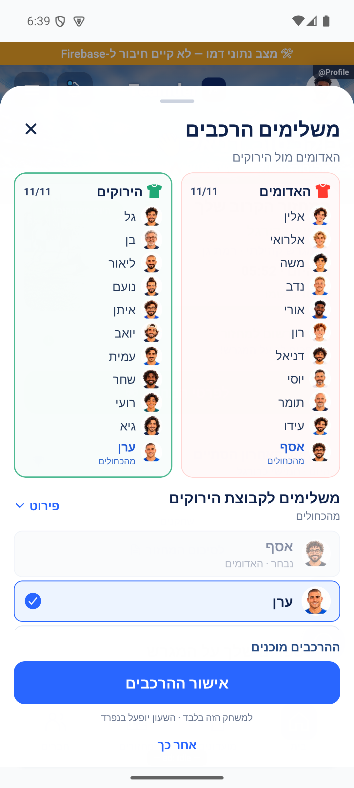

# ממלאים, השאלה ורוטציה

## בדיקת עומק לעריכת הקבוצות — 24.10.2026

מטפלי `beginFillFlow`, `onBalancedConfirm`, `onFillConfirm`, `onFillCancel` ו־`advanceFillFlow` הופעלו מול השירות המלא באחסון מבודד. נבדקו שתי קצרות במצבים זמני, קבוע ומאוזן, העדפת הגדרת המחזור, היעדר תורמים, ביטול, מקור שהשתנה בזמן הבחירה ושחרור נעילות. תוקן דיווח הצלחה שנשלח לפני שמירת ההשלמות; כעת ביטול וכשל אינם נחשבים להחלפה שהושלמה. [ראיות ומגבלות](../../audits/2026-10-24-live-teams.md). מקומי וטרם הופץ.

## השלמות בעריכת הקבוצות במשחק — 24.10.2026

הפעולה החדשה בתפריט הלייב מכינה `liveTeamsEditSkeleton` ומעבירה אותו ל־`beginFillFlow` עם הקשר `teamsEdit`. בחירת המשלימים נשארת במסלול הזמני, הקבוע או המאוזן הקיים; שמירתו הסופית עוברת ל־`saveLiveTeamsEdit`, שמאמת את בחירת המשלימים ושומר יחד את הזוג, התור ואיפוס המשחק. ביטול השלמה אינו כותב דבר. אין זקיפת הופעה או שימוש בהשלמה למשחק שנזרק. ההחזר של השאלות והחישובים מפורטים ב־[עריכת הקבוצות והתור](live-advanced.md#עריכת-הקבוצות-והתור-בזמן-הלייב--24102026). 41 בדיקות חדשות עברו; צילום חלון העריכה באנדרואיד דמו אינו הוכחת כל צירופי ההשלמות או מסד חי. מקומי וטרם הופץ.

## תיעוד כשלים — 20.10.2026

נוספו תצפיות דיווח בנקודות הכשל של המקורות המשויכים לפיצ׳ר, במסגרת הרחבה רוחבית. נשמרו ערכי החזרה, הזריקות ותנאי הפעולה הקיימים; נוסף מקור קוד והקשר לדיווח. כיסוי תחבירי אינו הוכחת הרצה של כל מצב. השינוי מקומי וטרם הופץ; בדיקות המסירה, מגבלות מניעת הכפילויות והמסלולים שטרם חוברו מתועדים בדוח המשותף.

[דוח דיווח השגיאות והראיות](../../changes/2026-10-20-error-reporting-audit.md).

## החזרה בטוחה כשבסיס קבוע כבר חסר — 18.10.2026

שימור `baseTeams` במעבר אינו משחזר בסיס שכבר אבד במחזור פעיל. `restorePlayer` חוסם כעת החזרה במצב `permanent` ללא בסיס, כולל מערך בסיס ריק, אם ההרכב האפקטיבי לאחר ההחזרה והחזרת השאלה ידועה עדיין יעלה מעל `perTeam`. השגיאה מסווגת כ־`RESTORE_REQUIRES_SPACE`. המסך מציג: ״הקבוצה מלאה ולא ניתן לזהות בבטחה מי צריך לחזור לקבוצתו. פנו מקום במסך החילופים ואז נסו שוב.״

הבדיקה מתבצעת בתוך אותה עסקת ההחזרה ולפני יצירת ה־patch. בדחייה לא נכתב שום שדה, ובפרט `leftHome` אינו מתנקה. אין יצירת בסיס, הסקה מ־`originalTeams` או העברה אוטומטית של שחקן משוער. החזרה כשיש מקום ממשיכה לעבוד, וחזרה כפולה אינה מוסיפה פעמיים. בסיס תקף או השאלה ידועה ממשיכים במסלולי ההחזרה הקיימים. השעון אינו תנאי.

`finalGoalAuditLegacyRestore.test.ts` מריץ שירות, מדיניות ומטפל אישור אמיתיים בדמו ובעסקה. לפני התיקון שמונה מתוך 12 בדיקות נכשלו; אחרי התיקון כולן עוברות, כולל שוויון עמוק של הנתונים ואפס כתיבה בדחייה, פעולה לאחר פינוי מקום והצגת ההודעה במסך. ארבע חבילות ממוקדות עברו עם 38 בדיקות והטיפוסים נקיים. [דוח וגבולות](../../../artifacts/final-deep-audit-2026-10-17/legacy-restore-guard-audit.md).

לאחר מכן נפתח ונבחן בנפרד [צילום הדחייה במכשיר](../screenshots/final-audit-production-eleven-legacy-restore-denied-2026-10-18.png) מהמוביל: ההודעה לעיל מוצגת במלואה, ״אחדעשר־03״ עדיין תחת ״הלכו הביתה״, והלוח נשאר 1:1 עם 00:00 ומצב מוכן. זהו לקוח הפיתוח `5556/8082` מול מחזור הבדיקה בייצור, 1080×2400, צפיפות 420 וגופן 100%. שכבת ההודעה מכסה את ראש הלוח וחלק מהשמות מקוצרים. הקובץ הקודם ששמו `final-eleven-legacy-restore-blocked.png` מציג רק את חלון האישור שלפני הפעולה, ולכן אינו ראיה להודעת הדחייה ואינו מקוטלג כאן.

קובצי המקור `tmp/final-production-2026-10-18/data-audit/data-eleven-legacy-before-restore.json` ו־`data-eleven-legacy-denied-confirmed.json` נקראו בנפרד מהצילום: שלושת אוגדי המחזורים ב־`games`, לרבות `game`, היסטוריה, קבלות, נתוני שחקנים וסיכומים, שווים בערכיהם. במחזור אחד עשר הגדלים נשארו 11/11/10 וב־`draftTeams.leftHome` נשארה רשומה אחת. זו ראיית נתונים תחומה לדחייה הזאת; ביקורת הזהויות ומניעת הכפילויות המפורטת נפרדת, ואין להסיק מהצילום לבדו אפס כתיבה או הצלחת החזרה אחרי פינוי מקום. [מקורות התמונה ומגבלותיה](../../../artifacts/final-deep-audit-2026-10-17/eleven-proof-entries.json). אין בכך שחזור של בסיס ישן או אימות מכשיר לשימור הבסיס במעבר המשחק החדש.

## ראיות השלמה נוספות במכשיר קטן — 18.10.2026

[צילום ההשלמה הקטן](../screenshots/final-audit-production-eleven-small-refill-2026-10-18.png) נפתח ונבחן בנפרד לאחר צילום המוביל במחזור בדיקת אחד עשר מול אחד עשר בייצור. הוא מציג את האדומים מול הירוקים, את ״אחדעשר־01״ מהכחולים מסומן ואת האדומים 11/11, לצד הודעת בחירה מוכנה לאישור. אישור ההרכב ו״אחר כך״ גלויים במלואם. זהו מצב לפני האישור; ממנו לבדו אין הוכחה שהשחקן עבר או שהקפטן הוחלף. מקור `data-eleven-captain-fixed-saved.json` המתואר בסעיף הקפטן להלן מאמת בנפרד את 01 באדומים ואת 04 כקפטן הכחולים.

קובץ המקור הוא 576×1024 בצפיפות 288, חלון כ־320×568.89 וגופן 140%, בלקוח הפיתוח `5556/8082` מול שרת הייצור וחשבון הבדיקה המאושר. אזור ההרכבים מציג כותרת ושם ראשון בלבד; המשך ההרכב מחוץ לגבול הגלילה. המועמדים 01 ו־04 גלויים ועוד תחילת השורה הבאה. הצילום אינו מאמת גלילה לסוף הסגל או קריאות כל השמות. ב[צילום הלייב באותן הגדרות](../screenshots/final-audit-production-eleven-small-live-2026-10-18.png) נראות הפעולות, אך אין שורת סגל מלאה ואזהרת הפיתוח מכסה חלק מהניווט התחתון.

[הצעת ההשלמה הרגילה](../screenshots/final-audit-production-eleven-refill-fixed-offer-2026-10-18.png) מתעדת שלב קודם, אחרי המתנת ההרכב ולפני בחירת המשלים. השעון אינו קריא בה; אפס הזמן והיותו עצור נבדקו בעקבה ובנתונים. הקריאה הראשונה ביקשה שרת אך החזירה הרכב ישן, ובהמשך הוכנה הצעה התואמת לקבלת העזיבה. אירועי המאזין והמטא־נתונים שלהם לא נלכדו ישירות. [עקבת ההכנה](../../../artifacts/final-deep-audit-2026-10-17/eleven-refill-fixed-trace.json) אינה הוכחה שהעברה או החזרה מאוחרות כבר הושלמו.

שלוש התמונות הקטנות והחמש הרגילות רשומות עם מקורות, חותמות ומגבלות ב־[רשומות הראיות](../../../artifacts/final-deep-audit-2026-10-17/eleven-proof-entries.json) ובמניפסט. צילום הפנדלים הקטן מאמת את הפרדת הכדור מתג השוער כמפורט ב[תיעוד הפנדלים](penalties.md#כדור-ההמתנה-ליד-הבועט--18102026); הוא אינו ראיה לחוזה ההשלמה. בפרט, ההחזרה שאחרי בחירת 01 חשפה את פגם בסיס הקבוצות הנפרד. אף אחד מהצילומים לעיל אינו אימות מכשיר לתיקון שימור `baseTeams` במעבר משחק, להפצה לחנות או לאייפון.

## בסיס הקבוצות נשמר גם במעבר למשחק הבא — 18.10.2026

במקור המשחק השני של בדיקת אחד עשר מול אחד עשר נמצא ש־`rotation.baseTeams` חסר, אף שהיה קיים במשחק הראשון. לאחר השלמה קבועה, החזרת ״אחדעשר־03״ הוסיפה אותו לאדומים בלי להחזיר את ״אחדעשר־01״ לכחולים: ההרכבים נעשו 12/10/11 ורשימת העזיבה התרוקנה. `restorePlayer` קורא את הנתונים בתוך עסקה, אך ללא הבסיס אינו נכנס לענף החזרת המשלים. זו תקלה בנתון שנשמר במעבר, ולא ממצא של קריאה ישנה.

`prepareRoundResult` משמר כעת את `rot.baseTeams` בשני שלדי התוצאה, ניצחון ותיקו, לפני העברתם לשמירת ההרכב. המנוע הרגיל בנה רוטציה חדשה בלי השדה; המסלול המאוזן והמסלולים הישנים כבר נשאו אותו. אין שינוי בתוכן הבסיס, במדיניות ההשלמה או ההחזרה, במזהי משחק, בתוצאה או בשעון.

`finalGoalAuditBaseRestore.test.ts` מפעיל מעבר משחק ושמירה בפועל, עזיבה, השלמה קבועה, שמירה והחזרה כפולה. לפני התיקון ארבע בדיקות רגילות נכשלו ושתי מאוזנות עברו; אחרי התיקון כל שש הבדיקות עוברות בדמו ובעסקה, עם בסיס זהה למקור והרכבים שחוזרים לאחד עשר. חמש חבילות ממוקדות עברו עם 89 בדיקות, והטיפוסים נקיים. [דוח המקורות והבדיקות](../../../artifacts/final-deep-audit-2026-10-17/base-restore-audit.md).

התיקון אינו משחזר בסיס שכבר אבד בנתוני בדיקה קיימים. לא נוסף גיבוי אוטומטי מ־`originalTeams`, שיכול להיות שונה מבסיס אחרי השלמות הפתיחה. אין כתיבת תיקון או עקיפת ממשק. מקור הבדיקה הקיים מחייב התאוששות במסלול מוצר נתמך; מעבר נוסף או חילוף רגיל אינם לבדם הוכחה שבסיס אבוד שוחזר. אימות מכשיר של שימור הבסיס במעבר החדש עדיין נדרש אצל המוביל.

## קפטן תקף אחרי השלמה קבועה — 18.10.2026

במקור `data-eleven-auto-refill-saved.json` של בדיקת המוביל נמצא שהמשלים ״אחדעשר־05״ עבר לצמיתות מהירוקים לאדומים, אך `captainId` של הירוקים עדיין הפנה אליו. ההרכבים נשמרו 11/11/10; זו תקלה בנתון הקפטן, ולא כשל בהעברת השחקן. `applyChosenFill` מחזיר סגלים ללא מטא־נתוני הקבוצות, ו־`_persistRotation` חיבר אליהם מחדש את הקפטן המקורי בלי לבדוק שנשאר בקבוצה.

הכותב משמר כעת קפטן מקורי רק כשהוא עדיין ב־`playerIds` החדש; אחרת הוא בוחר את השחקן הראשון שנותר, או `''` בקבוצה ריקה. המדיניות זהה לגיבוי הקיים בהכנת הטיוטה. קפטן יעד תקף נשמר, ובהשאלה זמנית קפטן המקור נשאר מפני שהוא עדיין בסגל הבית. צבעים, שדות קבוצה נוספים, מקור השמירה, הסדר, ההשאלות, התוצאה והשעון אינם משתנים.

`finalGoalAuditFillCaptains.test.ts` מפעיל את המנוע ואת שני מסלולי השמירה האמיתיים מול תעבורה מבודדת. לפני התיקון נכשלו שמונה מתוך עשר בדיקות; אחרי התיקון כולן עברו בגודלי 4/7/11, כולל אורח, קפטן תקף שאינו ראשון, מקור ריק והשאלה זמנית. חמש חבילות ממוקדות עברו עם 76 בדיקות ובדיקת הטיפוסים נקייה. [דוח הנתונים, השחזור והגבולות](../../../artifacts/final-deep-audit-2026-10-17/fill-captain-audit.md).

בהמשך המוביל העביר את ״אחדעשר־01״ מהכחולים בהשלמה קבועה. המקור `data-eleven-captain-fixed-saved.json` מתעד בחירת ״אחדעשר־04״ כקפטן הכחולים כשהוא עדיין בסגל; נתון הקפטן תוקן במסלול הזה. ההחזרה שאחר כך חשפה את פגם בסיס הקבוצות הנפרד המתואר בראש המסמך. אין בכך אישור מלא לכל התנהגות ההשלמה וההחזרה, ואין טענה שבוצעה כתיבה מתקנת אוטומטית למקורות הישנים.

## הצעת השלמה אחרי אישור עזיבה — 18.10.2026

`markPlayerWentHome` מחזיר `LiveRosterMutationReceipt` מקומי: `before` היא תמונת העסקה שאושרה ו־`after` היא אותה תמונה עם השינוי שנכתב. במסלול הדמו נשמרת תמונת הלפני לפני החלפת שדות ההרכב; במסלול המסד מוחזרת הקבלה מניסיון העסקה שהצליח. קריאות שאינן משתמשות בערך המוחזר אינן צריכות להשתנות. אין מסמך קבלה חדש או כתיבה נוספת.

`onPlayerWentHome` מעביר את הקבלה ל־`prepareRefillPlaying`, שקורא כעת `{source:'server'}`. `waitForRosterMutation` מקבל תמונת אחרי מדויקת או ממתין עד שמונה שניות מתמונת לפני מדויקת, בהאזנה עם `includeMetadataChanges`. נדרשת תמונת שרת ללא כתיבה ממתינה. ההשוואה כוללת את `RoundDecisionContext`, הפורמט ומצב ההשלמה; כך סגל, צדדים, שער, משחק, מצב סופי, פורמט או מדיניות השלמה אחרים אינם פותחים הצעה ישנה. משחק שכבר נשמר אינו מקבל השלמת אמצע משחק. השעון מוחרג מטביעת ההחלטה, ולכן עזיבה והשלמה אפשריות לפני הפעלתו וגם אם הופעל בזמן ההמתנה.

המשמעות של החסר, `perTeam`, `effFillMode`, ההשאלות והשלמה מאוזנת לא השתנתה. `source` של השלד נבנה מתמונת ההרכב שהתקבלה. כשל או פקיעת זמן אינם יוצרים הצעה ואינם מבטלים את העזיבה שכבר נשמרה. הקוצב וההאזנה מתנקים; המנעול הקיים מונע אישור עזיבה כפול. אחרי ההמתנה המטפל בודק שוב שלא נפתח בינתיים תהליך השלמה, סיום או כתיבה אחר. `keepClock:true` נשמר, ללא איפוס תוצאה או שעון.

המוביל מצא בייצור הרכב אדום של עשרה מול אחת עשרה ללא חלון השלמה. המקור `tmp/final-production-2026-10-18/data-audit/data-eleven-player-left.json` מציג 10/11/11 במשחק ראשון ובשעון מושבת באפס. לא נלכדה הקריאה הפנימית באותו ניסיון. `finalGoalAuditRefill.test.ts` משחזר קריאה ישנה עם מטפל ושירות אמיתיים: לפני התיקון עשר בדיקות נכשלו ואחת עברה; אחרי ההרחבה עברו 16, כולל מחסור לפני שעון, קבוצה ממתינה, שינויי לוח, מטמון, קבלה ממתינה, פקיעת זמן ומנעולים מקומיים. יחד עם ארבע חבילות שירות וביקורת עברו 120 בדיקות, והטיפוסים נקיים. [הראיות והגבולות](../../../artifacts/final-deep-audit-2026-10-17/refill-read-audit.md).

לאחר טעינת הקוד, המוביל אישר שההצעה האוטומטית נפתחה. [לכידת הקריאה וההצעה](../../../artifacts/final-deep-audit-2026-10-17/eleven-refill-fixed-trace.json) מכילה קבלת שינוי ותוצאת הכנה ללא שגיאה. אחרי סגירת שכבת אזהרת הפיתוח אישור המשלים עבר; מקור `data-eleven-auto-refill-saved.json` מציג את ההעברה שנשמרה. בניסיון הזה נחשף פגם הקפטן הנפרד המתואר בראש המסמך, כך שאין להציגו כאישור מלא לתקינות כל שדות ההרכב. המוביל מרכז את הצילומים הקנוניים.

## עזיבה והחזרה מול הרכב עדכני — 18.10.2026

`markPlayerWentHome`, `restorePlayer` ו־`retireEmptyTeam` בונים את השינוי בתוך `runTransaction` מול המסמך העדכני. ניסיון חוזר שכבר התקיים הוא פעולה ריקה; ערב סגור נדחה. אין שכתוב של תוצאה, שעון, אירועי משחק או חלוקה מתחרה. בדמו מתעדכן `updatedAt` כדי שהמנוי ירענן. אורח בהשלמה קבועה זכאי לחזור לבסיס כמו משתמש רשום. פרישת קבוצה נבדקת מחדש: רק קבוצה ממתינה שעדיין ריקה ושאינה משחקת. `finalRosterAudit.test.ts` מפעיל את השירות האמיתי עם תחרות, חזרה וכפילויות. בחוזה הזקיפה נשארת מדיניות ההרכב בסיום ותרומה לאירוע; לא נוספה מדידת דקות.

[דוח הביקורת, הבדיקות וגבולות האימות](../../changes/2026-10-18-preproduction-end-to-end.md).

## תחימת חלון השלמה במסך קטן — 17.10.2026

בבדיקת ייצור של 11 מול 11, לאחר שמירת המשחק הראשון והמתנה להשלמה לקראת הבא, נצפתה חסימה במכשיר ברוחב 320 ובגובה 569 עם גופן 140%: רשימת המועמדים קרסה והאישור נמשך אל מתחת למסך. מקור הממצא: `tmp/live-action-production/shots/eleven-next-fill-small.png`, לפני התיקון. מספרי הגודל הישנים, 43% להרכבים ו־27% למועמדים, לא הבטיחו מקום לכותרת ולפעולות שגדלו עם הטקסט.

`BalancedFillModal` מודד ב־`onLayout` את גובה הרקע הפנוי שכבר מוגן ב־`SafeModal`. גובה החלונית מספרי: הקטן מבין גובה החלון, המדידה ו־820, פחות 12 יחידות. הכותרת והפעולות אינן מתכווצות. גוף בעל `flexBasis:0` ו־`minHeight:0` מקבל את הגובה שנותר ביניהן, ואז מדידתו קובעת את תקציב ההרכבים: יעד של 32% מגובה הגוף הפנוי לאחר מרווח שש יחידות במצב קומפקטי, ו־45% במצב רגיל. ליעד מצטרף רף עבור כותרת, שורת שחקן ותוצאה שמורה בהתאם להגדלת הגופן; ב־140% עם תוצאה שמורה הרף הוא 114 יחידות. התקציב מוגבל לגובה הגוף הפנוי בפועל. הוא ניתן כ־`height` מספרי לעטיפת `View` מקורית שאינה ניתנת לאיחוד; גלילת ההרכבים ממלאת אותה. לפני מדידת הגוף מופעל אותו רף. רשימת המועמדים מקבלת את כל היתרה. אם אין צד חסר, ההרכבים מקבלים את כל הגוף.

האימות המקורי הראשון לאחר תחימת החלונית הראה שיפור חלקי בלבד: מועמדים ופעולות נראו, אך `balanced-fill-rosters` עדיין היה בגובה אפס, למרות גוף בגובה 468 פיקסלים. זו ההיררכיה שב־`latest-ui.xml` והצילום `eleven-fill-small-fixed-ready.png` באותו שלב; אין לסווג אותם כתקינות של ההרכבים. בעקבות זאת הוחלפה ההסתמכות על `flexBasis` של הגלילה בעטיפה בעלת גובה מפורש ורף התוכן המתואר. סיבת ההבדל הפנימית במנוע הפריסה לא הוכחה; האימות המקורי החוזר של תיקון העטיפה מתועד להלן. בדיקות המקור אינן גוברות על הממצא המקורי הזה.

שני האזורים הם גלילות אחיות, עם כל חברי ההרכבים והמועמדים, בלי חיתוך מספרם לפי הגודל. כותרת בחירת המשלים והפירוט נגללים עם המועמדים. התוצאה שכבר נשמרה נגללת עם ההרכבים; הסבר משך ההשלמה והשעון נמצא בתוכן הנגלל. בתחתית נשארים מצב ההתקדמות, האישור ו״אחר כך״, בגובה טבעי לפי הטקסט ולא לפי תקרת גופן. הכותרת והרווחים קומפקטיים במסך צר/נמוך או בגופן מוגדל, אך שמות השחקנים והפעולות ממשיכים לכבד הגדלת גופן. שינוי מדידות, גופן או `visible` אינו מאפס בחירה; אפקט איפוס הבחירה נשאר תלוי רק בבקשה.

אין שינוי ב־`initialFillSelection`, ב־`chooseFillPlayer`, ב־`counts`, ב־`required`, ב־`ready`, בסדר ההשלמה המדורג או בשמירה. לא נוספה שכבת אישור. ההשלמה זמנית/קבועה, המחסור, כפילויות, המעבר לצד הבא והבקשה לאחר משחק שמור משתמשים באותם מסלולים. בפרט אין שינוי כאן לשמירת תוצאה ממתינה, למחזור או לנתוני השרת.

בכותרת כל הרכב הוחלף סמל החולצה השטוח ב־`TeamShirtIllustration` ברוחב 20 וב־`side.color` המדויק, אותו איור מוצל המשמש בלוח התוצאות ובחלונות הלייב. אין שינוי ברכיב האווטרים או בערכת העיצוב. בדיקות הרכיב מוודאות את שתי החולצות, הצבעים והרוחב; החולצות האדומה והכחולה נצפו גם ברענון המקורי החוזר של ההרכבים.

שבע בדיקות חדשות ב־`balancedFillResponsive.test.tsx` מפעילות את הרכיב ואת פונקציות הבחירה האמיתיות: תקציב מדוד ב־4/7/11, שמירת כל ההרכבים והמועמד האחרון, פעולה קבועה מחוץ לגוף הנגלל, בחירה אחרונה ושימורה בשינוי גופן/מדידות/הסתרה, החלפת בחירה יחידה, פירוט, העברת צד ומניעת כפילות, ומסלול הרכבים מלאים ושתי דרכי סגירה. יחד עם בדיקות הבחירה, המסלול המדורג ושומר סדר ההוקים עברו ארבע חבילות ו־345 בדיקות. אלו בדיקות רכיב עם מארחים מקוריים מדומים ומדידות מוזרקות; הן אינן הוכחת פריסה של מנוע הפריסה המקורי. הצילום המקורי של החסימה והצילום הראשון עם ההרכבים בגובה אפס נשארים ראיות ביניים בלבד.

### אימות מקורי חוזר מול ייצור

המוביל פתח מחדש את חלון ההשלמה דרך המוצר לאחר פתיחה קרה, במחזור הבדיקה המורשה של 11 מול 11, במצב השלמה קבועה, במסך 320×569 ובגופן 140%. ארבעת צילומי המקור להלן נפתחו ונבחנו גם בסקירה עצמאית; מקורם ב־`tmp/live-action-production/shots/`, והם הועתקו ללא שינוי לתיקיית הצילומים ולקטלוג המניפסט:

| צילום | מה נצפה |
|---|---|
| [הרכב האדומים](../screenshots/action-pitch-production-eleven-fill-small-roster-visible-2026-10-17.png) | האדומים 11/11 עם חולצה אדומה ושורת שחקן מלאה; מועמד ראשון וכפתורי אישור מנוטרל ו״אחר כך״ גלויים |
| [הרכב היעד](../screenshots/action-pitch-production-eleven-fill-small-target-roster-2026-10-17.png) | גלילת ההרכבים בלבד חושפת את הכחולים 10/11, חולצה כחולה ושחקן ראשון; רשימת המועמדים נשארת במקומה |
| [המועמד האחרון בשורה מלאה](../screenshots/action-pitch-production-eleven-fill-small-last-full-2026-10-17.png) | גלילת המועמדים עד אופק, בשורה מלאה, והסבר ההשלמה הקבועה; ההרכב ותחתית הפעולות נשארים במקומם |
| [אופק נבחר](../screenshots/action-pitch-production-eleven-fill-small-selected-2026-10-17.png) | אופק מסומן, הכחולים 11/11 והאישור פעיל; ״אחר כך״ גלוי באותו מקום |

לשם הבהרת ההבדל, [צילום הביניים שבו ההרכבים בגובה אפס](../screenshots/action-pitch-production-eleven-fill-small-intermediate-zero-rosters-2026-10-17.png) מקוטלג כפגם, ולא כחלק מראיות התקינות לעיל.

בהיררכיה המקורית שבדק המוביל לפני הבחירה, אזור ההרכבים היה בגובה 205 פיקסלים, המועמדים 248 והתחתית 258, בתוך השטח הבטוח. כך הוכח שההרכבים אינם עוד בגובה אפס; אלו מידות מקוריות ולא תוצאת בדיקת הסגנונות. המוביל בחר את אופק ולחץ על האישור הקיים. הקובץ `tmp/live-action-production/data-eleven-second-ready.json` נקרא גם בנפרד לאחר הפעולה: `rotation.round=2`, תוצאה 0:0, אפס אירועי שער, `timerRunning=false`, `timerAccumulatedMs=0`, רשומת היסטוריה אחת של המשחק הראשון, `committedRoundCount=1` ו־`pendingSavedRound=null`. אופק משויך לקבוצה מספר 1, הגדלים הם 11/11/10 ואין השאלות, בהתאם להשלמה הקבועה. זוהי הוכחה למעבר הזה ולשמירה החד־פעמית שנקראה; אין כאן טענה שנבדקו באותו חלון כל הענפים, אייפון, מכשיר פיזי או שינוי הרשאה. שאר בדיקות הגדלים והענפים מפורטות בדוח המשימה של המוביל.

עודכן: 7.10.2026. מקור הקוד: `8e8fde5`, גרסה `1.1.35`. מסמך זה מתאר את הקוד; מצב חנות ופריסת שרת דורשים ראיה נפרדת.

## כניסה ותפקידים

לייב מתקדם → בקשת מילוי; ניהול מחזור → זמינים/פעימת השלמה

מנהל מאשר ממלא; פנייה לשחקן חיצוני ורישום חבר מועדון הם מסלולים שונים.

## רכיבים ומצבים

| רכיב / מצב | התנהגות וחוזה |
|---|---|
| בחירת ממלא | שחקן וקבוצת יעד; request/confirm/cancel אינם אותה פעולה |
| זמני / קבוע | השאלה זמנית מחזירה לפי כללי הרוטציה; מילוי קבוע משנה סגל |
| ביטול | מתאים את התור ואת מילוי הקבוצה; לא למחוק קבוצה בטעות |
| קבוצה ריקה | retireEmptyTeam ו־prepareRefillPlaying; צורך בהרכב לעומת סגל רשום |
| פניות חיצוניות | FillerInterestsSection מופיע למנהל במחזור acceptsFillers; אמינות, אישור ודחייה |
| פעימת הזמנה | AvailablePlayers startFillerPulse וסיבות חסימה; הזמנה אינה כבר השתתפות |

## מסלול נתונים ומקומות שינוי

[`src/components/match/FillerPickerModal.tsx`](../../../src/components/match/FillerPickerModal.tsx); [`src/services/rotationEngine.ts`](../../../src/services/rotationEngine.ts); [`src/screens/AdvancedLiveMatchScreen.tsx`](../../../src/screens/AdvancedLiveMatchScreen.tsx)

gameService ו־rotationEngine: snapshots, ספירות וצדי משחק; pending פניות טעון מאגר משתמש/אמינות. ממיר המשחק חייב לקרוא תוספות למודל; ממלא אורח נושא מזהה אורח ולא uid מומצא.

ממיר המחזור: [`src/firebase/firestore.ts`](../../../src/firebase/firestore.ts), `gameDocConverter.fromFirestore`; סוגים: [`src/types`](../../../src/types). שינוי שדה דורש מעקב כתיבה → ממיר → שירות/חנות → רכיב. ניווט: [`GameStack.tsx`](../../../src/navigation/GameStack.tsx), ובמסכים משותפים גם המחסניות שמארחות אותם.

## בדיקות וראיות

rotationFill/rotationDeep/rotationCounts, fillerGuest, rotationQueueReorder; בדיקת תור לאחר ביטול והחזרת מושאל.

צילומי המיפוי מהאמולטור נעשו במצב נתוני דמו, המסומן בפס כתום. הם מוכיחים את הרכיב והמצב המוצגים בלבד, ולא ממירי Firebase, נתוני ייצור או כתיבה. צילומי תיקונים קודמים מסומנים בנפרד. שגיאת מזהה, מצב טעינה או שער הגנה אינם הוכחת הפעולה המלאה.

## גבולות והערות תחזוקה

ממצא קוד לסקירה: FillerInterestsSection נטען גם באפקט וגם במיקוד, ובכשל מסוים מחזיר רשימה ריקה. לא שוחזר; אין לומר שאין פניות כאשר הקריאה נכשלה.

לפני שינוי פתח את הקוד המקושר ואת [כללי הפרויקט](../../../AGENTS.md). לאחר שינוי עדכן במסמך זה את התאריך, נקודת הקוד, המצבים שהתעדכנו, הבדיקות והצילום. אין לטעון שכל מצב/תפקיד נבדק רק משום שקיים צילום אחד.

## פירוט טכני ממוקד: זרימה, חישוב ונקודות שינוי

[הסבר פשוט למשתמש](fillers.simple.md)

העמקה: 07.10.2026, מול קוד המקור שב־`8e8fde5`. בעת הכתיבה HEAD הוא `50d508f`; בדיקת ההפרש בין הנקודות ב־`src` וב־`functions` לא מצאה שינוי קוד. הסעיפים וההסתייגויות הקיימים נשמרו. זו קריאת קוד ותיעוד, בלי הרצת תרחישי כתיבה חדשים.

המכנה כאן הוא גודל ההרכב האפקטיבי, לא מספר הרשומים למחזור. `rosterOf` מחשב סגל ביתי פחות מושאלים החוצה ועוד מושאלים פנימה. `nextFillNeeded` מחשב `deficit=perTeam-rosterOf(...).length` ועובר על הקבוצות שאינן משחקות, עם קדימות לקבוצה שיצאה; שחקן שכבר הושאל אינו תורם פנוי.

לדוגמה יעד של 5 מול הרכב אפקטיבי של 3 דורש 2 ממלאים. אם יש רק תורם פנוי אחד, אין להמציא שחקן שני או לחסום בהכרח ערב חסר. `applyChosenFill` במצב זמני יוצר `RotationLoan`; במצב קבוע מסיר מהסגל הביתי של המקור ומוסיף ליעד. כשהמקור נכנס במשחקון הבא, השאלה זמנית חוזרת לפי חוקי המעבר.

המסך אוסף בחירה לפני `commitFilledRotation`; ביטול מחייב שיקום התור/מפתח אותו משחקון, ולא זקיפת סטטיסטיקה שנייה. פניות חיצוניות ב־`FillerInterestsSection` ו־`startFillerPulse` שייכות לרישום למחזור ולסמכות אישור, ולא ללולאת המילוי על המגרש.

בדוק תורם שנעלם, אורח, קבוצה ריקה, זמני/קבוע וביטול אחרי שכבר בוצעה זקיפה. שינוי `rosterOf` משפיע גם על היסטוריית מי שיחק ועל הפנדלים; חובה להצליב את שלושתם ולא רק את מראה ההרכב.

## השלמת הנפשות — 8.10.2026

FillerInterestsSection שומרת approved={row,at} אחרי await approveFiller ורק אם activeGame עדיין תואם. שורת האישור היא ArrivalMotion עם תמונה, שם וסימון הצלחה; אין כותרת מועמדים ריקה אחרי אישור האחרון. שינוי מחזור או חזרה למיקוד מנקים אישור ישן. כשל משאיר את המועמד בלי שורת הצלחה. TeamScore variant=list עוקבת אחרי מזהי roster בתחום teamIdx: שחקן חדש מקבל כניסת תמונה 300 אלפיות שנייה, בלי לשנות סגל או RotationLoan. grid לא שונה. שורת פנייה חיצונית ושחקן מושאל על המגרש הם מסלולים שונים: אין תנועה פיזית רציפה בין שתי רשימות שאינן באותו מסך. החישוב perTeam-rosterOf(...).length, שמירת commitFilledRotation והאישור בשרת נשארו ללא שינוי. בתרחיש המקומי הורץ כשל ואחריו הצלחה; לא בוצעה קריאת אישור אמיתית. ממצא כשל load שמחזיר [] נותר מגבלה קיימת ולא תוקן במסגרת התנועה.

[פרטי האימות והמגבלות](../../changes/2026-10-08-motion-completion.md). מקור: `9ec0dfd` עם שינויים מקומיים; טרם פורסמה גרסה.

## חלון השלמה עם הקשר ההחלטה — 16.10.2026

מקור: `4a3cb346` עם שינויים מקומיים. רכיב: `BalancedFillModal`; שני אתרי הפתיחה ב־`AdvancedLiveMatchScreen` מעבירים מעתה גם `sides[].members`, מידע תצוגה בלבד של ההרכב האפקטיבי לפי `rosterOf`. כל חבר מקבל שם, מזהה, תמונה ואווטר מתוך `resolveFillPlayer`; אצל מושאל קיים מצורפת קבוצת המקור מתוך `RotationLoan`. `playerIds` נשאר מקור ספירת המקומות והשמירה. לא נוסף שדה למסד או לממיר.

`UserAvatar` משמש לכל שחקן בהרכב ולכל מועמד: תמונת פרופיל קודמת לאווטר שנבחר, ובהיעדרם הפתרון הקיים מספק אווטר ספורט ניטרלי. אין ראשי תיבות. שתי הקבוצות מופיעות זו לצד זו; אווטר הוא הילד הראשון בשורה ולכן מופיע מימין, וסימון מועמד נבחר מופיע משמאל. אין פלוס לחיץ או עיגול בחירה ריק. הכרטיס הפעיל מסומן במסגרת; לחיצה עליו מחזירה לבחירת אותה קבוצה. כרטיס מלא מראש או צד שאינו ניתן לעריכה במסלול המדורג אינם פותחים בחירה.

לכל צד `need=max(0,capacity-playerIds.length)`. במסלול המדורג הצד הלא פעיל מקבל מכסת בחירה אפס. `required=min(needA+needB,donors.length)`. אישור דורש מספר בחירות זהה ל־`required`, ללא כפילות ובלי חריגה ממכסה. כשאין מספיק מועמדים, החוסר בהרכבים נכתב במפורש וכפתור האישור מציין הרכבים חסרים. נוסחאות אלה וכללי הזכאות נותרו ללא שינוי.

`initialFillSelection` מתחיל ללא מועמד נבחר. `chooseFillPlayer` מבצע בחירה ידנית אטומית: בחוסר יחיד בחירה אחרת מחליפה את הבחירה הקודמת; בחוסר מרובה אפשר לבחור עד המכסה; לחיצה על נבחר מסירה אותו. מועמד שכבר נבחר לצד השני או אינו במאגר אינו מצטרף. כשצד מתמלא בבחירה המשותפת ויש עוד מועמד פנוי וצד חסר, המיקוד עובר לצד החסר. במסלול המדורג אין מעבר צד בתוך אותו חלון. אין בחירה מומלצת או שמירה מתוך פונקציית הבחירה.

שמות ההרכב נגללים בנפרד מהמועמדים והאישור קבוע בתחתית. מאז תיקון 17.10.2026, גובה ההרכבים נגזר מגובה הגוף שנמדד לאחר הכותרת והפעולות, והמועמדים מקבלים את יתרת הגוף; פירוט התחימה והגבולות לעיל. הגופן אינו מוקטן לפי מספר השחקנים. במסך צר מ־350 יחידות או בהגדלת גופן מעל 1.3, הכרטיסים נערמים וההרכבים נשארים נגישים בגלילה בתוך החלון. שורה חדשה משתמשת ב־`ArrivalMotion` הקיים, שמכבד הפחתת תנועה. המונים וההשוואה עברו לפירוט; קבוצת מקור מוצגת בכותרת אם היא משותפת לכל המועמדים ובכל שורה כאשר יש כמה מקורות. ההשוואה מופיעה רק כשכל ההרכבים מלאים, באותן הרשאות דירוג קיימות.

משך ההשלמה מוצג לפי החוזה הקיים: משותפת למשחק אחד; זמנית מדורגת עד כניסת המקור או יציאת המקבלת; קבועה להמשך. בזמן מילוי באמצע משחק נשמר מצב השעון, ובמעבר משחק מפעילים אותו בנפרד. סגירה קוראת לאותו `onFillCancel`; בקשה שנשארת ומוסתרת באמצעות `visible` שומרת בחירה חלקית. האישור עדיין עובר דרך `onBalancedConfirm` ו־`commitFilledRotation`, ללא שינוי סטטיסטיקה או הרשאות.

בדיקות: `fillSelection.test.ts` בודק כל גודל 4–11, שני צדדים, חוסר מרובה, החלפת בחירה, מחסור, אורח ואי כפילות; `sequentialFillDesign.test.ts` מוודא שמות הרכב וגבולות המסלול הקיים. [הבדיקות והצילומים שבוצעו בפועל](../../changes/2026-10-16-fill-popup.md). אין להסיק מתרחיש דמו על שרת, שני מנהלים, אייפון או קורא מסך.

## שילוב בהכנה ובחילופים — 16.10.2026

`OpeningTeamsPanel` מחשב חוסר מתוך סגל פעיל מול `capacity` ומעביר את הטיוטה הצבועה ל־`prepareStartRotation → beginFillFlow`; לא נוצר מסלול בחירה נוסף. בהמתנה `RotationPanel` מציג את כל סגל הבסיס, ומושאל נושא תווית יעד לפי `filledTeam`. בחלון החילופים מוצג דווקא הסגל האפקטיבי כדי שלא יוצע אותו משלים בשתי קבוצות. `liveSubstitution/retainRotationLoans` ו־`RotationLoan.swapId` מתועדים ב־[לייב](live-advanced.md). מונים, מכסות והבחירה בחלון ההשלמות נשארו כפי שתועדו לעיל. [הרצה משולבת, הוכחות ומגבלות](../../changes/2026-10-16-live-game-redesign.md).

## תלות בעדכון העונות — 19.10.2026

נבדק ההפרש בקבצים המשותפים הרשומים כאן: `src/firebase/firestore.ts`. השינוי ממוקד במדיניות העונות, קריאת מצבן, שיוך מחזור ופקודות ניהולן; אין שינוי מכוון בחוזה העצמאי המתואר במסמך זה. אין להסיק מכך שהמסך הזה הורץ מחדש.

[מצב המימוש, הבדיקות ומגבלות האימות של העונות](../clubs/seasons.md). מקומי בלבד; לא בוצעה פריסה במסגרת המשימה.

## תלות במידע על סגירת עונה — 23.10.2026

בדיקת ההבדל ב־`src/firebase/firestore.ts` וב־`src/types/index.ts` מראה שהשינוי מוגבל לקריאת `seasons.closureStatus` בחוזה `GroupSeasons`. יתר ממירי הנתונים והמסלולים המתועדים כאן לא שונו במשימה זו. אימות הריצה החדש מתייחס להתאוששות ולכרטיס העונה, ולא להרצה חדשה של כל מצבי המסך הזה. [המסלול, הבדיקות והמגבלות](../../changes/2026-10-23-season-automatic-recovery.md).

## סריקת לילה ואחידות ממשק — 24.10.2026

`src/components/match/BalancedFillModal.tsx`: `s.sheet` משתמש ב־`overlaySurfaces.sheet`, במקום משטח עצמאי בפינות 26. `src/components/match/SubstitutionModal.tsx` משתמש במשטח המשותף וברקע `overlayTheme.backdrop`, במקום פינות 24 ורקע עצמאי. שני החלונות נשארים באותו מיקום, גובה וגלילה; אין שינוי בתנאי השלמה, מיון, תור, סגל, תוצאה או כתיבה. הצילומים נוצרו ממציגים מבודדים דרך `src/dev/OverlayAuditPreview.tsx`; אינם הוכחת הרצת כל מארחי הפיצ׳ר או פעולות השמירה.

[צילום אחרי](../screenshots/night-balanced-fill-after-2026-10-24.png) · [דוח הסריקה והגבולות](../../audits/2026-10-24-night-scan.md).

## תלות בשמירת צבעי המחזור — 24.10.2026

במסגרת בחירת צבעים לפני שיבוץ עודכנו מקורות משותפים הרשומים לפיצ׳ר: `src/firebase/firestore.ts`, `src/screens/AdvancedLiveMatchScreen.tsx`, `src/types/index.ts`. השינוי מוסיף מפת צבעים למחזור, קריאה וכתיבה שלה ושימורה במסלולי הכוחות וההכנה. אין כאן פעולת ממשק חדשה במסך זה. זו בדיקת השפעת התוספת הממוקדת, ולא חקירה או אימות חזותי מחודש של הפיצ׳ר. כל 480 חבילות הבדיקה ו־5,343 הבדיקות עברו; טיפוסי הלקוח והשרת נקיים. השינוי מקומי וטרם הופץ. [מסלול הנתונים, ראיות ומגבלות](../rounds/draft-setup.md#צבעים-לפני-שיבוץ-ובכל-שיטת-חלוקה--24102026).

## טיפול בפולס — 24.10.2026

נבדקה התלות בקבצים המשותפים: שינוי `AppDialog` נוגע לעיצוב בקשות לייב ולפריסת חלון צר או גופן מוגדל; שינוי מסלול אירוע ההרשמה בשרת משמר את עסקת השיבוץ. שאר התנהגות הפיצ׳ר לא נבדקה מחדש בסבב זה. אין להסיק מכרטיס מרוענן על אימות מסך, משלוח או פריסה.

[פירוט התיקונים, הבדיקות והמגבלות](../../changes/2026-10-24-pulse-current.md). התיקונים מקומיים וטרם הופצו.
