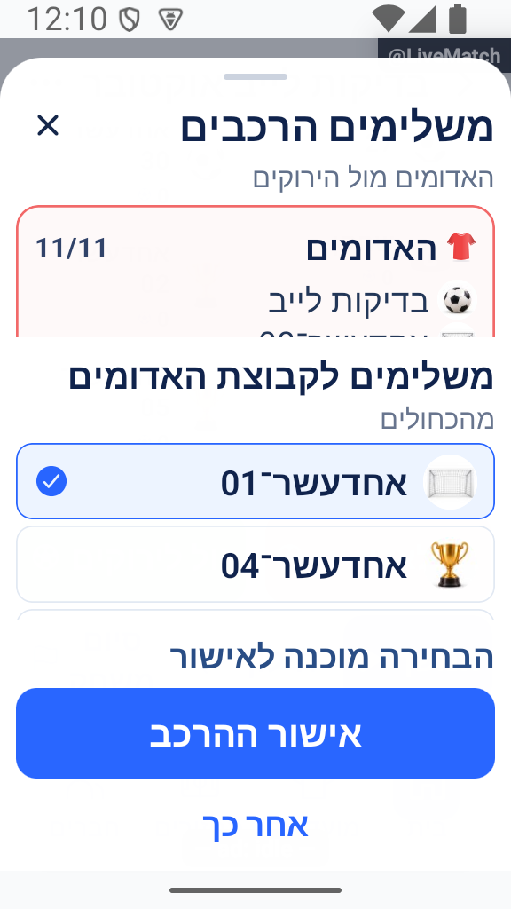
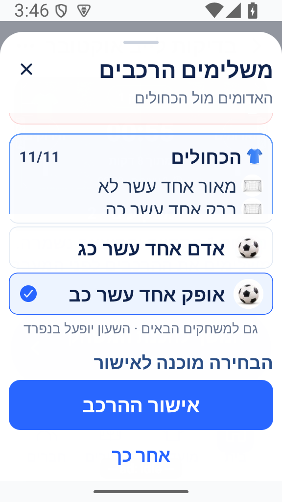
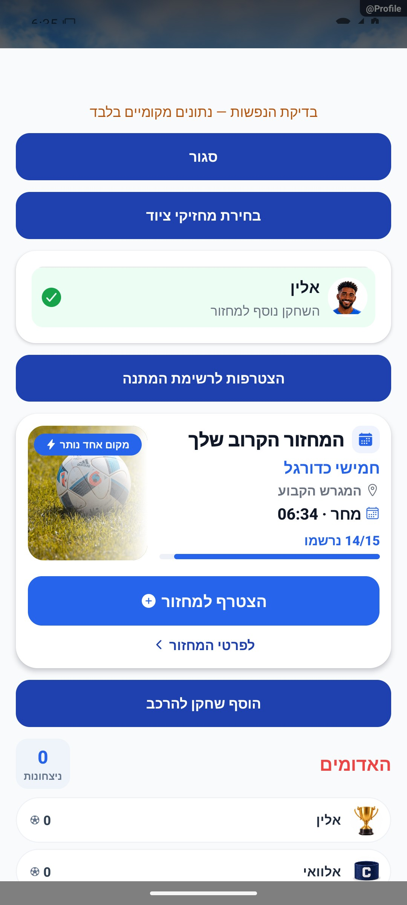

# ממלאים, השאלה ורוטציה — הסבר פשוט

## תיעוד כשלים — 20.10.2026

נוסף תיעוד אוטומטי לנקודות כשל במסלול הזה, עם מקור התקלה. הפעולה המקורית שומרת על ערכי החזרה והודעות השגיאה שלה. השינוי מקומי, טרם הופץ, ואין אימות מסירה חיה לפולס.

[דוח דיווח השגיאות והראיות](../../changes/2026-10-20-error-reporting-audit.md).

## קבוצה מלאה והחזרת שחקן — 18.10.2026

אם הקבוצה מלאה ואין מידע בטוח על המשלים שצריך לחזור לקבוצתו, ההחזרה נעצרת ומופיעה הנחיה לפנות מקום במסך החילופים ואז לנסות שוב. השחקן נשאר מסומן כמי שיצא, ושום הרכב אינו משתנה בגלל הניסיון שנדחה. כשיש מקום אפשר להחזיר כרגיל, גם בלי להפעיל שעון. ההודעה ואחדעשר־03 שנותר תחת ״הלכו הביתה״ נצפו במכשיר מול מחזור הבדיקה בייצור; השוואת נתוני הלפני ואחרי בנפרד הראתה שלא השתנו המחזור ואוגדי הנתונים שלו. אין בכך הוכחה שהחזרה אחרי פינוי מקום הושלמה או שבסיס ישן שוחזר. [הצילום, הבדיקות והגבולות](fillers.md#החזרה-בטוחה-כשבסיס-קבוע-כבר-חסר--18102026).

## בחירה ופעולות גלויות במכשיר קטן — 18.10.2026

בצילום חדש ממחזור הבדיקה בייצור, ברוחב כ־320 ובגופן 140%, המשלים 01 מסומן עבור האדומים וכפתורי אישור ההרכב ו״אחר כך״ גלויים. ההרכבים והמועמדים נמשכים באזורי גלילה; התמונה אינה מציגה את כולם. היא צולמה לפני האישור, והעברת השחקן ושינוי הקפטן נבדקו בנפרד בנתונים. אין בה הוכחה לתיקון החזרת משלים אחרי מעבר משחק. [הצילום, המקור והמגבלות](fillers.md#ראיות-השלמה-נוספות-במכשיר-קטן--18102026).

## החזרת משלים גם אחרי שעוברים משחק — 18.10.2026

תוקן מעבר שאיבד את סגל הבסיס של הקבוצות. כשהבסיס חסר, החזרת שחקן הביתה עלולה הייתה להשאיר גם אותו וגם את המשלים באותה קבוצה. הבסיס נשמר כעת גם אחרי ניצחון או תיקו, והבדיקות מחזירות את המשלים לקבוצתו בלי ליצור שחקן עודף. נתונים שכבר איבדו את הבסיס אינם משוחזרים אוטומטית; בדיקת המכשיר למעבר המתוקן עדיין אצל המוביל. [המקור והגבולות](fillers.md#בסיס-הקבוצות-נשמר-גם-במעבר-למשחק-הבא--18102026).

## קפטן נשאר שייך לקבוצתו — 18.10.2026

בהשלמה קבועה, אם המשלים היה קפטן הקבוצה שממנה יצא, נבחר לה קפטן מתוך השחקנים שנשארו. קפטן תקף נשמר, ובהשאלה זמנית קפטן קבוצת הבית אינו מתחלף. בחירת הקפטן החדש אושרה גם במקור נתונים של ההעברה שביצע המוביל; ההחזרה שאחריה חשפה פגם בסיס נפרד. [הנתונים והבדיקות](fillers.md#קפטן-תקף-אחרי-השלמה-קבועה--18102026).

## הצעת השלמה אחרי עזיבה — 18.10.2026

אם שחקן הלך הביתה והקבוצה שמשחקת נשארה קצרה, ההשלמה מתבססת על העזיבה שאושרה. תמונת הרכב ישנה אינה נחשבת עוד כהוכחה שהקבוצה מלאה. ההמתנה מוגבלת, ושינוי משחק או הרכב אינו פותח הצעה ישנה. אין צורך להתחיל שעון, והוא והתוצאה נשארים כמו שהיו.

התיקון נבדק בקוד אחרי ממצא ייצור. המוביל חזר במכשיר על העזיבה, ההצעה נפתחה והמשלים נשמר. הקריאה שנכשלה בניסיון המקורי לא נלכדה; בניסיון המתוקן נחשף גם פגם קפטן נפרד. שינוי הקפטן אחרי תיקונו נבדק במקור הנתונים של פעולה נוספת במכשיר, אך ההחזרה שאחריה חשפה פגם בסיס נפרד. אלה אינם אישור כולל לכל ההשלמה וההחזרה. [הבדיקות והגבולות](fillers.md#הצעת-השלמה-אחרי-אישור-עזיבה--18102026).

## עזיבה והחזרה מול הרכב עדכני — 18.10.2026

עזיבה או החזרה של שחקן נבדקות מול ההרכב העדכני בזמן השמירה. ניסיון חוזר אינו מוציא או מוסיף אותו פעמיים. בהחזרה קבועה, גם אורח שמילא מקום חוזר לקבוצה המקורית שלו. חלוקה מחדש אינה מחזירה מי שהלך הביתה; צריך להחזיר אותו במפורש.

[דוח הביקורת, הבדיקות וגבולות האימות](../../changes/2026-10-18-preproduction-end-to-end.md).

## השלמה במסך קטן ובגופן מוגדל — 17.10.2026

חלון ההשלמה תוחם את התוכן לפי המקום הפנוי במכשיר. אישור ו״אחר כך״ נשארים בתחתית, ושתי רשימות נגללות בנפרד: ההרכבים הקיימים והמועמדים להשלמה. כך אפשר להגיע גם לשחקנים האחרונים בקבוצה של אחד עשר, בלי שהתוכן ידחוף את הפעולות מחוץ למסך. פירוט משך ההשלמה נמצא באזור הנגלל; הבחירה עצמה וכללי ההשלמה לא השתנו, ולא נוספה לחיצת אישור.

ליד שם כל קבוצה מוצגת החולצה המלאה המעודכנת בצבע שלה, כמו בלוח התוצאות ובחלונות הלייב.

התיקון מקומי בעקבות חסימה שנצפתה במסך קטן עם גופן מוגדל. באימולטור אנדרואיד מול מחזור הבדיקה בייצור נפתח החלון מחדש, נגללו ההרכבים והמועמדים בנפרד ונבחר המועמד האחרון. הקבוצה החסרה התעדכנה מעשרה לאחד עשר שחקנים; האישור ו״אחר כך״ נשארו גלויים. אישור ההשלמה העביר למשחק השני בתוצאת אפס מול אפס, בלי להפעיל שעון ובלי לשמור שוב את המשחק הראשון. נבדקה כאן השלמה קבועה, במסך ברוחב 320 ובגופן 140%; אין בכך אימות אייפון או כל סוגי ההשלמה. [הצילומים, הנתונים והגבולות](fillers.md#תחימת-חלון-השלמה-במסך-קטן--17102026).

אם חסר שחקן לקבוצה שעל המגרש, המנהל יכול לבחור ממלא. מילוי זמני משאיל שחקן; מילוי קבוע משנה את הקבוצה שלו. זה שונה מהזמנת שחקן חדש מהאזור למחזור.

[להסבר המעמיק ולמפת הקוד](fillers.md)

## צילום והיקף ההוכחה

הצילומים מציגים רק את המצבים המתועדים במסמך המעמיק. חלקם נתוני דמו, חלקם הוכחות מתיקון קודם, ובכמה מהם טעינה או הודעת הגנה; הם אינם אישור שכל התהליך או השרת נבדקו.

## השלמת הנפשות — 8.10.2026

אישור ממלא מציג את תמונתו עם סימון ירוק לאחר הצלחה. כששחקן נכנס להרכב החי, תמונתו מופיעה בתנועה קצרה. כשל אישור אינו מציג הצלחה.

[פרטי האימות והמגבלות](../../changes/2026-10-08-motion-completion.md). מקור: `9ec0dfd` עם שינויים מקומיים; טרם פורסמה גרסה.

## בחירת משלימים עם ההרכבים מול העיניים — 16.10.2026

בחלון ההשלמה רואים את שתי הקבוצות ואת האווטרים והשמות של השחקנים שכבר בהרכב. המכסה מותאמת לגודל המשחק, מארבעה ועד אחד עשר שחקנים בקבוצה. החוסר כתוב במילים; בחירה נעשית בלחיצה על שורת שחקן, וסימון אישור מופיע רק לצד הבחירה.

בבחירה משותפת, מילוי קבוצה מעביר את הבחירה לקבוצה השנייה שעדיין חסרה. אפשר לחזור לקבוצה באמצעות הכרטיס שלה. שחקן שנבחר לקבוצה אחת אינו זמין לאחרת. קבוצת המקור של המשלים נשארת ברורה, ומוני משחקים והשלמות נמצאים ב״פירוט״.

האישור שומר את הבחירות לפי המסלול הקיים; הפעלת השעון נשארת פעולה נפרדת. בהשלמה זמנית בשלבים המשלים חוזר כשהמקור עולה או כשהקבוצה המקבלת יוצאת, ולכן ההשלמה עשויה להימשך יותר ממשחק אחד. השלמה קבועה נשארת גם למשחקים הבאים.

השינוי מקומי. [ראיות, בדיקות ומגבלות](../../changes/2026-10-16-fill-popup.md).

## שילוב במסכים המחודשים — 16.10.2026

מסך בחירת הקבוצות והצבעים מוביל לאותו חלון השלמה עם שני ההרכבים מול העיניים. בלייב רואים גם אצל איזו קבוצה שחקן ממתין משלים כעת. חילוף זמני וקבוע בחלון החילופים מכבד את הגדרת המחזור, גם כשמשתתף בו משלים. [פרטים וצילומים](../../changes/2026-10-16-live-game-redesign.md).

## תלות בעדכון העונות — 19.10.2026

קובץ תשתית משותף עודכן במסגרת העונות. שינוי זה אינו מוסיף פעולה חדשה למסך המתואר כאן; פרטי העונות והבדיקות מופיעים במסמך העונות.

[מצב המימוש, הבדיקות ומגבלות האימות של העונות](../clubs/seasons.md). מקומי בלבד; לא בוצעה פריסה במסגרת המשימה.
