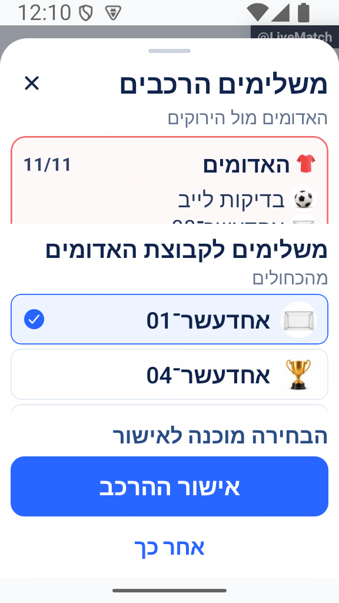
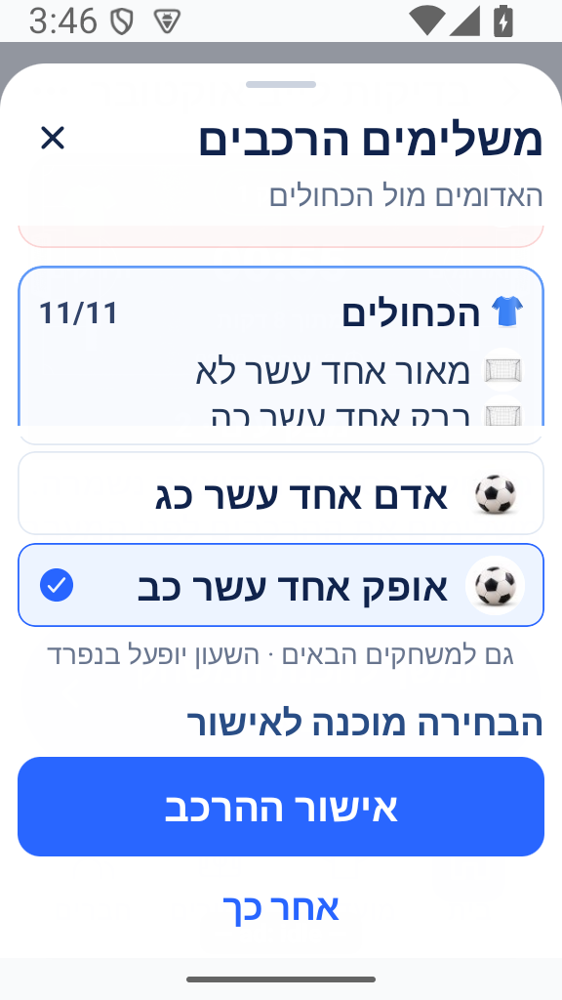
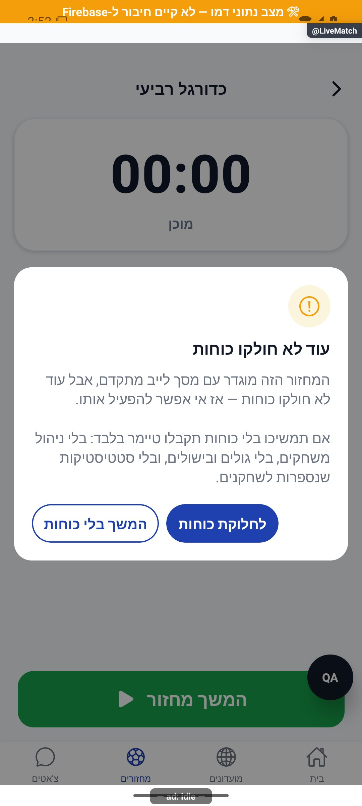
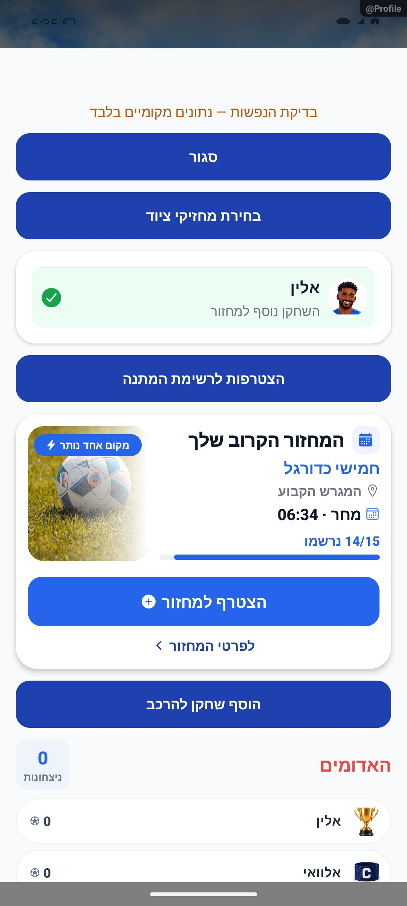
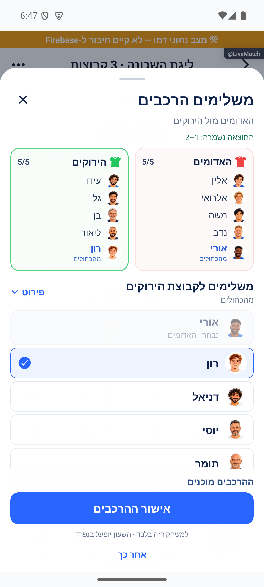

# ממלאים, השאלה ורוטציה — הסבר פשוט

## עצירת מחזור קבוע ללא פעילות, 6.11.2026

נוספה במנגנון השרת עצירה של מחזור קבוע לאחר שלושה מחזורים רצופים ללא פעילות. ההשפעה כאן תחומה לתלות המשותפת בפתיחת מחזורים וניקוי מחזורים ריקים; אין אימות חדש של כל פעולות המסך. מנגנון השרת נפרס והופעל באישור הבעלים; אין צורך בגרסת טלפון חדשה להפעלתו. [ההתנהגות, מסלול הנתונים, הבדיקות ומגבלות ההפעלה](../../changes/2026-11-06-inactive-recurring-rounds.md).

## סף תפוסה פעיל בשרת, 6.11.2026

נפרס ואומת סף של לפחות 70 אחוז תפוסה ועד פחות ממחזור מלא להצעות השלמה. למשל, במחזור של 15 מקומות נדרשים לפחות 11 משתתפים. שחקנים רשומים ואורחים פעילים נספרים, וממתינים אינם נספרים. התנאי חל בסריקה האוטומטית, בפעימות ההזמנה ובבקשת מנהל. אין צורך בעדכון יישום כדי שהשרת יאכוף אותו.

פריסה זו אינה כוללת את בדיקת ההתנגשות בהרשמה שתועדה ב-28.10 או שינויים מקומיים אחרים. לא נשלחו התראות בדיקה. [ראיות הפריסה והבדיקות](../../changes/evidence/2026-11-06-filler-70-server/verification.json).

## דירוג בסיס לשחקן ללא דירוג, 6.11.2026

נבדק שינוי תחום במקורות המשותפים של הכוחות האוטומטיים: שחקן ללא דירוג מחושב כ-2.5 מתוך 5, וההסברים תואמים. דירוג מפורש נשמר. אין כאן אימות חדש של כל מצבי הפיצר העצמאי; השינוי מקומי וטרם הופץ. [ההתנהגות, הבדיקות ומגבלות האימות](../rounds/draft-setup.md#דירוג-בסיס-לשחקן-ללא-דירוג-6112026).

## סבב תיקוני הפולס, 5.11.2026

עודכן התיעוד לפי תיקונים ברכיבים משותפים. מקומי וטרם הופץ. הבדיקה החזותית היא של רכיבי מקור במתאם דפדפן עם נתוני הדגמה, ולא בדיקת מכשיר או שרת חדשה. [מקורות, בדיקות ומגבלות](../../changes/2026-11-05-pulse-sweep.md).

## מדידת פעולות ואמינות נתונים, 5.11.2026

נוספה הכנה למדידת הפעולות ברכיבים המתועדים כאן. בפולס אפשר לראות ביצועים וחשבונות ייחודיים לפי פעולה ותקופה, כאשר קיים כיסוי מדידה. איסוף החשבונות החדש עדיין כבוי והמימוש מקומי. [פירוט והיקף הבדיקות](../../audits/2026-11-04-system-night/product-measurement.md).

## אישור מול הרשמה רגילה, 4.11.2026

בדוח השימוש סופרים החלטה על מועמד רק אחרי שהתקבל אישור שההחלטה שינתה את הבקשה. לחיצה נוספת אחרי שהמועמד כבר נרשם אינה נספרת כהחלטה חדשה.

כשמנהל מאשר שחקן השלמה ושחקן אחר נרשם למקום האחרון, רק אחד נכנס לסגל והשני עובר להמתנה. התראת האישור שנשמרה עבור שחקן ההשלמה ציינה את מקומו בפועל. נמצא פער כשמבטלים בקשת השלמה שכבר אושרה בקריאה ישירה למסד. [תוצאות הבדיקה](../../audits/2026-11-04-system-night/registration.md).

## בקשות השלמה משחקנים מבחוץ, 4.11.2026

שחקן שכבר נרשם למחזור, נכנס להמתנה או הגיש בקשת הרשמה רגילה אינו מוצג עוד למנהל כמועמד מבחוץ. מי שרק התקבל למועדון עדיין יכול לחכות למקום במחזור. הבקשות הפעילות מופיעות גם בפעמון שבבית. מקומי וטרם הופץ. [הראיות והמגבלות](../../changes/2026-11-04-filler-requests.md) · [דרכי הכניסה וההמלצות](../../specs/2026-11-04-outside-round-players.md).

## חיפוש שחקנים וזמני טעינה, 4.11.2026

רשימת הפנויים להזמנה ידנית מחזירה מועמדים מהר יותר. ההחלטה אם אפשר להזמין או להצטרף ממשיכה להיבדק בזמן הפעולה. מימוש מקומי שטרם הופץ. [השינוי, המדידות והבדיקות](../../changes/2026-11-04-player-discovery-speed.md).

## ציר פעילות פרטי בפולס, 4.11.2026

בציר הפעילות, תשובת שרת על מצב הרשמה קיים אינה נספרת כהרשמה חדשה. קבלה ללא סימון יצירה מפורש מוצגת עם מגבלת אמינות.

נוסף תיעוד פרטי של ביקורים ופעילות במערכת הניהול. התוספת מקומית והאיסוף החדש כבוי כברירת מחדל; אין בדיקת מכשיר חדשה של מסך זה. מקומי וטרם הופץ או נפרס. [היקף, מקורות, בדיקות ומגבלות](../shared/usage-activity.md).

## שיפורי טעינה משותפים, 4.11.2026

עודכנו מנגנוני הטעינה המשותפים כדי לצמצם עבודה וקריאות חוזרות. דרך השימוש בפיצר נשמרת. השינוי מקומי וטרם הופץ, ואין אימות מכשיר חדש של המסך הזה. [היקף, מדידות ומגבלות](../../changes/2026-11-04-screen-performance.md).

## תיקוני דיווחי הפולס, 3.11.2026

במקור השרת המשותף הועבר זיהוי של הרשמה שכבר נספרה לפני רישום השגיאה. אין שינוי מכוון בפעולות העצמאיות או בנתונים של הפיצר הזה. התיקון מקומי וטרם נפרס.

[פירוט התיקונים, הבדיקות, הצילומים והמגבלות](../../changes/2026-11-03-pulse-sweep.md).

## העברת אורח לרשימת המתנה, 3.11.2026

במקור המשותף תוקנה העברה ידנית של אורח מההרכב להמתנה, כדי שלא יקודם מיד מחדש. אין שינוי מכוון בפעולות העצמאיות של המסך המתואר כאן, ולא נערכה לו בדיקת מסך חדשה. התיקון מקומי וטרם הופץ.

[פרטי השינוי המשותף](../../changes/2026-11-03-guest-waitlist.md).

## שלדי טעינה בשלושה אזורים, 2.11.2026

עודכנה בדיקת רקע משותפת לטעינת נתונים. אין שינוי בפעולות או בתצוגה העצמאית של הפיצר הזה. השינוי מקומי וטרם הופץ. [מימוש, בדיקות, צילומים ומגבלות](../../changes/2026-11-02-loading-skeletons.md).

## אימות פרסום קבוצות בפולס, 2.11.2026

נבדק ההפרש התחום בשירות המשותף של המחזורים: נוספה בדיקת אישור לפרסום קבוצות כאשר תשובת הפעולה אובדת. אין שינוי בחישוב, במכנים או בפעולות העצמאיות של הפיצר המתואר כאן. התיקון מקומי וטרם הופץ; אין בדיקת מכשיר חדשה לפיצר זה.

[דוח הטיפול, הבדיקות והמגבלות](../../changes/2026-11-02-pulse-sweep.md).

## בקשות לשיחה אישית, 2.11.2026

נבדקה השפעת תוספת בקשות השיחה במקורות המשותפים. השינוי ממוקד בהרשאת שיחה, בשדות פרטיות ההודעות ובחיבורי הבדיקות; אין מכך אימות חדש של מסך זה במכשיר. המימוש מקומי וטרם הופץ או נפרס. [התנהגות, בדיקות ומגבלות](../chat/message-requests.md).

## הסרת מגבלת החברים במועדון, 1.11.2026

נבדקה השפעת השינוי הממוקד במקורות המשותפים: הוסרה מגבלת החברים במועדון. אין שינוי מכוון בהתנהגות העצמאית של המסך המתואר כאן או במספר המקומות במחזור. התיקון מקומי וטרם הופץ; אין בדיקת מכשיר חדשה לפיצר זה.

[מסלול הנתונים, התנאים, התאימות, הבדיקות ומגבלות ההפצה](../../changes/2026-11-01-unlimited-club-members.md).

## פריסת הגנות הסרת המחזור, 30.10.2026

שבעת תיקוני השרת להגנת הסרת מחזור ולספירת המחזורים המתועדים נפרסו באישור ונבדקו בשרת. המחזור לא נמחק, וכל נתוני המועדון שנבדקו נשמרו. אין כאן הפצת יישום חדשה או בדיקת מכשיר.

[גרסאות פעילות, בדיקות שרת וגבולות האישור](../../changes/2026-10-30-evening-removal-server-deployment.md).

## השלמת הגנת הסרת המחזור, 30.10.2026

ההכנה המקומית מגינה גם על סנכרון מדידות אישי ועל יומן הנתונים ללוח המנהל. עיבוד ישן אינו יכול להחזיר מידע אחרי הסרה או בזמן הקפאה. אין שינוי חזותי, הרשאות חדשות או פעולת מחיקה בממשק; שבעה תיקוני שרת מוכנים לבדיקה ולפריסה באישור נפרד. לא בוצעה הסרה בייצור.

[תוכנית הביצוע, החבילות, הבדיקות וגבולות האישור](../../changes/2026-10-30-evening-removal-readiness.md).

## הגנה בהסרת מחזור היסטורי, 30.10.2026

נבדק השינוי התחום במקורות השרת המשותפים: נוספה הגנה מפני עיבוד מאוחר של מחזור שהוסר, ותוקנה ספירת מחזורים מתועדים בסטטיסטיקה. אין שינוי מכוון בניווט או בחישובים העצמאיים של הפיצר המתואר כאן. התיקונים מקומיים וטרם נפרסו; לא נערכה בדיקת מכשיר חדשה שלו.

[התנהגות, סדר הפעולות, חישובים, בדיקות וגבולות האישור](../../changes/2026-10-30-evening-removal-readiness.md).

## החלפת הקבוצה הבועטת בפנדלים, 30.10.2026

בפנדלי ההכרעה נוספה אפשרות לבחור את הקבוצה שבועטת כעת, בלי למחוק את הבעיטות הקודמות. זהו עדכון תחום במקורות משותפים; אין שינוי מתוכנן במסך המתואר כאן ואין אימות מכשיר חדש שלו. [התנהגות, בדיקות ומגבלות](../../changes/2026-10-30-shootout-turn.md).

## התאוששות משגיאות בפולס, 28.10.2026

טעינת פרטי מחזור וטבלת מועדון יכולה להתאושש מכשל חיבור קצר בעזרת ניסיון נוסף. כשל מתמשך נשאר גלוי ואינו מוצג כאפס או כמידע חסר שאומת.

השינוי מקומי וטרם הופץ. [ממצאים, בדיקות ומגבלות](../../changes/2026-10-28-pulse-errors.md).

## הצעות השלמה מתאימות יותר - 28.10.2026

הצעה להשלמת מחזור תישלח רק כשהתפוסה הגיעה ל-70 אחוז לפחות ועדיין יש מקום פנוי. למשל, במחזור של 15 מקומות נדרשים לפחות 11 משתתפים, כולל אורחים. אם כבר רשומים למחזור מתנגש, ההצעה לא תישלח, לפי חלון ארבע השעות הקיים באפליקציה. המתנה לאישור או למקום אינה נחשבת להרשמה מאושרת לצורך החסימה.

סף התפוסה נפרס ב-6.11.2026 כמפורט בראש המסמך. סינון ההרשמה המתנגשת נשאר מקומי וטרם נפרס. אין כאן שינוי חזותי או בדיקת שליחה חיה. [הבדיקות והמגבלות המקוריות](../../changes/2026-10-28-filler-eligibility.md).

## הרחבת אבחון דיווחים, 27.10.2026

הדיווחים יוכלו לכלול מה ניסו לבצע, מה היה מצב האפליקציה ומה החזיר השרת. פרטים חסרים מוצגים כלא ידועים, ומספר מוגבל של מופעים נשמר בלי למחוק את המופע הראשון. השינוי מקומי וטרם הופץ, ואינו משלים פרטים לדיווחים ישנים. [היקף, ראיות ומגבלות](../../changes/2026-10-27-diagnostic-context.md).

בדיקות הקוד הושלמו, אך השינוי עדיין מקומי ולא הופץ. פרטים שלא נאספו בדיווחים ישנים אינם משוחזרים בדיעבד.

## טיפול בתקלות הפולס, 26.10.2026

עודכן הטיפול באישור שעון בחלון הפנדל מתוך המסך המשותף. אין שינוי בחיפוש משלימים, בסדר ההמתנה או בשיבוץ.

השינוי מקומי וטרם הופץ. [בדיקות, מסירה ומגבלות](../../changes/2026-10-26-pulse-fixes.md).

## השפעת מקור משותף במשימת השעון - 26.10.2026

עצירת הרוטציה עוצרת כעת גם את שעון המשחק ושומרת את פרק הריצה האחרון. הרכב המקור משוחזר עם קפטן שנמצא בו, והשלמה שאינה מאפסת את המשחק משאירה את השעון פועל. לא נערכה כאן בדיקה חדשה של כל מצבי המסך. השינוי מקומי, ומצב ההפצה ומגבלות הבדיקה מפורטים בדוח המקושר. [היקף המימוש, הבדיקות, מגבלות האישור והצילומים](../../changes/2026-10-26-android-personal-activity.md).

## זמן אירועים מלא אחרי משך המשחק - 25.10.2026

גולים ופנדלים במהלך משחק נשמרים כעת לפי הזמן המלא של המשחק, גם אחרי משך המשחק שנקבע. לדוגמה, במשחק של שמונה דקות שהגיע לעשר דקות ושלושים שניות, גול נשמר בדקה האחת עשרה ובחלון הפנדל מופיע הזמן עשר דקות ושלושים שניות. התיקון מקומי וטרם הופץ. [בדיקות, צילום ומגבלות](../../changes/2026-10-25-overtime-event-time.md).

## הפצה פנימית 1.1.61 - 25.10.2026

הבינארי `1.1.61/295` הופץ ואומת במסלול הפנימי באנדרואיד. תיקוני הלקוח נכללים בו, ושירות הפרופיל נפרס ואומת בנפרד. גם תיקוני הסגל, שמירת התוצאה והתראת השגיאה בשרת נפרסו ואומתו באישור מפורש. שינויי יישום הפולס עצמו טרם הופצו. אין שינוי כללי הרשאה או הסבת נתונים. ניסוחי המצב המקומי בסעיפים הקודמים נכתבו לפני ההפצה; [דוח ההפצה](../../changes/2026-10-25-internal-1.1.61.md) מפרט בדיוק מה נכלל, מה נבדק ומה עדיין מקומי.

## תיקוני הפולס - 25.10.2026

נבדק תיקון ממוקד בקובץ משותף במהלך סבב הפולס. אין שינוי מכוון בתהליך העצמאי המתואר כאן ואין טענה לבדיקת מסך חדשה שלו. מקומי וטרם הופץ.

[מקורות, בדיקות, צילומים ומגבלות](../../changes/2026-10-25-pulse-fixes.md).

## הכדורגל שלי בעמוד הראשון של הקרוסלה - 25.10.2026

עודכנה הקרוסלה האישית בבית, בקובץ משותף לתהליך הזה או לכלי הבדיקה שלו. אין שינוי נוסף בפעולות המתוארות כאן ולא נערכה להן בדיקת ממשק חדשה. מקומי וטרם הופץ. [השינוי והבדיקות](../../changes/2026-10-25-home-profile-carousel.md).

## הוסף אירוע במסך הלייב - 25.10.2026

במסך הלייב המשותף אוחדו שני כפתורי הגול והפנדל לכפתור הוסף אירוע וחלון בחירה. לא שונו ממלאים, השאלה, הרכבים או חישובי רוטציה. [ראיות ומגבלות](../../changes/2026-10-25-add-match-event.md). מקומי וטרם הופץ.

## שעון מדויק וכיתוב פנדל - 25.10.2026

במקורות המשותפים נוסף שימור השעון המדויק של פנדל במהלך משחק, וכיתוב ההבקעה ביומן קוצר. אין שינוי במונים או בתהליך העצמאי המתואר כאן; לא נערכה לו בדיקת ממשק חדשה במסגרת העדכון. השינוי מקומי וטרם הופץ. [פרטים וראיות](../../changes/2026-10-25-in-play-penalties.md#שעון-מדויק-וכיתוב-אירוע).

## פנדל במהלך משחק חי - 25.10.2026

עודכנו מקורות משותפים לצורך פנדלים במהלך משחק. אין שינוי מכוון בתהליך העצמאי המתואר במסמך הזה, ולא נערכה לו בדיקת ממשק חדשה במסגרת המשימה.

השינוי מקומי. נדרשת פריסת שרת לפני הפצת לקוח שמשתמש באפשרות; לא בוצעו פריסה או שינוי הרשאות. [חוזה הנתונים, התהליך, הבדיקות ומגבלות ההפצה](../../changes/2026-10-25-in-play-penalties.md).

## חזרה מארון התארים לכרטיס המקורי — 24.10.2026

לערימת הניווט המשותפת נוסף רישום מקומי של ארון התארים, כדי שחזרה מכרטיס שחקן לא תחליף לשונית. אין שינוי מכוון בהתנהגות העצמאית המתוארת כאן, ואין בדיקת ממשק חדשה שלה. התיקון מקומי ולא הופץ. [מסלול הניווט, בדיקות, צילומים ומגבלות](../../changes/2026-10-24-cabinet-back.md).

## בדיקת עומק לעריכת הקבוצות — 24.10.2026

נבדק שהחלפת הקבוצות נשמרת רק לאחר בחירת המשלימים, ושביטול או כשל משאירים את המשחק הקודם. נבדקו גם שתי קבוצות קצרות והיעדר משלימים. [פירוט ומגבלות](../../audits/2026-10-24-live-teams.md). מקומי וטרם הופץ.

## השלמה אחרי החלפת הקבוצות במשחק — 24.10.2026

אם מחליפים קבוצות דרך תפריט הלייב ונדרשים משלימים, בוחרים אותם לפני שהשינוי נשמר. ביטול משאיר את המשחק הקודם כפי שהיה. החלפה שאושרה מאפסת רק את המשחק הנוכחי, בלי להוסיף לו נתונים. [פירוט ומגבלות](live-advanced.md#עריכת-הקבוצות-והתור-בזמן-הלייב--24102026). מקומי וטרם הופץ.

## תיעוד כשלים — 20.10.2026

נוסף תיעוד אוטומטי לנקודות כשל במסלול הזה, עם מקור התקלה. הפעולה המקורית שומרת על ערכי החזרה והודעות השגיאה שלה. השינוי מקומי, טרם הופץ, ואין אימות מסירה חיה לפולס.

[דוח דיווח השגיאות והראיות](../../changes/2026-10-20-error-reporting-audit.md).

## קבוצה מלאה והחזרת שחקן — 18.10.2026

אם הקבוצה מלאה ואין מידע בטוח על המשלים שצריך לחזור לקבוצתו, ההחזרה נעצרת ומופיעה הנחיה לפנות מקום במסך החילופים ואז לנסות שוב. השחקן נשאר מסומן כמי שיצא, ושום הרכב אינו משתנה בגלל הניסיון שנדחה. כשיש מקום אפשר להחזיר כרגיל, גם בלי להפעיל שעון. ההודעה ואחדעשר־03 שנותר תחת ״הלכו הביתה״ נצפו במכשיר מול מחזור הבדיקה בייצור; השוואת נתוני הלפני ואחרי בנפרד הראתה שלא השתנו המחזור ואוגדי הנתונים שלו. אין בכך הוכחה שהחזרה אחרי פינוי מקום הושלמה או שבסיס ישן שוחזר. [הצילום, הבדיקות והגבולות](fillers.md#החזרה-בטוחה-כשבסיס-קבוע-כבר-חסר--18102026).

## בחירה ופעולות גלויות במכשיר קטן — 18.10.2026

בצילום חדש ממחזור הבדיקה בייצור, ברוחב כ־320 ובגופן 140%, המשלים 01 מסומן עבור האדומים וכפתורי אישור ההרכב ו״אחר כך״ גלויים. ההרכבים והמועמדים נמשכים באזורי גלילה; התמונה אינה מציגה את כולם. היא צולמה לפני האישור, והעברת השחקן ושינוי הקפטן נבדקו בנפרד בנתונים. אין בה הוכחה לתיקון החזרת משלים אחרי מעבר משחק. [הצילום, המקור והמגבלות](fillers.md#ראיות-השלמה-נוספות-במכשיר-קטן--18102026).

## החזרת משלים גם אחרי שעוברים משחק — 18.10.2026

תוקן מעבר שאיבד את סגל הבסיס של הקבוצות. כשהבסיס חסר, החזרת שחקן הביתה עלולה הייתה להשאיר גם אותו וגם את המשלים באותה קבוצה. הבסיס נשמר כעת גם אחרי ניצחון או תיקו, והבדיקות מחזירות את המשלים לקבוצתו בלי ליצור שחקן עודף. נתונים שכבר איבדו את הבסיס אינם משוחזרים אוטומטית; בדיקת המכשיר למעבר המתוקן עדיין אצל המוביל. [המקור והגבולות](fillers.md#בסיס-הקבוצות-נשמר-גם-במעבר-למשחק-הבא--18102026).

## קפטן נשאר שייך לקבוצתו — 18.10.2026

בהשלמה קבועה, אם המשלים היה קפטן הקבוצה שממנה יצא, נבחר לה קפטן מתוך השחקנים שנשארו. קפטן תקף נשמר, ובהשאלה זמנית קפטן קבוצת הבית אינו מתחלף. בחירת הקפטן החדש אושרה גם במקור נתונים של ההעברה שביצע המוביל; ההחזרה שאחריה חשפה פגם בסיס נפרד. [הנתונים והבדיקות](fillers.md#קפטן-תקף-אחרי-השלמה-קבועה--18102026).

## הצעת השלמה אחרי עזיבה — 18.10.2026

אם שחקן הלך הביתה והקבוצה שמשחקת נשארה קצרה, ההשלמה מתבססת על העזיבה שאושרה. תמונת הרכב ישנה אינה נחשבת עוד כהוכחה שהקבוצה מלאה. ההמתנה מוגבלת, ושינוי משחק או הרכב אינו פותח הצעה ישנה. אין צורך להתחיל שעון, והוא והתוצאה נשארים כמו שהיו.

התיקון נבדק בקוד אחרי ממצא ייצור. המוביל חזר במכשיר על העזיבה, ההצעה נפתחה והמשלים נשמר. הקריאה שנכשלה בניסיון המקורי לא נלכדה; בניסיון המתוקן נחשף גם פגם קפטן נפרד. שינוי הקפטן אחרי תיקונו נבדק במקור הנתונים של פעולה נוספת במכשיר, אך ההחזרה שאחריה חשפה פגם בסיס נפרד. אלה אינם אישור כולל לכל ההשלמה וההחזרה. [הבדיקות והגבולות](fillers.md#הצעת-השלמה-אחרי-אישור-עזיבה--18102026).

## עזיבה והחזרה מול הרכב עדכני — 18.10.2026

עזיבה או החזרה של שחקן נבדקות מול ההרכב העדכני בזמן השמירה. ניסיון חוזר אינו מוציא או מוסיף אותו פעמיים. בהחזרה קבועה, גם אורח שמילא מקום חוזר לקבוצה המקורית שלו. חלוקה מחדש אינה מחזירה מי שהלך הביתה; צריך להחזיר אותו במפורש.

[דוח הביקורת, הבדיקות וגבולות האימות](../../changes/2026-10-18-preproduction-end-to-end.md).

## השלמה במסך קטן ובגופן מוגדל — 17.10.2026

חלון ההשלמה תוחם את התוכן לפי המקום הפנוי במכשיר. אישור ו״אחר כך״ נשארים בתחתית, ושתי רשימות נגללות בנפרד: ההרכבים הקיימים והמועמדים להשלמה. כך אפשר להגיע גם לשחקנים האחרונים בקבוצה של אחד עשר, בלי שהתוכן ידחוף את הפעולות מחוץ למסך. פירוט משך ההשלמה נמצא באזור הנגלל; הבחירה עצמה וכללי ההשלמה לא השתנו, ולא נוספה לחיצת אישור.

ליד שם כל קבוצה מוצגת החולצה המלאה המעודכנת בצבע שלה, כמו בלוח התוצאות ובחלונות הלייב.

התיקון מקומי בעקבות חסימה שנצפתה במסך קטן עם גופן מוגדל. באימולטור אנדרואיד מול מחזור הבדיקה בייצור נפתח החלון מחדש, נגללו ההרכבים והמועמדים בנפרד ונבחר המועמד האחרון. הקבוצה החסרה התעדכנה מעשרה לאחד עשר שחקנים; האישור ו״אחר כך״ נשארו גלויים. אישור ההשלמה העביר למשחק השני בתוצאת אפס מול אפס, בלי להפעיל שעון ובלי לשמור שוב את המשחק הראשון. נבדקה כאן השלמה קבועה, במסך ברוחב 320 ובגופן 140%; אין בכך אימות אייפון או כל סוגי ההשלמה. [הצילומים, הנתונים והגבולות](fillers.md#תחימת-חלון-השלמה-במסך-קטן--17102026).

אם חסר שחקן לקבוצה שעל המגרש, המנהל יכול לבחור ממלא. מילוי זמני משאיל שחקן; מילוי קבוע משנה את הקבוצה שלו. זה שונה מהזמנת שחקן חדש מהאזור למחזור.

[להסבר המעמיק ולמפת הקוד](fillers.md)

## צילום והיקף ההוכחה

הצילומים מציגים רק את המצבים המתועדים במסמך המעמיק. חלקם נתוני דמו, חלקם הוכחות מתיקון קודם, ובכמה מהם טעינה או הודעת הגנה; הם אינם אישור שכל התהליך או השרת נבדקו.

## השלמת הנפשות — 8.10.2026

אישור ממלא מציג את תמונתו עם סימון ירוק לאחר הצלחה. כששחקן נכנס להרכב החי, תמונתו מופיעה בתנועה קצרה. כשל אישור אינו מציג הצלחה.

[פרטי האימות והמגבלות](../../changes/2026-10-08-motion-completion.md). מקור: `9ec0dfd` עם שינויים מקומיים; טרם פורסמה גרסה.

## בחירת משלימים עם ההרכבים מול העיניים — 16.10.2026

בחלון ההשלמה רואים את שתי הקבוצות ואת האווטרים והשמות של השחקנים שכבר בהרכב. המכסה מותאמת לגודל המשחק, מארבעה ועד אחד עשר שחקנים בקבוצה. החוסר כתוב במילים; בחירה נעשית בלחיצה על שורת שחקן, וסימון אישור מופיע רק לצד הבחירה.

בבחירה משותפת, מילוי קבוצה מעביר את הבחירה לקבוצה השנייה שעדיין חסרה. אפשר לחזור לקבוצה באמצעות הכרטיס שלה. שחקן שנבחר לקבוצה אחת אינו זמין לאחרת. קבוצת המקור של המשלים נשארת ברורה, ומוני משחקים והשלמות נמצאים ב״פירוט״.

האישור שומר את הבחירות לפי המסלול הקיים; הפעלת השעון נשארת פעולה נפרדת. בהשלמה זמנית בשלבים המשלים חוזר כשהמקור עולה או כשהקבוצה המקבלת יוצאת, ולכן ההשלמה עשויה להימשך יותר ממשחק אחד. השלמה קבועה נשארת גם למשחקים הבאים.

השינוי מקומי. [ראיות, בדיקות ומגבלות](../../changes/2026-10-16-fill-popup.md).

## שילוב במסכים המחודשים — 16.10.2026

מסך בחירת הקבוצות והצבעים מוביל לאותו חלון השלמה עם שני ההרכבים מול העיניים. בלייב רואים גם אצל איזו קבוצה שחקן ממתין משלים כעת. חילוף זמני וקבוע בחלון החילופים מכבד את הגדרת המחזור, גם כשמשתתף בו משלים. [פרטים וצילומים](../../changes/2026-10-16-live-game-redesign.md).

## תלות בעדכון העונות — 19.10.2026

קובץ תשתית משותף עודכן במסגרת העונות. שינוי זה אינו מוסיף פעולה חדשה למסך המתואר כאן; פרטי העונות והבדיקות מופיעים במסמך העונות.

[מצב המימוש, הבדיקות ומגבלות האימות של העונות](../clubs/seasons.md). מקומי בלבד; לא בוצעה פריסה במסגרת המשימה.

## תלות במידע על סגירת עונה — 23.10.2026

נוסף מידע משותף שמאפשר להסביר מדוע עונה מתעכבת בסגירה. אין שינוי נוסף בפעולות המתוארות כאן; השינוי מקומי וטרם הופץ. [המסלול, הבדיקות והמגבלות](../../changes/2026-10-23-season-automatic-recovery.md).

## סריקת לילה ואחידות ממשק — 24.10.2026

חלונית השלמת ההרכבים קיבלה את המסגרת, הצל והפינות של שאר החלונות התחתונים. חלון החילופים משתמש באותה מעטפת. לא השתנו בחירת המשלימים, ההרכבים, אישור או החזרת שחקנים. נבדקו רכיבי המקור בדמו אנדרואיד, ללא שמירה; מקומי וטרם הופץ.

[צילום אחרי](../screenshots/night-balanced-fill-after-2026-10-24.png) · [דוח הסריקה והגבולות](../../audits/2026-10-24-night-scan.md).

## תלות בשמירת צבעי המחזור — 24.10.2026

שמירת המידע המשותפת עודכנה כדי להעביר את צבעי הקבוצות ממסכי הכוחות להכנה וללייב. אין תוספת פעולה במסך הזה, והוא לא נבדק מחדש במכשיר במסגרת התוספת. השינוי מקומי וטרם הופץ. [פרטי התוספת ומגבלות הבדיקה](../rounds/draft-setup.md#צבעים-לפני-שיבוץ-ובכל-שיטת-חלוקה--24102026).

## טיפול בפולס — 24.10.2026

עודכן רכיב משותף של חלונות האישור ומסלול השרת להרשמה. אין בסבב הזה שינוי ייעודי או אימות חדש של מסך זה.

[פירוט התיקונים, הבדיקות והמגבלות](../../changes/2026-10-24-pulse-current.md). התיקונים מקומיים וטרם הופצו.

## שם הכפתור בתפריט הלייב — 24.10.2026

הכפתור בתפריט הלייב נקרא כעת ״סדר המשחק״. הוא פותח את אותה עריכת קבוצות משחקות וסדר ממתינות, עם אותן פעולות ואותם כללי איפוס.

תפריט הלייב נצפה באנדרואיד בדמו מבודד: [לפני](../screenshots/live-order-label-before-2026-10-24.png), [אחרי](../screenshots/live-order-label-after-2026-10-24.png). הכיתוב החדש מוצג במלואו ובכיווניות תקינה. השינוי מקומי וטרם הופץ.

## מניעת טעינה אחרי עדכון פרופיל בלבד - 25.10.2026

עדכון שם, תמונה או נתונים אישיים באותו חשבון אינו טוען שוב את המסך ללא צורך. החלפת חשבון ושינוי גישה עדיין מרעננים את המידע. התיקון מקומי ונבדק בקוד, ללא מדידת זמן במכשיר. [בדיקות ומגבלות](../../changes/2026-10-24-loading-performance.md).

## תגובה מיידית לכפתורי השעון - 25.10.2026

עודכן רכיב השעון המשותף למסכי הלייב. אין שינוי מכוון בהתנהגות הפיצר המתואר כאן. [בדיקות, ראיות ומגבלות](../../changes/2026-10-25-live-timer-response.md). התיקון מקומי וטרם הופץ.

## תלות בניווט עריכת קבוצות - 25.10.2026

נבדק השינוי הממוקד במקורות המשותפים: `src/navigation/GameStack.tsx`, `src/screens/AdvancedLiveMatchScreen.tsx`. נוסף מעבר מתפריט הלייב לחלוקת הכוחות עם שימור מפתח מסך המקור. אין שינוי נוסף בתהליך העצמאי המתואר כאן ולא נערכה לו בדיקת מסך חדשה. [היקף, בדיקות ומגבלות](../../changes/2026-10-25-live-draft-entry.md).

## תלות בסדר תפריט הלייב - 25.10.2026

במקור המשותף `src/screens/AdvancedLiveMatchScreen.tsx` הועבר כפתור העזרה לראש התפריט בלבד. אין שינוי בפעולות הפיצר המתואר כאן ולא נערכה לו בדיקת מסך חדשה. [היקף וראיות](../../changes/2026-10-25-live-help-first.md).

## תאימות לשמירת פקודת רכיב הבית - 25.10.2026

נוספה הגנה פנימית מפני ביצוע חוזר של פעולת רכיב הבית. התהליך המתואר בעמוד זה לא השתנה במכוון, ונתונים ישנים נשארים נתמכים. התיקון מקומי וטרם הופץ. [מקור הבדיקה והמגבלות](../../changes/2026-10-25-widget-completion.md).

## תלות בהיסטוריית הרשמה בלוח המנהל - 28.10.2026

בקובץ `functions/src/index.ts` נוספו רק ייצואים עצמאיים של איסוף היסטוריית הרשמה וקריאתה למנהלי מועדון. אין שינוי מכוון במסלול הפיצר המתואר כאן, בחישוביו או בהרשאותיו, ולא נערכה לו בדיקת מסך חדשה. השירותים החדשים מקומיים וטרם נפרסו. [היקף, חישובים וראיות בלוח המנהל](../clubs/manager-dashboard.md).

## שלמות החלוקה המתוזמנת, 29.10.2026

במקורות המשותפים תוקנה שמירת חלוקה מתוזמנת לשש ולשבע קבוצות וסוננו אורחים שממתינים. דרך חישוב האיזון נשמרה. אין שינוי מכוון בפעולות העצמאיות המתוארות בעמוד זה ואין אימות מסך חדש שלהן; השינוי מקומי וטרם הופץ.

[היקף, בדיקות, פערים פתוחים ומגבלות](../../changes/2026-10-29-scheduled-balance-integrity.md).

## נתונים עדכניים בעסקת החלוקה, 29.10.2026

במקורות המשותפים תוקנו פערי עדכון נתונים בזמן החלוקה המתוזמנת, ללא שינוי בנוסחת האיזון. אין שינוי מכוון בפעולות העצמאיות של המסלול המתואר כאן ואין אימות מסך חדש שלו. התיקון מקומי וטרם נפרס.

[מימוש, בדיקות ומגבלות](../../changes/2026-10-29-scheduled-balance-races.md).

## איזון ופיזור רמות לפני גיוון, 30.10.2026

עודכן החישוב המשותף של חלוקת כוחות לפי הדירוג הכללי: איזון הממוצעים קודם לפיזור הרמות, והגיוון מכריע אחרי שניהם. אין שינוי מכוון במבנה המסך או בפעולות העצמאיות המתוארות כאן, ואין אימות מכשיר חדש שלהן. השינוי מקומי וטרם הופץ או נפרס.

[מימוש, נוסחאות, בדיקות ומגבלות](../../changes/2026-10-30-rating-balance-priority.md).

## אימות כשלים בקבלת פרסום, 2.11.2026

בבדיקת אישור פרסום הקבוצות, כשל שלא ניתן לאמת כהצלחה נשאר כשל גלוי ונשמר באבחון. הבדיקה אינה שולחת הודעות שוב ואינה משנה הרשאות. השינוי תחום לשירות המשותף, מקומי וטרם הופץ.

[דוח הטיפול והראיות](../../changes/2026-11-02-pulse-sweep.md).

## תיקו בשתיים או בשלוש קבוצות, 6.11.2026

נבדק שינוי תחום במקורות המשותפים `functions/src/index.ts`, `src/screens/AdvancedLiveMatchScreen.tsx`, `src/services/gameService.ts`, `src/services/rotationEngine.ts`, `src/types/index.ts`: נוסף מסלול סיום משחק בתיקו בשתיים או בשלוש קבוצות, עם בחירה ידנית של הקבוצה שנשארת ושמירה במוני התיקו הקיימים. אין שינוי מכוון בפעולות העצמאיות של הפיצר המתועד כאן. בדיקות המסלול מפעילות שירות לקוח, ממירים וגוף שרת במאגר זיכרון; אין בכך הרצה חדשה של מסך זה. המימוש מקומי, ללא הפצה או פריסת שירות השמירה החדש. [התנהגות, נתונים, בדיקות ומגבלות](../../changes/2026-11-06-manual-draw.md).

## תלות משותפת בציון המחזור החדש, 6.11.2026

נוספה תמיכה מקומית בגרסת ציון למחזורי העתיד ובקריאת הרף הקפוא, תוך שמירת המודל של מחזורים קודמים. השינוי כאן תחום לתלות במקורות המשותפים, ואינו אימות חדש של כל המסלול העצמאי. אין פריסה, הסבת נתונים או שינוי ציוני עבר. [התנהגות, בדיקות ומגבלות](../../changes/2026-11-06-shared-evening-score.md).
