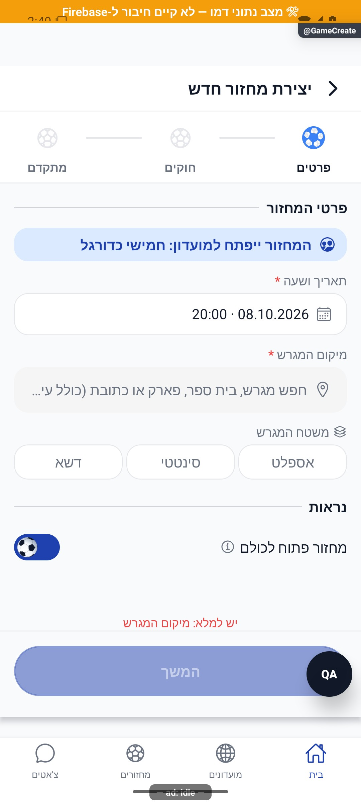
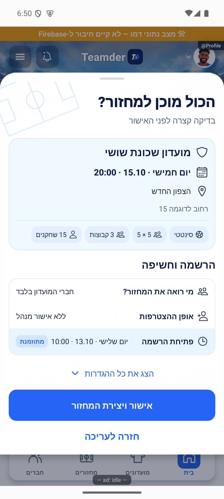
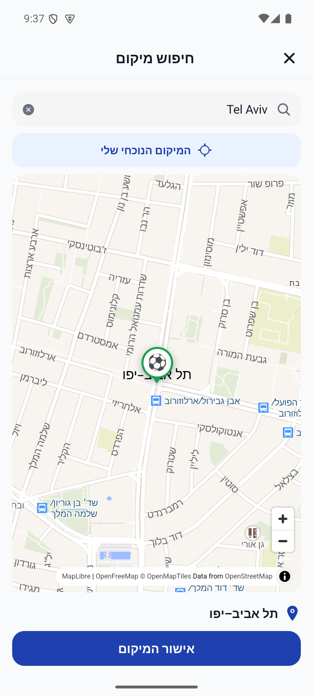
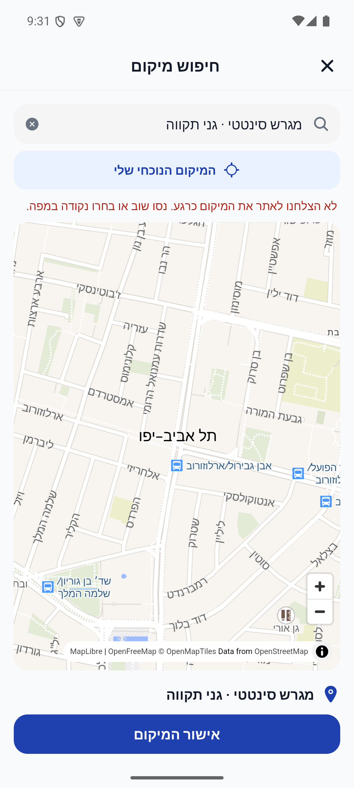
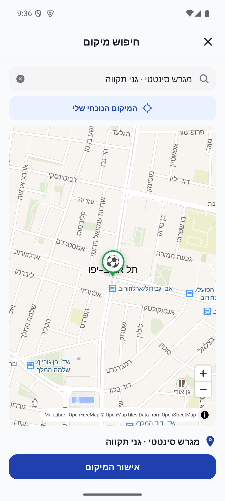

# יצירת מחזור והאשף — הסבר פשוט

## סבב פולס מאושר — 16.10.2026

בבחירת מגרש אפשר ללחוץ על המיקום הנוכחי שלי. הרשאת מיקום מתבקשת רק בלחיצה. הנקודה מוצעת במפה, ואפשר לשנות או לבטל אותה; היא מועברת לטופס רק באישור. לחיפוש נוסף גיבוי כשהשירות הראשי אינו זמין.

השינוי מקומי וטרם הופץ. [דוח, בדיקות וראיות](../../changes/2026-10-16-pulse-sweep.md).

כאן מארגן יוצר מחזור ובוחר מתי ואיפה משחקים, כמה קבוצות יהיו ואיך נרשמים. אפשר ליצור מחזור למועדון או מחזור חד־פעמי. בסוף בודקים את הפרטים ושומרים.

[להסבר המעמיק ולמפת הקוד](game-create.md)

## צילום והיקף ההוכחה

הצילומים מציגים רק את המצבים המתועדים במסמך המעמיק. חלקם נתוני דמו, חלקם הוכחות מתיקון קודם, ובכמה מהם טעינה או הודעת הגנה; הם אינם אישור שכל התהליך או השרת נבדקו.

## תיקוני עיצוב ונגישות — 10.10.2026

מקור: `a348b9f235f1e1433497600555303231512a0834` עם שינויים מקומיים. אין בסעיף זה הוכחת גרסת חנות.

אפשרויות האשף והמתגים מקבלים שם ומצב נבחר בקורא מסך, ושדות בחירה מציגים ערך ברור גם כשהם מלאים.

## עיצוב הטפסים — 11.10.2026

הטופס מוצג בכרטיסים לבנים על רקע תכלת עדין, עם שדות בעלי מסגרת דקה וכפתור פעולה בתחתית. ההסברים המלאים זמינים בכפתורי המידע. זהו שינוי מקומי בעיצוב; לא נשמרו נתוני אמת ולא הועלתה גרסה.

צילומים עדכניים: [צילום 1](../screenshots/form-round-details-2026-10-11.png) · [צילום 2](../screenshots/form-round-rules-2026-10-11.png) · [צילום 3](../screenshots/form-round-advanced-2026-10-11.png) · [צילום 4](../screenshots/form-round-schedule-2026-10-11.png).

מד השלבים מציג כדורי כדורגל עדינים. הכדור הכחול מתגלגל לשלב הבא וחוזר בכיוון ההפוך בלחיצה על חזרה. כאשר צמצום תנועה מופעל במכשיר, השלב מתעדכן ללא גלגול. השינוי מקומי וטרם הועלתה גרסה.

## איור הכדור המאושר — 11.10.2026

הכדור הוחלף לאיור המאושר החדש: מחומש מרכזי, לוחות לבנים והיקפיים מסודרים, קווים דקים והצללה כחולה עדינה. גרסה כחולה לשלב הפעיל וגרסה כחולה־אפורה לשאר השלבים. תנועת הגלגול הקיימת נשמרה.

## צמצום אזור ההסבר — 11.10.2026

אזור ההסבר שמתחת למד השלבים הונמך: הגובה מותאם לטקסט והמרווחים מעליו ומתחתיו קטנים יותר. איור המגרש הוקטן בהתאם.

## מתגי כדורגל בטפסים — 11.10.2026

בטפסי המועדון והמחזור, כדור מאויר מחליף את עיגול המתג: הפעלה מגלגלת אותו שמאלה על מסילה כחולה, וכיבוי ימינה על מסילה בהירה. גם מתג העונות בתוך טופס המועדון משתמש בעיצוב זה.

## כדור בעל נפח במתגים — 11.10.2026

כדור לבן וכחול עם תפרים, תאורה והצללה מחליף את האיור השטוח במתגי הטפסים. הגלגול שמאלה בהפעלה וימינה בכיבוי נשמר.

## כדור בעל נפח במד השלבים — 11.10.2026

מד השלבים מציג כעת את אותו כדור בעל נפח שבמתגים. הכדור מתגלגל אל השלב הנוכחי במעבר קדימה ואחורה; שלבים לא פעילים מוצגים בעדינות.

## כיווניות המתגים וההסברים — 11.10.2026

במתגי הטפסים, הכדור נמצא מימין כשהאפשרות כבויה ומתגלגל שמאלה בהפעלה. חלוניות המידע המשותפות מציגות מלל עברי מימין לשמאל.

במחזור של מועדון, תזמון יצירת כוחות מופיע גם כשהדירוג הפנימי כבוי. במקרה זה המתג מושבת ומוצג הסבר שיש להפעיל דירוג פנימי בהגדרות המועדון; כפתור המידע נשאר זמין.

## הסתרת הקו מאחורי כדורי השלבים — 11.10.2026

הקו המחבר בין השלבים אינו נראה דרך הכדורים הבהירים או בזמן גלגול הכדור הפעיל.

## תקציר לפני אישור בעיצוב החדש — 11.10.2026

לפני האישור נפתחת חלונית תחתונה עם פרטי המחזור בכרטיס תכלת, תגיות סוג מגרש ופורמט, והרשמה וחשיפה. פתיחת הרשמה מתוזמנת מודגשת בתכלת עם המועד שנבחר. אפשר לפתוח את יתר ההגדרות או לחזור לעריכה. הכפתור מותאם ליצירה או לשמירת שינויים.

## כתובת ואייקונים בתקציר — 11.10.2026

כתובת שכבר מופיעה בשם המגרש מוצגת פעם אחת. פרטי הגעה נוספים נשארים. האייקונים מוצגים מימין לפני הטקסט, לרבות התגיות ושורות ההגדרות.

## ריווח התקציר — 11.10.2026

במצב סגור הוסר השטח הריק בין הצגת כל ההגדרות לכפתור האישור. חץ ההרחבה מופיע משמאל לטקסט.

## הסבר המחזור המהיר — 11.10.2026

ההסבר בראש המחזור המהיר מוצג בשתי שורות מיושרות לימין, ללא חיתוך בקצה.

## אחידות בעיצוב התקציר

מעטפת התקציר תואמת כעת לשאר החלוניות, בלי לשנות את פרטי המחזור או פעולת האישור. נבדקה בדמו בגופן רגיל במצב יצירה; מצב עריכה לא צולם מחדש. [הפירוט](../shared/menus-and-motion.md).

## תמיכה זמינה — 14.10.2026

אם נתקעתם בטופס, בועת העזרה פותחת שיחה בלי לצאת ממנו. הצוות מקבל את מסך הפנייה ואת השלב שבו פתחתם אותה; צילום מצורף רק לפי בקשתכם. [פירוט](../shared/support-chat.simple.md). השינוי מקומי.

## סבב פולס — 15.10.2026

שורות הכדור והגופיות הוסרו מסיכום הבדיקה לפני יצירת המחזור. הגדרות הציוד עצמן נשמרו.

השינויים בסבב זה מקומיים וטרם הופצו. [דוח הסבב](../../changes/2026-10-15-pulse-sweep.md).

## צילומי הסבב המאושר — 16.10.2026

## יצירת מועדון אישי בעסקה אחת — 17.10.2026

יצירת המועדון האישי ושמירת הקישור אליו מתבצעות יחד. בקשות מקבילות משתמשות באותו מועדון, וכשל בשמירה אינו משאיר יצירה חלקית. תיקון השרת הוכן מקומית וטרם נפרס.

[סקירת ההכנה, בדיקות ומגבלות](../../changes/2026-10-17-preinternal-audit.md).

## הפצה פנימית — 17.10.2026

שינויי הלקוח האחרונים המתועדים כאן נכללו בבינארי הפנימי `1.1.53 / 286` באנדרואיד. המסלול אומת בגוגל; הייצור נשאר בגרסה הקודמת. זה אינו אימות חדש של תרחיש ייצור או של מכשיר אפל. [מקור הבינארי, פריסת השרת, בדיקות ומגבלות](../../changes/2026-10-17-internal-1.1.53.md).

`ensurePersonalGroup` נפרסה במסגרת ההפצה: המקור הפעיל תואם ל־133 קובצי צילום הפריסה, ובקשה ללא התחברות נדחתה ללא כתיבה. לא נוצר מועדון בדיקה או מועדון ייצור חדש לאימות מסלול זה.
