# רשימת מחזורים וגילוי

## עצירת מחזור קבוע ללא פעילות, 6.11.2026

נבדק השינוי התחום ב-`functions/src/clubDeletion.ts`, `functions/src/index.ts`, `tests/logic/clubDeletion.test.ts`: בדיקת חוסר פעילות לפני יצירת מחזור קבוע ושמירת שלוש החלטות בזמן ניקוי מחזורים ריקים. ההכרעה משתמשת במקור הקיים לקיום מחזור ומגינה על מחזור עם הרשמה שנותר לא מוכרע. עסקאות היצירה והניקוי נשארות מוגנות מפני שינוי מקביל ומועדון חסר. אין שינוי מכוון בחישובים, במכנים, בהרשאות, בניווט או בפעולות העצמאיות האחרות של הפיצר הזה. בדיקות מקור השרת הורצו במאגר זיכרון; הפריסה הממוקדת של שני שירותי התזמון אומתה בייצור מול המקור שנבדק, ותועדה הרצת שירות חמש הדקות ללא שגיאות. אין בכך אימות חדש של המסך או של יתר פעולות הפיצר. [ההתנהגות, מסלול הנתונים, הבדיקות ומגבלות ההפעלה](../../changes/2026-11-06-inactive-recurring-rounds.md).

## דירוג בסיס לשחקן ללא דירוג, 6.11.2026

נבדק שינוי תחום במקורות המשותפים של הכוחות האוטומטיים: שחקן ללא דירוג מחושב כ-2.5 מתוך 5, וההסברים תואמים. דירוג מפורש נשמר. אין כאן אימות חדש של כל מצבי הפיצר העצמאי; השינוי מקומי וטרם הופץ. המקורות המשותפים שנבדקו בהפרש זה: `functions/src/index.ts`. [ההתנהגות, הבדיקות ומגבלות האימות](../rounds/draft-setup.md#דירוג-בסיס-לשחקן-ללא-דירוג-6112026).

## מדידת פעולות ואמינות נתונים, 5.11.2026

במיפוי מקור הרכיבים המוזכרים במסמך נמצאו 29 נקודות מטפל ו-25 מזהי פעולה. הספירה מתארת קוד וכוללת רכיבים משותפים; אין לחבר אותה לספירות של מסמכים אחרים ואין לראות בה הרצת כל המסך. המדידה מפורטת לפי גבול פקד מקורי, פעולה עסקית ומצב חשבון. תשובה מאוחרת נבדקת מול בעל הפעולה, ומצב קיים או בקשה חוזרת אינם תמיד הצלחה חדשה. רשימת המקרים שהורצו ומגבלות המסד, המכשיר והכיסוי נשמרות [בדוח המדידה](../../audits/2026-11-04-system-night/product-measurement.md) ובדוחות המקושרים אליו. המימוש מקומי; לא בוצעה בדיקה חדשה של כל מצבי הפיצר.

## חיפוש שחקנים וזמני טעינה, 4.11.2026

שירות החיפוש, הכרטיס וגיוס הפנויים התעדכן. מסלולי התאימות של זהויות, סטטיסטיקה מלאה והזמנות ממשיכים לבדוק גישה. בדיקה זו תחומה למקור המשותף, ללא הרצה חדשה של כל המסך העצמאי. מימוש מקומי שטרם הופץ. [השינוי, המדידות והבדיקות](../../changes/2026-11-04-player-discovery-speed.md).

## התאמה למסך ולגופן, 4.11.2026

במסך `GamesListScreen` גובה תג המסננים ותג הבקשות הוא מזערי ומאפשר למספר לגדול. כותרת `FeedHero` מחלקת את המקום עם כפתור היצירה לפי רוחב וגודל גופן. בחלון הסינון קבוצות האפשרויות והמתגים נפרסות בכמה שורות כשנדרש, כותרות יכולות להתארך ופעולת המפה יכולה לרדת לשורה הבאה.

ראיות התצוגה והמגבלות של בדיקת המכשיר מרוכזות בתיעוד כרטיס השחקן. [תיעוד הבדיקה](../profile/player-card.md)

## ציר פעילות פרטי בפולס, 4.11.2026

בציר הפעילות, תשובת שרת על מצב הרשמה קיים אינה נספרת כהרשמה חדשה. קבלה ללא סימון יצירה מפורש מוצגת עם מגבלת אמינות.

נבדקו התוספות במקורות המשותפים לצורך ציר פעילות פרטי בפולס: דיווח ניווט והקשר, תיעוד ניסיון הרשמה ותוצאתו וגבולות זהות ומחיקת חשבון. התוספת היא תיעוד ברקע במקומות הנתמכים; אין מכך אימות חדש של כל מצבי הפיצר הזה או שינוי בחישוביו. מקומי וטרם הופץ או נפרס. [היקף, מקורות, בדיקות ומגבלות](../shared/usage-activity.md).

## השפעת שיפורי הטעינה המשותפים, 4.11.2026

עודכנה תלות משותפת במסלול טעינה או במתאם הבדיקה, בהיקף השינוי המתועד בלבד. אין שינוי מכוון בחישובים או בפעולות העצמאיות של הפיצר הזה.

מקורות משויכים שנבדקו בהיקף השינוי: `tests/logic/pulse23ExpectedConditions.test.ts`.

מימוש מקומי וטרם הופץ. אין בכך אימות מכשיר חדש של הפיצר הזה או מדידת מהירות של כל מסלוליו. [המדידות התחומות, הבדיקות והמגבלות](../../changes/2026-11-04-screen-performance.md).

## צמצום טעינות חוזרות, 4.11.2026

ב-`src/screens/games/GamesListScreen.tsx` מחושב `feedScope` מתוך מזהה החשבון, מצב אורח וקבוצת מזהי המועדונים, לאחר הסרת כפילויות ומיון. ארבע קריאות הרשימה נשארות מקבילות, אך `reload` משתנה רק כשהקשר הקריאה הזה משתנה. רענון תמונת משתמש, מונים, שם מועדון או סדר המועדונים אינו מפעיל שוב את ארבע הקריאות. שמות, תמונות ומטא נתוני מועדון ממשיכים להתעדכן בציור מתוך החנויות הנוכחיות. גם מנוי רענון מונה הבקשות תלוי במזהה המשתמש במקום באובייקט הפרופיל כולו.

`currentFeedScope` מתעדכן במהלך ציור המסך. תשובה מתקבלת רק אם מספר הבקשה, הקשר המסך, מזהה החשבון ומצב האורח עדיין זהים. החלפת השתייכות פוסלת תשובה קודמת עוד לפני הפעלת אפקט המיקוד הבא. ניקוי אפקט המיקוד מגדיל את `feedRequest` ולכן יציאה מהמסך פוסלת תשובה ממתינה. חזרה למסך, הוספה או הסרה של מועדון, החלפת חשבון, שדרוג אורח ורענון יזום ממשיכים לקרוא מידע חדש. כשל ברענון שומר את התוצאה הקודמת, וכשל ראשוני נשאר נפרד מתוצאה ריקה. אין שינוי בסדר העסקי, בסינון, במכנים, בנתיבי ניווט או בהרשאות.

בתרחיש בדיקה של פתיחה וחמש החלפות אובייקטי פרופיל ומועדונים, בלי שינוי בזהות או בהשתייכות, נמדדו 24 הפעלות של שירותי הרשימה במקור שלפני התיקון ו-4 אחרי התיקון. נחסכו 20 הפעלות שירות בתרחיש זה. אלו ספירות הפעלה במתאם בדיקה, ולא מדידת זמן מכשיר או מספר שאילתות מסד בפועל.

שש בדיקות התנהגות ב-`tests/logic/gamesFeedPerformance.test.ts` מריצות את הכרזות ההקשר, הקריאה ואפקט המיקוד של המסך עם מתאם ששומר זהות קרסים. הן מכסות רענון אובייקטים, שינוי השתייכות, חלון הזמן שלפני אפקט, החלפת חשבון, שדרוג אורח, יציאה, חזרה ורענון יזום. שלוש מהן נכשלו מול המקור הקודם וכל השש עברו אחרי התיקון. עם ארבע בדיקות המשכיות הקריאה ב-`tests/logic/gamesFeedReadState.test.ts` עברו עשר בדיקות ממוקדות. [מיפוי כל מקורות המסך ומגבלות הבדיקה](../../audits/2026-11-04-performance/screen-census.json).

המימוש מקומי וטרם הופץ. אין שינוי בפריסה החזותית, ואין מדידת זמני טעינה במכשיר או שירות חי בסבב הבדיקות הזה. בדיקות הפרויקט המלאות מתועדות במסירה המרכזית של המשימה.

## הפצה פנימית 1.1.74, 3.11.2026

עדכוני הלקוח ב-`src/components/ReadStatusNotice.tsx`, `src/hooks/useRoundChanges.ts`, `src/services/roundVisitService.ts`, `src/utils/photoPhase.ts`, `src/utils/roundVisit.ts`, `src/components/anim/MatchCardSkeleton.tsx`, `src/components/loading/ScreenSkeletons.tsx`, `src/screens/games/GamesListScreen.tsx` כלולים בחבילה הפנימית 1.1.74/306. ארכיון המקור המקומי וחתימת החבילה אומתו מול החבילה שהחזירה גוגל. מקור הבסיס הוא `06417f6132f4c7636aaee25574354ed7722966b9` עם שינויים שלא נשמרו לגיט.

עברו 6864 בדיקות יישום, בדיקות טיפוסים, 360 בדיקות הרשאות בסדרה ו-38 בדיקות שרת במסד הדגמה. ההרשאות והשירותים הפעילים נשמרו, ללא הסבת נתונים או קידום לייצור. האימות החזותי הוא מצילומי המקור בדפדפן שכבר תועדו, ללא התקנה או הרצת הפיצר הזה במכשיר בגרסה החדשה. אין בכך הכרזה על הפצת שינויים אחרים המתועדים במסמך. [מקור, קבלות, תכולה ומגבלות](../../changes/2026-11-03-internal-1.1.74.md).

## מצבים ריקים והמשכיות פעולה, 3.11.2026

כשל טעינה מוצג עם ניסיון חוזר. ברענון נשמרים המחזורים שכבר נטענו לאותו חשבון, עם הסבר שהמידע עשוי להיות ישן. כשל ראשוני אינו מוצג כאילו אין מחזורים.

מקורות משויכים שנערכו: `src/screens/games/GamesListScreen.tsx`.

ההתנהגות, טבלת המצבים, מסלול הנתונים, בידוד הזהות, ניווט, שמירת שישים ביקורי מחזור מקומיים, השהיית חיווי של שש שניות ושלבי התמונה מתועדים ב[דוח השינוי](../../changes/2026-11-03-experience-followup.md). מקורות המנגנונים: `src/components/ReadStatusNotice.tsx`, `src/hooks/useRoundChanges.ts`, `src/services/roundVisitService.ts`, `src/utils/roundVisit.ts`, `src/utils/photoPhase.ts`. אין שינוי בחישובים, במכנים או בהרשאות. חיווי עיכוב אינו הוכחה להתנתקות ואינו אישור כתיבה; אין מטמון תוכן קבוע חדש.

המימוש מקומי. נבדקו עשרים ושניים מצבי מקור ושני אזורי השוואה ב-72 בדיקות רוחב בדפדפן. תמונות וסמלים הוחלפו במצייני מקום; מצב עיכוב מוזן למתאם והתזמון נבדק בקוד. אין אימות מכשיר, שרת חי או מסך מלא חדש.

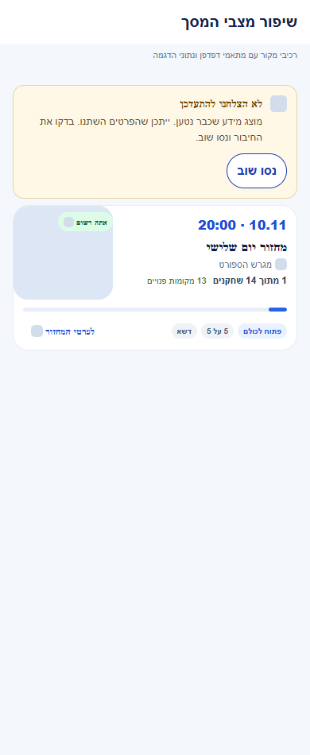

תוצאות האימות בסבב זה: כל 6864 הבדיקות ב-614 חבילות ובדיקת הטיפוסים עברו. בדיקות המצבים הממוקדות עברו ב-83 מקרים. נבדקו 72 פריסות של אזורי מקור בדפדפן, ונבדקה כיווניות בצילומים. אין אימות מכשיר או שירות חי חדש.

## התאמת מבנה שלדי הטעינה, 3.11.2026

באזורים המשויכים לפיצר הזה נבדק שלד `rounds` במתאם דפדפן. אין בכך אימות המסך המלא או כל מצב נתונים. ההתאמה עוסקת בפריסה ובהודעת ההמתנה הנגישה; שירותי הטעינה, מצבי הכשל, המיון, החישובים, המכנים והניווט נשארו ללא שינוי. מקורות משויכים שנערכו: `src/components/loading/ScreenSkeletons.tsx`, `src/components/anim/MatchCardSkeleton.tsx`, `tests/logic/communityRosterLoading.test.ts`.

[טבלת השינויים לפי אזור, המידות, השוואות למקור, הבדיקות והמגבלות](../../changes/2026-11-03-skeleton-layout-alignment.md). מקומי וטרם הופץ, ללא בדיקת מכשיר או שרת חי חדשה.

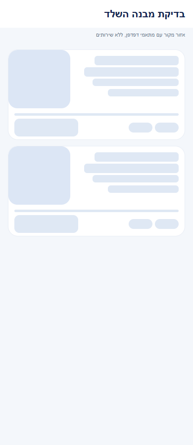

אימות במשימה זו: 6,820 בדיקות ב-608 חבילות ובדיקת טיפוסים עברו; 84 בדיקות רוחב של אזורי מקור ותשע השוואות מידות לכרטיסים אמיתיים עברו. אין בכך אימות מכשיר חדש של הפיצר או של מצבי נתונים שלא נבדקו.

## תיקוני דיווחי הפולס, 3.11.2026

נבדק ההפרש התחום ב-functions/src/index.ts, באתר index:20a83f91b9 בלבד: קוד כפילות של joinCredited נבדק לפני observeCaughtError. הסמן וההגדלה נשארים אטומיים, ושגיאות אחרות נשארות נצפות. אין שינוי מכוון בחישובים, במכנים, בניווט או בהרשאות של הפיצר המתואר כאן. בדיקת הלולאה הממוקדת מתועדת ב-shared/data-and-state-contracts; אין כאן בדיקת מסך או מסלול ייצור חדש של הפיצר הזה.

[פירוט התיקונים, הבדיקות, הצילומים והמגבלות](../../changes/2026-11-03-pulse-sweep.md).

## העברת אורח לרשימת המתנה, 3.11.2026

נבדק ההפרש הממוקד במקור המשותף `functions/src/index.ts`: תנאי `guestSeatFreed` ב-`onGameRosterChanged` מבחין כעת בין הסרת אורח פעיל לבין העברה ידנית להמתנה. אין שינוי מכוון בחישובים, בנתונים, בניווט או בפעולות העצמאיות של הפיצר המתואר כאן. בדיקות גילוי העזיבה והקידום מכסות את השינוי המשותף; אין בדיקת מסך חדשה לפיצר זה. התיקון מקומי וטרם נפרס או הופץ.

[היקף, בדיקות ומגבלות](../../changes/2026-11-03-guest-waitlist.md).

## חלון התנגשות בזמן ביטול, 3.11.2026

חלון המקור `src/components/games/RegistrationConflictModal.tsx` חוסם כעת את כל נתיבי הסגירה והצפייה בזמן ביטול ההרשמה האחרת. נעילה סינכרונית מגינה גם לפני ציור ההמתנה ומונעת ביטול כפול. היא נשארת פעילה עד סוף ההבטחה או עד שחרור `cancelBusy` החיצוני, לפי המאוחר; כשל משחרר את הנעילה המקומית ומאפשר ניסיון חוזר. הצרכן ב-`src/screens/games/GamesListScreen.tsx` ופעולות הביטול, ההצטרפות והרענון שלו לא שונו.

עברו שש בדיקות מקור ב-`tests/logic/overnightRegistrationConflictModal.test.tsx`. לפני התיקון חזרת אנדרואיד סגרה מארח מקור במצב המתנה; אחריו חזרה ולחיצה ברקע לא סגרו. אין בכך ביטול או הרשמה אמיתיים, בדיקת שרת או הוכחת כל זרימת הרשימה. השינוי מקומי וטרם הופץ. [חוזה הבקשה, מקורות הצילומים ומגבלות האימות](registration.md#נעילת-חלון-התנגשות-בזמן-ביטול-3112026).

## ליטוש מקומי והשפעת רכיבים, 3.11.2026

ב-`src/screens/games/GamesListScreen.tsx`, `src/components/games/AreaDemandCard.tsx` ו-`src/components/games/NearbyClubsSection.tsx` הוסרו הכרזות כיווניות מסגנונות שכבר נשענים על `RTL_LABEL_ALIGN`. הקריאות, ספי הצפיפות, רדיוס הגילוי, רשימות המשתמש וספירת מחזור לעומת משחק לא שונו. צילומי הלפני כבר נראו מיושרים; אין כאן טענה לתיקון תזוזה שנצפתה. 17 בדיקות ממוקדות בשתי חבילות כיווניות עברו. `GamesList` נשאר ברשימת מסכי השורש המציגים בועת עזרה.

תלות משותפת נוספת: `ConfirmDestructiveModal`, `Button`. הסכמה נחשפת כפקד יחיד ואינה משתנה בזמן בקשה; רק variant="danger" משתמש במלל הכהה; כפתורים רגילים לא שונו. אלה בדיקות רכיב מקור, ולא אישור למסך כולו; [חוזי הרכיבים המשותפים](../shared/menus-and-motion.md).

השינוי מקומי וטרם הופץ. אין כאן אימות חדש של מסך מוצר מלא, מכשיר, קורא מסך או שרת. [הראיות והמגבלות של המשימה](../../changes/2026-11-03-overnight-mission.md).

## בדיקת קצה ואימות מקורי, 2.11.2026

`useRememberedScroll` מבחין בין גאומטריית השלד לתוכן המוכן. מעבר או הקשר חדש ממתינים לשני פריימים כדי לא להחליף מיקום במדידה קודמת, בלי לעכב את הצגת התוכן. ברשימה וירטואלית מועבר גם מספר הפריטים, ומצביע `onViewableItemsChanged` מאשר שהפריט האחרון באמת נראה לפני חיתוך מיקום שאינו נכנס. תוצאה ריקה מאושרת יכולה לאפס מיקום. יעד שטרם נכנס נשמר לאורך מדידות הביניים, ומורחב חלון התאים באמצעות בקשת גלילה. לא מנחשים סיום לפי השהיה. אירוע גלילה מקורי מאשר את המיקום בטווח של נקודת תצוגה אחת; נשמר גם היסט שנצפה קודם, כי בקשת אותו מיקום אינה מייצרת אירוע נוסף. גרירה יזומה קודמת לשחזור. אירוע מדידה של רכיב מצב ריק נזרק לפי תג הרכיב המקורי, כדי שגובהו לא ייחשב לגובה המסך. ברשימת המחזורים זהו משטח גלילה רגיל, ללא ספירת פריטים וירטואלית. לא השתנו הרשמה, סינון, תפוסה, סדר עסקי או קריאות מסד.

הבדיקות ב-`tests/logic/experiencePolish.test.ts` וב-`tests/logic/communityRosterLoading.test.ts` כוללות תזמון מדידות, תוצאות קצרות וריקות, ביטול שחזור בגרירה, שימור נתון מאושר בכשל והפרדת הקשרים. צילום מקורי אינו אימות שרת או גרסת חנות. מקומי וטרם הופץ. [שחזור, תיקונים, בדיקות ומגבלות](../../changes/2026-11-02-experience-review.md).

## המשכיות ומשוב בשימוש, 2.11.2026

`useRememberedValue`, `useRememberedScroll` ו-`listMemory` שומרים מצב תצוגה בזיכרון התהליך בלבד, לפי חשבון והקשר. החלפת בעלים מנקה, ונשמרים עד 40 הקשרים. ההיסט משוחזר פעם אחת אחרי נתונים ומידות זמינים, נחתך לגבולות התוכן, וגרירה יזומה קודמת לשחזור. חיפוש ומצב תצוגה נשמרים בלי לשמור רשומות משתמשים או להוסיף קריאות מסד. אין הוכחת שחזור ברכיב גלילה מקורי בסבב זה. נשמרים `clubsOnly`, `GameFilters` והיסט נפרד לפי צירוף המסננים. לחיצה חוזרת על הלשונית שומרת את התנהגות החזרה לראש הרשימה. `useConfirmedFeedback` נקרא רק לאחר תשובת שירות מאושרת. `registrationFeedback` מבדיל בין `players`, `waitlist` ו-`pending`, ללא ברירת מחדל מוצלחת לערך לא מוכר. הכפתור מציג אישור וסימן בדיקה במשך 1400 אלפיות שנייה, עם רטט עדין והודעה באותה משמעות. תשובה ממסך שנעזב או מחשבון קודם אינה מפעילה משוב. מצב המתנה שומר תווית לצד המחוון; כשל אינו מציג אישור. `ContentReveal` מציג תוכן זמין מיד, ומבצע מעבר אטימות מ-0.78 ל-1 במשך 180 אלפיות שנייה רק אחרי ההמתנה הראשונה באותו הקשר. צמצום תנועה מכבה את המעבר. אין השהיה, חסימת מגע או הזזה, ורענון עם תוכן קיים אינו מפעיל אותו מחדש. הכרטיס המשותף `src/components/match/MatchListCard.tsx` מציג אישור קצר. מיון, קריאות נתונים ומכני תפוסה נשמרו.

בדיקות התנהגות חדשות: `tests/logic/experiencePolish.test.ts`. האימות החזותי כולל אזורי מקור עם נתוני הדגמה ומתאמי דפדפן בלבד, ללא אימות מכשיר או מסד. מימוש מקומי שטרם הופץ. [התנהגות, בדיקות, צילומים ומגבלות](../../changes/2026-11-02-experience-polish.md).

## הרחבת שלדי הטעינה, 2.11.2026

`src/components/anim/MatchCardSkeleton.tsx` שומר את `count`, מידות הכרטיס ואת סדר הצורות, ומשתמש באזור פעימה משותף במקום נצנוץ נפרד בכל צורה. רשימת המחזורים שומרת את תנאי `loading && isEmpty`, ושלושת הכרטיסים נשארו. אין שינוי בנתונים, ברענון, בסינון או בפעולות הרשמה.

בסיס השלדים הוא `src/components/loading/ScreenSkeletons.tsx`: פעימה שמכבדת צמצום תנועה, הודעה אחרי ארבע שניות, ניקוי בעזיבה וצורות שאינן מקבלות מיקוד. אין בכך אימות מכשיר, תנועה אמיתית או חיבור למסד. מימוש מקומי שטרם הופץ. [התנהגות, בדיקות, צילומים ומגבלות](../../changes/2026-11-02-loading-skeletons-expanded.md).

## אימות פרסום קבוצות בפולס, 2.11.2026

נבדק ההפרש התחום בשירות המשותף של המחזורים: נוספה בדיקת אישור לפרסום קבוצות כאשר תשובת הפעולה אובדת. אין שינוי בחישוב, במכנים או בפעולות העצמאיות של הפיצר המתואר כאן. התיקון מקומי וטרם הופץ; אין בדיקת מכשיר חדשה לפיצר זה.

השינוי ב-`src/services/gameService.ts` מוגבל ל-`publishDraftTeams` ולתלות בסיווג כשלים זמניים. נבדקו גבולות קבלת השרת, התאמת החשבון והחלוקה, ושימור השגיאה כאשר האימות נכשל. `tests/logic/publishTeamsReceipt.test.ts` מפעיל את פונקציית השירות מול תחליפי קריאה וכתיבה; אין בכך הרצת כל המסלולים של המסמך הזה.

[דוח הטיפול, הבדיקות והמגבלות](../../changes/2026-11-02-pulse-sweep.md).

## בקשות לשיחה אישית, 2.11.2026

נבדקה השפעת תוספת בקשות השיחה במקורות המשותפים. השינוי ממוקד בהרשאת שיחה, בשדות פרטיות ההודעות ובחיבורי הבדיקות; אין מכך אימות חדש של מסך זה במכשיר. המימוש מקומי וטרם הופץ או נפרס. [התנהגות, בדיקות ומגבלות](../chat/message-requests.md).

מקורות משותפים שנבדקו בהיקף השינוי הזה: `functions/src/index.ts`, `functions/src/socialPlayers.ts`, `src/firebase/firestore.ts`, `src/types/index.ts`. אין בסעיף זה טענה להרצת כל המסלולים ההיסטוריים של הפיצר. [מסירת המימוש](../../changes/2026-11-02-message-requests.md).

## הסרת מגבלת החברים במועדון, 1.11.2026

נבדקה השפעת השינוי הממוקד במקורות המשותפים: הוסרה מגבלת החברים במועדון. אין שינוי מכוון בהתנהגות העצמאית של המסך המתואר כאן או במספר המקומות במחזור. התיקון מקומי וטרם הופץ; אין בדיקת מכשיר חדשה לפיצר זה.

מקורות ששונו בהיקף המשימה: `functions/src/index.ts`, `functions/src/socialPlayers.ts`, `src/services/groupService.ts`. מספרי החברים אינם משמשים עוד כתנאי תפוסה במועדון. שדות התאימות הישנים אינם נאכפים.

[מסלול הנתונים, התנאים, התאימות, הבדיקות ומגבלות ההפצה](../../changes/2026-11-01-unlimited-club-members.md).

## פריסת הגנות הסרת המחזור, 30.10.2026

נפרסו שבע חבילות מבודדות, ועדכון המקור בלבד אומת מול כל הקבצים הפעילים. הגדרות השירותים והאירועים ו-111 השירותים האחרים נשמרו. אומתו מוכנות ותעבורה לגרסאות החדשות, קריאה עצמית עם חשבון בדיקות קיים ושימור גרסאות כל 496 המסמכים שבגיבוי. שש דחיות בקשות דפדפן לא תקינות סווגו לפי מזהי בקשה; לא זוהה כשל ריצה עסקי בלתי צפוי. לא הופעלו מחיקה, חסימת מחזור או בקשת שמירה תקינה על נתוני המועדון. זו ראיית הפריסה התחומה ולא הרצה מחודשת של כל מסך.

[גרסאות פעילות, בדיקות שרת וגבולות האישור](../../changes/2026-10-30-evening-removal-server-deployment.md).

## השלמת הגנת הסרת המחזור, 30.10.2026

הורחבה ההגנה ב-`functions/src/personalActivity.ts` וב-`functions/src/managerRoundHistory.ts`: קריאת `gameRemovalBlocksWrite` וקיום המחזור בתוך עסקת יצירת הנתונים. בקשת סנכרון לאחר הסרה מחזירה כשל מפורש במקום ניסיון חוזר ללא סוף. ב-`functions/src/index.ts` גם חבילת סטטיסטיקה מלקוח ישן מעדכנת את המחזור עם תנאי גרסה, ומכסת הפעולות כוללת תמיד כתיבת הגנה זו. אין שינוי בחישובי התוצאות, הפרטיות או הניווט מעבר להגדרת המחזור המתועד שפורטה קודם. נבדקו ארבעה עשר תרחישים ראשיים, שמונה תרחישי חסימה ושחזור, שמונה בדיקות חבילות ושבע בדיקות פעילות ונתוני מנהל במסד מקומי. ההיקף הוא בדיקת השינוי התחום במקורות משותפים, ולא הרצה מחודשת של כל מסך או של תשתית מסירת האירועים. התיקונים טרם נפרסו.

[תוכנית הביצוע, החבילות, הבדיקות וגבולות האישור](../../changes/2026-10-30-evening-removal-readiness.md).

## הגנה בהסרת מחזור היסטורי, 30.10.2026

השינוי התחום ב-`functions/src/index.ts` עוטף את עיבוד אירועי הסגל בזכות עיבוד כדי לסנכרן הסרה ניהולית עתידית; הוא מוסיף קריאת קיום מחזור בעסקאות של השלמת היסטוריה ושמירת פעילות. השינוי ב-`functions/src/socialPlayers.ts` משווה את הגדרת המחזור המתועד לחישוב העצמי. אין שינוי מכוון בפעולות העצמאיות האחרות המתועדות כאן, בהרשאות או בניווט. זו בדיקת השפעה תחומה של המקורות המשותפים, ולא הרצה של כל מצבי הפיצר. אין פריסה או אימות מכשיר חדש.

[התנהגות, סדר הפעולות, חישובים, בדיקות וגבולות האישור](../../changes/2026-10-30-evening-removal-readiness.md).

## החלפת הקבוצה הבועטת בפנדלים, 30.10.2026

נבדק ההבדל התחום במשימה במקורות המשותפים `src/services/gameService.ts`, `src/types/index.ts` ו-`src/firebase/firestore.ts`: הוא מוסיף ומשמר תור מפורש לפנדלי ההכרעה ומעדכן אותו ברישום ובביטול בעיטה. אין שינוי בשדות, בחישובים או במסלול הנתונים העצמאי של הפיצר המתואר כאן. בדיקת הקורא והעסקאות מפורטת בדוח; אין בכך הרצה מחדש של המסך הזה. [התנהגות, בדיקות ומגבלות](../../changes/2026-10-30-shootout-turn.md).

## התאוששות משגיאות בפולס, 28.10.2026

במקור המשותף `src/services/gameService.ts`, הקריאות `getGameById` ו-`getCommunityChampionship` משתמשות כעת ב-`withAuthRaceRetry` עם `retryTransientReads: true`. כשל זמני מאפשר ניסיון קריאה נוסף אחרי 500 אלפיות שנייה עם בדיקת בעלות על החשבון. מסלול החלוקה השמורה נשאר במסלול ההמתנה המדויק שלו. מסמך חסר נשאר חסר, סירוב הרשאה שומר על הטיפול הקיים וכשל מתמשך נזרק. אין שינוי בכתיבות, במכנים, בחישובי המחזור או בהכרעת התוצאה.

השינוי מקומי וטרם הופץ או נפרס. אין שינוי חזותי ואין צילום מכשיר חדש. [ממצאים, בדיקות ומגבלות](../../changes/2026-10-28-pulse-errors.md).

## תלות בסינון הצעות השלמה - 28.10.2026

השינוי הנוכחי ב-`functions/src/index.ts` מוגבל לבחירת הצעות השלמה: סף תפוסה של 70 אחוז ובדיקת הרשמה מתנגשת לפני יצירת התראה. אין שינוי מכוון בתהליך העצמאי המתואר כאן ואין אימות חדש שלו. רענון המקור המשותף אינו מאמת שינויים קודמים שהיו בו מאז קליטת התיעוד. [היקף, בדיקות ומגבלות](../../changes/2026-10-28-filler-eligibility.md). מקומי וטרם נפרס.

## הרחבת אבחון דיווחים, 27.10.2026

נוספה מעטפת אבחון מקומית עם מצב בזמן הכשל, שלבים בעלי מזהה ותזמון, מצב רשת ובנייה ומופעים נפרדים לשגיאה. נקודת הכניסה לתעבורת השרת עוברת כעת דרך העטיפה המשותפת; תשובות, חריגות, אפשרויות קריאה ומדיניות הפיצר נשמרות. אין כאן שינוי בהרשאות או בחישובי המוצר. הבדיקות המלאות ומגבלות האימות מתועדות בדוח המקושר; אין טענה לאימות מכשיר או להפצה. [היקף, ראיות ומגבלות](../../changes/2026-10-27-diagnostic-context.md).

באימות הסופי עברו כל 6,231 הבדיקות ב-555 חבילות, ובדיקות הטיפוסים של הלקוח, השרת והפולס נקיות. צילום הדפדפן והידור מקורות האנדרואיד הם בדיקות מקומיות; אין הוכחת מכשיר, הידור אייפון או מסירה חיה של הבנייה החדשה. רישום יומן השחרור נחשב מאומת רק לפי קבלת הקריאה החוזרת בדוח השינוי.

## טיפול מלא בפריטי הפולס הפתוחים, 27.10.2026

שירות המיקום שומר כעת את מצב ההרשאה שכבר התקבל גם אם ספק המיקום מתנתק. איתור עיר שלא משיב מוגבל בזמן ושומר את המיקום והעיר החלופית; שעוני ההמתנה מסולקים. שלוש בדיקות נכשלו לפני התיקון ועברו אחריו. זהו תיקון מקומי ללא בדיקת מכשיר חדשה. [ממצאים, בדיקות ומסירה](../../changes/2026-10-27-pulse-completion.md).

## טיפול בתקלות הפולס, 26.10.2026

השינוי במקור המשותף מוגבל לסיווג תוצאה צפויה לפני רישום שגיאה: תיעוד מחיקת מחזור שכבר קיים אינו כשל חדש, והתנגשות גרסה בעדכון עונה אינה מבטלת את הגנת הגרסה. אין שינוי בחוזה הפיצר, במכנים, בניווט או בהרשאות; לא נערכה הרצה חדשה לכל מצבי הפיצר. כשל לא צפוי בתיעוד מחיקה נזרק שוב כדי לאפשר ניסיון שרת חוזר.

השינוי מקומי וטרם הופץ. [בדיקות, מסירה ומגבלות](../../changes/2026-10-26-pulse-fixes.md).

מקורות שנבדקו בסבב: `functions/src/index.ts`.

## ביטול פעילות אחרי מחיקת מועדון - 26.10.2026

נבדקה השפעת השינוי התחום ב-`src/services/groupService.ts`, ב-`src/services/seriesService.ts` וב-`functions/src/index.ts`: עצירת סדרות לפני מחיקת מסמך ההרשאה, הפעלת ביטול פעילות באירוע מחיקת המועדון, ועסקאות יצירה שמאמתות את קיום המועדון והסדרה גם במנגנון ההעתקה הישן. `functions/src/clubDeletion.ts` שומרת מחזורים שהסתיימו ונתוני עבר, מבטלת מצבים פעילים, דוחה בקשות חברות ממתינות, מסירה רק את המועדון שנמחק מהרשמות להתראות ומסירה את ההעתק הציבורי. המימוש והבדיקות ב-`tests/logic/clubDeletion.test.ts` וב-`tests/logic/clubDeletionClient.test.ts` מפורטים ב[דוח התיקון](../../changes/2026-10-26-deleted-club-recurring.md). אין שינוי מסכים, ניווט, נוסחאות או הרשאות במסגרת תיקון זה. זו בדיקת השפעה ממוקדת ואינה אימות מחודש של שינויים קודמים במקורות המשותפים. תיקון השרת נפרס ואומת באישור הבעלים, עם השוואת המקור הפרוס והקוד המהודר ושימור יתר הפונקציות. הסדרה, הרשמת ההתראות והכרטיס הציבורי של המקרה הידוע טופלו ונקראו חזרה; המחזור כבר היה חסר בבדיקה העדכנית. שינוי הלקוח טרם נכלל בבינארי. סעיף הפריסה בדוח כולל את מגבלות בדיקת החבילה המבודדת, ללא טענה למחיקת מועדון בדיקה בייצור.

## השפעת מקור משותף במשימת השעון - 26.10.2026

נבדק ההפרש ב-`src/services/gameService.ts`: `stopRotation` עוצר את השעון וסוגר קטע ריצה באותה טרנזקציה שמשחזרת את ההרכב; `_persistRotation` משמר קטע ריצה פתוח לפני איפוס שעון המשחק הבא. נשמרים `startedAt` והיסטוריית `activeIntervals`, ונמנעים שיבוצים ישנים אחרי עצירת הרוטציה. השוואת שתי המתודות למצב הקודם משחזרת את חותמת המקור שנרשמה לפיצר לפני תיקון זה. חלון הרשימה, הסינון, המיון ומטמון הבקשות לא שונו בשתי מתודות הרוטציה. זו בדיקת השפעת השינוי התחום במקור המשותף, ולא הרצה מחודשת של כל מצבי הפיצר. השינוי מקומי; מסמך זה אינו מאשר פריסה, שינוי הרשאות או העלאה לחנות. הצילומים בסיכום האישי מבוססים על רכיבי המקור עם מתאמי דפדפן ונתוני בדיקה, ולא על הרצת אנדרואיד או שעון. [היקף המימוש, הבדיקות, מגבלות האישור והצילומים](../../changes/2026-10-26-android-personal-activity.md).

## שעון מדויק וכיתוב פנדל - 25.10.2026

במקורות המשותפים נוסף שימור השעון המדויק של פנדל במהלך משחק, וכיתוב ההבקעה ביומן קוצר. אין שינוי במונים או בתהליך העצמאי המתואר כאן; לא נערכה לו בדיקת ממשק חדשה במסגרת העדכון. השינוי מקומי וטרם הופץ. [פרטים וראיות](../../changes/2026-10-25-in-play-penalties.md#שעון-מדויק-וכיתוב-אירוע).

## פנדל במהלך משחק חי - 25.10.2026

נבדק השינוי הממוקד במקורות המשותפים: נוספו חוזי אירועי פנדל במהלך משחק, קוראים ומוני סטטיסטיקה, והגנות בעסקאות סיום ואיפוס משחק. מסלול הפיצר המתואר כאן אינו נקודת הכניסה להזנה החדשה. בדיקות המאגר עברו, אך אינן הוכחת הרצה חדשה של כל מצבי התהליך או של פריסה.

השינוי מקומי. נדרשת פריסת שרת לפני הפצת לקוח שמשתמש באפשרות; לא בוצעו פריסה או שינוי הרשאות. [חוזה הנתונים, התהליך, הבדיקות ומגבלות ההפצה](../../changes/2026-10-25-in-play-penalties.md).

## חזרה מארון התארים לכרטיס המקורי — 24.10.2026

לערימת הניווט המשותפת נוסף רישום מקומי של ארון התארים, כדי שחזרה מכרטיס שחקן לא תחליף לשונית. אין שינוי מכוון בהתנהגות העצמאית המתוארת כאן, ואין בדיקת ממשק חדשה שלה. התיקון מקומי ולא הופץ. [מסלול הניווט, בדיקות, צילומים ומגבלות](../../changes/2026-10-24-cabinet-back.md).

## קיצור טעינה ומניעת קריאות כפולות — 23.10.2026

`GamesListScreen` מפעיל `reload` דרך `useFocusEffect` בלבד. הוסר אפקט ההרכבה המקביל: ארבע קריאות השירות (`getMyLiveOrUpcomingGames`, `getCommunityGames`, `getOpenGames`, `getMyUpcomingScheduledGames`) מופעלות פעם אחת במקום פעמיים בכניסה עם תלויות יציבות. מדובר בארבע הפעלות שירות במקום שמונה, לא בספירה של קריאות מסד פנימיות או בהבטחה לזמן תגובה בחצי. שינוי תלויות כשהמסך ממוקד עדיין מרענן. המיון, המסננים, ההרשמה והחזרת המסך למיקוד נשמרו.

[בדיקות, צילומים ומגבלות](../../changes/2026-10-23-screen-loading.md).

## מונה בקשות וזהות חשבון — 23.10.2026

אפקט המונה ב־`GamesListScreen` תלוי גם ב־`isGuest`. במצב אורח או בהיעדר
משתמש נקבע אפס מקומי ואין פנייה ל־`getInboxCount`. דגל `alive` מתבטל
בניקוי האפקט ומונע מתשובת החשבון הקודם לשנות את המונה. המנוי למיקוד
מוסר באותו ניקוי. נתוני המחזורים, הסינון ופעולות ההצטרפות לא שונו.
בדיקות `tests/logic/pulse23ExpectedConditions.test.ts` מאמתות את הקריאות
והתגובה המאוחרת; אין צילום מוצר חדש או אימות מכשיר בסבב זה.
ראו גם [חוזה תיבת הבקשות](../profile/requests.md). השינוי מקומי וטרם הופץ.

## תיעוד כשלים — 20.10.2026

נוספו תצפיות דיווח בנקודות הכשל של המקורות המשויכים לפיצ׳ר, במסגרת הרחבה רוחבית. נשמרו ערכי החזרה, הזריקות ותנאי הפעולה הקיימים; נוסף מקור קוד והקשר לדיווח. כיסוי תחבירי אינו הוכחת הרצה של כל מצב. השינוי מקומי וטרם הופץ; בדיקות המסירה, מגבלות מניעת הכפילויות והמסלולים שטרם חוברו מתועדים בדוח המשותף.

[דוח דיווח השגיאות והראיות](../../changes/2026-10-20-error-reporting-audit.md).

עדכון מגע מקומי מ־13.10.2026: משטח הרשימה הראשי של `GamesListScreen` הוחלף ב־`ScrollSurface` עם אותה הפניה, רענון ותוכן; המסננים האופקיים נשארו במשטח הקודם. נוספו תיעוד גרירה/תנע וההגנה מפני אירוע סיום תנע חסר. אין שינוי באישור הצטרפות, בבקשות, במיון או בשמירת המסננים. [המנגנון וגבולות ההוכחה](../shared/menus-and-motion.md). התיקון המקומי אינו הוכחת פתרון לכל לחיצה מתה שתועדה במכשיר המדווח.

עודכן: 7.10.2026. מקור הקוד: `8e8fde5`, גרסה `1.1.35`. מסמך זה מתאר את הקוד; מצב חנות ופריסת שרת דורשים ראיה נפרדת.

## כניסה ותפקידים

לשונית מחזורים → GamesList; מחזור → MatchDetails; יצירה → GameCreate. המסלול GamesMap עדיין רשום, אך כפתור הכניסה אליו הוסר מהרשימה ב־28.9 ואינו כניסה פעילה בממשק הנוכחי.

אורח יכול לגלות; פעולה המחייבת חשבון עוברת useAuthenticatedAction. המחזורים שלי מופיעים ראשונים, אחריהם מחזורים שהרשמתם תיפתח ולבסוף מחזורים נוספים.

## רכיבים ומצבים

| רכיב / מצב | התנהגות וחוזה |
|---|---|
| כותרת | כותרת כחולה קומפקטית, יצירת מחזור, מסננים מהירים ופעמון; ללא כפתור מפה; MatchCardSkeleton בזמן טעינה |
| פתוחים / שלי | רשימה אחת עם מקטעים; כרטיסי MatchListCard עם תמונת מועדון, תפוסה, מועד, מקום ופעולה נגזרת מצב |
| גילוי לפי צפיפות | מחזורים קודם, אחריהם ביקוש אזורי ומועדונים סמוכים כשיש מעט תוצאות; הגדרות gamesFeedDiscovery |
| אין תוצאות | היעדר מחזורים שונה ממסנן המסתיר מחזורים; האחרון מציע לנקות מסנן |
| הרשמה | בקשה, המתנה, הצעת מקום והתנגשות מועדים מפנות לחוזה הרשמה; לא כל לחיצה מייד מצרפת |
| זמינות ומיקום | AvailabilityNudgeModal, מיקום סמוך והרשאת מיקום; סירוב מצריך חלופה |
| יצירה | כפתור ״מחזור חדש״ בכותרת; openCreate יכול לפתוח את תהליך היצירה |

## מסלול נתונים ומקומות שינוי

[`src/screens/games/GamesListScreen.tsx`](../../../src/screens/games/GamesListScreen.tsx)

gameService ונתוני קבוצות/משתמש בחנויות; availabilityFeedService לביקוש ו־nearbyClubsService למועדונים. מסנן משתמש ב־GameFilterSheet; אין להסיק שרשימה ריקה מעידה על כשל או על אפס בלי להבחין במצב הטעינה.

ממיר המחזור: [`src/firebase/firestore.ts`](../../../src/firebase/firestore.ts), `gameDocConverter.fromFirestore`; סוגים: [`src/types`](../../../src/types). שינוי שדה דורש מעקב כתיבה → ממיר → שירות/חנות → רכיב. ניווט: [`GameStack.tsx`](../../../src/navigation/GameStack.tsx), ובמסכים משותפים גם המחסניות שמארחות אותם.

## בדיקות וראיות

בדיקות gamesFeedDiscovery, סינון והרשמה; לאשר תרחישי מעט/הרבה/אפס מחזורים ומסנן מסתיר.

צילומי המיפוי מהאמולטור נעשו במצב נתוני דמו, המסומן בפס כתום. הם מוכיחים את הרכיב והמצב המוצגים בלבד, ולא ממירי Firebase, נתוני ייצור או כתיבה. צילומי תיקונים קודמים מסומנים בנפרד. שגיאת מזהה, מצב טעינה או שער הגנה אינם הוכחת הפעולה המלאה.

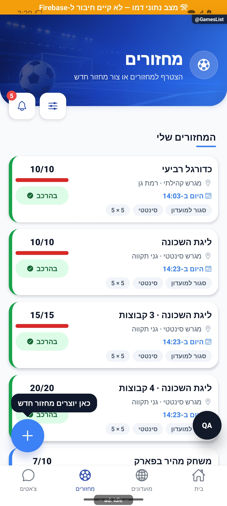

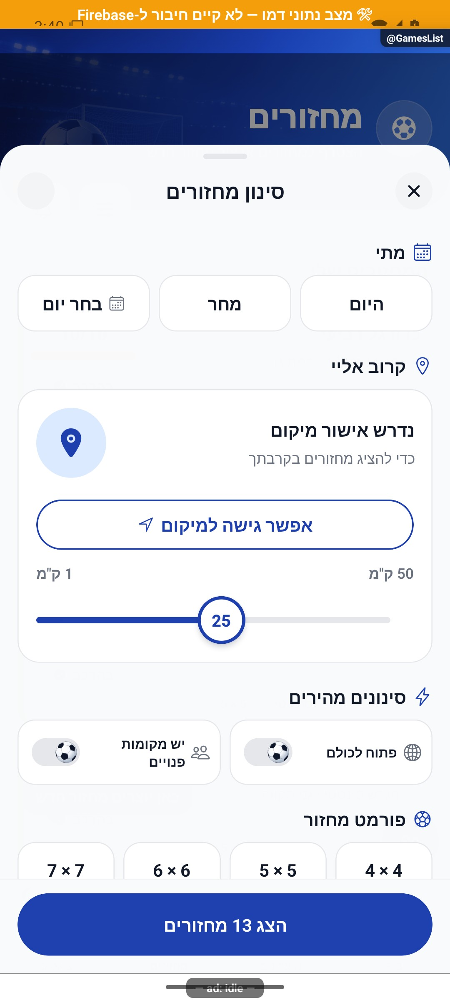
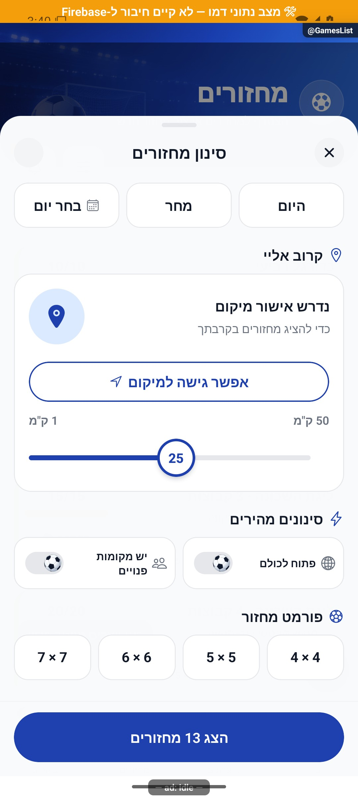
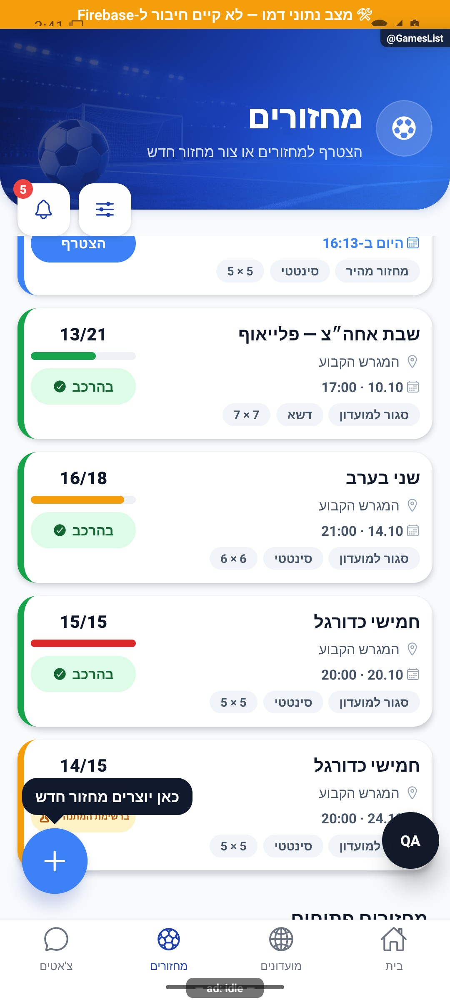
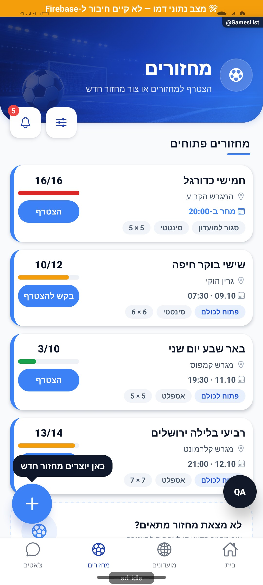

אלה צילומי גלילה ופתיחת חלון בלבד. לא הופעלו הרשאת מיקום, הרשמה או בקשת הצטרפות. ההבדל בין הרשמה מאושרת להמתנה מתועד לפי המצב בשירות; כפתור ״הצטרף״ בכרטיס מלא אינו הוכחה שהמשתמש יקבל מקום.

## גבולות והערות תחזוקה

התצוגה מותאמת לכמות אמיתית, ולכן מקור 094 שבו היה מחזור אחד אינו תיאור קבוע של ההיצע היום.

לפני שינוי פתח את הקוד המקושר ואת [כללי הפרויקט](../../../AGENTS.md). לאחר שינוי עדכן במסמך זה את התאריך, נקודת הקוד, המצבים שהתעדכנו, הבדיקות והצילום. אין לטעון שכל מצב/תפקיד נבדק רק משום שקיים צילום אחד.

## פירוט טכני ממוקד: זרימה, חישוב ונקודות שינוי

[הסבר פשוט למשתמש](games-list.simple.md)

העמקה: 07.10.2026, מול קוד המקור שב־`8e8fde5`. בעת הכתיבה HEAD הוא `50d508f`; בדיקת ההפרש בין הנקודות ב־`src` וב־`functions` לא מצאה שינוי קוד. הסעיפים וההסתייגויות הקיימים נשמרו. זו קריאת קוד ותיעוד, בלי הרצת תרחישי כתיבה חדשים.

המסך מפריד בין נתוני המשתמש לבין גילוי ציבורי; הסינון ופלט הגילוי אינם משנים רוסטר. `GamesListScreen` משתמש בחנויות המשתמש והמועדונים ובשירותי המחזורים, בעוד [הגדרות הגילוי](../../../src/config/gamesFeedDiscovery.ts) קובעות את שילוב הביקוש והמועדונים. שינוי סדר המקטעים שייך לתצוגה/הגדרות; שינוי מי רשאי להצטרף שייך לשירות ולשרת.

יש להבחין בשלושה מכנים: מספר מחזורים שהתקבלו, מספר הנותרים לאחר סינון ומספר המקומות בכל מחזור. לדוגמה, 5 מחזורים שהתקבלו ו־2 אחרי מסנן אינם 3 מחזורים חסרים במסד. תפוסת 8 משתמשים ושני אורחים פעילים במחזור שקיבולתו 10 היא 10/10; אורח בהמתנה אינו המקום ה־11. כפתור הצטרפות במחזור מלא עשוי לבקש המתנה, ולא מבטיח מקום.

`useAuthenticatedAction` חוצץ בין גלישה לבין פעולה המחייבת חשבון. הצלחת קריאת הפיד אינה הצלחת רישום; כשל רשימה חייב להיבדק בנפרד ממצב ריק וממסנן ללא תוצאות. בבדיקה ממוקדת יש לכסות סשן מתחלף, מעט/הרבה מחזורים וסירוב למיקום, בלי להצטרף בחשבון האמיתי.

## עיצוב המחזורים — 8.10.2026

מקור: `a348b9f` עם שינויים מקומיים, טרם שוחרר. העיצוב החדש מחליף את כרטיסי הרשימה הקודמים; הצילומים הישנים למעלה נשמרו כראיות היסטוריות.

- `MatchesHero` מציג כותרת כחולה עם קווי מגרש, כפתור יצירה מפורש במקום הפלוס הצף. שערי יצירה קיימים נשמרו.
- בכרטיס התמונה נמצאת בשמאל הפיזי, מהקצה העליון, עם פינות מעוגלות ומרווח לפני פס התפוסה. תגית אישית מונחת עליה: ״אתה רשום״, ״בהמתנה״ או המתנה לאישור. ללא קשר אישי מוצגת הרשאת ההצטרפות. המידע מימין כולל מועד, שם המחזור, מיקום ותפוסה. הרשאת הצטרפות, פורמט וסוג מגרש מוצגים כתגיות בתחתית.
- מקור התמונה: `groups` בחנות לחבר מועדון; למועדון שאינו בחנות `groupService.getPublic` לפי מזהים שהתקבלו מהפיד, פעם לכל מזהה בכל רענון. קריאות עצמאיות משתמשות ב־`Promise.allSettled`; כשל בתמונה אינו הופך את פיד המחזורים לריק. התוצאה מתבטלת בעת שינוי מקורות/חשבון או הסרת המסך.
- `coverPhotoUrl` קודם ל־`getCoverSource(coverImageId)`; מועדון בלי תמונה, מחזור ללא מועדון ושגיאת טעינת תמונה משתמשים בתמונת אצטדיון קבועה. אין שדות חדשים או שינוי ממירים.
- תפוסה = `players.length + activeGuestCount(guests) + pendingPromotion`. אורח לא פעיל אינו נספר; בקשת אישור אינה תופסת מקום. המכנה הוא `maxPlayers`. אורך הפס חסום ל־0–100%; בקיבולת שאינה חיובית הוא אפס. `alignItems: flex-start` תחת הכיווניות של האפליקציה מעגן אותו לימין החזותי, והוא מתמלא שמאלה.
- אין שינוי בחוזה ההרשמה. קודם בודקים קיבולת ואחר כך אישור: מחזור מלא מציע ״הצטרף לרשימת המתנה״; מחזור עם מקום ואישור מציע בקשה; אחרת הצטרפות. למי שרשום, ממתין או ממתין לאישור מוצגת פעולה לפתיחת פרטים. פעולת הכרטיס מונעת התפשטות לחיצה להורה. ביטול עדיין נמצא בפרטים.
- מסנן ״המועדונים שלי״ משתמש בחברות ב־`groups`, ולא בבעלות או בבקשה פתוחה לחברות. הוא חל על המקטעים כולל מחזורים שהרשמתם טרם נפתחה. ״באזור שלי״ משתמש במנגנון המיקום הקיים; המחזורים האישיים אינם מוסתרים בגלל מרחק. ״הכול״ מנקה את שני המסננים המהירים בלבד; שאר מסנני החלון נשמרים. ניקוי במצב ללא תוצאות מנקה הכול.
- מונה המסננים כולל בחירה במועדונים שלי. הרשמה, התנגשות מועדים, הצעת מקום, רענון וגילוי נשארים בזרימות הקיימות.

בדיקת הטיפוסים עברה. בריצה המלאה עברו 188 חבילות ו־2,795 בדיקות; בדיקת הביצועים של `balanceVariety` מדדה 155.2 מילישניות מול סף 150. בהרצה נפרדת עברו כל 24 הבדיקות, כולל ביצועים (108.5 מילישניות לחלוקה). הסף לא שונה. אין מכאן הוכחה לבדיקת אייפון או כתיבות ייצור.

### צילומים עדכניים של העיצוב הממומש

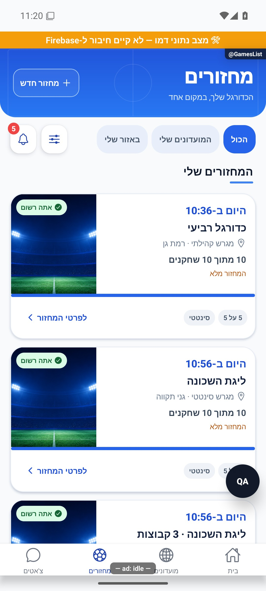
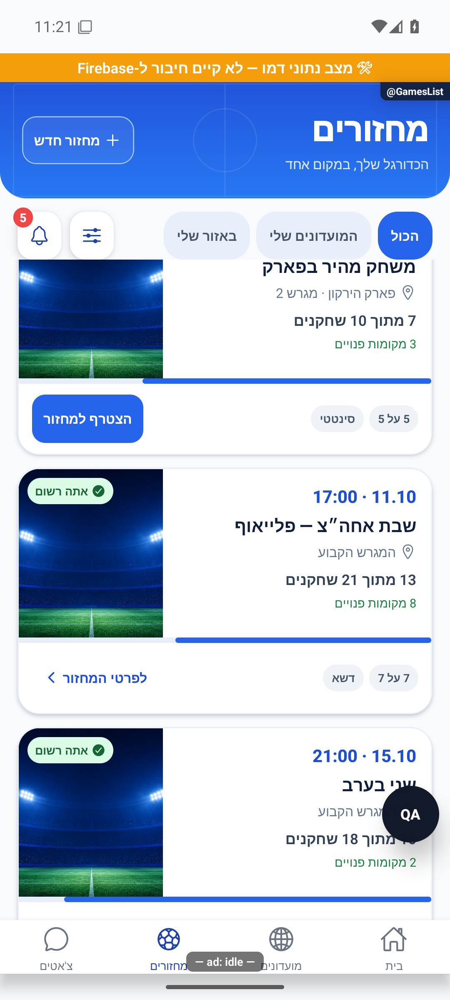
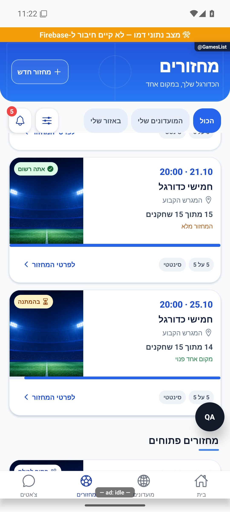
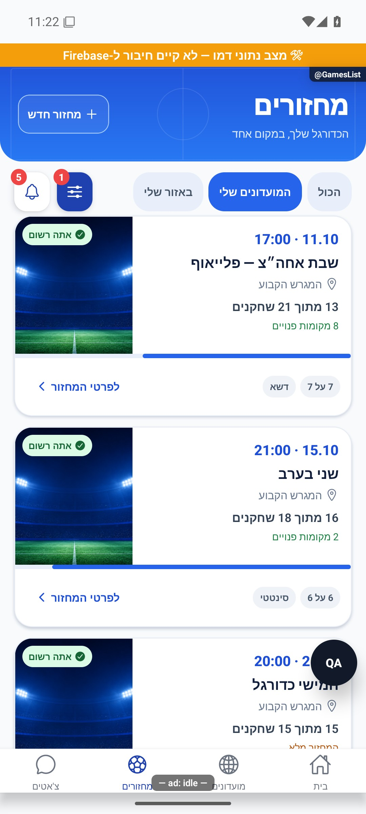

הצילומים נבדקו באמולטור אנדרואיד בדמו. בתפוסת 13 מתוך 21 הפס ממלא כ־62% מימין; בתפוסת 14 מתוך 15 הוא ממלא כ־93%. תמונה צמודה למעלה, תגית מעליה ואייקון המיקום מימין נצפו בפועל. סינון המועדונים מסתיר את המחזורים החד־פעמיים; ניקוי המסננים בחלון או במצב ריק מנקה גם את בחירת המועדונים. תמונות שהועלו מרחוק וכשל תמונה, סירוב מיקום, הרשמה בפועל, אישור ותצוגת אייפון לא הורצו בסבב זה. האצטדיון המוצג הוא תמונת הדמו/ברירת המחדל. כלי הפיתוח והפס הכתום אינם חלק מגרסת ההפצה.

הריצה המלאה החוזרת עברה: 189 חבילות, 2,796 בדיקות. בדיקת הטיפוסים נקייה. יומנים: `artifacts/rounds-redesign-jest-final.log`, `artifacts/rounds-redesign-tsc.log`.

חלון המסננים מקבל `hasAdditionalFilters` כדי להציג איפוס גם כשהמסנן היחיד הפעיל הוא בחירת המועדונים שבבעלות המסך. כך אפשר לנקות גם אותו מתוך החלון.

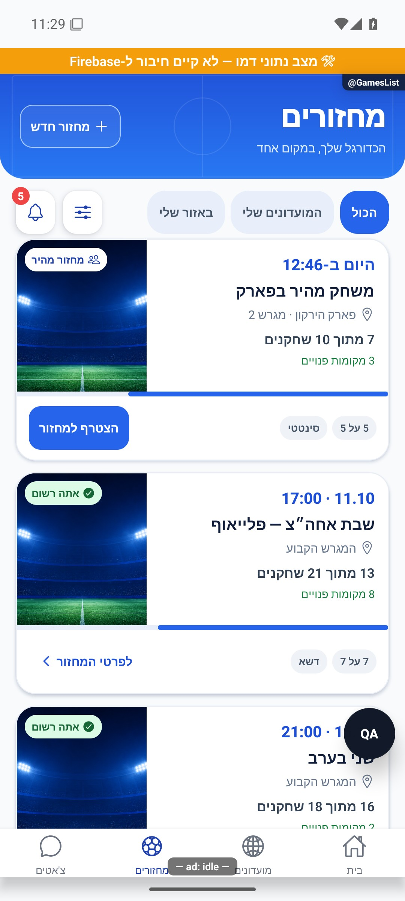

איפוס מסנן המועדונים מתוך חלון המסננים הורץ בדמו: ״הכול״ נבחר מחדש, מונה המסננים נוקה והמחזור החד־פעמי חזר לרשימה.

## עידון כרטיס המחזור — 8.10.2026

ב־`MatchListCard` התמונה נחתכת בתוך מסגרת עם רדיוס 18 בכל ארבע הפינות, כולל שתי הפינות הפנימיות בצד ימין הפיזי. היא נשארת צמודה למעלה ובשמאל הכרטיס. `marginBottom:8` בתמונה ו־`marginTop:2` בפס יוצרים הפרדה של 10 נקודות ביניהם. הפס הוזח 12 נקודות מכל צד ועיגולו 3; כיוון המילוי וחישוב התפוסה נשארו כפי שמתואר לעיל.

השורה התחתונה משתמשת בריווח אנכי 6 במקום 10, בכפתור בעל גובה מינימלי 36 במקום 44 וריווח אנכי 6 במקום 10. `hitSlop` מוסיף ארבע נקודות מעל ומתחת כדי לשמור על אזור לחיצה של לפחות 44. ריווח התגית הוא ארבע נקודות אנכיות ושבע אופקיות. תגיות יכולות להישבר לשורה נוספת ברוחב מצומצם; לא חותכים את המידע כדי לכפות שורה אחת.

`visibilityLabel` נפרד מהתגית האישית: `visibility === 'public'` מציג ״פתוח לכולם״; מחזור שאינו ציבורי ויש לו `groupId` מציג ״סגור למועדון״; ללא מועדון מוצג ״סגור״. התגית מוצגת תמיד בשורה התחתונה, גם במצב רשום, רשימת המתנה או בקשת אישור. פורמט וסוג מגרש נשארו מותנים בנתונים קיימים. מקור ההכרעה הוא הנתון הקיים במחזור; אין שדות חדשים, כתיבות מסד או שינוי הרשאות. אין שינוי בהחלטת כפתור ההצטרפות או בהבחנה בין פתיחות לציבור לבין צורך באישור.

בדיקת הטיפוסים וכל 2,796 הבדיקות ב־189 חבילות עברו. יומנים: `artifacts/rounds-card-polish-tsc.log`, `artifacts/rounds-card-polish-jest.log`. הצילומים הקודמים בסעיף העיצוב המקורי מתעדים את הנראות לפני עידון זה.

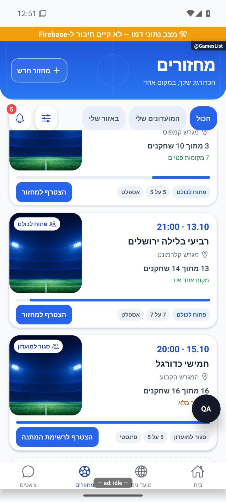

נבדק באימולטור אנדרואיד עם נתוני דמו: פינות פנימיות מעוגלות, רווח לפס, תגיות פתוח וסגור לצד פורמט ומגרש, וכפתורי הצטרפות והמתנה קומפקטיים. גם מצב רשום עם תגית סגור למועדון נצפה. לא הופעלו פעולות הרשמה; אייפון וגופנים מוגדלים לא הורצו.

## כרטיס קומפקטי — 8.10.2026

מקור: `a348b9f` עם שינויים מקומיים. ב־`MatchListCard` הגובה המינימלי של החלק העליון ירד מ־154 ל־126 נקודות; הריפוד ירד מ־14 ל־12 והרווח בין שורות מ־5 ל־4. מספר השחקנים והמקומות הפנויים מוצגים באותה שורת `occupancy`, עם גלישה לשורה נוספת ברוחב מצומצם. אין גובה קבוע: כותרת ומיקום ארוכים או גופן מוגדל יכולים להגביה את הכרטיס. גדלי הגופן בתפוסה הם 12 ובמקומות הפנויים 11. הסדר בתגית הוא טקסט ואז אייקון, ולכן תחת `forceRTL` האייקון נמצא בשמאל הפיזי. נשמרים התמונה, כל התגיות, התאריך, הכותרת, המיקום, הפס והפעולה; חישובים, מקורות נתונים וניווט לא השתנו.

בדיקת הטיפוסים עברה. בריצה המלאה עברו 2,795 בדיקות ו־188 חבילות; בדיקת זמן אחת ב־`balanceTeams` נכשלה תחת עומס טעינת האימולטור. בהרצה נפרדת עברו כל 16 הבדיקות באותה חבילה. סף הביצועים לא שונה. ראיות: `artifacts/rounds-compact-tsc.log`, `artifacts/rounds-compact-jest.log`, `artifacts/rounds-compact-performance.log`.

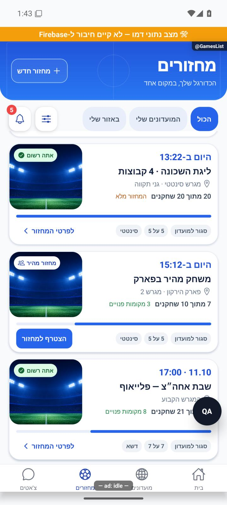

אומת באימולטור אנדרואיד בדמו: מחזור מלא ורשום, מחזור עם 7 מתוך 10 שחקנים ושלושה מקומות פנויים וכפתור הצטרפות; האייקון בתגית נמצא משמאל לטקסט. הפס מתמלא מימין לשמאל. בוצעה גלילה בלבד ללא הרשמה. סימוני הדמו והפיתוח בצילום אינם חלק מההפצה. אייפון וגופנים מוגדלים לא הורצו.

## מרווח מתחת למסננים — 8.10.2026

`controlsFloat.marginBottom` הוא 12 נקודות. המרווח נמצא מחוץ ל־`ScrollView`, ולכן נשאר קבוע גם אחרי גלילה ומפריד את גבול חיתוך הרשימה מהכפתורים. אין שינוי בנתונים, סינון, ניווט או גובה הכרטיס. מקור `a348b9f` עם שינויים מקומיים. בדיקות מתועדות ביומנים `artifacts/rounds-scroll-gap-tsc.log` ו־`artifacts/rounds-scroll-gap-jest.log`.

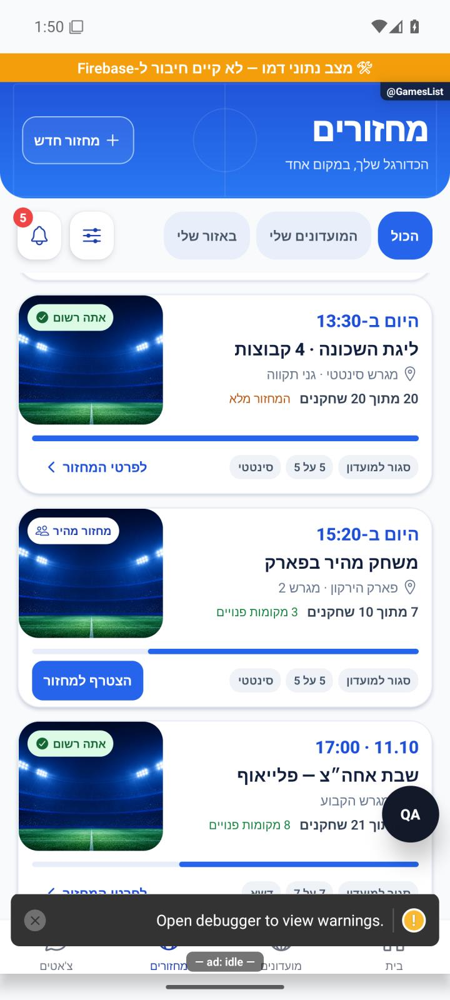

נצפה באנדרואיד בדמו לאחר גלילה: רווח קבוע בין הכפתורים לבין גבול אזור הגלילה. אין פעולות הרשמה. סימוני הפיתוח בצילום אינם חלק מההפצה. אייפון לא הורץ.

## כותרת אחידה עם מסך המועדונים — 8.10.2026

`MatchesHero` משתמש ב־`FeedHero`, בדומה לכותרת המועדונים. רקע המחזורים הוא `gamesTabBackground.png` עם מגרש וכדור; כותרת ותיאור מימין וכפתור ״מחזור חדש״ בשמאל. קווי המגרש הווקטוריים הוחלפו בתמונת הרקע הקיימת. הכפתור מפעיל את `handleCreate` הקיים, ורשימות, מסננים, תזמון וכרטיסים לא שונו בגלל הכותרת. המרווח הקבוע מתחת לכפתורי הסינון נשמר.

נצפה באימולטור אנדרואיד עם נתוני דמו. סימוני פיתוח והפס הכתום בצילום אינם חלק מההפצה. לא בוצעו פעולות הצטרפות או יצירה, קריאת מסד חי או בדיקת אייפון וגופן מוגדל. בדיקת הטיפוסים ו־2,801 הבדיקות ב־190 חבילות עברו; יומנים `artifacts/club-feed-redesign-tsc.log`, `artifacts/club-feed-redesign-jest.log`.

## הפלוס בכפתור יצירה — 8.10.2026

הפלוס מופיע משמאל לטקסט בכפתור היצירה. ברכיב FeedHero הטקסט קודם לאייקון add בתוך שורת הכפתור; תחת forceRTL הטקסט מימין והפלוס משמאל. לא השתנו הפעולה, גודל הכפתור או שער היצירה. אומת באימולטור אנדרואיד בנתוני דמו, ללא יצירת מועדון או מחזור. אייפון וגופן מוגדל לא נבדקו. בדיקת טיפוסים וכל 2,801 הבדיקות ב־190 חבילות עברו. יומנים artifacts/hero-plus-left-tsc.log ו־artifacts/hero-plus-left-jest.log.

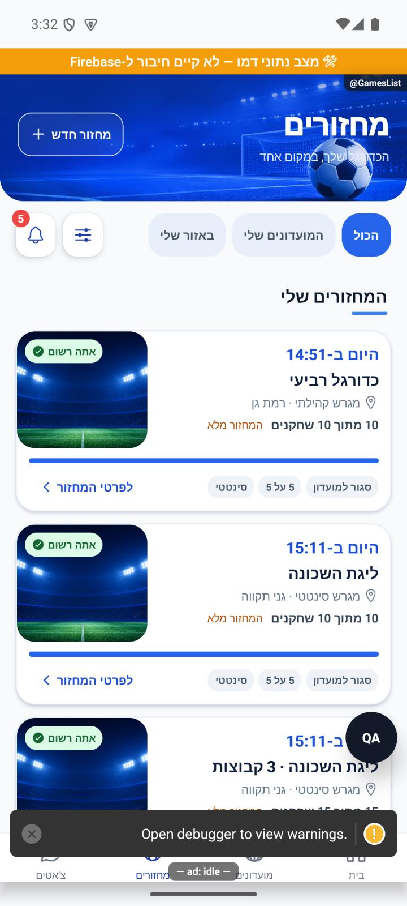

## מניעת החלפת תמונות במהלך טעינה — 9.10.2026

מקור: שינויים מקומיים מעל `a348b9f`, ללא פריסה. לפני התיקון `coverForGame` החזירה `undefined` הן כשאין מועדון והן כאשר תשובת `getPublic` טרם הגיעה. `MatchListCard` הציגה בשני המקרים את `park-aerial.jpg`; תשובת המועדון החליפה אותה ברקע האמיתי. בנוסף אפקט טעינת הרקעים איפס את המפה בכל שינוי ברשימות או במועדונים, ולכן גם תמונה ידועה הוחלפה זמנית בברירת המחדל.

`src/utils/roundFeedCovers.ts` מגדירה שלושה מצבים: `undefined` — נתוני מועדון טרם התקבלו; `null` — התקבלה תשובה ללא רקע/מועדון, או כשל ראשון ללא תמונה שמורה; אובייקט — נתוני רקע ידועים, גם אם השדות עצמם ריקים. `resolveRoundCover` מעדיפה את נתוני המועדון מתוך `groupStore`, ואחריהם מטמון ציבורי השייך לאותו משתמש. ללא `groupId` מוחזר `null` מיד.

`GamesListScreen` מעבירה גם `coverLoading` במפורש לשני אזורי כרטיסי המחזור. בזמן המתנה לא מועבר מקור תמונה; נשמרים המידות, הצבע הניטרלי והתגית הקיימים. אין הצגת תמונת ברירת מחדל רגע לפני התמונה הנכונה. הקריאות הקיימות לכרטיס בבית האורח ובהזמנה האישית, שאינן מפעילות טעינת רקע מועדון, שומרות על ברירת המחדל הקודמת משום ש־`coverLoading` ברירתה `false`.

`mergeRoundCovers` ממזגת תשובות במפה במקום לאפס אותה בתחילת רענון. כשל זמני שומר תמונה ידועה; כשל ראשון מסיים את מצב ההמתנה עם חלופה, ורענון מאוחר יכול לנסות שוב. תשובה מוצלחת שמחזירה `null` מחליפה את הרשומה השמורה, כדי לא להציג לצמיתות רקע של מועדון שהוסר. החלפת משתמש מסתירה מיד מטמון של זהות אחרת, והכתיבה הבאה אינה ממזגת אותו. ניקוי האפקט הקיים ממשיך לפסול תגובות של טעינה שהוחלפה או מסך שפורק. המזהים נלקחים ממחזורי המקור ולא מוקלדים מחדש.

ב־`MatchListCard` כשל תמונה משויך לכתובת שנכשלה. שינוי כתובת יכול להיטען מיד, בלי פריים של דגל שגיאה מהכתובת הקודמת. הפניה לכתובת הפעילה מונעת מאירוע שגיאה מאוחר של תמונה קודמת לפסול את החדשה. מפתח רכיב התמונה כולל את המועדון והרקע, למניעת שימור מפת פיקסלים של מקור קודם בטעינת מקור אחר. `resizeMethod=resize` מתאימה פענוח באנדרואיד לגודל הכרטיס.

אין שינוי בהרשמה, בקיבולת, בסינון, בנתונים שמורים, בהחלפת רקעי מועדונים או בצילום שהעלה משתמש. לא נוספה אנימציית החלפה.

בדיקות `tests/logic/roundFeedCovers.test.ts` מכסות הבחנה בין המתנה לחלופה, פתרון לפי מזהה מועדון, רענון וכשל, ניסיון חוזר, שינוי/מחיקת רקע, קדימות נתוני חברות והחלפת חשבון. `tests/roundCoverRendering.test.ts` מפעילה את רכיב הכרטיס עם מארחים מדומים ומכסה מקור ריק בזמן המתנה, חלופות, תאימות לקריאות אחרות, שגיאה ישנה והעלאה חדשה לאחר שגיאה. בדיקות אלה אינן מדידת טעינת תמונה במכשיר.

אימות חזותי: דמו באימולטור אנדרואיד עם עיכוב זמני של 25 שניות בתשובת `getPublic` המדומה ורקע גלריה מדומה. צולמו המתנה ותשובה שהושלמה; קובץ השירות הוחזר במדויק לאחר הצילום. אין נתוני ייצור או שמירת בחירת תמונה בתהליך. אייפון, רשת אמיתית ותמונה שהועלתה לא נבדקו במכשיר; שגיאת כתובת נבדקה ברכיב המדומה.

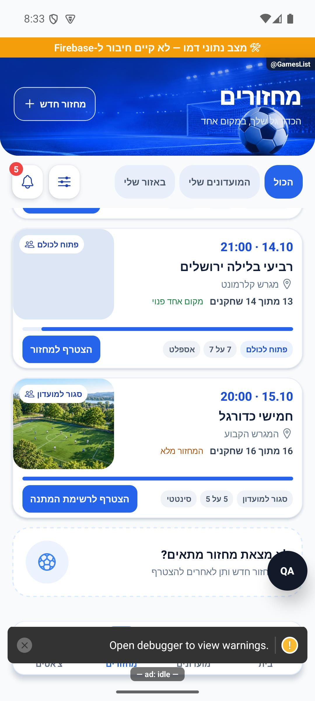
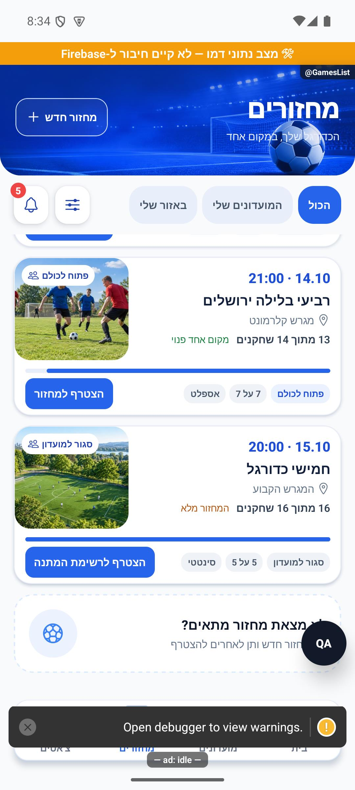

צילומי המקור והמגבלות מפורטים במניפסט וב־`artifacts/round-cover-fix`. השינוי טרם פורסם בחנות.

בדיקות הסיום עברו: בדיקת טיפוסים נקייה, 206 חבילות ו־2,998 בדיקות, כולל 12 בדיקות חדשות לטעינה ולרינדור תמונות. יומנים: `artifacts/round-cover-fix/tsc.log`, `jest.log`.

## תיקוני דיווחים — 9.10.2026

תגית התמונה נבנית רק כש-statusForUser שונה מ-none. תגית הסגירה תלויה גם ב-isOrphanContext ולא רק ב-groupId. resolveRoundCover אינה מקבלת מזהה מועדון במחזור יתום; גם coverLoading מתעלם ממנו. מועדון חסר רקע מקבל clubDefaultCoverId, ומחזור עצמאי מקבל c01 (park-aerial). נשמרו העלאות, קיבולת, קידומים והפעולות. tests/roundCoverRendering.test.ts בודקות טעינה ללא הבזק, בחירה, כשל העלאה מאוחר, תגית יחידה ומחזור יתום עם מזהה היסטורי.

מקור: שינויים מקומיים מעל a348b9f; טרם נבנתה גרסה. [ראיות ומגבלות](../../changes/2026-10-09-pulse-round2.md).

## תיקוני עיצוב ונגישות — 10.10.2026

מקור: `a348b9f235f1e1433497600555303231512a0834` עם שינויים מקומיים. אין בסעיף זה הוכחת גרסת חנות.

`GameFilterSheet` מספקת שמות למתגים; שורה שמופעלת כולה היא תחנה יחידה והמתג הפנימי מוסתר מקורא המסך. אין שינוי בתוצאות הסינון, סדר המחזורים או תמונות הכרטיסים. השינוי נקרא בקוד בלבד.

## תיקוני דיווחים — 10.10.2026, אחרי גרסה 1.1.45

MatchListCard נותן קדימות ל־coverPhotoUrl תקין, לאחריו תמונת fieldType אספלט או סינטטי, לאחריה גלריית המועדון וברירת המחדל לדשא. coverLoading ממשיך למנוע הצגת תמונה זמנית בזמן טעינת המועדון. כשל בתמונה שהועלתה נופל לתמונת סוג המגרש. בדיקות roundCoverRendering מכסות טעינה, החלפת תמונה, כשל והעדיפות.

שינוי מקומי מעל bcca0886; לא נבנתה גרסה בסבב הזה. נבדק בקוד ובבדיקות אוטומטיות. צילומי אנדרואיד בנתוני דמו בלבד; אין אימות באייפון או בטלפון המדווח.

## גיוון תמונות לפי משטח — 10.10.2026

נוספו שש תמונות עם שחקנים: שתיים לאספלט, שתיים לסינתטי ושתיים לדשא טבעי. יחד עם שתי תמונות המגרש הקיימות יש שלוש אפשרויות לאספלט, שלוש לסינתטי ושתיים לדשא. הבחירה קבועה לפי מזהה המחזור, ולא משתנה בטעינה או בין מכשירים. תמונת מועדון שהועלתה נשמרת בעדיפות ראשונה; כשל טעינה שלה נופל למאגר המשטח. תמונות מובנות של המועדון מפנות למשטח, וסוג חסר ממשיך לגלריה ולברירת המחדל הקיימת. אין כתיבה למסד.

roundSurfaceCover משתמש ב־hash: לכל תו h=(31*h+charCode) ללא סימן, ואינדקס h modulo מספר התמונות במשטח. coverLoading עדיין מונע תמונה זמנית לפני השלמת טעינת המועדון. roundCoverRendering בודקת יציבות, פיזור, שלושת המשטחים, קדימות העלאה וכשל.

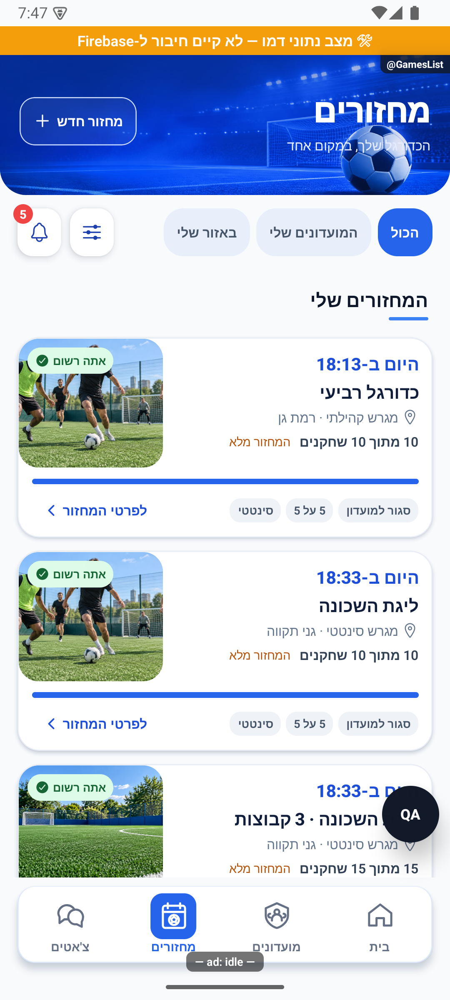

צילום כרטיסים בסינתטי בלבד. שאר התמונות נצפו במקור ונבדקו אוטומטית. אין אימות אייפון פיזי. שינוי מקומי, טרם הופץ.

## תמונה אחידה ברשימה ובפרטים — 11.10.2026

`src/data/roundCover.ts` מספקת `resolveRoundCover` משותפת ל־`MatchListCard` ול־`MatchStadiumHero`. סדר הבחירה: תמונת מועדון שהועלתה ולא נכשלה, תמונת משטח קבועה לפי `game.id` ו־`fieldType`, תמונת גלריית המועדון, ברירת מחדל קבועה לפי מזהה המועדון, ולבסוף תמונת מחזור ללא מועדון. הקוד אינו שומר שדה חדש ואינו משתמש באקראיות. מחזור יתום אינו מקבל תמונה ממועדון ישן.

`MatchDetailsScreen` מעבירה במפורש `roundId={game.id}` ו־`fieldType={game.fieldType}`; קודם הכותרת התעלמה מהמשטח והשתמשה בתמונת המועדון בלבד. המתנה לתמונת מועדון וכשל העלאה משתמשים באותה מדיניות בשני הרכיבים. `useRef` בכותרת מונע מכשל מאוחר של תמונה ישנה לפסול תמונה חדשה. חיתוך הכרטיס לעומת כותרת רחבה, שכבת ההכהיה ואווירת התאורה נשמרו; זהות המקור אינה מחייבת חיתוך זהה.

בדיקות `tests/roundCoverRendering.test.ts` מפעילות את שני הרכיבים ומשוות את מקורות התמונה בשלושת המשטחים, ללא משטח, בתמונה שהועלתה, בהמתנה, בכשל, בתמונה שהוחלפה, במחזור עצמאי ובמחזור יתום. נבדק גם חיבור השדות מהמסך לכותרת.

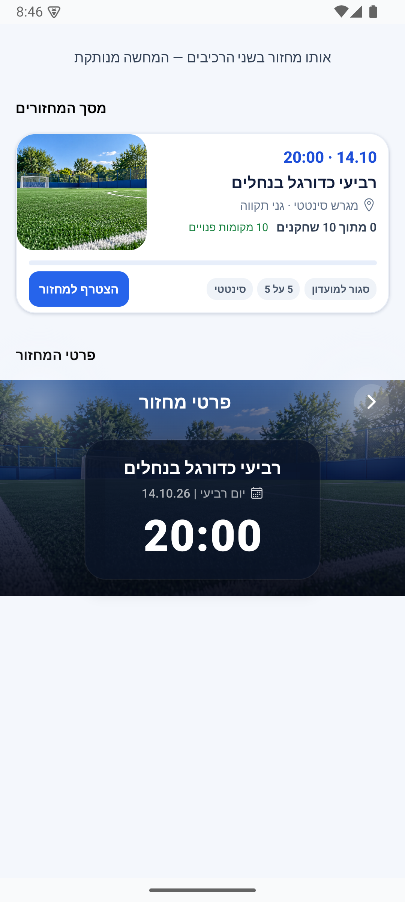

צילום הרכיבים האמיתיים באמולטור אנדרואיד בתצוגת המחשה מנותקת ופעולות מנוטרלות; לא נבדק מול נתוני ייצור או באייפון. השינוי מקומי, טרם הופץ.

## מאגר 60 תמונות — 12.10.2026

מקור: `ec536c6f1e2302ff40cfa3b16b230257cae8df53` עם שינויים מקומיים אחרי 1.1.47/280. ששת המאגרים ב־`src/data/roundSurfaceCovers.ts` מכילים עשר תמונות כל אחד; `src/assets/images/roundCovers/manifest.json` שומר מזהה, תיאור היצירה, מידות וחותמת לכל קובץ. המאגר נוצר בכלי `image_gen` המובנה, 60 קריאות נפרדות. התמונות נשמרו מקומית והוקטנו ל־1152×768, איכות JPEG 82, בסך 11,052,997 בתים. אין שימוש בספק תמונות מרוחק ואין כתיבה למסד.

`roundCoverPeriod(startsAt)` מחשב את החודש ואת השעה ב־`Asia/Jerusalem`, כולל שעון קיץ דרך מאגר אזורי הזמן. חלונות האור המקומיים המשוערים לפי חודש, בדקות מאז חצות: ינואר 390–1035, פברואר 375–1050, מרץ 375–1080, אפריל 375–1155, מאי 345–1185, יוני 330–1200, יולי 345–1200, אוגוסט 360–1185, ספטמבר 375–1125, אוקטובר 390–1080, נובמבר 375–1005, דצמבר 390–1005. התחלה כלולה וסיום אינו כלול. זו הערכה חזותית עונתית, לא חישוב זריחה ושקיעה לפי מיקום. תאריך חסר, לא סופי, לא תקין או לא חיובי משתמש ביום. התוצאה אינה תלויה בשעה הנוכחית או באזור הזמן של הצופה.

`roundSurfaceCover` בוחר תחילה משטח ויום/לילה, ואז אינדקס `hash(roundId) % 10`, עם אותו חישוב 31 הקיים. שינוי שעת המחזור או סוג המגרש יכול לשנות את התמונה; רענון בלבד לא משנה אותה. סדר הקבצים קבוע. אין הבטחה שלכל שני מחזורים סמוכים תהיה תמונה שונה. `resolveRoundCover` מעביר את `startsAt`; `MatchStadiumHero` מעביר אותו גם לבורר המשותף, כפי שעושים כרטיס הרשימה והבית. תמונה שהועלתה נשמרת; כשל טעינה חוזר למשטח. בהמתנה לטעינת המועדון נשמר מצב התמונה הניטרלי; בהיעדר משטח נשמר סדר הגלריה וברירת המחדל. תמונות מועדון מובנות אינן גוברות על משטח, בהתאם להתנהגות הקוד הקודמת. מחזור יתום אינו משתמש בשיוך ישן.

בדיקות: `roundCoverRendering` מרנדרת את רכיבי הבית, הרשימה והכותרת ומשווה מקור בשלושת המשטחים ביום ובלילה, קדימות העלאה, כשל והמתנה. `roundCoverPeriod` מכסה עונות, חצות, גבולות חודשים, גבול חלון ותאריך פגום. `roundCoverLibrary` מאמתת 60 קבצים שונים, 10 בכל קטגוריה, חותמות, חתימת JPEG ותקציב משקל. כל 3,523 הבדיקות ב־268 חבילות עברו; בדיקת הטיפוסים עברה. ראיות: `artifacts/round-cover-library-2026-10-12/`. אין פריסה, שינוי הרשאות או הסבת נתונים. בדיקת מכשיר מתועדת בנפרד בדוח השינוי; אין להסיק מכיסוי קוד על אימות באייפון או מול ייצור.

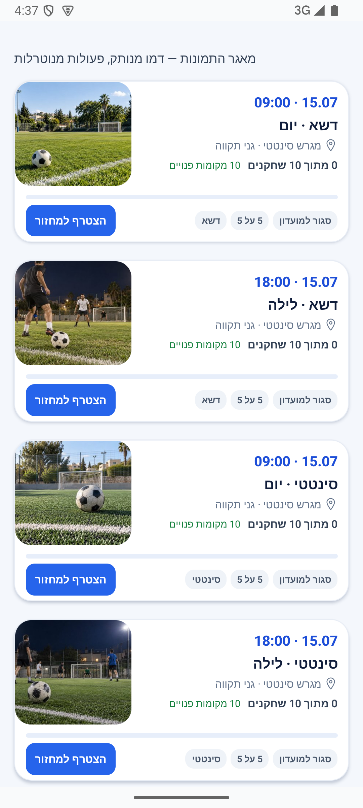
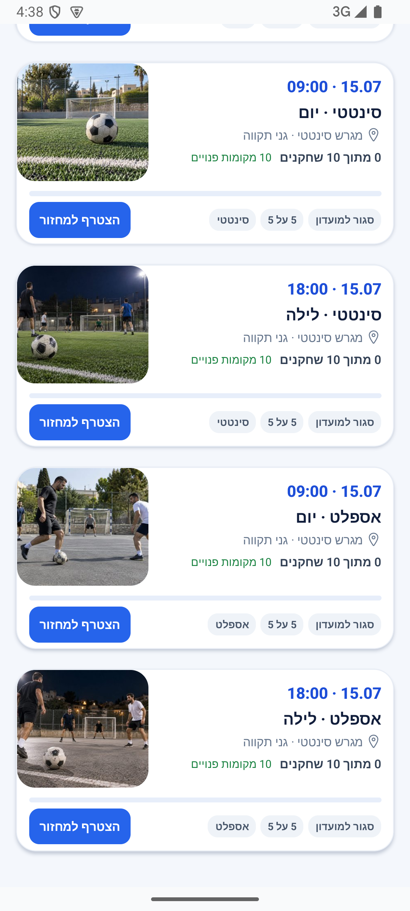
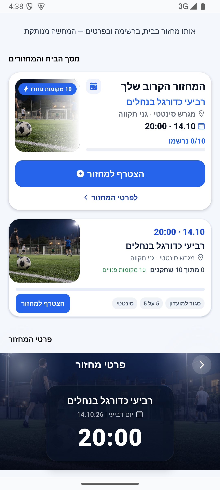

נצפו רכיבים אמיתיים באנדרואיד עם נתוני המחשה מנותקים ופעולות מנוטרלות; ששת המצבים נבדקו מבחינת חיתוך וכיווניות. זמן האמולטור UTC, אך בחירת התאורה נעשית לפי ישראל. אין אימות אייפון, נתוני ייצור או גרסת חנות.

## חיווי המתנה בהצטרפות — 12.10.2026

בכפתור הקבוע בתחתית `MatchDetailsScreen` מוצג כעת `ActivityIndicator` לבן במקום האייקון בזמן `busy`; הכיתוב נשאר, ומצב הנגישות מציין עיבוד וחוסר זמינות. קודם הכפתור היה חסום בלבד, ללא חיווי נראה. `primaryInFlight` חוסם באופן סינכרוני לחיצה חוזרת, ו־`busy` מופעל לפני בדיקות הרשת המקדימות, כולל בדיקת כרטיס אדום. מעטפת `try/finally` משחררת את שני המצבים גם בחזרה מוקדמת, הצלחה או שגיאה. כניסת אורח ממשיכה לפתוח את תהליך ההתחברות כפי שהיה.

גם `MatchListCard` מציג מחוון טעינה בזמן `busy`, בצבע מתאים לכפתור. `GamesListScreen` חוסם שליחת פעולות הצטרפות מקבילות באמצעות הפניה סינכרונית, לצד מצב המועדון הפעיל שכבר היה קיים. השינוי אינו מקצר את זמן השרת ואינו מציג הרשמה מוצלחת לפני תשובה. אין שינוי הרשאות, תור המתנה או מדיניות אישור.

אימות: 3,533 בדיקות עברו. שלוש בדיקות חדשות מפעילות את פונקציית ההצטרפות האמיתית עם תשובות רשת מושהות: חיווי מיידי, שליחה יחידה בלחיצות חוזרות, הצלחה, כשל עם אפשרות ניסיון חוזר ובדיקה מקדימה שמסתיימת בחסימה. באמולטור אנדרואיד בדמו נפתח מסך פרטי המחזור האמיתי עם תשובת הצטרפות מוזרקת ומושהית בשבע שניות; שני צילומים בהפרש של כשלוש שניות הראו את המחוון בזמן ההמתנה. זהו תרחיש מקומי ואינו הצטרפות לשרת או מדידת ביצועי ייצור. לא נבדק אייפון. הוכן אחרי 1.1.47/280, טרם הופץ. מקור `ec536c6f1e2302ff40cfa3b16b230257cae8df53` עם שינויים מקומיים.

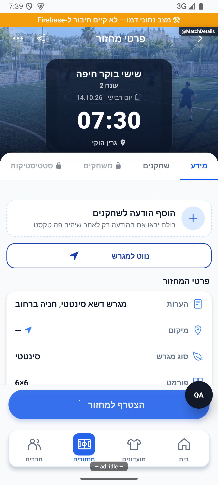

נוסף צילום של רכיב הכרטיס האמיתי עם מצב עיבוד מוזרק בתצוגת בדיקה. הצילום מאמת את המחוון ואת כיווניות הכיתוב; אינו תהליך הצטרפות מקצה לקצה מהרשימה.

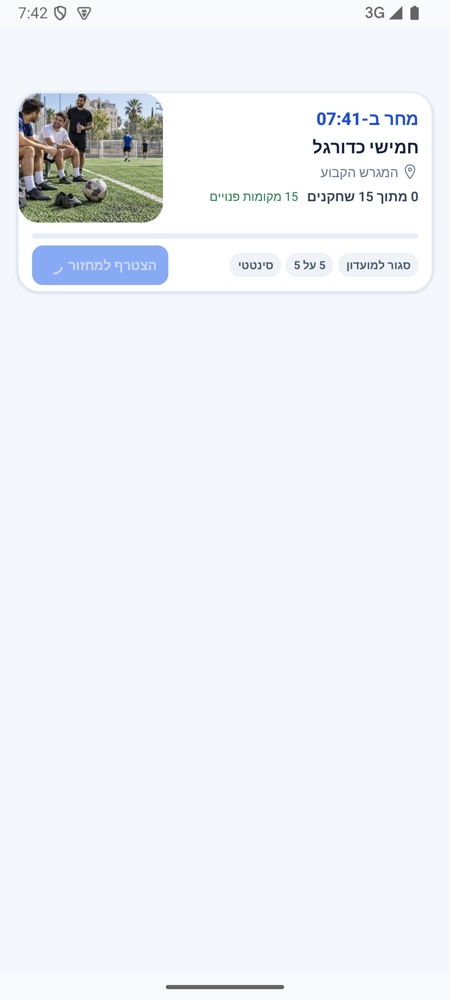

## תלות בעדכון העונות — 19.10.2026

נבדק ההפרש בקבצים המשותפים הרשומים כאן: `src/firebase/firestore.ts`. השינוי ממוקד במדיניות העונות, קריאת מצבן, שיוך מחזור ופקודות ניהולן; אין שינוי מכוון בחוזה העצמאי המתואר במסמך זה. אין להסיק מכך שהמסך הזה הורץ מחדש.

[מצב המימוש, הבדיקות ומגבלות האימות של העונות](../clubs/seasons.md). מקומי בלבד; לא בוצעה פריסה במסגרת המשימה.

## תלות במידע על סגירת עונה — 23.10.2026

בדיקת ההבדל ב־`src/firebase/firestore.ts` וב־`src/types/index.ts` מראה שהשינוי מוגבל לקריאת `seasons.closureStatus` בחוזה `GroupSeasons`. יתר ממירי הנתונים והמסלולים המתועדים כאן לא שונו במשימה זו. אימות הריצה החדש מתייחס להתאוששות ולכרטיס העונה, ולא להרצה חדשה של כל מצבי המסך הזה. [המסלול, הבדיקות והמגבלות](../../changes/2026-10-23-season-automatic-recovery.md).

## תלות בשמירת צבעי המחזור — 24.10.2026

במסגרת בחירת צבעים לפני שיבוץ עודכנו מקורות משותפים הרשומים לפיצ׳ר: `src/firebase/firestore.ts`, `src/types/index.ts`. השינוי מוסיף מפת צבעים למחזור, קריאה וכתיבה שלה ושימורה במסלולי הכוחות וההכנה. אין כאן פעולת ממשק חדשה במסך זה. זו בדיקת השפעת התוספת הממוקדת, ולא חקירה או אימות חזותי מחודש של הפיצ׳ר. כל 480 חבילות הבדיקה ו־5,343 הבדיקות עברו; טיפוסי הלקוח והשרת נקיים. השינוי מקומי וטרם הופץ. [מסלול הנתונים, ראיות ומגבלות](../rounds/draft-setup.md#צבעים-לפני-שיבוץ-ובכל-שיטת-חלוקה--24102026).

## המשך קיצור טעינות בלילה של 25.10.2026

`src/services/gameService.ts` מאחד קריאות פעילות ב-`cachedMyGames` לפי משתמש ותחום. `getMyGames` משתמש במפתח `open`, ו-`getMyRecentGamesRaw` במפתח `recent`; הם אינם מתערבבים. מטמון ההצלחה נשאר 15 שניות. ביטול המטמון הקיים אחרי פעולות מחזור מנקה גם בקשות פעילות, ומונע מתשובה קודמת לאכלס אותו מחדש. הסינון, המיון, חלון 48 השעות והניווט נשמרו.

אם שתי שאילתות המשתתף והיוצר נכשלו, המתודה דוחה בשגיאת מקור. רשימה ריקה משתי קריאות מוצלחות עדיין תקפה; תשובה מצד מוצלח יחיד נשמרה לפי החוזה הקיים. אין שינוי במנויי לייב או בכתיבות. `tests/logic/myGamesReadCoalescing.test.ts` מאמת הצלחה, כשל וביטול בגופי המוצר. השינוי מקומי וטרם נמדד במכשיר. [בדיקות, ראיות ומגבלות](../../changes/2026-10-24-loading-performance.md).

## תגובה מיידית לכפתורי השעון - 25.10.2026

נבדק ההפרש ב-`src/services/gameService.ts`: פעולות התחלת והשהיית שעון מחזירות את מצב הלייב מהעסקה הקיימת לשימוש בתגובת התצוגה. אין שינוי בעוגני הזמן, בכתיבות, בהגנות מעבר משחק או במידע שהקוראים האחרים שומרים. אין הרצה חדשה של כל מצבי הפיצר המתואר כאן. [בדיקות, ראיות ומגבלות](../../changes/2026-10-25-live-timer-response.md). התיקון מקומי וטרם הופץ.

## תלות בניווט עריכת קבוצות - 25.10.2026

נבדק השינוי הממוקד במקורות המשותפים: `src/navigation/GameStack.tsx`. נוסף מעבר מתפריט הלייב לחלוקת הכוחות עם שימור מפתח מסך המקור. אין שינוי נוסף בתהליך העצמאי המתואר כאן ולא נערכה לו בדיקת מסך חדשה. [היקף, בדיקות ומגבלות](../../changes/2026-10-25-live-draft-entry.md).

## תאימות לשמירת פקודת רכיב הבית - 25.10.2026

השינוי התחום במקורות המשותפים `src/types/index.ts` ו-`src/firebase/firestore.ts` מוסיף ומשמר את `liveMatch.lastWidgetCommandId`, מזהה אטום למניעת ביצוע חוזר של פקודת רכיב הבית. הוא אופציונלי במסמכים ישנים ואינו משנה מונים, הכרעות, ניווט או הרשאות של הפיצר המתואר כאן. בדיקה מפעילה את ממיר הקריאה המקורי ומאמתת שימור ערך והיעדרו. אין בכך בדיקת מכשיר חדשה לכל מצבי הפיצר. [מקור הבדיקה והמגבלות](../../changes/2026-10-25-widget-completion.md).

## תלות בהיסטוריית הרשמה בלוח המנהל - 28.10.2026

בקובץ `functions/src/index.ts` נוספו רק ייצואים עצמאיים של איסוף היסטוריית הרשמה וקריאתה למנהלי מועדון. אין שינוי מכוון במסלול הפיצר המתואר כאן, בחישוביו או בהרשאותיו, ולא נערכה לו בדיקת מסך חדשה. השירותים החדשים מקומיים וטרם נפרסו. [היקף, חישובים וראיות בלוח המנהל](../clubs/manager-dashboard.md).

## שלמות החלוקה המתוזמנת, 29.10.2026

נבדק השינוי הממוקד במקורות המשותפים: נוספו אזורי קבוצה שש ושבע למתאמי החלוקה ולקורא ההשמות, וסוננו אורחים ממתינים בשני מסלולי היצירה בשרת. אין שינוי בליבת האיזון או בחישובים העצמאיים של המסלול המתואר כאן. 15 בדיקות ממוקדות של החלוקה וקורא הנתונים עברו, וכן בדיקות הטיפוסים של הלקוח והשרת. אין אימות מכשיר חדש, שינוי חזותי מתוכנן או פריסה.

[היקף, בדיקות, פערים פתוחים ומגבלות](../../changes/2026-10-29-scheduled-balance-integrity.md).

## נתונים עדכניים בעסקת החלוקה, 29.10.2026

נבדק השינוי התחום במקורות המשותפים של החלוקה: בדיקת מצב ותזמון בתוך העסקה, הגדרות וסגל עדכניים, קריאת דירוגים בתוך העסקה והשמטת כל הדירוגים בהגרלה אקראית. אין שינוי בחישוב האיזון או בהתנהגות העצמאית של המסלול המתואר כאן. 41 בדיקות ממוקדות עברו; אין בכך אימות מכשיר או מסירה חיה. השינוי מקומי וטרם נפרס.

[מימוש, בדיקות ומגבלות](../../changes/2026-10-29-scheduled-balance-races.md).

## איזון ופיזור רמות לפני גיוון, 30.10.2026

נבדק שינוי תחום במקורות המשותפים של חלוקת הכוחות ומדדי השמירה. החישוב נותן עדיפות לפער ממוצעים, אחריו לפיזור הקצוות ולפרופיל הרמות, ולבסוף לציוותים חוזרים. התג rating_priority_v3 נוסף בלי להסיר קריאת דורות ישנים. אין שינוי מכוון בחישובים העצמאיים או בניווט המתוארים כאן. 112 בדיקות ממוקדות ובדיקות הטיפוסים של הלקוח והשרת עברו; אין בכך הרצה של המסך במכשיר או הפצה.

[מימוש, נוסחאות, בדיקות ומגבלות](../../changes/2026-10-30-rating-balance-priority.md).

## אימות כשלים בקבלת פרסום, 2.11.2026

בבדיקת אישור פרסום הקבוצות, כשל שלא ניתן לאמת כהצלחה נשאר כשל גלוי ונשמר באבחון. הבדיקה אינה שולחת הודעות שוב ואינה משנה הרשאות. השינוי תחום לשירות המשותף, מקומי וטרם הופץ.

נוסף תיעוד תצפית בנקודות הכשל של אימות קבלת הפרסום ב-`src/services/gameService.ts`. בדיקת `tests/logic/authTransientReads.test.ts` סופרת כעת גם את קריאת הקבלה, עם הרשאת ניסיון חוזר לקריאה בלבד; כתיבת תחילת העונה נשארת ללא ניסיון חוזר זמני. אין שינוי בזרימות העצמאיות האחרות המתוארות במסמך זה.

[דוח הטיפול והראיות](../../changes/2026-11-02-pulse-sweep.md).

## עדכון מקור משותף לבקשות השלמה, 4.11.2026

שינוי הסינון והטיפול בבקשות השלמה תועד בפיצר המחזורים. אין שינוי מכוון במסלול העצמאי המתועד כאן ולא נערך לו אימות מכשיר חדש. מקורות משותפים שהשתנו במסגרת התיקון: functions/src/index.ts, tests/logic/pulse23ExpectedConditions.test.ts. [הראיות והמגבלות](../../changes/2026-11-04-filler-requests.md).

## תיקו בשתיים או בשלוש קבוצות, 6.11.2026

נבדק שינוי תחום במקורות המשותפים `functions/src/index.ts`, `src/services/gameService.ts`, `src/types/index.ts`: נוסף מסלול סיום משחק בתיקו בשתיים או בשלוש קבוצות, עם בחירה ידנית של הקבוצה שנשארת ושמירה במוני התיקו הקיימים. אין שינוי מכוון בפעולות העצמאיות של הפיצר המתועד כאן. בדיקות המסלול מפעילות שירות לקוח, ממירים וגוף שרת במאגר זיכרון; אין בכך הרצה חדשה של מסך זה. המימוש מקומי, ללא הפצה או פריסת שירות השמירה החדש. [התנהגות, נתונים, בדיקות ומגבלות](../../changes/2026-11-06-manual-draw.md).

## תלות משותפת בציון המחזור החדש, 6.11.2026

נוספה תמיכה מקומית בגרסת ציון למחזורי העתיד ובקריאת הרף הקפוא, תוך שמירת המודל של מחזורים קודמים. השינוי כאן תחום לתלות במקורות המשותפים, ואינו אימות חדש של כל המסלול העצמאי. המקורות המשותפים שנבדקו בהפרש התחום: src/firebase/firestore.ts, src/types/index.ts. אין פריסה, הסבת נתונים או שינוי ציוני עבר. [התנהגות, בדיקות ומגבלות](../../changes/2026-11-06-shared-evening-score.md).
