# רשימת מחזורים וגילוי — הסבר פשוט

## קיצור טעינה ומניעת קריאות כפולות — 23.10.2026

רשימת המחזורים אינה טוענת עוד את אותן רשימות פעמיים בעת הפתיחה. הנתונים ממשיכים להתעדכן כשחוזרים אליה וברענון ידני. השינוי מקומי וטרם הופץ.

[בדיקות, צילומים ומגבלות](../../changes/2026-10-23-screen-loading.md).

## מונה הבקשות במצב אורח — 23.10.2026

רשימת המחזורים אינה מבקשת בקשות חברות עבור אורח. במעבר חשבון מתנקה מונה הבקשות הקודם ותגובה מאוחרת אינה מחזירה אותו. התיקון מקומי וטרם הופץ.

## תיעוד כשלים — 20.10.2026

נוסף תיעוד אוטומטי לנקודות כשל במסלול הזה, עם מקור התקלה. הפעולה המקורית שומרת על ערכי החזרה והודעות השגיאה שלה. השינוי מקומי, טרם הופץ, ואין אימות מסירה חיה לפולס.

[דוח דיווח השגיאות והראיות](../../changes/2026-10-20-error-reporting-audit.md).

עדכון מקומי מ־13.10.2026: הרשימה מקבלת את הגנת הלחיצות המשותפת למצב שבו המכשיר מחמיץ את סיום הגלילה. ההרשמה, הסינון וכרטיסי המחזורים פועלים לפי אותם כללים. אימות במכשיר המדווח עדיין נדרש.

ברשימת המחזורים מוצאים מחזור שאפשר להצטרף אליו ורואים את המחזורים שלך. אפשר לסנן את הרשימה ולפתוח מחזור כדי לראות פרטים ולהירשם. כשיש מעט מחזורים, מוצגים גם ביקוש לשחקנים ומועדונים באזור.

[להסבר המעמיק ולמפת הקוד](games-list.md)

## צילום והיקף ההוכחה

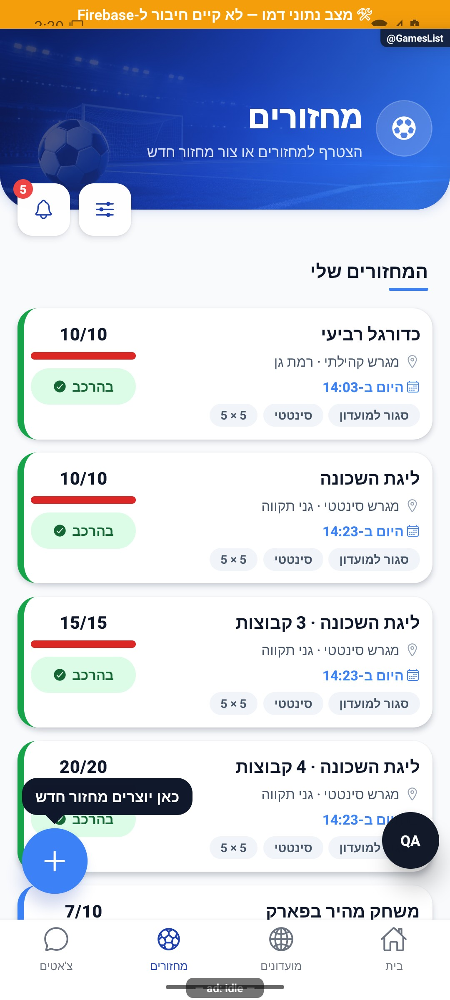

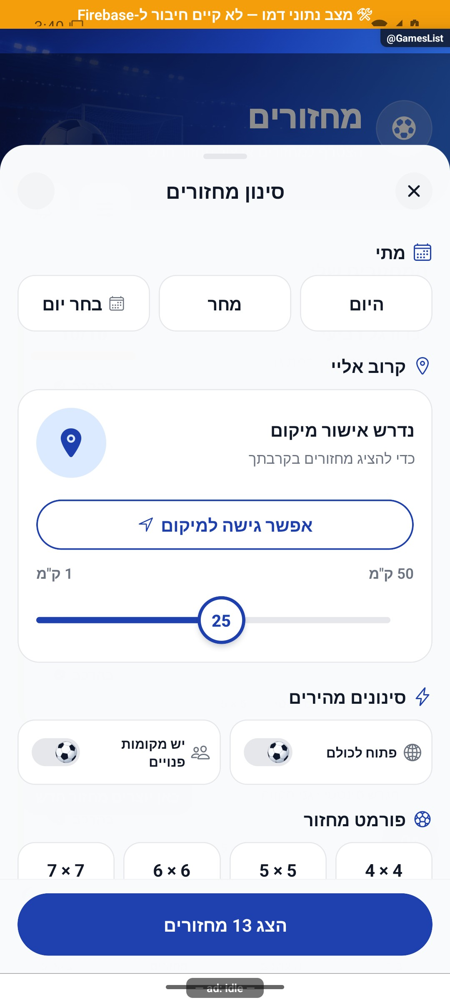

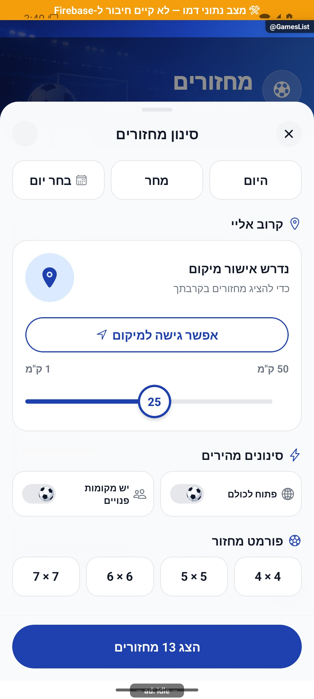

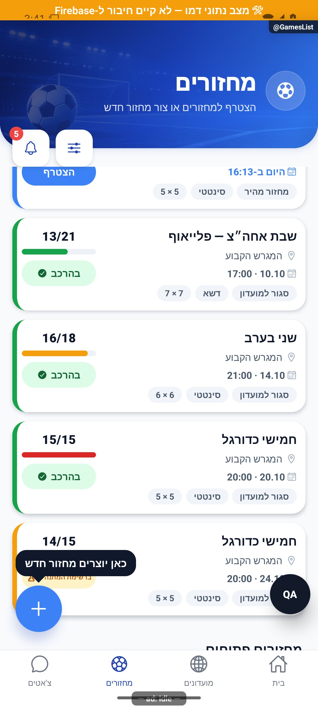

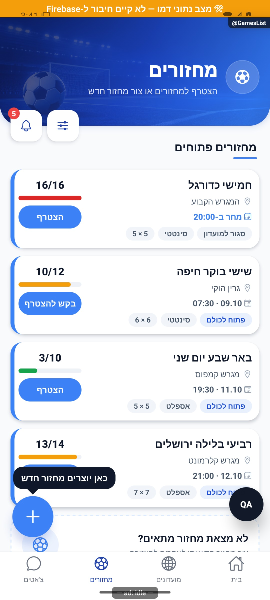

הצילומים מציגים רק את המצבים המתועדים במסמך המעמיק. חלקם נתוני דמו, חלקם הוכחות מתיקון קודם, ובכמה מהם טעינה או הודעת הגנה; הם אינם אישור שכל התהליך או השרת נבדקו.

## העיצוב החדש — 8.10.2026

המחזורים שלך מופיעים ראשונים. בכל כרטיס רואים את תמונת המועדון ובתוכה את מצב ההרשמה שלך. מתחת לפרטים מופיע פס כחול המתמלא מימין לשמאל לפי מספר המקומות התפוסים. גודל המשחק וסוג המגרש מופיעים בתגיות. מחזור מלא מציע להיכנס לרשימת המתנה.

אפשר לבחור במהירות הכול, המועדונים שלי או מחזורים באזור. כפתור ״מחזור חדש״ נמצא למעלה. מחזור ללא מועדון מקבל תמונת אצטדיון קבועה.

העיצוב עדיין בשינויים מקומיים ולא עלה לחנות.

### צילומים עדכניים של העיצוב הממומש

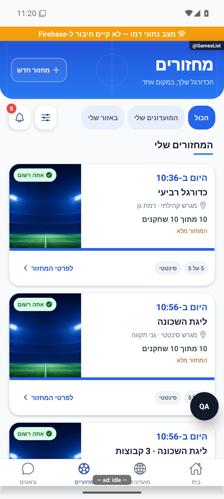
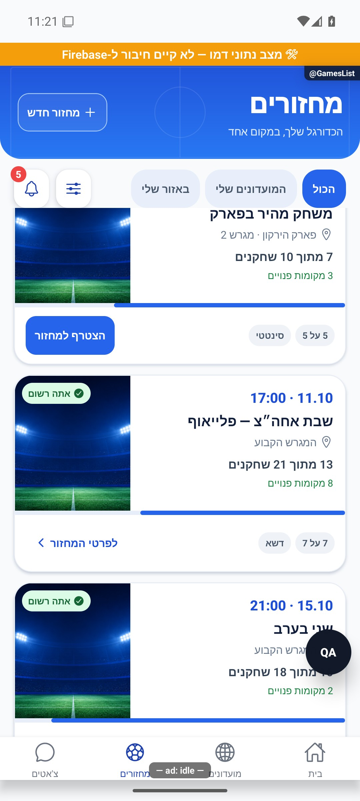
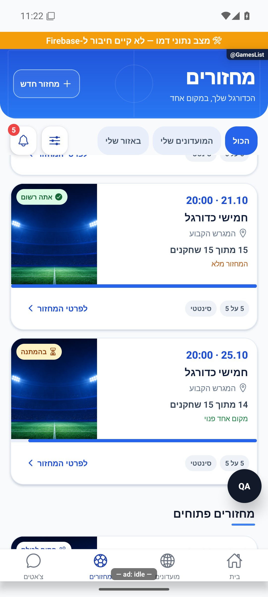
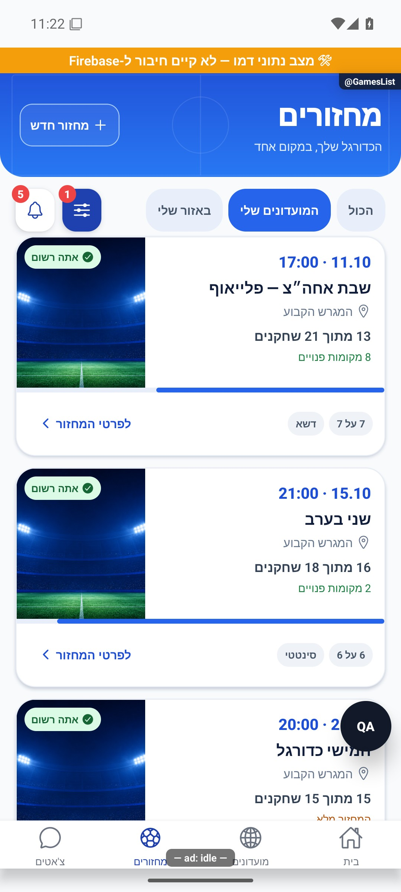

הצילומים נבדקו באמולטור אנדרואיד בדמו. בתפוסת 13 מתוך 21 הפס ממלא כ־62% מימין; בתפוסת 14 מתוך 15 הוא ממלא כ־93%. תמונה צמודה למעלה, תגית מעליה ואייקון המיקום מימין נצפו בפועל. סינון המועדונים מסתיר את המחזורים החד־פעמיים; ניקוי המסננים בחלון או במצב ריק מנקה גם את בחירת המועדונים. תמונות שהועלו מרחוק וכשל תמונה, סירוב מיקום, הרשמה בפועל, אישור ותצוגת אייפון לא הורצו בסבב זה. האצטדיון המוצג הוא תמונת הדמו/ברירת המחדל. כלי הפיתוח והפס הכתום אינם חלק מגרסת ההפצה.

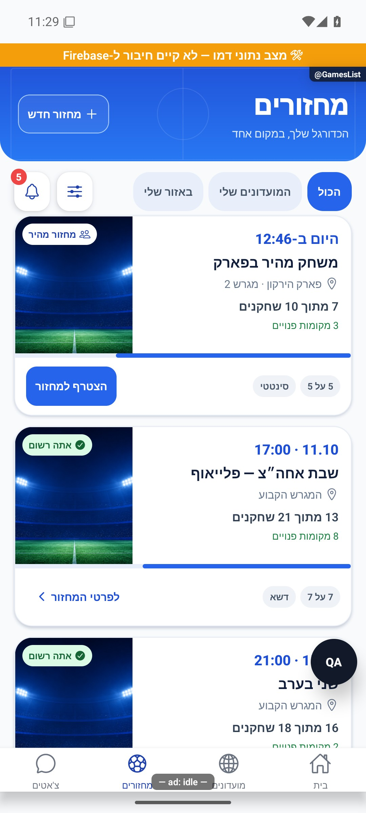

איפוס מסנן המועדונים מתוך חלון המסננים הורץ בדמו: ״הכול״ נבחר מחדש, מונה המסננים נוקה והמחזור החד־פעמי חזר לרשימה.

## עידון הכרטיסים

תמונת המועדון מעוגלת גם בצד הפנימי שלה ויש רווח בינה לבין פס התפוסה. שורת התגיות וכפתור ההצטרפות קומפקטיים יותר. בכל מחזור מוצג גם אם הוא פתוח לכולם או סגור, בנוסף למצב ההרשמה שלך שמופיע על התמונה.

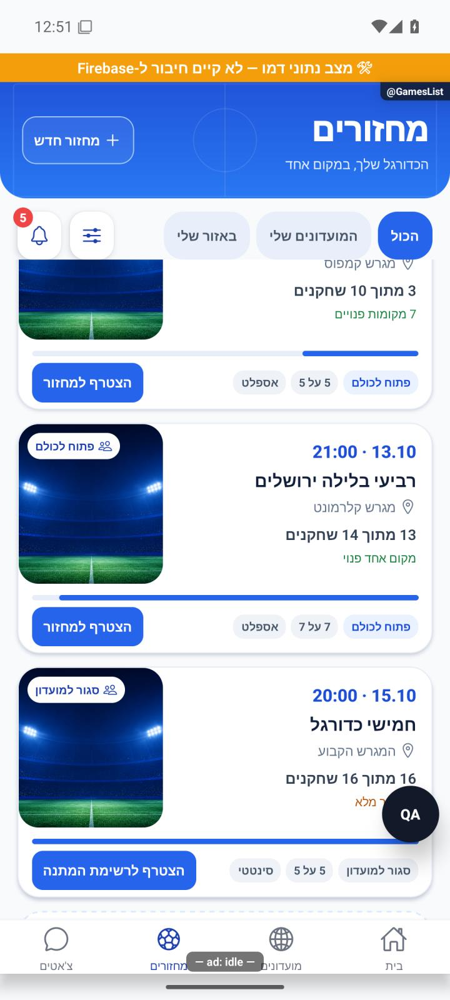

נבדק באימולטור אנדרואיד עם נתוני דמו: פינות פנימיות מעוגלות, רווח לפס, תגיות פתוח וסגור לצד פורמט ומגרש, וכפתורי הצטרפות והמתנה קומפקטיים. גם מצב רשום עם תגית סגור למועדון נצפה. לא הופעלו פעולות הרשמה; אייפון וגופנים מוגדלים לא הורצו.

## כרטיס נמוך יותר

מספר השחקנים והמקומות הפנויים מופיעים יחד והריווחים הצטמצמו. כל הנתונים נשמרים והאייקון בתגית שעל התמונה נמצא משמאל לטקסט. כשצריך יותר מקום לטקסט הכרטיס יכול להתרחב.

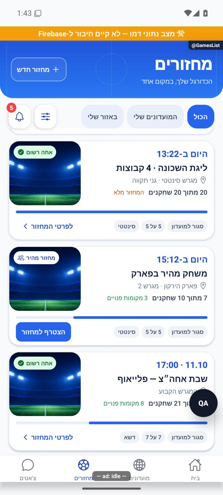

אומת באימולטור אנדרואיד בדמו: מחזור מלא ורשום, מחזור עם 7 מתוך 10 שחקנים ושלושה מקומות פנויים וכפתור הצטרפות; האייקון בתגית נמצא משמאל לטקסט. הפס מתמלא מימין לשמאל. בוצעה גלילה בלבד ללא הרשמה. סימוני הדמו והפיתוח בצילום אינם חלק מההפצה. אייפון וגופנים מוגדלים לא הורצו.

נוסף רווח קטן וקבוע מתחת לכפתורי הסינון, כדי שהכרטיסים בזמן גלילה לא יהיו צמודים אליהם.

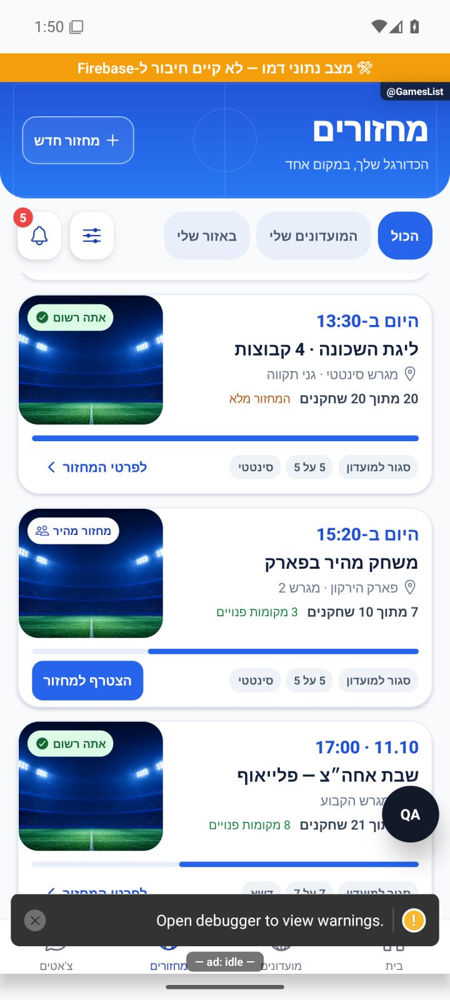

נצפה באנדרואיד בדמו לאחר גלילה: רווח קבוע בין הכפתורים לבין גבול אזור הגלילה. אין פעולות הרשמה. סימוני הפיתוח בצילום אינם חלק מההפצה. אייפון לא הורץ.

כותרת המחזורים עכשיו באותו סגנון של המועדונים, עם רקע אחר של מגרש וכדור. כפתור ״מחזור חדש״ נשאר בשמאל והמידע על המחזורים נשאר כפי שהיה.

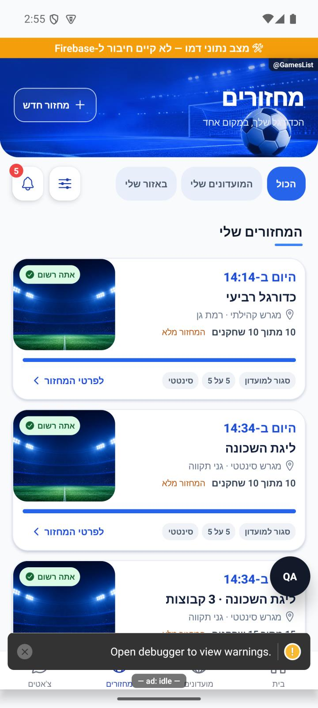

נצפה באימולטור אנדרואיד עם נתוני דמו. סימוני פיתוח והפס הכתום בצילום אינם חלק מההפצה. לא בוצעו פעולות הצטרפות או יצירה, קריאת מסד חי או בדיקת אייפון וגופן מוגדל. בדיקת הטיפוסים ו־2,801 הבדיקות ב־190 חבילות עברו; יומנים `artifacts/club-feed-redesign-tsc.log`, `artifacts/club-feed-redesign-jest.log`.

## הפלוס בכפתור יצירה — 8.10.2026

הפלוס מופיע משמאל לטקסט בכפתור היצירה. אומת באימולטור אנדרואיד בנתוני דמו, ללא יצירת מועדון או מחזור. אייפון וגופן מוגדל לא נבדקו. בדיקת טיפוסים וכל 2,801 הבדיקות ב־190 חבילות עברו. יומנים artifacts/hero-plus-left-tsc.log ו־artifacts/hero-plus-left-jest.log.

## תמונות בזמן טעינה — 9.10.2026

בטעינה הראשונה אזור התמונה נשאר ניטרלי עד שידוע מהו רקע המועדון, במקום להציג קודם תמונה אחרת. תמונות שכבר נטענו נשארות בזמן רענון. מחזור ללא מועדון מקבל מיד את תמונת ברירת המחדל; גם היעדר רקע או כשל טעינה מקבלים חלופה.

## תיקוני דיווחים — 9.10.2026

פתוח לכולם מופיע רק בשורת התגיות. מעל התמונה מוצג מצב אישי כגון אתה רשום או רשימת המתנה. מחזור מהיר סגור מסומן מחזור סגור, גם אם נותר לו שיוך ישן למועדון.

מקור: שינויים מקומיים מעל a348b9f; טרם נבנתה גרסה. [ראיות ומגבלות](../../changes/2026-10-09-pulse-round2.md).

## תיקוני עיצוב ונגישות — 10.10.2026

מקור: `a348b9f235f1e1433497600555303231512a0834` עם שינויים מקומיים. אין בסעיף זה הוכחת גרסת חנות.

אפשרויות סינון המחזורים מקבלות שם ומצב ברור בקורא מסך.

## תיקוני דיווחים — 10.10.2026, אחרי גרסה 1.1.45

תמונות המחזורים מתאימות לאספלט ולסינטטי. תמונה שהמועדון העלה נשמרת.

שינוי מקומי מעל bcca0886; לא נבנתה גרסה בסבב הזה. נבדק בקוד ובבדיקות אוטומטיות. צילומי אנדרואיד בנתוני דמו בלבד; אין אימות באייפון או בטלפון המדווח.

## גיוון תמונות לפי משטח — 10.10.2026

נוספו שש תמונות עם שחקנים: שתיים לאספלט, שתיים לסינתטי ושתיים לדשא טבעי. יחד עם שתי תמונות המגרש הקיימות יש שלוש אפשרויות לאספלט, שלוש לסינתטי ושתיים לדשא. הבחירה קבועה לפי מזהה המחזור, ולא משתנה בטעינה או בין מכשירים. תמונת מועדון שהועלתה נשמרת בעדיפות ראשונה; כשל טעינה שלה נופל למאגר המשטח. תמונות מובנות של המועדון מפנות למשטח, וסוג חסר ממשיך לגלריה ולברירת המחדל הקיימת. אין כתיבה למסד.

roundSurfaceCover משתמש ב־hash: לכל תו h=(31*h+charCode) ללא סימן, ואינדקס h modulo מספר התמונות במשטח. coverLoading עדיין מונע תמונה זמנית לפני השלמת טעינת המועדון. roundCoverRendering בודקת יציבות, פיזור, שלושת המשטחים, קדימות העלאה וכשל.

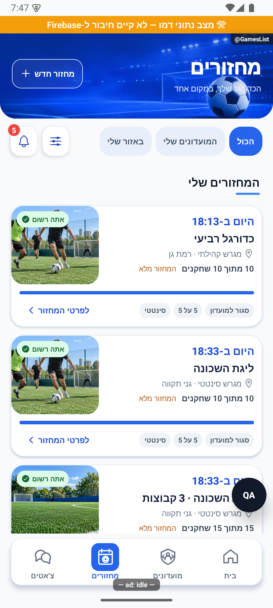

צילום כרטיסים בסינתטי בלבד. שאר התמונות נצפו במקור ונבדקו אוטומטית. אין אימות אייפון פיזי. שינוי מקומי, טרם הופץ.

## תמונה אחידה ברשימה ובפרטים — 11.10.2026

אותו מחזור מציג כעת אותה תמונה ברשימת המחזורים ובפרטי המחזור. תמונה שהמועדון העלה קודמת לתמונות המובנות; אחרת נבחרת תמונה קבועה שמתאימה לסוג המגרש. החיתוך וההכהיה שונים בהתאם למקום שבו התמונה מוצגת.

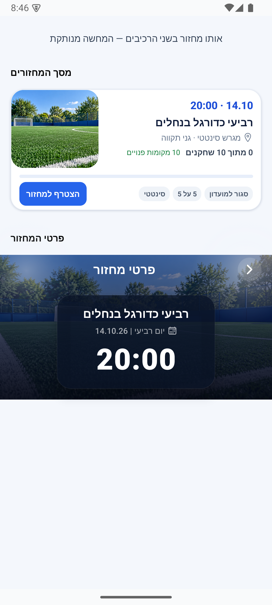

צילום הרכיבים האמיתיים באמולטור אנדרואיד בתצוגת המחשה מנותקת ופעולות מנוטרלות; לא נבדק מול נתוני ייצור או באייפון. השינוי מקומי, טרם הופץ.

## מאגר תמונות לפי משטח ושעת המחזור — 12.10.2026

המחזור מקבל תמונה מתוך מאגר של 60 תמונות: 10 לכל שילוב של דשא, סינתטי או אספלט ביום ובלילה. יש מגרשים, שחקנים, חימום ואווירת משחק. הבחירה נעשית לפי שעת המחזור בישראל ועונת השנה בקירוב, ונשארת זהה בבית, ברשימה ובפרטים. תמונה שהמועדון העלה בעצמו נשארת בעדיפות ראשונה. ללא תאריך תקין נבחר מאגר היום; ללא סוג מגרש נשמרת החלופה הקיימת.

[גלריית התמונות](../../../src/assets/images/roundCovers/index.html). השינוי מקומי ולא נכלל עדיין בגרסת החנות.

## חיווי הצטרפות — 12.10.2026

לאחר לחיצה על הצטרפות למחזור מופיע עיגול טעינה בכפתור עד לקבלת התשובה. לחיצות חוזרות בזמן העיבוד חסומות, ובכשל אפשר לנסות שוב. נבדק באנדרואיד בדמו עם המתנה יזומה של שבע שניות; טרם הופץ.

## תלות בעדכון העונות — 19.10.2026

קובץ תשתית משותף עודכן במסגרת העונות. שינוי זה אינו מוסיף פעולה חדשה למסך המתואר כאן; פרטי העונות והבדיקות מופיעים במסמך העונות.

[מצב המימוש, הבדיקות ומגבלות האימות של העונות](../clubs/seasons.md). מקומי בלבד; לא בוצעה פריסה במסגרת המשימה.

## תלות במידע על סגירת עונה — 23.10.2026

נוסף מידע משותף שמאפשר להסביר מדוע עונה מתעכבת בסגירה. אין שינוי נוסף בפעולות המתוארות כאן; השינוי מקומי וטרם הופץ. [המסלול, הבדיקות והמגבלות](../../changes/2026-10-23-season-automatic-recovery.md).

## תלות בשמירת צבעי המחזור — 24.10.2026

שמירת המידע המשותפת עודכנה כדי להעביר את צבעי הקבוצות ממסכי הכוחות להכנה וללייב. אין תוספת פעולה במסך הזה, והוא לא נבדק מחדש במכשיר במסגרת התוספת. השינוי מקומי וטרם הופץ. [פרטי התוספת ומגבלות הבדיקה](../rounds/draft-setup.md#צבעים-לפני-שיבוץ-ובכל-שיטת-חלוקה--24102026).
