# רשימת מחזורים וגילוי — הסבר פשוט

## בדיקת קצה ואימות מקורי, 2.11.2026

מקום הגלילה אינו מוחלף בגובה שלד הטעינה. המסננים והכרטיסים ממשיכים במסלוליהם הקיימים. מקומי וטרם הופץ. [שחזור, תיקונים, בדיקות ומגבלות](../../changes/2026-11-02-experience-review.md).

## המשכיות ומשוב בשימוש, 2.11.2026

בחזרה לרשימת המחזורים נשמרים המסננים והמיקום במהלך השימוש. ההרשמה מקבלת אישור קצר בכרטיס לפי התוצאה האמיתית, והמעבר מהמתנה לתוכן עדין. מימוש מקומי שטרם הופץ. [התנהגות, בדיקות, צילומים ומגבלות](../../changes/2026-11-02-experience-polish.md).

## הרחבת שלדי הטעינה, 2.11.2026

כרטיסי ההמתנה ברשימת המחזורים משתמשים כעת בפעימה עדינה אחידה ובהודעת טעינה אחת. צמצום תנועה מכבה את הפעימה. מימוש מקומי שטרם הופץ. [התנהגות, בדיקות, צילומים ומגבלות](../../changes/2026-11-02-loading-skeletons-expanded.md).

## אימות פרסום קבוצות בפולס, 2.11.2026

נבדק ההפרש התחום בשירות המשותף של המחזורים: נוספה בדיקת אישור לפרסום קבוצות כאשר תשובת הפעולה אובדת. אין שינוי בחישוב, במכנים או בפעולות העצמאיות של הפיצר המתואר כאן. התיקון מקומי וטרם הופץ; אין בדיקת מכשיר חדשה לפיצר זה.

[דוח הטיפול, הבדיקות והמגבלות](../../changes/2026-11-02-pulse-sweep.md).

## בקשות לשיחה אישית, 2.11.2026

נבדקה השפעת תוספת בקשות השיחה במקורות המשותפים. השינוי ממוקד בהרשאת שיחה, בשדות פרטיות ההודעות ובחיבורי הבדיקות; אין מכך אימות חדש של מסך זה במכשיר. המימוש מקומי וטרם הופץ או נפרס. [התנהגות, בדיקות ומגבלות](../chat/message-requests.md).

## הסרת מגבלת החברים במועדון, 1.11.2026

נבדקה השפעת השינוי הממוקד במקורות המשותפים: הוסרה מגבלת החברים במועדון. אין שינוי מכוון בהתנהגות העצמאית של המסך המתואר כאן או במספר המקומות במחזור. התיקון מקומי וטרם הופץ; אין בדיקת מכשיר חדשה לפיצר זה.

[מסלול הנתונים, התנאים, התאימות, הבדיקות ומגבלות ההפצה](../../changes/2026-11-01-unlimited-club-members.md).

## פריסת הגנות הסרת המחזור, 30.10.2026

שבעת תיקוני השרת להגנת הסרת מחזור ולספירת המחזורים המתועדים נפרסו באישור ונבדקו בשרת. המחזור לא נמחק, וכל נתוני המועדון שנבדקו נשמרו. אין כאן הפצת יישום חדשה או בדיקת מכשיר.

[גרסאות פעילות, בדיקות שרת וגבולות האישור](../../changes/2026-10-30-evening-removal-server-deployment.md).

## השלמת הגנת הסרת המחזור, 30.10.2026

ההכנה המקומית מגינה גם על סנכרון מדידות אישי ועל יומן הנתונים ללוח המנהל. עיבוד ישן אינו יכול להחזיר מידע אחרי הסרה או בזמן הקפאה. אין שינוי חזותי, הרשאות חדשות או פעולת מחיקה בממשק; שבעה תיקוני שרת מוכנים לבדיקה ולפריסה באישור נפרד. לא בוצעה הסרה בייצור.

[תוכנית הביצוע, החבילות, הבדיקות וגבולות האישור](../../changes/2026-10-30-evening-removal-readiness.md).

## הגנה בהסרת מחזור היסטורי, 30.10.2026

נבדק השינוי התחום במקורות השרת המשותפים: נוספה הגנה מפני עיבוד מאוחר של מחזור שהוסר, ותוקנה ספירת מחזורים מתועדים בסטטיסטיקה. אין שינוי מכוון בניווט או בחישובים העצמאיים של הפיצר המתואר כאן. התיקונים מקומיים וטרם נפרסו; לא נערכה בדיקת מכשיר חדשה שלו.

[התנהגות, סדר הפעולות, חישובים, בדיקות וגבולות האישור](../../changes/2026-10-30-evening-removal-readiness.md).

## החלפת הקבוצה הבועטת בפנדלים, 30.10.2026

בפנדלי ההכרעה נוספה אפשרות לבחור את הקבוצה שבועטת כעת, בלי למחוק את הבעיטות הקודמות. זהו עדכון תחום במקורות משותפים; אין שינוי מתוכנן במסך המתואר כאן ואין אימות מכשיר חדש שלו. [התנהגות, בדיקות ומגבלות](../../changes/2026-10-30-shootout-turn.md).

## התאוששות משגיאות בפולס, 28.10.2026

טעינת פרטי מחזור וטבלת מועדון יכולה להתאושש מכשל חיבור קצר בעזרת ניסיון נוסף. כשל מתמשך נשאר גלוי ואינו מוצג כאפס או כמידע חסר שאומת.

השינוי מקומי וטרם הופץ. [ממצאים, בדיקות ומגבלות](../../changes/2026-10-28-pulse-errors.md).

## תלות בסינון הצעות השלמה - 28.10.2026

השינוי הנוכחי ב-`functions/src/index.ts` מוגבל לבחירת הצעות השלמה: סף תפוסה של 70 אחוז ובדיקת הרשמה מתנגשת לפני יצירת התראה. אין שינוי מכוון בתהליך העצמאי המתואר כאן ואין אימות חדש שלו. רענון המקור המשותף אינו מאמת שינויים קודמים שהיו בו מאז קליטת התיעוד. [היקף, בדיקות ומגבלות](../../changes/2026-10-28-filler-eligibility.md). מקומי וטרם נפרס.

## הרחבת אבחון דיווחים, 27.10.2026

הדיווחים יוכלו לכלול מה ניסו לבצע, מה היה מצב האפליקציה ומה החזיר השרת. פרטים חסרים מוצגים כלא ידועים, ומספר מוגבל של מופעים נשמר בלי למחוק את המופע הראשון. השינוי מקומי וטרם הופץ, ואינו משלים פרטים לדיווחים ישנים. [היקף, ראיות ומגבלות](../../changes/2026-10-27-diagnostic-context.md).

בדיקות הקוד הושלמו, אך השינוי עדיין מקומי ולא הופץ. פרטים שלא נאספו בדיווחים ישנים אינם משוחזרים בדיעבד.

## טיפול מלא בפריטי הפולס הפתוחים, 27.10.2026

כשהמיקום כבר אושר, ניתוק ספק המיקום אינו גורם לבקשת הרשאה מיותרת. העיר השמורה נשארת זמינה לסינון, והמתנה לאיתור עיר מוגבלת בזמן. התיקון מקומי וטרם הופץ. [ממצאים, בדיקות ומסירה](../../changes/2026-10-27-pulse-completion.md).

## טיפול בתקלות הפולס, 26.10.2026

נבדק שינוי ממוקד במקור משותף במהלך טיפול בתקלות הפולס. אין שינוי נוסף בפעולות הפיצר המתואר כאן.

השינוי מקומי וטרם הופץ. [בדיקות, מסירה ומגבלות](../../changes/2026-10-26-pulse-fixes.md).

## ביטול פעילות אחרי מחיקת מועדון - 26.10.2026

מחיקת מועדון עוצרת כעת את המחזורים השבועיים שלו, ובשרת נוספה הגנה שמונעת פתיחת מחזור למועדון שכבר נמחק. הטיפול מבטל מחזורים שטרם הסתיימו, דוחה בקשות חברות ממתינות, מסיר הרשמה להתראות ואת כרטיס המועדון הציבורי. נתוני עבר והישגים אישיים נשמרים. תיקון השרת נפרס ואומת באישור הבעלים. הסדרה שנותרה כובתה, ההרשמה להתראות והכרטיס הציבורי הוסרו; המחזור עצמו כבר לא היה קיים בבדיקה העדכנית. עצירת הסדרה המוקדמת בצד הלקוח תיכלל בבינארי עתידי. נשמרה ההיסטוריה. [המימוש, בדיקת השאריות ומגבלות האישור](../../changes/2026-10-26-deleted-club-recurring.md).

## השפעת מקור משותף במשימת השעון - 26.10.2026

במקור המחזורים המשותף תוקן שימור זמן הריצה בזמן עצירת רוטציה ומעבר למשחק הבא. חלון הרשימה, הסינון, המיון ומטמון הבקשות לא שונו בשתי מתודות הרוטציה. לא נערכה כאן בדיקה חדשה של כל מצבי המסך. השינוי מקומי, ומצב ההפצה ומגבלות הבדיקה מפורטים בדוח המקושר. [היקף המימוש, הבדיקות, מגבלות האישור והצילומים](../../changes/2026-10-26-android-personal-activity.md).

## שעון מדויק וכיתוב פנדל - 25.10.2026

במקורות המשותפים נוסף שימור השעון המדויק של פנדל במהלך משחק, וכיתוב ההבקעה ביומן קוצר. אין שינוי במונים או בתהליך העצמאי המתואר כאן; לא נערכה לו בדיקת ממשק חדשה במסגרת העדכון. השינוי מקומי וטרם הופץ. [פרטים וראיות](../../changes/2026-10-25-in-play-penalties.md#שעון-מדויק-וכיתוב-אירוע).

## פנדל במהלך משחק חי - 25.10.2026

עודכנו מקורות משותפים לצורך פנדלים במהלך משחק. אין שינוי מכוון בתהליך העצמאי המתואר במסמך הזה, ולא נערכה לו בדיקת ממשק חדשה במסגרת המשימה.

השינוי מקומי. נדרשת פריסת שרת לפני הפצת לקוח שמשתמש באפשרות; לא בוצעו פריסה או שינוי הרשאות. [חוזה הנתונים, התהליך, הבדיקות ומגבלות ההפצה](../../changes/2026-10-25-in-play-penalties.md).

## חזרה מארון התארים לכרטיס המקורי — 24.10.2026

לערימת הניווט המשותפת נוסף רישום מקומי של ארון התארים, כדי שחזרה מכרטיס שחקן לא תחליף לשונית. אין שינוי מכוון בהתנהגות העצמאית המתוארת כאן, ואין בדיקת ממשק חדשה שלה. התיקון מקומי ולא הופץ. [מסלול הניווט, בדיקות, צילומים ומגבלות](../../changes/2026-10-24-cabinet-back.md).

## קיצור טעינה ומניעת קריאות כפולות — 23.10.2026

רשימת המחזורים אינה טוענת עוד את אותן רשימות פעמיים בעת הפתיחה. הנתונים ממשיכים להתעדכן כשחוזרים אליה וברענון ידני. השינוי מקומי וטרם הופץ.

[בדיקות, צילומים ומגבלות](../../changes/2026-10-23-screen-loading.md).

## מונה הבקשות במצב אורח — 23.10.2026

רשימת המחזורים אינה מבקשת בקשות חברות עבור אורח. במעבר חשבון מתנקה מונה הבקשות הקודם ותגובה מאוחרת אינה מחזירה אותו. התיקון מקומי וטרם הופץ.

## תיעוד כשלים — 20.10.2026

נוסף תיעוד אוטומטי לנקודות כשל במסלול הזה, עם מקור התקלה. הפעולה המקורית שומרת על ערכי החזרה והודעות השגיאה שלה. השינוי מקומי, טרם הופץ, ואין אימות מסירה חיה לפולס.

[דוח דיווח השגיאות והראיות](../../changes/2026-10-20-error-reporting-audit.md).

עדכון מקומי מ־13.10.2026: הרשימה מקבלת את הגנת הלחיצות המשותפת למצב שבו המכשיר מחמיץ את סיום הגלילה. ההרשמה, הסינון וכרטיסי המחזורים פועלים לפי אותם כללים. אימות במכשיר המדווח עדיין נדרש.

ברשימת המחזורים מוצאים מחזור שאפשר להצטרף אליו ורואים את המחזורים שלך. אפשר לסנן את הרשימה ולפתוח מחזור כדי לראות פרטים ולהירשם. כשיש מעט מחזורים, מוצגים גם ביקוש לשחקנים ומועדונים באזור.

[להסבר המעמיק ולמפת הקוד](games-list.md)

## צילום והיקף ההוכחה

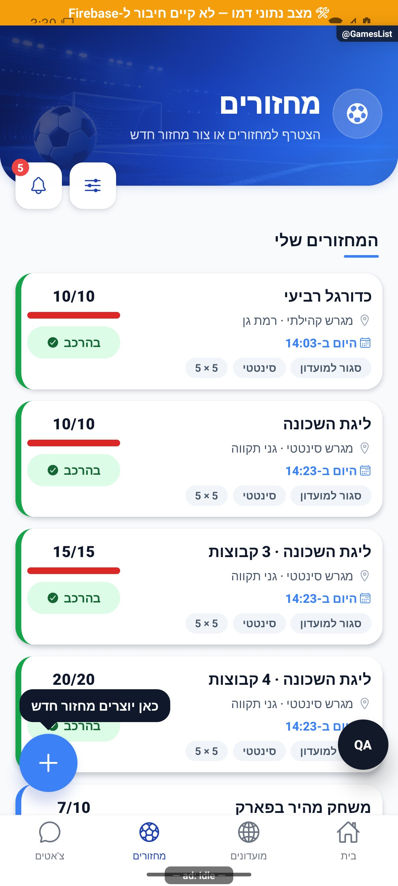

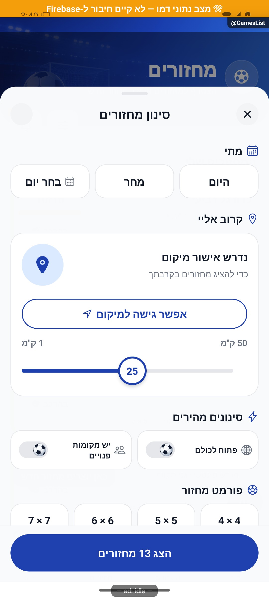

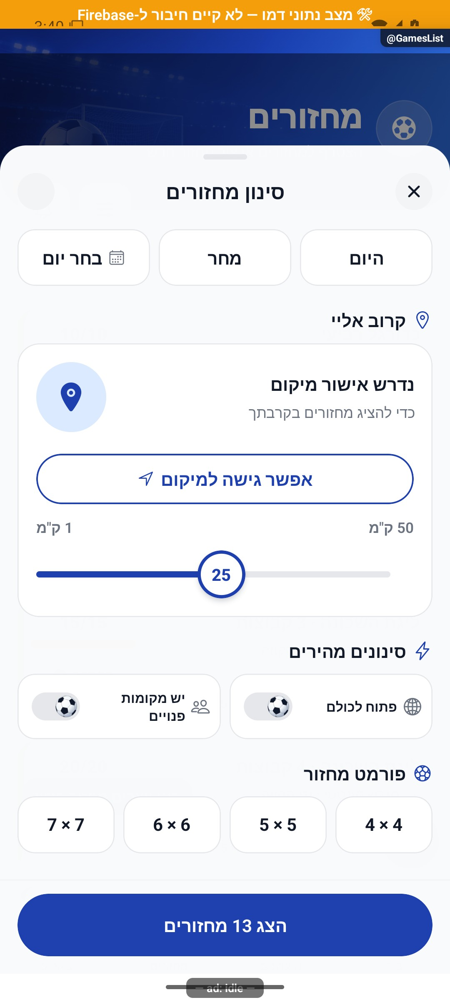

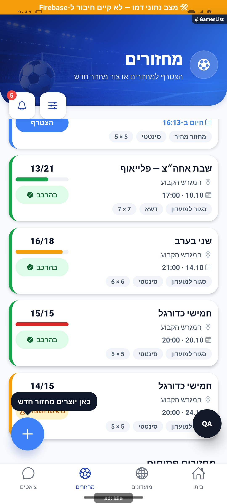

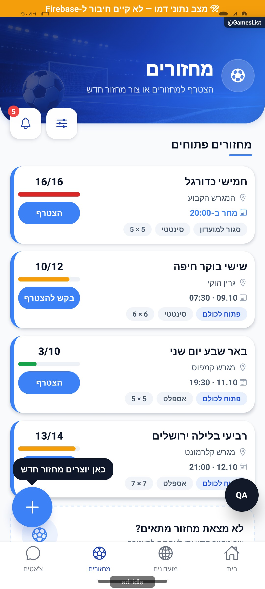

הצילומים מציגים רק את המצבים המתועדים במסמך המעמיק. חלקם נתוני דמו, חלקם הוכחות מתיקון קודם, ובכמה מהם טעינה או הודעת הגנה; הם אינם אישור שכל התהליך או השרת נבדקו.

## העיצוב החדש — 8.10.2026

המחזורים שלך מופיעים ראשונים. בכל כרטיס רואים את תמונת המועדון ובתוכה את מצב ההרשמה שלך. מתחת לפרטים מופיע פס כחול המתמלא מימין לשמאל לפי מספר המקומות התפוסים. גודל המשחק וסוג המגרש מופיעים בתגיות. מחזור מלא מציע להיכנס לרשימת המתנה.

אפשר לבחור במהירות הכול, המועדונים שלי או מחזורים באזור. כפתור ״מחזור חדש״ נמצא למעלה. מחזור ללא מועדון מקבל תמונת אצטדיון קבועה.

העיצוב עדיין בשינויים מקומיים ולא עלה לחנות.

### צילומים עדכניים של העיצוב הממומש

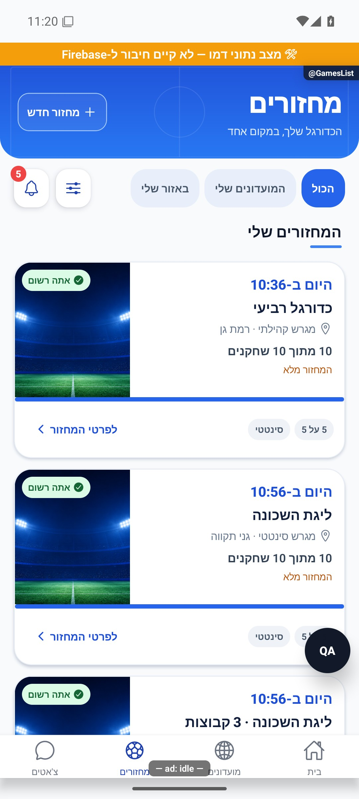
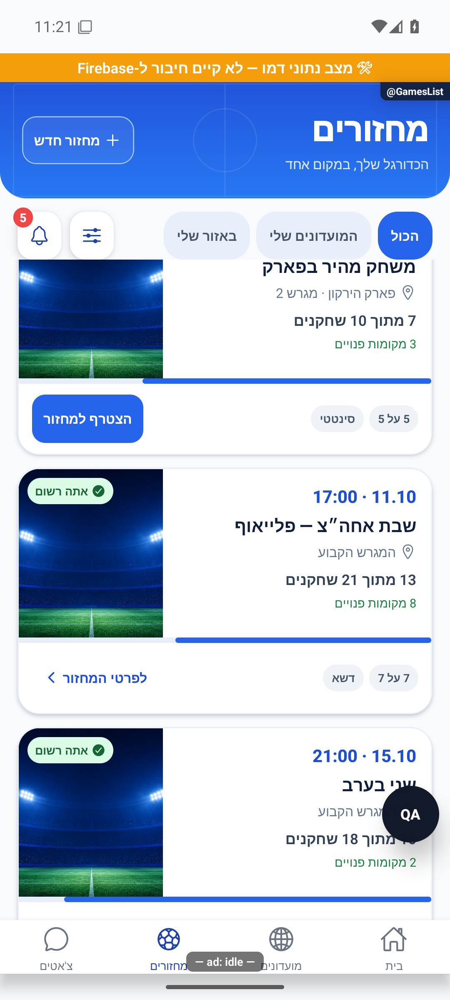
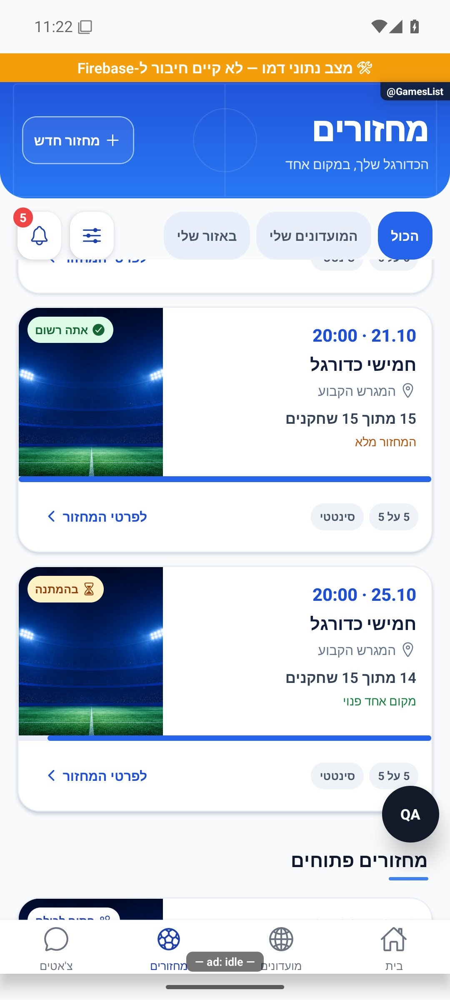
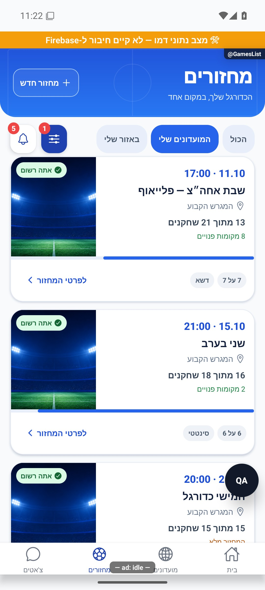

הצילומים נבדקו באמולטור אנדרואיד בדמו. בתפוסת 13 מתוך 21 הפס ממלא כ־62% מימין; בתפוסת 14 מתוך 15 הוא ממלא כ־93%. תמונה צמודה למעלה, תגית מעליה ואייקון המיקום מימין נצפו בפועל. סינון המועדונים מסתיר את המחזורים החד־פעמיים; ניקוי המסננים בחלון או במצב ריק מנקה גם את בחירת המועדונים. תמונות שהועלו מרחוק וכשל תמונה, סירוב מיקום, הרשמה בפועל, אישור ותצוגת אייפון לא הורצו בסבב זה. האצטדיון המוצג הוא תמונת הדמו/ברירת המחדל. כלי הפיתוח והפס הכתום אינם חלק מגרסת ההפצה.

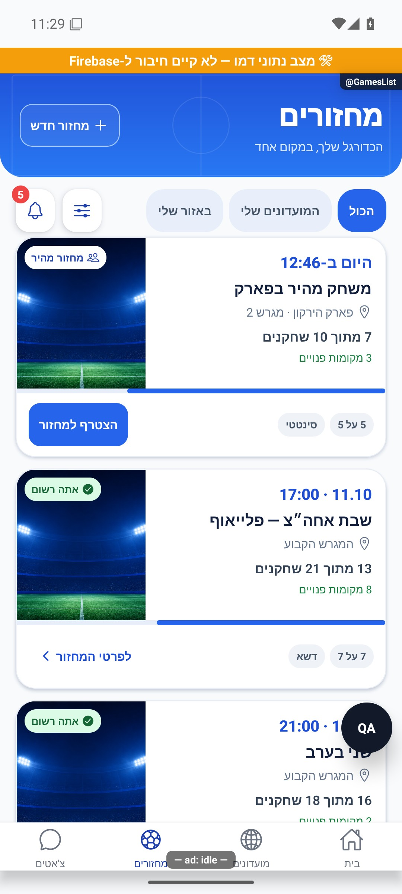

איפוס מסנן המועדונים מתוך חלון המסננים הורץ בדמו: ״הכול״ נבחר מחדש, מונה המסננים נוקה והמחזור החד־פעמי חזר לרשימה.

## עידון הכרטיסים

תמונת המועדון מעוגלת גם בצד הפנימי שלה ויש רווח בינה לבין פס התפוסה. שורת התגיות וכפתור ההצטרפות קומפקטיים יותר. בכל מחזור מוצג גם אם הוא פתוח לכולם או סגור, בנוסף למצב ההרשמה שלך שמופיע על התמונה.

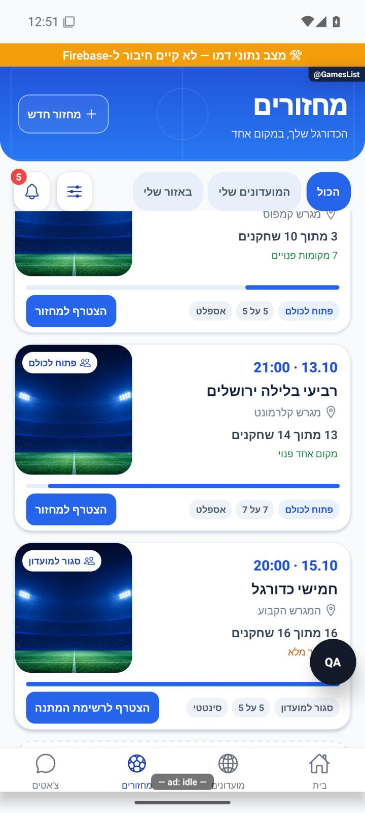

נבדק באימולטור אנדרואיד עם נתוני דמו: פינות פנימיות מעוגלות, רווח לפס, תגיות פתוח וסגור לצד פורמט ומגרש, וכפתורי הצטרפות והמתנה קומפקטיים. גם מצב רשום עם תגית סגור למועדון נצפה. לא הופעלו פעולות הרשמה; אייפון וגופנים מוגדלים לא הורצו.

## כרטיס נמוך יותר

מספר השחקנים והמקומות הפנויים מופיעים יחד והריווחים הצטמצמו. כל הנתונים נשמרים והאייקון בתגית שעל התמונה נמצא משמאל לטקסט. כשצריך יותר מקום לטקסט הכרטיס יכול להתרחב.

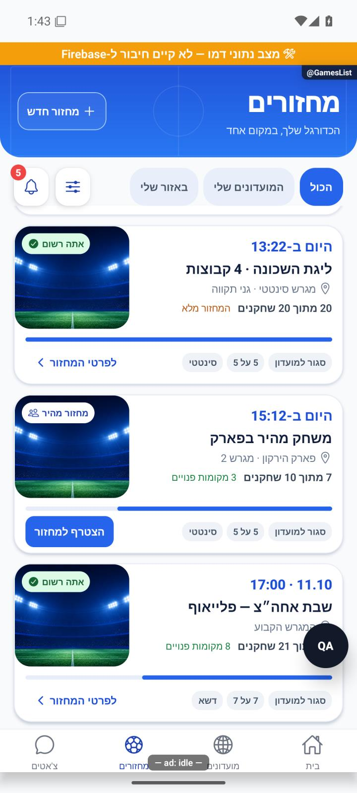

אומת באימולטור אנדרואיד בדמו: מחזור מלא ורשום, מחזור עם 7 מתוך 10 שחקנים ושלושה מקומות פנויים וכפתור הצטרפות; האייקון בתגית נמצא משמאל לטקסט. הפס מתמלא מימין לשמאל. בוצעה גלילה בלבד ללא הרשמה. סימוני הדמו והפיתוח בצילום אינם חלק מההפצה. אייפון וגופנים מוגדלים לא הורצו.

נוסף רווח קטן וקבוע מתחת לכפתורי הסינון, כדי שהכרטיסים בזמן גלילה לא יהיו צמודים אליהם.

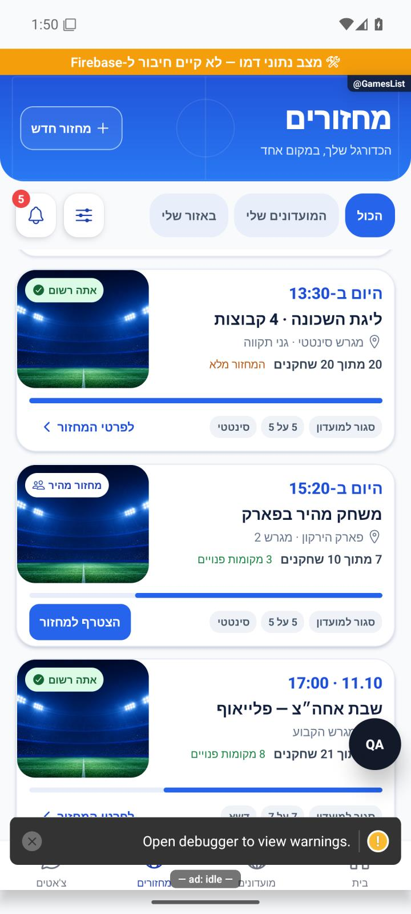

נצפה באנדרואיד בדמו לאחר גלילה: רווח קבוע בין הכפתורים לבין גבול אזור הגלילה. אין פעולות הרשמה. סימוני הפיתוח בצילום אינם חלק מההפצה. אייפון לא הורץ.

כותרת המחזורים עכשיו באותו סגנון של המועדונים, עם רקע אחר של מגרש וכדור. כפתור ״מחזור חדש״ נשאר בשמאל והמידע על המחזורים נשאר כפי שהיה.

נצפה באימולטור אנדרואיד עם נתוני דמו. סימוני פיתוח והפס הכתום בצילום אינם חלק מההפצה. לא בוצעו פעולות הצטרפות או יצירה, קריאת מסד חי או בדיקת אייפון וגופן מוגדל. בדיקת הטיפוסים ו־2,801 הבדיקות ב־190 חבילות עברו; יומנים `artifacts/club-feed-redesign-tsc.log`, `artifacts/club-feed-redesign-jest.log`.

## הפלוס בכפתור יצירה — 8.10.2026

הפלוס מופיע משמאל לטקסט בכפתור היצירה. אומת באימולטור אנדרואיד בנתוני דמו, ללא יצירת מועדון או מחזור. אייפון וגופן מוגדל לא נבדקו. בדיקת טיפוסים וכל 2,801 הבדיקות ב־190 חבילות עברו. יומנים artifacts/hero-plus-left-tsc.log ו־artifacts/hero-plus-left-jest.log.

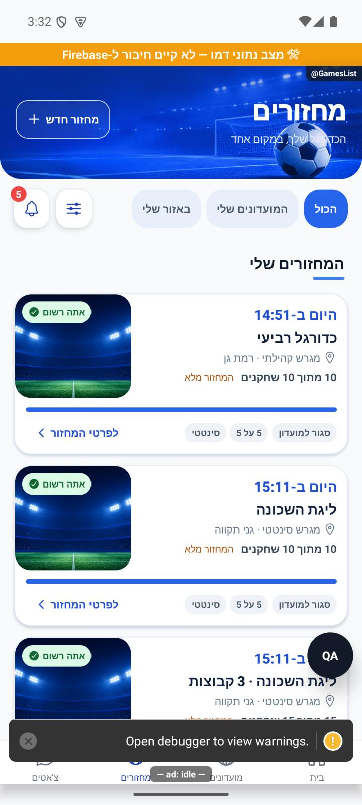

## תמונות בזמן טעינה — 9.10.2026

בטעינה הראשונה אזור התמונה נשאר ניטרלי עד שידוע מהו רקע המועדון, במקום להציג קודם תמונה אחרת. תמונות שכבר נטענו נשארות בזמן רענון. מחזור ללא מועדון מקבל מיד את תמונת ברירת המחדל; גם היעדר רקע או כשל טעינה מקבלים חלופה.

## תיקוני דיווחים — 9.10.2026

פתוח לכולם מופיע רק בשורת התגיות. מעל התמונה מוצג מצב אישי כגון אתה רשום או רשימת המתנה. מחזור מהיר סגור מסומן מחזור סגור, גם אם נותר לו שיוך ישן למועדון.

מקור: שינויים מקומיים מעל a348b9f; טרם נבנתה גרסה. [ראיות ומגבלות](../../changes/2026-10-09-pulse-round2.md).

## תיקוני עיצוב ונגישות — 10.10.2026

מקור: `a348b9f235f1e1433497600555303231512a0834` עם שינויים מקומיים. אין בסעיף זה הוכחת גרסת חנות.

אפשרויות סינון המחזורים מקבלות שם ומצב ברור בקורא מסך.

## תיקוני דיווחים — 10.10.2026, אחרי גרסה 1.1.45

תמונות המחזורים מתאימות לאספלט ולסינטטי. תמונה שהמועדון העלה נשמרת.

שינוי מקומי מעל bcca0886; לא נבנתה גרסה בסבב הזה. נבדק בקוד ובבדיקות אוטומטיות. צילומי אנדרואיד בנתוני דמו בלבד; אין אימות באייפון או בטלפון המדווח.

## גיוון תמונות לפי משטח — 10.10.2026

נוספו שש תמונות עם שחקנים: שתיים לאספלט, שתיים לסינתטי ושתיים לדשא טבעי. יחד עם שתי תמונות המגרש הקיימות יש שלוש אפשרויות לאספלט, שלוש לסינתטי ושתיים לדשא. הבחירה קבועה לפי מזהה המחזור, ולא משתנה בטעינה או בין מכשירים. תמונת מועדון שהועלתה נשמרת בעדיפות ראשונה; כשל טעינה שלה נופל למאגר המשטח. תמונות מובנות של המועדון מפנות למשטח, וסוג חסר ממשיך לגלריה ולברירת המחדל הקיימת. אין כתיבה למסד.

roundSurfaceCover משתמש ב־hash: לכל תו h=(31*h+charCode) ללא סימן, ואינדקס h modulo מספר התמונות במשטח. coverLoading עדיין מונע תמונה זמנית לפני השלמת טעינת המועדון. roundCoverRendering בודקת יציבות, פיזור, שלושת המשטחים, קדימות העלאה וכשל.

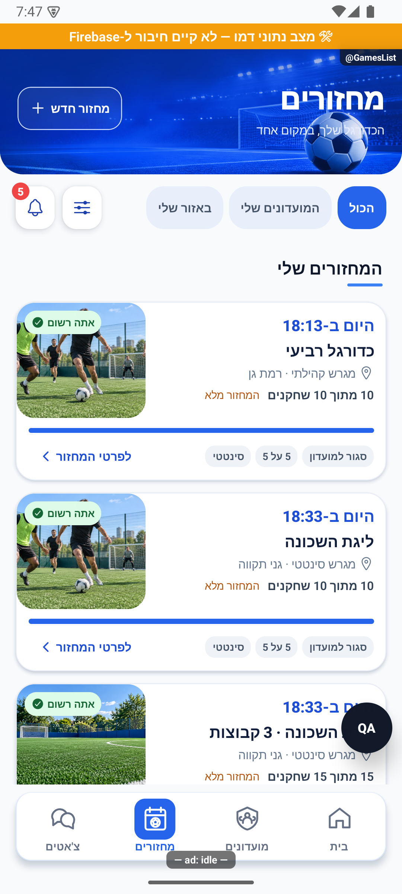

צילום כרטיסים בסינתטי בלבד. שאר התמונות נצפו במקור ונבדקו אוטומטית. אין אימות אייפון פיזי. שינוי מקומי, טרם הופץ.

## תמונה אחידה ברשימה ובפרטים — 11.10.2026

אותו מחזור מציג כעת אותה תמונה ברשימת המחזורים ובפרטי המחזור. תמונה שהמועדון העלה קודמת לתמונות המובנות; אחרת נבחרת תמונה קבועה שמתאימה לסוג המגרש. החיתוך וההכהיה שונים בהתאם למקום שבו התמונה מוצגת.

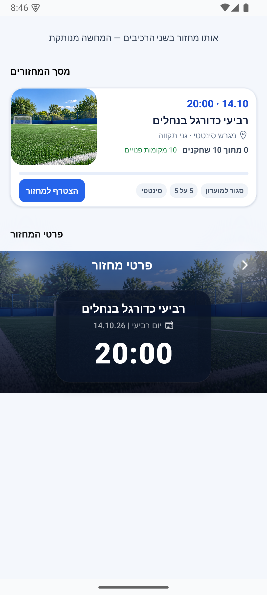

צילום הרכיבים האמיתיים באמולטור אנדרואיד בתצוגת המחשה מנותקת ופעולות מנוטרלות; לא נבדק מול נתוני ייצור או באייפון. השינוי מקומי, טרם הופץ.

## מאגר תמונות לפי משטח ושעת המחזור — 12.10.2026

המחזור מקבל תמונה מתוך מאגר של 60 תמונות: 10 לכל שילוב של דשא, סינתטי או אספלט ביום ובלילה. יש מגרשים, שחקנים, חימום ואווירת משחק. הבחירה נעשית לפי שעת המחזור בישראל ועונת השנה בקירוב, ונשארת זהה בבית, ברשימה ובפרטים. תמונה שהמועדון העלה בעצמו נשארת בעדיפות ראשונה. ללא תאריך תקין נבחר מאגר היום; ללא סוג מגרש נשמרת החלופה הקיימת.

[גלריית התמונות](../../../src/assets/images/roundCovers/index.html). השינוי מקומי ולא נכלל עדיין בגרסת החנות.

## חיווי הצטרפות — 12.10.2026

לאחר לחיצה על הצטרפות למחזור מופיע עיגול טעינה בכפתור עד לקבלת התשובה. לחיצות חוזרות בזמן העיבוד חסומות, ובכשל אפשר לנסות שוב. נבדק באנדרואיד בדמו עם המתנה יזומה של שבע שניות; טרם הופץ.

## תלות בעדכון העונות — 19.10.2026

קובץ תשתית משותף עודכן במסגרת העונות. שינוי זה אינו מוסיף פעולה חדשה למסך המתואר כאן; פרטי העונות והבדיקות מופיעים במסמך העונות.

[מצב המימוש, הבדיקות ומגבלות האימות של העונות](../clubs/seasons.md). מקומי בלבד; לא בוצעה פריסה במסגרת המשימה.

## תלות במידע על סגירת עונה — 23.10.2026

נוסף מידע משותף שמאפשר להסביר מדוע עונה מתעכבת בסגירה. אין שינוי נוסף בפעולות המתוארות כאן; השינוי מקומי וטרם הופץ. [המסלול, הבדיקות והמגבלות](../../changes/2026-10-23-season-automatic-recovery.md).

## תלות בשמירת צבעי המחזור — 24.10.2026

שמירת המידע המשותפת עודכנה כדי להעביר את צבעי הקבוצות ממסכי הכוחות להכנה וללייב. אין תוספת פעולה במסך הזה, והוא לא נבדק מחדש במכשיר במסגרת התוספת. השינוי מקומי וטרם הופץ. [פרטי התוספת ומגבלות הבדיקה](../rounds/draft-setup.md#צבעים-לפני-שיבוץ-ובכל-שיטת-חלוקה--24102026).

## המשך קיצור טעינות בלילה של 25.10.2026

מסכים שמבקשים במקביל אותה רשימת מחזורים משתמשים באותה טעינה. אם כל מקורותיה נכשלו, לא נשמרת רשימה ריקה כהצלחה ואפשר לנסות שוב מיד. הסינון ורענון אחרי פעולות נשמרו. מקומי וטרם הופץ. [בדיקות, ראיות ומגבלות](../../changes/2026-10-24-loading-performance.md).

## תגובה מיידית לכפתורי השעון - 25.10.2026

עודכן רכיב השעון המשותף למסכי הלייב. אין שינוי מכוון בהתנהגות הפיצר המתואר כאן. [בדיקות, ראיות ומגבלות](../../changes/2026-10-25-live-timer-response.md). התיקון מקומי וטרם הופץ.

## תלות בניווט עריכת קבוצות - 25.10.2026

נבדק השינוי הממוקד במקורות המשותפים: `src/navigation/GameStack.tsx`. נוסף מעבר מתפריט הלייב לחלוקת הכוחות עם שימור מפתח מסך המקור. אין שינוי נוסף בתהליך העצמאי המתואר כאן ולא נערכה לו בדיקת מסך חדשה. [היקף, בדיקות ומגבלות](../../changes/2026-10-25-live-draft-entry.md).

## תאימות לשמירת פקודת רכיב הבית - 25.10.2026

נוספה הגנה פנימית מפני ביצוע חוזר של פעולת רכיב הבית. התהליך המתואר בעמוד זה לא השתנה במכוון, ונתונים ישנים נשארים נתמכים. התיקון מקומי וטרם הופץ. [מקור הבדיקה והמגבלות](../../changes/2026-10-25-widget-completion.md).

## תלות בהיסטוריית הרשמה בלוח המנהל - 28.10.2026

בקובץ `functions/src/index.ts` נוספו רק ייצואים עצמאיים של איסוף היסטוריית הרשמה וקריאתה למנהלי מועדון. אין שינוי מכוון במסלול הפיצר המתואר כאן, בחישוביו או בהרשאותיו, ולא נערכה לו בדיקת מסך חדשה. השירותים החדשים מקומיים וטרם נפרסו. [היקף, חישובים וראיות בלוח המנהל](../clubs/manager-dashboard.md).

## שלמות החלוקה המתוזמנת, 29.10.2026

במקורות המשותפים תוקנה שמירת חלוקה מתוזמנת לשש ולשבע קבוצות וסוננו אורחים שממתינים. דרך חישוב האיזון נשמרה. אין שינוי מכוון בפעולות העצמאיות המתוארות בעמוד זה ואין אימות מסך חדש שלהן; השינוי מקומי וטרם הופץ.

[היקף, בדיקות, פערים פתוחים ומגבלות](../../changes/2026-10-29-scheduled-balance-integrity.md).

## נתונים עדכניים בעסקת החלוקה, 29.10.2026

במקורות המשותפים תוקנו פערי עדכון נתונים בזמן החלוקה המתוזמנת, ללא שינוי בנוסחת האיזון. אין שינוי מכוון בפעולות העצמאיות של המסלול המתואר כאן ואין אימות מסך חדש שלו. התיקון מקומי וטרם נפרס.

[מימוש, בדיקות ומגבלות](../../changes/2026-10-29-scheduled-balance-races.md).

## איזון ופיזור רמות לפני גיוון, 30.10.2026

עודכן החישוב המשותף של חלוקת כוחות לפי הדירוג הכללי: איזון הממוצעים קודם לפיזור הרמות, והגיוון מכריע אחרי שניהם. אין שינוי מכוון במבנה המסך או בפעולות העצמאיות המתוארות כאן, ואין אימות מכשיר חדש שלהן. השינוי מקומי וטרם הופץ או נפרס.

[מימוש, נוסחאות, בדיקות ומגבלות](../../changes/2026-10-30-rating-balance-priority.md).

## אימות כשלים בקבלת פרסום, 2.11.2026

בבדיקת אישור פרסום הקבוצות, כשל שלא ניתן לאמת כהצלחה נשאר כשל גלוי ונשמר באבחון. הבדיקה אינה שולחת הודעות שוב ואינה משנה הרשאות. השינוי תחום לשירות המשותף, מקומי וטרם הופץ.

[דוח הטיפול והראיות](../../changes/2026-11-02-pulse-sweep.md).
