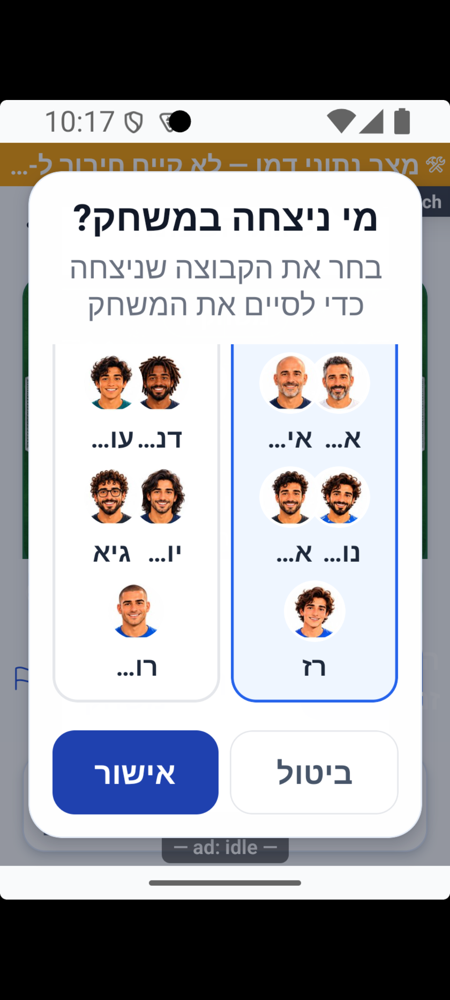
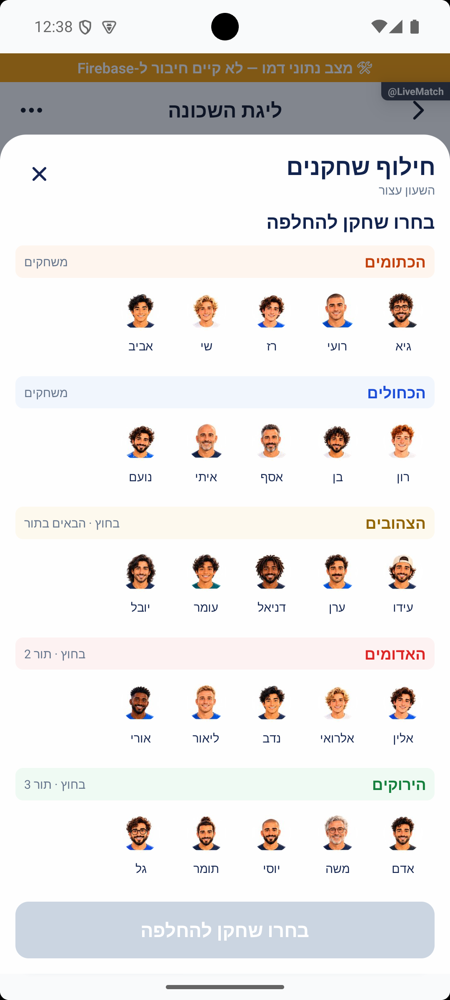
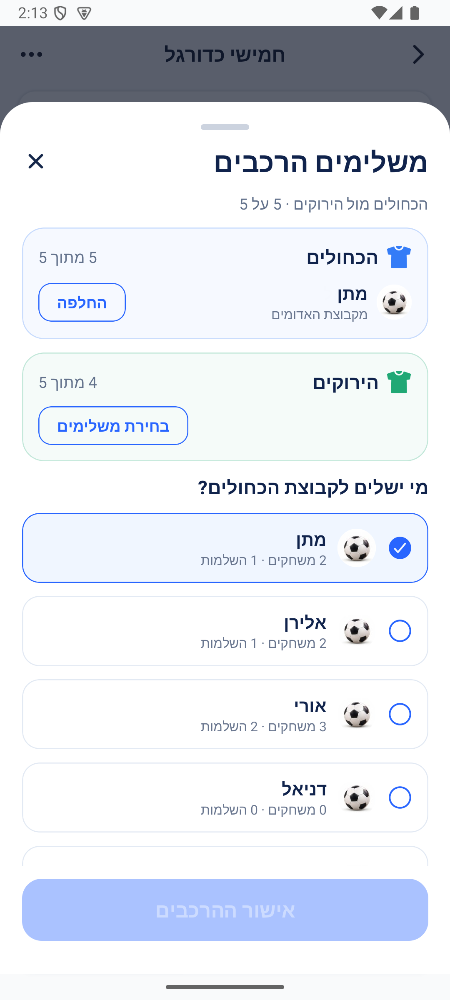

# לייב מתקדם ורוטציה

## הרחבת אבחון דיווחים, 27.10.2026

נוספה מעטפת אבחון מקומית עם מצב בזמן הכשל, שלבים בעלי מזהה ותזמון, מצב רשת ובנייה ומופעים נפרדים לשגיאה. נקודת הכניסה לתעבורת השרת עוברת כעת דרך העטיפה המשותפת; תשובות, חריגות, אפשרויות קריאה ומדיניות הפיצר נשמרות. אין כאן שינוי בהרשאות או בחישובי המוצר. הבדיקות המלאות ומגבלות האימות מתועדות בדוח המקושר; אין טענה לאימות מכשיר או להפצה. [היקף, ראיות ומגבלות](../../changes/2026-10-27-diagnostic-context.md).

באימות הסופי עברו כל 6,231 הבדיקות ב-555 חבילות, ובדיקות הטיפוסים של הלקוח, השרת והפולס נקיות. צילום הדפדפן והידור מקורות האנדרואיד הם בדיקות מקומיות; אין הוכחת מכשיר, הידור אייפון או מסירה חיה של הבנייה החדשה. רישום יומן השחרור נחשב מאומת רק לפי קבלת הקריאה החוזרת בדוח השינוי.

## טיפול מלא בפריטי הפולס הפתוחים, 27.10.2026

בבדיקה ממוקדת נמצא שחיווי הדקה האחרונה וההארכה כבר קיים בשני מסכי הלייב. הופעלו החישובים וגוף מנגנון הרטט מתוך המקור ונבדקו גם השהיה, משך לא מוגדר ומניעת התראה כפולה באותו רגע. לא נוסף צליל ולא אומתו רטט פיזי או תצוגת מכשיר חדשה. זהו אימות מקומי של מימוש קיים, ללא שינוי מסך. [ממצאים, בדיקות ומסירה](../../changes/2026-10-27-pulse-completion.md).

## טיפול בתקלות הפולס, 26.10.2026

`InPlayPenaltyModal.timerWriting` ננעל לפני עדכון המצב וחוסם גם שמירת בעיטה בזמן כתיבת השעון. ניסיון מוצלח מנקה את הודעת הכשל. `AdvancedLiveMatchScreen` מחזיר אישור אמת רק אחרי הצלחת `timerFeedback.run`; המתאם `onPenaltyTimer` דוחה פעולה שלא אושרה. אין שינוי בזמן האירוע, בממיר או בחישובי התוצאה. בדיקות `tests/logic/inPlayPenaltyModal.test.tsx` כוללות לחיצה כפולה באותו רינדור, שמירה בזמן פעולה, דחייה, ניסיון חוזר וקליטת זמן לאחר חידוש.

השינוי מקומי וטרם הופץ. [בדיקות, מסירה ומגבלות](../../changes/2026-10-26-pulse-fixes.md).

מקורות שנבדקו בסבב: `src/components/match/InPlayPenaltyModal.tsx`, `src/screens/AdvancedLiveMatchScreen.tsx`.

## עדכון ניקוי מדידה פרטי במקור המשותף - 26.10.2026

ב-`functions/src/personalActivity.ts` הובטח שכשל חלקי בניקוי מקבצי מדידה לאחר מחיקת חשבון ישאיר את שורש המדידה לאיתור חוזר. רק אחרי הצלחת מחיקת הצאצאים נמחק השורש. אין שינוי בחישוב השתתפות או בחלונות הטיימר בעקבות תיקון זה. ארבעים ושבע בדיקות שרת מקומיות עברו; אין בכך הרצת רוטציה במכשיר או פריסה.

## חלונות פעילות אישיים וסגירת זמן ברוטציה - 25.10.2026

עדכון פרטיות במקור השרת המשותף: נוספה מחיקת מדידות הגוף הפרטיות אחרי סימון מחיקת החשבון, וגדר פרופיל פעיל בקליטת מדידה ובקריאתה. התוספת ב-`functions/src/personalActivity.ts` אינה משנה את הוכחת ההשתתפות במקטעי המחזור או את חישוב חפיפת הטיימר והשיבוץ. סוכן השרת דיווח על 46 בדיקות מנותקות שעברו, ובהן ניקוי רקורסיבי ומחיקה מקבילה לעסקת העלאה; לא בוצעה מחיקה חיה או פריסה. [התנהגות החשבון ומגבלות האימות](../profile/account-lifecycle.md).

המימוש המקומי ב-`src/utils/personalActivityWindows.ts` ובמראה העצמאית `functions/src/personalActivityWindows.ts` מגדיר חלונות חצי פתוחים של זמן, מתחילתם ועד לפני סופם. `personalActivityPlayerIds` מחשב את הסגל הפעיל באמצעות `rotation.playing` ו-`rosterOf`, לרבות הוצאה והשאלה של שחקן והחרגת `draftTeams.leftHome`. ללא רוטציה נכללים רק השיבוצים `teamA`, `teamB`, `gkA`, `gkB`. אין שימוש בהרכב הסופי לשחזור השתתפות היסטורית. `personalActivityEligibility` מחייב גם טיימר רץ עם זמן התחלה תקין שאינו בעתיד. המשמעות היא זכאות למדידה, ולא הוכחה שחיישן מחובר או שסיפק נתון.

`personalActivityWindows` מחשב חיתוך בין חלונות ריצת הטיימר לבין היסטוריית הסגל שסופקה לו, מאחד חפיפות, מסנן זמנים פגומים ומחזיר `eligibleMs`, `timerMs` ו-`knownFrom`. למשל, ריצות בין 10 ל-60 ובין 70 ל-100, ושחקן במגרש עד 40 ומ-80, נותנות 50 יחידות זמן זכאיות מתוך 80 יחידות ריצה. שחקן ממתין עם היסטוריה מוכחת מקבל אפס זמן זכאי; היסטוריה חסרה או פגומה מחזירה `unavailable`. היסטוריית הסגל בממשק החישוב אינה שדה חדש במסמך המשחק. מסלול השרת הנפרד משתמש ביומן אירועים, ואינו מחייב כתיבה של היסטוריה מכל לקוח.

ב-`src/services/gameService.ts`, `stopRotation` קורא בטרנזקציה את הרוטציה, ההרכב והטיימר העדכניים. אותה כתיבה סוגרת קטע ריצה חי לפי `serverNow`, משמרת `activeIntervals` ו-`startedAt`, עוצרת ומאפסת את שעון המשחק, מסירה שיבוצים ישנים ומשחזרת את `baseTeams` העדכני עם קפטן שנמצא בסגל. `roundNumber` מתקדם כדי שפקודה ישנה מהמצב הפשוט לא תתאים שוב לאחר הסרת הרוטציה. עצירה נוספת ללא רוטציה אינה יוצרת קטע נוסף. מחזור סופי או מבוטל אינו נפתח מחדש במסלול זה.

גם `_persistRotation` שומר כעת קטע ריצה פתוח מתוך תמונת הטרנזקציה לפני איפוס הטיימר כאשר נשלח `resetTimerBy`. עדכון הרכב שאינו מאפס את השעון משמר את מצב הריצה ואת מזהה המשחק. בדיקת מקור ההרכב הקיימת נשמרה, כך ששינוי מקביל בטיימר דוחה הצעה ישנה. אין שינוי בדקות של אירועי שער, במכני סטטיסטיקות הכדורגל, במסכים או בניווט.

בדיקות שנערכו: `tests/logic/personalActivityRotationTransitions.test.ts` מריץ את מתודות השירות האמיתיות עם תעבורה מבודדת, ובודק ניסיון חוזר, עצירה כפולה, שימור תחילת המחזור, שחזור קפטן, מעבר מזהה, עדכון הרכב באמצע ריצה וסינון משך שלילי. `tests/logic/personalActivityWindows.test.ts` בודק גבולות חילוף, השאלות, ספסל, שוערים, זמן חסר ושרשרת של שלושה חילופים באמצעות `exchangeLivePlayers` האמיתי. `tests/logic/personalActivityWindowsMirror.test.ts` משווה טלפון ושרת במאה תרחישי סגל ובשלושים תרחישי חלונות. שלוש החבילות מכילות 32 בדיקות; ריצת חמש חבילות המעברים וההגנות הקיימות עברה עם 78 בדיקות לפני הוספת בדיקת החילופים האחרונה. אלה בדיקות מנותקות ללא כתיבת נתוני חשבון או הפעלת שעון פיזי. בדיקת הטיפוסים הרוחבית הראשונה בסבב נכשלה בשגיאות מעטפת בדיקות השרת החדשה, שנמסרו לסוכן האחראי; אין להסיק מסעיף זה שבדיקות הפרויקט כולן עברו.

בביקורת שילוב עצמאית זוהו ותוקנו אצל בעל מסלול השרת שני ליקויים נוספים ב-`functions/src/personalActivity.ts`: קיבוע תחילת הכיסוי לאירוע הראשון שנמסר, וטיימר המסומן כרץ ללא עוגן התחלה תקין. טיימר זכאי מחייב כעת עוגן התחלה סופי, לא שלילי ולפני סוף המקטע. בסבב האימות הראשון הורצו עצמאית 69 בדיקות בארבע החבילות של השרת, החלונות, המראה והמעברים, וכולן עברו.

החלטת הכיסוי עודכנה לאחר ביקורת נוספת: `before.updateTime` יחד עם `before.data` מוכיחים שההרכב והמצב לא השתנו לאורך המקטע עד `after.updateTime`. לכן `knownFrom` מתעדכן למוקדם מבין תחילות המקטעים שהגיעו, ולא לסוף המקטע הראשון. זהו שימוש בתמונת המצב שלפני השינוי, ללא ניחוש של הרכב קודם מתוך הרכב סופי. תמונת מצב נוכחית יכולה להוכיח גם את הזמן מאז גרסת המסמך ועד הקריאה; לפני קליטת דגימות נבדקת שוב גרסת המשחק בטרנזקציה. הקוד המעודכן נקרא מחדש; תוצאת 69 הבדיקות לעיל קדמה להרחבת תחילת הכיסוי ואינה אישור בדיקה של ההרחבה. דגימה שמקדימה גם את הגרסה המוקדמת המוכחת עדיין מוחזרת להמתנה ללא אישור קליטה. כל השינויים המתוארים כאן מקומיים וטרם אומתו בהפצה או במדידה במכשיר.

## זמן אירועים מלא אחרי משך המשחק - 25.10.2026

גולים ופנדלים במהלך משחק נשמרים כעת לפי הזמן המלא של המשחק, גם אחרי משך המשחק שנקבע. לדוגמה, במשחק של שמונה דקות שהגיע לעשר דקות ושלושים שניות, גול נשמר בדקה האחת עשרה ובחלון הפנדל מופיע הזמן עשר דקות ושלושים שניות. התיקון מקומי וטרם הופץ. [בדיקות, צילום ומגבלות](../../changes/2026-10-25-overtime-event-time.md).

ב-`src/screens/AdvancedLiveMatchScreen.tsx` הפרמטר `minute` של `LiveScoreboardCard` מחושב כעת באמצעות `Math.floor(timerMs / 60000) + 1`, והפרמטר `clockMs` מקבל `timerMs` ללא תקרה. רק `timerText` ותצוגת החריגה ממשיכים להשתמש בתקרת המשך. לדוגמה, `630000` מילישניות עם משך `480000` נותנות דקה `11` וחותמת פנדל `630000`, לצד שעון ראשי `08:00` וחריגה `02:30`. חלון הפנדל לוכד את הזמן בעת השמירה, מעגל לשנייה שלמה ושומר זמן קודם בעריכה ובניסיון חוזר; מסלול השמירה, הממיר וההיסטוריה לא שונו. גם גול רגיל ושער עצמי מקבלים את הדקה המלאה מהפרמטר המשותף. אין שינוי בפקדי הזמן, בהרשאות, במונים, ברוטציה או בניווט, ואירועי עבר אינם מתוקנים אוטומטית. בדיקות וגבולות התצוגה מפורטים בדוח המקושר.

## הפצה פנימית 1.1.61 - 25.10.2026

הבינארי `1.1.61/295` הופץ ואומת במסלול הפנימי באנדרואיד. תיקוני הלקוח נכללים בו, ושירות הפרופיל נפרס ואומת בנפרד. גם תיקוני הסגל, שמירת התוצאה והתראת השגיאה בשרת נפרסו ואומתו באישור מפורש. שינויי יישום הפולס עצמו טרם הופצו. אין שינוי כללי הרשאה או הסבת נתונים. ניסוחי המצב המקומי בסעיפים הקודמים נכתבו לפני ההפצה; [דוח ההפצה](../../changes/2026-10-25-internal-1.1.61.md) מפרט בדיוק מה נכלל, מה נבדק ומה עדיין מקומי.

## תיקוני הפולס - 25.10.2026

`MatchEventPicker` משתמש ב-`animationType="slide"`. `AdvancedLiveMatchScreen.addEvent` מצטמצם מ-54 ל-46 יחידות גובה מזערי, מגופן 20 ל-18 ומסמל 27 ל-23, עם ריווח אנכי 7 במקום 10. `LiveTeamsEditModal` מציג סדר המשחק במצב הראשי בלבד; כותרת בחירת קבוצה ואישור איפוס נשמרות. אין שינוי באישור כתיבה, כוחות, תור, תוצאה או נתוני שרת.

[מקורות, בדיקות, צילומים ומגבלות](../../changes/2026-10-25-pulse-fixes.md).

## מרכוז המגרש בהזנת פנדל - 25.10.2026

השער, השוער והבועט ממורכזים לרוחב המגרש כבר מהפתיחה, גם לפני שמתקבלת מדידת הרוחב. השינוי משותף גם למגרש בפנדלי ההכרעה ובהזנת גול. נבדק באנדרואיד בדמו; הסטייה הנמדדת עד חצי פיקסל. התיקון מקומי וטרם הופץ. [צילום, מדידות, בדיקות ומגבלות](../../changes/2026-10-25-penalty-pitch-center.md).

`MatchActionPitch` מעגן את `Participant` באחוזים לפי הכיווניות ועם פיצוי חצי רוחב ב-`marginStart`; השער משתמש ברוחב 32 אחוז ובמרווח תחילה 34 אחוז, והכדור בעוגן מרכזי עם הזזה פיזית יחסית למרכז. רוחב הממשק הנמדד נשאר מקור מרחקי האנימציה. אין שינוי בניווט, בתהליך, בנתונים, במכנים או בכתיבות. צילום הפנדל היחיד הוא הוכחת הריצה בסבב זה; אין לייחס לו צילום חדש של הכרעה או גול רגיל.

בדיקת טיפוסים ו-111 בדיקות ממוקדות עברו. בסבב המלא ארבע בדיקות בשלוש חבילות מחוץ למרכוז נכשלו; 5827 עברו. פרטי הכשלים וראיות ההרצה בדוח המקושר, ואין טענה שהסבב המלא נקי.

## חלונות הזנה מלמטה - 25.10.2026

חלונות הזנת גול, פנדל במהלך משחק והפנדלים בסיום משחק נפתחים באנימציה מלמטה, ברוחב מלא וצמודים לתחתית, בדומה להוסף אירוע. הפינות מעוגלות למעלה בלבד. שלבי הבחירה, השמירה והאנימציות בתוך החלונות נשארו כפי שהיו. נבדק באנדרואיד בדמו; התיקון מקומי וטרם הופץ. [צילומי לפני ואחרי, בדיקות ומגבלות](../../changes/2026-10-25-bottom-match-sheets.md).

המעטפות ב־`src/components/match/GoalEntryModal.tsx`, ב־`src/components/match/InPlayPenaltyModal.tsx` וב־`src/components/match/ShootoutWizard.tsx` משתמשות ב־`SafeModal` עם `animationType="slide"`, רקע שמצמיד לתחתית ומשטח ברוחב מלא. גובה החלונות, הגלילה, ההגנה על אזורי המערכת והלוגיקה נשמרו. אין מסך חדש, שינוי ניווט או שינוי מונים. עברו בדיקות טיפוסים ו־5821 בדיקות. ההכרעה צולמה בתצוגת תיקו זמנית בזיכרון הדמו דרך פעולות המקור, ללא סיום משחק או שמירת בעיטה.

## תהליך זהה לפנדל יחיד - 25.10.2026

בוחרים בועט, עוברים אוטומטית לבחירת שוער, ואז לוחצים גול, עצירה או החמצה. הלחיצה שומרת מיד בלי המשך או אישור נוסף. אותה אנימציה מופעלת אחרי אישור השמירה, ובסיומה חוזרים ללייב אחרי בעיטה אחת. השעון המדויק והאפשרות לציין שוער לא ידוע נשמרו. כפתורי התוצאה קבועים מתחת לתוכן הנגלל. התיקון מקומי וטרם הופץ; הוא אינו נכלל בגרסה 1.1.60. [תהליך, צילום, בדיקות ומגבלות](../../changes/2026-10-25-in-play-penalty-flow.md).

`InPlayPenaltyModal.save` מקבל כעת תוצאה ישירות מכפתור הפעולה. `src/components/match/penaltyOutcomeButtons.tsx` משותף גם ל־`ShootoutWizard`; בועט ושוער נבחרים באמצעות `MatchPlayerPicker`, והאנימציה נשארת ב־`MatchActionPitch`. נעילת לחיצה כפולה וניסיון חוזר משתמשים באותו אירוע קבוע, לרבות השעון. אין שינוי בשירות השמירה, במונים, בהפרדת סוגי הפנדלים או בנתיבי ניווט. עברו בדיקות טיפוסים ו־5821 בדיקות; בדמו אומתה הוספת בעיטה אחת וסגירה אחרי האנימציה. אין בדיקת כתיבה לייצור או אייפון.

## הפצה פנימית 1.1.60 - 25.10.2026

נכלל בגרסה הפנימית `1.1.60/294`. שירותי הפנדלים במהלך משחק נפרסו ואומתו, לרבות שמירת הפירוט וארכיון העונות. הייצור בחנות נשאר `1.1.57/291`. הסעיפים ההיסטוריים שמתארים מימוש מקומי קדמו להפצה זו. אין בסבב ההפצה בדיקת התקנה, משחק מלא מול שרת או צילום ממשק חדש. [מקור מדויק, בדיקות וקבלות](../../changes/2026-10-25-internal-1.1.60.md).

## פלוס מודגש בכרטיסי הגול - 25.10.2026

הפלוס בכרטיסי הגול הוגדל ועובה, בצבע הקבוצה ומשמאל לטקסט, כדי שהוספת גול תבלוט יותר. ב-`src/components/match/MatchEventPicker.tsx` הסמל הקודם בגודל 19 הוחלף בפלוס וקטורי בגודל 24 על 24, בעובי קו 3.4 ועם קצוות מעוגלים. הוא נשאר דקורטיבי בתוך הכפתור הנגיש הקיים ובאותו סדר ילדים. צבע הקבוצה, כרטיסי הבחירה, החולצות, כפתור הפנדל, המשוב ומסלולי ההזנה לא שונו. אין שינוי נתונים או חישובים. [ראיות ומגבלות](../../changes/2026-10-25-event-picker-bold-plus.md). מקומי וטרם הופץ.

## כרטיסי אירוע לבנים - 25.10.2026

חלון הוסף אירוע עוצב ללא מגרש. שני כרטיסים לבנים מוצגים זה לצד זה, עם צל עדין, פס בצבע הקבוצה, חולצה רגילה ופלוס משמאל לכיתוב. כל הכרטיס לחיץ. הפנדל נמצא מתחתיהם באותו רוחב, עם מסגרת ירוקה עדינה ואייקון שער משמאל לטקסט. ב-`src/components/match/MatchEventPicker.tsx` הוסרו תמונת הרקע ושכבת הגוון. כל `Pressable` הוא כרטיס לבן בגובה מזערי 152 יחידות או 136 בפריסה קומפקטית, עם מסגרת ניטרלית, צל, `teamAccent` וחולצת `TeamShirtIllustration` המשותפת ברוחב 48 או 42. צבע הקבוצה משמש רק בפס ובפלוס; לצהוב וללבן גוון כהה לשמירת הנראות. השמות נגזרים מהקבוצות ונשארים כהים. הפלוס מופיע אחרי הטקסט בסדר הילדים כדי להופיע משמאל בכיווניות עברית. כפתור הפנדל לפחות 52 יחידות, עם פינות מעוגלות 14, רקע בהיר, מסגרת ירוקה וסמל שער פשוט עם נקודת בעיטה. נשמרו סגירה, גלילה, משוב לחיצה ורטט, חסימת נגיעה כפולה, הרשאות, הגנת הקשר המשחק ומסלולי הזנת הגול והפנדל. אין שינוי בשמירה, במונים או בשעון. בדיקות `tests/logic/matchEventPicker.test.tsx` ממשיכות לבדוק בחירה וסגירה; הוסרו דימויי הרקע שאינו בשימוש. [צילומים, בדיקות ומגבלות](../../changes/2026-10-25-event-picker-white-cards.md). מקומי וטרם הופץ.

## כפתורי פעולה ברורים על המגרש - 25.10.2026

על המגרש מופיעים כעת כפתורי גול מלאים בצבעי הקבוצות, מתחת לחולצות הרגילות. לכל כפתור פלוס משמאל לטקסט. הפנדל מופיע בכפתור לבן ברוחב המגרש עם מסגרת ירוקה ואייקון שער משמאל לטקסט. כל חצי מגרש נשאר לחיץ, ולחיצה מקבלת משוב חזותי ורטט עדין במכשירים תומכים. ב-`src/components/match/MatchEventPicker.tsx` כל `Pressable` של קבוצה מכיל את החולצה ועטיפת `goalButton` צבעונית עם הטקסט תחילה והפלוס אחריו, כדי שהפלוס יהיה משמאל תחת כיווניות עברית. נשמר כפתור נגיש אחד לכל חצי ללא כפתורים מקוננים. לחיצה משנה שקיפות וקנה מידה בעטיפה; `lightHaptic` מופעל רק לאחר חסימת נגיעה כפולה. הצבע נגזר מהקבוצה, והטקסט נעשה כהה בקבוצות לבנות וצהובות לפי `TEAM_PALETTE`. גובה כפתור גול לפחות 44, וגובה חצי המגרש לפחות 120 או 112 בפריסה קומפקטית. כפתור הפנדל לפחות 52, עם `PenaltyGoalIcon` וקטורי דקורטיבי והכיתוב לפני האייקון באותה שורה. אין חץ או כיתוב משנה. תמונת המגרש, הרשאות, סגירה, בחירת צד ומסלולי ההזנה לא שונו. גדלי גופן נשארו ניתנים להגדלה והטקסט יכול להישבר לשורות כשצריך. בדיקות `tests/logic/matchEventPicker.test.tsx` מדמות את המשוב והסמל לצורך בדיקת מסלולי הבחירה. [צילומים, בדיקות ומגבלות](../../changes/2026-10-25-event-picker-actions.md). מקומי וטרם הופץ.

## חולצות אחידות בחלון האירוע - 25.10.2026

בחולצות שבחלון הוסף אירוע הוסר עיטור הכדור. הן משתמשות כעת באותה חולצה רגילה שמופיעה בשאר האפליקציה, בצבע הקבוצה. כפתור הפנדל ותהליך ההזנה לא שונו. ב-`src/components/match/MatchEventPicker.tsx` הוסרה שכבת `ballBadge` בלבד; נשמר `TeamShirtIllustration` המשותף ללא שינוי במקור החולצה או בתמונת המגרש. אין שינוי בלחיצות, בצדדי הקבוצות, בהרשאות או בשמירת נתונים. [צילומים ומגבלות](../../changes/2026-10-25-event-picker-shirts.md). מקומי וטרם הופץ.

## בחירת אירוע על מגרש - 25.10.2026

חלון הוסף אירוע מציג מגרש דשא עם שתי חולצות: לחיצה על כל חצי פותחת הוספת גול לקבוצה שמופיעה בו. הפנדל נמצא בכפתור תכלת בהיר מתחת למגרש, ללא כיתוב נוסף. החלון נשאר קומפקטי ושמות הקבוצות וצבעיהן מתעדכנים לפי המשחק. `src/components/match/MatchEventPicker.tsx` משתמש ברקע מקומי `src/assets/images/event-picker-pitch.png` שהוכן על בסיס הסקיצה המאושרת. התמונה כוללת דשא, פסים, סימוני מגרש ושערים בלבד. היא מוצגת בשלמותה בתוך חלון הכפתורים עם מידות מפורשות של מאה אחוז; התאמה לגודל החלון נעשית במתיחה כדי לשמר את שני השערים גם בהגדלת גופן. מעליה שכבת כהות מדורגת לשמירת קריאות הטקסט. `TeamShirtIllustration` והכיתוב נשארו רכיבים פעילים לפי נתוני הקבוצות. כל חצי נשאר כפתור נגיש נפרד; התמונה אינה מקבלת לחיצות או קריאת מסך. גובה חצי מגרש מזערי 112 יחידות ובפריסה קומפקטית 104, וכפתור הפנדל לפחות 56. הכותרת, הסגירה והגלילה נשמרו. אין שינוי בהרשאות, תזמון חלונות, מונים, זמן האירועים או כתיבה למסד. מסלול הבחירה נבדק ב-`tests/logic/matchEventPicker.test.tsx`; תמונת הרקע מדומה בבדיקות היחידה ונבדקת בנפרד בצילום אמיתי. [צילומים, מקור התמונה ומגבלות](../../changes/2026-10-25-pitch-match-event.md). מקומי וטרם הופץ.

## חלון אירוע קומפקטי - 25.10.2026

חלון הוסף אירוע צומצם: שני כרטיסי הגול והפנדל מתחתיהם נשארו, עם אייקונים קטנים יותר, רווחים קצרים וצל עדין. התווית פנדל נשארה ללא כיתוב נוסף. אזורי הלחיצה נשארו גדולים ונוחים, והטקסט תומך בהגדלת גופן. ב-`src/components/match/MatchEventPicker.tsx` גובה כרטיס גול המזערי ירד מ-166 ל-108 יחידות במסך רגיל ומ-142 ל-100 בפריסה הקומפקטית. עיגול החולצה ירד מ-86 ל-54, רוחב החולצה מ-54 ל-36, והפנדל מגובה מזערי 86 ל-64. הכותרת ירדה מ-24 ל-20, ושאר הרווחים והצללים הוקטנו. כפתור הסגירה נשאר 44 על 44. הטקסט אינו מוגבל למכפיל גופן ונשאר ניתן לגלישה בשמות ארוכים. אין שינוי בניווט, בהרשאות, בשמירה או בחישובים. [צילום, בדיקות ומגבלות](../../changes/2026-10-25-compact-match-event.md). מקומי וטרם הופץ.

## הוסף אירוע - 25.10.2026

שלושת הכפתורים במסך הלייב הוחלפו בכפתור אחד, הוסף אירוע, עם פלוס משמאל לטקסט. בלחיצה נפתח חלון בחירה עם שני כרטיסי גול זה לצד זה לפי הקבוצות שמשחקות וצבעיהן, ומתחתיהם פנדל ללא כיתוב נוסף. כל בחירה פותחת את תהליך ההזנה הקיים; סגירה אינה רושמת אירוע. `src/components/match/MatchEventPicker.tsx` הוא חלון בחירה בתוך המסך הקיים. `src/screens/AdvancedLiveMatchScreen.tsx` מציג אותו לפי `canEnterGoals` והקשר המשחק, מזהה המשחק הפנימי והקבוצות; שינוי הקשר או הרשאה מונע בחירה ישנה. בחירת צד מעדכנת `goalRequest`, ובחירת פנדל מעדכנת `penaltyRequest`. אין כתיבה בשלב הבחירה. באייפון פתיחת חלון ההזנה ממתינה לסיום סגירת חלון הבחירה; נגיעה כפולה נחסמת. התוויות, הצבעים והצדדים נגזרים מ-`rotation.playing` ו-`draftTeams`. אין שינוי בחישובי שערים, פנדלים, מונים, מסד או זמן האירוע. כפתורי השעון, החילוף וסיום המשחק נשארו במקומם. הבורר נגלל בגובה קטן ושני כרטיסי הקבוצות נשארים זה לצד זה. בדיקות `tests/logic/matchEventPicker.test.tsx` מכסות בחירה לכל צד ולפנדל, סגירה, חזרה ומניעת בחירה כפולה וסדר סגירת החלונות באייפון. [ראיות ומגבלות](../../changes/2026-10-25-add-match-event.md). מקומי וטרם הופץ.

## אחידות כפתורי הביטול - 25.10.2026

כפתור הביטול של פנדל ביומן המשחק נראה כעת בדיוק כמו כפתור ביטול גול רגיל: איקס אפור בתוך עיגול מלא בהיר. ב-`src/components/match/LiveScoreboardCard.tsx` הוחלף סמל המתאר באותה עטיפת `undoCircle` ואותו סמל `close` בגודל 14 של גול רגיל. גם הגדרת הכפתור הנגישה, מצב ההשבתה והרחבת אזור הלחיצה זהים. מנגנון ביטול הפנדל ואישור הביטול לא שונו. [ראיות ומגבלות](../../changes/2026-10-25-in-play-penalties.md#אחידות-כפתורי-הביטול). מקומי וטרם הופץ.

## הסרת עריכת פנדל - 25.10.2026

העיפרון ליד דקת הפנדל הוסר. לאחר שמירת פנדל אין ביומן אפשרות לערוך אותו. אפשרות ביטול הפנדל נשארה. דקת ההבקעה, הכיתוב והסטטיסטיקה לא השתנו. ב-`src/components/match/LiveScoreboardCard.tsx` הוסר כפתור העריכה והוסרה העברת אירוע קודם לחלון ההזנה. חלון הזנת פנדל חדש נותר פעיל; מנגנון השמירה והשירות לא שונו. [צילום ומגבלות](../../changes/2026-10-25-in-play-penalties.md#הסרת-עריכת-פנדל). מקומי וטרם הופץ.

## דקת ההבקעה ביומן - 25.10.2026

ביומן אירועי המשחק ובהיסטוריה מוצגת שוב דקת ההבקעה, למשל 5, ולא השעון המדויק. חלון הפנדל נשאר עם השעון המדויק, וכיתוב ההבקעה נשאר אלין (פנדל). ב-`src/components/match/LiveScoreboardCard.tsx` זמן אירוע פנדל מוצג ישירות מ-`minute`, כפי שמוצג זמן של גול רגיל. ב-`src/screens/games/MatchRoundsScreen.tsx` הוחזרה גם תצוגת הדקה של השער והבעיטה. השדה `clockMs`, שמירתו, החלון, החותמות והמונים לא שונו בתיקון ההחזרה. השינוי מקומי וטרם הופץ. [ראיות ומגבלות](../../changes/2026-10-25-in-play-penalties.md#החזרת-דקת-ההבקעה-ביומן).

## שעון מדויק וכיתוב פנדל - 25.10.2026

בחלון פנדל מוצג השעון המדויק של המשחק, למשל 04:32, במקום שדה דקה. הזמן מתקדם עם השעון ונשמר בעת האישור. אין אפשרות לערוך פנדל לאחר שמירתו. ביומן הבקעה מוצגת בשם השחקן ואחריו סוגריים, למשל אלין (פנדל). `InPlayPenalty.clockMs` הוא שדה אופציונלי שעובר בממיר המסד, בחותמת הלקוח והשרת ובהיסטוריה. זמן חדש נלכד ברזולוציית התצוגה של שניות; בכשל נשמר גם זמן הניסיון המקורי. השדה `minute` נשאר לתאימות, אך אינו שדה קלט בחלון החדש. אירועים ישנים אינם מקבלים שניות מומצאות. אין שינוי במוני פנדלים או שערים. השינוי מקומי וטרם הופץ. [פרטים וראיות](../../changes/2026-10-25-in-play-penalties.md#שעון-מדויק-וכיתוב-אירוע).

## פנדל במהלך משחק חי - 25.10.2026

נקודות הכניסה הן `AdvancedLiveMatchScreen`, `LiveScoreboardCard` ו-`src/components/match/InPlayPenaltyModal.tsx`. הכפתור משתמש ב-`canEnterGoals`; בחירת תוצאה דורשת אישור מפורש. `gameService.saveInPlayPenalty` מאמת הקשר והרכבים בעסקה, ו-`src/utils/inPlayPenalty.ts` מעדכן אירוע, שער מקושר, תוצאה ותגי כיבוש יחד. היומן מאחד אירועים לפי זמן ומאפשר ביטול פנדל; אין אפשרות לערוך פנדל שנשמר; טיוטת כשל נשמרת באותו מסך עם מזהה קבוע. צילומי האנדרואיד בדמו כוללים בחירה, תוצאה, אישור ויומן. אין בדיקת ייצור או אייפון.

השינוי מקומי. נדרשת פריסת שרת לפני הפצת לקוח שמשתמש באפשרות; לא בוצעו פריסה או שינוי הרשאות. [חוזה הנתונים, התהליך, הבדיקות ומגבלות ההפצה](../../changes/2026-10-25-in-play-penalties.md).

## חזרה מארון התארים לכרטיס המקורי — 24.10.2026

לערימת הניווט המשותפת נוסף רישום מקומי של ארון התארים, כדי שחזרה מכרטיס שחקן לא תחליף לשונית. אין שינוי מכוון בהתנהגות העצמאית המתוארת כאן, ואין בדיקת ממשק חדשה שלה. התיקון מקומי ולא הופץ. [מסלול הניווט, בדיקות, צילומים ומגבלות](../../changes/2026-10-24-cabinet-back.md).

## עדכון הפצה פנימית — 24.10.2026

נכלל בגרסה הפנימית `1.1.59/293`, ממקור `7c6f98e`. שני שירותי היסטוריית ההשוואות ועדכון הצבעים בשני נתיבי החלוקה המתוזמנת נפרסו ואומתו. אין היסטוריית השוואות ישנה; רק לקוחות חדשים מתעדים ביקורים. הייצור בחנות נשאר `1.1.57/291`, והכללים נשמרו לתאימות. טענות ״מקומי״ או ״טרם הופץ״ בהמשך מתארות את שלבי הפיתוח שקדמו להפצה זו. [מקור, בדיקות, פריסה ומגבלות](../../changes/2026-10-24-internal-1.1.59.md). אין בסבב זה אימות ממשק או התקנה חדשים.

## בדיקת סיום וסיכומים אחרי החלפת קבוצות — 24.10.2026

`tests/logic/liveTeamsEndToEnd.test.ts` מוסיף 33 בדיקות שמפעילות את `gameService` המלא, ממיר המסמך האמיתי, גוף `commitRoundStats` ושלבי סיום המחזור המקוריים, לרבות `sealRoundSummary`, `rollUpClubPairs` וקריאת הארכיון. נבדקים כתיבה וקריאה חוזרת של ההיסטוריה, המונים האישיים והמועדוניים, דירוגי הערב והסיכום האישי והחתום. כל גדלי ההרכב מ־3 עד 11 בצד עוברים תרחיש של משחק שמור, משחק שאופס ומשחק חלופי: נשמרים בדיוק 2 משחקים, 2 שערים ו־2 בישולים. המכנה האישי הוא הופעות במשחקים שנשמרו; נוכחות במחזור נזקפת פעם אחת, ללא מי שסומן כמי שלא הגיע.

`tests/logic/matchStatsReadState.test.tsx` מוסיף בדיקה שמעבירה את הנתונים שנשמרו דרך קוראי המוצר אל `MatchStatsTab` ואל `RoundCard` ו־`RosterRow`: מספר המשחק, הקבוצות, המנצחת, הכובש, המבשל וההרכב תואמים. זו בדיקת עץ רכיבים וטקסט; אינה צילום או בדיקת כיווניות חדשה במכשיר.

נבדקו סיום מיד אחרי איפוס ללא 0:0 מדומה, תור בלבד, החלפות רצופות, היפוך צדדים, שלושת סוגי ההשלמה, אורח, פנדלים, שער עצמי ולא מזוהה, תיקו, כשל כתיבה, אובדן תשובה, בקשה מיושנת והתאוששות כל שלב סיום ללא כפילות. ארכיון עונה קודם נשאר זהה ונקרא לסיכום הקריירה. שתי החבילות הממוקדות עברו, 61 בדיקות; גם כל 485 חבילות הפרויקט ו־5,530 הבדיקות עברו ובדיקת הטיפוסים נקייה. לא נמצא כשל נוסף בקוד המוצר. [מסלול הנתונים, התרחישים המספריים, הראיות והמגבלות](../../audits/2026-10-24-live-teams-end-to-end.md). ללא מסד חי, אימות מעטפת אירועי הענן או בדיקת סגירת עונה אוטומטית; לא נפרס דבר.

## בדיקת עומק לעריכת הקבוצות — 24.10.2026

לפי בקשת הבעלים בוצעה בדיקת עומק לאחר המימוש. נמצאו ותוקנו שני פערים: שינוי תור ברוטציה ישנה מקבע כעת את `roundCommitKey` הקיים בתור `roundInstanceId` לפני עדכון `updatedAt`, ולכן אינו יוצר זהות משחק חדשה; אירוע `RotationQueueReordered` להחלפת זוג נשלח ב־`advanceFillFlow` רק אחרי שמירה מוצלחת, ולא בפתיחת מסלול המשלימים. שינוי תור בלבד מדווח אחרי שמירתו. ביטול וכשל אינם מדווחים כהצלחה. אין שינוי חזותי נוסף או שינוי בכללי ההרשאות.

`tests/helpers/liveTeamsWorld.ts` מפעיל את מודול השירות המלא מול אחסון בעל גרסאות שמכריח ניסיונות חוזרים, עם ממירי הנתונים האמיתיים. `tests/helpers/liveTeamsScreenWorld.ts` מפעיל את תנאי הכניסה ומטפלי המסך המקוריים מול השירות. הבדיקות `tests/logic/liveTeamsAudit.test.ts` ו־`tests/logic/liveTeamsScreenAudit.test.ts` מוסיפות כיסוי לכל 17,736 תכניות הזוג והתור עבור 2–7 קבוצות ושלוש שיטות השלמה, לכל פורמט מ־3 נגד 3 עד 11 נגד 11, לרצף שער/שעון/פנדלים אחרי החלפה, לפעולות עם זהות שנזרקה, לשני מנהלים, לכשל ולתשובה שאבדה, לביטול ולשתי קבוצות קצרות. מספר המשחק, ניצחונות, חלוקה מקורית ושימושי השלמות נשמרים. במצטבר 152 בדיקות ייעודיות עברו; כל 484 חבילות הפרויקט וכל 5,496 הבדיקות עברו, ובדיקת הטיפוסים נקייה.

באימולטור אנדרואיד דמו אומתו שינוי תור ברוטציה ישנה, ביטול ללא כתיבה, החלפת שתיהן ושבע קבוצות ברוחב 320 עם גופן 140%, כולל גלילה ובחירת הקבוצה האחרונה. [חלון קטן](../screenshots/live-teams-audit-seven-small-2026-10-24.png) · [אישור קטן](../screenshots/live-teams-audit-confirm-small-2026-10-24.png). [המטריצה, התקלות, התוצאות וגבולות האימות](../../audits/2026-10-24-live-teams.md). מקומי וטרם הופץ; אין בדיקת אייפון או שמירה במסד ייצור.

הושלם באותו אימולטור גם רצף עם שעון רץ ושתי קבוצות קצרות בהשלמה מאוזנת: בחירת משלים לכל צד ואישור ההרכבים שמרו את הזוג החדש, שתי השאלות ואיפוס תקף. הנתונים נקראו חזרה ואומתו; נתוני הדמו והגדרות התצוגה הוחזרו. שתי רשומות תיקון נפרדות נשמרו ונקראו חזרה ב־`appConfig/releaseLog`; אין מזהה משימת פולס למשימה זו. [קבלות וגבולות](../../audits/2026-10-24-live-teams.md#רישום-התיקונים).

## עריכת הקבוצות והתור בזמן הלייב — 24.10.2026

כניסה: תפריט מסך `AdvancedLiveMatchScreen` → ״עריכת הקבוצות והתור״. אין נתיב ניווט חדש. הפעולה מופיעה למנהל לפי בדיקת היוצר/מנהלי המועדון הקיימת, אחרי אישור הרכבים ולפני שמירת תוצאת המשחק. בזמן מעבר, השלמות, חילוף, פעולה מקבילה או סיום מחזור היא אינה מוצעת. צופים אינם מקבלים גישה. כללי ההרשאות לא נערכו.

`src/components/match/LiveTeamsEditModal.tsx` מציג שתי קבוצות משחקות, בורר קבוצה וסדר ממתינות בחצי הקדמה ודחייה. השמות והחולצות מגיעים מ־`teamName`, `teamColor` ו־`TeamShirtIllustration`, לרבות צבעים שנבחרו בכוחות. קבוצה שכבר בצד השני אינה ניתנת לבחירה; קבוצות שפרשו אינן מוחזרות לרוטציה. היוצאת מתווספת לסוף התור ואפשר לסדר אותו לפני האישור. הצד שלא הוחלף נשאר במקום. בשתי קבוצות בלבד מוצג תור ריק ולחצני ההחלפה מושבתים. במסך צר או בגופן מוגדל הכרטיסים נערמים; גוף החלון גולל וכפתור האישור נשאר מחוץ לגלילה. הכיווניות משתמשת ב־`row` וב־`RTL_LABEL_ALIGN`.

| מצב | תוצאה וכתיבה |
|---|---|
| פתיחה, בחירה, ביטול או חזרה מאישור | טיוטה מקומית בלבד; ללא שינוי נתונים |
| אישור ללא שינוי | הכפתור מושבת |
| שינוי תור בלבד | עסקה משנה את תור הרוטציה וחותמותיה; כל `liveMatch`, ההרכבים ומזהה המשחק נשמרים |
| שינוי אחת הקבוצות או שתיהן | אישור ״החלפה ואיפוס״, בחירת משלימים אם נדרש, ואז עסקה אחת שומרת זוג, תור, הרכבים ואיפוס |
| השתנה המשחק בזמן העריכה | הודעה, האישור מושבת, נדרשת פתיחה מחדש; העסקה מאמתת שוב גם אם המאזין מתעכב |
| כשל שמירה | אין איפוס נפרד; הודעה וניסיון חוזר לפי המצב העדכני. כשל בהשלמות מחייב פתיחה מחדש |

`src/utils/liveTeamsEdit.ts` מגדיר `LiveTeamsPlan`, `LiveTeamsEditContext`, `replaceLiveTeam`, `moveLiveWaiting`, `liveTeamsEditSkeleton`, `validateLiveTeamsFill` ו־`resetLiveForTeamChange`. ההקשר קושר את מזהה המחזור והמשחק, הרוטציה, הסגל, ההרכבים, השעון, הלוח, סדרת הפנדלים וזקיפת התוצאה. שעון שרץ ללא כתיבה אינו משנה את ההקשר. כתיבת שער, שינוי שעון, חילוף, רישום או תוצאה כן מבטלים אותו.

`gameService.prepareLiveTeamsEdit` קורא מצב ומכין שלד בלבד. `beginFillFlow` מקבל `teamsEdit` ומשתמש בבחירת ההשלמות הקיימת, לרבות השלמה מאוזנת. השאלות שמשויכות לקבוצה יוצאת או לבית של קבוצה נכנסת מוחזרות; חילוף זמני זוגי מוחזר בשלמותו. השלמה מאוזנת מתחילה ללא השאלות קודמות, ואינה מוסיפה הופעות למוני ההמלצה. שחקנים שעזבו ואורחים שממתינים אינם נכללים. אין העלאת קבוצה ריקה. בהשלמה קבועה נשמרים בסיס הכוחות והחלוקה המקורית; קפטן שעבר מוחלף בשחקן תקף. מסלול האישור מפעיל `gameService.saveLiveTeamsEdit` במקום שמירת המעבר הרגילה. בחירות המשלימים משוחזרות ומאומתות מול שלד העסקה, בלי לסמוך על רוטציה שהגיעה מהממשק.

בשינוי זוג, העסקה מחליפה את `rotation`, את ההרכבים העדכניים ב־`draftTeams.teams` ואת `liveMatch` יחד. אין קריאה לשמירת תוצאה, אין שינוי במספר המשחק, ב־`wins`, ב־`fillUsage`, ב־`baseTeams`, ב־`originalTeams`, בקבלת התוצאה הקודמת או במסמכי היסטוריה/סטטיסטיקות. `roundInstanceId` מקבל זהות פנימית חדשה באותו מספר משחק: פעולת שער/שעון/פנדל ישנה שנושאת את הזהות שנזרקה נדחית. הממירים הקיימים `readRotation` ו־`readLiveMatch` קוראים את כל השדות ללא שינוי סכימה.

האיפוס מגדיר תוצאה 0:0, שעון עצור עם אפס זמן, ומוחק `goals`, `shootout`, `timerEvents` ושיבוצי מגרש ישנים. הבישולים והשערים העצמיים נעלמים עם יומן השערים ולא נזקפים. מונה הכובש למחזור מחושב באמצעות `tallyWithout`: מונה קודם פחות שערים רגילים משויכים במשחק שנזרק, עם רצפה אפס והסרת מפתח שהתאפס. למשל מונה 5 עם שני שערים שנזרקו נשאר 3. שער עצמי וכובש לא ידוע אינם מפחיתים זכות של כובש. `startedAt` ו־`activeIntervals` הם ראיות מחזור ופעילות גופנית אמיתית לאורך הערב; הם נשמרים, וריצה פתוחה נסגרת בזמן האיפוס. הם אינם אירועי תוצאה או הופעות במשחק שנזרק.

גם `reorderWaiting`, המשמש את החצים הישנים ברשימת ההמתנה, עובר באותה עסקה כדי שתור ישן לא יחזיר לממתינות קבוצה שכבר עלתה בעקבות החלפה. כשל מוצג ומדווח במקום הבטחת הצלחה. המאזין המאוחד הקיים `subscribeLiveGame` מעביר את כל המצב המעודכן לצופים.

בדיקות חדשות: `tests/logic/liveTeamsEdit.test.ts` ו־`tests/logic/liveTeamsEditModal.test.tsx` מכסות שמירה אטומית, תור בלבד, השלמות זמניות/קבועות/מאוזנות, שתי קצרות, החזרת השאלות, כישלון מקור, פעולה חוזרת, שמירת נתוני עבר, ממירים אמיתיים, ביטול, אישור מפורש, שגיאה וכפתורים מושבתים. 41 בדיקות ממוקדות עברו. בדיקת טיפוסים נקייה; כל 482 חבילות הבדיקה וכל 5,385 הבדיקות עברו. באימולטור הדמו, לאחר אישור מפורש מהבעלים לאיפוס בדמו בלבד, שינוי תור שמר 2:1 ו־04:32, והחלפת הכחולים בירוקים שמרה משחק 2 עם 0:0 ו־00:00 ושעון עצור. מונה הכובש נשאר 1 מתוך 3 לאחר הסרת שני שערים שנזרקו. [צילום לאחר האיפוס](../screenshots/live-teams-reset-after-2026-10-24.png) · [דוח הבדיקות, הצילומים וגבולות האימות](../../changes/2026-10-24-live-teams.md). השינוי מקומי וטרם הופץ.

צילומי המסך המקוריים באנדרואיד בנתוני הדגמה: [תפריט לפני](../screenshots/live-teams-menu-before-2026-10-24.png), [תפריט אחרי](../screenshots/live-teams-menu-after-2026-10-24.png), [חלון עריכה](../screenshots/live-teams-edit-after-2026-10-24.png), [אישור](../screenshots/live-teams-confirm-after-2026-10-24.png). אלו צילומי רכיבי המקור ולא הסקיצה מהשיחה; מקור ומגבלות רשומים במניפסט. אין הוכחת מסד ייצור, שני מכשירים או אייפון.

## שמירת צבעים מהחלוקה דרך ההכנה ועד הלייב — 24.10.2026

בחירות מסכי הכוחות נשמרות ב־`Game.draftTeamColors` וב־`draftTeams`, ולכן `initialOpeningPlan` מקבל את הצבעים שנבחרו לפני החלוקה. [כל מסלולי היצירה והממיר](draft-setup.md#צבעים-לפני-שיבוץ-ובכל-שיטת-חלוקה--24102026).

שינוי נוסף ב־`OpeningTeamsPanel` עובר דרך `changeOpening` ב־`src/screens/AdvancedLiveMatchScreen.tsx`: מפת צבעים שהשתנתה נשמרת ב־`gameService.saveDraftTeamColors`, ורק לאחר הצלחת העסקה מוחלת בתכנית ההכנה. התכנית נשמרת מקומית תחת טביעת הצבעים החדשה לפני רענון המצב המקומי. `pendingOpeningColors` משמר את הפותחות והתור אם המאזין מקדים את תשובת השמירה. כשל עסקה אינו מחיל בחירה חדשה; מוצגים הודעה ודיווח. כשל אחסון מקומי מדווח ואינו מבטל שמירת מסד שכבר הצליחה.

`_persistRotation` ממשיך לשמור `colorKey`, ומסנכרן גם את `draftTeamColors` ואת צבעי `originalTeams` עם ההרכב המאושר. רשומות משחקים שהסתיימו אינן נכתבות מחדש. צבע אינו משנה שחקנים, תור, תוצאה או שעון; אין פעולת צבע חדשה בפרטי מחזור או ברוטציה פעילה. כללי ההרשאות לא שונו.

19 בדיקות `draftColorsPersistence` מפעילות שירות, ממיר, כתיבת רוטציה ופונקציית/אפקט ההכנה, כולל אישור מוקדם במאזין. הרצף צהוב/כחול/ירוק לפני הכוחות → כחול/צהוב/ירוק בהכנה נשמר בלייב ובתמונת הכוחות. כל 480 חבילות הבדיקה ו־5,343 הבדיקות עברו; טיפוסי הלקוח והשרת נקיים. זהו אימות מבודד: מסך ההכנה עצמו ומעבר חי במכשיר לא הורצו במשימה. [ראיות ומגבלות](../../changes/2026-10-24-draft-colors.md). מקומי וטרם הופץ.

## מעטפות משותפות לחילוף ולהשלמה — 24.10.2026

`src/components/match/SubstitutionModal.tsx` משתמש כעת ב־`overlaySurfaces.sheet` וב־`overlayTheme.backdrop` מתוך `src/theme/overlays.ts`. `src/components/match/BalancedFillModal.tsx` משתמש באותו משטח תחתון; רקע ההחשכה המשותף כבר היה מחובר בו. כך שתי החלוניות מקבלות פינות עליונות 28, משטח לפי ערכת הנושא, מסגרת וצל משותפים. הריפוד, גבולות הגובה והגלילה נשמרו. בדיקת ההפרש לא מצאה שינוי בבחירה, בתנאי אישור וסגירה, בשירותים, בשמירה, בהשאלות, ברוטציה, בשעון או בתוצאה.

שיוך חלון החילוף ל־`src/components/match/RotationPanel.tsx` וזרימת ההשלמות נבדקו בקוד בלבד. מציגים מבודדים של שני רכיבי המקור נצפו לפני ואחרי באימולטור אנדרואיד בדמו; לא בוצעו שמירה או חילוף, ואין הוכחה לכל המארחים, כל מצבי המשחק או אייפון. השינוי מקומי וטרם הופץ. [חילוף לאחר התיקון](../screenshots/night-substitution-after-2026-10-24.png) · [השלמה לאחר התיקון](../screenshots/night-balanced-fill-after-2026-10-24.png) · [דוח הסריקה, הבדיקות והגבולות](../../audits/2026-10-24-night-scan.md).

## תלות שעודכנה — 23.10.2026

בדיקות actionPitchAnimation עודכנו למיקום כדור מול הבועט, תג שוער בצד ומסלול גול לפינה. [התנהגות, צילומים ומגבלות](penalties.md).

## תיעוד כשלים — 20.10.2026

נוספו תצפיות דיווח בנקודות הכשל של המקורות המשויכים לפיצ׳ר, במסגרת הרחבה רוחבית. נשמרו ערכי החזרה, הזריקות ותנאי הפעולה הקיימים; נוסף מקור קוד והקשר לדיווח. כיסוי תחבירי אינו הוכחת הרצה של כל מצב. השינוי מקומי וטרם הופץ; בדיקות המסירה, מגבלות מניעת הכפילויות והמסלולים שטרם חוברו מתועדים בדוח המשותף.

[דוח דיווח השגיאות והראיות](../../changes/2026-10-20-error-reporting-audit.md).

## אימות מחזור חדש בגרסה 1.1.56 — 18.10.2026

הראיות המאוחרות בסעיף זה משלימות את ביקורת הקוד ואת גבולות בדיקות הפיתוח המתועדים בהמשך. המוביל הפעיל את גרסה `1.1.56`, קוד `289`, ממקור `96e94`, מול מחזור בדיקה חדש ומאושר בייצור, באותו חשבון ובאותו מועדון בדיקות. היו 33 משתתפים: חשבון הבדיקה ו־32 אורחים, בשלוש קבוצות של 11, עם השלמה קבועה וללא השלמה מאוזנת. [דוח הגרסה וההיקף](../../changes/2026-10-18-internal-1.1.56.md).

אחרי סיום המשחק הראשון ומעבר לשני, `rotation.baseTeams` נשאר זהה לבסיס הפתיחה. אורח 03 יצא מא׳, אורח 01 השלים אותה באופן קבוע מב׳, ובהחזרת 03 המשלים חזר לב׳. התקבלו שוב `11/11/11`, בלי יוצאים או השאלות, ובלי שינוי במפתח המשחק השני, בניקוד, באירועים או בשעון. גם קפטן קבוצת המקור נשאר שחקן תקף בהרכבה. זו ראיה חדשה לתיקון שימור הבסיס; המחזור הקודם שכבר איבד בסיס לא שוכתב. [אימות ההחזרה](../../changes/evidence/2026-10-18-internal-1.1.56/assert-permanent-restored-observed.json).

במשחק השני נרשמו שלוש בעיטות פנדל — גול, עצירה והחטאה. הסדרה והלוח המלא נשמרו בחזרה לבחירה, בחירה חוזרת בפנדלים וכשל רשת לפני השמירה. אחרי חזרת החיבור ואישור ניצחון ידני לא׳ נשמרה תוצאת 1:1 עם `penalties: []`; טביעת `alternativeDecisionFingerprint` בקבלה התאימה לחישוב חוזר מהלוח והסדרה המקוריים. הסדרה נמחקה רק עם שמירת החלופה, ולא נזקפו מוני בעיטות או שוער. המשחק השלישי הריק לא נזקף בסיום המחזור.

קבלת הסיום המאומתת מכילה 213 בדיקות שעברו: שתי היסטוריות ושתי קבלות, 33 שורות שחקנים, 44 הופעות, 22 ניצחונות, 22 הפסדים ו־11 שערים נקיים. בשלוש תוצאות הגול נכללו שני שערים לחשבון הבדיקה ושער עם כובש לא ידוע; הבישול היחיד נשמר לאורח 08. נוכחות חשבון הבדיקה עלתה מ־6 ל־7 מחזורים פעם אחת בלבד. טביעות ששת מחזורי הבדיקה הקודמים נשארו זהות בכל 13 צילומי הנתונים שנבדקו. [קבלת הסיום](../../changes/evidence/2026-10-18-internal-1.1.56/assert-evening-finished-verified.json), [פירוט ומגבלות](../../changes/evidence/2026-10-18-internal-1.1.56/data-verification.md).

הסיכום החתום המלא חושב מחדש באמצעות `roundSummary` של הלקוח ושל השרת והתקבל זהה למקור. שני מודולי הציון החזירו 8.7, עם שינוי של 0.3, לפי `scoreBasis` שנשמר בפועל. [קבלת החישוב](../../changes/evidence/2026-10-18-internal-1.1.56/finished-reducers.json). הנתונים הם קריאות שרת סדרתיות; הם מאמתים את המצבים שנשמרו, בעוד אטומיות מצב הביניים נבדקת גם בחוזה אוגד השרת ובבדיקות הכשל. ניסיון הניתוק היה לפני שמירה, ואינו הוכחת אישור שאבד אחרי כתיבה. הסעיף אינו מוסיף שינוי התנהגות או אישור להפצה לייצור.

## הכרעה חלופית אטומית — 18.10.2026

אישור מנצחת ידנית או יציאת שתי הקבוצות אחרי פנדלים אינו מפעיל עוד `clearShootout` לפני זקיפת התוצאה. המסך שומר בחזרה לבחירה את `ShootoutDecisionContext`, את `RoundDecisionContext` המלא ואת `alternativeFingerprint`; ביטול, סגירה ובחירה חוזרת בפנדלים אינם כותבים דבר. רק כפתור האישור הקיים מפעיל `prepareRoundResult`. הבחירה נשארת קשורה למצב שהמנהל ראה, ואין פעולה נוספת במסלול התקין.

`prepareRoundResult` משווה קריאה טרייה מהשרת להחלטה המקורית, לרבות הסדרה שעוד קיימת. `_commitRoundStatsAndClear` שולח ל־`commitRoundStats` שדה אופציונלי `alternativeDecision: {fingerprint}` ומערך `penalties: []`. השרת מאמת סטטוס כשיר, תיקו, מפתח משחק, זהות ההרכבים והשחקנים, סדר ממתינות, קפטנים, שערים וסדרה מלאה. `alternativeRoundFingerprint` בלקוח ובשרת מנרמל באותו אופן ערכי בעיטה ישנים וחסרים, ומתעלם מהשעון. `open` ו־`active` שקולים לצורך החלטה בלבד; מצבים סופיים אינם שקולים.

ההיסטוריה, הסטטיסטיקה, קבלת `committedRounds` ומחיקת הסדרה והלוח נכתבים באותו אוגד אטומי הקיים, עם תנאי גרסת המסמך. כשל לפני קבלת האוגד משאיר גם את הבעיטות וגם את יתר נתוני המקור; אין עוד חלון שבו המחיקה הצליחה אבל התוצאה לא נשמרה. שינוי במסמך בין קריאת השרת לכתיבה דוחה את האוגד כולו. הבעיטות שנדחו אינן מופיעות בהיסטוריה ואינן זוקפות בעיטות או נתוני שוער. מדיניות המשתתפים, האורחים וההופעות לא השתנתה.

הקבלה שומרת `alternativeDecisionFingerprint` יחד עם התוצאה והחלטת התיקו; התשובה מחזירה את אותה טביעה. אישור תשובה שאבד מאפשר ניסיון חוזר לפי אותו מפתח וטביעה, גם כשהסדרה כבר נמחקה, ללא כתיבה נוספת. טביעה, מנצחת או החלטת תיקו אחרות אינן מקבלות אישור מהקבלה הזאת. אם כבר נפתח משחק אחר, שומר ההחלטה מסרב להכין מעבר נוסף ואינו מוחק את הסדרה החדשה. לאחר אישור הכותב נשאר גישור `waitForCommittedRound` לקבלת אותה תוצאה ואותו הרכב; הוא אינו משגר את השמירה מחדש.

התאימות אינה דורשת שינוי כללים: לקוח ישן שמשמיט `alternativeDecision` ממשיך בחוזה הקודם ובתשובת `protocol: 2`. מול שרת ישן, סדרה לא ריקה אינה תואמת ל־`penalties: []` ונדחית בלי מחיקה. סדרה ריקה יכולה להישמר בחוזה הישן; הלקוח מקבל תשובת הצלחה ללא הד הטביעה רק אם הסדרה המקורית הייתה ריקה, התוצאה תואמת והקריאה המאשרת מצביעה על קבלת המשחק ואותו הרכב. כך הצלחה אמיתית אינה מוצגת ככשל ואינה נשלחת שוב בטעות. `clearShootout` וגישור המחיקה נשמרו למתקשרים הישנים בלבד; המסך הנוכחי אינו משתמש בהם לשינוי הכרעה.

`finalAtomicAlternativeAudit` מפעיל מטפלי מסך, שירות, ממיר ופעולת שרת מלאים עם תעבורה מבודדת ואוגד שבודק את כל תנאי הגרסה לפני כל שינוי. הוא מכסה כשל וניסיון חוזר, הכרעה ידנית ויציאת שני הצדדים, לחיצה כפולה, אישור שאבד, קבלה שונה, מעבר משחק, שינויים לפני ובזמן השמירה, שרת ישן וסדרה ריקה, ערכים חסרים ו־`null`, ושוויון טביעות אחרי הממיר האמיתי. בריצה הסופית עברו שבע חבילות ו־183 בדיקות ב־26.589 שניות, ובהן 54 תרחישים חדשים. טיפוסי השרת נקיים; טיפוסי הלקוח נעצרו אז בנתוני בדיקת יצירה שבבעלות סוכן אחר, והגבול מפורט בדוח. [הדוח וההרצה](../../changes/evidence/2026-10-18-production-blockers/atomic-alternative-audit.md). אלו ראיות ביקורת מקומית שנאספו לפני הפריסה ואימות המכשיר המאוחר; [האימות במחזור החדש](#אימות-מחזור-חדש-בגרסה-1156--18102026) משלים אותן. צילומי החלופה הישנה אינם ראיה לאטומיות החדשה. לא שונו הרשאות במסגרת התיקון.

## הודעה פעילה בהחזרה ללא מקום בטוח — 18.10.2026

`restorePlayer` דוחה כעת עם `RESTORE_REQUIRES_SPACE` החזרה עודפת במצב השלמה קבועה כאשר בסיס הקבוצות חסר. `onRestorePlayer` מציג את הודעת השגיאה למשתמש ולא רק רושם אותה; המנעול משתחרר ואין אירוע הצלחה. הדחייה אינה כותבת דבר ואינה מנקה את רשומת העזיבה. לאחר פינוי מקום במסך החילופים אפשר לנסות שוב. [החוזה והבדיקות](fillers.md#החזרה-בטוחה-כשבסיס-קבוע-כבר-חסר--18102026), [הדוח](../../../artifacts/final-deep-audit-2026-10-17/legacy-restore-guard-audit.md). ארבע חבילות ו־38 בדיקות עברו והטיפוסים נקיים.

[צילום המכשיר לאחר הדחייה](../screenshots/final-audit-production-eleven-legacy-restore-denied-2026-10-18.png) נפתח ונבחן בנפרד: ״הקבוצה מלאה ולא ניתן לזהות בבטחה מי צריך לחזור לקבוצתו. פנו מקום במסך החילופים ואז נסו שוב.״ גלוי במלואו, ואחדעשר־03 עדיין מופיע תחת ״הלכו הביתה״. הלוח 1:1, 00:00 ומוכן; שכבת ההודעה מכסה את ראשו. המקור הוא לקוח הפיתוח `5556/8082` מול מחזור הבדיקה בייצור, 1080×2400, צפיפות 420 וגופן 100%, ולא גרסת חנות. `data-eleven-legacy-before-restore.json` ו־`data-eleven-legacy-denied-confirmed.json` תחת `tmp/final-production-2026-10-18/data-audit/` נקראו בנפרד: אוגדי שלושת המחזורים שווים בערכיהם, ובמחזור אחד עשר הגדלים 11/11/10 ורשומת העזיבה נשארה. ביקורת הזהויות ומניעת הכפילויות המפורטת נפרדת; אין להסיק אפס שינוי מסד מצילום בלבד. הקובץ ששמו `final-eleven-legacy-restore-blocked.png` הוא אישור לפני הפעולה ואינו ראיה להודעה. [המקורות והמגבלות](../../../artifacts/final-deep-audit-2026-10-17/eleven-proof-entries.json). צילום זה אינו אימות החזרה אחרי פינוי מקום או שימור `baseTeams` במעבר משחק חדש.

## שימור בסיס הקבוצות בתוצאת משחק — 18.10.2026

`prepareRoundResult` נושא כעת את `rot.baseTeams` בשני ענפי התוצאה, ניצחון ותיקו. בלי ההעתקה, שלד הרוטציה הרגיל איבד את בסיס ההרכבים במעבר למשחק הבא, ו־`restorePlayer` לא ידע להחזיר משלים קבוע לקבוצתו. המקורות של בדיקת אחד עשר מציגים בסיס תקף במשחק הראשון, בסיס חסר בשני והרכב 12/10/11 אחרי החזרה. המנוע המאוזן כבר שמר בסיס ולכן שתי בדיקות הביקורת שלו עברו גם לפני התיקון.

שש בדיקות חדשות מפעילות הכנת תוצאה, שמירת מעבר, עזיבה, השלמה קבועה, שמירה והחזרה כפולה בדמו ובעסקה. ארבע בדיקות רגילות נכשלו לפני התיקון; אחרי התיקון כולן עוברות בלי שינוי תוצאה, שעון או זהות משחק. יחד עם ארבע חבילות שירות עברו 89 בדיקות והטיפוסים נקיים. [החוזה והגבול למקור שכבר איבד בסיס](fillers.md#בסיס-הקבוצות-נשמר-גם-במעבר-למשחק-הבא--18102026), [הדוח](../../../artifacts/final-deep-audit-2026-10-17/base-restore-audit.md). לא נוסף שחזור אוטומטי מ־`originalTeams` ולא בוצעה כתיבת ייצור בסוכן זה; אימות מכשיר למעבר המתוקן עדיין אצל המוביל.

## השלמה אחרי עזיבה שאושרה — 18.10.2026

בבדיקת המוביל, עזיבת שחקן מאחד עשר מול אחד עשר התעדכנה בהרכב האדום לעשרה אך הצעת ההשלמה לא נפתחה. המקור `tmp/final-production-2026-10-18/data-audit/data-eleven-player-left.json` מציג `open`, משחק ראשון, צדדים `[0,1]`, הרכבים 10/11/11 ושעון מושבת באפס. קריאת `prepareRefillPlaying` הייתה קריאת ברירת־מחדל מיד אחרי אישור העזיבה, וקריאת תמונת הלפני המלאה משחזרת בקוד החזרת `null` שקטה. הקריאה הפנימית של הניסיון ההיסטורי לא נלכדה, ולכן אין טענה שהפרש התמונות שלו הוכח ישירות.

`markPlayerWentHome` מחזיר כעת `LiveRosterMutationReceipt` מקומי עם תמונות לפני ואחרי העסקה שאושרה. אין כתיבה נוספת או שדה מסד חדש. המטפל מעביר את הקבלה ל־`prepareRefillPlaying`, שקורא מהשרת ומפעיל `waitForRosterMutation`: תמונת האחרי המדויקת מאפשרת חישוב מחסור; תמונת הלפני המדויקת מאפשרת המתנה מוגבלת לשמונה שניות לתמונת שרת מאושרת. הרכב, משחק, שער, פורמט, מצב השלמה או מצב סופי אחרים נדחים. משחק שכבר נשמר אינו מקבל הצעת השלמה באמצעו. תמונת מטמון או כתיבה ממתינה אינה אישור. עדכון שעון בלבד אינו פוסל, והפעלתו אינה תנאי להשלמה. קבוצה ממתינה שעזב ממנה שחקן אינה יוצרת מחסור אצל המשחקות.

אחרי ההמתנה נבדקים שוב `fillFlowRef`, `finalizingRef` ו־`committingRef`, כך שתהליך מקומי חדש אינו נדרס בידי ההצעה הישנה. `keepClock:true` נשמר, והתוצאה והשעון אינם משתנים בעזיבה או בפתיחת ההשלמה. הקבלה היא תמונת קריאה מקומית בלבד; הבחירה והכתיבה של ההשלמה עדיין כפופות למקור הרוטציה הקיים. [חוזה ההשלמה](fillers.md#הצעת-השלמה-אחרי-אישור-עזיבה--18102026), [דוח השחזור והבדיקות](../../../artifacts/final-deep-audit-2026-10-17/refill-read-audit.md).

לאחר טעינת התיקון המוביל בדק במכשיר שההצעה נפתחה אוטומטית; [לכידת ההכנה](../../../artifacts/final-deep-audit-2026-10-17/eleven-refill-fixed-trace.json) ללא שגיאה. לאחר סגירת אזהרת הפיתוח אישור המשלים נשמר, כפי שמראה `data-eleven-auto-refill-saved.json`. במקור הזה נחשף [פגם קפטן בהשלמה קבועה](fillers.md#קפטן-תקף-אחרי-השלמה-קבועה--18102026): המשלים עבר אך עדיין סומן כקפטן קבוצת המקור. הכותב תוקן בנפרד לשמר רק קפטן שנשאר בסגל; תיקון הקפטן עבר בדיקות קוד ועדיין דורש קריאה חוזרת במכשיר. אין לייחס לניסיון פתיחת ההשלמה אישור מלא של כל שדות ההרכב.

## הכרעה חלופית אחרי אישור מחיקת פנדלים — 18.10.2026

סעיף זה מתעד את התיקון הקודם בשתי פעולות, שהוחלף במסך הנוכחי ב[חוזה האטומי](#הכרעה-חלופית-אטומית--18102026). בייצור נלכדה קריאת שרת מיידית עם אותה סדרה שכבר אושרה למחיקה, וכל יתר הטביעה היה זהה. [הלכידה שלפני התיקון](../../../artifacts/final-deep-audit-2026-10-17/seven-alternative-read-trace.json), [ההרצה המוצלחת לאחר גישור המחיקה](../../../artifacts/final-deep-audit-2026-10-17/seven-alternative-fixed-trace.json). ההרצה ההיא מוכיחה את הגישור הישן ואינה מוכיחה את החלופה האטומית החדשה.

`waitForClearedShootout` נשמר לתאימות עם מתקשרים שמפעילים במפורש את שתי המתודות הישנות: הוא ממתין עד שמונה שניות רק למחיקת הסדרה המדויקת, ואינו מאשר מטמון, כתיבה ממתינה או לוח אחר. `finalAlternateDecisionAudit` מפעיל מתאם של המתקשר הישן ובודק את המתודות האמיתיות והממיר, לרבות גישור הקבלה שלאחר השמירה. מטפלי המסך הנוכחיים מכוסים בקובץ האטומי החדש. [דוח הגישור ההיסטורי](../../../artifacts/final-deep-audit-2026-10-17/alternative-decision-audit.md).

## בחירה מחדש ונגישות פעולות הגול במכשיר — 18.10.2026

בדמו מקומי ב־`5554/8084`, עם `__DEV__`, `USE_MOCK_DATA` ו־`p7` מאומתים, נבדקו במכשיר הודעת דחיית סגל ודאית לעומת הודעת כשל לא מסווג. מידות החלון נקראו מתוך ההרצה: כ־320×568.889 וגופן 140%. [דוח המקורות, ההזרקה והשחזור](../../../artifacts/final-deep-audit-2026-10-17/goal-native-proof.md).

בהזרקת `LIVE_ROSTER_CHANGED` לפני כתיבה הוצגו הכובש ותמונתו, ״ללא בישול״, הודעה שהגול לא נשמר ו״בחירת שחקנים מחדש״. הפעולה החזירה לכובשים בלי המשתתף שהועבר להמתנה, ונשארו אפס שערים. [משוב דחיית הסגל](../screenshots/final-audit-goal-penalty-goal-roster-error-small-2026-10-18.png). בכשל לא מסווג נשמרו הכובש וללא בישול עם ״ניסיון חוזר״. אחרי שחרור המתאם נשמר גול דמו יחיד; שתי הקריאות נשאו אותו מזהה ואת אותו תוכן. [משוב ניסיון חוזר](../screenshots/final-audit-goal-penalty-goal-network-error-small-2026-10-18.png). בשני המצבים ההודעה והכפתור גלויים במלואם; כפתור הפעולה נמדד ב־`[47,856][530,942]`.

בניסוי נמצא פגם נגישות: אחרי בחירה מחדש כפתור ״שער עצמי״ ירש במרכיב המקורי את התווית ״בחירת שחקנים מחדש״. `GoalEntryModal` נותן כעת `accessibilityLabel` מפורש ל״ללא בישול״, ״מבקיע לא ידוע״, ״שער עצמי״ ו״שינוי הכובש״. קבוצות הפעולות של שגיאה, כובש ומבשל מקבלות מפתחות נפרדים, כך שהמרכיב המקורי נוצר מחדש במעבר בין הקבוצות. לא שונו המטפלים, השמירה או מספר הלחיצות.

לאחר פתיחה קרה נבחנו [הפעולות המתוקנות](../screenshots/final-audit-goal-penalty-goal-actions-fixed-small-2026-10-18.png): בהיררכיה התווית ״שער עצמי״ תואמת לכפתור `[47,825][281,942]`, ותווית הבחירה מחדש אינה נמצאת עוד במסך הכובשים. לחיצה ממשית לפי התווית פתחה את [בחירת שחקן היריבה לשער עצמי](../screenshots/final-audit-goal-penalty-goal-own-opened-small-2026-10-18.png), בלי ליצור שער. גם ניסיון חוזר אחרי התיקון הוסיף אירוע יחיד באותו מזהה. שתי רגרסיות חדשות כיסו מעבר משגיאה לכובש ולשער עצמי במידה רגילה וקטנה. `finalGoalAuditSelection`, `goalPitchFlow` ו־`copyDirectionality` עברו עם שלוש חבילות ו־55 בדיקות, ובדיקת הטיפוסים עברה.

כל התמונות נפתחו ונבחנו מול היררכיה טרייה. אלה מתאמי כשל מקומיים לפני כתיבה, ואינם הוכחה לרשת ייצור שאיבדה אישור אחרי כתיבה או לסנכרון שני מנהלים. שמות בחלק משורות הרשימה דורשים גלילה; אין כאן אישור שכל ההרכב גלוי יחד. המשתמש, נתוני הדמו וההיסטוריה הושוו לגיבוי לפני כל פתיחה קרה, המתודות הוחזרו והמתקנים הוסרו. בסיום אומתו שוב בית הדמו, `p7`, חלון 411.429×914.286, צפיפות 2.625 וגופן 1. רשומות הצילומים למיזוג המוביל נמצאות ב־`artifacts/final-deep-audit-2026-10-17/goal-native-proof-entries.json`.

## תמונת מחזור מלאה במאזין הלייב — 18.10.2026

נמצא שהתחלת שעון יכולה להעביר את המחזור מ־`open` ל־`active`, בעוד `subscribeLiveGame` הזרים רק את חלקי הלייב. לכן `game.status` במסך נשאר ישן גם כשהשעון והרוטציה כבר עדכניים; גם `players` ו־`guests` לא הוחלפו משינויים במסמך. [מקור ההשוואה שנלכד בייצור](../../../artifacts/final-deep-audit-2026-10-17/decision-debug.json) פוענח ונבדק: זהות המחזור, המשחקון והצדדים וכל יתר רכיבי טביעת ההחלטה זהים; ההפרש היחיד הוא `actual.status: active` מול `expected.status: open`. ההבדל הזה פסל החלטת סיום של אותו משחק.

המאזין מחזיר כעת גם `game?: Game`, לצד `liveMatch`, `rotation`, `draftTeams` ו־`lastCommittedRoundId`. במסלול המסד זו אותה תמונה שפוענחה בממיר של `docs.game`, עם `matches: []` להתאמה לטיפוס `Game`, כמו בקריאה הראשונית; במסלול הדמו זה אותו מחזור שהפולינג מסר. המטפל ב־`AdvancedLiveMatchScreen` קורא `setGame(snapshot)` כאשר התמונה קיימת, וממשיך לעדכן את כל חלקי הלייב ולרענן את פרטי השחקנים בקבוצות וביוצאים הביתה. כך המצב, הרשומים והאורחים שייכים לאותה תמונת מקור של הלוח. לא נוסף מאזין או `getGameById` בכל עדכון, ופונקציית ביטול ההאזנה נשמרת. עדכון דמו ממשיך להישען על `updatedAt`.

בנפרד, `roundDecisionContext` מנרמל רק `open` ל־`active` בעת בניית טביעת ההחלטה. המעבר הרגיל של הפעלת שעון אינו שינוי בזהות הלוח; `finished` ו־`cancelled` עדיין פוסלים החלטה ישנה, וכך גם שינוי בסגל, בשערים או בפנדלים. אין איחוד גורף של מצבי מחזור, וזו אינה הרשאה לכתוב למחזור סופי. הפעלת השעון נשארת אפשרות בלבד.

`finalLiveSnapshotAudit.test.ts` מריץ את המתודה ואת אפקט המסך מתוך העץ התחבירי של קוד המוצר. במסלול המסד מופעלים גם `docs.game` וממיר המחזור האמיתי; תעבורת המסד עצמה מבודדת. 12 בדיקות עברו: הפעלת שעון עם תמונה מלאה, שינוי רשומים ואורחים בלי אובדן לוח, ניקוי חלקי הלייב, מאזין יחיד ללא קריאת השלמה, ביטול ההאזנה בשני המסלולים, שימור מצבים סופיים, מסמך חסר וכשל האזנה שאינו ממציא סגל ריק. נבדק גם שמעבר מצב בהפעלת שעון משמר את ההחלטה, בעוד שינוי סגל ומצב סופי פוסלים אותה. [הבדיקות](../../../tests/logic/finalLiveSnapshotAudit.test.ts).

בנוסף להרצת 12 הבדיקות לבדן, הרצה משותפת עם `finalLineupAudit` ו־`finalGoalAuditDecisionContext` עברה עם 3 חבילות ו־30 בדיקות. בדיקת הטיפוסים עברה. אלו בדיקות קוד עם תעבורה מבודדת, ולא ניסוי מסד אמיתי.

לאחר טעינה קרה בידי המוביל נפתח חלון התיקו; [צילום המקור](../../../tmp/live-action-production/shots/final-four-tie-fixed.png) נפתח ונבחן גם במסגרת עדכון התיעוד. מוצגים משחק 2, הכחולים מול הירוקים בתוצאה 0:0, אפשרויות פנדלים ובחירת מנצחים, ואישור מושבת עד בחירה. [היררכיית המכשיר](../../../artifacts/final-deep-audit-2026-10-17/four-tie-fixed.xml) מאשרת את מצב האישור ואת זמינות החזרה למשחק. זו הוכחה לפתיחת התיקו לאחר התיקון, ללא טענה שהמשחק הסתיים או ששינויי אורחים מרחוק נבדקו במכשיר. אימות מכשיר לשינוי רשומים ואורחים בזמן שהמסך פתוח עדיין נדרש; המוביל מרכז את הארכוב והמניפסט. לא שונו ממירים, שדות שמורים, חישובי סטטיסטיקה, הרשאות או מסכי ניווט במסגרת התיקון הזה.

## ביקורת סופית: סגל משתנה והחלטת סיום — 18.10.2026

סעיף זה מחדד את כללי הניסיון החוזר והסיום בהמשך. בעת ביקורת הקוד טרם בוצעה בדיקת מכשיר לתרחישים החדשים; מאז נוספו הוכחות הדמו התחומות המתוארות בראש המסמך. אין להסיק מהן על שני מנהלים או כשל רשת חי. צילומי הסבבים הקודמים אינם מוכיחים את הסנכרון החדש. בביקורת הקוד עצמה לא בוצעה פריסה או שינוי הרשאות.

### הזנת גול בזמן שינוי ההרכב

`GoalEntryModal` ממשיך לשמור מיד בבחירת המבשל או ״ללא בישול״, ללא אישור נוסף. רשימת השחקנים נשארת יציבה והכובש מנוטרל ברשימת המבשלים. לפני שליחה, השוואת מזהי הסגל מאפסת כובש שכבר אינו זכאי ומחזירה לבחירת כובש; מערך חדש עם אותם מזהים אינו מאפס בחירה תקפה. מבקיע לא ידוע ושער עצמי ממשיכים לפי משמעותם הקיימת.

בתחילת ניסיון נשמרים ב־`attemptPeople` פרטי התצוגה של המשתתפים. בזמן שמירה, שגיאה או חגיגה התמונות והשמות נלקחים מהניסיון גם אם ההרכב החי התחלף. שינוי סגל אינו מוחק ניסיון שנשלח, ואישור מאוחר אינו משויך לבחירה חדשה. נשמרים מנעול הכתיבה, מזהה הניסיון והגנת דור החלונית; הצלחה ותנועת הכדור מתחילות רק אחרי אישור השמירה.

| מצב | תגובת החלונית |
|---|---|
| כובש יצא מההרכב לפני שליחה | חזרה לבחירת כובש, בלי כתיבה |
| לא התקבל אישור או שהכשל אינו מסווג | אותו מזהה, אותם משתתפים ואותו תוכן ל״ניסיון חוזר״ |
| דחייה ודאית עם `LIVE_ROSTER_CHANGED` | הודעה שהגול לא נשמר ו״בחירת שחקנים מחדש״ במקום ניסיון חוזר |
| בחירה מחדש אחרי הדחייה המסווגת | ניקוי הניסיון שנדחה וחזרה לכובש; מזהה חדש רק בעת השלמת הבחירה החדשה |
| האירוע כבר אושר | צילום המשתתפים וההצלחה נשמרים גם אם הסגל השתנה |

`assertLiveRosterMember` מוסיף את הקוד `LIVE_ROSTER_CHANGED` לדחיית זכאות, ללא שינוי הודעת השירות. שגיאת רשת או התנגשות תוכן באותו מזהה אינן הוכחה שהאירוע לא נכתב, ולכן אינן מאפשרות להחליפו באירוע חדש. שתי הלחיצות במסלול הרגיל אינן משתנות; הבחירה מחדש מוצעת רק אחרי דחייה ודאית.

### קשירת הסיום ללוח שהוצג למנהל

`roundDecisionContext` בונה `RoundDecisionContext`: מזהה מחזור `gameId`, מזהה משחקון `roundId`, הצדדים המשחקים `playing` וטביעת `fingerprint`. הטביעה כוללת מצב מחזור, רוטציה, כוחות, רשומים ואורחים; שתי תוצאות; מזהי שערים, צד, כובש, מבשל, סיווג בישול ושער עצמי; וטביעת סדרת הפנדלים. השעון מוצא מהטביעה במכוון: השהיה לבדה אינה מבטלת החלטה, והפעלת השעון אינה תנאי לסיום.

`onEndRound`, `onTieWinner`, `resolveTie` ו־`onShootoutDecided` מעבירים את צילום ההחלטה כפרמטר השביעי `expectedDecision` אל `prepareRoundResult`. השירות קורא מהשרת ומשווה באמצעות `matchesRoundDecision` לפני הזקיפה. שינוי משחקון, הרכב, תוצאה, שער או בעיטה דוחה החלטה ישנה במקום להחילה על מצב חדש. בהכרעה חלופית ההקשר המצופה כולל את הסדרה המקורית; מחיקתה נעשית רק באוגד זקיפת התוצאה האטומי. בחירת מנצחת ידנית מחייבת שהקבוצה עדיין בין המשחקות. חידוש תוצאה שכבר נחתמה נשאר במסלול `committedOnly` הקיים.

בדיקת הלקוח משלימה הגנה בשרת: `_commitRoundStatsAndClear` שולח ל־`commitRoundStats` את `liveLineupFingerprint`, המחושב באותו אופן בלקוח וב־`functions/src/liveRoundCommit.ts`. הטביעה כוללת צדדים משחקים, אינדקסי קבוצות, מזהי שחקניהן וצבעיהן, מזהי היוצאים הביתה הממוינים, והשאלות עם מקור, יעד ומזהה חילוף. `matchesLiveRound` משווה אותה לצד מזהה המשחקון, מזהי השערים, חותמת הרוטציה ונתוני הפנדלים. כך גם שינוי הרכב שלא קידם את חותמת הרוטציה מתגלה. אין שדה גרסה חדש שנשמר במסד או שינוי בממיר.

הטביעה אופציונלית בקלט השרת לתאימות: לקוח חדש שולח אותה; לקוח ישן שמשמיט אותה נשאר בפרוטוקול הקודם. ההגנה הנוספת דורשת את קוד השרת המתאים, שטרם נפרס בסבב הזה. פריסות קודמות המתועדות בהמשך אינן מוכיחות שהיא פעילה בייצור. אין שינוי בחישובי שערים, בישולים, הופעות או נתוני שוער.

### בדיקות וגבולות

`finalGoalAuditSelection` משחזר החלפת תור ראשון, בעיטה מרחוק, שינוי סגל לפני שליחה, שימור פרטי ניסיון ממתין, דחייה מסווגת לעומת כשל אחר ועריכת בעיטה. `finalGoalAuditDecisionContext` דוחה החלטה מאוחרת בסיום פנדלים ובבחירה ידנית, מתיר שינוי שעון בלבד ודוחה שינוי בהרכב, בשער או בבעיטה. `finalLineupAudit` משווה את טביעות הלקוח והשרת בהרכבים של 4, 7 ו־11, עם אורחים, צבעים והשאלות, ובודק תאימות לבקשות ישנות.

עברו 12 חבילות ו־492 בדיקות רכיבים ואנימציה; 3 חבילות ו־50 בדיקות הכרעה, הרכב ושלמות זקיפה; ובהרצה מאוחרת 2 חבילות ו־21 בדיקות דחיות שירות ושמירת פנדלים, לרבות ביטול חוזר אחרי אישור שאבד. אלה הרצות חופפות, ואין לחברן למניין בדיקות ייחודיות. [דוח השחזורים והגבולות](../../../artifacts/final-deep-audit-2026-10-17/goal-penalty-audit.md), [ריצת הרכיבים](../../../artifacts/final-deep-audit-2026-10-17/goal-audit-focused-final.log), [הכרעה והרכב](../../../artifacts/final-deep-audit-2026-10-17/lineup-and-lifecycle.log), [בדיקת השירות המאוחרת](../../../artifacts/final-deep-audit-2026-10-17/undo-and-rejections.log). סעיף הביטול בדוח נכתב לפני תיקונו; הלוג המאוחר מאמת את התיקון.

לא הורצו בביקורת זו שני מנהלים אמיתיים או אובדן אישור ברשת אמיתית. צילומי הודעות הבחירה מחדש במסך קטן ובטקסט מוגדל נוספו אחריה בדמו מאולץ, כמתואר בראש המסמך; בדיקות הקוד לבדן אינן אימות כיווניות או פריסה במכשיר. אין מסך ניווט חדש; המוביל מרכז צילומים ומניפסט. [סנכרון הפנדלים וביטול חוזר](penalties.md#ביקורת-סופית-סנכרון-תור-סגל-וניסיון-שמירה--18102026).

## תוכנית המשחק הבא בסיום פנדלים — 17.10.2026

מסך סיום הפנדלים מציג כעת את ההמשך לפני שמירה. `winnerRotationPreview` משותף לו ול־`EndMatchModal`: זוג נוכחי, ראשון בהמתנה והמפסידים לסוף התור; ללא ממתינים שני הצדדים נשארים. הבורר אינו כותב, וההצעה נבדקת מול `recordWinnerSkeleton`. האישור ממשיך דרך `onShootoutDecided` → `prepareRoundResult` → `beginFillFlow`; הרשאות, שירותים ומכנים לא השתנו. בדמו אומת מעבר בפועל והיסטוריה יחידה. [תיעוד, מצבים וגבולות](penalties.md#יומן-וסיום-פנדלים-עם-תוכנית-המשחק-הבא--17102026).

## השלמת דיווחי הפולס — 17.10.2026

roundSaveError ממפה closedSeasonGame ו־season-operation:busy לעברית; מסלולי סיום רגיל, מנצחת ידנית ותיקו משתמשים בו. הודעה עברית קיימת נשמרת; שגיאה טכנית לא מזוהה מוחלפת בהודעת כשל כללית. פרטי האבחון המלאים נשארים ב־logError. אין שינוי תוצאה או מדידת סטטיסטיקה בהצגת ההודעה.

[צילומים, בדיקות ומגבלות](../../changes/2026-10-17-roster-recruitment-and-pulse.md).

## שורת צירוף ובדיקת הפולס — 17.10.2026

נמצא במחזור המדווח status=open, לוח 1:1 וללא seasonId/startedAt. `liveSeasonStamp` משתמש ב־playEvidence המשותף וב־DocumentSnapshot.createTime של השרת; הוא אינו סומך על createdAt מהטלפון. תנאי זמן מחייב שהמסמך נוצר בתקופה הנוכחית, מצב לא סופי, היעדר חותמת, ללא פעולת עונה או pendingClose. `commitRoundStats` בודק את העונה מול החותמת המותרת ושומר אותה באותו batch.update של ניקוי הלוח והסמן, עם lastUpdateTime. נעילת מסמך המועדון, ההיסטוריה והזקיפות נשארות באותה חבילה. onGameRosterChanged מזהה גם עדות משחק ללא מעבר status ומוסיף חותמת עם תנאי גרסה. שתי הפונקציות נפרסו באישור מפורש, מקור 135 קבצים לכל פונקציה אומת ו־96 פונקציות אחרות נשמרו. לא הורצה הסבה או כתיבת תיקון ידנית.

[בדיקות, צילומים ומגבלות](../../changes/2026-10-17-roster-recruitment-and-pulse.md).

## בדיקות הפולס והגרסה הפנימית 1.1.55 — 17.10.2026

`prepareRoundResult` קורא שוב באמצעות `{source:"server"}` לאחר אישור התוצאה. הוא דורש `lastCommittedRoundId` וזהות רוטציה תואמים, מחזור שאינו סופי והרכבים וסגל שלא השתנו; שעון שהתחיל במקביל אינו נדרס. מקור ההצעה נלקח מהקריאה המאושרת ואימות העסקה בעת האישור נשמר. בדיקת הדגמה הפעילה את שירותי ההכנה והשמירה: 2:0 נשמר בהיסטוריה פעם אחת, זהות המשחקון הוחלפה והמשחק הבא התחיל ב־0:0 עם שעון עצור וצבעים שמורים. אין בכך שחזור כתיבה בחשבון המדווח. `AppDialog football` מחובר רק לאישור מחיקת גול ולאזהרת מחזור ללא קבוצות; פעולות והרשאות נשמרו.

[ראיות, בדיקות ומגבלות](../../changes/2026-10-17-internal-1.1.55.md).

## פישוט אפשרויות המבשל — 17.10.2026

ב־`GoalEntryModal` הוסר רק כפתור ״בישול לא ידוע״ מענף `step === 'assist'`. ״ללא בישול״ נשאר הילד היחיד במכל `actions` האופקי; `secondary.flex: 1` מותח אותו לכל הרוחב הזמין, גם בפריסה קומפקטית. לחיצה שומרת `assisterId: null` ו־`assistStatus: 'none'` ומשלימה את האירוע בלי אישור נוסף. בחירת שחקן מהרשימה עדיין שומרת `assistStatus: 'player'`. לא שונו מבקיע לא ידוע, שער עצמי או שינוי כובש.

הערך `unknown` במודל ובקריאת נתונים קיימים נשאר נתמך; הסרת אפשרות מהממשק אינה משנה גולים היסטוריים או מסבה נתונים. הבדיקה הקיימת עודכנה לבדוק שאין פעולה ״בישול לא ידוע״ ושהפעולה היחידה ללא שחקן משלימה את הגול עם הסיווג `none`.

אימות באימולטור דמו, 411 על 914 וגופן 100%: [צילום שלב המבשל](../screenshots/goal-no-assist-full-width-2026-10-17.png). נבחר אלרואי בכחולים; הרשימה נשארה במקומה והכובש אינו זמין לבישול. כפתור ״ללא בישול״ נמדד בגבולות `[69,1714][1012,1840]`, לכל רוחב אזור הפעולות, ואין כפתור בישול לא ידוע. החלונית נסגרה בלי לשמור גול. מידות קטנות יותר לא צולמו במשימה הזו.

אחרי השינוי עברו 19 בדיקות הזרימה הממוקדות, בדיקת הטיפוסים וכל 360 חבילות הבדיקה ו־4358 הבדיקות. מספר הבדיקות קטן באחת לאחר הסרת תרחיש הבחירה באפשרות שהוסרה. בדיקת התיעוד עברה עם 1004 צילומים. רישום התיקון והצילום `goal-no-assist-20261017-618172311` אומתו ביומן. עותק הדמו הוסר; המשחק המקורי, הכרעת הפנדלים וההיסטוריה נשארו זהים לגיבוי. ראיות הריצה ב־`artifacts/goal-no-assist-2026-10-17`.

## כותרת כפתור המשך פנדלים — 17.10.2026

בענף `live.shootout` של `AdvancedLiveMatchScreen`, כפתור ״המשך פנדלים״ ירש `timerBtn.flex: 1.6`. הסגנון נועד לכפתורי שעון בתוך שורה, אך כאן הכפתור יושב במכל אנכי ללא גובה קבוע; הכיווץ חתך את הכיתוב והשאיר רקע כחול ריק. סגנון ייעודי `shootoutResumeBtn` גובר עם `flex: 0`, גובה מזערי 52 וריפוד אנכי 12 ואופקי 16. הכותרת נשארת לבנה בגודל 19 עם `flexShrink: 1`, שורה יחידה והתאמת גופן לרוחב. הוגדרו תפקיד כפתור, תווית נגישה ומצב מושבת בזמן `roundBusy`.

הפעולה נשארה `setShootoutOpen(true)`: פתיחת אותה הכרעה, ללא התחלת הכרעה חדשה או שמירת בעיטה. אין שינוי בעיצוב כפתורי השעון האחרים או בנתונים.

אימות באימולטור דמו, 411 על 914 בגופן 100%: [צילום הכפתור](../screenshots/live-shootout-resume-labelled-2026-10-17.png). הכותרת נראית בשלמותה; גבולות הכפתור בהיררכיה `[79,1901][1001,2038]`, כ־52 נקודות גובה. לחיצה פתחה את ההכרעה הקיימת בתוצאה 1:1, עם שתי בעיטות לכל צד; חזרה למשחק השאירה את המשחק, ההכרעה וההיסטוריה זהים לגיבוי. לא נוצר אירוע ולא בוצעה בדיקת צילום חדשה במידות קטנות יותר.

אימות לאחר התיקון: `npx tsc --noEmit` עבר, וכל 360 חבילות הבדיקה וכל 4359 הבדיקות עברו ב־`npx jest --runInBand`. בדיקת התיעוד עברה עם 1003 צילומים. רישום ביומן השינויים וצילום `shootout-resume-20261017-1feffd786` אומתו בקריאה חוזרת. ראיות הריצה ב־`artifacts/shootout-resume-2026-10-17`.

## מסגרת יציבה לאורך הכרעת פנדלים — 17.10.2026

`ShootoutWizard` השתמש ב־`maxHeight` בלבד, ולכן גובה החלונית עקב אחרי התוכן בכל מסך. כעת `penalty-dialog` מקבל `height` ו־`maxHeight` זהים: הקטן מבין 680 נקודות ו־92% מגובה המסך. החישוב אינו תלוי בשלב, במספר השחקנים, במספר הבעיטות או בסטטוס השמירה; התקרות והכיווץ במסגרת הבטוחה מגבילים אותו למסך.

הגלילה הראשית מקבלת `flex: 1` ו־`minHeight: 0`, והמכל הפנימי `flexGrow: 1`. אזור `penalty-role-stage` משותף לבחירת בועט, שוער ותוצאה, עם גובה מזערי המתאים לגופן ומרכוז התוכן. המגרש נשאר בתחילת אותו אזור גלילה, בלי החלפת גובה לפי שלב. תוכן קצר במסכי ההתחלה, התיקון והסיום ממורכז, בעוד היומן מתחיל מראש האזור כדי לשמור על סדר קריאה. כרטיסי השחקנים בתיקון אינם נמתחים למילוי כל הגובה. תוכן שעובר את שטח החלונית גולל; מצב שמירה ושגיאה מצמצם את אזור הגלילה במקום לשנות את המסגרת. אין שינוי בשירותים, נתונים, הרשאות או במספר הלחיצות לתיעוד בעיטה.

בדיקות מעבר חדשות עוברות דרך התחלה, בועט, שוער, תוצאה, שמירה, שגיאה וניסיון חוזר, חגיגה, יומן, תיקון, ביטול וסיום, ומוודאות גובה זהה בכל שלב. נבדקים 390 על 820 בגופן רגיל וכן 320 ו־390 על 569 בגופן 140%. אלה בדיקות רכיבים; אימות מסך אמיתי מתועד בנפרד, ואין להסיק מהן שפריסה מרונדרת נבדקה בכל מידה.

אימות באימולטור: נפתחו ונבחנו תשעה שלבים בגופן 100%, במסך 411 על 914 נקודות. גבולות `penalty-dialog` היו זהים בכולם: `[37,340][1043,2125]`, כלומר 680 נקודות גובה בצפיפות 2.625. גבולות המגרש בבחירת בועט, שוער ותוצאה היו זהים: `[79,540][1001,1175]`. נבדק גם כשל מקומי חד־פעמי לפני כתיבה וניסיון חוזר מוצלח, שהשאיר בדיוק בעיטה אחת. נפתחו מסכי תיקון, ביטול וסיום בלי לבצע ביטול או לסיים את המשחק. עותק הדמו הוסר; המשחק המקורי, ההכרעה הקיימת וההיסטוריה הושוו לגיבוי ונשארו זהים.

צילומים: [קבוצה ראשונה](../screenshots/penalty-stable-first-2026-10-17.png), [בועט](../screenshots/penalty-stable-kicker-2026-10-17.png), [שוער](../screenshots/penalty-stable-keeper-2026-10-17.png), [תוצאה](../screenshots/penalty-stable-result-2026-10-17.png), [שגיאה](../screenshots/penalty-stable-error-2026-10-17.png), [יומן](../screenshots/penalty-stable-log-2026-10-17.png), [תיקון](../screenshots/penalty-stable-edit-2026-10-17.png), [ביטול](../screenshots/penalty-stable-undo-2026-10-17.png), [סיום](../screenshots/penalty-stable-finish-2026-10-17.png). הראיות והמדידות ב־`artifacts/penalty-stable-2026-10-17`.

בדיקות לאחר קביעת הגובה הסופי: 27 בדיקות הזרימה הממוקדות עברו; `npx tsc --noEmit` עבר; כל 360 חבילות הבדיקה וכל 4359 הבדיקות עברו ב־`npx jest --runInBand`. לא שונו שירותי שרת ולא בוצעה פריסה או בנייה.

בדיקת התיעוד עברה עם 1002 צילומים. רשומת התיקון והצילום `penalty-stable-20261017-adf778f17` אומתו בקריאה חוזרת ביומן השינויים. בסיום הוחזרה ההכרעה המקורית והחלונית המעודכנת נפתחה דרך ״המשך פנדלים״, ללא תיעוד בעיטה במשחק המקורי.

## ריווח רשימת הכובשים ופעולות המשחק — 17.10.2026

ב־`LiveScoreboardCard` רווח השורות `log.gap` ירד מ־8 ל־2; גובה `undoBtn` ירד מ־44 ל־32 ורוחבו נשאר 44. סמל הביטול נשאר בגודל 22 ומקבל `hitSlop` של נקודה מעל ומתחת, בתוך הרווח בין השורות. המרחק בין מרכזי שורות בגופן רגיל ירד מ־52 ל־34 נקודות. טקסט מוגדל עדיין קובע גובה שורה גדול יותר לפי הצורך. מגבלת הגלילה של הרשימה נשארת 160.

ב־`AdvancedLiveMatchScreen`, הטקסט בכפתורי הגול, החילוף, סיום המשחק והשעון השתמש ב־`flex: 1`, שהרחיב את תיבת הכותרת ודחק את האייקון לקצה. הוחלף ב־`flexShrink: 1`, כך שהטקסט והאייקון ממורכזים יחד במרווח של 6 נקודות, ובפריסה קומפקטית 4. נשמרו צמצום הגופן, כיווניות וסדר הרכיבים. נוסף ריפוד אופקי של 8 לכפתורי הפעולות הרגילים. הבדיקה הקיימת של גמישות הכותרות עודכנה לדרוש יכולת הצטמצמות בלי התרחבות כפויה.

ההבדל מאומת בקוד הנוכחי ובשינויים המקומיים; אין יומן של כל מצב ביניים שמאפשר לייחס כל הבדל חזותי למועד מסוים אתמול. אין כאן שינוי בלוגיקת הגולים, השעון, החילופים או הנתונים.

אימות בפועל: [הצילום הסופי](../screenshots/live-scorer-and-action-spacing-2026-10-17.png) נפתח ונבחן באימולטור דמו, 411 על 914 נקודות וגופן 100%. ארבע שורות כובשים נראות בשלמותן; מרכזי השורות בהיררכיה במרחק 89–90 פיקסלים, כ־34 נקודות בצפיפות 2.625. בכפתורי הגולים והפעולות האייקון צמוד לכותרת; צמצום כותרות במסך צר נבדק בבדיקה הקיימת, ללא צילום מכשיר חדש בגופן מוגדל. משחק הדמו והיסטורייתו הושוו לגיבוי עדכני לאחר הבדיקה ונשארו זהים; לא הופעל ביטול גול לצורך הבדיקה.

אחרי עדכון חוזה הבדיקה של הכותרת: שש הבדיקות הממוקדות עברו; `npx tsc --noEmit` עבר; כל 360 חבילות הבדיקה וכל 4356 הבדיקות עברו ב־`npx jest --runInBand`. בדיקת התיעוד עברה עם 993 צילומים. שתי רשומות התיקון עם `shotId: live-spacing-20261017-7b4ee70eb` אומתו ביומן השינויים. ראיות הריצה ב־`artifacts/live-spacing-2026-10-17`.

## צורת הכדור ומיקום המתנה — 17.10.2026

### חידוד מאוחר: כדור רק לאחר שמירה

ההנחיה האחרונה מחליפה את מיקום הפתיחה המתואר בהמשך: במצב גול `match-action-ball` מרונדר רק כאשר `visible && status === 'saved'`. בבחירה, שמירה ושגיאה אין כדור על המגרש. אחרי אישור השמירה, עם מבשל האנימציה מתחילה אצלו, עוברת לכובש ומסתיימת בשער; ללא מבשל היא מתחילה אצל הכובש. אין שינוי בזרימת שתי הלחיצות או בשמירה עצמה. נראות הכדור בפנדלים לא שונתה. בדיקות ממוקדות מאמתות היעדר כדור לפני אישור שמירה ואת נקודת הפתיחה הנכונה עם מבשל ובלעדיו. הצילומים עם כדור בזמן הבחירה בהמשך מתעדים את המצב שהוחלף.

גם בתא של משתתף ללא בחירה ידועה או ללא בישול הוחלף סמל הכדור בקו ניטרלי קריא, כדי שלא יופיע כדור נוסף לפני האנימציה. [פתיחה ללא כדור](../screenshots/goal-ball-hidden-initial-2026-10-17.png), [לאחר בחירת כובש ללא כדור](../screenshots/goal-ball-hidden-selected-2026-10-17.png). שתי הזרימות הורצו דרך הממשק בעותק דמו מקומי זמני: [מסירה ובעיטה](../screenshots/goal-ball-assisted-motion-2026-10-17.png), [בעיטה ללא מבשל](../screenshots/goal-ball-unassisted-motion-2026-10-17.png). אלו רצפי פריימים חתוכים מתוך הקלטות, שש תמונות בשנייה; ההקלטות המקוריות וממצאי האירועים נשמרו ב־`artifacts/goal-ball-animation-2026-10-17`. נבדקו גם `assistStatus: player` עם מזהה מבשל ו־`assistStatus: none` ללא מזהה מבשל. עותק הדמו הוסר אחרי הבדיקה; המחזור המקורי וההיסטוריה שלו נבדקו ונשארו זהים לגיבוי העדכני. אין כאן אישור כתיבה חדש לייצור.

אימות המצב האחרון, כולל תמונת הכדור והסרת הסמל החלופי: בדיקת הטיפוסים עברה, וכל 360 חבילות הבדיקה ו־4356 הבדיקות עברו. רישום השינוי והצילום `goal-ball-animation-only-1fb51da4c` אומתו ביומן. בדיקת התיעוד עברה עם 992 צילומים. תוצאות הריצה נשמרו לצד ההקלטות. אין בנייה או הפצה במסגרת השינוי הזה.

הציור הראשוני של הכדור הוחלף בהמשך היום לבקשת הבעלים בתמונת כדור מציאותית ושקופה: `src/assets/images/match-football.png`. הנכס נוצר בכלי התמונות המובנה, נשמר במקומי בגודל 192 על 192 עם ערוץ שקיפות ומשקל 59,361 בתים, ומוצג ב־`Image` בגודל 24 נקודות בתוך מעטפת ההנפשה הקיימת. מקור והנחיית יצירה ב־`match-football.prompt.json`. אין תלות ברשת. העיצוב משותף לגול ולפנדל. במצב גול, כל עוד `status !== 'saved'`, הכדור נמצא ב־`positions.secondary.x` וב־`passStartY`, גם לפני בחירת המבשל ובמצבי שמירה ושגיאה. רק אישור שמירה מפעיל את המסלול הקיים: מסירה אם יש מבשל, או בעיטה מהכובש אם אין. מסלולי פנדל, תוצאות, הפחתת תנועה ומסלול הנתונים לא שונו.

הוכחות עדכניות לתמונה במקום הציור: [פתיחה עם תמונת כדור](../screenshots/goal-photo-ball-initial-2026-10-17.png), [לאחר בחירת כובש](../screenshots/goal-photo-ball-selected-2026-10-17.png). שני מצבי הדמו נפתחו ונבחנו בפועל; לא נוצר גול בבדיקה הזו. הצילומים הישנים בהמשך מתעדים את שלב הציור שהוחלף.

הקו המקווקו מוצג רק כאשר יש `primary.player`, כדי שלא ייראה כסמל צמוד לעיגול הכובש הריק. העיפרון מופיע רק לשחקן שנבחר ויש לו `onEdit`; הוא מחליף בחירה בלחיצה על המשתתף, ואינו אישור נוסף. בדיקות `actionPitchAnimation.test.tsx` מכסות מיקום המתנה לפני בחירה ואחריה במצבי פתיחה, שמירה ושגיאה, וכן שמירת מיקום הפתיחה של הבועט בפנדל.

אימות חזותי: דמו מקומי באימולטור אנדרואיד, מסך 411 על 914 נקודות וגופן 100%. נצפו פתיחה ובחירת כובש, סדר עברי, כדור אצל המבשל ומראה המחומשים. לא נרשם אירוע חדש בייצור או בדמו לצורך בדיקה זו; תנועת השמירה נבדקת בבדיקות הקוד הקיימות ואינה מוכחת מחדש בצילומים הסטטיים. [פתיחה](../screenshots/goal-ball-assister-initial-2026-10-17.png), [בחירת מבשל](../screenshots/goal-ball-assister-selected-2026-10-17.png).

אימות לאחר התיקון: `npx tsc --noEmit` עבר; כל 360 חבילות הבדיקה וכל 4354 הבדיקות עברו באמצעות `npx jest --runInBand`. בדיקת התיעוד עברה עם 986 צילומים. המחזור והיסטוריית הדמו הושוו לגיבוי עדכני ונשארו זהים; החלונית הוחזרה למצב הפתיחה. רישום ביומן השינויים וצילום `goal-ball-20261017-a0ad7e634e` אומתו בקריאה חוזרת. לא נפרס שרת ולא נבנתה גרסה בתיקון החזותי הזה.

## פריסת שרת מאושרת — 17.10.2026

`commitRoundStats` נפרסה ונבדקו המקור והתוצר הפעילים מול 133 קבצים שנבדקו. נפרסה גם `onGameRosterChanged` לחתימת הסיכום. סיווג `outcome` ו־`assistStatus` נשמרים; החטאה מפורשת אינה עצירה והמכנה כולל את כל הבעיטות. משתתפים שהוחלפו אך תרמו לאירוע נשמרים בלי שינוי ההרכב הבא. אין הסבת נתונים. אימות משחק חדש בייצור ממתין לאישור מחזור נוסף. [מצב הפריסה והראיות](../../changes/2026-10-17-server-preparation.md)

במסך קומפקטי (`width < 360` או `fontScale > 1.2`) שגובהו קטן מ־650 נקודות, `stickyHeaderIndices` אינו מצמיד את לוח התוצאה. צילום מקורי ב־320 על 569 וב־140% הראה שגם אחרי צמצום המטא־דאטה נשארה רק כותרת ההרכבים מעל הפעולות הקבועות. גלילת הלוח עם הגוף משאירה את כל הסגלים נגישים; במסכים גבוהים נשמרת ההצמדה. בדיקת הגלילה במכשיר אחרי השינוי מתועדת בנפרד מהצילום שלפניו.

## פעולות שעון עסקתיות ותחומות למשחק — 17.10.2026

ביקורת קריאה מצאה ש־`startTimer`, `pauseTimer` ו־`resetTimer` קראו מצב ואז הפעילו `updateDoc` ישיר, אף שההערה תיארה עסקה. שתי הרצות מקומיות של הפונקציות האמיתיות הוכיחו מרוץ: עצירה אחרי עצירה וחידוש מקבילים שמרה 4000 במקום 2000 אלפיות שנייה והוסיפה מקטע חופף; הפעלה שנקראה במשחק קודם העבירה 7000 אלפיות שנייה ואירוע חידוש למשחק החדש. אלה שחזורי קוד מקומיים, לא תקלות שהופעלו בייצור.

שלוש הפעולות עוברות כעת דרך `mutateSharedTimer` ב־`gameService.ts`. עסקה קוראת את מסמך המחזור, בודקת מצב סופי, מצב חי, `lastCommittedRoundId` וזהות משחק, ומחשבת את השדות באמצעות `timerMutationFields` מתוך הצילום העדכני של אותו ניסיון. במקרה של שינוי מסמך מקביל מנגנון המסד מפעיל ניסיון נוסף; החישוב נעשה מחדש, בלי להעתיק זמן ישן. פעולת התחלה על שעון רץ ופעולת עצירה על שעון עצור הן פעולות ללא שינוי, ולכן שתי לחיצות או שני מנהלים אינם מוסיפים שני אירועים. חותמת זמן אחת משמשת לחישוב, לאירוע ולמקטע בכל ניסיון.

הפרמטר הרביעי האופציונלי `expectedRoundId` מגן גם על הזמן שבין לחיצת המשתמש לקריאה הראשונה. במצב רוטציה הוא נבדק מול `roundCommitKey`; שינוי גורם לשגיאה עם `code='TIMER_CHANGED'`. בנוסף העסקה זוכרת את זהות המשחק שנקראה בניסיון הראשון ודוחה מעבר למשחק אחר במהלך ניסיון חוזר, גם בקריאה ישנה ללא הפרמטר. במסלול הפשוט ללא רוטציה נשמרת תאימות לשלושת הפרמטרים; זהות גיבוי נשענת על `liveMatch.roundNumber` כאשר קיים. קריאה חסרה או מחזור סופי משמרים את ההתנהגות הישנה ללא שינוי כשלא נמסרה זהות צפויה; קריאה תחומה נדחית במפורש.

באיפוס נקראים באותה עסקה גם הגולים והמונים העדכניים. מתאפסים תוצאה, גולים, זמן ואירועי שעון; `tallyWithout` מנכה רק את הגולים שלא נשמרו מהמשחק הנוכחי ומשאיר מונים ממשחקים קודמים. מקטע פעילות פתוח נסגר פעם אחת; מקטעים קודמים נשמרים. אין שדה חדש במסד, שינוי ממיר, שינוי הרשאה או שינוי שרת.

קריאות המסך המתקדם מוסרות `currentRoundKey` בהפעלה, השהיה, המשך, איפוס ועצירה לקראת סיום משחק. בסיום, שגיאת זהות חייבת לעצור לפני `prepareRoundResult`; אין לבלוע אותה ולהמשיך לסיים משחק אחר. עצירה של משחק נוכחי שהשעון בו טרם הופעל היא פעולה תקינה ללא שינוי, ולכן נשמרת האפשרות להזין גולים ולסיים משחק בלי שעון.

`dataLiveTimerTransactions.test.ts` מפעיל את פונקציות השירות ואת פונקציות העזר האמיתיות עם מנגנון עסקאות מבודד: לחיצות מקבילות, ניסיון חוזר אחרי עצירה/חידוש, מעבר משחק לפני קריאה ובמהלך ניסיון חוזר, איפוס מול גול חדש, שימור מוני עבר ומקטעי פעילות, מחזור סופי, מסמך חסר, כשל חיבור וניסיון חוזר, מסלול פשוט ודמו. שתי בדיקות נוספות מפעילות את `onEndRound` האמיתי מול דחיית זהות ומול עצירה תקינה ללא זמן. לאחר שילוב קריאות המסך עברו כל 26 הבדיקות החדשות וחמש חבילות הרגרסיה — 115 בדיקות בשש חבילות. בדיקת טיפוסים ובדיקת מסמכי הפיצ׳רים נקיות; הרצת החבילה המלאה מרוכזת אצל המוביל.

מטפלי ההפעלה, ההשהיה, ההמשך והאיפוס מציגים את הודעת `TIMER_CHANGED` או הודעת ניסיון חוזר בכשל אחר. גם סיום משחק מציג שגיאת זהות ואינו ממשיך לאחריה. זהו שילוב שנבדק בפונקציות המסך; הודעות הכשל החדשות לא צולמו במכשיר במסגרת הרצה זו.

**גבולות:** נתוני מחזור שבעה על שבעה שנאספו לפני טעינת לקוח זה אינם הוכחת התיקון. בדיקת מכשיר מקורית של השעון המעודכן מרוכזת אצל המוביל במחזור אחד עשר; ריבוי מכשירים בו־זמנית לא הורץ בפועל. העסקה דורשת חיבור ואינה מעמידה פנים שפעולה ללא חיבור נשמרה. התאימות החתימתית אינה מתקנת לקוח ישן שכבר מותקן וממשיך לכתוב ללא עסקה; תפעול של כמה מנהלים דורש לקוחות מעודכנים. אין פריסה, תיקון נתוני עבר או שינוי הרשאות במסגרת זה.

## שמירת העדפת תנועה חדשה וניקוי הנפשות — 17.10.2026

`MatchActionPitch` ושני רכיבי `Participant` משתמשים ב־[`useReducedMotion`](../../../src/hooks/animations/useReducedMotion.ts) המקומי המשותף. הוא כבר קרא את `AccessibilityInfo.isReduceMotionEnabled` והאזין ל־`reduceMotionChanged`; אין כאן הוספה ראשונה של תמיכה בהעדפה חיה, ואין שימוש בהוק של ספריית ההנפשה שמחזיר רק את ההעדפה בתחילת התהליך. ברירת המחדל הקיימת `false` נשמרה כשקריאת המערכת אינה זמינה, בלי תלות חדשה.

תוקן מרוץ בין הקריאה הראשונית לבין אירוע חדש: המאזין נרשם לפני הקריאה, ואחרי אירוע חי `receivedChange` מונע מתשובה ראשונית מאוחרת לדרוס אותו. `alive` מונע גם מתשובת קריאה ומאירוע שכבר נכנס לתור לשנות מצב אחרי פירוק. בפירוק מוסר המאזין. אין קריאת שירות, שינוי הרשאה, שדה מסד, חישוב סטטיסטיקה או שינוי לוגיקת שמירה.

בהחלפת ההעדפה או ב־`visible=false`, האפקטים של `Participant` מבטלים את ההילה, כניסת האווטר וזינוק השוער ומחזירים ערכים סטטיים. אפקט המגרש מבטל תנועה ברשת, בכדור ובחגיגה, מבטל את תזמון ההשלמה הקודם ומגן על התשובה באמצעות `epoch`. כשהאירוע כבר אושר והפחתת התנועה פעילה, הכדור נמצא מיד בנקודת הסיום, מוצג מעבר שקיפות של140אלפיות השנייה וההשלמה מגיעה אחרי170אלפיות השנייה. חלון מוסתר אינו בונה הכרזת חגיגה; אין תזמון השלמה פעיל אחרי הסתרה או פירוק. הבחירה והשמירה עצמן אינן ממתינות לתנועה.

[`actionPitchReducedMotion.test.tsx`](../../../tests/logic/actionPitchReducedMotion.test.tsx) מוסיף עשר בדיקות עם ההוק ורכיבי המשתתף האמיתיים ומעטפת מבודדת למארחים ולמנוע ההנפשה: שתי תשובות ראשוניות, שני מרוצים בכיוונים מנוגדים, כשל קריאה, תשובה אחרי פירוק, הפעלה ועצירה של הילה באירוע חי, ביטול כניסה/זינוק/כדור בהעדפה ובהסתרה, וניקוי שלושת המאזינים והתזמונים בפירוק. יחד עם `actionPitchAnimation` ו־`actionPitchPicker` עברו30בדיקות ממוקדות. לאחר התיקון המוביל הריץ בדיקת טיפוסים נקייה וכל351חבילות הבדיקות ובהן4213בדיקות עברו.

אלה בדיקות קוד, ולא צילום או אימות תנועת מערכת במכשיר. המוביל אימת באימולטור5556ערך הפחתת תנועה פעיל אחרי פתיחה קרה; החלפת ההעדפה החיה בזמן הרצה טרם תועדה במחזור שבעה בעת עדכון זה. צילומי התנועה הקודמים מוכיחים את המסלולים שצולמו, ואינם הוכחה למרוץ שתוקן או לאירוע מערכת חדש. [דוח הבדיקות והאימות המרונדר](../../changes/2026-10-17-live-action-pitch.md).

## קריאות לוח הלייב והפקדים במסך קטן — 17.10.2026

בבדיקת הייצור של המוביל במכשיר 960×1707 פיקסלים, צפיפות 480 ומכפיל גופן 1.4 — כלומר רוחב 320 נקודות — השעון נחתך ל־״00:…״, שמות קבוצות ופעולות הגול חרגו, ו״התחל זמן״ לא נשאר קריא. התמונה `tmp/live-action-production/shots/four-small-live.png` מתעדת את התקלה לפני התיקון. `LiveScoreboardCard` ופקדי `AdvancedLiveMatchScreen` מפעילים פריסה קומפקטית כאשר רוחב החלון קטן מ־360 או מכפיל הגופן גדול מ־1.2.

בלוח הקומפקטי עמודת הזמן מקבלת רוחב מזערי 102, השעון בגודל בסיס 28 מתאים את גודלו לשורה אחת עם מינימום יחסי 0.65, ומכפיל ההגדלה המרבי שלו 1.15. ערך `timerText` עצמו נשמר במלואו, גם בדקות תלת־ספרתיות, ונמסר גם כתווית נגישות. בליטוש האחרון שמות קבוצות בלייב משתמשים תמיד בשורה אחת, גם במסך רגיל: `numberOfLines=1`, התאמת גופן לרוחב ומינימום יחסי 0.75. מכפיל ההגדלה המרבי הוא 1.15 בקומפקטי ו־1.3 ברגיל. חולצות ברוחב 34 ומספרי תוצאה בגודל בסיס 34 משאירים להם מקום בקומפקטי. פרטי זמן ומצב משתמשים במכפיל מרבי 1.15; פירוט העצירות יכול להישבר לשתי שורות. במסך רגיל נשמר השעון בגודל בסיס 38 והחולצות ברוחב 42. חישובי הזמן, תוספת הזמן, הדקות, המצב והשמירה לא השתנו.

פקדי הלייב שומרים שתי קבוצות כפתורי גול ושלושה פקדי זמן, חילוף וסיום. במצב קומפקטי הריפוד האופקי 12 וגובה הלחיצה המזערי 56. אחרי צילום קר נוסף של מחזור שבעה הוגבל טקסט כפתורי הגול לשורה אחת עם התאמה לרוחב ומינימום יחסי 0.75, כדי לצמצם את הגובה ולהשאיר מקום להרכבים. טקסט הגול משתמש בגודל בסיס 14 במצב הזה ומותאם לרוחב לאחר הגדלת המערכת. גם טקסט כפתור השעון — ״התחל זמן״, ״השהיה״ או ״המשך״ — נשאר בשורה אחת עם מינימום יחסי 0.65, כדי שלא להפריד אות בודדת לשורה נוספת. טקסטי ״חילוף״ ו״סיום משחק״ עדיין מאפשרים שתי שורות ומינימום יחסי 0.85. כל הטקסטים מקבלים רוחב גמיש. צבעי הקבוצות, הטקסט הלבן או השחור לקבוצה לבנה, ומיקום הכדור משמאל לטקסט נשמרו. לחיצות ממשיכות לאותן פעולות; הפעלת שעון אינה תנאי להזנת גול או לסיום.

בליטוש נוסף של המוביל, כשהלוח קומפקטי ויש תווית מצב, משך המשחק מוצג בנוסח קצר, למשל ״8דק׳״, לצד המצב באותה שורה במקום שורה עצמאית. תווית הנגישות שומרת את נוסח המשך המלא. ללא מצב מוצג משך המשחק בנפרד, ובפריסה הרגילה נשמר המבנה הקודם. המטרה היא להשאיר מקום להרכב ברוחב 320 ובגופן 140%; אין שינוי בחישוב הזמן. שינוי תצוגה זה טרם צולם בלקוח הקר העדכני בעת כתיבת הסעיף.

בדיקות `liveScoreboardResponsive` מפעילות את רכיב התוצאה עם זמן רגיל ותלת־ספרתי ומאמתות שמות, תוצאות וצבעים. הן מריצות גם את קוד פקדי המקור עם פעולות מבוקרות כדי לבדוק העברת צד ופעולות זמן/חילוף/סיום. בדיקות רכיב אינן הוכחת פריסה פיזית; צילום חוזר של המוביל נדרש לפני סימון התיקון כמאומת בייצור.

### גלילה בחלון הניצחון

בצילום הייצור `four-end-small-final.png` נראו האישור והחזרה, אך הגוף לא הגיב לגלילה ונקטע לפני ״במשחק הבא״. `EndMatchModal` משתמש כעת ברקע לחיץ נפרד מאחורי כרטיס `View`, כך שהכרטיס אינו מתחרה על מחוות הגלילה. `MatchResultPanel` הוא תצוגה שאינה קולטת מחוות; `compact` אופציונלי מופעל כעת גם מחלון הניצחון וגם מ־`TieDecisionModal`, עם חולצות וטקסט מדוד קטנים יותר והשארת שמות הקבוצות בלוח התוצאה של החלונות עד שתי שורות. זהו רכיב תוצאה נפרד משמות הלייב שנשארים בשורה אחת.

במצב הקומפקטי של `EndMatchModal`, כרטיסי ״במשחק הבא״ משתמשים ב־`flexDirection:'column'` וברווח 4: החולצה מעל אזור השם והתג, במקום לצדם. השם והתג נשארים בשורה אחת; השם מתאים את הגופן לרוחב עם מינימום 0.75, ומכפיל ההגדלה המרבי של שניהם 1.15. במצב רגיל נשמר הסידור האופקי. גם `TieDecisionModal` מחשב קומפקטי לפי רוחב קטן מ־360 או מכפיל גופן גדול מ־1.2, מעביר אותו ללוח התוצאה, משתמש בכותרת בגודל בסיס 20 ומכפיל מרבי 1.2, ומגביל מטא־נתונים ל־1.15. בחירה, אישור, ביטול, תוצאה, השלמת קבוצות ורוטציה לא השתנו.

בדיקת `penaltyPitchResultActions` מאמתת שאין מעטפת לחיצה סביב הגלילה ושהפעולות קבועות. ציפיות ישנות לשתי שורות ב־`liveScoreboardResponsive` עודכנו לשורה אחת לפי התכנון החדש, בנפרד לשמות, לגול ולשעון; הבדיקות שומרות שתי שורות לחילוף ולסיום ומאמתות גם את מינימום התאמת הגופן. לאחר הליטוש האחרון של הגול והשעון הורצו שוב כל שלוש החבילות `liveScoreboardResponsive`, `penaltyPitchResultActions` ו־`tieDecisionConfirmation`, וכל 32 הבדיקות עברו. צילומי מחזור שבעה שקדמו לליטוש אינם הוכחת הפריסה האחרונה, והמוביל מבצע צילום חדש לאחר פתיחה קרה. הפסקת תהליך האימולטור במהלך בדיקת השעון אינה מסומנת כקריסת אפליקציה מאומתת, משום שסיבתה טרם אובחנה.

[הדוח המשולב, צילומים ומגבלות](../../changes/2026-10-17-live-action-pitch.md).

## פעולות סיום נגישות במסך קטן — 17.10.2026

ב־`EndMatchModal` וב־`TieDecisionModal` תוכן התוצאה והאפשרויות נגלל מעל אזור תחתית קבוע שאינו מתכווץ. האישור והחזרה נמצאים מחוץ לגלילה. בחלון התיקו האישור ממשיך להופיע מושבת ללא בחירה, באותו גובה לפני ואחרי הבחירה; אין שמירה או מעבר עד אישור מפורש. לפני התיקון אפשר היה להגיע אליו בגלילה גם במסך קטן ובטקסט מוגדל, אך הוא לא היה גלוי בפתיחה. זהו תיקון גילוי ונגישות, ללא שינוי כתיבה, תוצאות או רוטציה. בדיקות `tieDecisionConfirmation` ו־`penaltyPitchResultActions` מכסות את מבנה הפעולות והחוזים; האימות המרונדר מתועד ב[דוח הביקורת](../../changes/2026-10-17-live-action-pitch.md).

## בורר מנצחת תחום עם סגלים נגללים — 17.10.2026

בבדיקה המקורית ב־320×569 ובגופן 140%, בורר `WinnerPickerModal` שהגיע מבחירה ידנית בתיקו חרג מעל ומתחת למסך בהרכבי 11. גובה הכרטיס תחום כעת ל־`max(240,min(700,floor(height-80)))`, כלומר 489 בגובה 569. הכותרת והפעולות הן אזורים קבועים ללא כיווץ; `ScrollView` מוגבל ביניהן ומכיל שני כרטיסי `TeamScore` עם ההרכבים האפקטיביים מ־`buildRoster`. ניתן לגלול עד סוף שני הסגלים בלי לאבד אישור וביטול. שמות השחקנים מקוצרים בשתי עמודות, במיוחד בהגדלת טקסט; נגישות כל אחד עשר האווטרים אינה טענה שכל שם נראה בשלמותו.

בחירת קבוצה מעדכנת `selected` מקומי ואת המסגרת בלבד; האישור מושבת עד לבחירה. האישור מוסר את אותו אינדקס קבוצה דרך `onPick` וסוגר דרך `onClose`; מסלול ההכרעה ושמירת התוצאה הקיים במארח נשמר, ללא שינוי מונים או רוטציה בגלל הפריסה. ביטול וסגירה אינם שומרים, ובסגירה הבחירה מתאפסת. לא נוסף מסך או נתיב ניווט. בדיקות `penaltyPitchResultActions` מכסות תחימת חלון, סגלים של 4/7/11 וביטול. בבדיקה מקורית חוזרת נגללו ההרכבים עד רז ורועי, הירוקים נבחרו והמשחק אושר; `state-eleven-finished.json` מכיל היסטוריה אחת בתוצאה 1:1, מנצחת א׳ ושני סגלים של 11, והלייב התקדם למשחק שני מוכן 0:0. זו הוכחת דמו מקומי בלבד.

[צילומי פתיחה, סוף הרכבים, בחירה וגבולות ההוכחה](../../changes/2026-10-17-live-action-local-proof.md).

## אישור קבוע ללא שינוי גובה בבחירה — 16.10.2026

כניסה: מנהל בלייב מתקדם ← סיום משחק בתוצאה שוויונית ← `TieDecisionModal`. האישור נבנה תמיד; `confirmDisabled=busy || !selected` משותף ל־`disabled`, לעיצוב ול־`accessibilityState`. ללא בחירה הוא בעוצמה חזותית 0.5; בחירה תקינה מפעילה אותו. `confirm` ממשיך לבדוק מצב עבודה, מניעת לחיצה כפולה ופעולה תקפה, ולכן גם קריאה ישירה ללא בחירה אינה מפעילה המשך. יציאת שתי הקבוצות עדיין דורשת לפחות ארבע קבוצות ושתי ממתינות; בחירה מיושנת משאירה אישור רגיל מושבת.

עובי מסגרות האפשרויות הוא תמיד 1.5; בחירה משנה רק צבע ורקע. כאשר יציאה כפולה זמינה, `confirmHint` נשאר בפריסה: לפני בחירתה שקיפות אפס והסתרה ממערכת הנגישות, ואחריה גלוי. לכן גם ההסבר אינו משנה גובה. כאשר האפשרות אינה זמינה אין מקום שמור להסבר. נוסח האישור נשאר רגיל, או ״אישור וסיום משחק״ ביציאה כפולה. אין שינוי נתונים, חישובים, מכנים, ממירים, הרשאות, מסלול שמירת התוצאה או ניווט.

נמדדו באימולטור גבולות הכותרת והאישור לפני ואחרי בחירה ידנית בשלוש קבוצות, ולפני ואחרי בחירת יציאה כפולה בחמש: המיקום והגודל זהים. ללא בחירה האישור מסומן מושבת בהיררכיה; אחרי הבחירה פעיל. לחיצה ללא בחירה לא הפעילה המשך. לא אושרה תוצאה בבדיקה. בדיקות `tieDecisionConfirmation` עודכנו לצפות לכפתור מושבת בפתיחה, בהקשר חדש ובבחירה מיושנת; בדיקות האישור הקיימות ממשיכות לכסות את שלוש הפעולות והחסימות. [נתונים, צילומים ובדיקות](../../changes/2026-10-16-tie-stable-confirmation.md).

## הזנת שער על המגרש ובחירה בשתי לחיצות — 17.10.2026

כניסה: מנהל במחזור ← לייב מתקדם ← כפתור הגול של אחד הצדדים. `LiveScoreboardCard` מוסר ל־`GoalEntryModal` את הרכב הצד המזוכה, הרכב היריבה, `teamColor/teamInk` וגם `otherTeamColor/otherTeamInk`, לפי `rotation.playing` וצבעי `draftTeams.teams`. החולצה מקבלת את הצבע המקורי והכותרת את `teamTextColor`, לרבות לבן וצהוב. הכותרת ״גול ל…״, מספר המשחק והדקה נשארים מעל המגרש. אין נתיב ניווט חדש.

הסעיף הזה מחליף את עיצוב 16.10 עם כרטיס גוון, `MatchSteps` ורשימת שורות. חלון הגול הנוכחי אינו מציג אשף עיגולים, חצים בשורות או כפתור אישור נוסף. [דוח העיצוב הקודם](../../changes/2026-10-16-goal-team-identity.md) וצילומיו נשמרים כראיה היסטורית בלבד; [דוח המגרש והאימות הנוכחי](../../changes/2026-10-17-live-action-pitch.md) מרכז את המקור, ההרצות והצילומים החדשים.

| מצב | תצוגה והמשך | כתיבה |
|---|---|---|
| בחירת כובש | `MatchActionPitch` מציג פלוס כובש עם הילה פועמת ופלוס מבשל; `MatchPlayerPicker` כבר פתוח עם ״מי כבש?״ | לחיצה על שחקן מציבה אווטאר ועוברת מיד למבשל; ללא כתיבה |
| בחירת מבשל | הפעימה עוברת למבשל והכותרת ל״מי בישל?״; אותו מערך שחקנים באותו סדר, כולל הכובש המושבת במשבצת שלו | לחיצה על מבשל מתחילה `onSave`; שתי בחירות שחקנים בסך הכול |
| ללא בישול או בישול לא ידוע | שתי חלופות נפרדות במקום בחירת מבשל | אותה פעולת השלמה שומרת `assistStatus=none/unknown` ללא אישור נוסף |
| מבקיע לא ידוע | חלופה בשלב הראשון; במגרש מופיעה תווית במקום תמונה | שמירה מיידית עם `scorerId:null`, לפי המשמעות הקיימת |
| שער עצמי | הכותרת מזהה את המוטבת; הבורר והכובש במגרש מזהים את היריבה בשמה ובצבעה | בחירת שחקן מהצד שספג שומרת `ownGoal:true`; אין בישול או זיכוי שער אישי |
| תיקון לפני השלמה | לחיצה על הכובש עם העיפרון חוזרת לבחירתו; במסך רגיל קיים גם ״שינוי הכובש״ בתחתית | ללא כתיבה; בחירה חדשה מחליפה את הקודמת |
| שמירה | הבחירות נשארות גלויות, הבורר והסגירה חסומים, מוצג ״שומרים את הגול…״ | השמירה החלה כבר בלחיצה האחרונה; אין חגיגה לפני אישורה |
| אישור שמירה | הכדור נמסר מהמבשל לכובש אם יש מבשל, נבעט לתוך השער, הרשת מגיבה ומופיע ״גול!״ בצבע הקבוצה המזוכה | `status=saved` רק לאחר השלמת ההבטחה; ניתן לסגור מיד או בסיום התנועה |
| כשל | שתי הבחירות נשמרות; הודעת הכשל והניסיון החוזר קבועים בתחתית, והמגרש והרשימה נגללים מעליהם לפי הצורך; אין חגיגה והבחירה חסומה עד ניסיון חוזר או סגירה | אותו מזהה ואותו אובייקט אירוע; שינוי תוכן באותו מזהה נדחה בשירות |
| הרכב ריק או גדול | מצב ריק מפורש; בבחירה רגילה בסגל של 4, 7 או 11 רק אזור הבחירה גולל | מזהה שאינו ברשימה אינו נבחר; אין דרישה להפעלת שעון |

### רכיבים משותפים, מידות וכיווניות

`MatchActionPitch` משותף לחלון הגול ולפנדלים, עם `mode`, שני `PitchParticipant`, תפקיד פעיל, מצב שמירה וזהות אנימציה. רק תמונה שנבחרה עם פעולת עריכה היא פקד; הפלוסים מכוונים ואינם פותחים רשימות. רקע `match-action-grass.png` ארוז מקומית; קווי המגרש, השער, הרשת והכדור מצוירים מעליו. `UserAvatar` משתמש בתמונה או באווטאר הקיים, ובחלופה מאוירת כאשר התמונה חסרה; אין מעבר לאות ראשונה. חגיגת שער עצמי מקבלת `celebrationColor=teamInk` של המוטבת, אף שטבעת הכובש היא בצבע היריבה.

`MatchPlayerPicker` מודד את רוחב האזור באמצעות `onLayout`; רוחב תא הוא החלק השלם של הרוחב הזמין חלקי מספר העמודות. ברגיל יש חמש עמודות, ברוחב חלון קטן מ־350 ארבע, ובמכפיל גופן מעל 1.3 שלוש. אותו מערך `roster` נמסר בשני שלבי גול; `disabledIds=[scorerId]` מחליף סינון. תאי שחקן מציגים אווטאר 46, שם עד שתי שורות וסימון משלים. גובה הגלילה המזערי הוא הגבוה מבין 90 לבין `82 × min(fontScale,1.6)`.

כותרת רגילה בגודל 25, חולצה ברוחב 49 וסגירה בשטח 44 על 44. פריסה קומפקטית חלה בגובה קטן מ־700, ברוחב קטן מ־350 או במכפיל גופן מעל 1.3: הכותרת בגודל 21 ובשורה אחת עם התאמה לרוחב; החולצה 42. רק המטא־דאטה מוגבלת למכפיל 1.15. המגרש בגובה 150 כאשר גובה החלון קטן מ־650, ובגובה 170 בשאר המצבים הקומפקטיים. בבורר נשמר מינימום `ceil(100 + 52 × min(fontScale,1.6))`, כלומר 173 יחידות בגופן 140%; התחתית אינה מתכווצת וגובה פעולותיה לפחות 64. קישור התיקון הכפול שבתחתית אינו נבנה בקומפקטי, אך העיפרון בכובש נשאר. גובה הבורר והפעולות אינו משתנה במעבר הרגיל בין כובש למבשל. במסך רגיל נשמר מקום לקישור גם לפני שניתן לתקן.

בבדיקת ניתוק אמיתי באחד עשר, במסך 320×569 ובגופן 140%, סכום מינימום הכותרת, המגרש, הבורר והודעת הכשל דחק את כפתור הניסיון החוזר מעבר לגבול החלון. התיקון תחום ל־`status=error`: גובה החלונית תחום ל־92% מגובה החלון, `goal-error-body` הוא `ScrollView` גמיש עם `minHeight:0` שמכיל את המגרש והבורר, והכותרת וכן `goal-entry-footer` עם ההודעה והניסיון החוזר נמצאים מחוץ לגלילה. התחתית אינה מתכווצת; כפתור הניסיון החוזר שומר `minHeight:48` וריפוד אנכי 8, ללא גובה קשיח וללא קיצור הודעת הכשל. אפשר לגלול את גוף השגיאה כדי לעיין בבחירות, אך אין פעולה נוספת במסלול הרגיל. חזרה לשמירה מסירה את מעטפת הגלילה של השגיאה, תוך שימור `attempt` והמשתתפים; אין הנפשת הצלחה לפני אישור.

שתי בדיקות נוספות ב־`goalPitchFlow` מפעילות כשל ואחריו שתי לחיצות ניסיון חוזר ב־320×569/140% וב־320×480/180%: ההודעה והכפתור נמצאים מחוץ לגוף הגלילה, הבחירות ואותו אובייקט אירוע נשמרים, יש רק ניסיון שמירה נוסף אחד, ולאחר אישור המצב הופך `saved`. יחד 20 בדיקות החוזה עברו ובדיקת הטיפוסים נקייה. אלה בדיקות רכיב וחוזה פריסה, לא מדידת פיקסלים במנוע המקורי.

לאחר מכן המוביל הפעיל את הלקוח מחדש במסך 320×569 ובגופן 140%, ניתק את חיבור המערכת ובחר בחשבון הבדיקה ו״ללא בישול״ במשחק השלישי של מחזור אחד עשר. [צילום השגיאה המתוקן](../screenshots/action-pitch-production-eleven-offline-goal-error-fixed-2026-10-17.png) נפתח ונבחן: הכותרת, חשבון הבדיקה וללא בישול נשמרו, ההודעה והניסיון החוזר שלמים. [עץ המקור](../../changes/evidence/live-action-2026-10-17/eleven-offline-retry-fixed-ui-before.xml) מודד הודעה בגבולות `[47,751][530,841]` וכפתור `[47,856][530,943]`, כלומר 87 פיקסלים בגובה, כ־48.33 יחידות בצפיפות 1.8 שדווחה בידי המוביל. הבורר יכול להציג חלק משורה באזור הגלילה, אבל הודעת הכשל והפעולה עצמן אינן מוסתרות.

[מניפסט ניסוי הכשל והניסיון החוזר](../../changes/evidence/live-action-2026-10-17/manifest-eleven-error-retry-ui.json) שומר שלוש קריאות מסד מסוננות: ללא חיבור אפס אירועים, לאחר חידוש חיבור ושתי לחיצות ניסיון חוזר אירוע אחד, ולאחר ביטולו שוב אפס. בשלוש נקודות האימות נשארו שתי היסטוריות ו־32 שורות סטטיסטיקה, ללא זקיפת משחק שלישי. רצף הבחירות ולחיצות המכשיר תועד בידי המוביל; הקריאות עצמן מוכיחות את המצב שנשמר, ולא את מספר המחוות. זו בדיקה אמיתית של כשל כתיבה וחידוש, בלי הזרקת תגובה אבודה אחרי כתיבה מוצלחת. גובה 480 וגופן 180% נשארו בדיקת רכיב בלבד, לא אימות מכשיר. [דוח הייצור](../../changes/2026-10-17-live-action-production-proof.md) מרכז את הגבולות ואת ההפרדה מארכיון סיום המחזור.

תחת `forceRTL` החולצה היא הילד הראשון ומופיעה מימין; כותרות משתמשות ב־`RTL_LABEL_ALIGN`. תאי השחקנים נשארים בסדר המקור. מיקומי הכדור, המשתתפים והשער מתורגמים לקואורדינטות פיזיות דרך `logicalStart`, בלי `row-reverse`. במגרש גול נמוך מ־210, קוטר המשתתף 42 במקום 52 ומקומות הכובש והמבשל עולים ל־36% ול־52% מהגובה; תוויות המגרש מוגבלות למכפיל 1.15 כדי להישאר בתוך גבולותיו. מידות הפנדל הקומפקטי מתועדות בנפרד ב־[מסמך הפנדלים](penalties.md).

### תנועה, שמירה וניסיון חוזר

`selection` היא הפניה סינכרונית לתפקיד ולכובש, כך שגם שתי לחיצות לפני רינדור נוסף מתפרשות ככובש ואז מבשל. `writing` ננעל לפני `await`; `attempt` מחזיק `GoalEntry` עם מזהה אקראי יציב. הכשל אינו מחליף אותו, ולכן ניסיון חוזר אינו יוצר אירוע חדש. סגירה אחרי כשל ופתיחה מחדש היא פעולה עצמאית עם מזהה חדש. `generation/currentContext` מבטלים תשובה ישנה כשמשתנים המחזור, הצד או מספר המשחק ובפירוק הרכיב; השוואת מזהה מגינה גם מפני חגיגה ישנה שתסגור גול חדש.

ביומן הגולים של `LiveScoreboardCard`, פעולת הביטול עודכנה מפקד 22×22 עם הרחבת מגע שעלולה להיחסם בגבולות ההורה לפקד מקורי בגודל 44×44, ובתוכו נשאר עיגול הסמל בגודל 22. יש `accessibilityRole=button`, תווית מלאה ״ביטול הגול של…״ לפי `goalLabel(g)` ומצב מושבת בזמן `busy`. הפונקציה נשארת `undo(g.id)` והכתיבה נשארת `gameService.removeGoal`; אין שינוי בשיוך השער, בחישוב התוצאה או במשמעות הביטול. התיקון נכתב לאחר שבבדיקת ניתוק במכשיר הפקד הישן היה קטן וללא תווית, ונדרש זיהוי הסמל. [צילום התיקון](../screenshots/action-pitch-production-eleven-goal-undo-accessible-fixed-2026-10-17.png) נפתח ונבחן לאחר ניסיון חוזר. המוביל קרא ב־`device.dump` המקורי תווית ״ביטול הגול של בדיקות לייב״ וגבולות `[53,470][132,549]`, 79×79 פיקסלים, כ־43.89 יחידות בצפיפות 1.8. **לא נשמר קובץ XML נפרד למדידה הזאת**; היא מתועדת כתצפית המוביל, והצילום מאמת את התצוגה. מקור `data-eleven-offline-fixed-undone.json` מאשר שהביטול דרך הממשק החזיר את המשחק השלישי לאפס שערים בלי לשנות היסטוריה או מוני משחקים קודמים.

במגרש `status=idle` מאפשר פעימת הילה וכניסת תמונה קצרה. ב־`saving/error` אין הצלחה. רק `saved` מתחיל מסלול מסירה ובעיטה: 980 מילישניות עם מבשל או 760 בלעדיו, ואחריהן 200 לסגירה אוטומטית. הסגירה זמינה מיד אחרי אישור השמירה; המשתמש אינו חייב להמתין להנפשה. `useReducedMotion` קורא ומאזין להעדפת המערכת: בלי פעימה, כניסת קפיץ, מסלול או זינוק, ועם תצוגה קצרה של 140 מילישניות ועוד 30 לסיום. סגירה, הסתרה, שינוי זהות ופירוק מבטלים תזמונים והנפשות באמצעות `epoch`, ניקוי הטיימר ו־`cancelAnimation`. כשל בקריאת העדפת המערכת אינו חוסם פעולת משחק.

### חוזי נתוני שערים שתוקנו בביקורת

`recordGoal` מאמת בתוך עסקת הכתיבה, דרך `assertLiveRosterMember`, את ההרכב האפקטיבי של שתי הקבוצות המשחקות כולל השאלות, הרשמה פעילה כשהיא זמינה, הגעה והליכה הביתה. בכיבוש רגיל הכובש והמבשל שייכים לצד המזוכה; בשער עצמי הכובש שייך לצד שספג. משלים זמני ואורח פעיל בהרכב זכאים; שחקן ממתין, שהוסר, שלא הגיע או שהלך הביתה אינו זכאי. חלון שנפתח לפני חילוף אינו יכול לשמור שחקן שעבר מאז ליריבה. מבקיע לא ידוע פטור מבחירת שחקן, אך קריאה חדשה עם `expectedRoundId` עדיין דורשת הרכב מוכן של המשחק הנוכחי. תאימות קריאה ישנה ללא מפתח נשמרת למצבים שקדמו לרוטציה, בלי לעקוף הרכב שכבר קיים.

מזהה אירוע חוזר מאושר ללא הגדלת תוצאה רק אם הצד, הכובש, המבשל, סיווג הבישול והעצמיות תואמים לאירוע השמור. תוכן אחר באותו מזהה נדחה. זמן ניסיון חוזר אינו משנה את הזמן השמור ואינו חלק ממבחן הזהות, כי השעון עשוי להתקדם. `readLiveMatch` משמר `assisterId/assistStatus/ownGoal`; ההאזנה מציגה את האירוע, ובסיום נמסרים מזהי השערים ומפתח המשחק ל־`commitRoundStats`. אין שינוי במשמעות הדקה, בשערי השדה או במכנה סטטיסטי בעקבות העיצוב.

בשרת תוקן שימור מבשל אורח רשום בהיסטוריית המשחק, בנוסף לשורת הסטטיסטיקה של המחזור. אורח אינו מקבל בגלל זה מוני חשבון או מועדון; שער עצמי, בישול לעצמו ומבקיע לא ידוע אינם מקבלים זיכוי בישול. אחרי חילוף של כובש או מבשל בהרכב 11 על 11, מגבלת 11 נבדקת על ההרכב הנוכחי לפני המשתתפים המשוחזרים לצורך הזקיפה; ההיסטוריה כוללת גם אותם בצד המתאים. מגבלת 440 פעולות האצווה נשארת, וחריגה נדחית לפני כתיבה ללא זקיפה חלקית. `getRoundHistory` זורק כשל קריאה במקום להחזיר רשימה ריקה, כדי שחידוש הלייב לא יציג כשל כהיעדר תוצאה שמורה. שינויי השרת האלה מקומיים ודורשים פריסה עתידית; אין במסמך אישור פריסה או שינוי הרשאות.

### בדיקות וגבולות ההוכחה

`goalPitchFlow.test.tsx` כולל כעת 20 בדיקות התנהגות: סגלים 4/7/11, סדר קבוע ונטרול הכובש, שתי לחיצות מהירות, שלוש משמעויות הבישול, מבקיע לא ידוע, שער עצמי והרכב היריבה, חסימת כפילות, אישור לפני חגיגה, ניסיון חוזר באותו אובייקט, תיקון, סגירה מיידית אחרי אישור, תשובות מאוחרות, פירוק ופתיחה מחדש באותו צד. בדיקת 320 על 569 וגופן 140% מאמתת חוזי פריסה ובחירה ברכיב המבודד; שתי בדיקות כשל נוספות מאמתות הודעה וניסיון חוזר מחוץ לגוף הגלילה, גם בגובה 480 וגופן 180%. אלה אינן הוכחת רינדור. יחד עם `hooksAfterEarlyReturn` ו־`copyDirectionality` עברו כעת 346 בדיקות בשלוש חבילות. בדיקת הטיפוסים לאחר תיקון השגיאה נקייה; תוצאות ההרצה המלאה של המוביל אחרי אצוות הקוד הסופית מרוכזות בדוח המשולב.

ביקורת הנתונים הריצה תשע חבילות ו־180 בדיקות, כולל `dataLiveAudit` ו־`dataLiveAuditServerCommit`: עסקת שער בגודלי 4/7/11, אורחים ומשלימים, סגל מיושן, זהות ניסיון חוזר, שימור בישול אורח בשרת, 11 על 11 אחרי חילוף כובש/מבשל וחריגה אטומית. אלה בדיקות של קוד הלקוח והשרת עם מסד מבודד, לא הוכחת כתיבה בייצור. [דוח הראיות המקומיות](../../changes/2026-10-17-live-action-local-proof.md) מפרט תצפיות מקוריות ונתוני דמו בגודלי 4/7/11, מסגרות מסירה/בעיטה/חגיגה ובדיקה חוזרת למסך קטן; ההוכחה מוגבלת למצבים ולצילומים שנרשמו. [דוח המגרש המשולב](../../changes/2026-10-17-live-action-pitch.md) מרכז בנפרד את בדיקות היעד והייצור; אין לסמן מצב כרץ על סמך סעיף הקוד. הרשאות קיימות לא שונו. המימוש אינו מאושר להעלאה מכוח מסמך זה, ותיקוני השרת לא נפרסו במשימה.

## בחירת הכרעה מקומית ואישור משותף — 16.10.2026

`TieDecisionModal.choice` מחליף את `bothOutSelected`: מצב מקומי ריק, פנדלים, ידני או יציאת שני הצדדים. לחיצה באפשרות מעדכנת רק בחירה ומסגרת כחולה, בלי קריאת שירות או מעבר מסך. `confirm` הוא נקודת ההמשך היחידה ומפעיל רק את הפעולה הנבחרת. `confirming` חוסם לחיצה כפולה באותו פרק פתיחה. אין בחירת פנדלים מודגשת כברירת מחדל. נוסף נוסח `he.shDecideConfirm` לאישור רגיל; ביציאה כפולה נשאר הנוסח ״אישור וסיום משחק״ וההסבר על תיקו ללא מנצחים.

| מצב | התנהגות |
|---|---|
| ללא בחירה | אין סימון; האישור גלוי ומושבת |
| פנדלים או ידני נבחרו | סימון מקומי וכפתור אישור; ניתן להחליף אפשרות |
| יציאה כפולה נבחרה | הסבר וכפתור אישור וסיום משחק, רק אם שתי קבוצות ממתינות ולפחות ארבע בחלוקה |
| אישור | רק הפעולה שנבחרה מופעלת; בזמן עבודה ולחיצה כפולה אין פעולה נוספת |
| סגירה או שינוי הקשר | בחירה ומנעול האישור מתאפסים לפי נראות, זהות משחק וזוג/ממתינות, מספר קבוצות וזמינות יציאה כפולה |

פנדלים פותחים אחרי האישור את בחירת הראשונים; ידני פותח אחרי האישור את `WinnerPickerModal`; יציאה כפולה משתמשת במסלול השמירה והרוטציה הקיים. בחירה כפולה מיושנת משאירה את האישור גלוי ומושבת כאשר תנאי הזמינות נעלמו. הסטטיסטיקה, שערי המשחק והפנדלים, זהות המשחקון, מכנים, הממיר והרשאות נשארו כפי שהיו. אין נתיב חדש או שדות מסד חדשים.

נבדקו באימולטור: פתיחה ללא בחירה, בחירת פנדלים ואישור, החלפת בחירה לפתרון ידני ואישור, בחירת יציאה כפולה בלי שמירה ואישור שמוביל למשחק הבא. `tieDecisionConfirmation` כולל 12 בדיקות התנהגות, כולל חסימת לחיצה כפולה, עומס, סגירה, איפוס והגבלת שתי/שלוש קבוצות. [הצילומים, הנתונים ותוצאות הבדיקות](../../changes/2026-10-16-tie-selection-confirmation.md).

## חולצות אחידות וצמצום כפילות בחילוף — 16.10.2026

`EndMatchModal` מציג `TeamShirtIllustration` ברוחב 32 לכל קבוצה ב־`nextPlaying`, וברוחב 22 לקבוצה בשורת ההמתנה. `TieDecisionModal` מציג אותו רכיב ברוחב 27 עבור שני האינדקסים הראשונים בתור. כל הצבעים נשארים מ־`teamColor` של הקבוצה; אין שינוי בבחירת הקבוצה הנשארת, הנכנסת או היורדת. זהו אותו איור שבחלוקה ובלוח המשחק.

ב־`SubstitutionModal` ההוראה הראשונית נשארת כאשר אין שחקן מקור. לפי החידוד האחרון שורת ההקשר ״מחליפים את…״ הוסרה לחלוטין, כולל תמונת המקור וכפתור השינוי העליון, גם במצב מקור יחיד. הוסרו העיצובים שאינם בשימוש: `context`, `name`, `link`. בחירת מקור ממשיכה להופיע בסימון התמונה בקבוצה. לאחר בחירת יעד או מקום פנוי, הסיכום הקיים בתחתית מציג את המעבר. לא נשמר מקום ריק לשורה שהוסרה. לחיצה נוספת על מקור מסומן ממשיכה לאפס מקור, יעד ומקום פנוי, ואז אפשר לבחור שוב. נגישות כפתורי השחקנים, מניעת לחיצה בזמן שמירה, תנאי קיבולת וכתיבות השירות נשמרו. [צילום מקור יחיד וזוג לאחר ההסרה המלאה](../../changes/2026-10-16-substitution-no-header.md).

הורצו ונבדקו חזותית: חלון ניצחון עם חולצות המשחק הבא והקבוצה היורדת; חלון תיקו בחמש קבוצות עם חולצות שני הצדדים העולים; בחירת מקור יחיד בחילוף ובחירת זוג. לא אושר סיום משחק ולא בוצע חילוף בבדיקות האלה. אין שינוי חישוב, מכנה, ממיר, הרשאה, ניווט או כיסוי מסכים. [הצילומים, תוצאות הבדיקות והגבולות](../../changes/2026-10-16-live-shirt-swap-polish.md).

## לוח תוצאה על דשא בחלונות סיום ותיקו — 16.10.2026

`MatchResultPanel`, המשותף ל־`EndMatchModal` ול־`TieDecisionModal`, משתמש מעתה באותה תמונה מקומית `live-scoreboard-pitch.png` ובאותו `TeamShirtIllustration` של `LiveScoreboardCard`. החולצה ברוחב 42 מקבלת צבע אמיתי מ־`teamColor`; השמות והתוצאות לבנים, עם צל עדין לקריאות. לתמונה אותה שכבת ירוק שקופה בעוצמה 0.12, מתיחה לגבולות הכרטיס וחיתוך לפינות מעוגלות. המפריד האפור הוסר, ובמקומו מופיעים קווי המגרש שבתמונה.

הקבוצות ממורכזות לגובה שורת התוצאה ומוצגות בסדר `rotation.playing`: הצד הראשון מימין בהתאם לכיווניות המערכת. `scoreA` ו־`scoreB` נשארים משויכים לאותם צדדים. הכיתוב על המנצחים והגביע נשאר בכרטיס הניצחון. לפי החידוד האחרון הוסר כיתוב התיקו מתוך לוח התוצאה; הכותרת מחוץ למגרש נשמרה. `caption` הוא שדה אפשרי, ושורתו נבנית רק אם יש תוכן, בלי לשמור רווח ריק. `TieDecisionModal` אינו מוסר כיתוב ללוח. אין שעון נוסף בחלונות האלה, אין קריאות שירות או כתיבות חדשות, ואין שינוי במנצחים, בהשלמת קבוצות, בהחלטת תיקו, בנתיבי ניווט או בשמירת תוצאה.

הורצו ונבדקו חזותית חלון ניצחון 1:0, תיקו 1:1 בשלוש קבוצות ותיקו 1:1 בחמש קבוצות עם צבעים לבן וכתום. בשלוש קבוצות אפשרות יציאת שני הצדדים נשארה מוסתרת, ובחמש נשארה זמינה. נבדקו השיוך של שמות ותוצאות לצבע, קריאות וכיווניות. [צילומים, בדיקות וגבולות](../../changes/2026-10-16-result-pitch.md). התיאור הקודם של לוח כהה עם חולצות קו הוחלף בעדכון הזה; יתר התהליך נשמר.

## משחק ללא תלות בהפעלת השעון — 16.10.2026

מקור `4a3cb346` עם שינויים מקומיים. שחזור: הרכבים מאושרים ורוטציה קיימת, אך `liveMatch` טרם נוצר; לחיצה על סיום משחק החזירה תשובה ריקה מ־`prepareRoundResult`. בנוסף, חלון התיקו דרש מצב חי, והאפקט במסך סגר אותו אם אותו מצב טרם הגיע מההאזנה. השעון אינו עוד תנאי לפעולות משחק.

`roundLive` במסך מספק תצוגת `roundReady` של 0:0 עבור הרכב מאושר ללא מצב חי, ורק כשאין תוצאה חתומה שממתינה להמשך. `TieDecisionModal` ו־`captureRoundForResult` משתמשים בה. האפקט אינו סוגר תיקו בגלל היעדר שעון, אך ממשיך לסגור כאשר התוצאה כבר שונה, התחילו פנדלים או המשחק נחתם. כשל הכנה ללא תוצאה מציג שגיאה במקום לחזור בשקט.

`gameService.ensureRoundReady` יוצר בעסקה רק מצב חי חסר. נבדקים רוטציה, חלוקה, זהות `roundCommitKey`, סטטוס שאינו סופי וחתימת `lastCommittedRoundId`. `readyLiveRound` יוצר תוצאה אפס, אירועים ריקים ושעון עצור במצטבר אפס, ללא `startedAt`. מצב קיים אינו נדרס. `prepareRoundResult` מפעיל זאת לפי הצורך, קורא מחדש ומאמת שלא התחלף המשחק בזמן ההמתנה. אין התחלת זמן או שינוי אוטומטי לסטטוס פעיל.

בסיום 0:0 ללא החלטה מוחזר `outcome:null` ללא שמירת תוצאה; בחירת מנצחים, יציאת שני צדדים או הכרעת פנדלים ממשיכות דרך אותה חתימת שמירה ואותה רוטציה. אפס שערים הוא תוצאה תקינה כשמנהל מסיים במפורש. היסטוריית משחק אחת נשמרת לכל זהות; הניצחונות והשלמת ההרכבים מחושבים באלגוריתם הקיים. אין מכנה או שדות חדשים ואין שינוי בממיר או בהרשאות.

`startShootout` יכול ליצור את הלוח החסר עם הסדרה באותה עסקה, בתנאי שיש זהות משחק והרכבים מאושרים. אינו מאפס סדרה קיימת. חילופים, מעבר שחקנים והשלמה כבר נשענים על הרכבים ורוטציה ולא על השעון; תנאי השמירה וההרשאות שלהם נשארו.

תפריט הניהול זמין למנהל מראש גם ללא רוטציה או שעון. לאחר סיום ידני מוצלח של המחזור, הצורך במסירת ציוד נקבע דרך `didEveningHappen` עם הסיום הידני שהושלם; התנאי המקומי שחייב התחלת שעון או גול הוסר. אימות מפורש שהמחזור לא התקיים עדיין מכובד. אין שינוי בהחלטה המרכזית ב־`eveningPlayed.ts` או באיסוף תוצאה אחרונה בסיום מחזור.

נבדקו במסך: לחיצה ראשונה ללא מצב חי, בחירת מנצחים ומעבר למשחק שני, בחירת בועט ושוער, שמירת בעיטה, סיום פנדלים וחילוף שחקן משחק בממתין. זמן מצטבר אפס, אין חותמת התחלה ואפס אירועי שעון. מצב מחזור המשתמש הושווה ונשאר ללא שינוי. השלמה והעברת ציוד לא הורצו במסך בסבב הזה. בדיקות שירות מכסות יצירה מול עסקה מבודדת ודמו, החלטות ידניות, פנדלים, ניסיון חוזר ושמירה חד־פעמית. בדיקות מסך מכסות הישארות חלון התיקו והמדיניות המרכזית לסיום ידני. [מספרים, צילומים וגבולות](../../changes/2026-10-16-optional-match-clock.md).

## חולצות בממתינים והזנת שער לפני הפעלת השעון — 16.10.2026

מקור `4a3cb346` עם שינויים מקומיים. `RotationPanel.waitBadge` מציג מעתה `TeamShirtIllustration` ברוחב 28 במקום סמל האנשים. צבע החולצה נלקח מ־`teamColor` עבור אינדקס הקבוצה וצבע החלוקה השמור. הוסר הרקע העגול של הסמל הקודם; המקום בכותרת נשמר. תחת כיווניות המערכת החולצה נמצאת מימין לשם, ושם הקבוצה, מונה הניצחונות, התור והסגל נשארים כפי שהיו. אין שינוי רוטציה או שחקנים.

לפי בקשת הבעלים בוטלה תלות הזנת שער בהפעלת זמן ראשונה. `AdvancedLiveMatchScreen.canEnterGoals` משותף לכפתורים ול־`LiveScoreboardCard.canEdit`: מנהל, רוטציה מוכנה ולוח זמין, בלי שמירה בתהליך, תוצאה שכבר נחתמה, פנדלים פעילים או מחזור סופי/מבוטל. `scoreboardLive` יכול להיות תצוגת ההכנה לפני שקיים `liveMatch`; פתיחת חלון השער אינה כותבת או מתחילה זמן. ההסבר הזמני שדרש להתחיל זמן הוסר. צופה, הרכבים שטרם אושרו ומשחק שנשמר אינם מקבלים אפשרות הזנה.

### שמירת שער ראשון ללא שעון

`recordGoal` ממשיך לבדוק זהות משחקון באמצעות `expectedRoundId`, מצב סופי וחתימת `lastCommittedRoundId`. אם עדיין אין `liveMatch` והזהות תואמת לרוטציה מוכנה, הוא יוצר באותה עסקה `roundReady`, תוצאה, אירוע שער ומפת כובשים. השעון מתחיל במצב עצור עם מצטבר אפס, ללא חותמת `startedAt` וללא אירועי התחלה. אין קריאה ל־`markGameStarted` או `startTimer` בזמן הזנת השער, ואין שינוי בסטטוס המחזור בגלל פעולה זו. בקשה ישנה ללא זהות משחקון אינה יוצרת מצב חדש כאשר הוא חסר.

שער לצד הראשון יוצר 1:0, ולצד השני 0:1. `goalTally` מזכה מבקיע ידוע שאינו שער עצמי; ללא מבקיע או בשער עצמי אין זיכוי שחקן. אלה כללי הזיכוי הקיימים, ללא מכנה חדש. הדקה מחושבת במסך באותה נוסחה קיימת: חלק שלם של זמן המשחק בדקות ועוד אחת, לכן בזמן אפס נרשמת דקה אחת. מזהה הניסיון שומר על מניעת כפילות. אם מצב חי כבר קיים, השמירה ממשיכה להוסיף לאירועים ולמונים בלי לאפסם. בדמו מתעדכן גם `updatedAt`, כדי שההאזנה תציג מיד את התוצאה ללא ריצה של השעון.

### התחלת זמן לאחר גול

`markGameStarted` בנתיב המסד קורא מחדש את המחזור בעסקה לפני יצירה או שינוי של שדות ההתחלה. אם שער יצר מצב חי אחרי הקריאה הראשונה, ההתחלה מעדכנת רק סטטוס, שלב וחותמת התחלה חסרה, ומשאירה תוצאה, שערים, מוני שחקנים ושעון קיימים. כך התחלה במכשיר אחר אינה מחזירה 1:0 לאפס. בדיקת סגירת העונה הקיימת נשמרה. נתיב הדמו ממשיך להעתיק את המצב הקיים; `startTimer` נשאר פעולה נפרדת.

אין שדות חדשים לממיר, שינוי הרשאות או ניווט. `readLiveMatch` הקיים כבר קורא את השדות האלה. אין שינוי במכנים, ברוטציה, בהרכבים או בסיכום הסטטיסטיקה. תוצאה שכבר נשמרה אינה מוחלפת בתצוגת אפס.

| מצב שהורץ | ראיה |
|---|---|
| מחזור המשתמש ללא מצב שעון | [חולצה בממתינים וכפתורים פעילים](../screenshots/waiting-shirt-user-ready-2026-10-16.png) |
| פתיחת הזנת גול לפני זמן | [בחירת מבקיע](../screenshots/waiting-shirt-goal-before-clock-2026-10-16.png) |
| שמירת גול בלי הפעלת זמן | [1:0, שעון 00:00 ומצב מוכן](../screenshots/waiting-shirt-goal-saved-zero-clock-2026-10-16.png) |
| הפעלה והשהיה אחרי הגול | [1:0 עם אותו אירוע שער](../screenshots/waiting-shirt-goal-after-clock-2026-10-16.png) |

`liveGameWrites` מריץ את שירות השערים גם מול עסקה מבודדת וגם בדמו: שער ראשון, בישול, ניסיון חוזר, התחלה אחריו ודחיית זהות חסרה/מיושנת/שמורה/סופית. תרחיש תחרות מבודד מכניס שער אחרי צילום קריאה ריק ולפני עסקת ההתחלה, ומוודא שלא נמחק. `savedRoundTransition` בודק זמינות לפני זמן וחסימות לצופה, פעולה עמוסה, פנדלים ומשחק שאינו זמין. בדיקת הטיפוסים נקייה וכל 338 חבילות / 3,989 בדיקות עברו. במסך בוצעה הזנה דרך הפקדים בדמו בלבד; אין הוכחת מסד מרוחק, תחרות בין מכשירים, אייפון או נגישות מוגדלת. [המספרים, הצילומים והגבולות](../../changes/2026-10-16-waiting-shirt-preclock-goals.md).

## כפתורי שערים ללא כפל שמות בהרכבים — 16.10.2026

מקור `4a3cb346` עם שינויים מקומיים. מנהל במחזור ← לייב מתקדם. ב־`AdvancedLiveMatchScreen.quickGoalText` הגופן גדל מ־14 ל־16, ומשקל 800 נשמר. צבע הטקסט והכדור הוא `#FFFFFF`, ורק כאשר `draftTeams.teams[].colorKey=white` הוא `#000000`. צבע הרקע ממשיך להיות `teamColor`; הכדור ממשיך להופיע משמאל לטקסט תחת כיווניות המערכת. מידות הכפתורים ופתיחת `GoalEntryModal` נשמרו. תנאי ההשבתה עודכן בהמשך לבקשת הבעלים, כמפורט בתחילת המסמך. זהו כלל הצבע המפורש שביקש הבעלים, במקום בחירת דיו לפי יחס ניגודיות.

ב־`TeamScore` עם `variant=list` ו־`compact`, המשמש את שתי הקבוצות המשחקות ב־`RotationPanel`, הוסר שם הקבוצה החזותי מהכותרת. במקומו `TeamShirtIllustration` ברוחב 24 וצבע הקבוצה, לצד מספר הניצחונות. גובה מזערי 32, רווח 6 ושול תחתון 4. ניצחון יחיד מוצג כ״ניצחון אחד במחזור״. שם הקבוצה נשמר ב־`accessibilityLabel` המשותף עם מספר הניצחונות; החולצה דקורטיבית. הרשימות ושמות השחקנים נפרדים מקבוצת הנגישות הזאת. לא הורץ קורא מסך.

השם בלוח התוצאה נשאר מקור הזיהוי הטקסטואלי של כל עמודת שחקנים, באותו צד ובאותו צבע. כותרות הממתינים ובורר המנצחים אינם `compact` ולכן ממשיכים להציג שמות. אין שינוי בניווט, בהרכבים, בשעון, ברוטציה, בכתיבת שערים, בהרשאות, בממיר או במכני הסטטיסטיקה.

| מצב שהורץ | ראיה |
|---|---|
| מחזור המשתמש, כחולים וירוקים | [שם המחזור וההרכבים נשמרו, בלי שמות כפולים בכותרות](../screenshots/live-goal-user-updated-2026-10-16.png) |
| כפתורים פעילים, אדומים וכחולים | [טקסט לבן מוגדל וכדור משמאל; ניצחון יחיד ושניים](../screenshots/live-goal-buttons-active-2026-10-16.png) |
| קבוצה לבנה מול שחורה | [חריג הכיתוב השחור בלבנים בלבד](../screenshots/live-goal-white-black-2026-10-16.png) |

בדיקת טיפוסים נקייה וכל 338 חבילות / 3,983 בדיקות עברו אחרי השינוי האחרון. אין בדיקה חדשה של מסד מרוחק, אייפון, גופן מוגדל, רוחב נוסף או קורא מסך. מחזור המשתמש הושווה אחרי שינוי שמו ובסיום הבדיקות: הכוחות ומצב המשחק נשמרו. השם החדש בבסיס המקומי אומת בקריאה חוזרת, ולבסיס לא נוספו כוחות או מצב חי. [דוח השינוי](../../changes/2026-10-16-live-roster-goal-polish.md).

## חולצות מאוירות ללא פסים ומירכוז לגובה — 16.10.2026

מקור `4a3cb346` עם שינויים מקומיים. `ScoreSide` של `LiveScoreboardCard` מציג כעת `TeamShirtIllustration` מתוך `TeamShirt.tsx`, ברוחב 42 וביחס המקורי 76 על 82. זהו אותו ציור שהיה מקומי ב־`DraftGenerationPreview`: גוף בצבע הקבוצה, מעבר צבעים עדין, צווארון/שרוולים לבנים וקפלים. הוא חולץ לרכיב משותף, ותצוגת הכוחות משתמשת בו באותן מידות מקוריות. מזהה מעבר הצבעים נגזר מ־`useId` ומנוקה לתווים בטוחים, כדי שחולצות במארחים שונים לא ישתפו הפניה לצבע אחר. אין תמונה חדשה או בקשת רשת.

`teamAccent` והאלמנט שמתחת לתוצאה הוסרו. תג מספר המשחק עבר אל `timerCol`, לפני הזמן; לכן הוא אינו מוסיף שורת כותרת מעל שני הצדדים ודוחף אותם למטה. `row.alignItems=center` ממקם את שתי עמודות הקבוצות במרכז גובה השורה הכוללת גם את תג המשחק והשעון. `side.justifyContent=center` ממקם את החולצה, השם והתוצאה יחד. כיתוב המפעיל, כאשר קיים, נשאר מתחת לשורה כפי שהיה; מצב זה לא הורץ בסבב. הכיווניות וסדר הצדדים נשארו לפי `rotation.playing`, ללא היפוך שורה.

צבע החולצה מגיע מ־`sideTints` בהכנה או מ־`teamColor` בלייב, בדיוק כמו קודם. לפני בחירה הגוון ניטרלי. אין שינוי בצבע השמור, בסגל, בשעון, בתוצאה, במסלול הזנת שערים, בשירות, בממיר, בנתוני סטטיסטיקה או בהרשאות. חלונות הניצחון והתיקו עודכנו בהמשך לאותו `TeamShirtIllustration`, כמפורט בעדכון לוח התוצאה לעיל.

| מצב שהורץ | ראיה |
|---|---|
| מוכן, אדומים וכחולים | [איור משותף, בלי פסים וממורכז](../screenshots/live-shirt-centered-ready-2026-10-16.png) |
| זמן רץ ואחריו השהיה בפקדים | [רץ](../screenshots/live-shirt-centered-running-2026-10-16.png), [מושהה](../screenshots/live-shirt-centered-paused-2026-10-16.png) |
| שחורים ולבנים עם תוצאה שונה | [שני הצבעים והספרות](../screenshots/live-shirt-centered-black-white-2026-10-16.png) |
| הכנה ללא בחירה ואחריה זוג | [ניטרלי](../screenshots/live-shirt-opening-empty-2026-10-16.png), [ירוקים וכתומים](../screenshots/live-shirt-opening-selected-2026-10-16.png) |

בדיקת הטיפוסים וכל 338 חבילות / 3,983 בדיקות עברו. אלו תרחישי דמו נפרדים באנדרואיד; מחזור המשתמש הושווה לפני ואחרי ונשאר זהה במהלך הבדיקות. הוא הוחזר ללא כוחות שמורים. אין בדיקת אייפון, גופן מוגדל, קורא מסך או מסד אמיתי. תצוגת הכוחות עצמה לא נפתחה מחדש בסבב; שימור הצורה והמידות שם נבדק בקוד, ולא מוצג כהרצה חדשה. [דוח השינוי](../../changes/2026-10-16-live-shirt-centering.md).

## מגרש ירוק בלוח התוצאה — 16.10.2026

מקור `4a3cb346` עם שינויים מקומיים. כניסה: מחזור ← לייב מתקדם, לרבות בחירת הקבוצות לפני המשחק. `LiveScoreboardCard` משתמש ברקע המגרש המקומי `src/assets/images/live-scoreboard-pitch.png`; החולצות, שמות הצדדים, התוצאות, השעון, תווית המצב ומספר המשחק נשארים רכיבי ממשק המתעדכנים מנתוני הלייב. בחלונות הניצחון והתיקו נשאר `MatchResultPanel` הכהה שאושר קודם.

| מצב שהורץ | תצוגה ופעולה | כתיבה וראיה |
|---|---|---|
| הכנה ללא זוג | אותו מגרש, ״בחרו קבוצה״ וחולצות ניטרליות | תצוגה בלבד; [צילום](../screenshots/live-pitch-opening-empty-2026-10-16.png) |
| זוג נבחר בהכנה | צהובים וכתומים בצבעיהם המקוריים, שמות ותוצאה לבנים | בחירה מקומית דרך הפקדים; בלי אישור הרכבים; [צילום](../screenshots/live-pitch-opening-selected-2026-10-16.png) |
| מוכן | שתי חולצות מלאות, אפס מול אפס, שעון אפס | נתוני בדיקה מקומיים; [צילום](../screenshots/live-pitch-ready-2026-10-16.png) |
| ריצה והשהיה | אותו רקע ופריסה; רק הזמן והמצב משתנים | הפעלה/השהיה בפקדי הממשק על מחזור בדיקה בלבד; [רץ](../screenshots/live-pitch-running-2026-10-16.png), [מושהה](../screenshots/live-pitch-paused-2026-10-16.png) |
| שער ובישול, יומן פתוח | תוצאה מתעדכנת; יומן ירוק נפרד מתחת למגרש | `recordGoal` בשירות הדמו ופתיחת הפקד; ללא מחיקה; [צילום](../screenshots/live-pitch-scorers-2026-10-16.png) |
| שחורים מול לבנים | חולצות בגוון הקבוצה, מתאר לבן; תוצאות ושמות לבנים | תרחיש דמו נפרד; [צילום](../screenshots/live-pitch-black-white-2026-10-16.png) |

### מבנה וקריאות

`pitchPanel` מכיל את המידע העליון ובעל עיגול פינות וחיתוך מקומי. תמונת `Image` נטענת באמצעות `require` סטטי, עם `resizeMode=stretch` ורוחב וגובה מפורשים של מאה אחוז. מידות מפורשות נדרשות כדי שגודל התמונה המקורי לא יגרום לחיתוך השערים. הרקע עשוי להימתח ביחסי מסך אחרים כדי לשמור את המגרש כולו; נבדק רק רוחב האימולטור הנוכחי. צבע ירוק נשאר בבסיס הכרטיס. זו תמונה ארוזה, ללא בקשת רשת בזמן משחק; אין בה טקסט, תוצאות, אווטרים או חולצות.

מעל הרקע יש שכבת ירוק שקופה ומעבר ירוק עדין באזור השעון כדי לרכך את קווי האמצע מאחורי הספרות. שכבת הרקע נמצאת במעטפת `pointerEvents=none`, והתמונה אינה נגישה כפריט נפרד. אין פקד שנבלע ברקע. מספר המשחק מוצג בתג שקוף, והשמות/התוצאות/הזמן לבנים; תיאור משך המשחק, העצירות והמצב בגווני לבן וירוק בהיר. סימון הריצה ותוספת הזמן נשארים מובחנים. צבע הדקה האחרונה משתנה לוורוד בהיר; התנאי וההנפשה הקיימים נשמרו, אך הדקה האחרונה ותוספת הזמן לא הורצו בסבב החזותי הזה.

`ScoreSide` מצייר כעת `TeamShirtIllustration` עם `teamColor` המקורי, ללא פס מתחת לתוצאה, כמפורט בעדכון החולצות למעלה. ציור החולצה עם המסגרת והפסים שבצילומי סעיף המגרש הראשוני הוחלף; הצילומים ההם הם ראיה לשלב שקדם לתיקון החולצות. `OpeningTeamsPanel.sideTints` משתמש באותו צבע מקורי לאחר בחירה ובצבע ניטרלי לפני בחירה. אין הנחת צבע לפי מיקום, ואין שינוי ב־`colorKey` השמור כתוצאה מהעיצוב.

`logWrap` נמצא מחוץ לשכבת תמונת המגרש ובתוך הכרטיס הירוק, לכן פתיחת יומן השערים אינה משנה את גודל המגרש או את השערים. נשמרו הגבלת גובה היומן, הגלילה וסדר הילדים תחת כיווניות המערכת: נקודה ושם מימין, דקה וכפתור מחיקה משמאל. אין `row-reverse`. הבהוב שער והנפשת התוצאה נשארו; הקריאות נבדקה לאחר סיום ההבהוב, בלי טענה לבדיקת כל פריים.

### נתונים, חישובים ובדיקות

אין שינוי בסכמה, בממיר, בשירותי שמירה, בהרשאות, בניווט, בחישוב תוצאה, בזמן המשחק, ברוטציה או במכני הסטטיסטיקה. המקורות ממשיכים להיות `live.scoreA/scoreB/goals`, `rotation.playing/round`, חלוקת הכוחות והמאפיינים שמחשב המסך לשעון. העיצוב אינו כותב את תמונת הרקע או את הטקסטים למסד. תרחישי הבדיקה הוגנו ב־`__DEV__` ובמצב דמו, וכל שינוי משחק הוגבל למזהה `qa-live-design-`. אובייקט מחזור המשתמש הראשי הושווה לפני ואחרי הבדיקות ונשאר זהה; בסיום הוחזר האימולטור לפרטי מחזור חמש על חמש, שלוש קבוצות ו־15 שחקנים ללא כוחות שמורים.

בדיקת הטיפוסים נקייה וכל 338 חבילות / 3,983 בדיקות עברו אחרי השינוי האחרון. הכיווניות ושני השערים נבדקו בצילומים אמיתיים באימולטור. אין הוכחת מסד מרוחק, אייפון, רוחב מסך נוסף, גופן מוגדל או קורא מסך. לא נוספה בדיקה המשכפלת את קובץ הסגנונות. [דוח השינוי, מקורות התמונה והגבולות](../../changes/2026-10-16-live-pitch-scoreboard.md).

## חלון תיקו ואישור מובנה — 16.10.2026

מקור `4a3cb346` עם שינויים מקומיים. מנהל בלייב המתקדם ← ״סיום משחק״ בתוצאה שוויונית ← `TieDecisionModal` ב־`Shootout.tsx`. החלון מקבל כעת `draftTeams/rotation/live/busy` מהמסך ומציג שמות וצבעים, מספר משחק, שתי תוצאות וכיתוב ״תיקו״. `MatchResultPanel` מציג את לוח התוצאה המשותף גם ל־`EndMatchModal`; הצורה, המידות וסדר הצדדים נשמרו מחלון הניצחון. החולצות הן `TeamShirt`; צבעי המתאר מותאמים לרקע הכהה.

| מצב | התנהגות | ראיה |
|---|---|---|
| שתי קבוצות או שלוש | פנדלים ובחירת מנצחים בלבד | [שתיים](../screenshots/tie-popup-two-2026-10-16.png), [שלוש](../screenshots/tie-popup-three-2026-10-16.png) |
| ארבע קבוצות עם שתי ממתינות | מופיעה גם אפשרות יציאה כפולה ושמות העולות | [ארבע](../screenshots/tie-popup-four-2026-10-16.png) |
| חמש קבוצות עם שלוש ממתינות | מוצגים הראשונים והשניים בתור כעולים | [חמש](../screenshots/tie-popup-five-2026-10-16.png) |
| בחירה ביציאה כפולה | בחירה מקומית בלבד; מוצג כפתור אישור באותו חלון | [לפני אישור](../screenshots/tie-popup-inline-confirm-2026-10-16.png) |
| אישור היציאה | `onDecideBothOut → resolveTie('bothOut')`, ללא חלונית נוספת | [משחק שני אחרי האישור](../screenshots/tie-popup-after-inline-2026-10-16.png) |
| פנדלים / ידני | בחירה מקומית ואישור לפני המסך הבא | [בחירה ואישור](../screenshots/tie-confirm-penalties-selected-2026-10-16.png), [בחירה ידנית](../screenshots/tie-confirm-manual-selected-2026-10-16.png) |
| חזרה מהחלון | אין שמירת תוצאה או התקדמות משחק | הושווה אובייקט דמו לפני ואחרי הסגירה |

תנאי `showBothOut` דורש יותר משלוש קבוצות בחלוקה, שתי כניסות בתור וקבלת `onBothOut` מהמארח. גם `onDecideBothOut` דוחה שלוש קבוצות ומטה או חוסר באחד הממתינים. הצבעים והשמות של העולות מגיעים מ־`rotation.waiting[0:2]` ומהחלוקה הנוכחית; אין בחירה אקראית או הסקת זוג אחר.

`choice` הוא מצב מקומי לכל דרכי ההכרעה. בחירה רק מסמנת אפשרות, וכפתור האישור ממשיך למסלול הנבחר. ביציאה כפולה נוסף הסבר שהמשחק ייסגר בתיקו ללא מנצחים. הבחירה ומנעול הלחיצה הכפולה מתאפסים בסגירה ובהחלפת ההקשר. בזמן עבודה הפעולות חסומות. האפקט במארח סוגר את החלון אם התוצאה כבר אינה שוויונית, תוצאה נשמרה או החלו פנדלים; היעדר מצב שעון אינו תנאי לסגירה.

`WinnerPickerModal` מעביר כעת את `draftTeams.teams` אל `TeamScore`, כך שבחירה ידנית מציגה את הצבעים השמורים ולא את ברירת המחדל. אין שינוי בסגל הבחירה או בזהות הקבוצה הנבחרת. בשאר מסלולי ההכרעה נשמרו הפעולות והנעילות הקיימות. הכניסה לתיקו עדיין עוצרת את השעון דרך `onEndRound`; החזרה מהחלון אינה מפעילה אותו מחדש. לא השתנו חישוב תוצאה, מכנים, ממירים, שירותי מסד, שרת או הרשאות.

בדיקת הטיפוסים נקייה וכל 338 חבילות / 3,983 בדיקות עברו. `tieDecisionConfirmation` מפעיל את פקדי הרכיב ובודק שבחירה אינה שומרת, שרק האישור מפעיל יציאה ושבשלוש קבוצות ומטה אין יציאה או אישורה. `savedRoundTransition` בודק גם את חסימת הפעולה במארח ואת המסלול אחרי האישור. [דוח השינוי, האימות והמגבלות](../../changes/2026-10-16-tie-popup.md).

## אישור סיום משחק וחולצות משותפות — 16.10.2026

מקור `4a3cb346` עם שינויים מקומיים. כניסה: מחזור ← לייב מתקדם ← ״סיום משחק״, למנהל. `EndMatchModal` מחליף את חלונית האישור הכללית כאשר התוצאה אינה שוויונית. הוא מציג מספר משחק, שמות וצבעים מהחלוקה, `scoreA` ו־`scoreB` לפי סדר `rotation.playing`, מנצחים ותצוגת הזוג הבא. חולצות מתאר על הלוח הכהה וחולצות מלאות בפרטי המעבר מצוירות ברכיב המקומי `TeamShirt`, ללא קובץ תמונה או רשת. אותו רכיב מופיע ב־`ScoreSide` של `LiveScoreboardCard`, בהכנה, במצב מוכן ובמשחק חי. בעדכון החולצות לעיל הלייב משתמש בציור `TeamShirtIllustration` המאויר; בחלונות התוצאה הכהים נשמר `teamTextColor(...,true)` למתאר. צבע החולצה המלאה הוא `teamColor`.

ההכרעה מבוססת על השוואת שני מספרי התוצאה. עם ממתינים, הזוג הבא הוא המנצחים ו־`rotation.waiting[0]`, והמפסידים עוברים לסוף התור לפי `recordWinnerSkeleton`. בלי ממתינים, שני הצדדים נשארים באותו סדר ומוצג הסבר מתאים. יתר הממתינים אינם מוחלפים בתצוגה במקום הראשונים. אין מכנה, ספירה או עיגול חדש; זו תצוגה מקדימה של כללי הרוטציה הקיימים.

| מצב | תצוגה ופעולה | כתיבה והוכחה |
|---|---|---|
| מנצחים ושלוש קבוצות | תוצאה, נשארים, עולים ומעבר המפסידים להמתנה | פתיחה אינה כותבת; [חלון שנבדק](../screenshots/end-match-confirm-three-2026-10-16.png) |
| שתי קבוצות ללא ממתינים | שני הצדדים נשארים; אין שורת מפסידים שעוברים החוצה | [תצוגה שנבדקה](../screenshots/end-match-confirm-two-2026-10-16.png) |
| חמש קבוצות, שלוש ממתינות ומנצחים בצד השני | המנצחים והראשונים בתור מופיעים בזוג הבא | [תצוגה שנבדקה](../screenshots/end-match-confirm-five-2026-10-16.png) |
| חזרה, כפתור סגירה, רקע או חזרה מערכתית | סגירת האישור | נבדקה סגירה בפקד והושווה אובייקט הדמו; שאר מסלולי הסגירה נקראו בקוד בלבד |
| אישור מפורש | `acceptEndRound` סוגר את החלון וקורא ל־`onEndRound` | מסלול השמירה וההשלמות הקיים; [משחק שני אחרי האישור](../screenshots/end-match-after-confirm-2026-10-16.png) |
| תיקו בפתיחה | מעבר ישיר למסלול ההכרעה הקיים | נבדק בקוד מבודד; אין חלונית מנצחים לפני החלטה |
| התוצאה התעדכנה לתיקו בזמן שהחלון פתוח | החלון נסגר ללא אישור | [עדכון דמו בזמן אמת שנבדק](../screenshots/end-match-realtime-tie-2026-10-16.png) |
| משחק/זהות משחקון/זוג השתנו, תוצאה כבר נשמרה או פנדלים החלו | אישור ישן אינו מתקבל | בדיקות מבודדות ל־`acceptEndRound`; אין כיסוי מקביליות מסד חדש |

`endRoundPrompt` קשור ל־`gameId`, ל־`roundCommitKey` ולסדר שני הצדדים. האפקט מבטל בקשה שאינה תואמת עוד; נראות החלון וקבלת האישור בודקות שוב את הזהות. התוצאה והתור מוצגים מהמצב העדכני. הסגירה אינה מפעילה שעון, עוצרת אותו או שומרת תוצאה. רק האישור קורא ל־`onEndRound`, שעוצר את הזמן ושומר דרך `prepareRoundResult` ומסלול ההשלמות הקיים. שמירה שנכשלה משתמשת בהודעת הכשל הקיימת וניתן לפתוח מחדש. נעילות הכניסה החוזרת נשארות בתוקף. תוצאה שמורה מנותבת להמשך הכנת ההרכבים במקום לאישור חדש.

החלון משתמש ב־`SafeModal`, בכיווניות המערכת ובסדר ילדים מימין לשמאל; התוכן נגלל אם הגובה אינו מספיק. יש שמות נגישים לכפתורים והחולצות דקורטיביות. לא אומתו גופן מוגדל, קורא מסך או אייפון. אין שינוי ניווט, שירות, שרת, ממיר מסד, הרשאות או נוסחת זקיפת סטטיסטיקה. כל 337 חבילות / 3,975 בדיקות ובדיקת הטיפוסים עברו. [דוח השינוי והראיות](../../changes/2026-10-16-end-match-popup.md).

## צבעי פעולות השערים וכיווניות היומן — 16.10.2026

מקור: `4a3cb346` עם שינויים מקומיים. במסלול מחזור ← לייב מתקדם, למנהל בעל הרשאת עריכה, `AdvancedLiveMatchScreen` משתמש ב־`teamColor` לרקע כפתור השער במקום ב־`teamTextColor`, המיועד לצבע כיתוב על כרטיס. למשל צהוב `#EAB308` וכתום `#F97316` נשמרים כפי שנבחרו. סדר הילדים הוא טקסט ואחריו כדור, ולכן הכדור נמצא משמאל תחת כיווניות המערכת.

בעיצוב שקדם לחידוד הצבעים לעיל, `teamOnColor` ב־`rotationView` בחר דיו לבן או כהה `#0F172A` לפי יחס הניגודיות הגבוה מבין השניים מול הרקע בפועל. לכל ערוץ צבע בטווח אפס עד אחת מבוצעת לינאריזציה: חילוק ב־12.92 עד 0.04045, ואחרת חזקה 2.4 של `(ערוץ+0.055)/1.055`. הבהירות היחסית היא סכום הערוצים הלינאריים במשקלים 0.2126, 0.7152 ו־0.0722; יחסי הניגודיות מחושבים באמצעות תוספת 0.05, עם בהירות 0.0088 לדיו הכהה ו־1 ללבן. אין שינוי של צבע הקבוצה כדי להשיג קריאות. הפונקציה נשמרה בקוד; כפתורי הגול משתמשים מעתה בכלל לבן/שחור בקבוצה הלבנה המפורט בתחילת המסמך.

ב־`LiveScoreboardCard` סדר `logRow` הוא נקודת צבע, שם מבקיע/בישול, דקה וכפתור ביטול למנהל. תחת `forceRTL` אלה מופיעים מימין לשמאל; `logName` מקבל את השטח הפנוי עם `flex:1`, יישור המערכת וקיצור שורה ארוכה. בידוד הדקה נשאר באמצעות `ltr`. אין `row-reverse`, שינוי נוסח שער עצמי או שינוי בפעולת המחיקה.

| מצב שהורץ | תוצאה וראיה |
|---|---|
| מחזור הדמו של המשתמש, צהובים מול כתומים, משחק שני לפני התחלת זמן | [כפתורים בגוון הקבוצה וכדור משמאל](../screenshots/live-controls-colors-2026-10-16.png) |
| תרחיש דמו נפרד עם שער ובישול, שער רגיל ושער עצמי | [נקודה ושם מימין; דקה וביטול משמאל](../screenshots/live-controls-scorers-2026-10-16.png) |

אין שינוי נתונים, שירות, ממיר קריאה, הרשאות, תנאי הפעלת הפעולות, ניווט, חישוב תוצאה או מכנה סטטיסטי. תרחיש השערים הוזן לזיכרון הדמו בלבד; מחזור המשתמש הושווה לפני ואחרי ונשמר ללא שינוי. בדיקת הטיפוסים נקייה וכל 337 חבילות / 3,963 בדיקות עברו. לא נבדקו מסד אמיתי, אייפון, קורא מסך או גופן מוגדל. [דוח התיקון](../../changes/2026-10-16-live-goal-rtl-colors.md).

הסקיצה שנוצרה בשלב תיקון השערים אושרה לאחר מכן ומומשה ב־`EndMatchModal`, כמפורט בעדכון למעלה. הצילומים בעדכון החדש הם תצוגות מרונדרות באימולטור ולא הסקיצה שנוצרה קודם.

## לוח אחיד ופריסת קבוצות ממתינות — 16.10.2026

מקור: `4a3cb346` עם שינויים מקומיים. `RotationPanel` מחלק את התאים של קבוצות ההמתנה, כולל מקומות פנויים בזמן העברה, באמצעות `WaitingRosterRows`: עד חמישה תאי `flex:1` בכל שורה, ובשורה חלקית תאי ריווח משלימים. אין הסתמכות על סכום רוחבים באחוזים ואין גלילה אופקית. חמישה שחקנים תופסים שורה אחת; אחד עשר מופיעים בשורות של חמש, חמש ואחד. סדר המקור נשאר סדר הקריאה תחת כיווניות המערכת. רשימת מי שהלכו הביתה שומרת את פריסתה הקודמת.

`OpeningTeamsPanel` משתמש כעת באותו `LiveScoreboardCard` של המשחק, עם תצוגת אפס לקריאה בלבד ושעון `00:00`. לפני בחירת צד מוצג ״בחרו קבוצה״ בצבע ניטרלי; אחרי הבחירה מוצגים השם והצבע שנבחרו. אין כתיבת רוטציה או הפעלת שעון מהתצוגה. פתיחת היסטוריית העצירות כבויה בשלב הבחירה, והמידות והמרווחים של הכרטיס משותפים ללייב.

לאחר אישור ההרכבים עשויה להיות רוטציה ללא `liveMatch`, עד ההפעלה הראשונה של הזמן. `scoreboardLive` מספק במקרה זה מודל תצוגה `roundReady` בלבד, כך שאין מעבר לכרטיס השעון הישן. אין כתיבת זמן או תוצאה. לפי החידוד המאוחר יותר, כפתורי השערים פעילים לאחר אישור ההרכבים גם אם מצב חי טרם נוצר; רק שמירת שער יוצרת אותו, בלי להתחיל זמן. משחק שתוצאתו כבר נשמרה ממשיך להשתמש בצילום התוצאה של אותו משחק בדיוק: בהיעדר צילום מוצגת טעינה, ולא אפס מדומה. בדיקת הרגרסיה ב־`savedRoundTransition.test.ts` מכסה את ההבחנה הזאת.

כפתור הפעולה התחתון מציג ״סיום משחק״ גם בשם הנגיש. הוא ממשיך לקרוא ל־`confirmEndRound`; סיום המחזור כולו נשאר בתפריט הנפרד.

| מצב שהורץ | ראיה |
|---|---|
| הכנה לפני בחירת הקבוצות | [תצוגה ניטרלית](../screenshots/live-unified-unselected-2026-10-16.png) |
| זוג נבחר לפני אישור | [אותו לוח עם צבעי הקבוצות](../screenshots/live-unified-opening-2026-10-16.png) |
| הרכבים אושרו, ללא מצב שעון שמור | [מוכן לפני הפעלה](../screenshots/live-unified-ready-2026-10-16.png) |
| הפעלה והשהיה | [רץ](../screenshots/live-unified-running-2026-10-16.png), [מושהה](../screenshots/live-unified-paused-2026-10-16.png) |
| קבוצות ממתינות בגדלים שונים | [ארבעה](../screenshots/live-waiting-four-2026-10-16.png), [חמישה](../screenshots/live-waiting-five-row-2026-10-16.png), [אחד עשר](../screenshots/live-waiting-eleven-2026-10-16.png) |

הבדיקה בוצעה בדמו באנדרואיד ובכיווניות הממשק בפועל. אין הוכחת אייפון או נגישות עם גופן מוגדל. [דוח השינוי, הבדיקות והמגבלות](../../changes/2026-10-16-live-layout-polish.md).

## פקדי כרטיס ההכנה — 16.10.2026

`OpeningTeamsPanel` מציג את זהות הקבוצה ראשונה בקוד, אחריה כפתור שינוי הצבע ולבסוף כפתור הבחירה. תחת `forceRTL` זה מציב את עיגול הבחירה בקצה השמאלי, משמאל לפעולת שינוי הצבע, ללא `row-reverse`. לחיצה על שם הקבוצה עדיין בוחרת או מבטלת; רק עיגול הבחירה מוצג כפקד בחירה נגיש עם שם הקבוצה ומצבו. כפתור הצבע נפרד ואינו משנה בחירה.

הכיתוב ״משחקים״ והשורה שלו אינם מרונדרים בקבוצות שנבחרו. כאשר נבחר זוג, קבוצות בחוץ עדיין מציגות ״ממתינים״ או מיקום בתור, ופקדי סדר התור נשמרו. תיקוף הבחירה, שתי קבוצות בלבד, אישור החלפת צבע תפוס והפעלת השעון בנפרד ממשיכים לפי החוזה הקיים. אין שינוי במסלול הנתונים או בהרשאות.

באימולטור נבדקו שתי קבוצות מסומנות, ביטול בחירה מהעיגול השמאלי ופתיחת לוח הצבעים מהכפתור החדש. צילומי אמת: [זוג נבחר](../screenshots/opening-controls-updated-2026-10-16.png), [ביטול בחירה](../screenshots/opening-controls-deselected-2026-10-16.png), [לוח הצבעים](../screenshots/opening-controls-color-2026-10-16.png). מקור `4a3cb346` עם שינויים מקומיים; בדמו באנדרואיד בלבד. [דוח השינוי והבדיקות](../../changes/2026-10-16-demo-round-persistence.md).

## מימוש מסכי המשחק המאושרים — 16.10.2026

מקור: `4a3cb346` עם שינויים מקומיים. סעיף זה מתאר את הממשק הנוכחי; צילומי הביקורות הישנות בהמשך הם ראיות היסטוריות. לא נוספו מסלולי ניווט: הכול בתוך `LiveMatch` במחסניות הקיימות.

| מצב | רכיב והתנהגות |
|---|---|
| הכנה לפני רוטציה | `OpeningTeamsPanel`: שתי קבוצות נבחרות, כל ההרכבים, הגרלה, תור וצבעים; בשתי קבוצות בלבד הן נבחרות מראש |
| אחרי בחירת זוג | הכרטיסים מסודרים לפי הזוג ואז התור; לחיצה על קבוצה שלישית אינה מבטלת בחירה קודמת בשקט |
| שינוי צבע | שמונה צבעים; צבע פנוי נבחר מיד, צבע תפוס דורש אישור עם שני ההרכבים; אין שינוי סגל או תור |
| חוסר בהרכב | אותו `BalancedFillModal` של המסלולים המשותף והמדורג, עם שמות ואווטרים |
| משחק פעיל | `LiveScoreboardCard` על מגרש ירוק וקבוע באמצעות `stickyHeaderIndices`; שני שמות המשחקים נשארים גלויים בגלילה |
| הרכבים | `RotationPanel/TeamScore`: ללא ספירת שחקנים בכותרות המשחקים; כל הממתינים גלויים בגלילה, ללא חיתוך לשישה; מושאל מסומן עם יעדו |
| שער | `GoalEntryModal` עם `MatchActionPitch/MatchPlayerPicker`: כובש → מבשל בשתי לחיצות, בורר יציב וכובש מנוטרל; ללא/לא ידוע ושער עצמי; תנועת כדור רק אחרי אישור שמירה |
| חילוף | `SubstitutionModal`: שורה לכל קבוצה וגלילה אופקית ל־4–11; מקור, יעד, סיכום, מצב שעון וזמני/קבוע; שמירה ממתינה, כשל נשאר פתוח |
| פנדלים | השלבים והחוזה ב־[מסמך הפנדלים](penalties.md); סגירה שומרת סדרה והכפתור התחתון מחזיר אליה |
| עזרה | הכותרת או תפריט ״עוד״; הבועה הגלובלית מוסתרת במסלול החי כדי לא לכסות פקדים |

### הכנה וצבעים

`openingTeams.ts` מספק `initialOpeningPlan/chooseOpeningTeam/shuffleOpening/moveOpeningWaiting/changeOpeningColor`. ההגרלה מערבבת את כל הקבוצות ללא הטיית מיון אקראי; שתי הראשונות משחקות והשאר בתור. צבע תפוס מוחלף אטומית במפת הצבעים המקומית. `openingFingerprint` קושר טיוטה לאינדקסים, לשחקנים, לצבעי המקור, לעוזבים ולשיטות ההשלמה. `AsyncStorage` במפתח `match-opening:<user>:<game>` משחזר רק כשחתימת המקור זהה. טעינה שומרת את האישור חסום.

`prepareStartRotation(gameId,order,{colors,fingerprint})` קורא מצב עדכני, דוחה רוטציה שכבר הוכנה, מקור אחר או צבעים כפולים/לא מוכרים, ומחזיר טיוטה עם `colorKey`. חתימת הכתיבה נגזרת מהמקור לפני שינוי צבע. `commitFilledRotation` שומר צבעים, הרכבים ורוטציה באותה עסקה קיימת. אין שינוי של שעון בגלל בחירת צבע. `teamTextColor` מתאים ניגודיות של הכיתוב לרקע; צבע החולצה נשאר המקורי, לרבות שחור, לבן וצהוב.

### שערים וחילופים

`recordGoal` מקבל מזהה ניסיון יציב, `expectedRoundId` ו־`assistStatus=player/none/unknown`. בעסקה, מזהה שכבר קיים עם אותו תוכן אינו מגדיל שוב את התוצאה; תוכן שונה באותו מזהה נדחה. הרכב השחקנים העדכני מאומת בתוך העסקה, כמפורט בסעיף המגרש. מחזור חסר, סופי או משחקון אחר אינם מאושרים לכותב החדש; לוח חי חסר יכול להיווצר מוכן וללא שעון כשהרוטציה המאושרת תואמת. ממיר הלייב, מטען הזקיפה, היסטוריית הדמו והשרת שומרים את `assistStatus`; נתון ישן לא מקבל הבחנה מומצאת. יומן השערים הנפתח בלוח מוגבל בגובה ונגלל, כדי שלא יסתיר את כל ההרכבים.

`swapPlayers` ו־`movePlayerToTeam` קוראים ושומרים בעסקה. החישוב הטהור ב־`liveSubstitution.ts` משתמש ב־`rosterOf`, ולכן מיקום משלים הוא הקבוצה שבה הוא משחק כעת. `effFillMode` מכבד את הגדרת המחזור; במסלול המאוזן ההשלמות נשארות זמניות לפי החוזה הקיים. בקבוע מעבירים בעלות על השחקנים ומתקנים קפטנים. בזמני שומרים סגלי מקור ומשנים `RotationLoan` בלבד. `swapId` מקשר החלפות; חילופים חוזרים מאחדים קשרים בלי להזיז משתתף שלישי באותו רגע.

`retainRotationLoans` מחזיר יחד חילוף מקושר כאשר אחד מצדדיו צריך לחזור לפי רוטציה, כדי למנוע חזרת חצי חילוף. בלי ממתינים, החלפה זמנית חוזרת במשחק הבא. מילוי זמני רגיל ללא `swapId` שומר את אורך החיים הקיים. `readRotation` משמר מזהה זה; דמו אינו עוקף את בדיקת הממיר. העברה למקום פנוי דורשת יעד שאינו מלא, מקור שיישאר עם לפחות שניים, ושחקן שאינו כבר מושאל. משחקון שהוחלף או שכבר נשמר נדחה. תוצאה, מפתח משחקון ושעון אינם משתנים בגלל חילוף. מגבלת זקיפת השתתפות לפי הרכב הסיום, שאושרה קודם, נותרה בתוקף.

### אימות

`openingTeams`, `liveGameWrites`, `liveSubstitution`, `shootoutPersistence`, `penaltyStats` ובדיקות הרוטציה מפעילים את החישובים, העסקאות והממירים האמיתיים עם קלט/פלט מבודד. הוסרו הנחות בבדיקות ביקורת שהתייחסו למיקום הקודם של רכיב הפנדלים. [רשימת הרצות, צילומים ומגבלות](../../changes/2026-10-16-live-game-redesign.md).

## גישה לכוחות ובחירת הלייב — 16.10.2026

ב־MatchDetailsScreen הוסרה מגבלת msToKickoff>-2h מתנאי showCreateTeamsBanner. שאר התנאים נשמרו: מנהל, לפחות שני אנשים פעילים, אין חלוקה/טיוטה מקומית, לא סופי ועד 24 שעות לפני ההתחלה. ב־LiveMatchScreen נבחר המצב ב־useFocusEffect/useCallback לפי advancedMode או completionMode=balanced. selection קשור ל־gameId; תשובה לאחר blur נזרקת. כשל/מסמך חסר מוביל למסך הסבר עם retry וחזרה, ללא fallback שקרי ל־plain. במיקוד חוזר לא מאפסים בחירה תקפה ולכן רכיב חי באותו מצב אינו מפורק ולא מאבד משלימים מקומיים. אין שינוי באלגוריתם חלוקה, בנוסחאות, במכנים, בסגל או בסמכויות כתיבה. קישורי דמו חדשים במפעיל הפיתוח מכסים כשל חד־פעמי ומחזור ללא קבוצות חמש שעות אחרי תחילה; הם לא נרשמים במסד. 16 בדיקות liveModeRouting מריצות את callback הטעינה ותנאי התצוגה האמיתיים. [ממצאים והפעלת ההגדרה שאושרה בשכחת שושי](../../changes/2026-10-16-live-mode-routing.md).

## חלוקה שמורה אחת — 15.10.2026

כל מסלולי השמירה משתמשים ב־saveDraftTeams. כל שמירה מפורשת מעתיקה את draft.teams אל originalTeams גם בזמן משחק, ומתעלמת מתמונת מקור ישנה שהועברה מהעורך. באותה עסקה מתעדכן rotation.baseTeams, מתנקים loans של החלוקה הקודמת, ותור ההמתנה מותאם לאינדקסי הקבוצות החדשים תוך שמירת סדרו. אין שינוי ב־playing, round, roundInstanceId, lastRoundAt, wins, בשעון או בשערים. הסרת צד שמשחק כעת נדחית לפני הכתיבה; שינוי סגל נדחה ב־validateDraftRoster במסלולים המפעילים אותו. גם העורך הישן שאינו מפעיל אימות סגל משתמש בעסקה וקורא את הרוטציה העדכנית. אין כתיבה לאוסף המשחקונים או לסטטיסטיקה. מילוי זמני/קבוע ועזיבת שחקן עדיין משתמשים בסגל העבודה; originalTeams ו־baseTeams הם תמונת החלוקה השמורה האחרונה, ולא רשימות חלוקה מתחרות. מונה updatedAt מתעדכן גם בדמו. בדיקות savedAllocationReplacement מריצות את מתודת השירות עצמה בנתיב עסקה ובדמו, רצף ארבע שמירות, תמונת מקור ישנה, שימור תוצאה/שעון/זהות משחקון, ביטול טיוטה מקומית ישנה, כשל שמירה ללא שינוי חלקי, ותור המתנה ב־3/4/7 קבוצות. אין שינוי ניווט, נוסחת דירוג, חישוב סטטיסטי או מכנה.

ראיות ומגבלות: [דוח התיקון](../../changes/2026-10-15-single-allocation.md). הצילום הוא תצוגת שתי קבוצות בדמו בלבד; רצף השמירות נבדק בשירות, ולא כתרחיש מלא במכשיר מול מסד אמיתי.

## חילופים במהלך משחק — החלטת בעלים 14.10.2026

נשמרת האפשרות להחליף שחקנים ולערוך כוחות בזמן משחק פעיל. זקיפת ההשתתפות והתוצאה מסתמכת על הצדדים בסיום המשחק, ולא על תמונת הרכב קבועה מתחילתו. `buildRoundSides` ב־`functions/src/roundSides.ts` משחזר גם כובשים ומבשלים זכאים מתוך אירועי שערים אם אינם מופיעים עוד בצדדים. אין בכך מעקב מלא אחר חילופים או דקות השתתפות. הבעלים אישר במפורש את המגבלה הזמנית; הקפאת הרכב או החלת עריכה רק במשחק הבא לא מומשו. פתרון מלא לחילופים דורש אפיון נפרד.

## סיום משחק והמתנה להרכבים הבאים — 14.10.2026

הרצף הוא שמירת תוצאה, בחירת משלימים כשנדרשים, ואז כתיבה אטומית של הרוטציה והאיפוס למשחק הבא. השמירה בשרת עדיין מנקה את שדות התוצאה הפעילה; הממשק מציג במקומם תמונת תוצאה לקריאה בלבד, ואינו כותב אותה חזרה. `captureRoundForResult` שומר צילום מקומי לפני הקריאה לשרת בכל מסלולי ההכרעה: ניצחון בתוצאה, הכרעה ידנית בתיקו, החלטת יציאת קבוצות ודו־קרב פנדלים.

סימון השרת `lastCommittedRoundId` נקרא בממיר המחזור ובהאזנה `subscribeLiveGame`. כששווה ל־`roundCommitKey(rotation)`, המשחק הנוכחי נשמר והמעבר טרם הושלם. הזיהוי חל גם על חלון ההשלמות הישן, ללא הרחבת מצב הקבוצות המאוזנות מעבר לאוטומטי. `savedRoundLive` בונה תצוגה מהיסטוריית המשחק המתאים: תוצאה, כובשים, מבשלים ושערים עצמיים. מזהי האירועים בתצוגה סינתטיים ואינם מיועדים לכתיבה. הצילום מוגבל למזהה המחזור ולמפתח המשחק; משחק חדש אינו מקבל תוצאה מצילום קודם. תגובה ישנה של טעינה שהתבטלה אינה משנה את התצוגה.

כל עוד ההמשך ממתין, הלוח נשאר על מספר המשחק שהסתיים, מציג את התוצאה האמיתית; ההודעה שהמשחק הסתיים והתוצאה נשמרה מופיעה רק באזור ההמשך בתחתית, לבקשת הבעלים. שורת המצב במרכז הכרטיס אינה מרונדרת כשהתווית ריקה. כפתורי הוספת שערים ומחיקתם מוסתרים; חלון הזנת שער פתוח נסגר כשיכולת העריכה נשללת. פקודות ההוספה/מחיקה בשרת הלקוח כבר בודקות סימון תוצאה שמורה בעסקה; אותן הגנות נוספו לנתיב הדמו. פעולות עריכת הרכבים דרך לוח הלייב ואיפוס שעון חסומות בשלב המעבר בלבד, ואינן משנות את החלטת הבעלים להתיר חילופים במהלך משחק פעיל.

אם לא קיימת תמונה מקומית אחרי פתיחה חדשה, מוצגת טעינת התוצאה, ולא 0:0 מדומה. כשל טעינה מציע ניסיון נוסף. כפתור ״המשך להכנת המשחק הבא״ מחליף את כפתורי השעון וסיום המשחק. אם נצפתה כתיבת תוצאה מאוחרת של לקוח ישן, מופיעה אזהרה; ההגנה הקיימת ב־`commitFilledRotation` מסרבת למחוק אותה.

`onFillCancel` דוחה את הבחירה ואינו קורא ל־`nudgeRotationAfterFillCancel`, אינו מקדם מזהה משחק ואינו מחליף קבוצות. רכיב ההשלמה מקבל `visible` נפרד מהבקשה, כך שסגירתם שומרת את הבחירה החלקית באותה כניסה למסך. לאחר פתיחה חדשה התוצאה משוחזרת מהיסטוריה והמשלימים נבחרים מחדש. `resumeSavedRound` משתמש ב־`prepareRoundResult(...,committedOnly:true)`; הכרעת התוצאה נלקחת מהתשובה האידמפוטנטית השמורה. אישור כל ההרכבים כותב רוטציה חדשה ואיפוס באותה עסקה; רק אז מציגים את מספר המשחק הבא ו־0:0. השעון נשאר עצור עד הפעלה מפורשת.

בדיקות: `savedRoundTransition.test.ts` מפעיל את קוד ביטול/חידוש ותנאי התצוגה בפועל, ומאמת שיחזור כובש ומבשל ללא שינוי הנתונים המקוריים. `preReleaseRoundIntegrity.test.ts` מפעיל את שירות השמירה: נעילת שערים לאחר שמירת תוצאה, מעבר אטומי, ואפשרות שער חדש רק אחרי שינוי המשחק. בדיקת הטיפוסים וכל 313 הסוויטות / 3,793 הבדיקות עברו; לוגים ב־`artifacts/saved-result-typecheck.log` וב־`artifacts/saved-result-jest.log`.

באימולטור אנדרואיד במצב דמו ללא מסד הורץ סיום משחק עם שני שערים ובישולים, סגירת ההשלמות, שימור הבחירה החלקית והשלמת המעבר. בנפרד הורצה טעינה חדשה של תוצאה סינתטית שמורה 2:1 במסלול הישן וסגירת החלון בלי קידום המשחק. לא הורצו אייפון, שני מנהלים אמיתיים או תקשורת מסד. אין פריסה, שינוי כללים או תיקון תוצאות ייצור.

ראיות: [תוצאה וכובשים לאחר סגירה](../screenshots/saved-round-goals-2026-10-14.png), [המשחק הבא ושעון עצור](../screenshots/saved-round-next-2026-10-14.png), [שחזור וסגירה במסלול הישן](../screenshots/saved-round-legacy-2026-10-14.png).

עודכן: 7.10.2026. מקור הקוד: `8e8fde5`, גרסה `1.1.35`. מסמך זה מתאר את הקוד; מצב חנות ופריסת שרת דורשים ראיה נפרדת.

## כניסה ותפקידים

LiveMatch של מחזור advancedMode

מנהל מנהל תוצאה/תור/שחקנים; השינויים נשמרים דרך פרוטוקול השירות והשרת.

## רכיבים ומצבים

| רכיב / מצב | התנהגות וחוזה |
|---|---|
| מצב חי | subscribeLiveGame: liveMatch, rotation, draftTeams; שתי קבוצות על מגרש ותור ממתינים |
| תחילת משחק | prepareStartRotation / markGameStarted וטיימר; מצב לפני התחלה שונה ממשחק פעיל |
| תוצאה | WinnerPickerModal; prepareRoundResult → commitFilledRotation; תוצאות נשמרות פעם אחת |
| תיקו | TieDecisionModal: ידני, פנדלים, או שתיהן יוצאות רק אם waiting[1] קיים |
| תור | reorderWaiting, מילוי חסר, nudgeRotationAfterFillCancel; אינדקסי תור אינם צבעי קבוצות |
| שחקנים | הלך הביתה/חזר, החלפה/העברה, פרישת קבוצה ריקה, מילוי קבוצות פעילות |
| תפריט | משחקים, איפוס, סיום; אישורים ולא מחיקה לצילום |
| סיום מחזור | endEvening, סטטיסטיקה, equipment; אינו סיום המשחק הבודד |

## מסלול נתונים ומקומות שינוי

[`src/screens/AdvancedLiveMatchScreen.tsx`](../../../src/screens/AdvancedLiveMatchScreen.tsx); [`src/components/match/RotationPanel.tsx`](../../../src/components/match/RotationPanel.tsx)

src/services/gameService.ts, rotationEngine.ts, gameLifecycle.ts; functions/src/commitProtocol.ts, roundSummary.ts, statBatch.ts. snapshot של הרכב ותוצאת משחק חייב לשקף מי שיחק ולא רק סגל סופי. פרוטוקול אידמפוטנטי מונע כפילות בחזרה/לחיצה.

ממיר המחזור: [`src/firebase/firestore.ts`](../../../src/firebase/firestore.ts), `gameDocConverter.fromFirestore`; סוגים: [`src/types`](../../../src/types). שינוי שדה דורש מעקב כתיבה → ממיר → שירות/חנות → רכיב. ניווט: [`GameStack.tsx`](../../../src/navigation/GameStack.tsx), ובמסכים משותפים גם המחסניות שמארחות אותם.

## בדיקות וראיות

rotationEngine/rotationFill/rotationDeep/rotationCounts, rotationQueueReorder, idempotency, advancedMatchStats ו־shootoutPersistence.

צילומי המיפוי מהאמולטור נעשו במצב נתוני דמו, המסומן בפס כתום. הם מוכיחים את הרכיב והמצב המוצגים בלבד, ולא ממירי Firebase, נתוני ייצור או כתיבה. צילומי תיקונים קודמים מסומנים בנפרד. שגיאת מזהה, מצב טעינה או שער הגנה אינם הוכחת הפעולה המלאה.

## גבולות והערות תחזוקה

הצילום הנוכחי מציג בפועל את שער ״עוד לא חולקו כוחות״; אין לכנותו הוכחה לכל הרוטציה. ארבע קבוצות ומעלה נדרשות ליציאת שתיהן כשיש שתי מחליפות.

לפני שינוי פתח את הקוד המקושר ואת [כללי הפרויקט](../../../AGENTS.md). לאחר שינוי עדכן במסמך זה את התאריך, נקודת הקוד, המצבים שהתעדכנו, הבדיקות והצילום. אין לטעון שכל מצב/תפקיד נבדק רק משום שקיים צילום אחד.

## פירוט טכני ממוקד: זרימה, חישוב ונקודות שינוי

[הסבר פשוט למשתמש](live-advanced.simple.md)

העמקה: 07.10.2026, מול קוד המקור שב־`8e8fde5`. בעת הכתיבה HEAD הוא `50d508f`; בדיקת ההפרש בין הנקודות ב־`src` וב־`functions` לא מצאה שינוי קוד. הסעיפים וההסתייגויות הקיימים נשמרו. זו קריאת קוד ותיעוד, בלי הרצת תרחישי כתיבה חדשים.

[rotationEngine](../../../src/services/rotationEngine.ts) הוא מנוע טהור: `prepareStartRotation/recordWinnerSkeleton/recordTieSkeleton` מחשבים מצב לפני מילוי; שירות המחזור שומר. `canStart` דורש שתי קבוצות מאוישות, לא שתי קבוצות מלאות לפי הפורמט: 4 מול 3 אפשרי, קבוצה ריקה לא.

במנצחת נשארת: `playing=[0,1]`, `waiting=[2,3]`, מנצחת 1 → `playing=[1,2]`, `waiting=[3,0]`; מספר ניצחונות 1 עולה. בלי ממתינות אותן שתי קבוצות נשארות. השאלות זמניות חוזרות כשהקבוצה הביתית נכנסת ומוסרות כשהקבוצה שקיבלה את ההשאלה יוצאת. בתיקו אין זקיפת ניצחון; יציאת שתיהן דורשת שתי מחליפות, ויש מסלול גיבוי כשנותרה אחת בלבד.

סיום עובר `prepareRoundResult` ו־`_commitRoundStatsAndClear` לפני `commitFilledRotation`. [מפתח משחקון](../../../src/services/rotationEngine.ts), `roundCommitKey`, מעדיף `roundInstanceId` יציב; `resolveRoundInstance` מנפיק חדש רק למספר משחקון חדש. עדכון סדר תור/ממלא אינו צריך לייצר זקיפה חדשה לאותו משחקון.

חלון המילוי נושא `RotationFillState.source`, טביעת מקור מקומית שנבנית באמצעות `rotationWriteSource`: מצב המחזור, הרוטציה, החלוקה, רשומים, אורחים ומצב השעון. `AdvancedLiveMatchScreen` מעבירה אותה דרך `fillFlowRef` אל `commitFilledRotation`, ו־`_persistRotation` קוראת את המחזור המעודכן בעסקה ומשווה את המקור לפני שינוי הרוטציה. הטביעה אינה נשמרת במסד. מנהל אחר שכבר התקדם, שינה סגל או התחיל שעון גורם לדחייה שמבקשת לפתוח מחדש את בחירת ההרכב. כך מילוי מאוחר אינו מחליף את זהות המשחקון הבא ואינו מאפס תוצאה חדשה. ניקוי התוצאה הקודמת אינו משנה את הטביעה, אבל תוצאה חדשה שאינה אפס לפני איפוס שעון נדחית ונשמרת בלוח, גם אם נוספה מלקוח ישן.

[commitRoundInOrder](../../../functions/src/commitProtocol.ts) קורא חתימת זקיפה. במסלול הייצור החדש `commitRoundStats` יוצר את היסטוריית המשחקון, חתימת `committedRounds/{roundId}`, הגדלות הסטטיסטיקה וניקוי לוח המשחק באותה אצווה. יצירת החתימה ותנאי `lastUpdateTime` על המחזור מבטיחים מנצח יחיד ומבטלים את כל האצווה אם שער או נתון אחר השתנו מאז הקריאה. אין ניקוי נוסף בלקוח לאחר תשובת רשת. בקשה חוזרת שכבר הושלמה מחזירה את המנצחת ואת מדיניות התיקו מהחתימה המקורית; לקוח מפסיד בריצת תחרות אינו בונה רוטציה לפי בחירה מקומית אחרת. היסטוריה חסרה מתוקנת באמצעות יצירה בלבד. המסלול הישן בלי `liveGoalIds` נשמר לתאימות; תמיכת הפרוטוקול בהיסטוריה נפרדת היא תמיכה בנתונים ובקוראים ישנים, ואינה סדר הכתיבה החדש בייצור.

הלקוח שולח `liveGoalIds`, `rotationUpdatedAt` ויומן פנדלים מנורמל; השרת בודק אותם דרך `matchesLiveRound`. שער ומחיקת שער משתמשים בעסקה וקוראים `lastCommittedRoundId` ישירות מהמסמך, לבדיקת מצב שרת עדכני בתוך העסקה; הממיר מחזיר אותו גם לצורך שחזור הממשק. משחקון חתום אינו מקבל שער או מחיקה מאוחרים. תשובת `protocol: 2` נדרשת לפני התקדמות; שרת ישן יגרום שגיאה מפורשת, ולא הצלחה מדומה. יש לפרוס ולאמת את השרת לפני הפצת הלקוח החדש.

`endEvening` מעביר כשל זקיפה למסך ומשאיר את המחזור פעיל. משחקון 0:0 נשמר אם השעון רץ, נצבר זמן, תועד שער או תועד דו־קרב פנדלים; רוטציה ריקה שהוכנה ולא התחילה אינה משחקון נוסף. `lastCommittedRoundId` מונע ספירת משחקון שכבר הסתיים. הכתיבה הסופית בודקת בעסקה שלא התחיל משחקון חדש, שלא נוסף שער ושזהות הרוטציה והשעון לא השתנו.

לאחר סיום המחזור `onGameRosterChanged` מפעילה חידוש שלבים עם `retry: true`: הופעות, דירוגים, צמדים, סיכום וחתימת השלמה. לכל שלב חתימה אטומית עם המונים שלו; ציונים והפרשי מיקום שכבר נשמרו נקראים מחדש ואינם מחושבים מחדש מול ממוצעים מאוחרים. הצמדים נצברים לפני הסיכום שעשוי לסגור עונה. שומר העונה בודק את עונת המחזור ואת גרסת המועדון לפני כל אצווה מצטברת; עונה שנחתמה אינה מקבלת זקיפה חדשה לעונה הפעילה.

אימות מקומי 10.10.2026: `preReleaseRoundIntegrity` ו־`preReleaseFinishRecovery` משחזרים כשל וחידוש, אובדן תשובה, תחרות שערים, תיקו 0:0, החלטות מנהלים סותרות, כשל מקטע צמדים ועונה חתומה באמצעות המתודות המקוריות וקלט/פלט מבודדים. אין כאן הוכחת כתיבה ממכשיר, פריסה או תיקון היסטורי. [פירוט השינויים והגבולות](../../../artifacts/pre-release-2026-10-10/rounds-fixes.md).

נקודות שינוי: חוקי התור במנוע, תיאום ובחירת ממלא במסך, אידמפוטנטיות בפרוטוקול, מכנים ב־statBatch. בדיקות `rotation*`, `idempotency` ו־`advancedMatchStats` חשובות לפני שינוי. צילום שער ההגנה בלבד אינו בדיקת הרוטציה הזאת.

## עדכון 8.10.2026 — תנועה ותיקוני דיווחים

`LiveScoreboardCard` מנפיש את שורת המצב לפי `running` במשך 190 אלפיות שנייה; ספרות הזמן אינן מוזזות. `RotationPanel` עטוף ב־`ChangeMotion` לפי `rotation.round` במשך 280. סיום המשחק, פרוטוקול התוצאה, תור הקבוצות והשעון נשארו מקור הנתונים היחיד.

**ראיה ומגבלות:** עצירה וחידוש הורצו והוקלטו בדמו. סיום משחק ורוטציה חדשה לא הורצו בסבב זה, לכן תנועת ההחלפה אינה מסומנת מאומתת.

בדיקת הטיפוסים ו־183 חבילות הבדיקות עברו, 2,752 בדיקות. מצב המקור: `9ec0dfd` עם שינויים מקומיים; אין גרסה חדשה שפורסמה. [יומן השינוי וההקלטות](../../changes/2026-10-08-motion-and-pulse.md).

## השלמת הנפשות — 8.10.2026

TeamScore variant=list מנפישה מזהים חדשים דרך useArrivalTracker ו־ArrivalMotion, ללא שינוי ב־rosterOf, בתור, בהשאלות, בשמירת משחקון או במכני הנתונים. teamIdx מפרידה תחומי סגל; rosterKey היא רשימת מזהים בלבד, ולכן עדכון שם או גולים לא נחשב כניסה. התנועה נבדקה ברכיב האמיתי עם state מקומי בחלונית הבדיקה; לא בוצעה רוטציה או אישור מילוי מול שרת בסבב זה. grid נשארה ללא שינוי.

[פרטי האימות והמגבלות](../../changes/2026-10-08-motion-completion.md). מקור: `9ec0dfd` עם שינויים מקומיים; טרם פורסמה גרסה.

## תיקון מקומי — ייחוס שיא אישי, 13.10.2026

ב־recordsOf השיא הקודם נלקח רק מהשחקנים שנבחרו לסיפור. 10 שערים אחרי שיא אישי 2 מושווים ל־2, גם אם שחקן שלא נבחר הבקיע 8 אחרי שיא 7. בסיפור משותף נשמר המבנה הקיים של ערך קודם יחיד: המרבי מבין המובילים שנבחרו בלבד. בהשוואת שיא זהה הערך הקודם שווה לערך הנוכחי. לא שונו הזכאות, בחירת המובילים או ניכוי סיפור אישי כאשר כבר נבחר שיא מועדון.

העותק functions/src/roundSummary.ts נוצר באמצעות המחולל. בדיקות roundSummary ו־roundSummaryParity עברו, לרבות שני מקרי נסיגה חדשים. אין שינוי עיצוב, פריסה או חישוב מחדש של סיכומים היסטוריים. ראיה מספרית ובדיקות; לא הורץ מחזור אמיתי לצורך התיקון.

## אישור מחיקת שער — 13.10.2026

LiveScoreboardCard.undo משתמש כעת ב־appAlert במקום Alert.alert של מערכת ההפעלה. נשמרו הכותרת, השאלה ושתי הפעולות; doUndo מופעל רק לאחר אישור, ושער לא נמחק בעת פתיחה או ביטול. [צילום המציג המשותף](../screenshots/overlays-final-goal-confirm-2026-10-13.png) בדמו: הכפתורים סוגרים בלבד. אין מחיקת שער אמיתי או הוכחת פעולה עסקית. חיפוש Alert.alert בקובצי תצוגה השאיר רק הערות ותיעוד לאחר השינוי.

## בורר המנצחת — 13.10.2026

תוקנה חפיפת סימון הבחירה עם שם הקבוצה ב־WinnerPickerModal: התג שגובהו 22 עובר מ־top:8 ל־top:-11, מעל המסגרת. שאר המידות, הבחירה ו־onPick נשמרו. נצפו [לפני בחירה](../screenshots/overlays-tenth-winner-2026-10-13.png) ו־[אחרי בחירה ותיקון](../screenshots/overlays-tenth-winner-selected-2026-10-13.png), עם שני סגלי דמו בני חמישה שחקנים. אישור מושבת עד בחירה והופך פעיל אחריה; חזרת המכשיר סוגרת ללא אישור. הכשל הישן נשמר ב־artifacts/home-carousel-height/night-tenth-winner-selected.png. הכותרות אדומים/כחולים אינן מוסתרות אחרי התיקון; שמות שחקנים ארוכים עדיין מתקצרים לפי הרכיב. אין אישור תוצאה אמיתית, בדיקת תחרות שרת, אייפון או כל גדלי הגופן.

## בורר משלים ותפריט שחקן — המשך אחד־עשר

הרכיבים האמיתיים FillerPickerModal ו־PlayerActionMenu נצפו בדמו המוגן, ללא שינוי קוד המוצר שלהם. בבורר מוצגת תוצאת דמו שמורה והמלצה לשניים מתוך 12 מועמדים. [2/2 ואישור פעיל](../screenshots/overlays-eleventh-filler-2026-10-13.png), [1/2 ואישור מושבת](../screenshots/overlays-eleventh-filler-incomplete-2026-10-13.png), [גלילה למועמד 12](../screenshots/overlays-eleventh-filler-scroll-2026-10-13.png) ו־[מאגר ריק](../screenshots/overlays-eleventh-filler-empty-2026-10-13.png). גם במצב ריק הכותרת/הודעת הסגירה נראות, ואישור אינו זמין. חזרת המכשיר סוגרת. לא אושרה החלפה, לא נשמרה תוצאה ולא הורץ מנוע הרוטציה.

בתפריט השחקן נמדד עוגן אמיתי דרך MeasurablePressable סמוך לתחתית, ולא הוזנו מידות ניחוש. [התפריט](../screenshots/overlays-eleventh-player-menu-2026-10-13.png) מתהפך מעל העוגן, כל חמש הפעולות נראות, הסמלים מימין והפריט המושבת נשאר לא פעיל לאחר הקשה. חזרת מכשיר סגרה למסך הדמו. אלה נתוני בדיקה ולא כלל הפעולות בכל מארח. אין הוכחה לכל קצה מסך, גופן מוגדל, אייפון או פעולות שרת.

## קבוצות עם השלמות — 14.10.2026, שינוי מקומי

האפיון, החישובים, הממירים והבדיקות מרוכזים ב־[חלוקת כוחות עם השלמות](draft-setup.md#קבוצות-עם-השלמות--14102026-שינוי-מקומי).

כניסה: מחזור עם `draftTeams.completionMode=balanced` מגיע ל־`AdvancedLiveMatchScreen` דרך `LiveMatchScreen`. `beginFillFlow` בונה בקשה משותפת לשני הצדדים; `onBalancedConfirm` מחיל השאלות זמניות. `prepareBalancedNext` מחזיר את כולם לבסיס אחרי שמירת תוצאה, ושומר מוני משחקים והשלמות לקריאה הבאה דרך `readRotation`. נשמרת בדיקת `rotationWriteSource` לפני כתיבה. השעון אינו מופעל עם שמירת ההרכב; המנהל מפעיל אותו בנפרד. סגירה אחרי תוצאה מאפשרת לחזור להצעה ומונעת תחילת שעון בזמן שהבחירה ממתינה.

לא שונתה נוסחת קריירה: `rosterOf` מוסר את הצדדים בפועל ל־`_commitRoundStatsAndClear`, והשרת בונה מהם את צדדי הסטטיסטיקה. בדיקה מבודדת מאמתת שמשלים נכלל בצד שבו שיחק ולא בצד הבית הממתין. לא נבדק משחק בייצור.

### עדכון בחירת המשלימים — 14.10.2026

לבקשת הבעלים בוטלה המלצה לשחקן בשלב ההשלמה. `BalancedFillRequest` אינו מכיל בחירה מומלצת; החלונית מתחילה בשתי בחירות ריקות, ללא תג מומלץ. החישוב הראשוני של חלוקת הבסיס עם השלמות אפשריות נשמר. גם חלונית המילוי הישנה מקבלת בחירה התחלתית ריקה. רשימת המועמדים נפתחת בצד הראשון שיש בו חוסר. אישור ההרכבים אינו קורא ל־`markGameStarted` או ל־`startTimer`: במעבר למשחק הבא השעון נשאר עצור, ובמילוי באמצע משחק נשמר מצב השעון הקודם.

כפתור האישור נקרא ״אישור ההרכבים״. לפני בחירה מלאה מוצגת בקשה לבחור את המספר החסר; רק חוסר אמיתי במועמדים מאפשר אישור הרכבים חסרים. צילום דמו ובדיקות טיפוסים/רגרסיה: `artifacts/manual-fill-*`. אין פריסה או בדיקת כתיבת משחק בייצור.

### כפתור החלפה בשורת המשלים — 14.10.2026

בעיצוב שהיה בתאריך הסעיף, כפתור ״החלפה״ הופיע בשורת המשלים הנבחר ומשמאלו. ב־16.10.2026 החליפו אותו כרטיסי ההרכבים הלחיצים המתוארים להלן, ונוספו גם השחקנים שכבר נמצאים בהרכב. חוזה השמירה והשעון לא השתנה.

ראיות דמו להתאוששות: [בחירת שני משלימים](../screenshots/forces-audit-recovery-2026-10-14.png), [דירוג חסר](../screenshots/forces-audit-rating-2026-10-14.png), [משחק הבא עם שעון עצור](../screenshots/forces-audit-next-2026-10-14.png). תוצאת ההודעה מבודדת משמאל לימין, ונוסחי המכסה מתאימים לשחקן יחיד. התרחיש סינתטי, ללא כתיבה למסד.

עדכון חזותי: [הודעת סיום בתחתית בלבד](../screenshots/saved-round-footer-only-2026-10-14.png). אומת באימולטור בדמו; ללא שינוי ברצף השמירה או במצב הנעילה.

## עיצוב אחיד למסלולי ההשלמות — 14.10.2026

גם המסלול המדורג הישן משתמש מעתה ב־`BalancedFillModal` מתוך `advanceFillFlow`, במקום להציג `FillerPickerModal` בלייב. `editableSide` מסמן את הצד היחיד שנבחר כרגע; הצד השני מציג הרכב מלא או ״השלמת ההרכב בשלב הבא״ לפי הגודל האמיתי. המכסה ומאגר התורמים נשארים אלה של `nextFillNeeded`. אישור נבדק מול הצד הפעיל, הכמות הנדרשת, מאגר המועמדים ואי כפילות, ואז עובר ל־`onFillConfirm`, שמשמר את `flow.fillMode` הקיים. לכן השלמה קבועה נשארת קבועה, וזמנית נשארת זמנית. כאשר שתי קבוצות חסרות במסלול המדורג, נשמרת בחירה בכל שלב בנפרד.

זהו איחוד עיצוב בלבד: `completionMode=balanced` והבחירה המשותפת נשארים בכוחות אוטומטיים בלבד. במסלול המדורג לא מוצגים דירוגים או מוני שימוש מומצאים: `showComparison=false`, `showUsage=false`, ומוצגת קבוצת המקור של המועמד. ההסבר מותאם להשלמה קבועה/זמנית ולהחלפה במהלך משחק באמצעות `fillMode` ו־`keepClock`. סגירה, חידוש ותוצאת המשחק השמורה ממשיכים לפי החוזה לעיל.

`sequentialFillDesign.test.ts` מריץ את קוד פתיחת החלון ואישור הבחירה בפועל, לרבות שמירת שני סוגי ההשלמה וסירוב לצד שגוי, מועמד זר, מכסה עודפת או כפילות. בדיקת הטיפוסים נקייה וכל 314 הסוויטות / 3,800 הבדיקות עברו; לוגים ב־`artifacts/fill-design-unified-typecheck.log` ו־`artifacts/fill-design-unified-jest.log`. באימולטור דמו הורץ מסלול ישן דרך ״המשך להכנת המשחק הבא״: שני שלבי הבחירה הופיעו בעיצוב החדש, המשלים הראשון הוסר ממועמדי השלב השני, והאישור העביר למשחק 2 עם שעון עצור. לא הורצה כתיבה למסד או בדיקת אייפון.

## הרכבים ואווטרים בזמן הבחירה — 16.10.2026

מקור: `4a3cb346` עם שינויים מקומיים. ב־`beginFillFlow` וב־`advanceFillFlow` נפתרים שמות ותמונות של `rosterOf` ונשלחים כ־`sides[].members`, כולל קבוצת מקור למושאל קיים. זה מידע תצוגה בלבד; מוני המשחק, מזהי השחקנים ושירותי הכתיבה נשארו ללא שינוי. התצוגה כוללת את שני ההרכבים לפי `capacity`, בלי הנחה של חמישה שחקנים ובלי אות ראשונה במקום אווטר.

בבחירה משותפת `chooseFillPlayer` מעביר מיקוד לצד החסר לאחר מילוי הצד הראשון; אין מועמד אוטומטי. בבחירה מדורגת `editableSide` נשאר מגבלה קשיחה, והאישור מתאר בחירה של השלב הנוכחי. השם, המקור והסימון נפרדים: אווטר ושם מימין, סימון נבחר משמאל; חוסר נכתב במילים. כרטיס קבוצה משמש גם לחזרה לעריכת הבחירה שלה. אזור ההרכבים מקבל קדימות בגובה, המועמדים נגללים בנפרד, ואישור/דחייה קבועים בתחתית. תנועה קצרה של משלים חדש משתמשת ב־`ArrivalMotion` הקיים.

[החישובים, המצבים והגבולות המלאים](fillers.md#חלון-השלמה-עם-הקשר-ההחלטה--16102026) · [בדיקות, צילומים ומגבלות](../../changes/2026-10-16-fill-popup.md).

[החלון החדש במסלול המדורג](../screenshots/fill-design-unified-2026-10-14.png).

## סבב פולס — 15.10.2026

`onStartRound` בכל השיטות מבצע `prepareStartRotation → beginFillFlow` בלבד. בעבר, במסלול שאינו balanced, `markGameStarted/startTimer` שינו את `rotationWriteSource` אחרי הכנת הבסיס ולפני `commitFilledRotation`, וגרמו לדחיית מקור מיושן של אותה פעולה. התחלה נשארת ב־`onTimerStart`; אירוע `RoundStarted` נרשם שם אחרי התחלה בפועל ורק כאשר השעון טרם התחיל. אין שינוי בהחלטת הבעלים על סטטיסטיקה לפי ההרכב בסיום, ואין הקפאת חילופים. בדיקת `pulseLiveStartRegression` מפעילה את פונקציית המסך מול מקור העסקה בשני מסלולי השלמות. זהו אימות אוטומטי של הפונקציה, לא משחק ייצור ששונה.

השינויים בסבב זה מקומיים וטרם הופצו. [דוח הסבב](../../changes/2026-10-15-pulse-sweep.md).

## אימות מרונדר — 16.10.2026

באימולטור דמו הוצג מחזור עם 10 שחקנים ללא קבוצות חמש שעות אחרי תחילה; כפתור צור כוחות פתח את בחירת השיטה. בכשל קריאה חד־פעמי הופיע ניסיון חוזר, ולחיצה עליו פתחה את הלייב המתקדם עם שתי קבוצות ותוצאה 2:1 מתוך נתוני הדמו. לא הוזנו שערים ולא נוצרו כוחות במהלך בדיקה זו. בדיקת טיפוסים נקייה; 330 חבילות ו־3,909 בדיקות עברו. אין בדיקת מכשיר הבעלים או אייפון.

[צילום 1](../screenshots/live-mode-no-teams-fixed-2026-10-16.png) · [צילום 2](../screenshots/live-mode-draft-entry-2026-10-16.png) · [צילום 3](../screenshots/live-mode-error-2026-10-16.png) · [צילום 4](../screenshots/live-mode-advanced-after-retry-2026-10-16.png)

## שמות שחקנים ומוני גולים ברשימה צרה — 17.10.2026

בבדיקת מחזור שבעה במכשיר, ברוחב 320 ובטקסט מוגדל ל־140%, האווטר ותג הגולים השאירו לשם רוחב קטן מדי. התיקון המקומי ב־`TeamScore` קורא `useWindowDimensions` לפני כל החזר מותנה: ברוחב קטן מ־360 או `fontScale>1.2`, מעטפת השם והמונה היא עמודה ברוחב הגמיש שנותר ליד האווטר. השם מקבל עד שתי שורות, התאמה לרוחב, `minimumFontScale=0.85` ו־`maxFontSizeMultiplier=1.2`; התג הקטן מקבל שורה משלו. ברוחב ובגופן רגילים נשמרת שורה אחת. לא מובטח שכל שם בלתי מוגבל ייכנס; תווית הנגישות תמיד מכילה את השם המלא, והבחנה בין שמות פרטיים זהים נשמרת לפי אות שם המשפחה.

כל השורה ממשיכה לפתוח את תפריט אותו שחקן. רק האווטר נמדד לצורך עוגן התפריט, בתוך מעטפת נפרדת עם `collapsable=false` ובלי כיווץ; שם ומונה אינם נכנסים למדידה. גם שורות לקריאה בלבד משתמשות בפריסה החדשה, ותצוגת הרשת נשארת ללא שינוי. תג הגולים משתמש ב־`row` במקום `row-reverse`: המספר הוא הילד הראשון והכדור השני, ולכן תחת `forceRTL` המספר מימין והכדור משמאל. אין שינוי לסגל, לזהות הנבחרת, לחילופים או לנתונים שנשמרים.

`tests/logic/teamScoreResponsive.test.tsx` כולל 12 בדיקות התנהגות: שימור סדר וזהויות בהרכבים של 4, 7 ו־11, גבולות הרוחב והגופן, קיצור שמות מתנגשים ותוויות מלאות, בחירה אחת דרך השורה ועוגן האווטר המדוד, היעדר פעולה כשהעוגן אינו מותקן, מקומות פנויים וקריאה בלבד. יחד עם `liveScoreboardResponsive`, `hooksAfterEarlyReturn` ו־`copyDirectionality` עברו 344 בדיקות בארבע חבילות. אלה בדיקות רכיב מבודדות; צילום הבאג הקודם אינו הוכחת התיקון. צילום חוזר של הפריסה והכיווניות בלקוח המעודכן מרוכז אצל המוביל; בעת הוספת סעיף זה טרם נצפה. רישום הצילום ויומן התיקון מרוכזים אצל המוביל.

## זמן עצירות וכפתור המשך בתוצאה שמורה — 17.10.2026

לאחר סימן זקיפה מאושר, `savedRoundView.endedAt` מקבל את `history.at` של המחזור ומפתח המשחק הנוכחיים. `capturedAt` מתעד צילום מקומי בלבד. חישוב העצירות הועבר לאחר זיהוי `pendingSavedRound` ומשתמש בנקודת הסיום המאושרת; עד שהיא זמינה אין סכום חי שמוצג כתוצאת המשחק. יומן האירועים העדכני נשאר מקור החישוב, כדי לשמור השהיה אחרונה שהגיעה אחרי הצילום. שורת ״עצור כעת״ מוחלפת ב״העצירה האחרונה״ בתוצאה שמורה. [הנוסחה, השחזור והבדיקות](live-timer.md#הקפאת-עצירות-במשחק-שנשמר--17102026).

רק כפתור ההמשך בהמתנה להרכבים קיבל התאמת טקסט: רוחב גמיש עם `flexShrink=1` ו־`minWidth=0`, עד שתי שורות, התאמת גופן עד 0.85, מכפלת גופן מרבית 1.2 וגודל 17 במצב צר או מוגדל. גובה מינימלי 64 נשאר ויכול לגדול, ונשמר מקום לאייקון. הטקסט המלא משמש גם תווית נגישות, כולל מצב שמירה. אין שינוי ברכיב כפתור כללי, במסלול ההמשך, בשירותי כתיבה, במספר המשחק או בהרכבים.

ב־`savedRoundStoppages.test.ts` נבדקים חישובי הזמן, קריאת ההיסטוריה, בידוד זהויות וכשל וניסיון חוזר. שתי בדיקות נוספות מפעילות את הביטוי המרונדר של הכפתור ואת סגנונותיו המקוריים, בודקות גבולות חלוקת הרוחב, שתי שורות ללא גובה קשיח, תווית מלאה ופעולת המשך יחידה. זה אינו מדד טקסט או צילום ממנוע הפריסה המקורי. צילום הבאג ב־320 ובהגדלה של 140 אחוזים והצילום של העצירות הגדלות הם מלפני התיקון; בדיקת מכשיר מעודכנת מרוכזת אצל המוביל.

## שינוי שיטת הכרעה בלי לאבד סדרה — 17.10.2026

`AdvancedLiveMatchScreen` מקבל מ־`ShootoutWizard` בקשת חזרה לבחירת הכרעה ושומר הקשר משחק וסדרה. בחירה חוזרת בפנדלים וסגירת בחירת מנצחת אינן מוחקות נתונים. רק אישור הכרעה חלופית מפעיל `prepareRoundResult` עם ההקשר המקורי. מחיקת הסדרה וזקיפת התוצאה הן כעת אטומיות יחד; כשל לפני הכתיבה משאיר את הבעיטות. צילום התוצאה המקומי משמיט את הסדרה שנדחתה. [החוזה העדכני](#הכרעה-חלופית-אטומית--18102026).

[חוזה המצבים, ההגנות, הנתונים והבדיקות](penalties.md#שינוי-שיטת-הכרעה-בלי-לאבד-סדרה--17102026) · [כפתור חזרה מימין](../screenshots/penalty-reconsider-back-2026-10-17.png) · [ראיות הנתונים](../../../artifacts/penalty-reconsider-2026-10-17/verification.json).

נבדק בממשק דמו של אנדרואיד: ארבע בעיטות נשמרו בחזרה, בהמשך ובביטול, והוסרו רק באישור מנצחת ידני. בהיסטוריה נשמרו 2:2, מנצחת בצד הראשון, ארבעה גולים רגילים ואפס פנדלים. המחזור המקורי נשאר ללא שינוי. בדיקת הטיפוסים נקייה ו־360 חבילות עם 4,368 בדיקות עברו. כתיבת ייצור, מכשירים מקבילים, מסך קטן וטקסט מוגדל לא הורצו בתיקון זה.

## חלון הכרעה רציף — 17.10.2026

בחירת שיטת ההכרעה והפנדלים מוצגים כעת בתוך אותה חלונית: חזרה ובחירה חוזרת מחליפות תוכן בלי סגירה ופתיחה. לחיצה ארוכה בשורת השחקנים הנוספים מציגה את ההרכב עד לשחרור. [מצבים, קוד, בדיקות וראיות](penalties.md#החזקה-להרכב-וחלון-משותף-לבחירת-הכרעה--17102026).

## הפצה פנימית — 17.10.2026

שינויי הלקוח האחרונים המתועדים כאן נכללו בבינארי הפנימי `1.1.53 / 286` באנדרואיד. המסלול אומת בגוגל; הייצור נשאר בגרסה הקודמת. זה אינו אימות חדש של תרחיש ייצור או של מכשיר אפל. [מקור הבינארי, פריסת השרת, בדיקות ומגבלות](../../changes/2026-10-17-internal-1.1.53.md).

## דיווחים חדשים בפולס — 17.10.2026

`recordWinnerSkeleton` מחליף רק את התא של המפסידים ב־`rotation.playing`: ניצחון התא הראשון נותן `[a,incoming]`, וניצחון התא השני נותן `[incoming,b]`. `recordWinner` משתמש באותו שלד; ניצחונות, תור, השאלות והרכבים ממשיכים במסלול הקיים. ללא ממתינים הזוג נשמר. `winnerRotationPreview` מחיל אותה החלפה ללא כתיבה, עבור סיום רגיל וסיום פנדלים.

`onPlayerWentHome` ו־`onRestorePlayer` מעבירים `{football:true}` אל `appAlert`: כותרת וגוף ממורכזים, אייקון כדורגל וכפתורים מלאים. פעולת האישור, נעילת הכפל, שירותי הסגל וההרשאות נשארו ללא שינוי.

`rotationWinnerSide.test.ts` בודק שני מצבי מילוי, ניצחונות רצופים ומעבר מנצחים, התאמת הצעה ושני צוותים ללא המתנה. בדמו נצפו הכחולים משמאל לפני ניצחון ולאחריו; הנתונים הראו `playing:[2,1]`, `waiting:[0]`, משחק 2, ניצחון יחיד והיסטוריה יחידה.

[דוח התיקון, הצילומים וגבולות האימות](../../changes/2026-10-17-new-pulse-live-and-chat.md).

## סבב פולס — 18.10.2026

`onRestorePlayer` מבחין רק בקוד RESTORE_REQUIRES_SPACE. הקוד שומר את ההסבר הקיים ומשחרר homeActionRef בכל מסלול; שגיאה אחרת נרשמת כבעבר. `finalGoalAuditLegacyRestore.test.ts` מאמת גוף מסך מקורי, ללא שינוי בהרכב או רישום שגיאה על סירוב צפוי. מבחני ההחזרה הקיימים מאמתים חזרה אחרי פינוי מקום והגנה מפני חריגה מקיבולת. אין שינוי בחישובי משחק או בשמירת תוצאה.

השינויים מקומיים וטרם הופצו. לא שונו הרשאות ולא נשלחו הזמנות או הודעות. בדיקת הדפדפן משתמשת בקוד הרכיבים בפועל, במתאם סגנונות, בסמלים חלופיים ובנתוני הדגמה; אינה הוכחת אנדרואיד או אייפון. שני האמולטורים לא הגיבו לפקודות או לצילום בסבב זה.

## תלות בעדכון העונות — 19.10.2026

מסלול תחילת מחזור מועדון משתמש ב־startSeasonEvening, מסנכרן סגירה שפג זמנה ובודק שוב הרשאה ותקופת עונה בעסקה. המחזור שומר תוצאה שכבר הוזנה. מחזור עצמאי ממשיך במסלולו הקודם.

[מצב המימוש, הבדיקות ומגבלות האימות של העונות](../clubs/seasons.md). מקומי בלבד; לא בוצעה פריסה במסגרת המשימה.

## תלות במידע על סגירת עונה — 23.10.2026

בדיקת ההבדל ב־`src/firebase/firestore.ts` וב־`src/types/index.ts` מראה שהשינוי מוגבל לקריאת `seasons.closureStatus` בחוזה `GroupSeasons`. יתר ממירי הנתונים והמסלולים המתועדים כאן לא שונו במשימה זו. אימות הריצה החדש מתייחס להתאוששות ולכרטיס העונה, ולא להרצה חדשה של כל מצבי המסך הזה. [המסלול, הבדיקות והמגבלות](../../changes/2026-10-23-season-automatic-recovery.md).

## עדכון תלות משותפת בקריאות מידע — 23.10.2026

בקובצי השירות המשותפים נוספה אפשרות מפורשת לניסיון חוזר אחד בקריאה זמנית שנכשלה, תוך עצירה אם החשבון מתחלף. החיבור מוגבל ל־14 נקודות קריאה המפורטות בדוח; אין כאן טענה שכל פעולה בפיצ׳ר קיבלה ניסיון חוזר או שנבדק מסך חדש. בדיקות המאגר המלאות עברו (5,261 בדיקות ב־472 חבילות), אך אינן הוכחת הרצה במכשיר. הקוד מקומי וטרם הופץ. [מסלול, ראיות ומגבלות](../../changes/2026-10-23-four-open-errors.md).

## טיפול בפולס — 24.10.2026

`onPlayerWentHome` שולח `football:true, icon:exit-outline`; `onTimerReset` שולח `football:true, icon:refresh-outline`. המטפלים וההרשאות נשמרים. [צילום יציאה](../screenshots/pulse-current-home-after-2026-10-24.png) ו[צילום איפוס](../screenshots/pulse-current-reset-after-2026-10-24.png) הם מארח החלון בדמו ללא הפעלת מחיקה או שינוי מסד. חיבור האפשרויות והכפתורים נבדק בבדיקות רכיב וקוד.

[פירוט התיקונים, הבדיקות והמגבלות](../../changes/2026-10-24-pulse-current.md). התיקונים מקומיים וטרם הופצו.

## שם הכפתור בתפריט הלייב — 24.10.2026

ב־`src/screens/AdvancedLiveMatchScreen.tsx` עודכן רק `label` של הפריט `liveEditTeams` ל״סדר המשחק״. המזהה, הסמל, תנאי `canEditLiveTeams` והמטפל `openLiveTeamsEditor` נשמרו; אין שינוי במצב, בשמירה, במסלול הנתונים או בכללי איפוס וסטטיסטיקה. כותרת חלון העריכה לא שונתה במסגרת הבקשה לשם הכפתור.

בדיקות הטיפוסים נקיות; כל 5,609 הבדיקות ב־494 חבילות עברו. [קבלת האימות והמגבלות](../../changes/2026-10-24-live-order-label.md).

תפריט הלייב נצפה באנדרואיד בדמו מבודד: [לפני](../screenshots/live-order-label-before-2026-10-24.png), [אחרי](../screenshots/live-order-label-after-2026-10-24.png). הכיתוב החדש מוצג במלואו ובכיווניות תקינה. השינוי מקומי וטרם הופץ.

## המשך קיצור טעינות בלילה של 25.10.2026

נבדק ההבדל ב-`src/services/gameService.ts`: הוא מוגבל לאיחוד בקשות פעילות במטמון רשימות המחזורים, מניעת מילוי המטמון מתשובה שלפני ביטולו, וזריקת כשל כששתי שאילתות הרשימה נכשלו. סינון הרשימות, חצי תשובה מוצלח, פעולות המחזור, מנויי הלייב והמונים לא שונו. [חוזה המטמון והבדיקות](../home/round-cards.md). אין אימות מכשיר חדש של כל מצבי הפיצר המתואר כאן. [בדיקות, ראיות ומגבלות](../../changes/2026-10-24-loading-performance.md).

## מניעת טעינה אחרי עדכון פרופיל בלבד - 25.10.2026

באפקט הטעינה של `src/screens/AdvancedLiveMatchScreen.tsx` התלות בחשבון הוגבלה למזהה ולמצב אורח. שינוי בשם, תמונה או מונים של אותו חשבון אינו מפעיל שוב את טעינת המחזור או המועדון. החלפת חשבון ושינוי מצב אורח כן מרעננים. במסכי הלייב ובהוספת חברים נשמרה גם התלות ברשימת המועדונים, כך ששינוי חברות או ניהול ממשיך להפעיל בדיקת גישה. אין שינוי בשערי הרשאות, במנויים, באישור כתיבות או במטמון. `tests/logic/profileIdentityLoading.test.ts` מפעיל את רישומי האפקטים ופונקציות הטעינה מהמקור עם קריאות ממתינות. ארבע בדיקות מאמתות קריאה אחת גם אחרי שינוי שם, תמונה ומונים, ורענון אחרי שינוי חשבון, מצב אורח, מועדון או מחזור רלוונטיים. זו בדיקת קוד, ללא מדידת זמן במכשיר או שינוי עיצוב. [בדיקות ומגבלות](../../changes/2026-10-24-loading-performance.md).

## תגובה מיידית לכפתורי השעון - 25.10.2026

`src/services/useTimerFeedback.ts` מוסיף השלכה מקומית לשדות השעון בלבד בשני מסכי הלייב. התחלה מציבה עוגן זמני לפי `serverNow`; השהיה מקבעת זמנית את המצטבר ועוד ההפרש החיובי מהעוגן. נעילת הפעלה סינכרונית חוסמת שתי לחיצות לפני רינדור. מצב ההמתנה מוצג בכיתוב מעדכן שעון, ובמסך המתקדם נכלל גם ב-`roundBusy` כדי לחסום פעולות משחק מתנגשות. התוצאה המאושרת מ-`startTimer` או `pauseTimer` מוחזרת מהעסקה הקיימת, כולל פעולה חוזרת ללא כתיבה; אין קריאת מסד נוספת. עוגני הכתיבה, אירועי העצירה והמרווחים הפעילים נשארו לפי זמן העסקה. לכן זו תגובת תצוגה מיידית ולא שינוי פרוטוקול זמן משותף לשעת הלחיצה; אחרי האישור תיתכן התאמה. עדכון שעון חדש מהמנוי גובר על ההשלכה. תוצאה מאושרת נשמרת לתצוגה עד הגעת המנוי, וכשל מחזיר למצב המאושר הקודם. שינוי חשבון, מחזור, משחק או אובדן מיקוד מבטל פרסום מאוחר. שערי התחלה, בדיקת מזהה משחק בעסקה, הגנה ממשחק שכבר נשמר והמתנת ההשהיה לפני סיום משחק נשמרו. רק כאשר `game.status` פעיל ו-`live.startedAt` מספר חיובי סופי, התחלת משחק נוסף מדלגת על `markGameStarted`. הודעות על מנהל אחר משתמשות במצב המקורי כדי לא לייחס לו לחיצה מקומית זמנית. התוצאה אינה מוזנת לשמירת ציונים, שערים או סיכומים; אלה ממשיכים להשתמש בנתונים המקוריים. [בדיקות, ראיות ומגבלות](../../changes/2026-10-25-live-timer-response.md). התיקון מקומי וטרם הופץ.

## עריכת קבוצות מהלייב - 25.10.2026

בתפריטי `LiveMatchScreen` ו-`AdvancedLiveMatchScreen` נוסף `liveDraftTeams` למנהל בלבד. הכניסה היא אל `DraftSetup` עם `gameId` ו-`returnRouteKey=route.key`, בלי לפתוח מראש שיטת חלוקה. הרישום הקיים של שני מסכי החלוקה נשמר בשלוש המחסניות `GameStack`, `CommunitiesStack`, `ProfileStack`; הטיפוסים כוללים את פרמטר החזרה.

`DraftSetupScreen` מעביר את המפתח ל-`DraftBoard` גם בחלוקת קפטנים וגם ביצירה אוטומטית ואקראית. שמירה ידנית וסיום חלוקה משתמשים ב-`returnFromDraft` מתוך `src/utils/draftNavigation.ts`: חיפוש מפתח המקור במחסנית הפעילה והסרת כל צעדי החלוקה שמעליו. אם אין מקור תקף נשמרת החזרה לפרטי המחזור. בסיכום שנפתח מהלייב מופיע "חזרה ללייב", וכניסה לעריכה מהסיכום משמרת את המפתח. כפתור החזרה בבורר השיטות נשאר חזרה טבעית במחסנית; צעדי משנה ממשיכים לחזור לבחירת השיטה לפי ההתנהגות הקיימת.

מסלול הנתונים נשאר `ManualAllocation` או יצירה או `DraftBoard` אל `gameService.saveDraftTeams`. שמירת החלוקה מעדכנת באותה עסקה את `draftTeams`, תמונת החלוקה המקורית ובסיס סגל הרוטציה, מסירה השאלות ומסנכרנת תור ממתינות. אין איפוס תוצאה או שעון. לא ניתן להסיר קבוצה שמשחקת כעת. המאזין `subscribeLiveGame` מעדכן את הלייב המתקדם. אין שינוי ממירים, הרשאות, חישובים או היסטוריית משחקים קודמים.

בדיקות הניווט נמצאות ב-`tests/logic/draftNavigation.test.ts`. בדיקת אישור היצירה ב-`dataDraftSavedResume.test.tsx` מוודאת גם העברת מפתח המקור לאחר אישור השמירה. תוצאות הריצה והראיות ירוכזו ב-`docs/changes/2026-10-25-live-draft-entry.md`. מקומי בלבד, ללא בנייה או הפצה.

אימות המשימה: בדיקת טיפוסים נקייה וכל 520 החבילות ו-5850 הבדיקות עברו. בתפריט הלייב המתקדם בדמו אנדרואיד נצפה הכפתור החדש ונבדקה כניסה וחזרה לאותו מסך. לא נשמרו כוחות באימות המכשיר; אין אימות שרת או אייפון. [צילום מעודכן](../screenshots/live-draft-entry-menu-after-2026-10-25.png), [היקף וראיות](../../changes/2026-10-25-live-draft-entry.md).

## עזרה בראש תפריט הלייב - 25.10.2026

כפתור "עזרה" מופיע ראשון, מעל "עריכת קבוצות", בשני סוגי הלייב. הפריט `liveHelp` הועבר לתחילת `sections[0].items` ב-`src/screens/AdvancedLiveMatchScreen.tsx` וב-`src/screens/LiveMatchScreen.tsx`. פעולת פתיחת העזרה, תנאי הניהול, יתר הפעולות והניווט נשארו זהים. אין שינוי נתונים, חישובים או הרשאות. השינוי מקומי וטרם הופץ. [צילום עדכני](../screenshots/live-help-first-after-2026-10-25.png), [בדיקות ומגבלות](../../changes/2026-10-25-live-help-first.md).

## תאימות לשמירת פקודת רכיב הבית - 25.10.2026

השינוי התחום במקורות המשותפים `src/types/index.ts` ו-`src/firebase/firestore.ts` מוסיף ומשמר את `liveMatch.lastWidgetCommandId`, מזהה אטום למניעת ביצוע חוזר של פקודת רכיב הבית. הוא אופציונלי במסמכים ישנים ואינו משנה מונים, הכרעות, ניווט או הרשאות של הפיצר המתואר כאן. בדיקה מפעילה את ממיר הקריאה המקורי ומאמתת שימור ערך והיעדרו. אין בכך בדיקת מכשיר חדשה לכל מצבי הפיצר. [מקור הבדיקה והמגבלות](../../changes/2026-10-25-widget-completion.md).

תצוגת בדיקה נוכחית בדפדפן בלבד: [מצב שעון פועל](../screenshots/pulse-penalty-timer-running-browser-2026-10-26.png), [מצב כשל בחלון](../screenshots/pulse-penalty-timer-error-browser-2026-10-26.png). המגרש והרשימה הושמטו; המצבים קבועים. אין זו בדיקת אנדרואיד או תמונת לפני השינוי.
