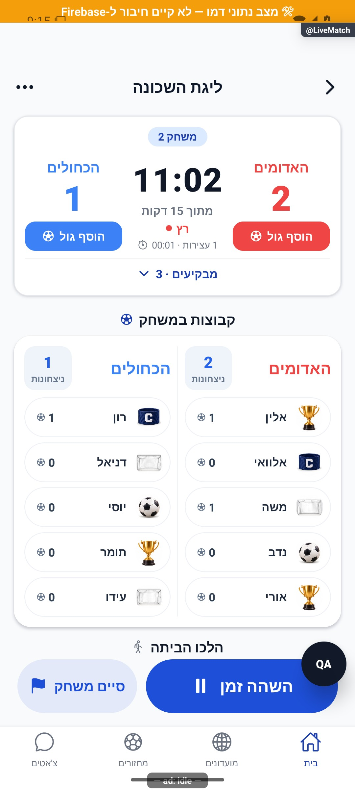

# לייב מתקדם ורוטציה

עודכן: 7.10.2026. מקור הקוד: `8e8fde5`, גרסה `1.1.35`. מסמך זה מתאר את הקוד; מצב חנות ופריסת שרת דורשים ראיה נפרדת.

## כניסה ותפקידים

LiveMatch של מחזור advancedMode

מנהל מנהל תוצאה/תור/שחקנים; השינויים נשמרים דרך פרוטוקול השירות והשרת.

## רכיבים ומצבים

| רכיב / מצב | התנהגות וחוזה |
|---|---|
| מצב חי | subscribeLiveGame: liveMatch, rotation, draftTeams; שתי קבוצות על מגרש ותור ממתינים |
| תחילת משחק | prepareStartRotation / markGameStarted וטיימר; מצב לפני התחלה שונה ממשחק פעיל |
| תוצאה | WinnerPickerModal; prepareRoundResult → commitFilledRotation; תוצאות נשמרות פעם אחת |
| תיקו | TieDecisionModal: ידני, פנדלים, או שתיהן יוצאות רק אם waiting[1] קיים |
| תור | reorderWaiting, מילוי חסר, nudgeRotationAfterFillCancel; אינדקסי תור אינם צבעי קבוצות |
| שחקנים | הלך הביתה/חזר, החלפה/העברה, פרישת קבוצה ריקה, מילוי קבוצות פעילות |
| תפריט | משחקים, איפוס, סיום; אישורים ולא מחיקה לצילום |
| סיום מחזור | endEvening, סטטיסטיקה, equipment; אינו סיום המשחק הבודד |

## מסלול נתונים ומקומות שינוי

[`src/screens/AdvancedLiveMatchScreen.tsx`](../../../src/screens/AdvancedLiveMatchScreen.tsx); [`src/components/match/RotationPanel.tsx`](../../../src/components/match/RotationPanel.tsx)

src/services/gameService.ts, rotationEngine.ts, gameLifecycle.ts; functions/src/commitProtocol.ts, roundSummary.ts, statBatch.ts. snapshot של הרכב ותוצאת משחק חייב לשקף מי שיחק ולא רק סגל סופי. פרוטוקול אידמפוטנטי מונע כפילות בחזרה/לחיצה.

ממיר המחזור: [`src/firebase/firestore.ts`](../../../src/firebase/firestore.ts), `gameDocConverter.fromFirestore`; סוגים: [`src/types`](../../../src/types). שינוי שדה דורש מעקב כתיבה → ממיר → שירות/חנות → רכיב. ניווט: [`GameStack.tsx`](../../../src/navigation/GameStack.tsx), ובמסכים משותפים גם המחסניות שמארחות אותם.

## בדיקות וראיות

rotationEngine/rotationFill/rotationDeep/rotationCounts, rotationQueueReorder, idempotency, advancedMatchStats ו־shootoutPersistence.

צילומי המיפוי מהאמולטור נעשו במצב נתוני דמו, המסומן בפס כתום. הם מוכיחים את הרכיב והמצב המוצגים בלבד, ולא ממירי Firebase, נתוני ייצור או כתיבה. צילומי תיקונים קודמים מסומנים בנפרד. שגיאת מזהה, מצב טעינה או שער הגנה אינם הוכחת הפעולה המלאה.

## גבולות והערות תחזוקה

הצילום הנוכחי מציג בפועל את שער ״עוד לא חולקו כוחות״; אין לכנותו הוכחה לכל הרוטציה. ארבע קבוצות ומעלה נדרשות ליציאת שתיהן כשיש שתי מחליפות.

לפני שינוי פתח את הקוד המקושר ואת [כללי הפרויקט](../../../AGENTS.md). לאחר שינוי עדכן במסמך זה את התאריך, נקודת הקוד, המצבים שהתעדכנו, הבדיקות והצילום. אין לטעון שכל מצב/תפקיד נבדק רק משום שקיים צילום אחד.

## פירוט טכני ממוקד: זרימה, חישוב ונקודות שינוי

[הסבר פשוט למשתמש](live-advanced.simple.md)

העמקה: 07.10.2026, מול קוד המקור שב־`8e8fde5`. בעת הכתיבה HEAD הוא `50d508f`; בדיקת ההפרש בין הנקודות ב־`src` וב־`functions` לא מצאה שינוי קוד. הסעיפים וההסתייגויות הקיימים נשמרו. זו קריאת קוד ותיעוד, בלי הרצת תרחישי כתיבה חדשים.

[rotationEngine](../../../src/services/rotationEngine.ts) הוא מנוע טהור: `prepareStartRotation/recordWinnerSkeleton/recordTieSkeleton` מחשבים מצב לפני מילוי; שירות המחזור שומר. `canStart` דורש שתי קבוצות מאוישות, לא שתי קבוצות מלאות לפי הפורמט: 4 מול 3 אפשרי, קבוצה ריקה לא.

במנצחת נשארת: `playing=[0,1]`, `waiting=[2,3]`, מנצחת 1 → `playing=[1,2]`, `waiting=[3,0]`; מספר ניצחונות 1 עולה. בלי ממתינות אותן שתי קבוצות נשארות. השאלות זמניות חוזרות כשהקבוצה הביתית נכנסת ומוסרות כשהקבוצה שקיבלה את ההשאלה יוצאת. בתיקו אין זקיפת ניצחון; יציאת שתיהן דורשת שתי מחליפות, ויש מסלול גיבוי כשנותרה אחת בלבד.

סיום עובר `prepareRoundResult` ו־`_commitRoundStatsAndClear` לפני `commitFilledRotation`. [מפתח משחקון](../../../src/services/rotationEngine.ts), `roundCommitKey`, מעדיף `roundInstanceId` יציב; `resolveRoundInstance` מנפיק חדש רק למספר משחקון חדש. עדכון סדר תור/ממלא אינו צריך לייצר זקיפה חדשה לאותו משחקון.

חלון המילוי נושא `RotationFillState.source`, טביעת מקור מקומית שנבנית באמצעות `rotationWriteSource`: מצב המחזור, הרוטציה, החלוקה, רשומים, אורחים ומצב השעון. `AdvancedLiveMatchScreen` מעבירה אותה דרך `fillFlowRef` אל `commitFilledRotation`, ו־`_persistRotation` קוראת את המחזור המעודכן בעסקה ומשווה את המקור לפני שינוי הרוטציה. הטביעה אינה נשמרת במסד. מנהל אחר שכבר התקדם, שינה סגל או התחיל שעון גורם לדחייה שמבקשת לפתוח מחדש את בחירת ההרכב. כך מילוי מאוחר אינו מחליף את זהות המשחקון הבא ואינו מאפס תוצאה חדשה. ניקוי התוצאה הקודמת אינו משנה את הטביעה, אבל תוצאה חדשה שאינה אפס לפני איפוס שעון נדחית ונשמרת בלוח, גם אם נוספה מלקוח ישן.

[commitRoundInOrder](../../../functions/src/commitProtocol.ts) קורא חתימת זקיפה. במסלול הייצור החדש `commitRoundStats` יוצר את היסטוריית המשחקון, חתימת `committedRounds/{roundId}`, הגדלות הסטטיסטיקה וניקוי לוח המשחק באותה אצווה. יצירת החתימה ותנאי `lastUpdateTime` על המחזור מבטיחים מנצח יחיד ומבטלים את כל האצווה אם שער או נתון אחר השתנו מאז הקריאה. אין ניקוי נוסף בלקוח לאחר תשובת רשת. בקשה חוזרת שכבר הושלמה מחזירה את המנצחת ואת מדיניות התיקו מהחתימה המקורית; לקוח מפסיד בריצת תחרות אינו בונה רוטציה לפי בחירה מקומית אחרת. היסטוריה חסרה מתוקנת באמצעות יצירה בלבד. המסלול הישן בלי `liveGoalIds` נשמר לתאימות; תמיכת הפרוטוקול בהיסטוריה נפרדת היא תמיכה בנתונים ובקוראים ישנים, ואינה סדר הכתיבה החדש בייצור.

הלקוח שולח `liveGoalIds`, `rotationUpdatedAt` ויומן פנדלים מנורמל; השרת בודק אותם דרך `matchesLiveRound`. שער ומחיקת שער משתמשים בעסקה וקוראים `lastCommittedRoundId` ישירות מהמסמך, משום שהממיר אינו מחזיר שדה שרת זה. משחקון חתום אינו מקבל שער או מחיקה מאוחרים. תשובת `protocol: 2` נדרשת לפני התקדמות; שרת ישן יגרום שגיאה מפורשת, ולא הצלחה מדומה. יש לפרוס ולאמת את השרת לפני הפצת הלקוח החדש.

`endEvening` מעביר כשל זקיפה למסך ומשאיר את המחזור פעיל. משחקון 0:0 נשמר אם השעון רץ, נצבר זמן, תועד שער או תועד דו־קרב פנדלים; רוטציה ריקה שהוכנה ולא התחילה אינה משחקון נוסף. `lastCommittedRoundId` מונע ספירת משחקון שכבר הסתיים. הכתיבה הסופית בודקת בעסקה שלא התחיל משחקון חדש, שלא נוסף שער ושזהות הרוטציה והשעון לא השתנו.

לאחר סיום המחזור `onGameRosterChanged` מפעילה חידוש שלבים עם `retry: true`: הופעות, דירוגים, צמדים, סיכום וחתימת השלמה. לכל שלב חתימה אטומית עם המונים שלו; ציונים והפרשי מיקום שכבר נשמרו נקראים מחדש ואינם מחושבים מחדש מול ממוצעים מאוחרים. הצמדים נצברים לפני הסיכום שעשוי לסגור עונה. שומר העונה בודק את עונת המחזור ואת גרסת המועדון לפני כל אצווה מצטברת; עונה שנחתמה אינה מקבלת זקיפה חדשה לעונה הפעילה.

אימות מקומי 10.10.2026: `preReleaseRoundIntegrity` ו־`preReleaseFinishRecovery` משחזרים כשל וחידוש, אובדן תשובה, תחרות שערים, תיקו 0:0, החלטות מנהלים סותרות, כשל מקטע צמדים ועונה חתומה באמצעות המתודות המקוריות וקלט/פלט מבודדים. אין כאן הוכחת כתיבה ממכשיר, פריסה או תיקון היסטורי. [פירוט השינויים והגבולות](../../../artifacts/pre-release-2026-10-10/rounds-fixes.md).

נקודות שינוי: חוקי התור במנוע, תיאום ובחירת ממלא במסך, אידמפוטנטיות בפרוטוקול, מכנים ב־statBatch. בדיקות `rotation*`, `idempotency` ו־`advancedMatchStats` חשובות לפני שינוי. צילום שער ההגנה בלבד אינו בדיקת הרוטציה הזאת.

## עדכון 8.10.2026 — תנועה ותיקוני דיווחים

`LiveScoreboardCard` מנפיש את שורת המצב לפי `running` במשך 190 אלפיות שנייה; ספרות הזמן אינן מוזזות. `RotationPanel` עטוף ב־`ChangeMotion` לפי `rotation.round` במשך 280. סיום המשחק, פרוטוקול התוצאה, תור הקבוצות והשעון נשארו מקור הנתונים היחיד.

**ראיה ומגבלות:** עצירה וחידוש הורצו והוקלטו בדמו. סיום משחק ורוטציה חדשה לא הורצו בסבב זה, לכן תנועת ההחלפה אינה מסומנת מאומתת.

בדיקת הטיפוסים ו־183 חבילות הבדיקות עברו, 2,752 בדיקות. מצב המקור: `9ec0dfd` עם שינויים מקומיים; אין גרסה חדשה שפורסמה. [יומן השינוי וההקלטות](../../changes/2026-10-08-motion-and-pulse.md).

## השלמת הנפשות — 8.10.2026

TeamScore variant=list מנפישה מזהים חדשים דרך useArrivalTracker ו־ArrivalMotion, ללא שינוי ב־rosterOf, בתור, בהשאלות, בשמירת משחקון או במכני הנתונים. teamIdx מפרידה תחומי סגל; rosterKey היא רשימת מזהים בלבד, ולכן עדכון שם או גולים לא נחשב כניסה. התנועה נבדקה ברכיב האמיתי עם state מקומי בחלונית הבדיקה; לא בוצעה רוטציה או אישור מילוי מול שרת בסבב זה. grid נשארה ללא שינוי.

[פרטי האימות והמגבלות](../../changes/2026-10-08-motion-completion.md). מקור: `9ec0dfd` עם שינויים מקומיים; טרם פורסמה גרסה.

## תיקון מקומי — ייחוס שיא אישי, 13.10.2026

ב־recordsOf השיא הקודם נלקח רק מהשחקנים שנבחרו לסיפור. 10 שערים אחרי שיא אישי 2 מושווים ל־2, גם אם שחקן שלא נבחר הבקיע 8 אחרי שיא 7. בסיפור משותף נשמר המבנה הקיים של ערך קודם יחיד: המרבי מבין המובילים שנבחרו בלבד. בהשוואת שיא זהה הערך הקודם שווה לערך הנוכחי. לא שונו הזכאות, בחירת המובילים או ניכוי סיפור אישי כאשר כבר נבחר שיא מועדון.

העותק functions/src/roundSummary.ts נוצר באמצעות המחולל. בדיקות roundSummary ו־roundSummaryParity עברו, לרבות שני מקרי נסיגה חדשים. אין שינוי עיצוב, פריסה או חישוב מחדש של סיכומים היסטוריים. ראיה מספרית ובדיקות; לא הורץ מחזור אמיתי לצורך התיקון.

## אישור מחיקת שער — 13.10.2026

LiveScoreboardCard.undo משתמש כעת ב־appAlert במקום Alert.alert של מערכת ההפעלה. נשמרו הכותרת, השאלה ושתי הפעולות; doUndo מופעל רק לאחר אישור, ושער לא נמחק בעת פתיחה או ביטול. [צילום המציג המשותף](../screenshots/overlays-final-goal-confirm-2026-10-13.png) בדמו: הכפתורים סוגרים בלבד. אין מחיקת שער אמיתי או הוכחת פעולה עסקית. חיפוש Alert.alert בקובצי תצוגה השאיר רק הערות ותיעוד לאחר השינוי.

## בורר המנצחת — 13.10.2026

תוקנה חפיפת סימון הבחירה עם שם הקבוצה ב־WinnerPickerModal: התג שגובהו 22 עובר מ־top:8 ל־top:-11, מעל המסגרת. שאר המידות, הבחירה ו־onPick נשמרו. נצפו [לפני בחירה](../screenshots/overlays-tenth-winner-2026-10-13.png) ו־[אחרי בחירה ותיקון](../screenshots/overlays-tenth-winner-selected-2026-10-13.png), עם שני סגלי דמו בני חמישה שחקנים. אישור מושבת עד בחירה והופך פעיל אחריה; חזרת המכשיר סוגרת ללא אישור. הכשל הישן נשמר ב־artifacts/home-carousel-height/night-tenth-winner-selected.png. הכותרות אדומים/כחולים אינן מוסתרות אחרי התיקון; שמות שחקנים ארוכים עדיין מתקצרים לפי הרכיב. אין אישור תוצאה אמיתית, בדיקת תחרות שרת, אייפון או כל גדלי הגופן.

## בורר משלים ותפריט שחקן — המשך אחד־עשר

הרכיבים האמיתיים FillerPickerModal ו־PlayerActionMenu נצפו בדמו המוגן, ללא שינוי קוד המוצר שלהם. בבורר מוצגת תוצאת דמו שמורה והמלצה לשניים מתוך 12 מועמדים. [2/2 ואישור פעיל](../screenshots/overlays-eleventh-filler-2026-10-13.png), [1/2 ואישור מושבת](../screenshots/overlays-eleventh-filler-incomplete-2026-10-13.png), [גלילה למועמד 12](../screenshots/overlays-eleventh-filler-scroll-2026-10-13.png) ו־[מאגר ריק](../screenshots/overlays-eleventh-filler-empty-2026-10-13.png). גם במצב ריק הכותרת/הודעת הסגירה נראות, ואישור אינו זמין. חזרת המכשיר סוגרת. לא אושרה החלפה, לא נשמרה תוצאה ולא הורץ מנוע הרוטציה.

בתפריט השחקן נמדד עוגן אמיתי דרך MeasurablePressable סמוך לתחתית, ולא הוזנו מידות ניחוש. [התפריט](../screenshots/overlays-eleventh-player-menu-2026-10-13.png) מתהפך מעל העוגן, כל חמש הפעולות נראות, הסמלים מימין והפריט המושבת נשאר לא פעיל לאחר הקשה. חזרת מכשיר סגרה למסך הדמו. אלה נתוני בדיקה ולא כלל הפעולות בכל מארח. אין הוכחה לכל קצה מסך, גופן מוגדל, אייפון או פעולות שרת.
