# לייב מתקדם ורוטציה — הסבר פשוט

## בדיקה מלאה במחזור חדש — 18.10.2026

בגרסה `1.1.56` (`289`), ממקור `96e94`, נבדק מחזור חדש של 11 מול 11 מול השרת האמיתי. בסיס הקבוצות נשמר במעבר למשחק הבא. אחרי יציאת שחקן, השלמה קבועה והחזרה שלו, המשלים חזר לקבוצתו וכל שלוש הקבוצות היו שוב מלאות, בלי לשנות את התוצאה או השעון.

נבדקה גם חזרה מפנדלים לבחירת מנצחים: שלוש הבעיטות נשמרו עד אישור ההחלטה, וגם כשלא היה חיבור לשמירה. אחרי חזרת החיבור ואישור החלופה, התוצאה נשמרה והבעיטות הוסרו בלי להוסיף נתוני פנדלים. בסיום נזקפו בדיוק שני משחקים ו־44 הופעות; המשחק הבא הריק לא נספר. ששת מחזורי הבדיקה הקודמים נשארו ללא שינוי. [הראיות והגבולות](live-advanced.md#אימות-מחזור-חדש-בגרסה-1156--18102026), [דוח הגרסה](../../changes/2026-10-18-internal-1.1.56.md).

## החזרה לקבוצה מלאה נעצרת עם הסבר — 18.10.2026

אם אי אפשר לזהות בבטחה את המשלים שצריך לפנות מקום, ההחזרה אינה מוסיפה שחקן עודף. מופיעה הנחיה לפנות מקום במסך החילופים ולנסות שוב, בלי לשנות את ההרכב או למחוק את סימון העזיבה. במכשיר מול מחזור הבדיקה בייצור נצפתה ההודעה בשלמותה ואחדעשר־03 נשאר בין היוצאים. השוואת המקור לפני ואחרי בנפרד הראתה שהנתונים נשארו זהים; הצילום עצמו אינו מוכיח שמירת נתונים או החזרה מוצלחת אחרי פינוי מקום. [הצילום, הבדיקות והגבולות](live-advanced.md#הודעה-פעילה-בהחזרה-ללא-מקום-בטוח--18102026).

## בסיס הקבוצות עובר למשחק הבא — 18.10.2026

תוקן מעבר שאיבד את הבסיס שלפיו משלים קבוע חוזר לקבוצתו כששחקן חוזר למחזור. הבסיס נשמר כעת גם אחרי ניצחון ותיקו. נתונים שבהם הוא כבר אבד אינם נכתבים מחדש אוטומטית. אחרי בדיקות הקוד נבדק גם המעבר במחזור החדש המתועד בראש המסמך. [הפרטים והגבולות](live-advanced.md#שימור-בסיס-הקבוצות-בתוצאת-משחק--18102026).

## השלמה אחרי ששחקן הלך הביתה — 18.10.2026

כשקבוצה שמשחקת נשארת קצרה, הצעת ההשלמה מתבססת כעת על העזיבה שאושרה, גם אם תמונת ההרכב מתעכבת לרגע. משחק או הרכב אחרים לא יפתחו הצעה ישנה, והשעון נשאר אפשרות בלבד. המוביל בדק שוב שההצעה נפתחת והמשלים נשמר; במחזור החדש המתועד בראש המסמך אומת גם קפטן תקף לקבוצה שממנה עבר המשלים. [המקור והגבולות](live-advanced.md#השלמה-אחרי-עזיבה-שאושרה--18102026).

## מעבר מפנדלים לבחירת מנצחים — 18.10.2026

בחזרה מפנדלים אפשר להמשיך באותה סדרה, לבחור מנצחים או לאשר יציאת שתי הקבוצות כאשר האפשרות זמינה. עד האישור המפורש שום בעיטה אינה נמחקת. כעת גם אחרי הלחיצה הבעיטות נשמרות אם שמירת התוצאה נכשלה: השמירה והמחיקה מצליחות יחד. ניסיון חוזר אחרי הצלחה אינו שומר את המשחק פעמיים, ושינוי אמיתי בהרכב או בתוצאה מחייב בדיקה מחדש.

התיקון עבר בדיקות קוד עם כשלים מכוונים ופעולת השמירה המלאה. לאחר עדכון השרת נבדק גם ניסיון חוזר אחרי כשל חיבור במחזור החדש המתועד בראש המסמך; צילומי הבדיקה הקודמת לבדם אינם אישור לחוזה החדש. [הפרטים והגבולות](live-advanced.md#הכרעה-חלופית-אטומית--18102026).

## בחירה מחדש וכפתורים מזוהים נכון — 18.10.2026

במסך קטן ובטקסט מוגדל נבדקו שתי הודעות הגול: דחייה ודאית של שחקן שאינו זכאי מציעה ״בחירת שחקנים מחדש״; כשלא התקבל אישור לשמירה, הבחירות נשארות ומוצע ניסיון חוזר. שתיהן מוצגות בשלמותן, ובדמו ניסיון חוזר שמר גול יחיד.

תוקנה גם תווית נגישה שגויה בכפתור ״שער עצמי״ אחרי בחירה מחדש. לאחר פתיחה קרה נבדק שהתווית תואמת לכפתור, ולחיצה פתחה את שחקני היריבה. [צילום אחרי התיקון](../screenshots/final-audit-goal-penalty-goal-actions-fixed-small-2026-10-18.png). הבדיקה נעשתה בדמו עם כשלים מקומיים מכוונים, ולא ברשת ייצור; הנתונים והסביבה הוחזרו בסיום. [הוכחות וגבולות](live-advanced.md#בחירה-מחדש-ונגישות-פעולות-הגול-במכשיר--18102026).

## המחזור מתעדכן יחד עם הלוח — 18.10.2026

כשהשעון התחיל, הלוח התעדכן אך מצב המחזור במסך יכול היה להישאר ישן. תוקן העדכון כך שגם מצב המחזור, הרשומים והאורחים מגיעים יחד עם הלוח וההרכבים. המעבר הרגיל למחזור פעיל בהפעלת השעון אינו מבטל החלטת סיום של אותו משחק. שינוי אמיתי בהרכב או בתוצאה וסיום המחזור עדיין מחייבים בדיקה מחודשת.

לא נדרשת טעינה נוספת בכל עדכון, ואפשר עדיין להזין גולים ולסיים משחק בלי להפעיל שעון. 12 בדיקות קוד חדשות עברו. לאחר טעינה קרה נפתח במכשיר חלון התיקו של משחק 2, בתוצאה 0:0; הצילום נפתח ונבחן. שינוי רשומים ואורחים בזמן שהמסך פתוח נבדק בקוד ועדיין דורש אימות מכשיר. [פרטי העדכון, ההוכחה והגבולות](live-advanced.md#תמונת-מחזור-מלאה-במאזין-הלייב--18102026).

## בחירה וסיום בטוחים כשהמשחק משתנה — 18.10.2026

הזנת גול נשארת בשתי לחיצות: כובש, ואז מבשל או ״ללא בישול״, בלי אישור נוסף. אם הכובש יצא מההרכב לפני השלמת הבחירה, חוזרים לבחור כובש זכאי. בחירה תקפה נשמרת כשהרשימה מתרעננת.

אם לא התקבל אישור לשמירה, הבחירות נשארות ומנסים שוב את אותו גול. רק דחייה ודאית בגלל שינוי בהרכב מציגה ״בחירת שחקנים מחדש״. בזמן המתנה נשארים השמות והתמונות שנבחרו גם אם מישהו עבר קבוצה; חגיגת הגול מופיעה רק אחרי אישור שמירה.

סיום משחק קשור לתוצאה ולהרכבים שהמנהל ראה. אם בינתיים השתנו המשחק, ההרכב, השערים או הפנדלים, ההחלטה הישנה נדחית וצריך לבדוק את המצב המעודכן. שינוי שעון בלבד אינו מבטל אותה, והפעלת השעון עדיין אינה תנאי להזנת גול או לסיום.

התיקונים נבדקו בקוד, כולל הרכבים של 4, 7 ו־11 ושמירה חוזרת. הודעות הבחירה מחדש במסך קטן נבדקו לאחר מכן גם בדמו מאולץ, כמתואר בראש המסמך. שני מנהלים ואישור שאבד ברשת אמיתית אינם מוכחים מכך. במועד ביקורת הקוד הגנת השמירה החדשה בשרת עדיין נזקקה לפריסה; אין להסיק על מצב הפריסה מבדיקת הדמו. [התנהגות, בדיקות וגבולות](live-advanced.md#ביקורת-סופית-סגל-משתנה-והחלטת-סיום--18102026).

## סיום פנדלים ברור — 17.10.2026

לפני סיום הפנדלים רואים את הקבוצות במשחק הבא ואת הקבוצה שתעבור להמתנה, כמו בסיום משחק רגיל. האישור שומר וממשיך במסלול ההכנה הקיים. [פרטי העיצוב והבדיקה](penalties.simple.md).

## השלמת דיווחי הפולס — 17.10.2026

כשל שמירת תוצאה עקב עונה מוצג בעברית עם הסבר שהגולים והבעיטות נשמרו.

[צילומים, בדיקות ומגבלות](../../changes/2026-10-17-roster-recruitment-and-pulse.md).

## שורת צירוף ובדיקת הפולס — 17.10.2026

מחזור חדש שנוהל בלי להפעיל שעון אינו אמור להיחסם כמשחק מעונה ישנה. תיקון השרת משייך אותו לעונה הנוכחית בזמן שמירת התוצאה, תוך שמירת החסימה על עונות סגורות.

[בדיקות, צילומים ומגבלות](../../changes/2026-10-17-roster-recruitment-and-pulse.md).

## בדיקות הפולס והגרסה הפנימית 1.1.55 — 17.10.2026

המעבר למשחק הבא משתמש במצב שמתקבל מהשרת אחרי שמירת התוצאה. שינוי מקביל בהרכבים או בזהות המשחקון עדיין חוסם שמירה ישנה. חלוניות מחיקת גול והמשך ללא כוחות הותאמו לעיצוב האפליקציה.

[ראיות, בדיקות ומגבלות](../../changes/2026-10-17-internal-1.1.55.md).

## ללא בישול ברוחב מלא — 17.10.2026

בשלב ״מי בישל?״ הוסר הכפתור ״בישול לא ידוע״. הכפתור ״ללא בישול״ תופס כעת את כל רוחב אזור הפעולות ומשלים את רישום הגול בלחיצה אחת. אפשר עדיין לבחור מבשל מהרשימה או לשנות את הכובש. האפשרות ״מבקיע לא ידוע״ בשלב הכובש נשארה.

[צילום עדכני מהאימולטור](../screenshots/goal-no-assist-full-width-2026-10-17.png). הבדיקה החזותית נעשתה בלי להוסיף גול למשחק המקורי.

## כפתור חזרה לפנדלים — 17.10.2026

כשחוזרים למסך המשחק בזמן הכרעת פנדלים, הכפתור הכחול מציג ״המשך פנדלים״ ומחזיר להכרעה הקיימת. תוקנה פריסה שכיווצה את הכפתור וחתכה את הכיתוב. נשמר לו גובה מזערי קבוע והטקסט מותאם לרוחב הכפתור.

[צילום הכפתור לאחר התיקון](../screenshots/live-shootout-resume-labelled-2026-10-17.png). פתיחה וחזרה נבדקו באימולטור בלי לשנות את הבעיטות או התוצאה.

## חלונית פנדלים בגודל אחיד — 17.10.2026

חלונית הפנדלים נשארת באותו גודל בבחירת הקבוצה הראשונה, הבועט והשוער, בבחירת תוצאה, ביומן, בתיקון ובסיום. התוכן הקצר ממורכז בתוך המסגרת; בשלבי הבעיטה המגרש נשאר למעלה והבחירות ממורכזות מתחתיו. תוכן ארוך או טקסט מוגדל גוללים בתוך החלונית. גם שמירה, שגיאה וניסיון חוזר אינם מגדילים את המסגרת. הבחירה הישירה והחלפת התור נשארו כפי שהיו.

נבדקו באימולטור תשעה שלבים, ובכולם נמדד אותו גובה. [בחירת בועט](../screenshots/penalty-stable-kicker-2026-10-17.png), [בחירת תוצאה](../screenshots/penalty-stable-result-2026-10-17.png), [סיום](../screenshots/penalty-stable-finish-2026-10-17.png). הבדיקה נעשתה בעותק דמו זמני; הפנדלים והמשחק המקוריים נשמרו ללא שינוי.

## ריווח שורות וכפתורי הפעולות — 17.10.2026

רשימת הכובשים צפופה יותר: המרחק בין שורה לשורה ירד מכ־52 לכ־34 נקודות תצוגה, בלי להקטין את הטקסט או את סמל הביטול. בכפתורי הגול, השעון, החילוף וסיום המשחק הטקסט והאייקון ממורכזים יחד במרווח קטן וקבוע; הטקסט כבר אינו דוחף את האייקון לקצה הכפתור. הטקסט יכול עדיין להצטמצם במסך צר.

[צילום עדכני מהאימולטור](../screenshots/live-scorer-and-action-spacing-2026-10-17.png): ארבע שורות כובשים שלמות וכפתורי פעולה עם אייקונים צמודים. נתוני המשחק נשמרו ללא שינוי.

## כדור ברור ומיקום פתיחה — 17.10.2026

בחלון הגול מופיעה כעת תמונה של כדור מציאותי על רקע שקוף, במקום ציור הכדור הראשוני. לפי החידוד האחרון, הכדור מוסתר בזמן בחירת השחקנים ובהמתנה לשמירה. רק אחרי אישור השמירה מופיעה האנימציה: עם מבשל — מסירה ממנו לכובש ובעיטה לשער; ללא מבשל — בעיטה ישירה מהכובש. קו המסירה מופיע רק אחרי בחירת הכובש. העיפרון ליד תמונת שחקן שנבחר מאפשר לתקן את הבחירה ואינו שלב חובה.

שני המסלולים נבדקו דרך הממשק בעותק דמו זמני, והמשחק המקורי לא שונה. [מצב הפתיחה המעודכן](../screenshots/goal-ball-hidden-initial-2026-10-17.png), [מסלול עם מבשל](../screenshots/goal-ball-assisted-motion-2026-10-17.png), [מסלול ללא מבשל](../screenshots/goal-ball-unassisted-motion-2026-10-17.png). הצילומים הקודמים בהמשך מתעדים את העיצוב שלפני החידוד.

נבדקו באימולטור הדמו מצב הפתיחה והמעבר לבחירת מבשל, בלי לרשום גול במשחק של המשתמש. [מצב פתיחה](../screenshots/goal-ball-assister-initial-2026-10-17.png), [אחרי בחירת כובש](../screenshots/goal-ball-assister-selected-2026-10-17.png).

## פריסת שרת מאושרת — 17.10.2026

תיקוני שמירת המשחק, בישולי האורחים, סיווג הפנדלים וזקיפת תורמי אירועים שהוחלפו נפרסו בשרת. נתונים שכבר נחתמו לא שוכתבו. גרסת האפליקציה החדשה עדיין לא נבנתה או הועלתה. [מצב הפריסה והראיות](../../changes/2026-10-17-server-preparation.md)

במסך קצר עם פריסה קומפקטית לוח התוצאה גולל יחד עם ההרכבים. כך אפשר להגיע לכל השחקנים גם כשמגדילים טקסט, במקום שלוח מוצמד יכסה את כל אזור ההרכב. פעולות הגול, השעון, החילוף והסיום נשארות קבועות בתחתית. במסך גבוה הלוח נשאר מוצמד כרגיל.

## שעון ששומר על המשחק הנכון — 17.10.2026

תוקן מרוץ שבו פעולה ישנה של מנהל יכלה לשנות את הזמן אחרי שמנהל אחר עצר וחידש אותו, או להגיע למשחק הבא. פעולות השעון בודקות מחדש את המצב בזמן השמירה. פעולה ששייכת למשחק אחר נדחית; לחיצות חוזרות אינן מוסיפות עצירות או זמן כפולים. איפוס משאיר את מוני השערים ממשחקים קודמים ומנכה את שערי המשחק שאופס.

עדיין אפשר להזין גולים ולסיים משחק בלי להפעיל שעון. הבדיקות המקומיות עברו; בדיקת מכשיר של השינוי נפרדת, וטרם הורץ ניסוי עם כמה מכשירים יחד. [החוזה והגבולות](live-advanced.md#פעולות-שעון-עסקתיות-ותחומות-למשחק--17102026).

## שמירת העדפת תנועה חדשה — 17.10.2026

חלונות הגול והפנדל כבר מתעדכנים כשמשנים את העדפת התנועה בזמן שהאפליקציה פתוחה. תוקן מקרה שבו בדיקת ההעדפה הראשונית חזרה באיחור ודרסה שינוי חדש: ההעדפה האחרונה נשמרת. בהפחתת תנועה ההילה, כניסת השחקנים ותנועת הכדור נעצרות, ואחרי שמירה מוצגת הצלחה קצרה. סגירת החלון מנקה את ההנפשות בלי לשנות את הגול או הבעיטה שנשמרו.

המרוץ והניקוי נבדקו בעשר בדיקות קוד חדשות. בדיקת החלפת ההעדפה בזמן הרצה במכשיר עדיין נפרדת ולא הושלמה בסבב המקומי; [פרטי הבדיקה והגבולות](live-advanced.md#שמירת-העדפת-תנועה-חדשה-וניקוי-הנפשות--17102026).

## שעון וכפתורים קריאים במסך קטן — 17.10.2026

במסך צר או בטקסט מוגדל, לוח הלייב והכפתורים מסתדרים באופן קומפקטי: השעון שומר את כל הספרות, ושמות הקבוצות, כפתורי הגול וכפתור השעון נשארים בשורה אחת ומתאימים את גודלם לרוחב. כך נשאר יותר מקום להרכבים, והמילה ״השהיה״ אינה נשברת. ״חילוף״ ו״סיום משחק״ יכולים להשתמש בשתי שורות בתוך אזור לחיצה גדול. אפשר להזין גולים ולסיים משחק גם לפני הפעלת השעון.

חלון הניצחון שומר את האישור והחזרה בתחתית, והתוצאה וההרכבים של המשחק הבא נגללים מעליהם. בוצעו התאמות אחרי תקלת קריאות וגלילה שנמצאה בבדיקת הייצור; [הצילום החוזר והגבולות](../../changes/2026-10-17-live-action-pitch.md) נבדלים ממבחני הרכיב ומהצילום שלפני התיקון.

בליטוש האחרון למסך קטן, החולצה בכרטיסי ״במשחק הבא״ נמצאת מעל השם והתג כדי להשאיר להם רוחב. גם חלון התיקו משתמש בתוצאה ובכותרת קומפקטיות. צילומי מחזור שבעה שקדמו לליטוש אינם הוכחה לעיצוב האחרון; צילום חדש לאחר פתיחה קרה נמצא בבדיקת המוביל.

בלוח הצר משך המשחק והמצב מוצגים כעת בשורה קצרה אחת, למשל ״8דק׳ · מוכן״, כדי להשאיר יותר מקום לשחקנים. השינוי הזה טרם צולם בלקוח העדכני בעת עדכון המסמך.

## בחירת מנצחת גם בהרכב גדול — 17.10.2026

בבחירה ידנית אחרי תיקו אפשר לגלול את שני ההרכבים, גם עם אחד עשר שחקנים במסך קטן, כשהכותרת, האישור והביטול נשארים גלויים. בוחרים קבוצה ואז מאשרים; ביטול מחזיר בלי לשמור. בהגדלת טקסט חלק משמות השחקנים מקוצרים, אך כל שחקני הסגל נגישים בגלילה. [צילומים ובדיקה חוזרת בדמו](../../changes/2026-10-17-live-action-local-proof.md); אין בכך הוכחת שמירה בייצור.

## סיום נגיש גם בטקסט גדול — 17.10.2026

בחלונות הניצחון והתיקו, האישור והחזרה למשחק נשארים בתחתית והפרטים גוללים מעליהם. כך אין צורך לחפש את פעולת ההמשך בגלילה במסך קטן. בתיקו האישור גלוי אך מושבת עד בחירת דרך ההכרעה. [הבדיקות והצילומים](../../changes/2026-10-17-live-action-pitch.md).

## אישור גלוי וגובה קבוע בחלון התיקו — 16.10.2026

כפתור האישור מופיע תמיד. ללא בחירה הוא מושבת; בחירת אפשרות מפעילה אותו באותו מקום, בלי להאריך את החלון. גם ההסבר של ״שתי הקבוצות יוצאות״ משתמש במקום שמור. סגירת החלון אינה מאשרת.

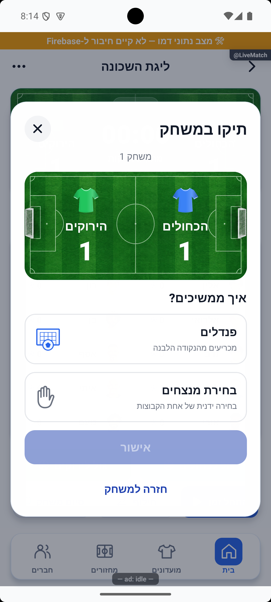

[צילומים והשוואת המיקום](../../changes/2026-10-16-tie-stable-confirmation.md). נבדק באימולטור בשלוש ובחמש קבוצות; טרם הופץ.

## גול על המגרש בשתי לחיצות — 17.10.2026

בראש החלון מופיעים שם הקבוצה והחולצה בצבעה, ומתחתיהם מגרש עם שער ומקומות לכובש ולמבשל. רשימת האווטרים כבר פתוחה: נוגעים בכובש ואז במבשל, והגול נשמר מיד בלי אישור נוסף. הפלוס רק מכוון לתפקיד הפעיל; אין צורך ללחוץ עליו. השחקנים נשארים באותו סדר בבחירת המבשל, והכובש מושבת במקום שלו.

אפשר לבחור ״ללא בישול״ או ״בישול לא ידוע״, וכן ״מבקיע לא ידוע״ ו״שער עצמי״ לפי משמעותן הקיימת. בשער עצמי רואים את שחקני היריבה ואת צבעה, וברור לאיזו קבוצה מתווסף הגול. לתיקון לפני השמירה נוגעים בכובש שעל המגרש, ליד העיפרון. רק לאחר אישור השמירה הכדור נמסר, נבעט לרשת ומופיעה חגיגה קצרה; אפשר לסגור מיד בלי לחכות לתנועה. בהעדפת תנועה מופחתת מוצגת הצלחה קצרה בלי מסלול כדור או קפיצות.

בהרכבים של 4 עד 11 גוללים באזור השחקנים בלבד בזמן בחירה רגילה. במסך קטן ובגופן מוגדל המגרש והכותרת קומפקטיים יותר, והפעולות שומרות על מקום קבוע במעבר מכובש למבשל. כשל בשמירה משאיר את הבחירות לניסיון חוזר של אותו גול, בלי ליצור אירוע נוסף. במצב הכשל בלבד המגרש ורשימת השחקנים יכולים לגלול מעל הודעת השגיאה וכפתור הניסיון החוזר, כדי שהפעולה לא תיחתך במסך קצר. במסך קטן ובטקסט מוגדל נבדק עכשיו גם ניתוק אמיתי: הבחירות נשמרו, ההודעה והכפתור נראו במלואם, ואחרי חידוש חיבור וניסיון חוזר נשמר גול יחיד. נבדקו בקוד גם סגל שהשתנה בזמן הבחירה, בישול של אורח וסיום 11 על 11 אחרי חילוף כובש או מבשל; תיקוני השרת שנדרשים לכך טרם נפרסו.

ביומן הגולים אזור הלחיצה של הביטול הוגדל, גם כשהעיגול החזותי נשאר קטן. קורא מסך מקבל תיאור מלא של הגול שמבטלים, והפעולה מושבתת בזמן שמירה. התצוגה ושטח המגע נבדקו במכשיר, וביטול גול הבדיקה החזיר את התוצאה לאפס בלי לשנות משחקים קודמים. משמעות הביטול נשארת זהה.

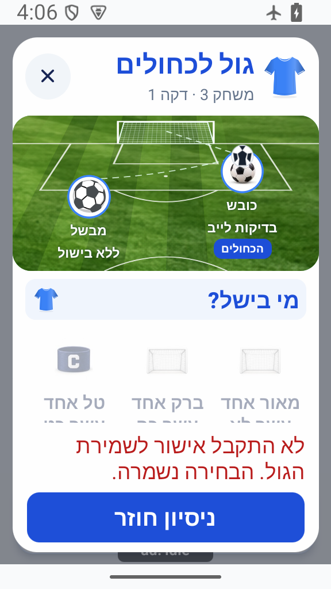

העיצוב הזה מחליף את חלון השורות ושלבי העיגולים הקודם. נצפו בדמו בחירות, כשל וניסיון חוזר ותנועת הכדור; נבדק גם חלון הגול המתוקן במסך קטן ובגופן מוגדל. [הראיות המקומיות והגבולות שלהן](../../changes/2026-10-17-live-action-local-proof.md) אינן הוכחת שמירה בייצור. [הדוח המשולב](../../changes/2026-10-17-live-action-pitch.md) · [פרטי המימוש והנתונים](live-advanced.md).

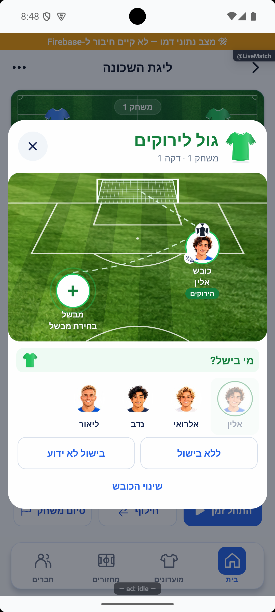

## אישור אחרי בחירת דרך ההכרעה — 16.10.2026

בחלון התיקו בוחרים פנדלים, בחירת מנצחים או יציאת שתי הקבוצות, ואז מאשרים בכפתור הגלוי כבר מפתיחת החלון. עד לבחירת אפשרות הכפתור מושבת. הבחירה רק מסמנת את האפשרות ואפשר לשנות אותה לפני האישור. אין בחירה מראש, וסגירת החלון אינה מאשרת. יציאת שתי הקבוצות עדיין זמינה רק עם לפחות ארבע קבוצות ושתי ממתינות.

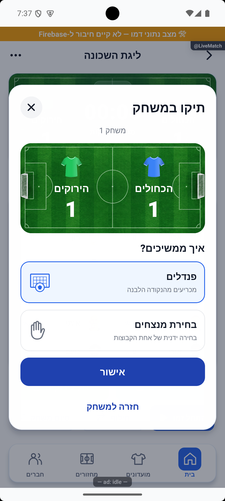

[מסכי ההמשך, בדיקות ומגבלות](../../changes/2026-10-16-tie-selection-confirmation.md). נבדק בדמו באימולטור; טרם הופץ.

## חולצות אחידות וסיכום חילוף אחד — 16.10.2026

בתצוגת ״במשחק הבא״ וגם ליד הקבוצה העוברת להמתנה מופיעות אותן חולצות מוצללות של לוח התוצאה, בצבע הקבוצות. הן מופיעות גם באפשרות ״שתי הקבוצות יוצאות״ בחלון התיקו.

במסך חילוף הוסרה לגמרי השורה ״מחליפים את…״, גם כאשר נבחר רק שחקן אחד. השחקן הנבחר מסומן בשורת הקבוצה, ולאחר בחירת שני שחקנים מופיע הסיכום למטה. אפשר לבטל את הבחירה בלחיצה נוספת על השחקן המסומן. [החידוד והצילום העדכני](../../changes/2026-10-16-substitution-no-header.md).

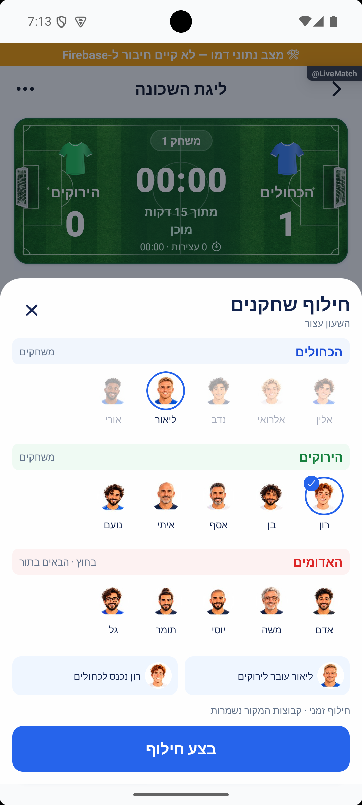

[צילומים, בדיקות ומגבלות](../../changes/2026-10-16-live-shirt-swap-polish.md). נבדק באימולטור; טרם הופץ.

## מגרש וחולצות בחלונות התוצאה — 16.10.2026

לוח התוצאה בחלונות סיום המשחק והתיקו מציג את אותו מגרש ירוק עם שערים ואותן חולצות מוצללות שמופיעים בזמן המשחק. החולצות תואמות לצבע שנבחר לקבוצה; השמות והתוצאות לבנים. הודעת הניצחון נשארת מתחת לתוצאה. בחלון התיקו אין כיתוב נוסף על הדשא; הכותרת ״תיקו במשחק״ מופיעה רק מעליו.

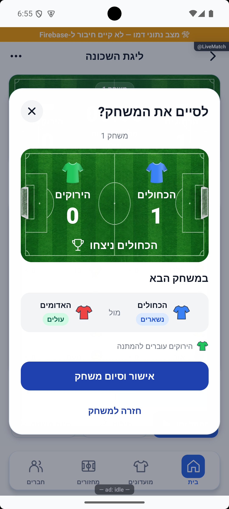

נבדקו ניצחון, תיקו וקבוצה לבנה באימולטור. [ראיות ומגבלות](../../changes/2026-10-16-result-pitch.md). השינוי מקומי וטרם הופץ.

## השעון הוא כלי עזר — 16.10.2026

אחרי אישור ההרכבים אפשר להזין שערים, לבצע חילופים, להשלים שחקנים ולסיים משחק גם בלי להפעיל את השעון. בסיום של אפס־אפס נפתח חלון התיקו, ואפשר לבחור מנצחים או פנדלים. כללי יציאת שתי הקבוצות נשארו: לפחות ארבע קבוצות ושתי ממתינות. שמירת התוצאה מעבירה למשחק הבא כשהזמן עדיין אפס.

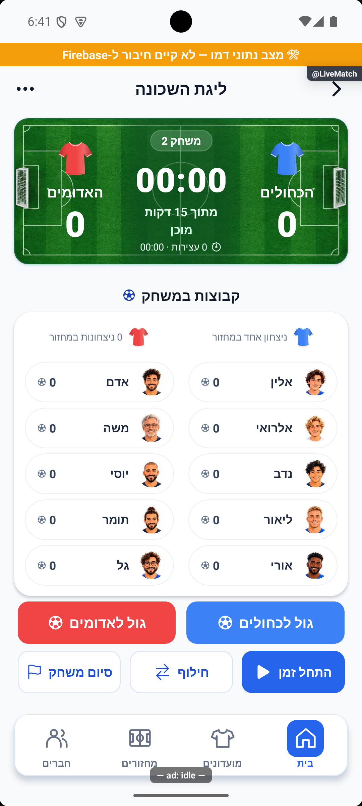

גם תפריט ניהול המחזור זמין לפני שימוש בשעון. נבדקו סיום ידני, פנדלים וחילוף באימולטור; השלמת שחקנים נבדקה בקוד ובבדיקות הקיימות. [ראיות ומגבלות](../../changes/2026-10-16-optional-match-clock.md). השינוי מקומי וטרם הופץ.

## חולצה בממתינים וגולים לפני הזמן — 16.10.2026

ליד שם כל קבוצה ממתינה מופיעה חולצה בצבע שלה, במקום סמל האנשים. אחרי אישור ההרכבים אפשר להזין גול גם לפני הפעלת השעון. שמירת גול אינה מתחילה זמן; אפשר להפעיל אותו אחר כך, והתוצאה נשמרת.

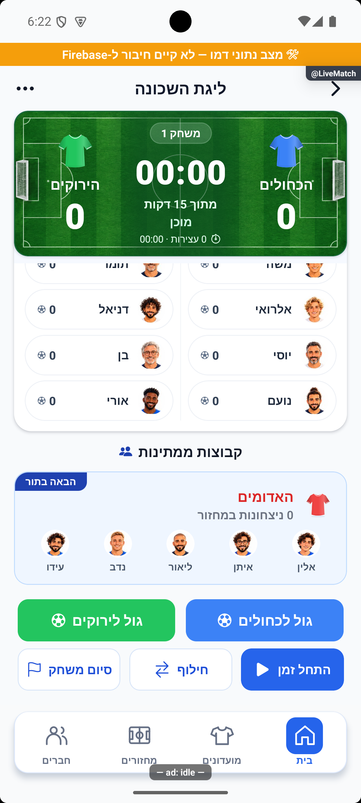

נבדקה הזנת גול: אחת מול אפס כשהזמן עדיין אפס, ואותה תוצאה אחרי הפעלה והשהיה. [צילומים, בדיקות ומגבלות](../../changes/2026-10-16-waiting-shirt-preclock-goals.md). נבדק בדמו מקומי; טרם הופץ.

## כפתורי שערים וכותרות הרכבים — 16.10.2026

הכיתוב בכפתורי הגול הוגדל ומופיע בלבן; בקבוצה הלבנה הכיתוב והכדור שחורים. השם של כל קבוצה נשאר בלוח התוצאה. בכותרת ההרכב מופיעים רק חולצה קטנה בצבע שלה ומספר הניצחונות במחזור, כדי לצמצם חזרה על אותו שם.

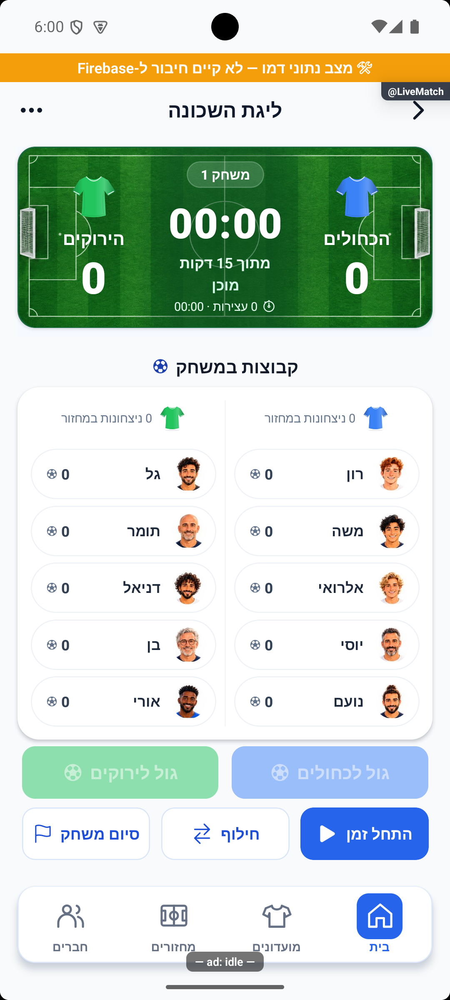

שם מחזור ההדגמה שונה מ״בדיקת כוחות ולייב״ ל״ליגת השכונה״, גם בבסיס השמור במכשיר. הכותרת ממשיכה להציג את שם המחזור; זה אינו שם קבוע במסך המשחק. הכוחות הנוכחיים נשמרו במהלך העדכון, ובטעינה מלאה הבאה הבסיס עדיין חוזר ללא כוחות לפי בקשת הבעלים.

[כפתורים פעילים, קבוצה לבנה ובדיקות](../../changes/2026-10-16-live-roster-goal-polish.md). המימוש מקומי וטרם הופץ.

## החולצות ומירכוז הקבוצות בלוח — 16.10.2026

הפסים שמתחת לתוצאות הוסרו. החולצות בלוח המשחק משתמשות מעתה באותו איור עם הצללה וצווארון שמופיע בתצוגת חלוקת הכוחות, וכל חולצה מקבלת את צבע הקבוצה שלה. החולצה, השם והתוצאה ממורכזים לגובה המגרש; מספר המשחק נמצא מעל השעון בעמודה האמצעית.

[בדיקות, צבעים ומגבלות](../../changes/2026-10-16-live-shirt-centering.md). נבדק בדמו מקומי; טרם הופץ.

## מגרש ירוק בלוח המשחק — 16.10.2026

לוח המשחק מציג כעת מגרש דשא ירוק עם שערים מימין ומשמאל, לפי הסקיצה שאושרה. החולצות מאוירות עם הצללה בצבעי הקבוצות; השמות, התוצאות והזמן מופיעים בלבן. רקע המגרש הוא תמונה מקומית, והנתונים מעליה ממשיכים להתעדכן בזמן המשחק.

אותו לוח מוצג בבחירת הקבוצות, לפני הפעלת הזמן, בריצה ובהשהיה. פתיחת יומן המבקיעים מוסיפה אותו מתחת למגרש, בלי למתוח את השערים. כללי המשחק, הכוחות ושמירת התוצאה נשארו כפי שהיו.

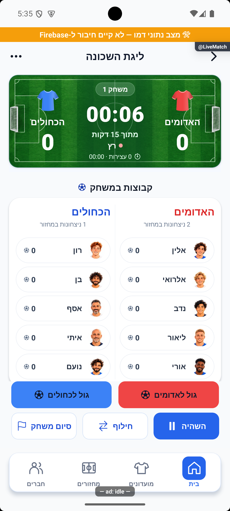

[כל הצילומים והבדיקות](../../changes/2026-10-16-live-pitch-scoreboard.md). נבדק באימולטור בדמו מקומי; טרם הופץ.

## חלון תיקו ואישור באותו מסך — 16.10.2026

בתיקו רואים את שתי הקבוצות, החולצות והתוצאה באותו סגנון של חלון הניצחון. אפשר לעבור לפנדלים או לבחירת מנצחים. בשלוש קבוצות ומטה אין אפשרות להוציא את שני הצדדים. מארבע קבוצות, ורק כששתי קבוצות ממתינות, רואים גם ״שתי הקבוצות יוצאות״ ואת שמות הקבוצות שיעלו.

בחירה בהוצאת שתי הקבוצות מסמנת את האפשרות ומפעילה את הכפתור הקיים עם הכיתוב ״אישור וסיום משחק״ בתוך אותו חלון. רק האישור מסיים; אין חלונית אישור נוספת. חזרה למשחק אינה שומרת תוצאה. הבחירה הידנית שומרת על שמות וצבעי הקבוצות שנבחרו.

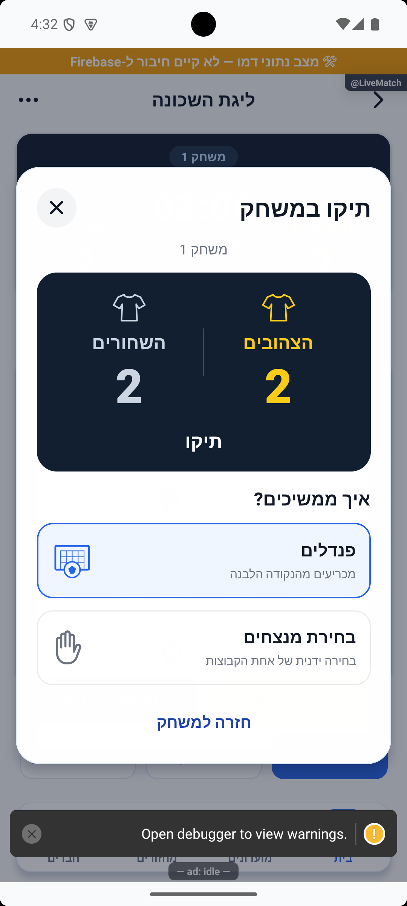
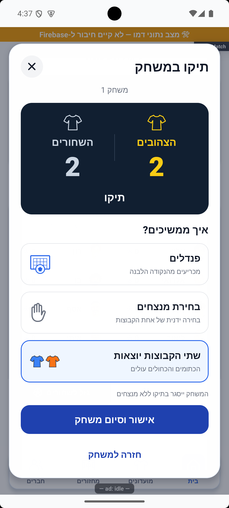

[בדיקות וצילומים](../../changes/2026-10-16-tie-popup.md). המימוש מקומי וטרם הופץ.

## חלון סיום משחק וחולצות בלוח התוצאה — 16.10.2026

בסיום משחק עם מנצחים מופיע חלון עם התוצאה, המנצחים והקבוצות שישחקו במשחק הבא. רואים מי נשארים, מי עולים ומי עוברים להמתנה. כשאין ממתינים, שתי הקבוצות ממשיכות. ״אישור וסיום משחק״ שומר דרך מסלול הסיום הקיים; ״חזרה למשחק״ וסגירת החלון אינן שומרות תוצאה. בתיקו ממשיכים לבחירת ההכרעה הקיימת.

אותו סמל חולצה מופיע מעל שמות הקבוצות והתוצאה בלוח הלייב ובחלון הסיום. בחלונות הסיום הוא נשאר במתאר על לוח כהה; בלייב הוא מאויר עם הצללה על המגרש הירוק, גם לשחורים וללבנים. הצילום הישן של הלייב להלן מתעד את העיצוב שקדם למגרש.

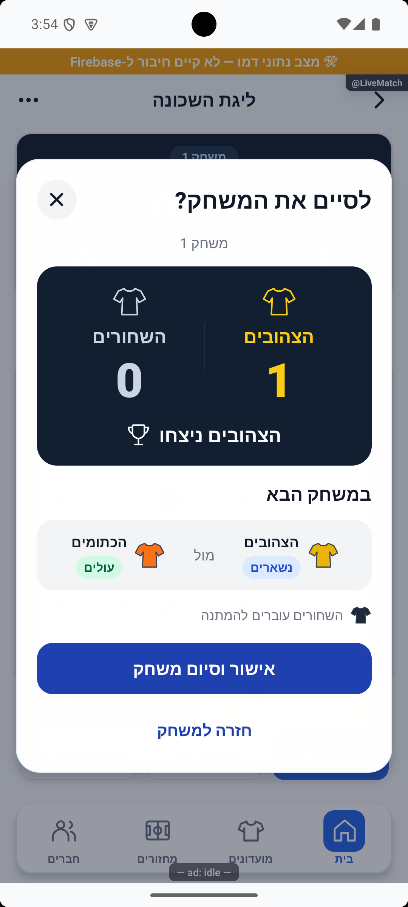
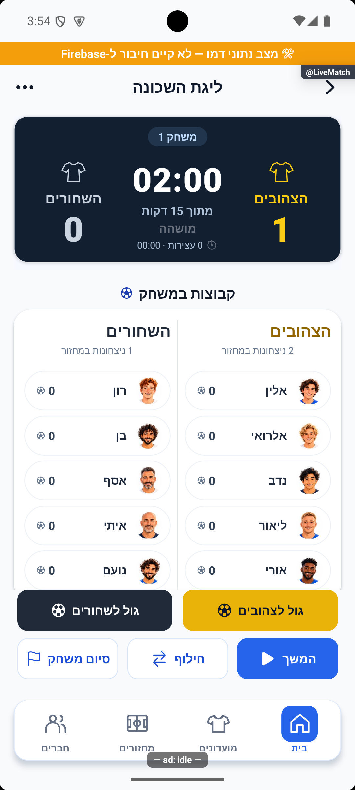

[הבדיקות והגבולות של ההרצה](../../changes/2026-10-16-end-match-popup.md). המימוש מקומי וטרם הופץ.

## צבעי כפתורי הגול ושורת המבקיע — 16.10.2026

כפתור הגול משתמש בצבע הקבוצה עצמו, עם טקסט וכדור בצבע קריא. הכדור נמצא משמאל לטקסט. ביומן השערים נקודת הצבע ושם המבקיע מתחילים מימין, אחריהם פרטי הבישול; הדקה וכפתור ביטול השער נמצאים בצד שמאל.

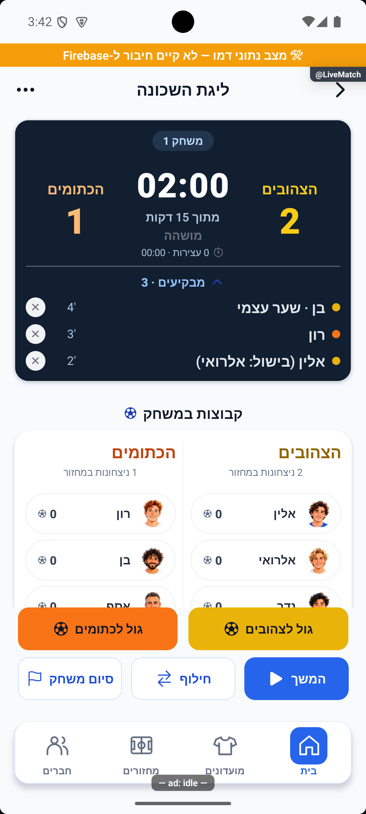

[בדיקות ומגבלות תיקון השערים](../../changes/2026-10-16-live-goal-rtl-colors.md). חלון סיום המשחק מומש לאחר אישור הסקיצה, כמפורט בעדכון למעלה.

## שורת ממתינים ולוח תוצאה אחיד — 16.10.2026

חמישה שחקנים בקבוצה ממתינה מופיעים בשורה אחת. בקבוצות גדולות יותר כל ההרכב מוצג בשורות של עד חמישה, ללא הסתרת שחקנים. לוח התוצאה, כעת על מגרש ירוק, שומר על אותו עיצוב בבחירת הקבוצות, לפני הפעלת הזמן, בזמן ריצה ובהשהיה. רק הקבוצות, הזמן, התוצאה ותווית המצב משתנים. כפתור הסיום נקרא כעת ״סיום משחק״.

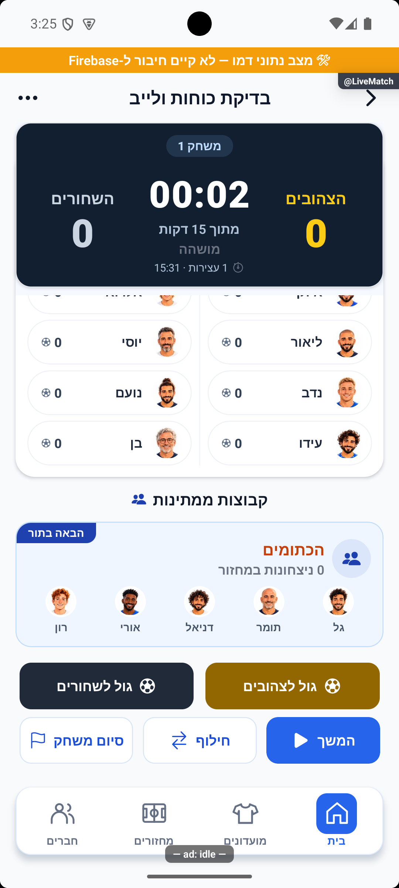

[פרטי הבדיקות והמגבלות](../../changes/2026-10-16-live-layout-polish.md).

## צמצום כרטיסי ההכנה — 16.10.2026

בבחירת הקבוצות הפותחות הוסר הכיתוב ״משחקים״ מתחת לקבוצות שנבחרו. בכותרת כל קבוצה, מימין לשמאל: שם הקבוצה, שינוי צבע ועיגול הבחירה בקצה השמאלי. סימון הממתינים וסדר התור נשארים זמינים.

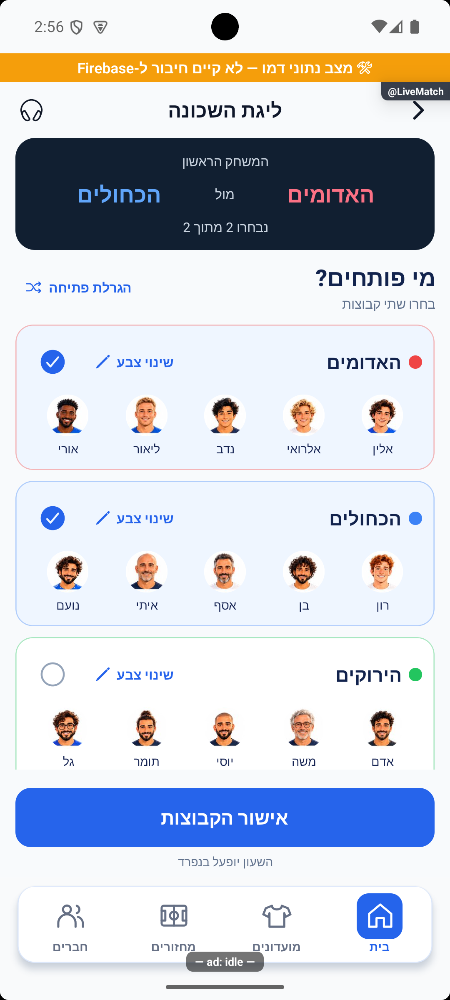

במחזור ההדגמה הקבוע אפשר לבדוק חלוקה חדשה בכל טעינה מחדש: נשמרות הגדרות המחזור והדירוגים, והכוחות והמשחק מתאפסים. [פרטי השמירה המקומית](../entry/legacy-and-hidden.md).

## מסכי המשחק המחודשים — 16.10.2026

לפני המשחק בוחרים שתי קבוצות מתוך ההרכבים הגלויים, או מגרילים פתיחה וסדר המתנה. אפשר לשנות צבעים; בחירה בצבע תפוס מציגה את שני ההרכבים ומבקשת לאשר החלפת צבעים. הבחירה נשמרת במכשיר עבור אותה חלוקת כוחות. אישור ההרכבים אינו מפעיל את השעון.

במשחק רואים לוח מגרש ירוק עם שתי הקבוצות, תוצאה ושעון גם בזמן גלילה. מתחתיו ההרכבים המלאים של המשחקים והממתינים, גם כששלוש קבוצות בחוץ. הכפתורים להזנת גול, זמן, חילוף וסיום נשארים בתחתית. עזרה נמצאת בכותרת ואינה מכסה אותם.

בהזנת גול בוחרים כובש ואז מבשל ישירות מהאווטרים שמתחת למגרש, בלי אישור נוסף. הכובש נשאר גלוי במגרש ובמקומו ברשימה, אך אינו זמין כמבשל. ״ללא בישול״ ו״בישול לא ידוע״ הן בחירות נפרדות. בשער עצמי רואים מי כבש לשער שלו ולאיזו קבוצה מתווסף הגול. כשל בשמירה משאיר את הבחירה לניסיון חוזר של אותו אירוע.

בחילופים הקבוצות מופיעות בשורות עם אווטרים ושמות. בוחרים שני שחקנים, רואים לאן כל אחד עובר ומאשרים. בהרכבים גדולים גוללים לרוחב. השעון ממשיך לפי מצבו הקיים. חילוף זמני או קבוע פועל לפי הגדרת המחזור, גם כשהשחקן כבר משלים; הסיכום מציין זאת לפני האישור. קבוצה חסרה מאפשרת גם העברה למקום פנוי, בתנאי שלא מרוקנים את המקור.

צילום בחירת המבשל שב־[דוח העיצוב מ־16.10](../../changes/2026-10-16-live-game-redesign.md) שייך לחלון הקודם עם השורות; החלון הנוכחי מתואר בסעיף המגרש למעלה.

[צילומים, בדיקות ומגבלות](../../changes/2026-10-16-live-game-redesign.md). המימוש מקומי וטרם הופץ; תצוגה בדמו אינה הוכחת כתיבה למסד אמיתי.

## גישה לכוחות ובחירת הלייב — 16.10.2026

כפתור יצירת הכוחות נשאר זמין למנהל גם אחרי שעברו יותר משעתיים מתחילת המחזור, כל עוד המחזור לא הסתיים ויש מספיק שחקנים. תצוגת הלייב נקראת מחדש כשחוזרים אליה; אם טעינת ההגדרות נכשלה מופיע ניסיון חוזר, במקום לעבור בטעות ללייב רגיל. קבוצות שמורות לבדן אינן מפעילות את הלייב המתקדם: הגדרת המחזור ממשיכה לקבוע, לצד מצב ההשלמות הקיים.

## חלוקה שמורה אחת — 15.10.2026

במחזור יש חלוקת כוחות שמורה אחת. שמירת חלוקה חדשה, בכל שיטה, מחליפה את הקודמת גם בזמן לייב. פתיחת שיטה אחרת לבדה אינה משנה את הכוחות. טיוטה ידנית חלקית נשארת במכשיר ואינה מחליפה חלוקה מלאה. התוצאה והשעון של המשחק הפעיל נשמרים; תוצאות משחקונים שכבר נשמרו אינן נערכות מחדש.

אפשר להחליף שחקנים גם במהלך משחק. כרגע ההרכב בסיום המשחק קובע למי נזקפות ההשתתפות והתוצאה, לצד ההגנה הקיימת לכובשים ולמבשלי שערים. לפי החלטת הבעלים, ההתנהגות הזאת נשארת עד לאפיון פתרון מלא לחילופים; אין הקפאת הרכב בתחילת המשחק.

אחרי סיום משחק התוצאה והכובשים נשארים מוצגים וההסבר שהמשחק הסתיים מופיע רק למטה, ליד כפתור ההמשך. אי אפשר להזין אליו עוד שערים. סגירת חלון השלמת השחקנים אינה מתחילה משחק חדש; חוזרים אליו דרך ״המשך להכנת המשחק הבא״, והבחירה החלקית נשמרת כל עוד נשארים באותו מסך. גם אחרי יציאה וחזרה נטענת התוצאה השמורה, ואז בוחרים שוב את המשלימים. רק לאחר אישור ההרכבים מתחלפות הקבוצות, מספר המשחק מתקדם והתוצאה מתאפסת. השעון אינו מתחיל אוטומטית. זה חל גם על חלון ההשלמות הישן. כשחסרים דירוגי שחקנים, ההשוואה מציינת זאת במפורש.

המנהל מתעד שערים ותוצאות ומנהל מי משחק ומי ממתין. אחרי משחקון הקבוצות מתחלפות לפי הכללים שנבחרו. בסיום הערב מסיימים את המחזור כולו ומקבלים סיכום.

אם שמירת התוצאה נכשלת, המחזור נשאר פעיל וניתן לנסות שוב. משחקון שהתחיל והסתיים ב־0:0 נשמר; משחקון שרק הוכן אינו נספר. ניסיון חוזר לא אמור להוסיף את אותה תוצאה פעמיים, ושני מנהלים שפעלו במקביל מקבלים את ההכרעה שכבר נשמרה.

אם בזמן בחירת הממלאים מנהל אחר כבר שינה את ההרכב או התחיל את המשחק הבא, הבחירה הישנה לא תדרוס אותו. תופיע בקשה לפתוח שוב את בחירת ההרכב לפי המצב המעודכן.

עדכון 10.10.2026: השמירה וחידוש הסיכום נבדקו בקוד מבודד. השינוי המקומי דורש פריסת שרת לפני הפצה; לא הסתיים מחזור אמיתי לצורך הבדיקה ולא תוקנו נתונים היסטוריים.

[להסבר המעמיק ולמפת הקוד](live-advanced.md)

## צילום והיקף ההוכחה

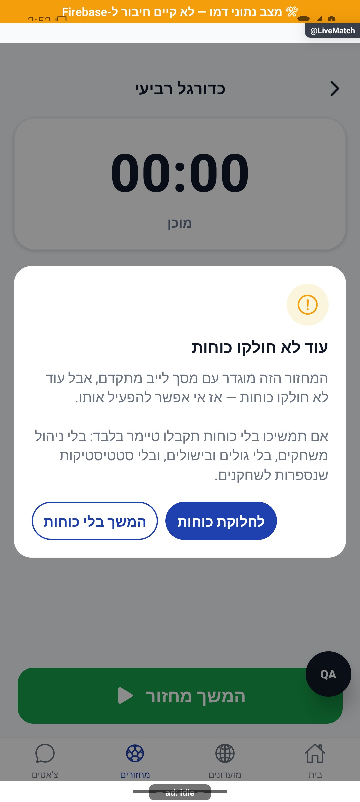

הצילומים מציגים רק את המצבים המתועדים במסמך המעמיק. חלקם נתוני דמו, חלקם הוכחות מתיקון קודם, ובכמה מהם טעינה או הודעת הגנה; הם אינם אישור שכל התהליך או השרת נבדקו.

## עדכון 8.10.2026 — תנועה ותיקוני דיווחים

מצב השעון מגיב לעצירה וחידוש. מעבר למשחק הבא מלווה בתנועה קצרה של פאנל הקבוצות.

## השלמת הנפשות — 8.10.2026

שחקן שנכנס להרכב מקבל כניסה קצרה של תמונתו. פתיחת ההרכב הקיים אינה מפעילה שוב הנפשה לכל השחקנים.

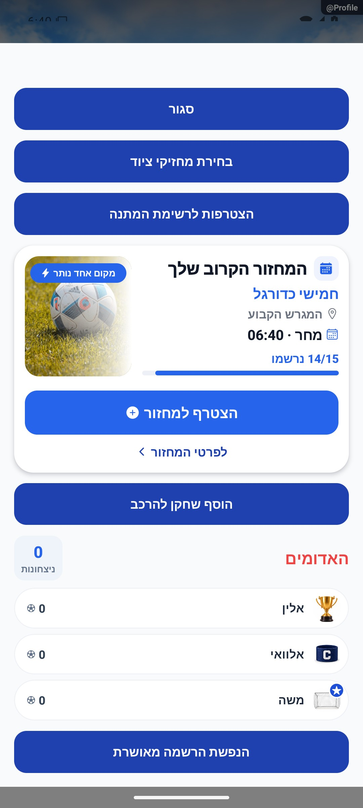

[פרטי האימות והמגבלות](../../changes/2026-10-08-motion-completion.md). מקור: `9ec0dfd` עם שינויים מקומיים; טרם פורסמה גרסה.

## דיוק השיא הקודם — תיקון מקומי מ־13.10.2026

כשסיכום המחזור מציין שיא אישי, השיא הקודם שייך לשחקן שמופיע בסיפור ולא לשחקן אחר. למשל, 10 שערים אחרי שיא קודם של 2 יושוו ל־2. התיקון נבדק בחישוב מבודד; אינו פרוס ואינו משנה סיכומים שכבר נשמרו.

אישור מחיקת שער משתמש כעת בחלונית המעוצבת של האפליקציה, עם ביטול ואישור אדום. המחיקה עדיין דורשת אישור מפורש.

בבחירת המנצחת, סימון הבחירה כבר אינו מכסה את שם הקבוצה. נבדקו המצבים לפני בחירה ואחריה בדמו, בלי לשמור תוצאת משחק.

נבדקו גם בחירת משלימים ותפריט השחקן: אישור זמין רק כשנבחר המספר הנדרש, ומאגר ריק מאפשר לסגור. התפריט נשאר בתוך המסך גם כשהשחקן סמוך לתחתית. הבדיקה בדמו וללא שינוי סגל.

## קבוצות עם השלמות

כשאין מספיק שחקנים למלא את כל הקבוצות, אפשר ליצור קבוצות בסיס מאוזנות עם השלמות לפני המשחקים. למשל, 13 שחקנים מחולקים ל־5, 4 ו־4. האיזון מתחשב גם בשחקנים שיוכלו להשלים, ולא רק בממוצע קבוצת הבסיס.

לפני משחק עם חוסרים המנהל בוחר בעצמו את המשלימים לשני הצדדים, ללא המלצה או בחירה מוקדמת. מי שנבחר לצד אחד לא ניתן לבחירה בצד השני. המשלימים חוזרים לקבוצת הבסיס לפני המשחק הבא, ומוצגת כמות המשחקים וההשלמות שכבר עשו. אישור ההרכבים אינו מפעיל את השעון; המנהל מפעיל אותו בנפרד. אם אין מספיק שחקנים, מופיעה הודעה ונדרש אישור מפורש למשחק בהרכבים חסרים.

הנתונים האישיים נזקפים לפי הצד שבו השחקן שיחק בפועל. לא מתווסף לו מחזור נוסף בגלל השלמה. השינוי מקומי ונבדק ברכיבי דמו ובבדיקות אוטומטיות; טרם הופץ למשתמשים.

כפתור ״החלפה״ מופיע כעת לצד השחקן שנבחר, באותה שורה, כדי לחסוך מקום ולשמור על קשר ברור בין השחקן לפעולה.

כל מסלולי השלמת השחקנים בלייב משתמשים באותו חלון. במחזורים שמשתמשים במסלול המדורג ממשיכים להשלים קבוצה אחת בכל שלב. השלמה זמנית נמשכת עד כניסת קבוצת המקור או יציאת המקבלת; השלמה קבועה נשארת להמשך. השעון אינו מתחיל אוטומטית.

## הרכבים גלויים בבחירת משלימים — 16.10.2026

שתי הקבוצות מוצגות עם שמות ואווטרים בזמן הבחירה, בהתאמה לארבעה עד אחד עשר שחקנים. נוגעים בשורת המועמד כדי לבחור; יש סימון אחד לבחירה, והחוסר כתוב במילים. בבחירה משותפת עוברים לצד החסר הבא אחרי השלמת הראשון. מוני המשחקים נמצאים בפירוט.

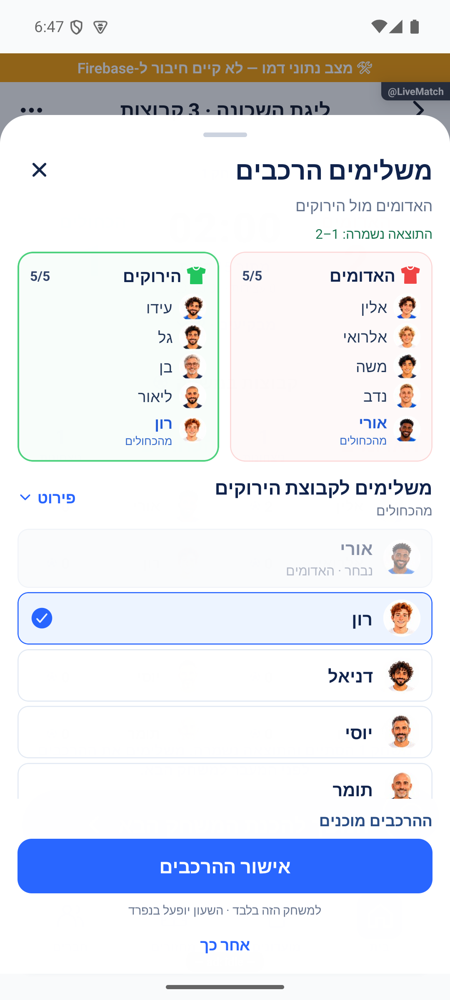

[משמעות ההשלמה ופרטי המימוש](fillers.md) · [ראיות ומגבלות האימות](../../changes/2026-10-16-fill-popup.md).

## סבב פולס — 15.10.2026

הכנת הרכבים אינה מתחילה את המשחק או את השעון. גם במסלול ההשלמות הרגיל מאשרים הרכבים לפני ההתחלה, כך שהאישור לא נכשל בגלל שינוי שהמערכת ביצעה בעצמה.

השינויים בסבב זה מקומיים וטרם הופצו. [דוח הסבב](../../changes/2026-10-15-pulse-sweep.md).

## אימות מרונדר — 16.10.2026

באימולטור דמו הוצג מחזור עם 10 שחקנים ללא קבוצות חמש שעות אחרי תחילה; כפתור צור כוחות פתח את בחירת השיטה. בכשל קריאה חד־פעמי הופיע ניסיון חוזר, ולחיצה עליו פתחה את הלייב המתקדם עם שתי קבוצות ותוצאה 2:1 מתוך נתוני הדמו. לא הוזנו שערים ולא נוצרו כוחות במהלך בדיקה זו. בדיקת טיפוסים נקייה; 330 חבילות ו־3,909 בדיקות עברו. אין בדיקת מכשיר הבעלים או אייפון.

[צילום 1](../screenshots/live-mode-no-teams-fixed-2026-10-16.png) · [צילום 2](../screenshots/live-mode-draft-entry-2026-10-16.png) · [צילום 3](../screenshots/live-mode-error-2026-10-16.png) · [צילום 4](../screenshots/live-mode-advanced-after-retry-2026-10-16.png)

## מקום לשמות השחקנים במסך צר — 17.10.2026

במסך צר או בטקסט מוגדל, מונה הגולים עובר לשורה קטנה מתחת לשם השחקן. כך השם מקבל את כל הרוחב שנותר ליד התמונה, ועד שתי שורות במקום להידחק בין התמונה למונה. במסך רגיל נשמרת הפריסה הקיימת. אפשר להקיש על כל השורה כדי לפתוח את תפריט השחקן; התפריט ממשיך להופיע ליד התמונה, והשם המלא זמין לנגישות.

התיקון נבדק ברכיב עם 4, 7 ו־11 שחקנים, שמות פרטיים זהים וגבולות רוחב והגדלת טקסט. בדיקת מכשיר וצילום חוזר של הכיווניות מרוכזים אצל המוביל; צילום הבאג שלפני התיקון אינו הוכחת העיצוב החדש. [פרטי הבדיקות והגבולות](live-advanced.md#שמות-שחקנים-ומוני-גולים-ברשימה-צרה--17102026).

## המתנה להכנת המשחק הבא — 17.10.2026

כשהמשחק הסתיים והתוצאה נשמרה, זמן העצירות נשאר קבוע גם אם הכנת ההרכבים מתעכבת. עד שהזמן השמור נטען מוצגת הודעת טעינה. ביומן, העצירה האחרונה אינה מתוארת עוד כמתרחשת עכשיו. כפתור ״המשך להכנת המשחק הבא״ מתאים את הכיתוב לעד שתי שורות במסך צר ובטקסט מוגדל, והכיתוב המלא נשאר נגיש.

נבדק בקוד וברכיב מבודד. התקלות נצפו במכשיר לפני התיקון; צילום חוזר של התוצאה המעודכנת מרוכז אצל המוביל. [חישוב העצירות](live-timer.md#הקפאת-עצירות-במשחק-שנשמר--17102026).

## חזרה לבחירת ההכרעה — 17.10.2026

בתחתית חלון הפנדלים, בצד ימין, מופיע ״חזור לבחירה״. הוא מחזיר לבחירה בין פנדלים לבין הכרעה אחרת, ושומר את הבעיטות שכבר נרשמו. בחירה חוזרת בפנדלים ממשיכה מאותה נקודה. גם ביטול בחירת מנצחת או חזרה למשחק שומרים את הסדרה.

רק אישור סופי של הכרעה אחרת מוחק את הבעיטות. מוצג הסבר לפני האישור, והבעיטות שנמחקו אינן נכללות בסיכום או בסטטיסטיקות הפנדלים. בזמן שמירה ממתינה או כשל שטרם טופל, החזרה מושבתת כדי שלא לאבד ניסיון שמירה.

נבדק באימולטור דמו: ארבע בעיטות נשמרו בחזרה, בהמשך ובביטול; אישור מנצחת ידני שמר משחק 2:2 ללא פנדלים. בדיקת הטיפוסים ו־4,368 בדיקות עברו. כתיבה אמיתית בסביבת הייצור לא נבדקה בתיקון זה.

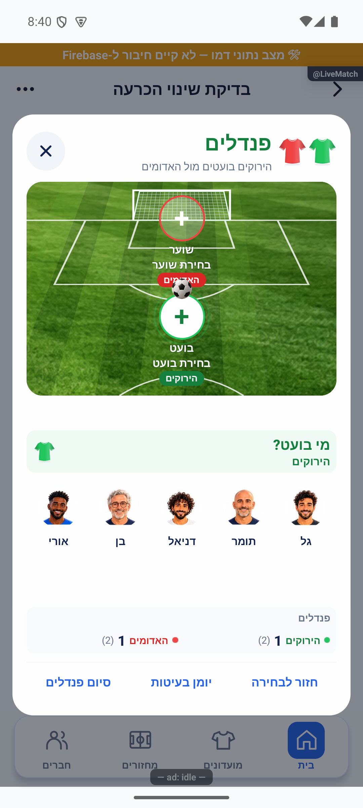

## חלון הכרעה רציף — 17.10.2026

בחירת שיטת ההכרעה והפנדלים מוצגים כעת בתוך אותה חלונית: חזרה ובחירה חוזרת מחליפות תוכן בלי סגירה ופתיחה. לחיצה ארוכה בשורת השחקנים הנוספים מציגה את ההרכב עד לשחרור. [מצבים, קוד, בדיקות וראיות](penalties.md#החזקה-להרכב-וחלון-משותף-לבחירת-הכרעה--17102026).

## הפצה פנימית — 17.10.2026

שינויי הלקוח האחרונים המתועדים כאן נכללו בבינארי הפנימי `1.1.53 / 286` באנדרואיד. המסלול אומת בגוגל; הייצור נשאר בגרסה הקודמת. זה אינו אימות חדש של תרחיש ייצור או של מכשיר אפל. [מקור הבינארי, פריסת השרת, בדיקות ומגבלות](../../changes/2026-10-17-internal-1.1.53.md).

## דיווחים חדשים בפולס — 17.10.2026

הקבוצה המנצחת שנשארת במגרש שומרת על אותו צד גם במשחק הבא. רק המפסידים מוחלפים בקבוצה העולה. חלוניות ״הלך הביתה״ ו״החזר למחזור״ משתמשות בעיצוב הכדורגל המשותף. אלה תיקוני לקוח מקומיים שדורשים גרסה חדשה.

[דוח התיקון, הצילומים וגבולות האימות](../../changes/2026-10-17-new-pulse-live-and-chat.md).
