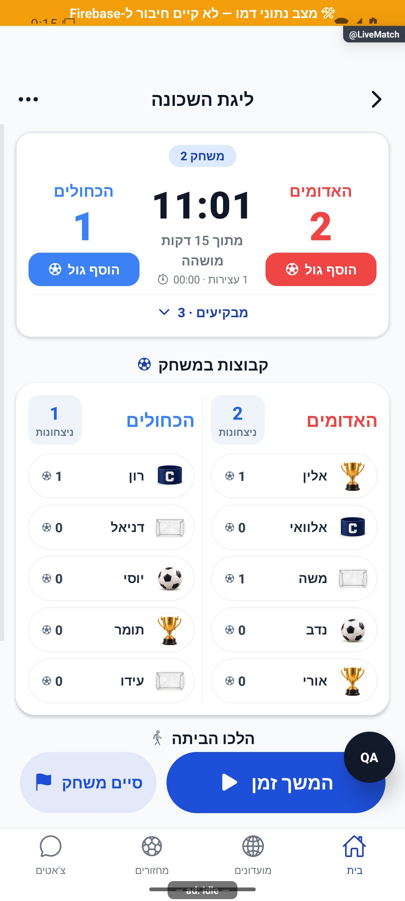

# לייב רגיל וטיימר מסונכרן

## הרחבת אבחון דיווחים, 27.10.2026

נוספה מעטפת אבחון מקומית עם מצב בזמן הכשל, שלבים בעלי מזהה ותזמון, מצב רשת ובנייה ומופעים נפרדים לשגיאה. נקודת הכניסה לתעבורת השרת עוברת כעת דרך העטיפה המשותפת; תשובות, חריגות, אפשרויות קריאה ומדיניות הפיצר נשמרות. אין כאן שינוי בהרשאות או בחישובי המוצר. הבדיקות המלאות ומגבלות האימות מתועדות בדוח המקושר; אין טענה לאימות מכשיר או להפצה. [היקף, ראיות ומגבלות](../../changes/2026-10-27-diagnostic-context.md).

באימות הסופי עברו כל 6,231 הבדיקות ב-555 חבילות, ובדיקות הטיפוסים של הלקוח, השרת והפולס נקיות. צילום הדפדפן והידור מקורות האנדרואיד הם בדיקות מקומיות; אין הוכחת מכשיר, הידור אייפון או מסירה חיה של הבנייה החדשה. רישום יומן השחרור נחשב מאומת רק לפי קבלת הקריאה החוזרת בדוח השינוי.

## טיפול מלא בפריטי הפולס הפתוחים, 27.10.2026

בבדיקה ממוקדת נמצא שחיווי הדקה האחרונה וההארכה כבר קיים בשני מסכי הלייב. הופעלו החישובים וגוף מנגנון הרטט מתוך המקור ונבדקו גם השהיה, משך לא מוגדר ומניעת התראה כפולה באותו רגע. לא נוסף צליל ולא אומתו רטט פיזי או תצוגת מכשיר חדשה. זהו אימות מקומי של מימוש קיים, ללא שינוי מסך. [ממצאים, בדיקות ומסירה](../../changes/2026-10-27-pulse-completion.md).

## טיפול בתקלות הפולס, 26.10.2026

`InPlayPenaltyModal.timerWriting` ננעל לפני עדכון המצב וחוסם גם שמירת בעיטה בזמן כתיבת השעון. ניסיון מוצלח מנקה את הודעת הכשל. `AdvancedLiveMatchScreen` מחזיר אישור אמת רק אחרי הצלחת `timerFeedback.run`; המתאם `onPenaltyTimer` דוחה פעולה שלא אושרה. אין שינוי בזמן האירוע, בממיר או בחישובי התוצאה. בדיקות `tests/logic/inPlayPenaltyModal.test.tsx` כוללות לחיצה כפולה באותו רינדור, שמירה בזמן פעולה, דחייה, ניסיון חוזר וקליטת זמן לאחר חידוש.

השינוי מקומי וטרם הופץ. [בדיקות, מסירה ומגבלות](../../changes/2026-10-26-pulse-fixes.md).

מקורות שנבדקו בסבב: `src/screens/AdvancedLiveMatchScreen.tsx`.

## זמן אירועים מלא אחרי משך המשחק - 25.10.2026

גולים ופנדלים במהלך משחק נשמרים כעת לפי הזמן המלא של המשחק, גם אחרי משך המשחק שנקבע. לדוגמה, במשחק של שמונה דקות שהגיע לעשר דקות ושלושים שניות, גול נשמר בדקה האחת עשרה ובחלון הפנדל מופיע הזמן עשר דקות ושלושים שניות. התיקון מקומי וטרם הופץ. [בדיקות, צילום ומגבלות](../../changes/2026-10-25-overtime-event-time.md).

ב-`src/screens/AdvancedLiveMatchScreen.tsx` הפרמטר `minute` של `LiveScoreboardCard` מחושב כעת באמצעות `Math.floor(timerMs / 60000) + 1`, והפרמטר `clockMs` מקבל `timerMs` ללא תקרה. רק `timerText` ותצוגת החריגה ממשיכים להשתמש בתקרת המשך. לדוגמה, `630000` מילישניות עם משך `480000` נותנות דקה `11` וחותמת פנדל `630000`, לצד שעון ראשי `08:00` וחריגה `02:30`. חלון הפנדל לוכד את הזמן בעת השמירה, מעגל לשנייה שלמה ושומר זמן קודם בעריכה ובניסיון חוזר; מסלול השמירה, הממיר וההיסטוריה לא שונו. גם גול רגיל ושער עצמי מקבלים את הדקה המלאה מהפרמטר המשותף. אין שינוי בפקדי הזמן, בהרשאות, במונים, ברוטציה או בניווט, ואירועי עבר אינם מתוקנים אוטומטית. בדיקות וגבולות התצוגה מפורטים בדוח המקושר.

## שעון מדויק וכיתוב פנדל - 25.10.2026

בחלון פנדל מוצג השעון המדויק של המשחק, למשל 04:32, במקום שדה דקה. הזמן מתקדם עם השעון ונשמר בעת האישור; עריכה שומרת על זמן האירוע. ביומן הבקעה מוצגת בשם השחקן ואחריו סוגריים, למשל אלין (פנדל). `InPlayPenalty.clockMs` הוא שדה אופציונלי שעובר בממיר המסד, בחותמת הלקוח והשרת ובהיסטוריה. זמן חדש נלכד ברזולוציית התצוגה של שניות; בכשל נשמר גם זמן הניסיון המקורי. השדה `minute` נשאר לתאימות, אך אינו שדה קלט בחלון החדש. אירועים ישנים אינם מקבלים שניות מומצאות. אין שינוי במוני פנדלים או שערים. השינוי מקומי וטרם הופץ. [פרטים וראיות](../../changes/2026-10-25-in-play-penalties.md#שעון-מדויק-וכיתוב-אירוע).

## פנדל במהלך משחק חי - 25.10.2026

החלון מקבל את מצב השעון ואת מטפל ההשהיה או ההמשך הקיים. אין עצירה או חידוש אוטומטיים בפתיחה ובסגירה, ומשך הבחירה אינו משנה את דקת האירוע שנלכדה. `timerMutationFields` מזהה גם אירועי פנדל בהגנת האיפוס ומנקה אותם עם השערים. לא שונה מנגנון `useTimerFeedback` במסגרת המשימה.

השינוי מקומי. נדרשת פריסת שרת לפני הפצת לקוח שמשתמש באפשרות; לא בוצעו פריסה או שינוי הרשאות. [חוזה הנתונים, התהליך, הבדיקות ומגבלות ההפצה](../../changes/2026-10-25-in-play-penalties.md).

## חזרה מארון התארים לכרטיס המקורי — 24.10.2026

לערימת הניווט המשותפת נוסף רישום מקומי של ארון התארים, כדי שחזרה מכרטיס שחקן לא תחליף לשונית. אין שינוי מכוון בהתנהגות העצמאית המתוארת כאן, ואין בדיקת ממשק חדשה שלה. התיקון מקומי ולא הופץ. [מסלול הניווט, בדיקות, צילומים ומגבלות](../../changes/2026-10-24-cabinet-back.md).

## תיעוד כשלים — 20.10.2026

נוספו תצפיות דיווח בנקודות הכשל של המקורות המשויכים לפיצ׳ר, במסגרת הרחבה רוחבית. נשמרו ערכי החזרה, הזריקות ותנאי הפעולה הקיימים; נוסף מקור קוד והקשר לדיווח. כיסוי תחבירי אינו הוכחת הרצה של כל מצב. השינוי מקומי וטרם הופץ; בדיקות המסירה, מגבלות מניעת הכפילויות והמסלולים שטרם חוברו מתועדים בדוח המשותף.

[דוח דיווח השגיאות והראיות](../../changes/2026-10-20-error-reporting-audit.md).

## עסקאות בפעולות השעון המשותף — 17.10.2026

שירותי `startTimer`, `pauseTimer` ו־`resetTimer` המשותפים למסך הרגיל ולמסך המתקדם משתמשים כעת ב־`mutateSharedTimer`: קריאה וחישוב הזמן נעשים בתוך אותה עסקה שכותבת, והחישוב חוזר מול נתון עדכני במקרה של התנגשות. `getDoc` ולאחריו כתיבה ישירה אינם מקור עוד לפעולות השעון. אין כתיבה בכל פעימת תצוגה; `useSyncedTimer` ממשיך לחשב זמן מחותמת התחלה ומשך מצטבר, באותו בסיס שעון שרת.

שלוש הקריאות במסך הרגיל נשמרו עם אותם פרמטרים ותפקידים. הפרמטר האופציונלי החדש של זהות משחק שייך למסך הרוטציה; הוא אינו חובה למסך השעון הפשוט. גם ללא פרמטר חדש נשמרת זהות הקריאה הראשונה בין ניסיונות העסקה, באמצעות מזהה רוטציה או `roundNumber` ישן אם קיים. שעון רץ אינו מתחיל שוב, ושעון עצור אינו מוסיף עצירה. איפוס חוזר אינו משכפל מקטע פעילות שכבר נסגר; מוני שערים קודמים נשמרים באמצעות `tallyWithout`. אין שינוי בשדות המסד, בממיר או בכללים.

במסגרת `dataLiveTimerTransactions.test.ts` הורצו השירותים האמיתיים במנוע עסקאות מבודד, כולל מסלול רגיל ללא רוטציה, התחלה ועצירה תקינות, פעולות מקבילות, כשל ללא חיבור וניסיון חוזר. 24 בדיקות שירות חדשות, שתי בדיקות המארח המתקדם וחמש חבילות רגרסיה עברו — 115 בדיקות בשש חבילות. זו בדיקת קוד; מסך השעון הרגיל לא הורץ מחדש במסגרת תיקון זה, ולא נבדקו בפועל שני מכשירים בו־זמנית או שעון לביש. שגיאות ושמירה ללא חיבור ממשיכות לעבור דרך מטפלי המסך הקיימים; עסקה אינה שומרת כתיבה מנותקת למועד מאוחר. חתימת השירות נשארה תואמת, אך לקוח מותקן ישן אינו מקבל את תיקון המרוץ ללא עדכון.

[השחזור, החוזה והרוטציה](live-advanced.md#פעולות-שעון-עסקתיות-ותחומות-למשחק--17102026). אין פריסה או כתיבות בדיקה בייצור במסגרת סוכן התיקון.

## תפריט ניהול ללא תלות בשעון — 16.10.2026

ב־`PlainLiveMatchScreen` הוחלף התנאי `isAdmin && timerStarted` בתנאי הרשאת מנהל בלבד, ובמסך המתקדם הוסר תנאי שעון או רוטציה המקביל. כתוצאה מכך סיום המחזור ועזרה זמינים מראש; לא השתנו פקדי התחלה, השהיה, המשך ואיפוס או בדיקת הצופה. נתוני עצירות נחשפים עדיין רק כשיש פעילות שעון, כי הם מידע על השעון עצמו.

תפריט הלייב הרגיל נפתח באימולטור בתרחיש דמו ללא הרכבים, ללא מצב חי וללא פעילות שעון. סיום המחזור דרך האישור נבדק בדמו בלבד. התמיכה בפעולות משחק ללא שעון מפורטת ב־[לייב מתקדם](live-advanced.md), וכניסה לפנדלים ב־[פנדלים](penalties.md). אין שדות חדשים או שינוי הרשאות. [צילום, בדיקות ומגבלות](../../changes/2026-10-16-optional-match-clock.md).

## התחלה ללא דריסת גול מוקדם — 16.10.2026

שירות `markGameStarted` המשותף קורא מחדש את המחזור בעסקה לפני יצירת מצב חי ראשון. שער שנרשם במקביל לפי האפיון החדש של הלייב המתקדם נשמר, והפעולה משנה רק שדות התחלה כאשר מצב כבר קיים. בדיקת סגירת העונה והפעלת `startTimer` בנפרד נשמרו. אין שינוי במסך הלייב הרגיל, בשדות הממיר או בהרשאות. תרחיש תחרות בשירות נבדק בקלט/פלט מבודד; הלייב המתקדם הורץ בדמו. מסך הלייב הרגיל עצמו לא נפתח מחדש בסבב הזה. [המימוש, האימות והגבולות](../../changes/2026-10-16-waiting-shirt-preclock-goals.md).

## גישה לכוחות ובחירת הלייב — 16.10.2026

ב־MatchDetailsScreen הוסרה מגבלת msToKickoff>-2h מתנאי showCreateTeamsBanner. שאר התנאים נשמרו: מנהל, לפחות שני אנשים פעילים, אין חלוקה/טיוטה מקומית, לא סופי ועד 24 שעות לפני ההתחלה. ב־LiveMatchScreen נבחר המצב ב־useFocusEffect/useCallback לפי advancedMode או completionMode=balanced. selection קשור ל־gameId; תשובה לאחר blur נזרקת. כשל/מסמך חסר מוביל למסך הסבר עם retry וחזרה, ללא fallback שקרי ל־plain. במיקוד חוזר לא מאפסים בחירה תקפה ולכן רכיב חי באותו מצב אינו מפורק ולא מאבד משלימים מקומיים. אין שינוי באלגוריתם חלוקה, בנוסחאות, במכנים, בסגל או בסמכויות כתיבה. קישורי דמו חדשים במפעיל הפיתוח מכסים כשל חד־פעמי ומחזור ללא קבוצות חמש שעות אחרי תחילה; הם לא נרשמים במסד. 16 בדיקות liveModeRouting מריצות את callback הטעינה ותנאי התצוגה האמיתיים. [ממצאים והפעלת ההגדרה שאושרה בשכחת שושי](../../changes/2026-10-16-live-mode-routing.md).

עודכן: 7.10.2026. מקור הקוד: `8e8fde5`, גרסה `1.1.35`. מסמך זה מתאר את הקוד; מצב חנות ופריסת שרת דורשים ראיה נפרדת.

## כניסה ותפקידים

MatchDetails → לייב → LiveMatch {gameId}

פעולות זמן וסיום למנהל; תצוגה לפי הרשאות. advancedMode מפנה למימוש המתקדם.

## רכיבים ומצבים

| רכיב / מצב | התנהגות וחוזה |
|---|---|
| זמן | useSyncedTimer: חותמת התחלה ומשך מצטבר; אין כתיבה בכל שנייה |
| פעולות | התחלה, עצירה, המשך, איפוס ואישור; עצירת משחק אינה סיום מחזור |
| עצירות | רשימת stoppages והצגת זמן; סנכרון גם עם WearOS |
| תפריט | משחקים → MatchRounds live:true; איפוס וסיום עם אישור |
| סיום | endEvening; תיעוד והעברת ציוד לפי הקשר; זהות/מנהל נבדקים בשירות |

## מסלול נתונים ומקומות שינוי

[`src/screens/LiveMatchScreen.tsx`](../../../src/screens/LiveMatchScreen.tsx)

gameService.getGameById/subscribeLiveMatch/markGameStarted/startTimer/pauseTimer/resetTimer/endEvening. eveningPlayed קובע אם המחזור התקיים; טיימר כשלעצמו אינו תנאי חדש במסך.

ממיר המחזור: [`src/firebase/firestore.ts`](../../../src/firebase/firestore.ts), `gameDocConverter.fromFirestore`; סוגים: [`src/types`](../../../src/types). שינוי שדה דורש מעקב כתיבה → ממיר → שירות/חנות → רכיב. ניווט: [`GameStack.tsx`](../../../src/navigation/GameStack.tsx), ובמסכים משותפים גם המחסניות שמארחות אותם.

## בדיקות וראיות

בדיקות startEvening, טיימר, ערב וניווט MatchRounds; השהיה/חזרה/מכשיר שני הן השלמות בטוחות רק בסביבת בדיקה.

צילומי המיפוי מהאמולטור נעשו במצב נתוני דמו, המסומן בפס כתום. הם מוכיחים את הרכיב והמצב המוצגים בלבד, ולא ממירי Firebase, נתוני ייצור או כתיבה. צילומי תיקונים קודמים מסומנים בנפרד. שגיאת מזהה, מצב טעינה או שער הגנה אינם הוכחת הפעולה המלאה.

לא נאסף צילום עדכני תקף למסלול העצמאי הזה; התיאור נשען על הקוד.

## גבולות והערות תחזוקה

אין קבוצות ותוצאה במימוש רגיל. צילום שלא מפעיל תהליך אינו הוכחת כתיבה או סנכרון.

לפני שינוי פתח את הקוד המקושר ואת [כללי הפרויקט](../../../AGENTS.md). לאחר שינוי עדכן במסמך זה את התאריך, נקודת הקוד, המצבים שהתעדכנו, הבדיקות והצילום. אין לטעון שכל מצב/תפקיד נבדק רק משום שקיים צילום אחד.

## פירוט טכני ממוקד: זרימה, חישוב ונקודות שינוי

[הסבר פשוט למשתמש](live-timer.simple.md)

העמקה: 07.10.2026, מול קוד המקור שב־`8e8fde5`. בעת הכתיבה HEAD הוא `50d508f`; בדיקת ההפרש בין הנקודות ב־`src` וב־`functions` לא מצאה שינוי קוד. הסעיפים וההסתייגויות הקיימים נשמרו. זו קריאת קוד ותיעוד, בלי הרצת תרחישי כתיבה חדשים.

[useSyncedTimer](../../../src/services/useSyncedTimer.ts) משחזר זמן משלושה שדות: `timerRunning`, `timerLastStartedAt`, `timerAccumulatedMs`. בריצה: `displayMs=accumulated+max(0,serverNow()-lastStartedAt)`; בעצירה מוצג המצטבר בלבד. הווי מצייר כל 250 מילישניות ומבקש תיקון שעון בהצגה ובכל שתי דקות; השירות מבטל כפילות מדידות.

לדוגמה 120000 מילישניות שנצברו ו־30000 מאז עוגן ההמשך נותנות 150000, כלומר 2:30. עצירה מקפלת את 30000 למצטבר ומאפסת את עוגן הריצה; המתנה של דקה במצב עצור אינה מוסיפה זמן. חזרה מרקע מחשבת לפי העוגן, לא לפי כמה טיקים קיבלה האפליקציה.

`startTimer/pauseTimer/resetTimer` ב־`gameService` כותבים נתיבי שדות, לא את כל `liveMatch`; אירועי טיימר ומקטעי פעילות נשמרים בנפרד. התחלה שכבר רצה ועצירה שכבר עצורה הם פעולות ריקות לפי קריאת המצב; זו אינה טרנזקציה מלאה לשני מנהלים שפועלים בדיוק יחד. מחזור הסתיים/בוטל חסום בפעולות זמן.

נקודות שינוי: נוסחה בווי, בסיס זמן ב־`serverClock`, כתיבה בשירות, ותצוגת זמן במסך/שעון. בדוק מכשירים בעלי סטיית שעון, שגיאה שנזרקת, פעולה כפולה ורקע. [שמירת המסך](../../../src/hooks/useScreenAwake.ts) מחוברת בשורש האפליקציה ושומרת חזית, לא רק מסך הטיימר.

## עדכון 8.10.2026 — תנועה ותיקוני דיווחים

`ChangeMotion` מחובר ל־`timerRunning` סביב תג המצב, למשך 190 אלפיות שנייה. אין טריגר בכל שנייה; `useSyncedTimer` ושלושת שדות השעון נשארו ללא שינוי.

**ראיה ומגבלות:** הצילום מראה את המסלול המתקדם, שמארח את רכיב השעון המשותף מבחינת משמעות המצב; המסלול הפשוט עצמו לא הורץ בסבב זה.

בדיקת הטיפוסים ו־183 חבילות הבדיקות עברו, 2,752 בדיקות. מצב המקור: `9ec0dfd` עם שינויים מקומיים; אין גרסה חדשה שפורסמה. [יומן השינוי וההקלטות](../../changes/2026-10-08-motion-and-pulse.md).

## אימות מרונדר — 16.10.2026

באימולטור דמו הוצג מחזור עם 10 שחקנים ללא קבוצות חמש שעות אחרי תחילה; כפתור צור כוחות פתח את בחירת השיטה. בכשל קריאה חד־פעמי הופיע ניסיון חוזר, ולחיצה עליו פתחה את הלייב המתקדם עם שתי קבוצות ותוצאה 2:1 מתוך נתוני הדמו. לא הוזנו שערים ולא נוצרו כוחות במהלך בדיקה זו. בדיקת טיפוסים נקייה; 330 חבילות ו־3,909 בדיקות עברו. אין בדיקת מכשיר הבעלים או אייפון.

[צילום 1](../screenshots/live-mode-no-teams-fixed-2026-10-16.png) · [צילום 2](../screenshots/live-mode-draft-entry-2026-10-16.png) · [צילום 3](../screenshots/live-mode-error-2026-10-16.png) · [צילום 4](../screenshots/live-mode-advanced-after-retry-2026-10-16.png)

## עזרה ללא כיסוי פקדים — 16.10.2026

בלייב הרגיל כמו במתקדם, כניסת העזרה נמצאת בכותרת או בתפריט ״עוד״, במקום בועה שמכסה פקדים. אין שינוי בחישוב השעון או בשירותי הזמן. [אימות ומגבלות](../../changes/2026-10-16-live-game-redesign.md).

## הקפאת עצירות במשחק שנשמר — 17.10.2026

בבדיקת מחזור אחד עשר בייצור, התוצאה והשעון כבר נשמרו אך סך העצירות המשיך לגדול בהמתנה להרכב הבא. `AdvancedLiveMatchScreen` חישב `buildStoppages(live.timerEvents, nowTick)` גם כאשר `pendingSavedRound=true`. הפעלת הפונקציה האמיתית בבידוד על המקור השמור אישרה 120,401 אלפיות שנייה בזמן הזקיפה, 720,401 כעבור עשר דקות ו־3,720,401 כעבור שעה, ללא כתיבת נתון נוסף.

`capturedAt` בצילום המקומי הוא הקשר בלבד ואינו מאשר סיום. רק `history.at` חיובי וסופי שנקרא עבור אותו `gameId` ומפתח משחק נשמר כ־`endedAt`. במצב תוצאה שמורה מחליפים את נקודת הזמן לחישוב העצירה הפתוחה ב־`endedAt`; במצב פעיל משתמשים ב־`nowTick`. מקור האירועים נשאר `live.timerEvents`, כי ההאזנה עשויה לקבל את ההשהיה האחרונה לאחר הצילום המקומי. הנוסחה נשארת סכום ההפסקות הסגורות ועוד ההפרש הלא שלילי מההשהיה האחרונה לנקודת הזמן. מספר העצירות ושעון המשחק אינם משתנים.

עד שנקודת הסיום נטענת, הסכום הוא `null` ומוצגת טעינה, ללא זמן חתום מומצא או שורת עצירה נמשכת. כשל מציג הודעה וניסיון נוסף ביומן, דרך מסלול קריאת התוצאה הקיים. בזמן המתנה התווית היא ״העצירה האחרונה״, ובמשחק פעיל נשארת ״עצור כעת״. תגובה לאחר ניקוי ההשפעה אינה קובעת חותמת למשחק אחר. אין שדה מסד חדש, שינוי ב־`useSyncedTimer`, בשירותי הזמן, בשרת או בהרשאות.

`tests/logic/savedRoundStoppages.test.ts` מפעיל את פונקציות המסך וההשפעה האמיתיות: הקפאה לעשר דקות, השהיה פעילה, כניסה קרה, צילום מוקדם לעומת השהיה מאוחרת, כשל והתאוששות, מזהה מחזור/משחק אחר, חותמת חסרה או לא תקינה, ניקוי לפני תשובה מאוחרת והמשך למשחק הבא. בדיקות הפריסה המקומיות בוחנות גם את רכיב כפתור ההמשך המבודד ב־320 עם הגדלת טקסט ובמסך רגיל. אלה בדיקות קוד וגבולות רכיב, ללא מנוע פריסה מקורי. צילום התקלה הישן אינו הוכחת התיקון; צילום מעודכן מרוכז אצל המוביל.

## תלות בעדכון העונות — 19.10.2026

נבדק ההפרש בקבצים המשותפים הרשומים כאן: `src/firebase/firestore.ts`. השינוי ממוקד במדיניות העונות, קריאת מצבן, שיוך מחזור ופקודות ניהולן; אין שינוי מכוון בחוזה העצמאי המתואר במסמך זה. אין להסיק מכך שהמסך הזה הורץ מחדש.

[מצב המימוש, הבדיקות ומגבלות האימות של העונות](../clubs/seasons.md). מקומי בלבד; לא בוצעה פריסה במסגרת המשימה.

## תלות במידע על סגירת עונה — 23.10.2026

בדיקת ההבדל ב־`src/firebase/firestore.ts` וב־`src/types/index.ts` מראה שהשינוי מוגבל לקריאת `seasons.closureStatus` בחוזה `GroupSeasons`. יתר ממירי הנתונים והמסלולים המתועדים כאן לא שונו במשימה זו. אימות הריצה החדש מתייחס להתאוששות ולכרטיס העונה, ולא להרצה חדשה של כל מצבי המסך הזה. [המסלול, הבדיקות והמגבלות](../../changes/2026-10-23-season-automatic-recovery.md).

## תלות בשמירת צבעי המחזור — 24.10.2026

במסגרת בחירת צבעים לפני שיבוץ עודכנו מקורות משותפים הרשומים לפיצ׳ר: `src/firebase/firestore.ts`, `src/types/index.ts`. השינוי מוסיף מפת צבעים למחזור, קריאה וכתיבה שלה ושימורה במסלולי הכוחות וההכנה. אין כאן פעולת ממשק חדשה במסך זה. זו בדיקת השפעת התוספת הממוקדת, ולא חקירה או אימות חזותי מחודש של הפיצ׳ר. כל 480 חבילות הבדיקה ו־5,343 הבדיקות עברו; טיפוסי הלקוח והשרת נקיים. השינוי מקומי וטרם הופץ. [מסלול הנתונים, ראיות ומגבלות](../rounds/draft-setup.md#צבעים-לפני-שיבוץ-ובכל-שיטת-חלוקה--24102026).

## טיפול בפולס — 24.10.2026

השינוי ב־`onTimerReset` הוא אפשרויות התצוגה של `appAlert` בלבד. [לפני](../screenshots/pulse-current-reset-before-2026-10-24.png) ו[אחרי](../screenshots/pulse-current-reset-after-2026-10-24.png) במארח החלון בדמו; האיפוס לא הופעל בסבב צילום זה. בדיקת החיבור ב־`pulseCurrentDialogs.test.tsx` עברה. אין שינוי בשעון, בתוצאה או בנתוני המשחק מצד שינוי חזותי זה.

[פירוט התיקונים, הבדיקות והמגבלות](../../changes/2026-10-24-pulse-current.md). התיקונים מקומיים וטרם הופצו.

## מניעת טעינה אחרי עדכון פרופיל בלבד - 25.10.2026

באפקט הטעינה של `src/screens/LiveMatchScreen.tsx` התלות בחשבון הוגבלה למזהה ולמצב אורח. שינוי בשם, תמונה או מונים של אותו חשבון אינו מפעיל שוב את טעינת המחזור או המועדון. החלפת חשבון ושינוי מצב אורח כן מרעננים. במסכי הלייב ובהוספת חברים נשמרה גם התלות ברשימת המועדונים, כך ששינוי חברות או ניהול ממשיך להפעיל בדיקת גישה. אין שינוי בשערי הרשאות, במנויים, באישור כתיבות או במטמון. `tests/logic/profileIdentityLoading.test.ts` מפעיל את רישומי האפקטים ופונקציות הטעינה מהמקור עם קריאות ממתינות. ארבע בדיקות מאמתות קריאה אחת גם אחרי שינוי שם, תמונה ומונים, ורענון אחרי שינוי חשבון, מצב אורח, מועדון או מחזור רלוונטיים. זו בדיקת קוד, ללא מדידת זמן במכשיר או שינוי עיצוב. [בדיקות ומגבלות](../../changes/2026-10-24-loading-performance.md).

## תגובה מיידית לכפתורי השעון - 25.10.2026

`src/services/useTimerFeedback.ts` מוסיף השלכה מקומית לשדות השעון בלבד בשני מסכי הלייב. התחלה מציבה עוגן זמני לפי `serverNow`; השהיה מקבעת זמנית את המצטבר ועוד ההפרש החיובי מהעוגן. נעילת הפעלה סינכרונית חוסמת שתי לחיצות לפני רינדור. מצב ההמתנה מוצג בכיתוב מעדכן שעון, ובמסך המתקדם נכלל גם ב-`roundBusy` כדי לחסום פעולות משחק מתנגשות. התוצאה המאושרת מ-`startTimer` או `pauseTimer` מוחזרת מהעסקה הקיימת, כולל פעולה חוזרת ללא כתיבה; אין קריאת מסד נוספת. עוגני הכתיבה, אירועי העצירה והמרווחים הפעילים נשארו לפי זמן העסקה. לכן זו תגובת תצוגה מיידית ולא שינוי פרוטוקול זמן משותף לשעת הלחיצה; אחרי האישור תיתכן התאמה. עדכון שעון חדש מהמנוי גובר על ההשלכה. תוצאה מאושרת נשמרת לתצוגה עד הגעת המנוי, וכשל מחזיר למצב המאושר הקודם. שינוי חשבון, מחזור, משחק או אובדן מיקוד מבטל פרסום מאוחר. שערי התחלה, בדיקת מזהה משחק בעסקה, הגנה ממשחק שכבר נשמר והמתנת ההשהיה לפני סיום משחק נשמרו. רק כאשר `game.status` פעיל ו-`live.startedAt` מספר חיובי סופי, התחלת משחק נוסף מדלגת על `markGameStarted`. הודעות על מנהל אחר משתמשות במצב המקורי כדי לא לייחס לו לחיצה מקומית זמנית. התוצאה אינה מוזנת לשמירת ציונים, שערים או סיכומים; אלה ממשיכים להשתמש בנתונים המקוריים. [בדיקות, ראיות ומגבלות](../../changes/2026-10-25-live-timer-response.md). התיקון מקומי וטרם הופץ.

## עריכת קבוצות מהלייב - 25.10.2026

בתפריטי `LiveMatchScreen` ו-`AdvancedLiveMatchScreen` נוסף `liveDraftTeams` למנהל בלבד. הכניסה היא אל `DraftSetup` עם `gameId` ו-`returnRouteKey=route.key`, בלי לפתוח מראש שיטת חלוקה. הרישום הקיים של שני מסכי החלוקה נשמר בשלוש המחסניות `GameStack`, `CommunitiesStack`, `ProfileStack`; הטיפוסים כוללים את פרמטר החזרה.

`DraftSetupScreen` מעביר את המפתח ל-`DraftBoard` גם בחלוקת קפטנים וגם ביצירה אוטומטית ואקראית. שמירה ידנית וסיום חלוקה משתמשים ב-`returnFromDraft` מתוך `src/utils/draftNavigation.ts`: חיפוש מפתח המקור במחסנית הפעילה והסרת כל צעדי החלוקה שמעליו. אם אין מקור תקף נשמרת החזרה לפרטי המחזור. בסיכום שנפתח מהלייב מופיע "חזרה ללייב", וכניסה לעריכה מהסיכום משמרת את המפתח. כפתור החזרה בבורר השיטות נשאר חזרה טבעית במחסנית; צעדי משנה ממשיכים לחזור לבחירת השיטה לפי ההתנהגות הקיימת.

מסלול הנתונים נשאר `ManualAllocation` או יצירה או `DraftBoard` אל `gameService.saveDraftTeams`. שמירת החלוקה מעדכנת באותה עסקה את `draftTeams`, תמונת החלוקה המקורית ובסיס סגל הרוטציה, מסירה השאלות ומסנכרנת תור ממתינות. אין איפוס תוצאה או שעון. לא ניתן להסיר קבוצה שמשחקת כעת. המאזין `subscribeLiveGame` מעדכן את הלייב המתקדם. אין שינוי ממירים, הרשאות, חישובים או היסטוריית משחקים קודמים.

בדיקות הניווט נמצאות ב-`tests/logic/draftNavigation.test.ts`. בדיקת אישור היצירה ב-`dataDraftSavedResume.test.tsx` מוודאת גם העברת מפתח המקור לאחר אישור השמירה. תוצאות הריצה והראיות ירוכזו ב-`docs/changes/2026-10-25-live-draft-entry.md`. מקומי בלבד, ללא בנייה או הפצה.

אימות המשימה: בדיקת טיפוסים נקייה וכל 520 החבילות ו-5850 הבדיקות עברו. בתפריט הלייב המתקדם בדמו אנדרואיד נצפה הכפתור החדש ונבדקה כניסה וחזרה לאותו מסך. לא נשמרו כוחות באימות המכשיר; אין אימות שרת או אייפון. [צילום מעודכן](../screenshots/live-draft-entry-menu-after-2026-10-25.png), [היקף וראיות](../../changes/2026-10-25-live-draft-entry.md).

## עזרה בראש תפריט הלייב - 25.10.2026

כפתור "עזרה" מופיע ראשון, מעל "עריכת קבוצות", בשני סוגי הלייב. הפריט `liveHelp` הועבר לתחילת `sections[0].items` ב-`src/screens/AdvancedLiveMatchScreen.tsx` וב-`src/screens/LiveMatchScreen.tsx`. פעולת פתיחת העזרה, תנאי הניהול, יתר הפעולות והניווט נשארו זהים. אין שינוי נתונים, חישובים או הרשאות. השינוי מקומי וטרם הופץ. [צילום עדכני](../screenshots/live-help-first-after-2026-10-25.png), [בדיקות ומגבלות](../../changes/2026-10-25-live-help-first.md).

## תאימות לשמירת פקודת רכיב הבית - 25.10.2026

השינוי התחום במקורות המשותפים `src/types/index.ts` ו-`src/firebase/firestore.ts` מוסיף ומשמר את `liveMatch.lastWidgetCommandId`, מזהה אטום למניעת ביצוע חוזר של פקודת רכיב הבית. הוא אופציונלי במסמכים ישנים ואינו משנה מונים, הכרעות, ניווט או הרשאות של הפיצר המתואר כאן. בדיקה מפעילה את ממיר הקריאה המקורי ומאמתת שימור ערך והיעדרו. אין בכך בדיקת מכשיר חדשה לכל מצבי הפיצר. [מקור הבדיקה והמגבלות](../../changes/2026-10-25-widget-completion.md).

תצוגת בדיקה נוכחית בדפדפן בלבד: [מצב שעון פועל](../screenshots/pulse-penalty-timer-running-browser-2026-10-26.png), [מצב כשל בחלון](../screenshots/pulse-penalty-timer-error-browser-2026-10-26.png). המגרש והרשימה הושמטו; המצבים קבועים. אין זו בדיקת אנדרואיד או תמונת לפני השינוי.
