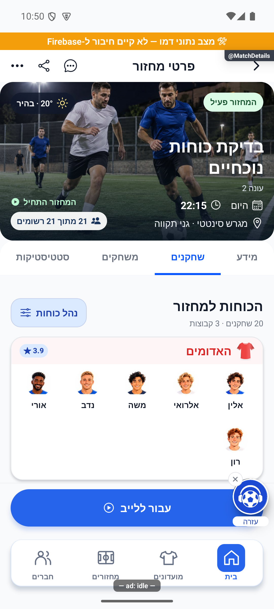
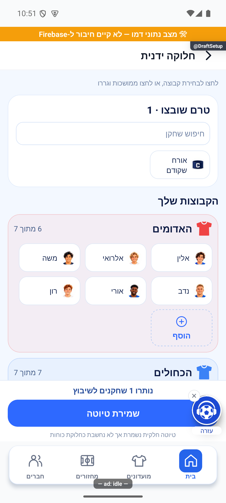
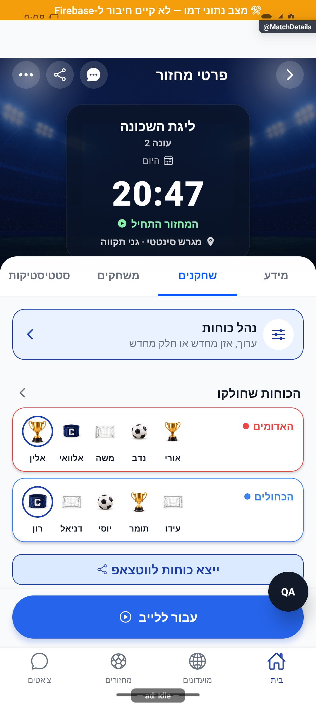
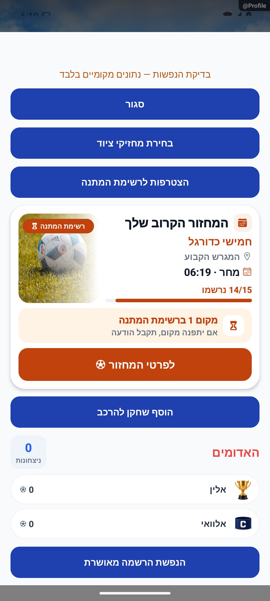
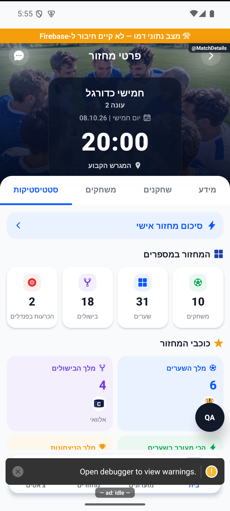
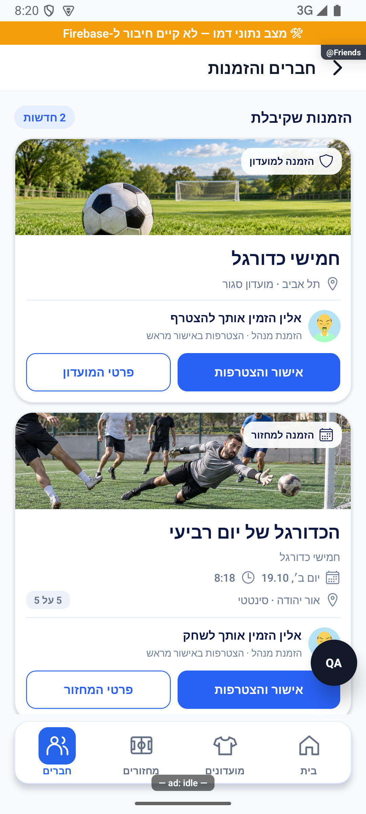
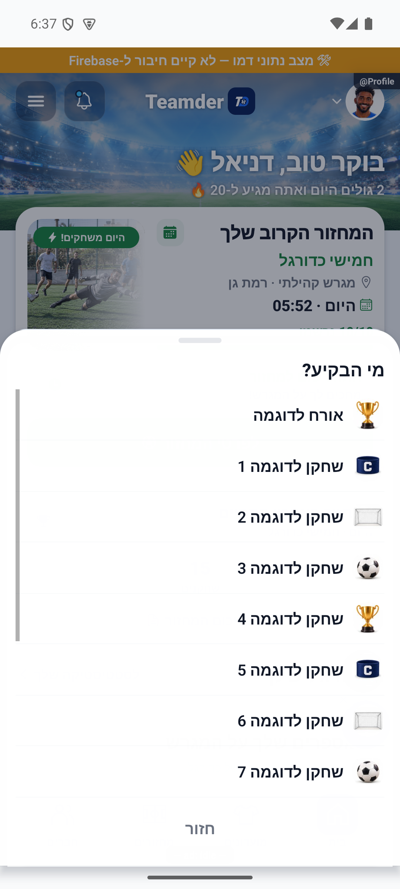
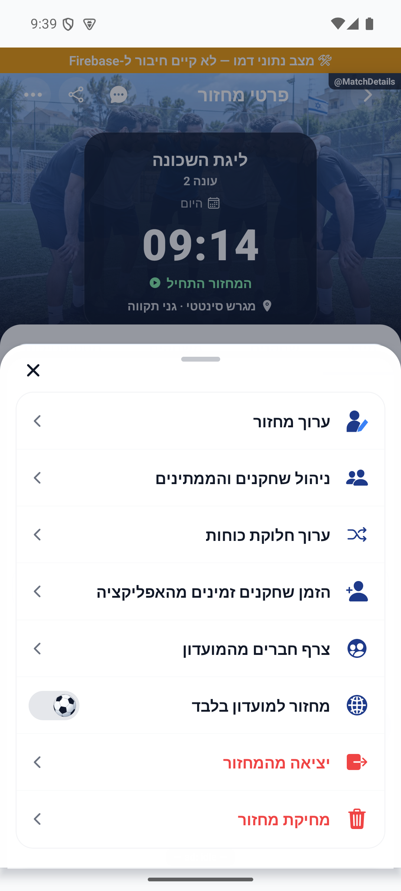

# פרטי מחזור וארבע הלשוניות

## כיווניות רכיב החוקים המשותף — 24.10.2026

`src/screens/games/MatchDetailsScreen.tsx` מציג את `communityRules` באמצעות `src/components/community/RichRulesText.tsx` בתוך `CollapsibleContent`. ב־`bulletRow` של רכיב החוקים הוחלף `row-reverse` ב־`row`, כך שנקודת הסעיף הראשונה בקוד מופיעה מימין תחת `forceRTL`. שיוך המארח נבדק בקוד בלבד. לא שונו מקור החוקים, פענוח המלל, פתיחה וסגירה של תוכן ארוך, מצבי המחזור, חישובים, ניווט או שמירה.

מציג מבודד של רכיב המקור נצפה לפני ואחרי באימולטור אנדרואיד בדמו. זו ראיית כיווניות של הרכיב, ולא הרצה חדשה של כל לשוניות המחזור, כל המארחים, אייפון או שמירה. השינוי מקומי וטרם הופץ. [צילום לאחר התיקון](../screenshots/night-rules-after-2026-10-24.png) · [דוח הסריקה וגבולות האימות](../../audits/2026-10-24-night-scan.md).

## קיצור טעינה ומניעת קריאות כפולות — 23.10.2026

`MatchDetailsScreen` מפעיל `reload` דרך `useFocusEffect` בלבד; הוסר אפקט ההרכבה שהפעיל אותו במקביל. כך קריאת `getGameById` הראשונית יורדת משתיים לאחת לכל מיקוד עם תלויות יציבות. מנוי `useGameEvents`, רענון ידני, מצבי חסימת גישה/מסמך חסר, נתוני המחזור וחישובי ההרשמה נשמרו. הבדיקה מפעילה את גופי הרישום האמיתיים ומוודאת טעינה אחת בכניסה ועוד אחת בחזרה. צילום דמו של מצב טעון אינו מדידת זמני שרת.

[בדיקות, צילומים ומגבלות](../../changes/2026-10-23-screen-loading.md).

## תיעוד כשלים — 20.10.2026

נוספו תצפיות דיווח בנקודות הכשל של המקורות המשויכים לפיצ׳ר, במסגרת הרחבה רוחבית. נשמרו ערכי החזרה, הזריקות ותנאי הפעולה הקיימים; נוסף מקור קוד והקשר לדיווח. כיסוי תחבירי אינו הוכחת הרצה של כל מצב. השינוי מקומי וטרם הופץ; בדיקות המסירה, מגבלות מניעת הכפילויות והמסלולים שטרם חוברו מתועדים בדוח המשותף.

[דוח דיווח השגיאות והראיות](../../changes/2026-10-20-error-reporting-audit.md).

## תיקון פערי העונות — 20.10.2026

השינוי בקובץ השרת המשותף במסגרת תיקוני העונות נוגע לשער הסגירה, אימות מחזור והשלמת סטטיסטיקה בלבד. נתיבי הפיצ׳ר המתועדים כאן לא שונו בסבב זה. הבדיקות המלאות עברו; אין בכך אימות חדש של פריסה או שירות חיצוני.

[דוח תיקונים, בדיקות ומגבלות](../reviews/2026-10-20-seasons-fixes.md).

## חלוקת בסיס נוכחית ללא אורחים שנמחקו — 18.10.2026

בבדיקת המחזור החי עם שבעה שחקנים לקבוצה זוהה כרטיס ״…״ של אורח שהוסר, אף שסגלי העבודה כבר נוקו כראוי. הגורם היה שימוש ב־`originalTeams` ההיסטורי בתצוגת החלוקה. במחזור שאינו סופי, `resolveCurrentSplitTeams` קורא את חלוקת הבסיס דרך `resolveSplitTeams` ומסנן אותה לפי רשומים ואורחים פעילים הקיימים כעת. קפטן שהוסר מוחלף לצורכי תצוגה בלבד בראשון שנותר; לקבוצה ריקה אין דמות מומצאת. אותה תוצאה משמשת לכרטיסים, לספירה ולשיתוף. לא משתנים מסמך, תמונת עבר או זכאות סטטיסטית.

מי שסומן ״הלך הביתה״ אך נשאר רשום מוצג בקבוצת הבסיס לפי החוזה הקיים, ומשלים אינו מועבר בתיעוד החלוקה אל הקבוצה שאליה הושאל. במחזור סופי נשמרת התצוגה ההיסטורית המקורית; שמו של אורח שנמחק מתוך תיעוד עבר נשאר לשאלת האפיון הכללית. העורך הידני ממשיך לטעון את `draftTeams.teams` הנוכחי ולסנן לפי זמינות, ואינו מייבא את תמונת העבר.

`finalForcesCurrentDisplay.test.ts` כולל שמונה בדיקות: הסרת זהות וספירה, קפטן חסר, קבוצה ריקה, שמירת בסיס/עזיבה/הלוואה, בורר המסך האמיתי, ומאגר ופעולת השמירה האמיתיים של העורך עם אורח שקודם ועדיין לא שובץ. שיבוץ מלא יכול להישמר גם כשהקבוצות קטנות מקיבולת שבע.

באימות מכשיר נפרד בדמו מאולץ נותר האורח המחוק ב־`originalTeams` בלבד: במסך הופיעו שש דמויות אדומים ללא דמות חסרת שם, וספירת 20 משובצים מול 21 רשומים. דרך ״נהל כוחות״ ועריכת הקיים נצפה האורח שקודם לבדו במאגר, והאדומים עם 6 מתוך 7. לא נשמרה חלוקה חדשה. תמונת העבר, סגלי העבודה והמשתמש הושוו לגיבוי, ומתקן הבדיקה הוסר. נבדקו מידות 411.429×914.286 וגופן 100%; אין בכך הוכחת שמירה בייצור או מסך קטן. [המקור, 15 האימותים והגבולות](../../../artifacts/final-deep-audit-2026-10-17/forces-display-native-proof.md).

## שורת צירוף ובדיקת הפולס — 17.10.2026

הוסרו רק `inviteAvailable` ו־`addMembers` מ־`sections`. היעדים `AddMembers` ו־`AvailablePlayers` רשומים בשלוש המחסניות הקיימות ומקבלים אותו `gameId`. ניהול שחקנים ממתינים בתפריט נשמר. `initialTabApplied` קשור ל־gameId וליעד, ואינו מוחל כל עוד המסמך הטעון שייך למחזור קודם. כשל הרשאת נתונים מחזיר למידע. עדכון רגיל של אותו מחזור אינו גובר על בחירת המשתמש. כפתור ההצטרפות מציג שמירה וטעינה ומושבת עד להקצאה האמיתית; אין צירוף חזוי.

[בדיקות, צילומים ומגבלות](../../changes/2026-10-17-roster-recruitment-and-pulse.md).

## בדיקות הפולס והגרסה הפנימית 1.1.55 — 17.10.2026

סף שתי קבוצות הוא `2 * teamSizeFromFormat(game.format)`; המכנה סופר רשומים ואורחים פעילים בלבד. תפריט חלוקה, כרטיס המידע וכפתורי יצירה/ניהול בלשונית השחקנים משתמשים בסף הזה. `openDraftSetup` בודק אותו גם בעת לחיצה. `effectiveMinPlayers` אינו יורד מסף שתי קבוצות גם אם נשמר מינימום נמוך יותר. עם פחות מהסף מוצג מספר חסרים ללא פעולת ניהול. לדוגמה 7 בפורמט `4v4` משאירים חסר אחד. `createdBy` מצורף להידרציה בטעינה ובמאזין, דרך מסלול הזהויות הקיים וללא קריאה חדשה למסמך פרטי. אין שינוי הרשאות.

[ראיות, בדיקות ומגבלות](../../changes/2026-10-17-internal-1.1.55.md).

## הירו ולשונית מידע בעיצוב חדש — 17.10.2026

סעיף זה מחליף את תיאורי ההירו, סדר המידע ומיקום התחזית במיפוי ההיסטורי בהמשך. אין מסלול חדש או לשונית חדשה. העיצוב המשותף משמש את אותו `heroNode` בכל ארבע הלשוניות.

### הירו ונתונים

`MatchStadiumHero` ממשיך להשתמש ב־`resolveRoundCover` עם מזהה המחזור, סוג המגרש, מועד המחזור וההיטל הציבורי או המועדון המקומי. סדר העדפת התמונות והחלופה לתמונה שהעלאתה נכשלה נשמר; לא נוספה תמונת מגרש חדשה. הכותרת העליונה לבנה עם חזרה, תפריט כשיש פעולות, שיתוף וצ׳אט לפי אותם תנאי כניסה וספירת הודעות. העונה, הספירה לאחור וחיווי תחילת המחזור ממשיכים להגיע מהמסך. ההירו גולל והלשוניות נשארות נעוצות דרך `TabScroll` ו־`ClubTabs flush`; הוסר חיבור הגובה השלילי הישן של ההירו, והניווט התחתון ופעולת הלייב לא עוצבו מחדש.

הפרטים מוצגים בשני בלוקים תחתונים: שם, עונה, תאריך, שעה ומיקום מימין; חיווי התחלה מעל מונה תפוסה משמאל. שמות ומיקומים ארוכים נגללים עם התוכן ויכולים להישבר לשורות; תחת רוחב צר בלוק המונה עובר לשורה נפרדת ונשאר מיושר לשמאל. `minWidth:180` מונע דחיסת שם המחזור לעמודה צרה. שעון וטמפרטורות מוקפים בבידוד כיווניות. מונה ההירו הוא `min(maxPlayers, players.length + activeGuestCount(guests) + reservedSeat)`, כאשר הזמנה לקידום ממתין מוסיפה מקום רק אם יש `pendingPromotion.uid`. עם מקום שמור הנוסח הוא ״מקומות תפוסים״; אחרת ״רשומים״. לדוגמה 14 משתתפים ועוד מקום קידום שמור מתוך 15 מוצגים כ־15 מקומות תפוסים, ללא טענה ש־15 כבר נרשמו. כרטיס ההכנות ממשיך לספור משתתפים בפועל בלבד.

תג המצב מפריד הסתיים, בוטל, פעיל, נרשמת, ממתין לאישור, המתנה, הרשמה מתוזמנת, נעילה, תפוסה מלאה והרשמה פתוחה. זה חיווי בלבד; אין שינוי בתנאי פעולת ההרשמה. מיקום ההירו הוא `locationStr` הקיים עם איחוד שם, כתובת ועיר ומניעת כפילות. ניווט למגרש ממשיך להשתמש ב־`openWaze` ובאותו תנאי מיקום.

### תחזית והחלפת מחזור

`useRoundForecast` מרכז את הקריאה הקיימת ל־`getForecastFor`. המפתח כולל מזהה מחזור, זמן התחלה, קווי מיקום ועיר; קואורדינטות המחזור קודמות לקואורדינטות המועדון, ועיר המחזור קודמת לעיר המועדון. אין שינוי בטווח הימים, במטמוני השירות או בספק התחזית. תוצאת מחזור קודם מוסתרת מיד לפי מפתח גם לפני ריצת האפקט. שינוי יעד מאפס את התוצאה, ותגובה מאוחרת אחרי שינוי או סגירה אינה מתפרסמת. ללא מיקום/מועד מתאים, או בכשל ובתוצאה חסרה, התג מוסתר ולא מציג אפס מעלות מומצא. אפס מעלות אמיתי נשמר. השבב מציג סמל, טמפרטורה ותיאור; סיכוי גשם מוצג מ־20% ומעלה, כמו בשורה הקודמת שהוחלפה. מצב השמים והסמל נשארו מהסיווג הקיים.

### תוכן לשונית מידע

הסדר הסופי לפי הבקשות האחרונות: `RoundGameFacts` ראשון, ללא כותרת; ניווט; אזהרות והכנות רלוונטיות; `PinnedAdminMessageCard`; `RoundPeopleCard`; מידע נוסף וכללים. שלוש תגיות המשחק ממשיכות מאותו `game.format`, `fieldType`, `matchDurationMinutes`; כל נתון חסר מושמט, ומשך שאינו חיובי אינו מוצג. ריפוד אנכי 8, סמל 22 ומרווח פנימי 4 נותנים גובה טבעי של כ־62 במקום כ־76 יחידות כשהכיתוב בשורה אחת; טקסט מוגדל יכול להגדיל את הגובה. אין גובה כפוי או קיצוץ תוכן. כותרות ״פרטי המשחק״ ו״הכנות למשחק״ הוסרו.

כרטיס ההכנות שומר על `showCreateTeamsBanner`, `showManageTeamsBanner`, `hasLocalManualDraft` ו־`teamsVisibleToViewer`. ההודעה מבדילה טיוטה, צורך בעדכון וכוחות מוכנים; מנהל בלבד מקבל יצירה/ניהול/המשך חלוקה. לחיצה עוברת לאותו `openDraftSetup` עם אותו מקור ניתוח שימוש. כוחות לא מפורסמים אינם נחשפים לצופה שאינו מנהל. במחזור סופי כל כרטיס ההכנות מוסתר. חיוויי המתנה, סיום עונה, חסימת סגירת עונה, השלמות, כללי מועדון וביטול הרשמה נשמרו.

הודעת המארגן קיבלה רקע לבן, סמל שיחה וכותרת, עם עריכה בצד הנגדי. תוכן חסר נשאר הזמנה להוספה למנהל בלבד; הודעה קיימת נקראת גם ללא הרשאת עריכה. תנאי `isAdmin && !isTerminalGame` ושירות השמירה לא שונו. `RoundPeopleCard` מציג מועדון, יוצר עם `UserAvatar`, ואז תאריך יצירה בפורמט `DD.MM.YY` בשורה עצמאית ללא לחיצה. מועדון של מחזור חד־פעמי מושמט; הכניסה ממשיכה לעמוד המועדון המתאים לחברות והיוצר ל־`PlayerCard`. שם מועדון יכול להגיע גם מההיטל הציבורי שכבר נטען לכיסוי; לא נוספה שאילתה פרטית. הערות ותאריך לא נעלמו: ההערות נשארו ב״מידע נוסף״, והתאריך הועבר לשורת היוצר במקום להיות משוכפל. אין שינוי שירות כתיבה, ממיר, הרשאות או חישובי משחק.

### בדיקות והוכחות

364 חבילות ו־4,422 בדיקות עברו ובדיקת הטיפוסים נקייה. נוספו עשר בדיקות חוזים עבור מיקום/שעת תחזית, מעבר בין מחזורים ותגובה מאוחרת, עיר חלופית, כשל וסגירה, פעולות ההירו והודעות שלא נקראו, אפס מעלות, מקום שמור, נתונים חסרים, זהויות ומסלולי מועדון/יוצר, שורת תאריך עם שנה וסדר חיווי התחלה ומונה. בדיקות אלה מפעילות רכיבים והוקים עם מארחים מדומים ואינן מדידת פריסה מקורית. [לוג מלא](../../../artifacts/round-info-redesign-2026-10-17/jest.log).

באימולטור דמו נבחנו ההירו, גלילת המידע, מיקום שני הבלוקים, תג תחזית 23° שנמסר מהשירות הקיים, הסדר הסופי והסרת הכותרות, תאריך היצירה, פתיחת עורך ההודעה וביטולו, ניהול הכוחות והחזרה, ומעבר ללשונית שחקנים וחזרה. ניווט חיצוני, הרשמה, ביטול השתתפות, שמירת הודעה דרך העורך, פרסום כוחות ותחילת לייב לא הופעלו. הודעת המחשה נוספה דרך שירות הדמו הקיים לצורך בחינת הכרטיס, ואז שוחזרה; [כל המחזורים וההיסטוריה הושוו ונשארו זהים](../../../artifacts/round-info-redesign-2026-10-17/preservation.json). בוצע רענון קוד מלא אחרי גיבוי ושחזור מצב הדמו כדי לוודא שהפריסה האחרונה נטענה.

[צילום ההירו](../screenshots/round-info-hero-compact-final-2026-10-17.png), [הסדר הסופי ושורת התאריך](../screenshots/round-info-compact-final-2026-10-17.png) ו[תצוגה צרה](../screenshots/round-info-small-latest-2026-10-17.png) נפתחו ונבחנו. גודל רגיל 411×914 וגופן מערכת 1.0; גודל צר 320×569 והגדרת גופן מערכת 1.4. במסך צר תוכן ממשיך בגלילה, וכרטיסי ניהול יכולים להתרחב לשורה נוספת. הגדרות המסך הוחזרו ל־1080×2400 וגופן 1.0. [היררכיית ההירו](../../../artifacts/round-info-redesign-2026-10-17/hero-compact-final.xml) · [המידע](../../../artifacts/round-info-redesign-2026-10-17/compact-final.xml). תגי הפיתוח והודעות כלי הפיתוח אינם חלק מהעיצוב.

לא נבדקו כל מצבי המנהל/אורח/סופי במכשיר, תחזית של יעד חדש מול הספק, כל ענפי השגיאה במכשיר, אייפון או שמירה בייצור. אין להסיק מהדמו על המרת מסמכים או הרשאות ייצור. אין פריסה, בנייה, התחייבות או העלאה. צילומים ותיאורי סדר המידע הקודמים במסמך הם היסטוריים ביחס לעדכון זה.

## כותרות לשוניות בשורה אחת — 17.10.2026

בצילום `tmp/live-action-production/shots/eleven-summary-labels-fixed-small.png`, ב־320×569 ובגופן 140%, כותרות `ClubTabs` נשברו למילה ועוד אות בשורה נפרדת, לרבות מידע/משחקים/סטטיסטיקות. `ClubTabButton` משתמש כעת ב־`numberOfLines=1`, ב־`adjustsFontSizeToFit` ובהתאמה מזערית 0.65 כשיש ארבע לשוניות ו־0.8 כשיש שלוש או פחות. `flexShrink:1` ו־`minWidth:0` נשמרו בתווית; הגובה המזערי 52 ותקציב הרוחב לפי התוכן נשארו בכפתור. אין תקרת הגדלת גופן כללית, היפוך שורה, שינוי סדר, שינוי מחסנית או שינוי ניווט. ב־MatchDetails סדר המקור נשאר מידע, שחקנים, משחקים, סטטיסטיקות. נעילה מפעילה את אותו הסבר ואינה בוחרת לשונית.

נוספו חמש בדיקות ב־`clubTabsTouchDiagnostics.test.tsx`: ארבע התוויות המלאות, מדיניות התאמה ומיקום במקור, פעולה מדויקת לכל מפתח, ותווית הסטטיסטיקה הארוכה כשהיא נעולה. יחד עם מעקב המגע ושומר הכיווניות עברו שלוש חבילות ו־21 בדיקות; טיפוסים עברו. אלו בדיקות הרכיב ומדיניותו עם מארחים מדומים, ולא הוכחת רוחב טקסט במנוע המקורי.

לאחר התיקון האחרון המוביל ביצע פתיחה קרה באימולטור אנדרואיד מול מחזור הבדיקה בייצור ב־320×569/140%. [צילום הסיכום הקטן הסופי](../screenshots/action-pitch-production-eleven-tabs-summary-final-small-2026-10-17.png) ו[צילום סוף הטבלה הקטן הסופי](../screenshots/action-pitch-production-eleven-tabs-standings-final-small-2026-10-17.png) נפתחו ונבחנו גם בסקירה עצמאית: ארבע הלשוניות מלאות בשורה אחת ללא אות שנשברת בנפרד, בראש הסיכום וגם בגלילה לסוף הטבלה. באותו צילום נראים מדד הכרעות הפנדלים במלואו וסוף הטבלה עד 33. העותקים הקנוניים הועתקו ללא שינוי; ההיררכיות המקוריות נשמרו ב־`docs/changes/evidence/live-action-2026-10-17/manifest-eleven-final-ui.json`. צילום הפגם הקודם אינו ראיית תיקון; אין כאן בדיקת אייפון, כל מסכי המועדון או כל מצבי הנעילה במכשיר.

גם בבדיקת הבקרה הסופית לאחר פתיחה קרה ברוחב 411 ובגופן רגיל נראו ארבע התוויות במלואן לצד מדדי 2/3/3/0: [צילום הסיכום הרגיל הסופי](../screenshots/action-pitch-production-eleven-tabs-summary-final-normal-2026-10-17.png). הצילום נפתח ונבחן בנפרד; אין מדובר בבדיקה רחבה נוספת של כל מסכי המועדון.

17.10.2026: קריאת הסיכום הכללי ב־`MatchDetailsScreen` משתמשת ב־`useMatchRoundSummary` עם מצבי טעינה, הצלחה וכשל וניסיון חוזר. הנתונים נשמרים ברענון רק לאותו מחזור וצופה, ומוסתרים סינכרונית בעת מעבר; תגובה מאוחרת אינה מתפרסמת. הפניה ממוקדת, כולל שירות הקריאה, האפקט, הבדיקות וגבולות ראיית הייצור: [מצבי קריאת הסיכום הכללי](match-stats.md#מצבי-קריאת-הסיכום-הכללי--17102026). תצוגת סיכום קיים נצפתה בייצור; מצבי כשל וניסיון חוזר נבדקו אוטומטית בלבד. אין שינוי הרשאות או כתיבות.

פותרים אלה מסתמכים על `resolveRosterEntry` גם לשמות אורחים, במקום לחפש אותם רק במטמון המשתמשים. אין שינוי זכאות לתארים או קריאת פרופילים נוספים. [חוזה זהות האורח והבדיקות](match-stats.md#שמות-אורחים-בסיכום-הכללי--17102026).

## סבב פולס מאושר — 16.10.2026

באישור הבעלים JOIN_SETTLE_MS ב־functions/src/index.ts הוחלף מ־2000 ל־500. אותה קבועה משמשת windowBucket ואת scheduleTime של onJoinRequestCreated. reconcileGameJoins ממשיך למיין לפי זמן לחיצה תחום, זמן קבלה ואז uid; סמכות הקצאת הרכב/המתנה/אישור נשארת בשרת. בקשה שמגיעה מאוחר יכולה לעבור לאצווה הבאה. אין הבטחה שכל ההצטרפות תושלם בחצי שנייה: קריאות רשת, התור והעסקה מוסיפים זמן. לא בוצעה פריסה ולכן אין שינוי בפועל בזמני הייצור. בדיקות joinFairness הקיימות בודקות קדימות, קיבולת ומניעת תיארוך לאחור.

השינוי מקומי וטרם הופץ. [דוח, בדיקות וראיות](../../changes/2026-10-16-pulse-sweep.md).

## גישה לכוחות ובחירת הלייב — 16.10.2026

ב־MatchDetailsScreen הוסרה מגבלת msToKickoff>-2h מתנאי showCreateTeamsBanner. שאר התנאים נשמרו: מנהל, לפחות שני אנשים פעילים, אין חלוקה/טיוטה מקומית, לא סופי ועד 24 שעות לפני ההתחלה. ב־LiveMatchScreen נבחר המצב ב־useFocusEffect/useCallback לפי advancedMode או completionMode=balanced. selection קשור ל־gameId; תשובה לאחר blur נזרקת. כשל/מסמך חסר מוביל למסך הסבר עם retry וחזרה, ללא fallback שקרי ל־plain. במיקוד חוזר לא מאפסים בחירה תקפה ולכן רכיב חי באותו מצב אינו מפורק ולא מאבד משלימים מקומיים. אין שינוי באלגוריתם חלוקה, בנוסחאות, במכנים, בסגל או בסמכויות כתיבה. קישורי דמו חדשים במפעיל הפיתוח מכסים כשל חד־פעמי ומחזור ללא קבוצות חמש שעות אחרי תחילה; הם לא נרשמים במסד. 16 בדיקות liveModeRouting מריצות את callback הטעינה ותנאי התצוגה האמיתיים. [ממצאים והפעלת ההגדרה שאושרה בשכחת שושי](../../changes/2026-10-16-live-mode-routing.md).

## חלוקה שמורה אחת — 15.10.2026

כל מסלולי השמירה משתמשים ב־saveDraftTeams. כל שמירה מפורשת מעתיקה את draft.teams אל originalTeams גם בזמן משחק, ומתעלמת מתמונת מקור ישנה שהועברה מהעורך. באותה עסקה מתעדכן rotation.baseTeams, מתנקים loans של החלוקה הקודמת, ותור ההמתנה מותאם לאינדקסי הקבוצות החדשים תוך שמירת סדרו. אין שינוי ב־playing, round, roundInstanceId, lastRoundAt, wins, בשעון או בשערים. הסרת צד שמשחק כעת נדחית לפני הכתיבה; שינוי סגל נדחה ב־validateDraftRoster במסלולים המפעילים אותו. גם העורך הישן שאינו מפעיל אימות סגל משתמש בעסקה וקורא את הרוטציה העדכנית. אין כתיבה לאוסף המשחקונים או לסטטיסטיקה. מילוי זמני/קבוע ועזיבת שחקן עדיין משתמשים בסגל העבודה; originalTeams ו־baseTeams הם תמונת החלוקה השמורה האחרונה, ולא רשימות חלוקה מתחרות. מונה updatedAt מתעדכן גם בדמו. בדיקות savedAllocationReplacement מריצות את מתודת השירות עצמה בנתיב עסקה ובדמו, רצף ארבע שמירות, תמונת מקור ישנה, שימור תוצאה/שעון/זהות משחקון, ביטול טיוטה מקומית ישנה, כשל שמירה ללא שינוי חלקי, ותור המתנה ב־3/4/7 קבוצות. אין שינוי ניווט, נוסחת דירוג, חישוב סטטיסטי או מכנה.

ראיות ומגבלות: [דוח התיקון](../../changes/2026-10-15-single-allocation.md). הצילום הוא תצוגת שתי קבוצות בדמו בלבד; רצף השמירות נבדק בשירות, ולא כתרחיש מלא במכשיר מול מסד אמיתי.

## תיקון מדידת הלשוניות — 13.10.2026

`TabScroll` ממשיך להשתמש בכותרת דביקה ובשימור ארבע הלשוניות. טלאי `ScrollViewStickyHeader` מסנכרן את ההיסט הנמדד עם הגלילה המקורית ב־`Fabric`, כולל חזרה לאפס. מדידה ישנה יכולה לבטל לחיצה עם תזוזה קטנה אף ש־`onPressIn` נשלח; הבחירה נשארת רק ב־`onPress`. `ClubTabs` מתעד את שלבי המחווה ומלבן המדידה, ללא תוכן משתמש. [פירוט המנגנון והראיות](../../audits/2026-10-13-scroll-native-analysis.md). אין שינוי בהרשאות, בהרשמה, בסדר הלשוניות או בתוצאות מחזור; אין פריסה בסבב זה.

## הכרעת הזמנות והצטרפות — 11.10.2026

ההתנהגות העדכנית מחליפה את תיאור ההזמנות הקודם: הזמנת מנהל היא אישור מראש, אך אינה מצרפת ללא הסכמת הנמען. פרטי המימוש, המכנים לקיבולת, התוקף, הרשאות, המסלולים, תאימות ללקוחות ישנים ובדיקות: [תיקון הזמנות ואישור הצטרפות](../../changes/2026-10-11-invitation-admission.md).

במועדון משתמשים ב־`joinSocialClub` מול המועדון הקנוני ולא בהכרעה לפי המראה הציבורית. במחזור משתמשים ב־`reconcileGameJoins` ובאישור מפורש ב־`approvedInvites`; `invitedUserIds` אינו אישור. התוצאה במסך מגיעה ממסמך הבקשה בשרת. כל הזמנות המועדון נפתחות במסך `CommunityDetailsPublic` הקיים עם `fromInvitation`, כולל בקשות ישנות ממתינות; הרשאה אינה נובעת מהפרמטר.

אימות: 253 חבילות ו־3414 בדיקות יישום; 328 בדיקות הרשאות מול הכללים המלאים; 9 בדיקות פונקציות מול מסד הדגמה מקומי. לא בוצעו פריסה, הסבת נתונים או בדיקת מסירה לטלפון ייצור.

עודכן: 7.10.2026. מקור הקוד: `8e8fde5`, גרסה `1.1.35`. מסמך זה מתאר את הקוד; מצב חנות ופריסת שרת דורשים ראיה נפרדת.

## כניסה ותפקידים

בית / מחזורים / מועדון / הודעה → MatchDetails {gameId, initialTab}

אורח, משתמש חיצוני, חבר מועדון, משתתף ומנהל מקבלים פעולות שונות. משחק רגיל אינו חושף את כל נתוני המשחק המתקדם.

## רכיבים ומצבים

| רכיב / מצב | התנהגות וחוזה |
|---|---|
| כותרת | MatchStadiumHero, שם מחזור/עונה/מועד/מיקום; הכותרת גוללת והלשוניות נשארות נעוצות |
| מידע | עובדות מזג אוויר/משך/תפוסה, כתובת וניווט, כללים, הערות, פרטי יצירה וניהול |
| שחקנים | הרשומים וההמתנה כוללים אורחים פעילים ואורחים בהמתנה; MatchPlayersScreen מוטמע ולא תקציר של שלושה |
| משחקים | MatchRoundsScreen מוטמע: תוצאות, מסנן קבוצות, שערים, הרכבים ופנדלים |
| סטטיסטיקה | MatchStatsTab, סיכום אישי, מדדים, כוכבים, מה קרה הערב וטבלת אלופים |
| מצבים | טרם התקיים / התקיים עם נתונים / היסטורי ללא נתוני משחק / רגיל / מתקדם / פעיל / הסתיים / בוטל |
| פעולות | הרשמה, התנגשות, ביטול, הצעת מקום, פתיחה לציבור, עריכת סדרה, פרסום קבוצות ומשוב חלוקה |
| טעינה | useGameEvents משותף; לשוניות נטענות כשנכנסים אליהן ונשמרות לאחר מכן; לא ארבעה מאזינים כפולים |

## מסלול נתונים ומקומות שינוי

[`src/screens/games/MatchDetailsScreen.tsx`](../../../src/screens/games/MatchDetailsScreen.tsx)

gameService ומסלולי gameLifecycle; cancelGameV2, requestJoin, confirmSpotOffer, publishDraft, notifyTeamsReady, setDraftFeedback. gameDocConverter.fromFirestore קורא את שדות המחזור. eveningPlayed הוא המקור למצב התקיים, ולא טיימר/שערים בנפרד.

ממיר המחזור: [`src/firebase/firestore.ts`](../../../src/firebase/firestore.ts), `gameDocConverter.fromFirestore`; סוגים: [`src/types`](../../../src/types). שינוי שדה דורש מעקב כתיבה → ממיר → שירות/חנות → רכיב. ניווט: [`GameStack.tsx`](../../../src/navigation/GameStack.tsx), ובמסכים משותפים גם המחסניות שמארחות אותם.

## בדיקות וראיות

בדיקות homeRoundState, eveningPlayed, eveningStats, guestPromotion, draftTeamsView וניווט משותף; בדיקת כיווניות בצילום לכל לשונית.

צילומי המיפוי מהאמולטור נעשו במצב נתוני דמו, המסומן בפס כתום. הם מוכיחים את הרכיב והמצב המוצגים בלבד, ולא ממירי Firebase, נתוני ייצור או כתיבה. צילומי תיקונים קודמים מסומנים בנפרד. שגיאת מזהה, מצב טעינה או שער הגנה אינם הוכחת הפעולה המלאה.

## גבולות והערות תחזוקה

הסדר הנוכחי: מידע, שחקנים, משחקים, סטטיסטיקה. במסמכים 109/110 הסדר שונה. RoundSummary הישן הוסר מהניווט; כניסה לסיכום מפנה לסטטיסטיקה.

לפני שינוי פתח את הקוד המקושר ואת [כללי הפרויקט](../../../AGENTS.md). לאחר שינוי עדכן במסמך זה את התאריך, נקודת הקוד, המצבים שהתעדכנו, הבדיקות והצילום. אין לטעון שכל מצב/תפקיד נבדק רק משום שקיים צילום אחד.

## פירוט טכני ממוקד: זרימה, חישוב ונקודות שינוי

[הסבר פשוט למשתמש](match-details.simple.md)

העמקה: 07.10.2026, מול קוד המקור שב־`8e8fde5`. בעת הכתיבה HEAD הוא `50d508f`; בדיקת ההפרש בין הנקודות ב־`src` וב־`functions` לא מצאה שינוי קוד. הסעיפים וההסתייגויות הקיימים נשמרו. זו קריאת קוד ותיעוד, בלי הרצת תרחישי כתיבה חדשים.

המסך הוא מתאם בין הרשאות, נתוני מחזור וארבעה משטחי תוכן; אינו מחשב מחדש את כל הסטטיסטיקה. `initialTab` בוחר כניסה, ונתוני אירועים משותפים עוברים דרך `useGameEvents`. לשונית שטרם נפתחה שונה מלשונית שנטענה ונשארת מותקנת; שינוי טעינה צריך לשמר הבחנה זו כדי לא להקים ארבעה מנויים.

תנאי פעולה אינם תחליף זה לזה: חברות במועדון, רישום למחזור, ניהול ומצב `active/finished/cancelled` הם צירים נפרדים. פרסום דרך `publishDraft` ושיגור `notifyTeamsReady` נפרדים משמירת חלוקה; בחירה שנשמרה עם `published:false` אינה הודעה שנשלחה.

למשל מחזור של 15 מקומות עם 12 רשומים, 2 אורחים פעילים ו־3 בהמתנה מציג תפוסה 14/15; מספר השורות הכולל אינו 17/15. קביעת ״התקיים״ נשענת על [eveningPlayed](../../../src/utils/eveningPlayed.ts); לא על סך שערים, זמן או סיום סטטוס שנגזר מחדש במסך.

נקודות שינוי: הממיר לקריאת שדה חדש, רכיב הלשונית לתוכן, השירות לפעולה ומחסניות הניווט לכניסה משותפת. סיכום שהוסר מהניווט אינו מוחזר רק מפני שקיים רכיב ישן. בדוק כניסה מכל הורה, מיקוד וחזרה, חבר לעומת מנהל, נתון חסר ומחזור רגיל לעומת מתקדם.

## עדכון 8.10.2026 — תנועה ותיקוני דיווחים

כרטיסי `DraftTeamCard` עטופים ב־`ChangeMotion` לפי מזהה המחזור, מצב פרסום ורשימת שחקני הקבוצה: 300 אלפיות שנייה, עם השהיה של 50 לפי מספר הקבוצה ועד 150. מוני `MatchPlayersTab` מגיבים לצירוף registered/waiting. הנפשות ההרשמה הקיימות נשארו במסלול שאחרי תוצאת השירות; לא נוסף אישור מוקדם או שינוי קיבולת.

**ראיה ומגבלות:** הסגל והקבוצות המרונדרים נצפו בדמו. פרסום חלוקה והרשמה חדשה לא הורצו בסבב זה; אין צילום שמוכיח כתיבת שרת חדשה.

בדיקת הטיפוסים ו־183 חבילות הבדיקות עברו, 2,752 בדיקות. מצב המקור: `9ec0dfd` עם שינויים מקומיים; אין גרסה חדשה שפורסמה. [יומן השינוי וההקלטות](../../changes/2026-10-08-motion-and-pulse.md).

## תיקוני סבב הבאגים — 8.10.2026

B09: teamsValidity בונה את קבוצת המזהים מרשומים ומאורחים שאינם waitlisted. שיוך של אורח בהמתנה מחזיר invalid. אין שינוי בספירת משחקונים או מחזורים.

[ראיות, בדיקות ומגבלות](../../changes/2026-10-08-audit-fixes.md).

## השלמת הנפשות — 8.10.2026

MatchDetailsScreen מוסיפה HeightReveal באזור המידע כשהסטטוס waitlist. המיקום מחושב ממערך game.waitlist ולא מהקיבולת; מיקום חסר מקבל נוסח ללא מקום. RegistrationSuccessAnimation עודכנה במסלול registered בלבד. אין שינוי בפעולות הרשמה, הצעות, קיבולת, טאבים או תזמון השירות. הוכחת ההמתנה המצורפת היא רכיב הבית עם אותו עיקרון פתיחה; חלונית המידע של MatchDetails בתור לא הורצה בסבב זה. יש להבדיל בין בדיקת רכיב משותף לבין מסך מלא.

[פרטי האימות והמגבלות](../../changes/2026-10-08-motion-completion.md). מקור: `9ec0dfd` עם שינויים מקומיים; טרם פורסמה גרסה.

## עבודת ציור וגלילה — 9.10.2026

מקור: שינויים מקומיים מעל `a348b9f`, טרם פורסמו. תשתית `ScrollSurface` מחוברת לפרטי מועדון, ללשוניות פרטי מחזור, לסטטיסטיקות מועדון ולסיכום האישי. היא מסמנת תחילת/סוף מחווה ותנופה בלבד; אין שינוי נתונים או עדכון מצב בכל פריים. `CountUp` ו־`StatDonut` מתייצבים לערך הסופי במהלך גלילה; שורות ללא שינוי מיקום אינן מתזמנות תנועה. אנימציות `LivingIcon` ו־`Breathing` נעצרות כשמסך המקור מאבד מיקוד, כשהיישום ברקע, בזמן גלילה ובהגדרת צמצום תנועה. תמונות פרופיל ורקע משתמשות ב־`resizeMethod=resize`, לצמצום פענוח באנדרואיד לפי גודל התצוגה.

אין שינוי בחישובים, במכנים, בשדות המסד או בהרשאות. [התנהגות, בדיקות ומגבלות](../shared/menus-and-motion.md) · [מדידות וראיות](../reviews/scroll-performance-2026-10-09.md). הבדיקה בדמו אינה אימות גרסת חנות במכשיר פיזי.

## תיקוני דיווחים — 9.10.2026

MatchDetailsScreen משתמשת קודם ב-myCommunities; למועדון ציבורי שאינו ברשימת החברות היא קוראת groupService.getPublic. התוצאה קשורה ל-ownerId ול-groupId, עם ביטול תוצאה לאחר שינוי זהות או יעד. עד פתרון הקריאה coverLoading מונעת הבזק תמונה חלופית. MatchStadiumHero שומרת קדימות העלאה/גלריה/clubDefaultCoverId ומחליפה העלאה שנכשלה. במחזור יתום אין ירושת תמונת מועדון. טעינת MatchRoundsScreen המשובצת עטופה ב-TabScroll עם header, stickyHeader ו-bottomInset; הכדור מסתובב באזור התוכן בגובה מינימלי 160, ולא במקום כל הכותרת. חישובי המשחקונים לא השתנו.

מקור: שינויים מקומיים מעל a348b9f; טרם נבנתה גרסה. [ראיות ומגבלות](../../changes/2026-10-09-pulse-round2.md).

## הגנת לחיצות אחרי גלילה — 9.10.2026

תיקון opt-in ב-patches/react-native+0.79.6.patch: ScrollSurface מעבירה recoverStaleMomentumAfterMs=250. RN שומרת זמן פריים גלילה אחרון, ורק כש-begin חדש מ-end ולא היו פריימים במשך 250ms היא מסיימת את נעילת responder. תנופה ארוכה עם פריימים טריים עדיין חוסמת לחיצת עצירה כרגיל. scrollEventThrottle מוגבל ל-64ms (ברירת 16), ללא listener נוסף, מצב או חישוב בכל פריים ברכיב היישום. onStaleMomentumRecovered מתעדת stale_momentum_recovered ביומן המקומי ומשחררת מצב moving; momentum_start מתועד גם הוא. MatchRoundsScreen משתמשת ב-ScrollSurface בכל ענפי הגלילה. patch-package מוחל בהתקנה דרך scripts/postinstall.cjs החוצה פלטפורמות; אין שינוי native או הרשאות. tests/scrollStaleMomentum.test.ts מריצה את תנאי RN המותקן עצמו: החמצת end נכשלת לפני התיקון ועוברת אחריו; נבדקים תנופה ארוכה, התחלה, מרווח הסיום הרגיל והיעדר opt-in. אין טענה שהמסלול הזה הוא סיבת השורש המוכחת במכשיר המדווח; שני הדיווחים נותרו פתוחים לאימות.

[בדיקות ומגבלות](../../changes/2026-10-09-pulse-round2.md).

## תיקוני עיצוב ונגישות — 10.10.2026

מקור: `a348b9f235f1e1433497600555303231512a0834` עם שינויים מקומיים. אין בסעיף זה הוכחת גרסת חנות.

`MatchManageSection` מספקת שם מפורש ומצב disabled למתג; שורה נגישה מסתירה את המתג הפנימי כתחנה כפולה. אין שינוי בהרשאות או בכתיבת הגדרת המחזור. נבדק בקוד בלבד.

## התאמת לשוניות לגופן מוגדל — 10.10.2026

מקור: `a348b9f235f1e1433497600555303231512a0834` ושינויים מקומיים. `ClubTabs` הוא הרכיב המשותף למועדון ולמחזור. לכל לשונית `flexBasis: auto` וגדילה/כיווץ לפי המקום הזמין, כך שתווית ארוכה מקבלת את הרוחב שהיא צריכה לפני חלוקת השטח הנוסף. גובה 52 הוחלף בגובה מינימלי 52 ובריווח אנכי; הטקסט יכול לעטוף כשנדרש מקום נוסף. הוסרו מגבלת שורה יחידה והקטנת גופן אוטומטית. סדר ימין־לשמאל, תפקיד לשונית, המצב הנבחר, פעולת החלפה ולשונית נעולה נשמרו. אין שינוי במסלול נתונים או בחישובים.

באמולטור אנדרואיד נצפו ארבע לשוניות מחזור, מעבר ביניהן וגלילה בגופן 130%. בצילום הסופי כל ארבע התוויות מופיעות במלואן בשורה אחת. בדיקת הטיפוסים עברה. סביבת הבדיקה: APK פיתוח מקומי שנבנה מתלויות המערכת הנוכחיות, עם תווית מעטפת `1.1.33/1` ושרת דמו `8083`. אין הוכחה לבינארי החנות, לאייפון או לקורא מסך. הפעלת כל מצבי המועדון בגופן מוגדל טרם הושלמה.

## אימות חסימת לחיצות אחרי גלילה — 10.10.2026

מקור: שינויים מקומיים מעל `a348b9f235f1e1433497600555303231512a0834`; מעטפת פיתוח מקומית `1.1.33/1`, Android/Fabric, RN0.79.6, Screens4.11.1, Metro8083 עם דמו ונתיבי בדיקה. אין הוכחת גרסת חנות/מכשיר פיזי/אייפון.

`ScrollSurface` שומרת את ההגנה הקיימת של250ms בלי שינוי הסף. RN בודקת את זמן begin מול end ואת זמן פריים הגלילה האחרון בזמן בירור responder; רק begin שלא נסגר ויותר250ms ללא פריים משחרר את הנעילה. תנופה עם פריימים טריים נשארת מוגנת, והמקלדת ממשיכה לפעול לפי `keyboardShouldPersistTaps`.

בקרה רגילה: גלילה עמוקה במחזור ואז לחיצה יחידה על סטטיסטיקות הצליחה. בניסוי זמני בדמו בלבד הושמט end: בלי ההגנה שתי לחיצות במחזור ולחיצות לשונית/תפריט במועדון נשארו חסומות; עם ההגנה הלחיצה הראשונה החליפה לשונית. הוכחות כוללות פקודות מגע אמיתיות, XML עם selected, צילום ולוג begin/drop_end/recovered. זה אינו שחזור טבעי או הוכחת סיבת השורש של דיווחי הבעלים. אין לסגור דיווח רק על סמך ניסוי מוזרק.

פער נוסף: `CommunityPlayersScreen` השתמשה ב־FlatList עם ScrollView רגילה ולכן לא קיבלה את ההגנה. `renderRosterScroll` יציבה מחזירה `ScrollSurface` כ־`renderScrollComponent`, עם `keyboardShouldPersistTaps="handled"`. אין ScrollView חיצונית או קינון: VirtualizedList עדיין מנהלת cells, חלון, מדידות ו־ref באמצעות cloneElement. כל props ואירועי הגלילה עוברים דרך המשטח המשותף; השורות, המיון, השאילתות, ההרשאות והפעולות לא השתנו.

`tests/scrollStaleMomentum.test.ts` מפעילה את תנאי RN ואת capture handler המותקנים עצמם. נוספו מקרי גבול250/251ms, פריים חדש, begin חדש, end תקין, opt-in אפס/שלילי, לחיצת ילד ראשונה ושמירת התנהגות המקלדת. [ראיות מלאות, תוצאות ומגבלות](../../../artifacts/pre-release-2026-10-10/scroll-press/README.md).

### תיקון כיווניות — 10.10.2026

כפתור הניווט למגרש משתמש בשורה רגילה: הטקסט ראשון ואייקון הניווט אחריו, כך שהאייקון משמאל תחת `forceRTL`. הוסרה היפוך השורה שסתר את חוזה הכיווניות. צילום דמו יתווסף לאחר בדיקה; אין להסיק אישור אייפון מהקוד.

צילום תצפית: `screenshots/release-ui-match-rtl-2026-10-10.png` מציג אייקון משמאל. מקור החבילה הפעילה אינו מאומת מול כל השינויים המקומיים; ההגבלה רשומה במניפסט. אין אישור אייפון.

[צילום ניווט מעודכן](../screenshots/release-fixes-match-2026-10-10.png): האייקון נצפה משמאל לטקסט בדמו5556, חבילה נוכחית.

## תיקוני דיווחים — 10.10.2026, אחרי גרסה 1.1.45

ClubTabs המשותף מוסיף club_tab_press_in ו־club_tab_selected ליומן המקומי. פריסת MatchDetails לא שונתה בסבב זה; flush היה קיים במסך המחזור. אין כאן תיקון מאומת לחסימה המתמשכת במכשיר הבעלים.

שינוי מקומי מעל bcca0886; לא נבנתה גרסה בסבב הזה. נבדק בקוד ובבדיקות אוטומטיות. צילומי אנדרואיד בנתוני דמו בלבד; אין אימות באייפון או בטלפון המדווח.

## תמונה אחידה ברשימה ובפרטים — 11.10.2026

`src/data/roundCover.ts` מספקת `resolveRoundCover` משותפת ל־`MatchListCard` ול־`MatchStadiumHero`. סדר הבחירה: תמונת מועדון שהועלתה ולא נכשלה, תמונת משטח קבועה לפי `game.id` ו־`fieldType`, תמונת גלריית המועדון, ברירת מחדל קבועה לפי מזהה המועדון, ולבסוף תמונת מחזור ללא מועדון. הקוד אינו שומר שדה חדש ואינו משתמש באקראיות. מחזור יתום אינו מקבל תמונה ממועדון ישן.

`MatchDetailsScreen` מעבירה במפורש `roundId={game.id}` ו־`fieldType={game.fieldType}`; קודם הכותרת התעלמה מהמשטח והשתמשה בתמונת המועדון בלבד. המתנה לתמונת מועדון וכשל העלאה משתמשים באותה מדיניות בשני הרכיבים. `useRef` בכותרת מונע מכשל מאוחר של תמונה ישנה לפסול תמונה חדשה. חיתוך הכרטיס לעומת כותרת רחבה, שכבת ההכהיה ואווירת התאורה נשמרו; זהות המקור אינה מחייבת חיתוך זהה.

בדיקות `tests/roundCoverRendering.test.ts` מפעילות את שני הרכיבים ומשוות את מקורות התמונה בשלושת המשטחים, ללא משטח, בתמונה שהועלתה, בהמתנה, בכשל, בתמונה שהוחלפה, במחזור עצמאי ובמחזור יתום. נבדק גם חיבור השדות מהמסך לכותרת.

צילום הרכיבים האמיתיים באמולטור אנדרואיד בתצוגת המחשה מנותקת ופעולות מנוטרלות; לא נבדק מול נתוני ייצור או באייפון. השינוי מקומי, טרם הופץ.

## גבולות מידע אישי — 11.10.2026

לאחר אישור הבעלים, קוראי זהות של שחקן אחר משתמשים בהיטל ציבורי בלבד; `users`, `playerStats` ותארים אישיים מוגבלים לבעלים. נתוני זוג אישיים מוגבלים לאחד המשתתפים; סטטיסטיקה מלאה של אדם אחר נשלחת דרך שער הפרטיות בשרת. טבלאות, תוצאות, השוואות וארכיוני מועדון נשארו לפי הרשאת המועדון. פרטי מסלול הקריאה, המקרים והבדיקות ב[גילוי שחקנים ופרטיות](../profile/player-discovery.md). השינוי מקומי וטרם נפרס; אין כאן אימות חדש של תצוגת ייצור.

## מאגר 60 תמונות — 12.10.2026

מקור: `ec536c6f1e2302ff40cfa3b16b230257cae8df53` עם שינויים מקומיים אחרי 1.1.47/280. ששת המאגרים ב־`src/data/roundSurfaceCovers.ts` מכילים עשר תמונות כל אחד; `src/assets/images/roundCovers/manifest.json` שומר מזהה, תיאור היצירה, מידות וחותמת לכל קובץ. המאגר נוצר בכלי `image_gen` המובנה, 60 קריאות נפרדות. התמונות נשמרו מקומית והוקטנו ל־1152×768, איכות JPEG 82, בסך 11,052,997 בתים. אין שימוש בספק תמונות מרוחק ואין כתיבה למסד.

`roundCoverPeriod(startsAt)` מחשב את החודש ואת השעה ב־`Asia/Jerusalem`, כולל שעון קיץ דרך מאגר אזורי הזמן. חלונות האור המקומיים המשוערים לפי חודש, בדקות מאז חצות: ינואר 390–1035, פברואר 375–1050, מרץ 375–1080, אפריל 375–1155, מאי 345–1185, יוני 330–1200, יולי 345–1200, אוגוסט 360–1185, ספטמבר 375–1125, אוקטובר 390–1080, נובמבר 375–1005, דצמבר 390–1005. התחלה כלולה וסיום אינו כלול. זו הערכה חזותית עונתית, לא חישוב זריחה ושקיעה לפי מיקום. תאריך חסר, לא סופי, לא תקין או לא חיובי משתמש ביום. התוצאה אינה תלויה בשעה הנוכחית או באזור הזמן של הצופה.

`roundSurfaceCover` בוחר תחילה משטח ויום/לילה, ואז אינדקס `hash(roundId) % 10`, עם אותו חישוב 31 הקיים. שינוי שעת המחזור או סוג המגרש יכול לשנות את התמונה; רענון בלבד לא משנה אותה. סדר הקבצים קבוע. אין הבטחה שלכל שני מחזורים סמוכים תהיה תמונה שונה. `resolveRoundCover` מעביר את `startsAt`; `MatchStadiumHero` מעביר אותו גם לבורר המשותף, כפי שעושים כרטיס הרשימה והבית. תמונה שהועלתה נשמרת; כשל טעינה חוזר למשטח. בהמתנה לטעינת המועדון נשמר מצב התמונה הניטרלי; בהיעדר משטח נשמר סדר הגלריה וברירת המחדל. תמונות מועדון מובנות אינן גוברות על משטח, בהתאם להתנהגות הקוד הקודמת. מחזור יתום אינו משתמש בשיוך ישן.

בדיקות: `roundCoverRendering` מרנדרת את רכיבי הבית, הרשימה והכותרת ומשווה מקור בשלושת המשטחים ביום ובלילה, קדימות העלאה, כשל והמתנה. `roundCoverPeriod` מכסה עונות, חצות, גבולות חודשים, גבול חלון ותאריך פגום. `roundCoverLibrary` מאמתת 60 קבצים שונים, 10 בכל קטגוריה, חותמות, חתימת JPEG ותקציב משקל. כל 3,523 הבדיקות ב־268 חבילות עברו; בדיקת הטיפוסים עברה. ראיות: `artifacts/round-cover-library-2026-10-12/`. אין פריסה, שינוי הרשאות או הסבת נתונים. בדיקת מכשיר מתועדת בנפרד בדוח השינוי; אין להסיק מכיסוי קוד על אימות באייפון או מול ייצור.

נצפו רכיבים אמיתיים באנדרואיד עם נתוני המחשה מנותקים ופעולות מנוטרלות; ששת המצבים נבדקו מבחינת חיתוך וכיווניות. זמן האמולטור UTC, אך בחירת התאורה נעשית לפי ישראל. אין אימות אייפון, נתוני ייצור או גרסת חנות.

## חיווי המתנה בהצטרפות — 12.10.2026

בכפתור הקבוע בתחתית `MatchDetailsScreen` מוצג כעת `ActivityIndicator` לבן במקום האייקון בזמן `busy`; הכיתוב נשאר, ומצב הנגישות מציין עיבוד וחוסר זמינות. קודם הכפתור היה חסום בלבד, ללא חיווי נראה. `primaryInFlight` חוסם באופן סינכרוני לחיצה חוזרת, ו־`busy` מופעל לפני בדיקות הרשת המקדימות, כולל בדיקת כרטיס אדום. מעטפת `try/finally` משחררת את שני המצבים גם בחזרה מוקדמת, הצלחה או שגיאה. כניסת אורח ממשיכה לפתוח את תהליך ההתחברות כפי שהיה.

גם `MatchListCard` מציג מחוון טעינה בזמן `busy`, בצבע מתאים לכפתור. `GamesListScreen` חוסם שליחת פעולות הצטרפות מקבילות באמצעות הפניה סינכרונית, לצד מצב המועדון הפעיל שכבר היה קיים. השינוי אינו מקצר את זמן השרת ואינו מציג הרשמה מוצלחת לפני תשובה. אין שינוי הרשאות, תור המתנה או מדיניות אישור.

אימות: 3,533 בדיקות עברו. שלוש בדיקות חדשות מפעילות את פונקציית ההצטרפות האמיתית עם תשובות רשת מושהות: חיווי מיידי, שליחה יחידה בלחיצות חוזרות, הצלחה, כשל עם אפשרות ניסיון חוזר ובדיקה מקדימה שמסתיימת בחסימה. באמולטור אנדרואיד בדמו נפתח מסך פרטי המחזור האמיתי עם תשובת הצטרפות מוזרקת ומושהית בשבע שניות; שני צילומים בהפרש של כשלוש שניות הראו את המחוון בזמן ההמתנה. זהו תרחיש מקומי ואינו הצטרפות לשרת או מדידת ביצועי ייצור. לא נבדק אייפון. הוכן אחרי 1.1.47/280, טרם הופץ. מקור `ec536c6f1e2302ff40cfa3b16b230257cae8df53` עם שינויים מקומיים.

## כרטיסי הזמנה ואישור מתוך הרשימה — 12.10.2026

מקור: 'ec536c6f1e2302ff40cfa3b16b230257cae8df53' עם שינויים מקומיים אחרי 1.1.47/280; טרם הופץ. אין מסך חדש: 'ReceivedInvitations' ממשיך להתארח ב־'FriendsScreen' בכל מחסניות הכניסה הקיימות.

- תצוגה: 'src/components/social/InvitationCard.tsx' כולל תמונת כיסוי בגובה 108, תג סוג ההזמנה, כותרת, פרטים, מזמין עם תמונה ציבורית, כפתור אישור ראשי וכפתור פרטים. כל השורות מסודרות לפי כללי הכיווניות. תמונות בגודל מפורש ממלאות את הכיסוי בלי להשתמש במידות הטבעיות של הנכס. 'resolveRoundCover' משותף לכרטיס המחזור ולמסך הפרטים, כולל סוג מגרש, שעת המחזור, מזהה, תמונה שהעלה המועדון ומחזור חד־פעמי. כשל בתמונה שהועלתה חוזר למאגר המקומי.
- נתונים: 'receivedInvitationsService.list' שומר את שאילתת הנמען והגנת הסשן; 'withPreviews' קורא מועדונים דרך 'groupService.getPublic', מחזורים דרך 'gameService.getGameById' ומזמינים דרך 'hydratePublicUsers'. אין קריאת מסמך פרטי של המזמין. קריאות מועדון חוזרות באותה טעינה מאוחדות. שדות 'preview' נבנים מהשירותים, אינם שדות חדשים במסד ולכן אינם דורשים שינוי ממירי הקריאה. כשל במידע משלים אינו מוחק הזמנה ואינו נטען כאילו מחזור חסר. חזרה למסך ורענון מרעננים את המצב; אין מנוי חי חדש לרשימת ההזמנות.
- קיבולת: תפוסה = מספר המשתמשים בהרכב + 'activeGuestCount' + מקום שמור להצעת קידום פעילה. ממתינים ואורחים ממתינים אינם תופסים מקום. 'isFull' מתקיים כשיש מכסה חיובית והתפוסה גדולה או שווה לה. דוגמה: 9 רשומים ואורח פעיל אחד במכסה 10 מוצגים כמלא; 9 רשומים ואורח בהמתנה אינם מלאים. זהו מידע לתצוגה בלבד. המרוץ על המקום האחרון מוכרע במסלול ההרשמה הקיים לפי זמן הלחיצה, לא לפי הכרטיס שנצפה קודם.
- פעולה: 'acceptReceivedInvitation' מאמת את המשתמש לפני ואחרי הפעולה. מועדון עובר דרך 'useGroupStore.requestJoinById' והפונקציה הקיימת 'joinSocialClub'; מחזור עובר דרך 'gameService.requestJoinGame(...,'notification')' וממתין לתוצאה המוסמכת של בקשת ההרשמה. אין כתיבה ישירה להרכב, אין יצירת אישור מהטקסט שבהתראה ואין שינוי בהרשאות.
- ניווט: אחרי 'joined/already_member' למועדון, 'navigateInvite' פותח 'CommunitiesTab → CommunityDetails' כאשר החברות כבר נטענה לחנות. מחזור פותח 'GameTab → MatchDetails' רק אחרי תשובת 'players/waitlist/pending'. המתנה מוצגת כהמתנה, ואישור ממתין אינו מוצג כהרשמה. אי אפשר להבטיח הצטרפות ישירה להזמנה רגילה או להזמנה של מנהל שאיבד את הרשאתו; השרת הקיים הוא הקובע. הזמנת מנהל תקפה מחליפה אישור כפי שאופיין.
- רציפות: הפניה סינכרונית חוסמת לחיצות מקבילות גם בין כרטיסים; מחוון טעינה מוצג בכרטיס הפעיל והכפתורים חסומים. 'finally' משחרר את החסימה. אחרי הצלחה מוסרות גם כפילויות של אותו יעד וסוג. סימון ההתראה כנקראה אינו תנאי להצלחת ההצטרפות. אחרי עזיבת המסך או החלפת חשבון, תשובה ישנה אינה מפעילה ניווט. בכשל מוצגת הודעה והרשימה נבדקת מחדש. בהיעדר יכולת ניווט ההצטרפות נשארת שמורה ואפשר להיכנס דרך הרשימות.
- רשימות: התצוגה מסתירה גם הזמנת מחזור ישנה כשהמחזור שקראנו כבר כולל את השחקן בהרכב או בהמתנה, ולכן צירוף ישיר של מנהל אינו משאיר הזמנה מיותרת. חברות קיימת במועדון מוסתרת לפי תוצאת השרת או החברות המאומתת בחנות. בדמו המנותק עודכן 'mockSubmitJoin' לכבד הזמנת מנהל נוכחי ותקפה; אין שינוי למסלול הרשאות הייצור.
- בדיקות: 'acceptReceivedInvitation.test.ts', 'invitationCardAcceptance.test.ts', 'receivedInvitationPreviews.test.ts', 'invitationClubAcceptance.test.ts' מפעילים קוד אמיתי עם תלויות מבודדות. 'invitationReconciler.test.ts' מאמת את מסלול השרת לשחקן חיצוני: הזמנת מנהל מובילה להרכב או להמתנה גם כשנדרש אישור, ואינה עוקפת דחייה, זהות לא מתאימה או מחזור סגור. בדיקת המועדון מפעילה את 'joinSocialClub' עצמו ומוודאת כניסה למועדון סגור עם הזמנת מנהל, מכסה, חסימה וחברות קיימת. אין בדיקות ניצול או כתיבה לייצור.
- ראיה: באמולטור נצפו אישור מועדון סגור ו־19 חברים לעומת 18 קודם, חזרה לרשימה ללא הזמנתו, אישור מחזור ו־1/10 בהרכב, ואישור מחזור מלא עם 10/10 בהרכב ו־1 בהמתנה, כולל המשתמש עצמו ברשימת ההמתנה. המשתמש מנהל במחזור הדמו; אישור מנהל לשחקן חיצוני נבדק במבחן השרת המבודד. אין הוכחה לבינארי החנות, למסירה מול שרת ייצור או לאייפון.

פירוט: [יומן השינוי](../../changes/2026-10-12-invitation-cards.md).

תוצאת הבדיקות הסופית: 3,561 בדיקות ב־273 חבילות עברו, בדיקת טיפוסים נקייה ובדיקת מסמכי הפיצ׳רים ללא כשלים. הוכנו 7 צילומי דמו מתועדים; אין פריסה או העלאת גרסה במשימה זו.

## סנכרון אורח שנשמר — 14.10.2026

לשונית השחקנים המוטמעת מקבלת `gameState` מפרטי המחזור, כולל פונקציית העדכון. חלונית הוספת אורח מעדכנת את אותו מחזור לאחר תשובת `addGuest`, ולכן הרשימה ומוני התפוסה רואים אותו עדכון ללא יציאה או רענון. במסלול המוטמע אין טעינת פתיחה ומאזין נוספים; המסך העצמאי ממשיך לטעון ולהאזין בעצמו. פעולות רענון מפורשות לאחר פעולות ניהול נשמרו. זהויות השחקנים והמעקב אחר הגעה נטענים גם במצב המוטמע.

`upsertSavedGuest` מוסיף או מחליף לפי מזהה: אם המאזין הקדים את תשובת השמירה, אין הכפלת אורח או תפוסה. נשמרת הכרעת `waitlisted` של השרת; אורח בהמתנה אינו נספר בהרכב. עריכת אורח אינה מפעילה קריאה מיד לאחר כתיבה שעלולה לדרוס את התוצאה השמורה. אין שינוי בהרשאות או בהכרעת הקיבולת.

בדיקות: `tests/logic/savedGuest.test.ts` מכסה שמירת המתנה, הגעת צילום מצב לפני תשובת השמירה וחיבור המצב המשותף. לא בוצעה הוספת אורח לנתוני ייצור לצורך אימות; אין שינוי בעיצוב.

### חזרה לטיוטה ידנית חלקית — 14.10.2026

פרטי המחזור בודקים במיקוד המסך את הטיוטה המקומית במפתח `manual-allocation:userId:gameId`. טיוטה תקינה מפעילה כפתור ״המשך חלוקה ידנית״ למנהל במחזור שאינו סופי, גם מעבר לחלון הזמן של הצעת יצירת כוחות. לשונית המידע מציינת שמדובר בטיוטה, ולא בכוחות מוכנים. הכפתור מעביר `resumeManual` למסך החלוקה, שפותח ישירות את העורך ומשחזר את השיבוץ. הפרמטר רשום בשלוש מחסניות הניווט המארחות. זיהוי הטיוטה אינו משנה הרשאות או מפרסם כוחות; טיוטה חלקית עדיין נשמרת במכשיר בלבד. קריאה מאוחרת אחרי החלפת משתמש או מחזור מתעלמת מהתוצאה הישנה.

בדיקות `manualDraftResume.test.ts` מכסות טיוטה חלקית, טיוטה ריקה שמורה ונתונים לא תקינים. באימולטור אומתו הכפתור ופתיחת הטיוטה הקיימת עם השיבוצים, ללא שמירה חדשה או שינוי נתוני מחזור. טרם הופץ.

### שמירה במחזור פעיל ועדיפות לחלוקה האחרונה — 14.10.2026

לבקשת הבעלים, החלוקה הידנית מאפשרת שמירה גם כאשר המחזור התחיל, בדומה לאוטומטית. הוסרה חסימת `liveMatch.startedAt` וקיום `rotation.baseTeams`; מחזור שסיים או בוטל עדיין חסום. בדיקות שינוי ההרכב, מספר הקבוצות והפורמט נשמרו. בשמירה מועבר `originalTeams` הקיים כדי ששירות השמירה ישמר את היסטוריית פתיחת המחזור כשהוא פעיל. אין שינוי ברוטציה או בתוצאות משחקים.

טיוטה מקומית שומרת `baseDraftRevision`, חתימה על זמן יצירת הכוחות והרכבי הקבוצות שעליהם התבססה. פרטי המחזור והעורך משתמשים ב־`hasManualDraft(raw, savedRevision)`; חלוקה חדשה שנשמרה בשרת, גם בשיטה אחרת או במכשיר אחר, מבטלת את העדיפות של הטיוטה הישנה. הקובץ המקומי אינו נמחק, אך אינו משוחזר אוטומטית. טיוטות ישנות ללא חתימה משוחזרות רק כשאין חלוקה שמורה בשרת. פרסום בלבד אינו מבטל טיוטה. אין צורך בשדה חדש במסד או בממיר.

בדיקות `manualDraftResume.test.ts` מכסות את העדיפות, תאימות הטיוטות הישנות, שינוי הרכב עם אותו זמן יצירה ושמירת הגנות מצב סופי. צילום האימולטור מאמת שכפתור ״נהל כוחות״ מופיע במקום המשך ידני לאחר החלוקה האוטומטית הקיימת. לא בוצעה שמירה חדשה לשרת או בדיקת כתיבה במחזור פעיל באימולטור.

### תיקון החלפת כוחות ידניים והסבר הטיוטה — 14.10.2026

התיקון הקודם ששמר את `fresh.draftTeams.originalTeams` הוחלף: הוא גרם לפרטי המחזור להמשיך להציג את החלוקה הישנה למרות ששדה `teams` כבר הכיל את החדשה. כעת `createManualDraft` בונה גם `teams` וגם עותק נפרד `originalTeams` מהחלוקה הידנית החדשה, כמו חלוקה חדשה אוטומטית. `resolveSplitTeams` מציג אותה גם כשהרוטציה מכילה הרכב ישן; שינויים שוטפים בהרכב אינם משנים את העותק הקפוא החדש. לא משתנים הרכבי משחקים קודמים או נתוני הרוטציה.

פתיחת העורך מעדיפה טיוטה מקומית תקפה; בהיעדרה נטענת החלוקה השמורה מ־`draftTeams.teams`, ולא העותק הישן המיועד לתצוגה. היא מסוננת לפי המשתתפים הפעילים ומותאמת לקיבולת. כך אפשר לפתוח שיבוץ שכבר נשמר ולשמור אותו שוב בלי לבנותו מחדש. התיקון חל על שמירות חדשות; לא בוצעה הסבה של מסמכי מחזור קיימים.

משמעות השמירה: חלוקה חלקית נשמרת במכשיר בלבד ואינה מחליפה כוחות במחזור; חלוקה מלאה נשמרת בשרת עם `published:false`, מחליפה את הכוחות ומוצגת למנהל. פרסום חושף אותה לשחקנים. בדיקות `manualDraftReplacement.test.ts` מכסות החלפה עם רוטציה ישנה, תצוגה לפני ואחרי פרסום ועצמאות העותק הקפוא. לא בוצעה שמירה לשרת באימולטור לצורך הבדיקה; אין שינוי עיצוב.

## קבוצות עם השלמות — 14.10.2026, שינוי מקומי

האפיון, החישובים, הממירים והבדיקות מרוכזים ב־[חלוקת כוחות עם השלמות](draft-setup.md#קבוצות-עם-השלמות--14102026-שינוי-מקומי).

בכרטיסי הכוחות `DraftTeamCard` מקבל `completionCapacity` רק כשהמצב החדש פעיל. הוא מציג את מספר שחקני הבסיס והמקומות להשלמה; כל יתר שיטות החלוקה שומרות את התצוגה הקיימת. ממוצע מוצג רק כשהמנהל או המשתמש רשאים לראות אותו לפי `teamAvgRating`. פתיחת סיכום הכוחות מציגה את השיבוץ השמור ישירות; עריכה ידנית משמרת את מצב ההשלמות.

### עדכון בחירת המשלימים — 14.10.2026

לבקשת הבעלים בוטלה המלצה לשחקן בשלב ההשלמה. `BalancedFillRequest` אינו מכיל בחירה מומלצת; החלונית מתחילה בשתי בחירות ריקות, ללא תג מומלץ. החישוב הראשוני של חלוקת הבסיס עם השלמות אפשריות נשמר. גם חלונית המילוי הישנה מקבלת בחירה התחלתית ריקה. רשימת המועמדים נפתחת בצד הראשון שיש בו חוסר. אישור ההרכבים אינו קורא ל־`markGameStarted` או ל־`startTimer`: במעבר למשחק הבא השעון נשאר עצור, ובמילוי באמצע משחק נשמר מצב השעון הקודם.

כפתור האישור נקרא ״אישור ההרכבים״. לפני בחירה מלאה מוצגת בקשה לבחור את המספר החסר; רק חוסר אמיתי במועמדים מאפשר אישור הרכבים חסרים. צילום דמו ובדיקות טיפוסים/רגרסיה: `artifacts/manual-fill-*`. אין פריסה או בדיקת כתיבת משחק בייצור.

## ציונים אחרי השלמת שערים — 14.10.2026

התיקון המקומי ב־`functions/src/retroScores.ts` וב־`retroScorePlan.ts` מחשב מחדש את ציוני המחזור בעת הוספה או מחיקה של שער שהושלם. ההשלמה, הציונים והממוצעים נכתבים באותה עסקה דרך `addRetroGoal`/`removeRetroGoal`. ניסיון חוזר עם אותו מזהה אינו מוסיף שער או ציון נוסף. `onGameRosterChanged` שומר מעתה בסיום את ספי הציון המקוריים ב־`finishStages/standings.scoreCalibration`, ובכל שורת `eveningStandings` גם `scoreBasis` עם הציון הקודם והאם המחזור נכלל בממוצע.

נוסחת הציון אינה משתנה: אותו `eveningScoreServer`, אותם ספי דירוג של המחזור ואותם ניצחונות/משחקים/פנדלים. הוספת שער אינה משנה את סרגל ההשוואה של האחרים. סדר `scoreRank` מחושב מחדש לכל המשתתפים לפי ציון וחותך שוויון במזהה, כמו בחישוב הסיום הקיים. `scoreDelta` מתעדכן מול הציון הקודם שנשמר; אם כבר קיים מחזור מאוחר יותר, רק ההשוואה של המחזור הבא מתעדכנת, בלי לשנות את הציון שלו.

תיקון הממוצע הוא `eveningScoreSum += newScore - oldScore`; `eveningScoreCount` אינו משתנה. רק מחזור שנכלל מלכתחילה בממוצע מקבל הפרש; מחזור ללא משחקים רשומים אינו נכנס לממוצע בעקבות השלמת שער. `lastEveningScore` מתעדכן רק אם `lastEveningAt` שייך למחזור המתוקן. אין זקיפה חוזרת של משחקים, מחזורים, ניצחונות, שערים או בישולים במהלך תיקון הציון עצמו. אין שינוי בתוצאות המשחקים. בהמשך אותה משימה הבעלים ביקש ואישר שגם סיכום המחזור הכללי יתעדכן; ההתנהגות המעודכנת מפורטת להלן.

כל הקריאות מתבצעות לפני כתיבות העסקה. בדיקת העונה הקיימת נשמרת בתוך העסקה, כדי לא לשנות ממוצע של עונה אחרת בזמן סגירה. סיכום שטרם נחתם מחזיר `score-summary:pending` בלי לשמור חצי פעולה. ההכנה מוגבלת ל־1,000 שורות ציונים במועדון ול־100 משתתפים למחזור; חריגה נכשלת לפני כתיבה. חלונות ההשלמה והרשאותיהם לא השתנו במשימה זו.

במחזור ישן ללא ספי מקור, הוכן שחזור מוגבל למחזור האחרון שנגמר, ורק אם ספי המועדון הנוכחיים משחזרים בדיוק את כל הציונים המקוריים לאחר הסרת השלמות שנוספו אחרי החתימה. אם אין הוכחה, ההכנה מחזירה `score-calibration:missing` ואינה מנחשת. הבעלים אישר פרטנית חסימת השלמה במקרה הזה וכן פריסה ממוקדת של שלוש פונקציות השרת. אין להסיק מהקוד המקומי שהמנגנון כבר פעיל בייצור.

לבקשת הבעלים תוקנו בפועל נתוני המחזור האחרון של ״כדורגל אנשים טובים״: 12 ציונים ודירוגיהם נבדקו, 9 ציונים השתנו ו־3 נשארו. תוקנו סכומי הממוצע והציון האחרון, וכל מוני המחזורים נשארו זהים. הכתיבה הממוקדת הותנתה בזמני עדכון של נתוני המקור והקריאה החוזרת אימתה כל שורה. לא שונו שערים, תוצאות משחקים, עונות או הרשאות. ראיות מקומיות: `artifacts/retro-score-repair-plan.json`, `retro-score-repair-receipt.json`, `retro-score-repair-after.json`.

בדיקות: `tests/logic/retroScoreCorrection.test.ts` מפעיל את קוד הקריאות בפועל עם עסקאות מבודדות, כולל הוספה, מחיקה, ניסיון חוזר, ממוצע, נעילת עונה וכשל חתימה בלי פעולה חלקית. כל 315 הסוויטות / 3,810 הבדיקות עברו, טיפוסי לקוח ושרת נקיים. מקורות פריסה מבודדים הוכנו על בסיס המקור הקיים של כל פונקציה, והורכבו בהצלחה ללא שינויים מקומיים אחרים (`artifacts/retro-score-deploy-proof.json`). בהמשך אותה משימה, לאחר אישור הבעלים, נפרסו שלוש הפונקציות המפורטות להלן. לא הורץ תיקון נוסף דרך יישום בטלפון; ההוכחה לתיקון הנתונים היא קריאה חוזרת מהמסד.

### סיכום כללי לאחר השלמות — 14.10.2026

`prepareRetroScores` קורא גם `roundSummaries/{gameId}`, את כל שורות `gamePlayerStats` של המחזור, `roundHistory` ו־`retroGoals`, לפני כתיבה כלשהי. `correctedRoundSummary` ב־`functions/src/retroRoundSummary.ts` משתמש באותו `buildRoundSummary` של החתימה. שערים ובישולים נסכמים משורות השחקנים המתוקנות, כולל אורחים; שערים עצמיים מצטרפים מההיסטוריה פעם אחת בלבד. מספר המשחקים, התוצאות, הניצחונות, הפנדלים וקבוצות המחזור נגזרים מההיסטוריה הקיימת ואינם מתווספים בגלל השלמה. אורחים אינם מקבלים תואר אישי, בהתאם להתנהגות הקיימת. מלכי שערים/בישולים/מעורבות והשוויונות ביניהם נבנים מחדש. הקשרים הישירים מכל ההשלמות מצטרפים לחישוב הצמד בלבד; אין המצאת משחק לצורך כך. סף הצמד הקיים של שני שערים משותפים נשמר.

הוספה/ביטול מעדכנים את הסיכום, הציונים, סכומי הממוצעים וסמני ההשלמות באותה עסקה. החתימה החדשה שומרת `correctionBasis` עם קלט ההשוואה המקורי, ולכן אפשר לחשב אירועים מחדש מול ההיסטוריה שהייתה בסיום, בלי להשתמש בשיאי מועדון מאוחרים. `summaryRefreshVersion:1` בשלב הציונים עוצר השלמה עד שסיכום מועדון חדש נוצר; מחזור אישי אינו דורש סיכום מועדון. במסמכים ישנים ללא בסיס השוואה, מתעדכנות עובדות המחזור והצמד; אירועי שערים/בישולים/מעורבות והשוואת ציונים שאי אפשר לאמת אינם מוצגים כטענה חתומה. אירועים בלתי תלויים נשמרים. השדה `correctionCoverage` מבחין בין `full` ל־`evening-facts`. אין הסבת כל ההיסטוריה, שיאים מצטברים או ארכיוני עונות במסגרת תיקון זה.

הלקוח קורא שוב את הסיכום עם חזרת המיקוד למסך ולאחר `retroRefreshKey`, אחרי פתיחת לשונית הסטטיסטיקה. כך ההשלמה אינה מחייבת סגירה ופתיחה מחדש של פרטי המחזור. שינוי הרענון מקומי ודורש גרסת לקוח חדשה; משתמשים בגרסה קיימת יקבלו את הנתון המתוקן בפתיחה חדשה של המסך.

תיקון נתונים ממוקד שכבר אומת: הסיכום האחרון של ״כדורגל אנשים טובים״ השתנה מ־13 שערים ו־8 בישולים ל־26 שערים ו־18 בישולים, ומספר המשחקים נשאר 6. מלכי השערים: מתן לוי ושלומי סלע, 4 כל אחד; מלך הבישולים: יניב גמבץ׳, 4; מעורבות: מתן ויניב, 6. מקור הנתונים והכתיבה המותנית: `artifacts/retro-summary-repair-plan.json`; הוכחה בקריאה חוזרת: `retro-summary-repair-after.json`. אין הוכחת הרצה של השלמה נוספת במכשיר ייצור; לא נוספו שערי בדיקה.

בדיקות נוספות: סיכום ומובילים באותה עסקה, הוספה חוזרת, ביטול, צמד לאחר שתי השלמות, אורחים ושער עצמי, שמירת מספר המשחקים ותוצאותיהם, וחישוב שיא מול בסיס ההשוואה המקורי. כל 315 החבילות ו־3,810 הבדיקות עברו; בדיקת טיפוסי לקוח ובניית שרת תקינות. אין שינוי חזותי במבנה המסך במשימה זו.

### אישור ופריסה ממוקדת — 14.10.2026

הבעלים אישר גם את העצירה במחזור ישן שאין הוכחה לבסיס חישובו, וגם פריסה של `addRetroGoal`, `removeRetroGoal`, `onGameRosterChanged` בלבד. שלושתן נפרסו והוחזרו במצב `ACTIVE`: שתי קריאות ההשלמות בשעה 20:07, וטריגר הסיום בשעה 20:10 לפי זמן אוניברסלי. הורד המקור שנפרס בפועל, גופי הפונקציות הושוו למקורות הפריסה המבודדים, וכל עזרי החישוב של קריאות ההשלמות הושוו לקוד שנבדק. ראיה: `artifacts/retro-score-verified-all.json` ומקורות `retro-score-*-after.zip`. לא נפרס קובץ העבודה המשותף עם שינויים לא קשורים: כל הכנה התבססה על המקור הקודם של הפונקציה המתאימה. לא נפרסו כללים ולא נבנתה גרסת חנות. רענון המסך בלקוח נשאר מקומי עד להפצת גרסה חדשה.

לפני הפריסה נקראו שש שגיאות פתוחות בפולס: שני דיווחי הרשאות על פתיחת סיכום תחת מסלול אורח, כשל תאריך ברכיב ההתראות המקורי, שתי קבוצות של התנגשות גרסת הרכב, והמרת מספר עשרוני ברכיב דירוג בגרסה ישנה. הן תועדו ב־`artifacts/retro-score-release-errors.json`, נשארו פתוחות ולא הוכנסו תיקונים לא קשורים לפריסה שאושרה. כלי הפריסה גם דיווח על סיום תמיכה קרוב בסביבת הריצה הקיימת; שדרוגה לא בוצע במשימה הממוקדת.

## סבב פולס — 15.10.2026

`retroRoster` כולל מזהי `guest:${id}` שאינם ברשימת המתנה. `addRetroGoal/removeRetroGoal` מעדכנים `gamePlayerStats` וסכומי מועדון גם לאורח; שחקן אמיתי בלבד מקבל עדכון `users/communityPlayerStats/eveningStandings`. `prepareRetroScores` קורא את שורות האורחים לפני כתיבה ומעביר לסיכום שורות מתוקנות. אין משתמש פיקטיבי, שינוי תוצאת משחק או שינוי מדיניות העונות. בדיקות כוללות מבקיע אורח, מבשל אורח, שני אורחים, ביטול חוזר, אורח מומצא וממתין. שינוי השרת במשימה זו מקומי ולא נפרס. `RetroGoalsSheet` משתמש במעטפת `View` במקום `Pressable` שבלעה גלילה, גובה מוגבל ורשימות מקוננות גוללות. `getRetroGoals` זורק כשל ולא מחזיר רשימה ריקה. הצלחת כתיבה מפעילה `onChanged` לפני קריאה חוזרת; כשל קריאה מוצג בנפרד כדי למנוע יצירת השלמה כפולה מתוך רושם שהשמירה נכשלה.

השינויים בסבב זה מקומיים וטרם הופצו. [דוח הסבב](../../changes/2026-10-15-pulse-sweep.md).

## תיקוני דיווחים חדשים — 15.10.2026

כפתור `teamsPointerCta` מחליף מעבר ללשונית השחקנים בקריאה ל־`openDraftSetup`, עם source מתאים לבאנר יצירה או ניהול. אותו שער מנהלים ותנאי הופעת הבאנר נשמרים, וטיוטה מקומית ממשיכה דרך `resumeManual` כפי שהיה בכפתור ניהול הכוחות בלשונית השחקנים. `he.matchInviteAvailable` מתעדכן גם במשטחים המשותפים שמשתמשים בו; אין שינוי בשאילתת הזמינות או בשליחת ההזמנה.

שינויים מקומיים אחרי גרסה 1.1.51; אינם כלולים בבינארי שכבר הועלה. תצוגה שנבדקה היא בדמו אנדרואיד בלבד, ללא בדיקת אייפון או חשבון המדווח.

## אימות מרונדר — 16.10.2026

באימולטור דמו הוצג מחזור עם 10 שחקנים ללא קבוצות חמש שעות אחרי תחילה; כפתור צור כוחות פתח את בחירת השיטה. בכשל קריאה חד־פעמי הופיע ניסיון חוזר, ולחיצה עליו פתחה את הלייב המתקדם עם שתי קבוצות ותוצאה 2:1 מתוך נתוני הדמו. לא הוזנו שערים ולא נוצרו כוחות במהלך בדיקה זו. בדיקת טיפוסים נקייה; 330 חבילות ו־3,909 בדיקות עברו. אין בדיקת מכשיר הבעלים או אייפון.

[צילום 1](../screenshots/live-mode-no-teams-fixed-2026-10-16.png) · [צילום 2](../screenshots/live-mode-draft-entry-2026-10-16.png) · [צילום 3](../screenshots/live-mode-error-2026-10-16.png) · [צילום 4](../screenshots/live-mode-advanced-after-retry-2026-10-16.png)

## כפתור ניווט ממורכז — 17.10.2026

ב־`MatchDetailsScreen` הטקסט והאייקון של כפתור הניווט הראשי הוכנסו ל־`navigateCtaContent`: שורת תוכן פנימית ברוחב הטבעי שלה, עם מרכוז, `gap:8` ורוחב מרבי 100%. סדר המקור טקסט ואז אייקון נשמר תחת `forceRTL`, ולכן האייקון משמאל. `navigateCtaText` משתמש ב־`typography.button` במקום `label` — גודל 16 וגובה שורה 22 במקום 14/20 — עם מרכוז, אפשרות כיווץ וללא התרחבות גמישה. הכפתור בגובה מזערי 50; נשמרו הרקע, צבע המסגרת, ההבלטה בלחיצה ומיקומו מעל כרטיס פרטי המחזור.

`he.matchDetailsNavigateButton` הוא כעת ״נווט למגרש״, ללא שילוב עברית עם שם אפליקציה לועזי. התווית הנגישה המפורטת ו־`openWaze` נשארו כפי שהיו. תנאי `locationStr`, הרשאות, קואורדינטות, פתיחת קישור והמידע במיקום לא שונו. אין כתיבת מסד, חישוב או ניווט פנימי חדש. לא נוסף מבחן ייעודי לתיקון סגנון הפיך; הורצו בדיקת הטיפוסים וכל החבילה.

באימולטור דמו 411×914 בגופן רגיל נפתח מסך פרטי המחזור הקיים. לאחר טעינה מחדש נבחן [הצילום הסופי](../screenshots/field-navigation-centered-2026-10-17.png), כולל כיווניות ומרכוז האייקון משמאל לטקסט. גבולות הכפתור `[32,1522][1049,1653]`, וגודל הטקסט הנגיש תואם לכיתוב הגלוי. [היררכיה ולוגי בדיקות](../../../artifacts/field-navigation-2026-10-17/rendered.xml). לא הופעלה אפליקציית הניווט החיצונית ולא נלחץ הכפתור. מסך קטן, גופן מוגדל ואייפון לא נבדקו במשימה הזו; אין פריסה, בנייה או העלאה.

## אזור כוחות עם כותרת משולבת וכרטיסי סיכום — 17.10.2026

בלשונית השחקנים ב־`MatchDetailsScreen`, ההרכב הגלוי תחת `teamsVisibleToViewer` מציג כותרת ומונה שחקנים וקבוצות. סכום השחקנים הוא סכום אורכי `splitTeams.playerIds`, כמו הסגל שהוצג; קבוצות עם חוסרים אינן מקבלות מספר מומצא של הרכב מלא. `openDraftView` נשאר על הכותרת. כפתור הניהול הוא אח נפרד בשורת הכותרת, מימינה במקור ולכן משמאל בתצוגה, ומופיע תחת `showManageTeamsBanner`. הוא מפעיל את אותה `openDraftSetup('manage_banner')`. טיוטה ידנית ממשיכה להציג ״המשך חלוקה ידנית״. בהיעדר חלוקה גלויה נשמר הבאנר הקודם, כדי לא לאבד גישה לטיוטה. סימוני טיוטה, צורך בעדכון, הרשאות צפייה ופרסום נשמרו.

`DraftTeamCard` קיבל מצב `summary` המשמש כאן בלבד. כותרת בצבע בהיר של הקבוצה כוללת את `TeamShirtIllustration` הקיים, `teamName` ו־`teamTextColor`, כדי ששם קבוצה לבנה יישאר קריא. הדירוג מועבר דרך `teamAvgRating` הקיים ומוצג רק כאשר נמסר ערך; המקור, המכנה והרשאות הדירוג לא שונו. תג הדירוג נמצא בצד הנגדי לשם באמצעות שם גמיש. המסגרת דקה בצבע הנייטרלי של המערכת, עם רקע גוף לבן וצל קיים.

הגוף משתמש ב־`Chip` עם אווטרים אחידים בגודל 40 וללא טבעת קפטן, שמות מלאים עד שתי שורות בגודל 12, גובה שורה 16 והתאמת טקסט עד 85%. השם המלא נשאר בתווית הנגישה של פתיחת כרטיס השחקן. לכל תא 20% מרוחב ההרכב וללא מרווח אופקי נוסף; חמישה תאים משלימים שורה, 7 נפרסים 5+2 ו־11 נפרסים 5+5+1. אין גובה כרטיס קבוע. הסדר נשאר הקפטן ולאחריו החברים בסדר הקיים, מימין לשמאל תחת `forceRTL`. כל פרטי השם, מזהה האווטר ותמונת הפרופיל מועברים ל־`UserAvatar` הקיים. `completionCapacity` שומר חיווי כמות מול יעד והסבר השלמה כאשר יש חוסר. עריכת הכוחות ובחירת קפטנים משתמשות בעיצוב הרכיב הרגיל, ללא שינוי בהתנהגות הבחירה וההנפשות.

פעולת השיתוף היא אותה `handleExportTeams` עם כיתוב ״שיתוף הכוחות בוואטסאפ״, רקע משני בהיר וגובה מזערי 48; היא אינה מפרסמת את הכוחות כשלעצמה. כפתור הפרסום ותחתית הלייב לא שונו. אין שדות חדשים, שינוי ממיר, שירות שמירה, סטטיסטיקות, סגלים, כללים או נתיב ניווט חדש.

נוספו חמש בדיקות למצב הסיכום: שימור כל השחקנים בסגלי 4/5/7/11, תמונות וזהויות, גודל אווטרים אחיד, צבע קבוצה, דירוג ואירוע פתיחת שחקן אחד לכל מזהה; וכן קבוצה לבנה עם חוסרים וללא דירוג שאינו מותר. בדיקות אלה מפעילות את הרכיב עם מארחים מדומים ואינן מדידת פריסה מקורית. כל 12 בדיקות הרכיב עברו; בדיקת טיפוסים נקייה וכל 360 החבילות ו־4,394 הבדיקות עברו. [לוגים](../../../artifacts/teams-overview-2026-10-17/jest.log).

באימולטור דמו 411×914 וגופן רגיל, שלוש קבוצות של חמישה נצפו עם כל השמות והאווטרים בשורה אחת, והדירוגים 3.8/3.6/3.7 בצד השני לכותרת. הכותרת וכפתור הניהול נראו יחד, והלחיצה פתחה `DraftSetup`; בוצעה חזרה ל־`MatchDetails` בלי בחירת שיטה, שמירה או יצירת כוחות. [צילום שנפתח ונבחן](../screenshots/teams-overview-summary-2026-10-17.png) · [נתיב הניהול](../../../artifacts/teams-overview-2026-10-17/manage-route.json). לא הופעל שיתוף חיצוני. הרכבים גדולים, שמות ארוכים, קבוצה לבנה, חוסרים, טקסט מוגדל ומסך קטן לא צולמו במכשיר בסבב זה; אין הוכחת ייצור חדשה. לא בוצעו פריסה, בנייה או העלאה.

## צמצום גובה כרטיסי הסיכום — 17.10.2026

ב־`DraftTeamCard` במצב `summary` בלבד, ריפוד הכותרת האנכי ירד מ־8 ל־5, ריפוד ההרכב העליון מ־10 ל־6 והתחתון מ־6 ל־3. לכן כרטיס עם שורת שחקנים אחת נמוך ב־13 יחידות פריסה. מרווח שורות נוספות ירד מ־8 ל־6. אווטרים בגודל 40, שטח אווטר 44, שמות בשתי שורות וסדר השחקנים נשמרו. אין שינוי נתונים, חישובים, הרשאות, שמירה או ניווט; כרטיסי העריכה הרגילים לא השתנו. השינוי משותף לסיכום הכוחות השמורים ולפרטי המחזור.

באימולטור דמו 411×914 וגופן רגיל נבחן סיכום קיים של שלוש קבוצות של חמישה. כל השמות והתמונות נראים בשורה אחת והקבוצה השלישית נכנסת במלואה מעל התחתית. [צילום](../screenshots/compact-team-cards-2026-10-17.png), [היררכיה](../../../artifacts/compact-team-cards-2026-10-17/rendered.xml) ו[שימור ההרכבים](../../../artifacts/compact-team-cards-2026-10-17/preservation.json). רענון הדמו נעשה אחרי גיבוי עדכני ושחזור; לא נוצרה חלוקה. פרטי המחזור, סגלים גדולים, מסך קטן וגופן מוגדל לא צולמו מחדש. באנר אזהרת פיתוח גלוי בתחתית. בדיקת הטיפוסים וכל חבילת הבדיקות הורצו; [לוג](../../../artifacts/compact-team-cards-2026-10-17/jest.log). אין פריסה, בנייה או העלאה.

## תלות בעדכון העונות — 19.10.2026

setEveningPlayed משתמשת בקריטריון המשותף לארגון ללא סימני משחק. תשובה שלילית שומרת שיוך תקופה יציב, וחיובית מסיימת את הערב וממתינה לסיכום. מסלול זה אינו מסיים בקיצור דרך מחזור שכבר מכיל משחקונים.

[מצב המימוש, הבדיקות ומגבלות האימות של העונות](../clubs/seasons.md). מקומי בלבד; לא בוצעה פריסה במסגרת המשימה.

## תלות במידע על סגירת עונה — 23.10.2026

בדיקת ההבדל ב־`src/firebase/firestore.ts` וב־`src/types/index.ts` מראה שהשינוי מוגבל לקריאת `seasons.closureStatus` בחוזה `GroupSeasons`. יתר ממירי הנתונים והמסלולים המתועדים כאן לא שונו במשימה זו. אימות הריצה החדש מתייחס להתאוששות ולכרטיס העונה, ולא להרצה חדשה של כל מצבי המסך הזה. [המסלול, הבדיקות והמגבלות](../../changes/2026-10-23-season-automatic-recovery.md).

## אימות לחיצות באנדרואיד — 23.10.2026

התיקון הקיים ללחיצות לאחר גלילה נבדק מחדש באימולטור אנדרואיד 35 עם דמו: לשונית משחקים נעוצה במחזור ופתיחת כרטיס השיתוף במועדון פעלו בלחיצה הראשונה לאחר הגלילה. נשמר יומן אירועים; אין שינוי נוסף במנגנון ואין אימות במכשיר המדווח או באייפון. [ראיות וגבולות](../../changes/2026-10-23-crash-test-and-pulse-followup.md).

## שינוי מוגבל בקובץ השרת המשותף — 24.10.2026

ב־`functions/src/index.ts` נוסף ייצוא רכיב קליטת הקריסות, ו־`onErrorLogged` מדלג על מקור הקריסות החדש כדי למנוע התראה כפולה. אין שינוי במסלול הפיצ׳ר המתואר כאן או בחישוביו. לפריסה הוכנה חבילה מהמקור הפרוס עצמו, עם תנאי הדילוג בלבד; אין פריסה של פונקציות הפיצ׳ר הזה. [היקף וראיות](../../changes/2026-10-24-crashlytics-pulse.md).

## תלות בשמירת צבעי המחזור — 24.10.2026

במסגרת בחירת צבעים לפני שיבוץ עודכנו מקורות משותפים הרשומים לפיצ׳ר: `functions/src/index.ts`, `src/firebase/firestore.ts`, `src/types/index.ts`, `tests/logic/manualDraftResume.test.ts`. השינוי מוסיף מפת צבעים למחזור, קריאה וכתיבה שלה ושימורה במסלולי הכוחות וההכנה. אין כאן פעולת ממשק חדשה במסך זה. זו בדיקת השפעת התוספת הממוקדת, ולא חקירה או אימות חזותי מחודש של הפיצ׳ר. כל 480 חבילות הבדיקה ו־5,343 הבדיקות עברו; טיפוסי הלקוח והשרת נקיים. השינוי מקומי וטרם הופץ. [מסלול הנתונים, ראיות ומגבלות](../rounds/draft-setup.md#צבעים-לפני-שיבוץ-ובכל-שיטת-חלוקה--24102026).

## טיפול בפולס — 24.10.2026

נבדקה התלות בקבצים המשותפים: שינוי `AppDialog` נוגע לעיצוב בקשות לייב ולפריסת חלון צר או גופן מוגדל; שינוי מסלול אירוע ההרשמה בשרת משמר את עסקת השיבוץ. שאר התנהגות הפיצ׳ר לא נבדקה מחדש בסבב זה. אין להסיק מכרטיס מרוענן על אימות מסך, משלוח או פריסה.

[פירוט התיקונים, הבדיקות והמגבלות](../../changes/2026-10-24-pulse-current.md). התיקונים מקומיים וטרם הופצו.

## תלות ביצוא היסטוריית השוואות — 24.10.2026

במשימה זו נוספה בקובץ השרת המשותף רק שורת יצוא של `recordPlayerComparison` ו־`getMyComparisonActivity`. מסלולי הפיצ׳ר המתוארים כאן לא שונו במסגרת התוספת הזאת ולא הורצו מחדש כתרחיש נפרד. אין פריסה או שינוי כללים. [המימוש, הבדיקות וגבולות האימות](../../changes/2026-10-24-comparison-activity.md).
