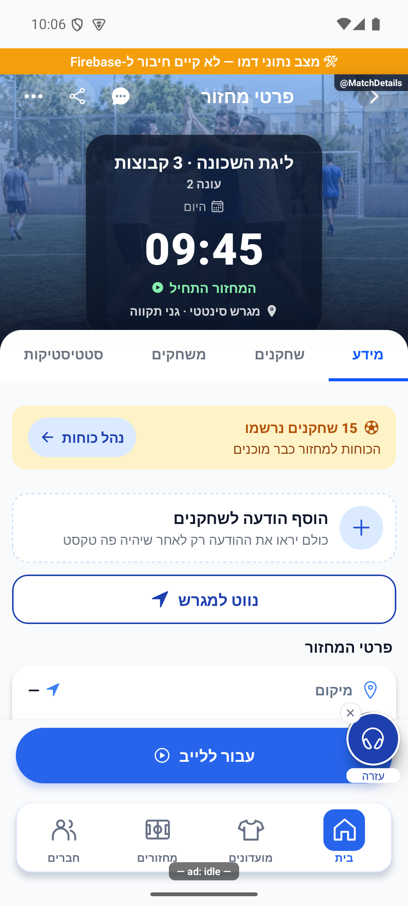
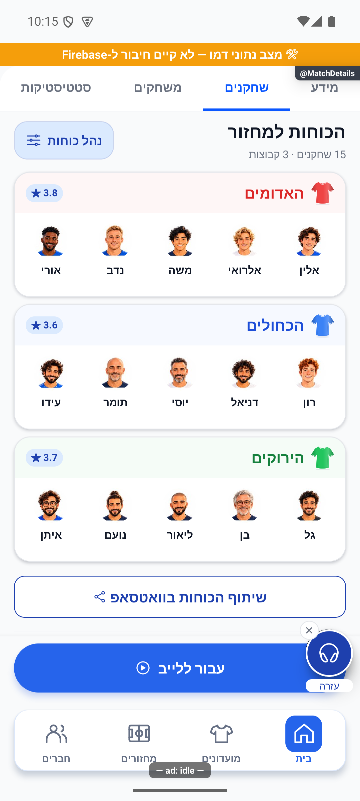

# פרטי מחזור וארבע הלשוניות — הסבר פשוט

## תיעוד כשלים — 20.10.2026

נוסף תיעוד אוטומטי לנקודות כשל במסלול הזה, עם מקור התקלה. הפעולה המקורית שומרת על ערכי החזרה והודעות השגיאה שלה. השינוי מקומי, טרם הופץ, ואין אימות מסירה חיה לפולס.

[דוח דיווח השגיאות והראיות](../../changes/2026-10-20-error-reporting-audit.md).

## תיקון פערי העונות — 20.10.2026

השינוי בקובץ השרת המשותף במסגרת תיקוני העונות נוגע לשער הסגירה, אימות מחזור והשלמת סטטיסטיקה בלבד. נתיבי הפיצ׳ר המתועדים כאן לא שונו בסבב זה. הבדיקות המלאות עברו; אין בכך אימות חדש של פריסה או שירות חיצוני.

[דוח תיקונים, בדיקות ומגבלות](../reviews/2026-10-20-seasons-fixes.md).

## אורח שהוסר אינו חוזר לכרטיס הקבוצה — 18.10.2026

במחזור פעיל, אורח שנמחק אינו מופיע שוב בחלוקת הכוחות כדמות בלי שם. הספירה והשיתוף מציגים את אותם הרכבים. שחקן שסומן שהלך הביתה עדיין שייך לתיעוד קבוצת הבסיס, ומשלים מוצג בקבוצת המקור שלו כמו קודם. תמונת החלוקה ההיסטורית נשמרת ואינה נערכת מחדש. העורך מציג אורח שקודם מהמתנה וטרם שובץ, בלי להחזיר אורח שנמחק.

התיקון נבדק גם באמולטור דמו: האורח המחוק נשאר בתמונת העבר, אך לא הופיע בין שש דמויות האדומים. האורח שקודם הופיע במאגר העריכה. לא בוצעה שמירה, ונתוני הדמו שוחזרו לאחר הצילומים. [צילומים וגבולות האימות](match-details.md#חלוקת-בסיס-נוכחית-ללא-אורחים-שנמחקו--18102026).

## שורת צירוף ובדיקת הפולס — 17.10.2026

אפשרויות הצירוף והזמנת הפנויים הועברו מהתפריט ללשונית השחקנים. בזמן הצטרפות מוצגת הודעת שמירה. מעבר למחזור אחר פותח את הלשונית שהתבקשה במקום לשמר בחירה ממחזור קודם.

[בדיקות, צילומים ומגבלות](../../changes/2026-10-17-roster-recruitment-and-pulse.md).

## בדיקות הפולס והגרסה הפנימית 1.1.55 — 17.10.2026

חלוקת כוחות דורשת מספיק נרשמים לשתי קבוצות מלאות לפי הפורמט. למשל, בארבעה מול ארבעה נדרשים שמונה; עם שבעה מופיע שחסר שחקן אחד. יוצר המחזור נטען גם כשאינו ברשימת המשתתפים.

[ראיות, בדיקות ומגבלות](../../changes/2026-10-17-internal-1.1.55.md).

## הירו ולשונית מידע בעיצוב חדש — 17.10.2026

ההירו מציג את פרטי המחזור על תמונת הרקע הקיימת: שם, עונה כשיש, מועד, שעה ומגרש בתחתית ימין; מונה הרשומים בתחתית שמאל, ו״המחזור התחיל״ מעליו כאשר החיווי רלוונטי. מזג האוויר מופיע בחלק העליון ומתייחס לשעת המחזור. ללא תחזית זמינה הוא מוסתר. במסך צר המידע יכול להמשיך לשורות נוספות.

לשונית ״מידע״ נפתחת בשלוש תגיות נמוכות ללא כותרת: פורמט, סוג מגרש ומשך משחק, כאשר הנתון קיים. אחריהן ניווט למגרש, כרטיס הכוחות ללא כותרת ״הכנות למשחק״, הודעת המארגן, וכרטיס המועדון והיוצר. תאריך יצירת המחזור הוא שורה שלישית מתחת ליוצר, עם שנה. הערות נוספות, כללים, אזהרות ופעולות קיימות נשמרו במקום הרלוונטי בהמשך.

״נהל כוחות״ נשאר מוגבל למנהל; טיוטה שטרם פורסמה אינה מוצגת ככוחות שכולם יכולים לראות. עריכת הודעה נשארת למנהל ורק במחזור שלא הסתיים או בוטל. הרשמה, ביטול, מעבר ללייב, שיתוף וצ׳אט ממשיכים לפי התנאים הקיימים.

[ההירו והתגיות הראשונות](../screenshots/round-info-hero-compact-final-2026-10-17.png) · [התוכן בגלילה](../screenshots/round-info-compact-final-2026-10-17.png) · [תצוגה צרה](../screenshots/round-info-small-latest-2026-10-17.png). נבדק באימולטור דמו; לא בוצעו פעולות מחזור בייצור. [חוזים ומגבלות](match-details.md#הירו-ולשונית-מידע-בעיצוב-חדש--17102026).

## כותרות הלשוניות במסך קטן — 17.10.2026

מידע, שחקנים, משחקים וסטטיסטיקות נשארות בשורה אחת, עם התאמת טקסט לרוחב כשהמקום צר. סדר הלשוניות, פעולת הבחירה וההסבר ללשונית נעולה נשמרו. התיקון מקומי ונבדק ברכיב וגם לאחר פתיחה קרה באימולטור אנדרואיד מול מחזור הבדיקה בייצור, במסך 320×569 ובגופן 140%: כל ארבע הכותרות נראו במלואן בשורה אחת, גם מעל סוף הטבלה. אין בכך בדיקת אייפון או כל מצבי הנעילה במכשיר. הצילום הקטן שבו אות אחרונה ירדה לשורה נפרדת נשאר ראיית הפגם בלבד.

17.10.2026: לשונית הסטטיסטיקה מבחינה בין טעינה, תקלה ומסמך חסר. בכשל אפשר לנסות שוב; ברענון נשמר הסיכום שכבר נטען באותו מחזור, ובמעבר מחזור או חשבון הוא מוסתר מיד. מצבי הכשל והמעבר נבדקו אוטומטית; סיכום קיים עם נתונים אמיתיים נצפה במחזור הבדיקה בייצור. [פירוט ומגבלות](match-stats.simple.md#טעינת-נתוני-המחזור--17102026).

שמות אורחים שהסיכום מפנה אליהם נפתרים מתוך אורחי המחזור, גם ללא חשבון. זה אינו משנה את מדיניות התארים או את סכומי המחזור; [ההסבר והגבולות](match-stats.simple.md#טעינת-נתוני-המחזור--17102026).

## סבב פולס מאושר — 16.10.2026

הוכן קיצור של זמן איסוף בקשות ההצטרפות משתי שניות לחצי שנייה. סדר הלחיצות נשמר בתוך האצווה. השינוי מקומי ויפעל בשרת רק לאחר פריסה נפרדת.

השינוי מקומי וטרם הופץ. [דוח, בדיקות וראיות](../../changes/2026-10-16-pulse-sweep.md).

## גישה לכוחות ובחירת הלייב — 16.10.2026

כפתור יצירת הכוחות נשאר זמין למנהל גם אחרי שעברו יותר משעתיים מתחילת המחזור, כל עוד המחזור לא הסתיים ויש מספיק שחקנים. תצוגת הלייב נקראת מחדש כשחוזרים אליה; אם טעינת ההגדרות נכשלה מופיע ניסיון חוזר, במקום לעבור בטעות ללייב רגיל. קבוצות שמורות לבדן אינן מפעילות את הלייב המתקדם: הגדרת המחזור ממשיכה לקבוע, לצד מצב ההשלמות הקיים.

## חלוקה שמורה אחת — 15.10.2026

במחזור יש חלוקת כוחות שמורה אחת. שמירת חלוקה חדשה, בכל שיטה, מחליפה את הקודמת גם בזמן לייב. פתיחת שיטה אחרת לבדה אינה משנה את הכוחות. טיוטה ידנית חלקית נשארת במכשיר ואינה מחליפה חלוקה מלאה. התוצאה והשעון של המשחק הפעיל נשמרים; תוצאות משחקונים שכבר נשמרו אינן נערכות מחדש.

תוקן מקומית אזור הלחיצה של הלשוניות לאחר גלילה וחזרה לראש. המעבר עדיין מתבצע בשחרור האצבע, וגרירה החוצה מבטלת אותו. בדיקות אימולטור אינן מחליפות בדיקה בגרסה מעודכנת בטלפון שבו הייתה התקלה.

## הזמנות ואישור מראש — 11.10.2026

הזמנה אישית ממנהל מאפשרת להצטרף בלי אישור נוסף, גם למועדון סגור. מצטרפים רק אחרי שלוחצים להצטרף; ההזמנה אינה שומרת מקום. במחזור מלא נכנסים להמתנה, ובמועדון מלא ההצטרפות נחסמת. קישור שיתוף רגיל אינו אישור מראש. הזמנה חדשה תקפה לשבעה ימים ולמחזור לא מעבר לגבול ההרשמה שלו; חסימה ודחייה קודמת אינן מתבטלות בגללה.

ברשימת ההזמנות מופיעים גם מצבים כמו הצטרפת, ממתין לאישור, המועדון מלא, הרשמה שטרם נפתחה והזמנה שאינה זמינה. השינוי מקומי ועדיין דורש פריסה והפצת גרסה.

זה המקום לראות את כל פרטי המחזור ולהירשם אליו. ארבע הלשוניות מציגות מידע, שחקנים, משחקים וסטטיסטיקה. הפעולות הזמינות משתנות לפי התפקיד שלך ולפי מצב המחזור.

[להסבר המעמיק ולמפת הקוד](match-details.md)

## צילום והיקף ההוכחה

הצילומים מציגים רק את המצבים המתועדים במסמך המעמיק. חלקם נתוני דמו, חלקם הוכחות מתיקון קודם, ובכמה מהם טעינה או הודעת הגנה; הם אינם אישור שכל התהליך או השרת נבדקו.

## עדכון 8.10.2026 — תנועה ותיקוני דיווחים

כרטיסי הקבוצות מופיעים ברצף קצר והמונה מגיב לשינוי במספר המשתתפים. הודעות הרשמה ממשיכות להבדיל בין הרשמה, המתנה ובקשה לאישור.

## תיקוני סבב הבאגים — 8.10.2026

אורח שממתין למקום אינו הופך חלוקת קבוצות לתקינה.

## השלמת הנפשות — 8.10.2026

בהמתנה למחזור רואים את המיקום בתור בתוך כרטיס שנפתח בעדינות. הרשמה שהצליחה משתמשת בתמונת המשתמש במשוב הקצר.

[פרטי האימות והמגבלות](../../changes/2026-10-08-motion-completion.md). מקור: `9ec0dfd` עם שינויים מקומיים; טרם פורסמה גרסה.

## שיפור תגובה בגלילה — 9.10.2026

צומצמה עבודה מיותרת של אנימציות ותמונות. מספרים מתייצבים בזמן גלילה, ואנימציות רקע מחזוריות נעצרות כשעוברים למסך אחר. הנתונים, סדר התוכן והניווט נשארים כפי שהיו. הבדיקה בוצעה באימולטור אנדרואיד עם נתוני דמו; טלפון פיזי ואייפון לא נבדקו.

## תיקוני דיווחים — 9.10.2026

פרטי המחזור מציגים את תמונת המועדון שמופיעה בכרטיס המחזור. מחזור ללא מועדון מקבל אותה תמונת ברירת מחדל בשני המקומות. בטעינת לשונית המשחקים הכותרת והלשוניות נשארות גלויות.

מקור: שינויים מקומיים מעל a348b9f; טרם נבנתה גרסה. [ראיות ומגבלות](../../changes/2026-10-09-pulse-round2.md).

## הגנת לחיצות אחרי גלילה — 9.10.2026

נוספה הגנה למצב שבו הגלילה כבר עצרה אבל המכשיר לא דיווח שסיים: הכפתורים אינם נשארים חסומים בגלל אירוע הסיום החסר. עדיין נדרש אישור במכשיר שבו דווחה התקלה.

[בדיקות ומגבלות](../../changes/2026-10-09-pulse-round2.md).

## תיקוני עיצוב ונגישות — 10.10.2026

מקור: `a348b9f235f1e1433497600555303231512a0834` עם שינויים מקומיים. אין בסעיף זה הוכחת גרסת חנות.

אפשרויות הניהול מקבלות שם ומצב ברור בקורא מסך, כולל מצב שבו אי אפשר לשנות.

## התאמת הלשוניות לגופן גדול — 10.10.2026

הלשוניות שומרות על טקסט מלא גם כשהגופן במכשיר מוגדל. לתווית ארוכה ניתן יותר רוחב, והגובה יכול לגדול בעת הצורך במקום להקטין את הטקסט. נבדק בפרטי מחזור באמולטור אנדרואיד עם גופן בגודל130%; אייפון ומכשיר פיזי לא נבדקו.

## בדיקת לחיצות אחרי גלילה — 10.10.2026

בדקנו לחיצות לאחר עצירת גלילה בפרטי מחזור ובפרטי מועדון. בניסוי דמו שדימה אירוע סיום גלילה חסר, הגנת הגלילה הקיימת אפשרה כבר את הלחיצה הראשונה. נוספה אותה הגנה גם לרשימת השחקנים במועדון. הנתונים, סדר השחקנים והחישובים לא השתנו.

התקלה לא שוחזרה באופן טבעי באמולטור. הניסוי מוכיח מסלול כשל מסוים, ואינו מוכיח שזו הסיבה בטלפון המדווח; שני הדיווחים נשארים פתוחים לאימות. [ראיות ומגבלות](../../../artifacts/pre-release-2026-10-10/scroll-press/README.md).

### עדכון 10.10.2026

אייקון ״נווט למגרש״ מיושר משמאל לטקסט.

## תיקוני דיווחים — 10.10.2026, אחרי גרסה 1.1.45

הלחיצה על לשוניות המחזור מקבלת תיעוד ממוקד. דיווח חסימת הלחיצות נשאר פתוח לאימות.

שינוי מקומי מעל bcca0886; לא נבנתה גרסה בסבב הזה. נבדק בקוד ובבדיקות אוטומטיות. צילומי אנדרואיד בנתוני דמו בלבד; אין אימות באייפון או בטלפון המדווח.

## תמונה אחידה ברשימה ובפרטים — 11.10.2026

אותו מחזור מציג כעת אותה תמונה ברשימת המחזורים ובפרטי המחזור. תמונה שהמועדון העלה קודמת לתמונות המובנות; אחרת נבחרת תמונה קבועה שמתאימה לסוג המגרש. החיתוך וההכהיה שונים בהתאם למקום שבו התמונה מוצגת.

צילום הרכיבים האמיתיים באמולטור אנדרואיד בתצוגת המחשה מנותקת ופעולות מנוטרלות; לא נבדק מול נתוני ייצור או באייפון. השינוי מקומי, טרם הופץ.

## גבולות מידע אישי — 11.10.2026

שמות ותמונות השחקנים נשמרים. מידע סטטיסטי של המועדון נשאר לפי הרשאות המועדון, והנתונים האישיים מוגבלים לפי הגדרות הפרטיות. השינוי הושלם מקומית וטרם הופץ.

## מאגר תמונות לפי משטח ושעת המחזור — 12.10.2026

המחזור מקבל תמונה מתוך מאגר של 60 תמונות: 10 לכל שילוב של דשא, סינתטי או אספלט ביום ובלילה. יש מגרשים, שחקנים, חימום ואווירת משחק. הבחירה נעשית לפי שעת המחזור בישראל ועונת השנה בקירוב, ונשארת זהה בבית, ברשימה ובפרטים. תמונה שהמועדון העלה בעצמו נשארת בעדיפות ראשונה. ללא תאריך תקין נבחר מאגר היום; ללא סוג מגרש נשמרת החלופה הקיימת.

[גלריית התמונות](../../../src/assets/images/roundCovers/index.html). השינוי מקומי ולא נכלל עדיין בגרסת החנות.

## חיווי הצטרפות — 12.10.2026

לאחר לחיצה על הצטרפות למחזור מופיע עיגול טעינה בכפתור עד לקבלת התשובה. לחיצות חוזרות בזמן העיבוד חסומות, ובכשל אפשר לנסות שוב. נבדק באנדרואיד בדמו עם המתנה יזומה של שבע שניות; טרם הופץ.

## כרטיסי הזמנות עם תמונה ואישור ישיר — 12.10.2026

הזמנות למועדונים ולמחזורים מוצגות בכרטיסים עם תמונת המקום, פרטי המזמין וכפתורי ״אישור והצטרפות״ ופרטים. במחזור רואים גם תאריך, שעה, מיקום, סוג מגרש ופורמט כשיש נתונים.

אישור הזמנת מנהל תקפה מצרף ישירות ופותח את פרטי אותו מועדון או מחזור במצב המעודכן. כשההרכב מלא, הכרטיס מציין שההצטרפות היא לרשימת ההמתנה; לאחר האישור המשתמש נכנס להמתנה, בלי להגדיל את ההרכב מעבר למכסה. במהלך האישור מופיע מחוון טעינה ולחיצות חוזרות חסומות. ההזמנה נעלמת אחרי הצטרפות או כניסה להמתנה. הזמנה אינה עוקפת חסימה, דחייה, מחזור סגור או תוקף שפג. הזמנה שאינה אישור מנהל עשויה להישאר ממתינה לאישור בהתאם להגדרות.

נבדק באמולטור אנדרואיד בדמו מנותק, וכן בבדיקות אוטומטיות של מסלולי הלקוח והשרת הקיימים. טרם הופץ.

## אורח מופיע מיד לאחר שמירה — 14.10.2026

אחרי שהוספת האורח נשמרת בהצלחה, הוא מופיע בלשונית השחקנים והמונה מתעדכן בלי רענון או יציאה. אם ההרכב מלא והאורח נוסף להמתנה, הוא מופיע ברשימת ההמתנה. השינוי מקומי, טרם הופץ; לא נבדקה הוספת אורח בייצור.

### חזרה לטיוטה ידנית חלקית — 14.10.2026

פרטי המחזור בודקים במיקוד המסך את הטיוטה המקומית במפתח `manual-allocation:userId:gameId`. טיוטה תקינה מפעילה כפתור ״המשך חלוקה ידנית״ למנהל במחזור שאינו סופי, גם מעבר לחלון הזמן של הצעת יצירת כוחות. לשונית המידע מציינת שמדובר בטיוטה, ולא בכוחות מוכנים. הכפתור מעביר `resumeManual` למסך החלוקה, שפותח ישירות את העורך ומשחזר את השיבוץ. הפרמטר רשום בשלוש מחסניות הניווט המארחות. זיהוי הטיוטה אינו משנה הרשאות או מפרסם כוחות; טיוטה חלקית עדיין נשמרת במכשיר בלבד. קריאה מאוחרת אחרי החלפת משתמש או מחזור מתעלמת מהתוצאה הישנה.

בדיקות `manualDraftResume.test.ts` מכסות טיוטה חלקית, טיוטה ריקה שמורה ונתונים לא תקינים. באימולטור אומתו הכפתור ופתיחת הטיוטה הקיימת עם השיבוצים, ללא שמירה חדשה או שינוי נתוני מחזור. טרם הופץ.

### שמירה במחזור פעיל ועדיפות לחלוקה האחרונה — 14.10.2026

לבקשת הבעלים, החלוקה הידנית מאפשרת שמירה גם כאשר המחזור התחיל, בדומה לאוטומטית. הוסרה חסימת `liveMatch.startedAt` וקיום `rotation.baseTeams`; מחזור שסיים או בוטל עדיין חסום. בדיקות שינוי ההרכב, מספר הקבוצות והפורמט נשמרו. בשמירה מועבר `originalTeams` הקיים כדי ששירות השמירה ישמר את היסטוריית פתיחת המחזור כשהוא פעיל. אין שינוי ברוטציה או בתוצאות משחקים.

טיוטה מקומית שומרת `baseDraftRevision`, חתימה על זמן יצירת הכוחות והרכבי הקבוצות שעליהם התבססה. פרטי המחזור והעורך משתמשים ב־`hasManualDraft(raw, savedRevision)`; חלוקה חדשה שנשמרה בשרת, גם בשיטה אחרת או במכשיר אחר, מבטלת את העדיפות של הטיוטה הישנה. הקובץ המקומי אינו נמחק, אך אינו משוחזר אוטומטית. טיוטות ישנות ללא חתימה משוחזרות רק כשאין חלוקה שמורה בשרת. פרסום בלבד אינו מבטל טיוטה. אין צורך בשדה חדש במסד או בממיר.

בדיקות `manualDraftResume.test.ts` מכסות את העדיפות, תאימות הטיוטות הישנות, שינוי הרכב עם אותו זמן יצירה ושמירת הגנות מצב סופי. צילום האימולטור מאמת שכפתור ״נהל כוחות״ מופיע במקום המשך ידני לאחר החלוקה האוטומטית הקיימת. לא בוצעה שמירה חדשה לשרת או בדיקת כתיבה במחזור פעיל באימולטור.

### תיקון החלפת כוחות ידניים והסבר הטיוטה — 14.10.2026

התיקון הקודם ששמר את `fresh.draftTeams.originalTeams` הוחלף: הוא גרם לפרטי המחזור להמשיך להציג את החלוקה הישנה למרות ששדה `teams` כבר הכיל את החדשה. כעת `createManualDraft` בונה גם `teams` וגם עותק נפרד `originalTeams` מהחלוקה הידנית החדשה, כמו חלוקה חדשה אוטומטית. `resolveSplitTeams` מציג אותה גם כשהרוטציה מכילה הרכב ישן; שינויים שוטפים בהרכב אינם משנים את העותק הקפוא החדש. לא משתנים הרכבי משחקים קודמים או נתוני הרוטציה.

פתיחת העורך מעדיפה טיוטה מקומית תקפה; בהיעדרה נטענת החלוקה השמורה מ־`draftTeams.teams`, ולא העותק הישן המיועד לתצוגה. היא מסוננת לפי המשתתפים הפעילים ומותאמת לקיבולת. כך אפשר לפתוח שיבוץ שכבר נשמר ולשמור אותו שוב בלי לבנותו מחדש. התיקון חל על שמירות חדשות; לא בוצעה הסבה של מסמכי מחזור קיימים.

משמעות השמירה: חלוקה חלקית נשמרת במכשיר בלבד ואינה מחליפה כוחות במחזור; חלוקה מלאה נשמרת בשרת עם `published:false`, מחליפה את הכוחות ומוצגת למנהל. פרסום חושף אותה לשחקנים. בדיקות `manualDraftReplacement.test.ts` מכסות החלפה עם רוטציה ישנה, תצוגה לפני ואחרי פרסום ועצמאות העותק הקפוא. לא בוצעה שמירה לשרת באימולטור לצורך הבדיקה; אין שינוי עיצוב.

## קבוצות עם השלמות

כשאין מספיק שחקנים למלא את כל הקבוצות, אפשר ליצור קבוצות בסיס מאוזנות עם השלמות לפני המשחקים. למשל, 13 שחקנים מחולקים ל־5, 4 ו־4. האיזון מתחשב גם בשחקנים שיוכלו להשלים, ולא רק בממוצע קבוצת הבסיס.

לפני משחק עם חוסרים המנהל בוחר בעצמו את המשלימים לשני הצדדים, ללא המלצה או בחירה מוקדמת. מי שנבחר לצד אחד לא ניתן לבחירה בצד השני. המשלימים חוזרים לקבוצת הבסיס לפני המשחק הבא, ומוצגת כמות המשחקים וההשלמות שכבר עשו. אישור ההרכבים אינו מפעיל את השעון; המנהל מפעיל אותו בנפרד. אם אין מספיק שחקנים, מופיעה הודעה ונדרש אישור מפורש למשחק בהרכבים חסרים.

הנתונים האישיים נזקפים לפי הצד שבו השחקן שיחק בפועל. לא מתווסף לו מחזור נוסף בגלל השלמה. השינוי מקומי ונבדק ברכיבי דמו ובבדיקות אוטומטיות; טרם הופץ למשתמשים.

הוכן תיקון לכך שהוספה או מחיקה של שערים שהושלמו תעדכן גם את ציון המחזור והממוצע, בלי לספור שוב מחזור. חישוב הציון משתמש באותו סרגל שהיה בסיום. אושרה פריסה ממוקדת. במחזור ישן שאי אפשר לשחזר את חישובו המקורי באופן ודאי, ההשלמה תיעצר בלי לשמור חלק מהנתונים. בנפרד, ציוני המחזור האחרון של ״כדורגל אנשים טובים״ כבר תוקנו בפועל לפי בקשת הבעלים, כולל הממוצעים.

השלמת שערים ובישולים אחרי הסיום מעדכנת גם את מספרי סיכום המחזור ואת כוכבי המחזור. במחזור האחרון שנבדק תוקן הסיכום ל־26 שערים ו־18 בישולים ב־6 משחקים. תוצאות המשחקים עצמן אינן משתנות. גם ביטול השלמה מחזיר את הנתונים בהתאם. במחזור ישן ללא נתוני השוואה מקוריים, לא מוצגים מחדש סיפורי שיאים שאי אפשר להוכיח. רענון מיידי באותו מסך הוכן בלקוח; בגרסה ישנה יש לפתוח מחדש את המסך.

תיקון השרת נפרס ואומת ב־14.10.2026 באישור הבעלים. ציוני המחזור האחרון וסיכומו הכללי תוקנו בפועל. לא נבנתה גרסת יישום חדשה במשימה זו; הרענון המיידי באותו מסך ממתין להפצת הלקוח.

## סבב פולס — 15.10.2026

השלמות כוללות גם אורחים פעילים במחזור. אפשר לגלול בכל ההשלמות ולנסות שוב במקרה של כשל טעינה. הצלחה בשמירה אינה מוצגת ככישלון אם הרענון שאחריה נכשל.

השינויים בסבב זה מקומיים וטרם הופצו. [דוח הסבב](../../changes/2026-10-15-pulse-sweep.md).

## תיקוני דיווחים חדשים — 15.10.2026

הכפתור ״נהל כוחות״ באזור המידע פותח את מסך חלוקת הכוחות. בתפריט מופיע הנוסח ״הזמן שחקנים זמינים מהאפליקציה״.

שינויים מקומיים אחרי גרסה 1.1.51; אינם כלולים בבינארי שכבר הועלה. תצוגה שנבדקה היא בדמו אנדרואיד בלבד, ללא בדיקת אייפון או חשבון המדווח.

## אימות מרונדר — 16.10.2026

באימולטור דמו הוצג מחזור עם 10 שחקנים ללא קבוצות חמש שעות אחרי תחילה; כפתור צור כוחות פתח את בחירת השיטה. בכשל קריאה חד־פעמי הופיע ניסיון חוזר, ולחיצה עליו פתחה את הלייב המתקדם עם שתי קבוצות ותוצאה 2:1 מתוך נתוני הדמו. לא הוזנו שערים ולא נוצרו כוחות במהלך בדיקה זו. בדיקת טיפוסים נקייה; 330 חבילות ו־3,909 בדיקות עברו. אין בדיקת מכשיר הבעלים או אייפון.

[צילום 1](../screenshots/live-mode-no-teams-fixed-2026-10-16.png) · [צילום 2](../screenshots/live-mode-draft-entry-2026-10-16.png) · [צילום 3](../screenshots/live-mode-error-2026-10-16.png) · [צילום 4](../screenshots/live-mode-advanced-after-retry-2026-10-16.png)

## כפתור ניווט ברור וממורכז — 17.10.2026

כפתור ״נווט למגרש״ מציג טקסט מעט גדול יותר ואת אייקון הניווט צמוד משמאלו, כיחידה ממורכזת. נשמרו המסגרת הכחולה, הרקע הבהיר והפעולה הקיימת. התווית הגלויה כעת בעברית בלבד.

הצילום נבדק באימולטור דמו בגופן רגיל. [פרטי המימוש והאימות](match-details.md#כפתור-ניווט-ממורכז--17102026).

## כרטיסי כוחות וכפתור ניהול — 17.10.2026

בלשונית השחקנים מופיעה כותרת ״הכוחות למחזור״ עם כמות השחקנים והקבוצות, ולצדה כפתור ״נהל כוחות״ למנהל. הכפתור פותח את אפשרויות העריכה, האיזון והחלוקה הקיימות. כשיש טיוטה ידנית הכפתור מציע להמשיך אותה.

כל קבוצה מוצגת בכרטיס בהיר: חולצה בצבע שלה, שם, דירוג בצד השני ותמונות שחקנים בגודל אחיד עם שמות. חמישה נכנסים בשורה, והרכבים גדולים ממשיכים לשורות נוספות. בקבוצה שחסרים בה שחקנים ממשיך להופיע הסבר על השלמה לפני המשחק. דירוג מוצג רק למי שהיה זכאי לראותו קודם.

כפתור ״שיתוף הכוחות בוואטסאפ״ קיבל עיצוב משני בהיר. פרסום הכוחות והכניסה ללייב ממשיכים לפעול באותו מסלול.

נבדקו באימולטור שלוש קבוצות של חמישה ופתיחת מסך הניהול וחזרה ממנו, בלי לערוך את הכוחות. [פרטי המימוש והבדיקות](match-details.md#אזור-כוחות-עם-כותרת-משולבת-וכרטיסי-סיכום--17102026).

## כרטיסי קבוצות נמוכים יותר — 17.10.2026

צומצמו מעט הרווחים בכותרת וסביב השחקנים בכרטיסי הסיכום המשותפים למסך הכוחות ולפרטי המחזור. גודל התמונות, הטקסט, שתי שורות לשם וחמישה שחקנים בשורה נשמרו. [צילום בדמו](../screenshots/compact-team-cards-2026-10-17.png).

## תלות בעדכון העונות — 19.10.2026

אפשר להכריע גם לגבי ערב שאורגן ולא נכנס ללייב. כשחסר מועד צריך לבחור אותו; מחזור מאושר ממתין לעיבוד הנתונים לפני סגירת עונה.

[מצב המימוש, הבדיקות ומגבלות האימות של העונות](../clubs/seasons.md). מקומי בלבד; לא בוצעה פריסה במסגרת המשימה.
