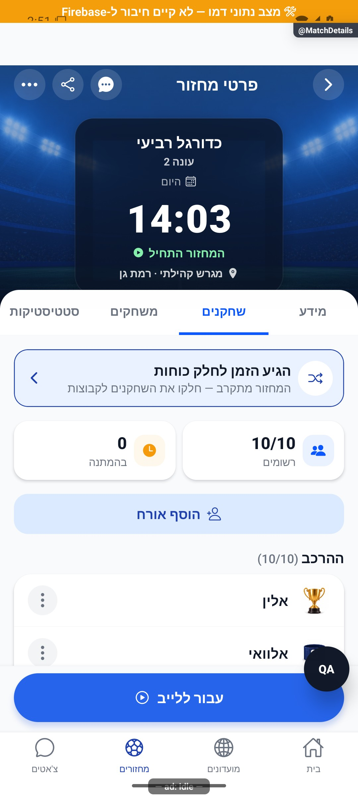
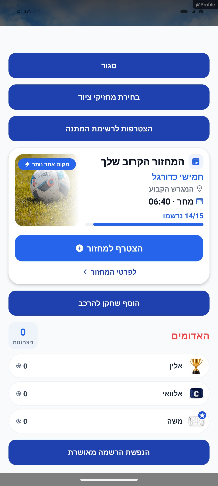

# שחקני המחזור, אורחים ותפריט שחקן — הסבר פשוט

## מדידת פעולות ואמינות נתונים, 5.11.2026

נוספה הכנה למדידת הפעולות ברכיבים המתועדים כאן. בפולס אפשר לראות ביצועים וחשבונות ייחודיים לפי פעולה ותקופה, כאשר קיים כיסוי מדידה. איסוף החשבונות החדש עדיין כבוי והמימוש מקומי. [פירוט והיקף הבדיקות](../../audits/2026-11-04-system-night/product-measurement.md).

## שיפורי טעינה משותפים, 4.11.2026

עודכנו מנגנוני הטעינה המשותפים כדי לצמצם עבודה וקריאות חוזרות. דרך השימוש בפיצר נשמרת. השינוי מקומי וטרם הופץ, ואין אימות מכשיר חדש של המסך הזה. [היקף, מדידות ומגבלות](../../changes/2026-11-04-screen-performance.md).

## התאמת מבנה שלדי הטעינה, 3.11.2026

נבדקה השפעת התאמת השלדים במקורות המשותפים. אין שינוי בנתונים, בחישובים או בפעולות העצמאיות של המסך. השינוי מקומי וטרם הופץ. נבדקו אזורי מקור בדפדפן בשלושה רוחבים, ללא בדיקת מכשיר חדשה. [המידות, הבדיקות והמגבלות](../../changes/2026-11-03-skeleton-layout-alignment.md).

כל 6,820 הבדיקות ובדיקת הטיפוסים עברו. האימות החזותי במשימה זו הוא בדפדפן בלבד.

## גרסת אנדרואיד פנימית 1.1.73, 3.11.2026

קוד הלקוח המתואר במסמך נכלל בגרסת האנדרואיד הפנימית 1.1.73/305. מקור החבילה, החתימה והמסלול אומתו מול החנות; הייצור נשאר 1.1.72/304. אין אימות התקנה מחנות או גרסת אייפון חדשה. תיקון השרת שמונע קידום מיידי מחדש של אורח שהועבר להמתנה עדיין ממתין לאישור פריסה. [מקור, בדיקות, קבלות ומגבלות](../../changes/2026-11-03-internal-1.1.73.md).

## העברת אורח לרשימת המתנה, 3.11.2026

מנהל יכול להעביר אורח שכבר בהרכב לרשימת ההמתנה באמצעות חץ מטה בשורת האורח. האורח עובר לסוף התור ושומר את שמו ודירוגו; מוני ההרכב וההמתנה מתעדכנים. חבר רגיל אינו מקבל את הפעולה. נבדק במסך המקורי עם נתוני הדגמה בלבד. התיקון מקומי וטרם הופץ, ונדרש גם עדכון שרת לפני הפעלתו למשתמשים.

[בדיקות, צילומים ומגבלות](../../changes/2026-11-03-guest-waitlist.md).

## בדיקת קצה ואימות מקורי, 2.11.2026

מקום הקריאה בסגל המחזור נשמר אחרי ההמתנה, ותוצאות קצרות אינן משתמשות במדידת שלד ישנה. מקומי וטרם הופץ. [שחזור, תיקונים, בדיקות ומגבלות](../../changes/2026-11-02-experience-review.md).

## המשכיות ומשוב בשימוש, 2.11.2026

בחזרה לסגל המחזור נשמר מקום הקריאה. משתתפים חדשים ממתינים ללחיצה על הצג כשקוראים בהמשך הרשימה. המונה ממשיך להציג את הסגל המלא והעדכני. מימוש מקומי שטרם הופץ. [התנהגות, בדיקות, צילומים ומגבלות](../../changes/2026-11-02-experience-polish.md).

## הרחבת אבחון דיווחים, 27.10.2026

הדיווחים יוכלו לכלול מה ניסו לבצע, מה היה מצב האפליקציה ומה החזיר השרת. פרטים חסרים מוצגים כלא ידועים, ומספר מוגבל של מופעים נשמר בלי למחוק את המופע הראשון. השינוי מקומי וטרם הופץ, ואינו משלים פרטים לדיווחים ישנים. [היקף, ראיות ומגבלות](../../changes/2026-10-27-diagnostic-context.md).

בדיקות הקוד הושלמו, אך השינוי עדיין מקומי ולא הופץ. פרטים שלא נאספו בדיווחים ישנים אינם משוחזרים בדיעבד.

## שעון מדויק וכיתוב פנדל - 25.10.2026

במקורות המשותפים נוסף שימור השעון המדויק של פנדל במהלך משחק, וכיתוב ההבקעה ביומן קוצר. אין שינוי במונים או בתהליך העצמאי המתואר כאן; לא נערכה לו בדיקת ממשק חדשה במסגרת העדכון. השינוי מקומי וטרם הופץ. [פרטים וראיות](../../changes/2026-10-25-in-play-penalties.md#שעון-מדויק-וכיתוב-אירוע).

## פנדל במהלך משחק חי - 25.10.2026

עודכנו מקורות משותפים לצורך פנדלים במהלך משחק. אין שינוי מכוון בתהליך העצמאי המתואר במסמך הזה, ולא נערכה לו בדיקת ממשק חדשה במסגרת המשימה.

השינוי מקומי. נדרשת פריסת שרת לפני הפצת לקוח שמשתמש באפשרות; לא בוצעו פריסה או שינוי הרשאות. [חוזה הנתונים, התהליך, הבדיקות ומגבלות ההפצה](../../changes/2026-10-25-in-play-penalties.md).

## חזרה מארון התארים לכרטיס המקורי — 24.10.2026

לערימת הניווט המשותפת נוסף רישום מקומי של ארון התארים, כדי שחזרה מכרטיס שחקן לא תחליף לשונית. אין שינוי מכוון בהתנהגות העצמאית המתוארת כאן, ואין בדיקת ממשק חדשה שלה. התיקון מקומי ולא הופץ. [מסלול הניווט, בדיקות, צילומים ומגבלות](../../changes/2026-10-24-cabinet-back.md).

## תיעוד כשלים — 20.10.2026

נוסף תיעוד אוטומטי לנקודות כשל במסלול הזה, עם מקור התקלה. הפעולה המקורית שומרת על ערכי החזרה והודעות השגיאה שלה. השינוי מקומי, טרם הופץ, ואין אימות מסירה חיה לפולס.

[דוח דיווח השגיאות והראיות](../../changes/2026-10-20-error-reporting-audit.md).

## הסרת אורח והרכב מעודכן — 18.10.2026

כשמנהל מסיר אורח, הוא מוסר גם מהרכבי הלייב ומהשלמותיו בלי להישאר כשחקן רפאים. שערים ובעיטות שכבר נרשמו אינם נמחקים. טיפול שרת משלים מיועד גם ללקוחות קודמים; אירוע הסרה שהתעכב לא יסיר שוב אדם שכבר הוחזר. נבדקו פעולות השירות והרשאותיו בקוד מבודד, ולא הסרה חדשה בסביבת הייצור. כללי השמירה ההיסטורית של אורח שכבר שיחק עוד טעונים אפיון ואינם משתנים בתיקון הזה.

## שורת צירוף ובדיקת הפולס — 17.10.2026

בלשונית השחקנים יש שורת פעולות אחת: צירוף חברים מהמועדון, הזמנת פנויים והוספת אורח. הספירות מופיעות בתוויות קטנות כדי להשאיר מקום להרכב. כל משתמש רואה רק את הפעולות המותרות לו.

[בדיקות, צילומים ומגבלות](../../changes/2026-10-17-roster-recruitment-and-pulse.md).

## בדיקות הפולס והגרסה הפנימית 1.1.55 — 17.10.2026

סמל הוספת האורח מופיע משמאל לטקסט. כשחסרים שחקנים לשתי קבוצות מלאות מופיע הסבר מדויק, ופעולות חלוקת הכוחות אינן מוצגות.

[ראיות, בדיקות ומגבלות](../../changes/2026-10-17-internal-1.1.55.md).

הוכן עדכון שיתריע למנהלים כשמצרפים אורח, כולל מי צירף אותו והאם נכנס להרכב או להמתנה. נדרשת פריסת שרת כדי להפעילו.

רואים מי בהרכב, מי בהמתנה ומי מחכה לאישור. מנהל יכול לנהל את הסדר ולהוסיף אורחים לפי הגדרות המחזור. לכל שחקן מוצגות רק פעולות שמתאימות לתפקיד ולמצב שלו.

[להסבר המעמיק ולמפת הקוד](match-players.md)

## צילום והיקף ההוכחה

הצילומים מציגים רק את המצבים המתועדים במסמך המעמיק. חלקם נתוני דמו, חלקם הוכחות מתיקון קודם, ובכמה מהם טעינה או הודעת הגנה; הם אינם אישור שכל התהליך או השרת נבדקו.

## השלמת הנפשות — 8.10.2026

כששחקן חדש מופיע ברשימת הרשומים, תמונתו נכנסת בתנועה קצרה. הרשימה הקיימת אינה חוגגת מחדש כשפותחים אותה. שינוי מחזיקי ציוד מדגיש רגעית את זהות השחקן.

[פרטי האימות והמגבלות](../../changes/2026-10-08-motion-completion.md). מקור: `9ec0dfd` עם שינויים מקומיים; טרם פורסמה גרסה.

## תיקוני עיצוב ונגישות — 10.10.2026

מקור: `a348b9f235f1e1433497600555303231512a0834` עם שינויים מקומיים. אין בסעיף זה הוכחת גרסת חנות.

בדירוג אורח אפשר לשמוע את שמו ואת הדירוג ולהגדיל או להקטין אותו ללא גרירה.

## תיקון דירוג אורח ושחקן — 12.10.2026

תוקנה קריסה באנדרואיד בעת הצגת דירוג עשרוני, למשל 4.5. הדירוג ממשיך לעבוד בעשיריות כפי שהיה. נבדקו פתיחה וגרירה באמולטור בדמו בלבד, בלי לשמור נתונים. התיקון עדיין לא הופץ.

## אורח מופיע מיד לאחר שמירה — 14.10.2026

אחרי שהוספת האורח נשמרת בהצלחה, הוא מופיע בלשונית השחקנים והמונה מתעדכן בלי רענון או יציאה. אם ההרכב מלא והאורח נוסף להמתנה, הוא מופיע ברשימת ההמתנה. השינוי מקומי, טרם הופץ; לא נבדקה הוספת אורח בייצור.

## תלות בעדכון העונות — 19.10.2026

קובץ תשתית משותף עודכן במסגרת העונות. שינוי זה אינו מוסיף פעולה חדשה למסך המתואר כאן; פרטי העונות והבדיקות מופיעים במסמך העונות.

[מצב המימוש, הבדיקות ומגבלות האימות של העונות](../clubs/seasons.md). מקומי בלבד; לא בוצעה פריסה במסגרת המשימה.

## תלות במידע על סגירת עונה — 23.10.2026

נוסף מידע משותף שמאפשר להסביר מדוע עונה מתעכבת בסגירה. אין שינוי נוסף בפעולות המתוארות כאן; השינוי מקומי וטרם הופץ. [המסלול, הבדיקות והמגבלות](../../changes/2026-10-23-season-automatic-recovery.md).

## תלות בשמירת צבעי המחזור — 24.10.2026

שמירת המידע המשותפת עודכנה כדי להעביר את צבעי הקבוצות ממסכי הכוחות להכנה וללייב. אין תוספת פעולה במסך הזה, והוא לא נבדק מחדש במכשיר במסגרת התוספת. השינוי מקומי וטרם הופץ. [פרטי התוספת ומגבלות הבדיקה](../rounds/draft-setup.md#צבעים-לפני-שיבוץ-ובכל-שיטת-חלוקה--24102026).
## קיצור פתיחת רשימת השחקנים - 25.10.2026

פתיחת סגל המחזור מבקשת את הנתונים פעם אחת במקום פעמיים. חזרה למסך עדיין מרעננת אותם, וסגל שמוצג בתוך מסך המחזור משתמש בנתוני ההורה. תשובה ישנה לאחר עזיבה או החלפת חשבון אינה מחליפה את הרשימה. התיקון מקומי ונבדק בקוד; זמן השיפור במכשיר טרם נמדד. [בדיקות ומגבלות](../../changes/2026-10-24-loading-performance.md).

## תלות בניווט עריכת קבוצות - 25.10.2026

נבדק השינוי הממוקד במקורות המשותפים: `src/navigation/GameStack.tsx`. נוסף מעבר מתפריט הלייב לחלוקת הכוחות עם שימור מפתח מסך המקור. אין שינוי נוסף בתהליך העצמאי המתואר כאן ולא נערכה לו בדיקת מסך חדשה. [היקף, בדיקות ומגבלות](../../changes/2026-10-25-live-draft-entry.md).

## תאימות לשמירת פקודת רכיב הבית - 25.10.2026

נוספה הגנה פנימית מפני ביצוע חוזר של פעולת רכיב הבית. התהליך המתואר בעמוד זה לא השתנה במכוון, ונתונים ישנים נשארים נתמכים. התיקון מקומי וטרם הופץ. [מקור הבדיקה והמגבלות](../../changes/2026-10-25-widget-completion.md).

## שלמות החלוקה המתוזמנת, 29.10.2026

במקורות המשותפים תוקנה שמירת חלוקה מתוזמנת לשש ולשבע קבוצות וסוננו אורחים שממתינים. דרך חישוב האיזון נשמרה. אין שינוי מכוון בפעולות העצמאיות המתוארות בעמוד זה ואין אימות מסך חדש שלהן; השינוי מקומי וטרם הופץ.

[היקף, בדיקות, פערים פתוחים ומגבלות](../../changes/2026-10-29-scheduled-balance-integrity.md).

## איזון ופיזור רמות לפני גיוון, 30.10.2026

עודכן החישוב המשותף של חלוקת כוחות לפי הדירוג הכללי: איזון הממוצעים קודם לפיזור הרמות, והגיוון מכריע אחרי שניהם. אין שינוי מכוון במבנה המסך או בפעולות העצמאיות המתוארות כאן, ואין אימות מכשיר חדש שלהן. השינוי מקומי וטרם הופץ או נפרס.

[מימוש, נוסחאות, בדיקות ומגבלות](../../changes/2026-10-30-rating-balance-priority.md).

## תיקו בשתיים או בשלוש קבוצות, 6.11.2026

נבדק שינוי תחום במקורות המשותפים `src/types/index.ts`: נוסף מסלול סיום משחק בתיקו בשתיים או בשלוש קבוצות, עם בחירה ידנית של הקבוצה שנשארת ושמירה במוני התיקו הקיימים. אין שינוי מכוון בפעולות העצמאיות של הפיצר המתועד כאן. בדיקות המסלול מפעילות שירות לקוח, ממירים וגוף שרת במאגר זיכרון; אין בכך הרצה חדשה של מסך זה. המימוש מקומי, ללא הפצה או פריסת שירות השמירה החדש. [התנהגות, נתונים, בדיקות ומגבלות](../../changes/2026-11-06-manual-draw.md).

## תלות משותפת בציון המחזור החדש, 6.11.2026

נוספה תמיכה מקומית בגרסת ציון למחזורי העתיד ובקריאת הרף הקפוא, תוך שמירת המודל של מחזורים קודמים. השינוי כאן תחום לתלות במקורות המשותפים, ואינו אימות חדש של כל המסלול העצמאי. אין פריסה, הסבת נתונים או שינוי ציוני עבר. [התנהגות, בדיקות ומגבלות](../../changes/2026-11-06-shared-evening-score.md).
