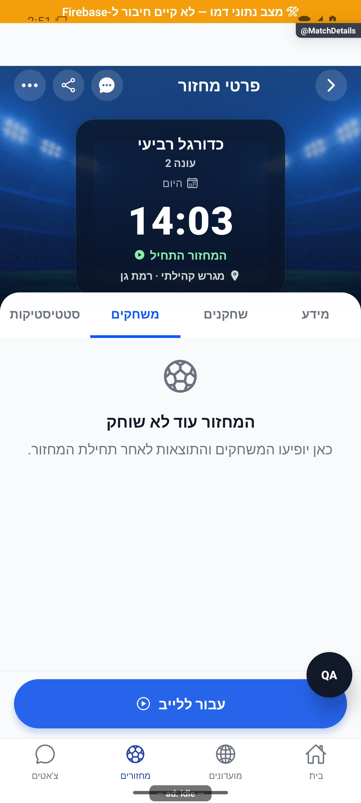

# תוצאות משחקים בתוך מחזור

## פריסת שרת מאושרת — 17.10.2026

`commitRoundStats` הפעילה כעת תואמת למקור המקומי, לרבות `assistStatus`, `outcome` ו־`roundParticipantSides`. שומר הכתיבות נשאר פעיל; לקוחות ישנים ללא סיווג בעיטה נשארים במסלול המורשת. המקורות הישנים של שלושת מחזורי הבדיקה לא שוכתבו. טרם נצפתה כתיבת משחק חדש אחרי הפריסה. [מצב הפריסה והראיות](../../changes/2026-10-17-server-preparation.md)

## קריאה אמינה והבחנה בתוצאות פנדלים — 17.10.2026

מקור: `4a3cb346` ושינויים מקומיים בהמשך לפיתוח 16.10.2026. אין בסעיף זה הפצה או פריסת שרת. [דוח העבודה הכולל](../../changes/2026-10-17-live-action-pitch.md).

`getRoundHistory` מעביר כשל קריאה כשגיאה; `MatchRoundsScreen` אינו ממיר אותו לרשימה ריקה ואינו ממיר כשל `getGameById` למחזור חסר. המחזור והרשומות נטענים יחד ומפורסמים כצילום מצב אחד רק לאחר ששתי הקריאות הצליחו ונמצא מחזור. כל השמות, האורחים וצבעי הקבוצות שייכים לאותו צילום מצב.

| מצב | תצוגה ופעולה | שינוי נתונים |
|---|---|---|
| טעינה ראשונה | חיווי טעינה; עדיין אין טענה שלא שוחקו משחקים | קריאה בלבד |
| קריאה ראשונה נכשלה או המחזור אינו זמין | ״לא הצלחנו לטעון את המשחקים״ וכפתור ״ניסיון חוזר״ | אין פרסום רשימה ריקה כאילו נטענה |
| הצלחה עם רשימה ריקה | הודעת ההיעדר המתאימה להקשר לייב/מחזור ששוחק/מחזור שטרם שוחק | אפס אמיתי לאחר קריאה מוצלחת |
| רענון נכשל לאחר הצלחה | המשחקים, זהויותיהם וצבעיהם נשארים; ״לא הצלחנו לעדכן את המשחקים״ וניסיון חוזר | צילום המצב הקודם אינו נמחק |
| ניסיון חוזר פעיל | הכפתור מושבת ומציג ״טוענים…״; הצלחה מסירה את השגיאה | קריאה חוזרת, ללא כתיבה |
| מחזור או זהות משתמש מתחלפים | הנתונים הקודמים מוסתרים מיד, עוד לפני ניקוי האפקט | אין זליגת רשומות בין הקשרים |
| תשובה מאוחרת/פירוק מסך | התשובה אינה מפרסמת נתונים ואינה מפעילה פתרון זהויות | אין שינוי לאחר יציאה |

`snapshot.owner` מורכב מ־`gameId`, מזהה המשתמש ומצב ההתחברות האנונימית. לפני פרסום תשובה נבדקים גם מונה הבקשה, חיות האפקט והזהות הנוכחית ב־`userStore`, כך שהחלפת חשבון מבטלת תשובה גם אם טרם הגיע רינדור נוסף. מסננים והרכבים פתוחים מתאפסים בשינוי הקשר, אך נשמרים ברענון אותו הקשר. המיקוד הראשון אינו מוסיף קריאה כפולה לטעינת הפתיחה; חזרה מאוחרת למסך לייב מרעננת את הרשימה. `live:true` עדיין אינו יוצר תוצאה.

יומן הפנדלים מציג כעת תווית מפורשת: גול, עצירה או החטאה. עצירה משתמשת גם בסמל יד, כדי שלא תהיה תלויה בצבע. בעיטה היסטורית ללא `outcome` שלא נכנסה מוצגת ״לא הובקע״; אין ניחוש אם הייתה עצירה או החטאה. השערים בפנדלים נשארים נפרדים מתוצאת השדה. שמות בעלי התפקידים יכולים להישבר לשורה נוספת, והתווית נשארת נפרדת.

### התאמת ההיסטוריה לנתונים שנשמרו

ב־`commitRoundStats` נשמר מבשל אורח רשום גם ב־`roundHistory.goals.assisterId`; קודם שורת המחזור זקפה לו בישול, אך ההיסטוריה השמיטה אותו. שער עצמי, בישול לעצמו ומבקיע לא ידוע אינם מקבלים בישול. הפתרון של שמות אורחים משתמש ב־`game.guests`, ומזהי אורחים אינם נשלחים לקריאת משתמשים. אורח שכבר הוסר ושמו אינו במקור הנוכחי ממשיך לקבל תווית אורח כללית; אין המצאת שם חסר.

כובש או מבשל אמיתיים שהוחלפו החוצה משוחזרים לפי החוזה הקיים של `buildRoundSides`, לצורך שמירת פעולותיהם והשתתפותם. `roundParticipantSides` משלים את הסגל ההיסטורי גם באורח רשום שכבש או בישל לפני שהוחלף; הוא משמש גם לזקיפת הופעת האורח ותוצאת המשחק ב־`gamePlayerStats`. אורח אינו נכנס בשל כך לנתונים גלובליים או לצמדי משתמשים. מגבלת 11 חלה על ההרכב האמיתי הנוכחי לפני השחזור; סיום 11 מול 11 עם משתתף משוחזר אינו נדחה רק משום שמספר המשתתפים שנזקפו גדול מ־11. נשמרים גבול 25 המשתתפים בצד היסטורי ומגבלת 440 הפעולות האטומיות, שנבדקת לפי המסמכים בפועל; אין כתיבה חלקית כאשר נחצה גבול האצווה. תיקוני השרת האלה מחייבים פריסה עתידית, ולא מוכחים באמצעות דמו.

בבדיקת ייצור מ־17.10.2026, תומר בישל לחשבון הבדיקה ואז הוחלף זמנית באיתי. השרת הקיים שמר לתומר `assists=1`, אך השמיט אותו מסגל ההיסטוריה וממוני ההופעה והתוצאה; גם מזהה המבשל בשער נשמר כריק. זו ראיה לפער בשרת הקיים, ולא הוכחת הפצת התיקון. מקור: `tmp/live-action-production/data-round-four-temp-swap.json` ו־`data-round-four-first-commit.json`, במשחק `r_mvbkmbvw_hoku9lb8` במחזור `lmUUmQru2HtKvQkRDVeD`. לא בוצעה הסבת הרשומות הללו.

השחזור המקומי טהור: הוא יוצר מערכי משתתפים חדשים ואינו משנה קבוצות מקור, השאלות או הרכב משחק הבא. הקבוצה נקבעת לפי `goal.team`; בכיבוש עצמי הכובש שייך לצד שספג. מבשל משוחזר רק לשער רגיל עם כובש ידוע, ללא בישול עצמי. אירוע שבוטל לפני השמירה אינו מוכיח השתתפות. מזהה שכבר משויך לצד אחד אינו משויך לצד שני; שחקן שכבר הועבר לצד האחר נשאר לפי החוזה הקיים של שיוך נוכחי. במסלול הכתיבה נדרשת הרשמה תקפה, ובשרת השחזור מוגבל לאורחי אותו מחזור. ברשומה ישנה חסרת צד או מזהה מבשל אין השלמה מנוחשת.

### בדיקות וגבולות האימות

`tests/logic/matchRoundsLoading.test.tsx` מפעיל את רכיב המסך: כשל ראשוני בכל אחת משתי הקריאות, ניסיון חוזר, רשימה ריקה אמיתית, שימור נתון בכשל רענון, מעבר מחזור, החלפת חשבון לפני תשובה ולפני רינדור, פירוק, מניעת קריאה כפולה במיקוד ראשון, ארבעת ניסוחי תוצאות הפנדלים ופתרון בישול אורח ללא קריאת משתמש. `dataLiveAudit/dataLiveAuditServerCommit` מפעילים גם את השירות ואת גוף פעולת השרת עם קלט ופלט מסד מבודדים, כולל גדלים 4/7/11, ניסיון חוזר, משתתפים משוחזרים, שימור בישול אורח וגבול אצווה. אלה אינן בדיקות ייצור.

המסך העצמאי ולשונית המשחקים המוטמעת משתמשים באותו מסלול. לא נוסף מסך או נתיב ניווט, ולא שונו הרשאות או חישובי המונים בתיקון התצוגה. צילומי כשל פתיחה וניסיון חוזר נאספו בידי סוכן הבדיקות בדמו אנדרואיד; רישומם יתווסף בידי המוביל בדוח הכולל. בתצוגה המוגדלת נמצאו ותוקנו שני הממצאים להלן. צילום חוזר לתיקוני הצבעים והשמות הועבר לסוכן הבדיקות; עד שילובו אין טענה שתיקונים אלה אומתו חזותית. תוצאות כל החבילה יפורטו בדוח הכולל לאחר השילוב.

### צבע אחרי הכנה ושמות ארוכים — 17.10.2026

צילום ניסיון חוזר בדמו ברוחב 320 ובהגדלת טקסט ל־140% הראה קבוצה ירוקה כאדומה, ובישול שנדחק כמעט לאפס רוחב לצד שם כובש ארוך. תחילה נבדק מקור הנתונים: `draftTeams.teams` כלל ירוק/כחול/אדום, `originalTeams` ירש צבעים חסרים, וברשומת ההיסטוריה נשמרו רק אינדקסי קבוצות. אותה סתירה יכולה להיווצר במוצר, משום ששינוי צבע בהכנה מעדכן את הקבוצות הנוכחיות אחרי צילום חלוקת השחקנים.

`originalRosters` נשאר המקור לשחזור שיוך קבוצה ברשומות ישנות שאין בהן אינדקס. `splitForColors` נלקח מהקבוצות הנוכחיות, כמו בלייב, ורק בהיעדרן מהצילום המקורי. `RoundCard` מקבל את שני המקורות בנפרד; שינוי הצבע אינו משנה שיוך שחקנים, צדי תוצאה או מנצחים. אין ברשומות הקיימות צילום צבע נפרד לכל משחק, ולכן אין לטעון שהמסך מסוגל לשחזר שינויי צבע שבוצעו באמצע המחזור: הוא מציג את זהות הקבוצות השמורה במחזור. לא נכתב צילום צבע היסטורי מנוחש.

כובש ובישול מוצגים כעת בשורות עצמאיות בתוך עמודה גמישה; שם יכול להישבר לשורות ללא מגבלת שורה אחת. הדקה נשארת בעמודה נפרדת ולא מתכווצת. כך שם ארוך אינו דוחק את המבשל לאזור שאינו קריא. שער עצמי משתמש באותו מבנה. זו תצוגה בלבד, ללא שינוי במיון שערים או בנתונים.

נוספו בדיקות לצבע מקורי אדום מול צבע נבחר ירוק, לשחזור אינדקס לפי הרכב מקורי כאשר ההרכבים הנוכחיים הוחלפו, ולשמות כובש/מבשל עם שורות עטיפה עצמאיות. כעת יש 16 תרחישי רכיב ב־`matchRoundsLoading`; יחד עם בדיקות הזהויות ושני מבחני ההגנה עברו 361 בדיקות, ובדיקת הטיפוסים נקייה. בדיקת המרווחים ברכיב אינה תחליף לצילום המכשיר החוזר.

## תיקון דמו — 14.10.2026

במצב `USE_MOCK_DATA`, `_commitRoundStatsAndClear` שמר בעבר רק את קידום הרוטציה וניקה שערים, בלי לכתוב ל־`mockRoundHistory` שממנו `getRoundHistory` קורא. כעת הוא יוצר לפני הניקוי תמונה עצמאית של ההרכבים בפועל (כולל משלימים ואורחים), צבעי הקבוצות, התוצאה, השערים והפנדלים. `saveMockRoundHistory` שומר פעם אחת לפי `roundCommitKey`; ניסיון חוזר מחזיר את המנצח שכבר נשמר. אין שינוי במסלול השרת או בנתוני ייצור.

בדיקות: `tests/logic/mockRoundHistory.test.ts` בודק שלושה משחקים רצופים, העתקה לפני ניקוי ומניעת כפילות, ומריץ גם את מתודת השירות עצמה בבידוד. תיקון 17.10 מוסיף שימוש ב־`roundParticipantSides` לפני השמירה, לרבות אורח שיצא בחילוף. `dataLiveAuditGuestDemo` מפעיל את המתודה עם חילוף זמני אמיתי במנוע, ובודק כובש ומבשל יוצאים, ביטול וניסיון חוזר בלי שינוי הרכב. `dataLiveAuditParticipants` בודק את חוזה הלקוח והשרת ואת התאמת העותק המופק; `dataLiveAuditServerCommit` בודק זקיפה אטומית של אורח יוצא בהרכבי 4/7/11. אלו בדיקות קוד מבודדות; לא בוצע שחזור ממשק של התיקון החדש, ואין בכך הוכחת תיקון נתוני ייצור קיימים. משחקי דמו שהסתיימו לפני תיקון רישום ההיסטוריה לא נרשמו ואי אפשר לשחזר את פרטיהם ממספר המשחק בלבד.

עודכן: 7.10.2026. מקור הקוד: `8e8fde5`, גרסה `1.1.35`. מסמך זה מתאר את הקוד; מצב חנות ופריסת שרת דורשים ראיה נפרדת.

## כניסה ותפקידים

MatchDetails → משחקים; תפריט לייב → MatchRounds {gameId,live:true}

הרשאת צפייה נגזרת הקשר; מסך רשום בכל מחסנית שמארחת הורה.

## רכיבים ומצבים

| רכיב / מצב | התנהגות וחוזה |
|---|---|
| רשימה | roundHistory שנשמר; מיון לפי at ואז id בסדר עולה |
| מסנן | הכול / קבוצות, צבעים ושמות; מונה מציין מספר תוצאות מתוך הכול |
| תוצאה | צדי משחק, מנצחת/תיקו ופנדלים נפרדים |
| שערים | שחקן, דקה, מבשל ושער עצמי; אינם מספר משחקים |
| הרכבים | פתיחה וסגירה לשתי קבוצות; שמות אורחים מתוך resolver |
| לייב | רענון במיקוד ושינוי מצבים בזמן חזרה; live:true אינו יוצר תוצאה |
| נתון חסר | היסטורי בלי תיעוד מוצג כך; לא להמציא אפסים או לומר שטרם שוחק |

## מסלול נתונים ומקומות שינוי

[`src/screens/games/MatchRoundsScreen.tsx`](../../../src/screens/games/MatchRoundsScreen.tsx)

gameService ורשומת committedRoundCount/roundHistory; ייצור דרך commitProtocol/roundSummary. eveningPlayed מפריד התקיים בלי תיעוד מטיימר שלא התחיל.

ממיר המחזור: [`src/firebase/firestore.ts`](../../../src/firebase/firestore.ts), `gameDocConverter.fromFirestore`; סוגים: [`src/types`](../../../src/types). שינוי שדה דורש מעקב כתיבה → ממיר → שירות/חנות → רכיב. ניווט: [`GameStack.tsx`](../../../src/navigation/GameStack.tsx), ובמסכים משותפים גם המחסניות שמארחות אותם.

## בדיקות וראיות

roundSides, historyOrder, idempotency, shootoutPersistence; לוודא שמות לטיניים ומונים בכיווניות.

צילומי המיפוי מהאמולטור נעשו במצב נתוני דמו, המסומן בפס כתום. הם מוכיחים את הרכיב והמצב המוצגים בלבד, ולא ממירי Firebase, נתוני ייצור או כתיבה. צילומי תיקונים קודמים מסומנים בנפרד. שגיאת מזהה, מצב טעינה או שער הגנה אינם הוכחת הפעולה המלאה.

לא נאסף צילום עדכני תקף למסלול העצמאי הזה; התיאור נשען על הקוד.

## גבולות והערות תחזוקה

זה מסך המשחקים בתוך ערב, לא היסטוריית המחזורים. להיסטוריית מועדון: ../clubs/history.md; אישית שייכת לתיעוד הבית/המשתמש.

לפני שינוי פתח את הקוד המקושר ואת [כללי הפרויקט](../../../AGENTS.md). לאחר שינוי עדכן במסמך זה את התאריך, נקודת הקוד, המצבים שהתעדכנו, הבדיקות והצילום. אין לטעון שכל מצב/תפקיד נבדק רק משום שקיים צילום אחד.

## פירוט טכני ממוקד: זרימה, חישוב ונקודות שינוי

[הסבר פשוט למשתמש](match-rounds.simple.md)

העמקה: 07.10.2026, מול קוד המקור שב־`8e8fde5`. בעת הכתיבה HEAD הוא `50d508f`; בדיקת ההפרש בין הנקודות ב־`src` וב־`functions` לא מצאה שינוי קוד. הסעיפים וההסתייגויות הקיימים נשמרו. זו קריאת קוד ותיעוד, בלי הרצת תרחישי כתיבה חדשים.

המסך מציג `roundHistory` שנוצרה במסלול הזקיפה, וממיין לפי זמן `at` ואז מזהה. `live:true` משפיע על הקשר רענון בלבד; לא יוצר משחקון ולא מגדיל מונה. צד א/ב ברשומה הוא צילום מצב בזמן המשחקון, לא בהכרח אותה קבוצה שמשחקת עכשיו.

המונה במסנן הוא מספר רשומות מוצגות מתוך כלל הרשומות: 6 משחקונים ושניים במסנן הכחולים פירושם 2 מתוך 6, לא שני מחזורים. סכום שערי רשומות כולל שערי שדה; יומן הפנדלים מוצג בנפרד. אין לייצר רשומות חסרות מתוך `committedRoundCount` בלבד.

היסטוריית משחקון וסטטיסטיקות המשחקון נשמרות יחד באצווה ב־`commitRoundStats`, דרך [פרוטוקול הזקיפה](../../../functions/src/commitProtocol.ts). ניסיון חוזר אינו דורס היסטוריה קיימת ואינו מגדיל מונים שוב. סיכומי המחזור כולו הם שלבים נפרדים; קריאת משחקון אינה מוכיחה שכל שלבי סיכום המחזור כבר הסתיימו.

נקודות שינוי: סינון ומיון במסך, בניית צילום מצב ב־`roundSummary`, ושמות/אורחים ב־resolver. בדוק תאריכים שווים, שם לטיני, אורח שעזב, שער עצמי, שוויון ומזהה זקיפה חוזר.

## תיקוני סבב הבאגים — 8.10.2026

B07 והרחבת 10.10.2026: היסטוריית המשחקון, תוספות המונים, חתימת `committedRounds` וניקוי הלוח נכתבים באותה אצווה אטומית. יצירת חתימה מאפשרת מנצח יחיד; תנאי גרסת המחזור מונע איבוד שער מתחרה. מגבלת האצווה כוללת גם היסטוריה וגם כתיבת מחזור. בקשה חוזרת מקבלת את התוצאה ומדיניות התיקו השמורות, ואינה זוקפת משחקון נוסף. 0:0 שהתחיל נשמר; משחקון ריק שרק הוכן אינו נשמר; תוצאה שכבר נזקפה אינה נספרת שוב בסיום הערב. תיקון היסטוריה חסרה משתמש ב־`create` ומטפל רק ב־`already-exists` כתוצאה תקינה. `preReleaseRoundIntegrity` משחזרת את המצבים בקוד המקורי עם קלט/פלט מבודדים. השינוי מקומי ומצריך פריסת שרת לפני שישפיע בייצור; לא בוצע תיקון תוצאות היסטוריות או סיום מחזור אמיתי.

[ראיות, בדיקות ומגבלות](../../changes/2026-10-08-audit-fixes.md).
