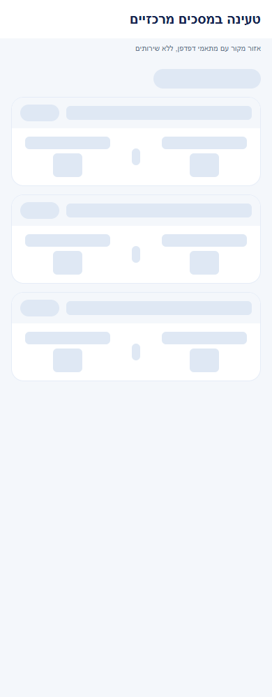
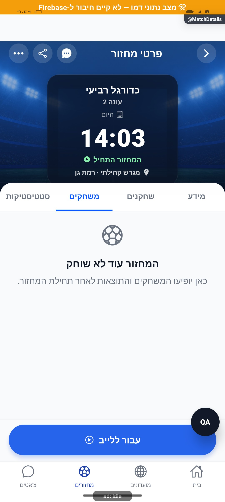

# תוצאות משחקים בתוך מחזור

## עצירת מחזור קבוע ללא פעילות, 6.11.2026

נבדק השינוי התחום ב-`functions/src/index.ts`: בדיקת חוסר פעילות לפני יצירת מחזור קבוע ושמירת שלוש החלטות בזמן ניקוי מחזורים ריקים. ההכרעה משתמשת במקור הקיים לקיום מחזור ומגינה על מחזור עם הרשמה שנותר לא מוכרע. עסקאות היצירה והניקוי נשארות מוגנות מפני שינוי מקביל ומועדון חסר. אין שינוי מכוון בחישובים, במכנים, בהרשאות, בניווט או בפעולות העצמאיות האחרות של הפיצר הזה. בדיקות מקור השרת הורצו במאגר זיכרון; הפריסה הממוקדת של שני שירותי התזמון אומתה בייצור מול המקור שנבדק, ותועדה הרצת שירות חמש הדקות ללא שגיאות. אין בכך אימות חדש של המסך או של יתר פעולות הפיצר. [ההתנהגות, מסלול הנתונים, הבדיקות ומגבלות ההפעלה](../../changes/2026-11-06-inactive-recurring-rounds.md).

## תיקו בשתיים או בשלוש קבוצות, 6.11.2026

החלון `src/components/match/Shootout.tsx` מעביר בחירה מפורשת אל `src/screens/AdvancedLiveMatchScreen.tsx` ו-`src/services/gameService.ts`. `src/utils/drawRotationPreview.ts` ו-`src/services/rotationEngine.ts` שומרים על התאמה בין הפירוט לתור בפועל. `RoundTieResolution` ב-`src/types/index.ts` מוסיף `stayA`, `stayB` ו-`keepPlaying`; השרת ב-`functions/src/index.ts` שומר את הבחירה בקבלת המשחק וממשיך לספור תיקו, הופעות, שערים ובישולים במסלול האטומי הקיים. אין שדה חדש בממיר המחזור ואין שינוי בחישוב הציון.

היחידה היא משחק בתוך מחזור: `communityStats.rounds` ו-`tiedRounds` גדלים באחד; לכל משתתף רשום בפועל גדלים `rounds` ו-`ties` בנתוני המחזור והמועדון, ו-`users.stats.ties` גדל באחד. הקבוצה שנשארת אינה מנצחת והממתינים אינם משתתפים. הבחירה השמורה גוברת על ניסיון חוזר. `tests/logic/manualDraw.test.ts` מפעיל שירות לקוח, ממירים וגוף שרת מול מאגר זיכרון; `tests/logic/tieDecisionConfirmation.test.tsx` בודק בחירה ידנית, פירוט ואישור. נבדקו רכיבי המקור בדפדפן בשישה צירופי קבוצות, רוחב וגופן לפני ואחרי; אין אימות מכשיר או שרת ייצור חדש. השירות `commitRoundStatsWithDrawRotation` מחייב פריסה עתידית לפני הפצת לקוח; לא בוצעה פריסה במשימה. [התנהגות, נתונים, בדיקות ומגבלות](../../changes/2026-11-06-manual-draw.md).

## כיסוי הבדיקה המשותפת, 6.11.2026

`tests/logic/matchStatsReadState.test.tsx` הותאם לבידוד כרטיס הפנדלים החדש בלשונית הסטטיסטיקה. אין שינוי במסך המשחקים או בפירוט הבעיטות הקיים. הכרטיס החדש מכוסה בנפרד ב-`tests/logic/roundPenalties.test.tsx`; [מימוש וראיות](match-stats.md#פנדלים-במחזור-6112026). אין בדיקת מכשיר חדשה למסך המשחקים במסגרת השינוי הזה.

## ממצאי סבב הפולס, 5.11.2026

נוספה בדיקת מסלול ב-`tests/logic/liveTeamsEndToEnd.test.ts`: לאחר זמן משחק חיובי, סיום מחזור בתיקו מייצר רשומת היסטוריה אחת, משחק אחד במונה ותיקו אחד גם בקריאה חוזרת. אין ניצחון או הפסד, ואין קידום למשחק נוסף. לא שונה שירות הקריאה של ההיסטוריה. מקומי, ללא הפצה או אימות מכשיר חדש. [ממצאים, בדיקות ומגבלות](../../changes/2026-11-05-pulse-sweep.md).

## מדידת פעולות ואמינות נתונים, 5.11.2026

במיפוי מקור הרכיבים המוזכרים במסמך נמצאו 13 נקודות מטפל ו-13 מזהי פעולה. הספירה מתארת קוד וכוללת רכיבים משותפים; אין לחבר אותה לספירות של מסמכים אחרים ואין לראות בה הרצת כל המסך. המדידה מפורטת לפי גבול פקד מקורי, פעולה עסקית ומצב חשבון. תשובה מאוחרת נבדקת מול בעל הפעולה, ומצב קיים או בקשה חוזרת אינם תמיד הצלחה חדשה. רשימת המקרים שהורצו ומגבלות המסד, המכשיר והכיסוי נשמרות [בדוח המדידה](../../audits/2026-11-04-system-night/product-measurement.md) ובדוחות המקושרים אליו. המימוש מקומי; לא בוצעה בדיקה חדשה של כל מצבי הפיצר.

## חיפוש שחקנים וזמני טעינה, 4.11.2026

קריאת מחזורים עתידיים של מועדון יכולה להעביר כשל גישה לחלונית ההזמנה כשהיא מבקשת תשובה מאומתת. ברירת המחדל של יתר הקוראים נשמרת. בדיקה זו תחומה למקור המשותף, ללא הרצה חדשה של כל המסך העצמאי. מימוש מקומי שטרם הופץ. [השינוי, המדידות והבדיקות](../../changes/2026-11-04-player-discovery-speed.md).

## ציר פעילות פרטי בפולס, 4.11.2026

נבדקו התוספות במקורות המשותפים לצורך ציר פעילות פרטי בפולס: דיווח ניווט והקשר, תיעוד ניסיון הרשמה ותוצאתו וגבולות זהות ומחיקת חשבון. התוספת היא תיעוד ברקע במקומות הנתמכים; אין מכך אימות חדש של כל מצבי הפיצר הזה או שינוי בחישוביו. מקומי וטרם הופץ או נפרס. [היקף, מקורות, בדיקות ומגבלות](../shared/usage-activity.md).

## השפעת שיפורי הטעינה המשותפים, 4.11.2026

מסכי המחסניות נרשמים באמצעות טעינת מודול לפי צורך, וכל שמות המסלולים נשמרו. הבית מורכב מתחת לספלאש. אין מסלול חדש או שינוי בתנאי ניווט של הפיצר הזה.

מקורות משויכים שנבדקו בהיקף השינוי: `src/navigation/GameStack.tsx`.

מימוש מקומי וטרם הופץ. אין בכך אימות מכשיר חדש של הפיצר הזה או מדידת מהירות של כל מסלוליו. [המדידות התחומות, הבדיקות והמגבלות](../../changes/2026-11-04-screen-performance.md).

## הפצה פנימית 1.1.74, 3.11.2026

עדכוני הלקוח ב-`src/components/loading/CentralSkeletons.tsx`, `src/screens/games/MatchRoundsScreen.tsx` כלולים בחבילה הפנימית 1.1.74/306. ארכיון המקור המקומי וחתימת החבילה אומתו מול החבילה שהחזירה גוגל. מקור הבסיס הוא `06417f6132f4c7636aaee25574354ed7722966b9` עם שינויים שלא נשמרו לגיט.

עברו 6864 בדיקות יישום, בדיקות טיפוסים, 360 בדיקות הרשאות בסדרה ו-38 בדיקות שרת במסד הדגמה. ההרשאות והשירותים הפעילים נשמרו, ללא הסבת נתונים או קידום לייצור. האימות החזותי הוא מצילומי המקור בדפדפן שכבר תועדו, ללא התקנה או הרצת הפיצר הזה במכשיר בגרסה החדשה. אין בכך הכרזה על הפצת שינויים אחרים המתועדים במסמך. [מקור, קבלות, תכולה ומגבלות](../../changes/2026-11-03-internal-1.1.74.md).

## הרחבת טעינת השלד במסכים מרכזיים, 3.11.2026

אזורי המקור המשויכים שנבדקו בדפדפן: `games-false`, `games-true`. השלד יושב בענפי ההמתנה הקיימים; סוגי השלדים נמצאים ב-`src/components/loading/CentralSkeletons.tsx`. מצבי כשל, ריק, פרטיות והחלפת הקשר נשארים נפרדים. אין שינוי בשירותים, בחישובים, במכנים או בהרשאות. ההמתנה ברענון לוח המנהל שומרת מידע שכבר התקבל עבור אותו חשבון ומועדון; בכרטיס האישי נשמר מנגנון הקריאה הקיים, לרבות איפוס חלקיו בתחילת ביקור.

מקורות משויכים שנערכו: `src/screens/games/MatchRoundsScreen.tsx`, `tests/logic/matchStatsReadState.test.tsx`, `tests/logic/matchRoundsLoading.test.tsx`.

[טבלת המבנים, תנאי ההכרעה, מסלול הנתונים, הבדיקות והמגבלות](../../changes/2026-11-03-central-screen-skeletons.md). מקומי וטרם הופץ. האימות החזותי תחום לאזורי מקור עם מתאמי דפדפן, ללא אימות מכשיר או שרת חי חדש.

בדיקות במשימה זו: 6,831 בדיקות ב-609 חבילות ובדיקת טיפוסים עברו. נבדקו 25 מצבי מקור ב-162 בדיקות רוחב, ובוצעו תשע השוואות מידות לרכיבי תוכן. אין בכך אימות מכשיר חדש של הפיצר או של מצבים שאינם כלולים בדוח.

## אימות פרסום קבוצות בפולס, 2.11.2026

נבדק ההפרש התחום בשירות המשותף של המחזורים: נוספה בדיקת אישור לפרסום קבוצות כאשר תשובת הפעולה אובדת. אין שינוי בחישוב, במכנים או בפעולות העצמאיות של הפיצר המתואר כאן. התיקון מקומי וטרם הופץ; אין בדיקת מכשיר חדשה לפיצר זה.

השינוי ב-`src/services/gameService.ts` מוגבל ל-`publishDraftTeams` ולתלות בסיווג כשלים זמניים. נבדקו גבולות קבלת השרת, התאמת החשבון והחלוקה, ושימור השגיאה כאשר האימות נכשל. `tests/logic/publishTeamsReceipt.test.ts` מפעיל את פונקציית השירות מול תחליפי קריאה וכתיבה; אין בכך הרצת כל המסלולים של המסמך הזה.

[דוח הטיפול, הבדיקות והמגבלות](../../changes/2026-11-02-pulse-sweep.md).

## הרחבת אבחון דיווחים, 27.10.2026

נוספה מעטפת אבחון מקומית עם מצב בזמן הכשל, שלבים בעלי מזהה ותזמון, מצב רשת ובנייה ומופעים נפרדים לשגיאה. נקודת הכניסה לתעבורת השרת עוברת כעת דרך העטיפה המשותפת; תשובות, חריגות, אפשרויות קריאה ומדיניות הפיצר נשמרות. אין כאן שינוי בהרשאות או בחישובי המוצר. הבדיקות המלאות ומגבלות האימות מתועדות בדוח המקושר; אין טענה לאימות מכשיר או להפצה. [היקף, ראיות ומגבלות](../../changes/2026-10-27-diagnostic-context.md).

באימות הסופי עברו כל 6,231 הבדיקות ב-555 חבילות, ובדיקות הטיפוסים של הלקוח, השרת והפולס נקיות. צילום הדפדפן והידור מקורות האנדרואיד הם בדיקות מקומיות; אין הוכחת מכשיר, הידור אייפון או מסירה חיה של הבנייה החדשה. רישום יומן השחרור נחשב מאומת רק לפי קבלת הקריאה החוזרת בדוח השינוי.

## אחידות כפתורי הביטול - 25.10.2026

כפתור הביטול של פנדל ביומן המשחק נראה כעת בדיוק כמו כפתור ביטול גול רגיל: איקס אפור בתוך עיגול מלא בהיר. ב-`src/components/match/LiveScoreboardCard.tsx` הוחלף סמל המתאר באותה עטיפת `undoCircle` ואותו סמל `close` בגודל 14 של גול רגיל. גם הגדרת הכפתור הנגישה, מצב ההשבתה והרחבת אזור הלחיצה זהים. מנגנון ביטול הפנדל ואישור הביטול לא שונו. [ראיות ומגבלות](../../changes/2026-10-25-in-play-penalties.md#אחידות-כפתורי-הביטול). מקומי וטרם הופץ.

## הסרת עריכת פנדל - 25.10.2026

ביומן הלייב הוסר העיפרון לעריכת פנדל שנשמר. אין שינוי ברישום הבעיטות או בתצוגת דקת ההבקעה בהיסטוריה. [ראיות ומגבלות](../../changes/2026-10-25-in-play-penalties.md#הסרת-עריכת-פנדל). מקומי וטרם הופץ.

## דקת ההבקעה ביומן - 25.10.2026

ביומן אירועי המשחק ובהיסטוריה מוצגת שוב דקת ההבקעה, למשל 5, ולא השעון המדויק. חלון הפנדל נשאר עם השעון המדויק, וכיתוב ההבקעה נשאר אלין (פנדל). ב-`src/components/match/LiveScoreboardCard.tsx` זמן אירוע פנדל מוצג ישירות מ-`minute`, כפי שמוצג זמן של גול רגיל. ב-`src/screens/games/MatchRoundsScreen.tsx` הוחזרה גם תצוגת הדקה של השער והבעיטה. השדה `clockMs`, שמירתו, החלון, החותמות והמונים לא שונו בתיקון ההחזרה. השינוי מקומי וטרם הופץ. [ראיות ומגבלות](../../changes/2026-10-25-in-play-penalties.md#החזרת-דקת-ההבקעה-ביומן).

## שעון מדויק וכיתוב פנדל - 25.10.2026

בחלון פנדל מוצג השעון המדויק של המשחק, למשל 04:32, במקום שדה דקה. הזמן מתקדם עם השעון ונשמר בעת האישור; עריכה שומרת על זמן האירוע. ביומן הבקעה מוצגת בשם השחקן ואחריו סוגריים, למשל אלין (פנדל). `InPlayPenalty.clockMs` הוא שדה אופציונלי שעובר בממיר המסד, בחותמת הלקוח והשרת ובהיסטוריה. זמן חדש נלכד ברזולוציית התצוגה של שניות; בכשל נשמר גם זמן הניסיון המקורי. השדה `minute` נשאר לתאימות, אך אינו שדה קלט בחלון החדש. אירועים ישנים אינם מקבלים שניות מומצאות. אין שינוי במוני פנדלים או שערים. השינוי מקומי וטרם הופץ. [פרטים וראיות](../../changes/2026-10-25-in-play-penalties.md#שעון-מדויק-וכיתוב-אירוע).

## פנדל במהלך משחק חי - 25.10.2026

`RoundGoalRec.penaltyId` ו-`RoundHistoryDoc.inPlayPenalties` מגיעים מ-`getRoundHistory`. `MatchRoundsScreen` מציג סימון בשער המקושר ורשימת בעיטות משחק עם בועט, שוער ידוע, דקה ותוצאה. רשימת `penalties` נותרת בעיטות הכרעה בלבד. `savedRoundLive` קורא את שני השדות לתוצאה הממתינה להרכב הבא. הכמות בחישוב תוצאת המשחק נלקחת משערים בלבד, ולא מוכפלת מרשימת הבעיטות.

השינוי מקומי. נדרשת פריסת שרת לפני הפצת לקוח שמשתמש באפשרות; לא בוצעו פריסה או שינוי הרשאות. [חוזה הנתונים, התהליך, הבדיקות ומגבלות ההפצה](../../changes/2026-10-25-in-play-penalties.md).

## חזרה מארון התארים לכרטיס המקורי — 24.10.2026

לערימת הניווט המשותפת נוסף רישום מקומי של ארון התארים, כדי שחזרה מכרטיס שחקן לא תחליף לשונית. אין שינוי מכוון בהתנהגות העצמאית המתוארת כאן, ואין בדיקת ממשק חדשה שלה. התיקון מקומי ולא הופץ. [מסלול הניווט, בדיקות, צילומים ומגבלות](../../changes/2026-10-24-cabinet-back.md).

## בדיקת סיום וסיכומים אחרי החלפת קבוצות — 24.10.2026

`tests/logic/liveTeamsEndToEnd.test.ts` מוסיף 33 בדיקות שמפעילות את `gameService` המלא, ממיר המסמך האמיתי, גוף `commitRoundStats` ושלבי סיום המחזור המקוריים, לרבות `sealRoundSummary`, `rollUpClubPairs` וקריאת הארכיון. נבדקים כתיבה וקריאה חוזרת של ההיסטוריה, המונים האישיים והמועדוניים, דירוגי הערב והסיכום האישי והחתום. כל גדלי ההרכב מ־3 עד 11 בצד עוברים תרחיש של משחק שמור, משחק שאופס ומשחק חלופי: נשמרים בדיוק 2 משחקים, 2 שערים ו־2 בישולים. המכנה האישי הוא הופעות במשחקים שנשמרו; נוכחות במחזור נזקפת פעם אחת, ללא מי שסומן כמי שלא הגיע.

`tests/logic/matchStatsReadState.test.tsx` מוסיף בדיקה שמעבירה את הנתונים שנשמרו דרך קוראי המוצר אל `MatchStatsTab` ואל `RoundCard` ו־`RosterRow`: מספר המשחק, הקבוצות, המנצחת, הכובש, המבשל וההרכב תואמים. זו בדיקת עץ רכיבים וטקסט; אינה צילום או בדיקת כיווניות חדשה במכשיר.

נבדקו סיום מיד אחרי איפוס ללא 0:0 מדומה, תור בלבד, החלפות רצופות, היפוך צדדים, שלושת סוגי ההשלמה, אורח, פנדלים, שער עצמי ולא מזוהה, תיקו, כשל כתיבה, אובדן תשובה, בקשה מיושנת והתאוששות כל שלב סיום ללא כפילות. ארכיון עונה קודם נשאר זהה ונקרא לסיכום הקריירה. שתי החבילות הממוקדות עברו, 61 בדיקות; גם כל 485 חבילות הפרויקט ו־5,530 הבדיקות עברו ובדיקת הטיפוסים נקייה. לא נמצא כשל נוסף בקוד המוצר. [מסלול הנתונים, התרחישים המספריים, הראיות והמגבלות](../../audits/2026-10-24-live-teams-end-to-end.md). ללא מסד חי, אימות מעטפת אירועי הענן או בדיקת סגירת עונה אוטומטית; לא נפרס דבר.

## תיעוד כשלים — 20.10.2026

נוספו תצפיות דיווח בנקודות הכשל של המקורות המשויכים לפיצ׳ר, במסגרת הרחבה רוחבית. נשמרו ערכי החזרה, הזריקות ותנאי הפעולה הקיימים; נוסף מקור קוד והקשר לדיווח. כיסוי תחבירי אינו הוכחת הרצה של כל מצב. השינוי מקומי וטרם הופץ; בדיקות המסירה, מגבלות מניעת הכפילויות והמסלולים שטרם חוברו מתועדים בדוח המשותף.

[דוח דיווח השגיאות והראיות](../../changes/2026-10-20-error-reporting-audit.md).

## שמירה מלאה וקישור ההכרעה להרכב — 18.10.2026

`RoundDecisionContext` קושר את בחירת ההכרעה למחזור, מפתח המשחק, הקבוצות, ההרכב, העוזבים, ההשאלות, התוצאה, השערים והפנדלים. שינוי שעון בלבד אינו פוסל. `prepareRoundResult` מאמת קריאת שרת לפני ההכנה ואחריה; `liveLineupFingerprint` נבדק גם בתוך עסקת השרת. קריאות מורשת ללא הטביעה נשמרות לתאימות, אך ערך שסופק ואינו תואם נדחה. במסלול מאומת `liveGoalIds` אין עוד חיתוך ל־60 שערים, 100 פרטי היסטוריה או 25 משתתפים בצד; כל המשתתפים עוברים את מסנן הזכאות הקיים. חריגה מ־440 פעולות `StatBatch` נדחית לפני כתיבה ואינה יוצרת תוצאה חלקית. ערב סגור אינו מקבל התחייבות משחק חדשה; ניסיון שכבר נזקף עדיין אידמפוטנטי. בביטול בעיטה, מזהה שכבר אינו בסדרה נחשב הצלחה ללא כתיבה; מזהה שקיים ואינו אחרון נדחה. נבדק ב־`finalGoalAuditDecisionContext`, `finalLineupAudit`, `finalStatsAuditContracts` ו־`finalGoalAuditServiceRejections`.

[דוח הביקורת, הבדיקות וגבולות האימות](../../changes/2026-10-18-preproduction-end-to-end.md).

## פריסת שרת מאושרת — 17.10.2026

`commitRoundStats` הפעילה כעת תואמת למקור המקומי, לרבות `assistStatus`, `outcome` ו־`roundParticipantSides`. שומר הכתיבות נשאר פעיל; לקוחות ישנים ללא סיווג בעיטה נשארים במסלול המורשת. המקורות הישנים של שלושת מחזורי הבדיקה לא שוכתבו. טרם נצפתה כתיבת משחק חדש אחרי הפריסה. [מצב הפריסה והראיות](../../changes/2026-10-17-server-preparation.md)

## קריאה אמינה והבחנה בתוצאות פנדלים — 17.10.2026

מקור: `4a3cb346` ושינויים מקומיים בהמשך לפיתוח 16.10.2026. אין בסעיף זה הפצה או פריסת שרת. [דוח העבודה הכולל](../../changes/2026-10-17-live-action-pitch.md).

`getRoundHistory` מעביר כשל קריאה כשגיאה; `MatchRoundsScreen` אינו ממיר אותו לרשימה ריקה ואינו ממיר כשל `getGameById` למחזור חסר. המחזור והרשומות נטענים יחד ומפורסמים כצילום מצב אחד רק לאחר ששתי הקריאות הצליחו ונמצא מחזור. כל השמות, האורחים וצבעי הקבוצות שייכים לאותו צילום מצב.

| מצב | תצוגה ופעולה | שינוי נתונים |
|---|---|---|
| טעינה ראשונה | חיווי טעינה; עדיין אין טענה שלא שוחקו משחקים | קריאה בלבד |
| קריאה ראשונה נכשלה או המחזור אינו זמין | ״לא הצלחנו לטעון את המשחקים״ וכפתור ״ניסיון חוזר״ | אין פרסום רשימה ריקה כאילו נטענה |
| הצלחה עם רשימה ריקה | הודעת ההיעדר המתאימה להקשר לייב/מחזור ששוחק/מחזור שטרם שוחק | אפס אמיתי לאחר קריאה מוצלחת |
| רענון נכשל לאחר הצלחה | המשחקים, זהויותיהם וצבעיהם נשארים; ״לא הצלחנו לעדכן את המשחקים״ וניסיון חוזר | צילום המצב הקודם אינו נמחק |
| ניסיון חוזר פעיל | הכפתור מושבת ומציג ״טוענים…״; הצלחה מסירה את השגיאה | קריאה חוזרת, ללא כתיבה |
| מחזור או זהות משתמש מתחלפים | הנתונים הקודמים מוסתרים מיד, עוד לפני ניקוי האפקט | אין זליגת רשומות בין הקשרים |
| תשובה מאוחרת/פירוק מסך | התשובה אינה מפרסמת נתונים ואינה מפעילה פתרון זהויות | אין שינוי לאחר יציאה |

`snapshot.owner` מורכב מ־`gameId`, מזהה המשתמש ומצב ההתחברות האנונימית. לפני פרסום תשובה נבדקים גם מונה הבקשה, חיות האפקט והזהות הנוכחית ב־`userStore`, כך שהחלפת חשבון מבטלת תשובה גם אם טרם הגיע רינדור נוסף. מסננים והרכבים פתוחים מתאפסים בשינוי הקשר, אך נשמרים ברענון אותו הקשר. המיקוד הראשון אינו מוסיף קריאה כפולה לטעינת הפתיחה; חזרה מאוחרת למסך לייב מרעננת את הרשימה. `live:true` עדיין אינו יוצר תוצאה.

יומן הפנדלים מציג כעת תווית מפורשת: גול, עצירה או החטאה. עצירה משתמשת גם בסמל יד, כדי שלא תהיה תלויה בצבע. בעיטה היסטורית ללא `outcome` שלא נכנסה מוצגת ״לא הובקע״; אין ניחוש אם הייתה עצירה או החטאה. השערים בפנדלים נשארים נפרדים מתוצאת השדה. שמות בעלי התפקידים יכולים להישבר לשורה נוספת, והתווית נשארת נפרדת.

### התאמת ההיסטוריה לנתונים שנשמרו

ב־`commitRoundStats` נשמר מבשל אורח רשום גם ב־`roundHistory.goals.assisterId`; קודם שורת המחזור זקפה לו בישול, אך ההיסטוריה השמיטה אותו. שער עצמי, בישול לעצמו ומבקיע לא ידוע אינם מקבלים בישול. הפתרון של שמות אורחים משתמש ב־`game.guests`, ומזהי אורחים אינם נשלחים לקריאת משתמשים. אורח שכבר הוסר ושמו אינו במקור הנוכחי ממשיך לקבל תווית אורח כללית; אין המצאת שם חסר.

כובש או מבשל אמיתיים שהוחלפו החוצה משוחזרים לפי החוזה הקיים של `buildRoundSides`, לצורך שמירת פעולותיהם והשתתפותם. `roundParticipantSides` משלים את הסגל ההיסטורי גם באורח רשום שכבש או בישל לפני שהוחלף; הוא משמש גם לזקיפת הופעת האורח ותוצאת המשחק ב־`gamePlayerStats`. אורח אינו נכנס בשל כך לנתונים גלובליים או לצמדי משתמשים. מגבלת 11 חלה על ההרכב האמיתי הנוכחי לפני השחזור; סיום 11 מול 11 עם משתתף משוחזר אינו נדחה רק משום שמספר המשתתפים שנזקפו גדול מ־11. נשמרים גבול 25 המשתתפים בצד היסטורי ומגבלת 440 הפעולות האטומיות, שנבדקת לפי המסמכים בפועל; אין כתיבה חלקית כאשר נחצה גבול האצווה. תיקוני השרת האלה מחייבים פריסה עתידית, ולא מוכחים באמצעות דמו.

בבדיקת ייצור מ־17.10.2026, תומר בישל לחשבון הבדיקה ואז הוחלף זמנית באיתי. השרת הקיים שמר לתומר `assists=1`, אך השמיט אותו מסגל ההיסטוריה וממוני ההופעה והתוצאה; גם מזהה המבשל בשער נשמר כריק. זו ראיה לפער בשרת הקיים, ולא הוכחת הפצת התיקון. מקור: `tmp/live-action-production/data-round-four-temp-swap.json` ו־`data-round-four-first-commit.json`, במשחק `r_mvbkmbvw_hoku9lb8` במחזור `lmUUmQru2HtKvQkRDVeD`. לא בוצעה הסבת הרשומות הללו.

השחזור המקומי טהור: הוא יוצר מערכי משתתפים חדשים ואינו משנה קבוצות מקור, השאלות או הרכב משחק הבא. הקבוצה נקבעת לפי `goal.team`; בכיבוש עצמי הכובש שייך לצד שספג. מבשל משוחזר רק לשער רגיל עם כובש ידוע, ללא בישול עצמי. אירוע שבוטל לפני השמירה אינו מוכיח השתתפות. מזהה שכבר משויך לצד אחד אינו משויך לצד שני; שחקן שכבר הועבר לצד האחר נשאר לפי החוזה הקיים של שיוך נוכחי. במסלול הכתיבה נדרשת הרשמה תקפה, ובשרת השחזור מוגבל לאורחי אותו מחזור. ברשומה ישנה חסרת צד או מזהה מבשל אין השלמה מנוחשת.

### בדיקות וגבולות האימות

`tests/logic/matchRoundsLoading.test.tsx` מפעיל את רכיב המסך: כשל ראשוני בכל אחת משתי הקריאות, ניסיון חוזר, רשימה ריקה אמיתית, שימור נתון בכשל רענון, מעבר מחזור, החלפת חשבון לפני תשובה ולפני רינדור, פירוק, מניעת קריאה כפולה במיקוד ראשון, ארבעת ניסוחי תוצאות הפנדלים ופתרון בישול אורח ללא קריאת משתמש. `dataLiveAudit/dataLiveAuditServerCommit` מפעילים גם את השירות ואת גוף פעולת השרת עם קלט ופלט מסד מבודדים, כולל גדלים 4/7/11, ניסיון חוזר, משתתפים משוחזרים, שימור בישול אורח וגבול אצווה. אלה אינן בדיקות ייצור.

המסך העצמאי ולשונית המשחקים המוטמעת משתמשים באותו מסלול. לא נוסף מסך או נתיב ניווט, ולא שונו הרשאות או חישובי המונים בתיקון התצוגה. צילומי כשל פתיחה וניסיון חוזר נאספו בידי סוכן הבדיקות בדמו אנדרואיד; רישומם יתווסף בידי המוביל בדוח הכולל. בתצוגה המוגדלת נמצאו ותוקנו שני הממצאים להלן. צילום חוזר לתיקוני הצבעים והשמות הועבר לסוכן הבדיקות; עד שילובו אין טענה שתיקונים אלה אומתו חזותית. תוצאות כל החבילה יפורטו בדוח הכולל לאחר השילוב.

### צבע אחרי הכנה ושמות ארוכים — 17.10.2026

צילום ניסיון חוזר בדמו ברוחב 320 ובהגדלת טקסט ל־140% הראה קבוצה ירוקה כאדומה, ובישול שנדחק כמעט לאפס רוחב לצד שם כובש ארוך. תחילה נבדק מקור הנתונים: `draftTeams.teams` כלל ירוק/כחול/אדום, `originalTeams` ירש צבעים חסרים, וברשומת ההיסטוריה נשמרו רק אינדקסי קבוצות. אותה סתירה יכולה להיווצר במוצר, משום ששינוי צבע בהכנה מעדכן את הקבוצות הנוכחיות אחרי צילום חלוקת השחקנים.

`originalRosters` נשאר המקור לשחזור שיוך קבוצה ברשומות ישנות שאין בהן אינדקס. `splitForColors` נלקח מהקבוצות הנוכחיות, כמו בלייב, ורק בהיעדרן מהצילום המקורי. `RoundCard` מקבל את שני המקורות בנפרד; שינוי הצבע אינו משנה שיוך שחקנים, צדי תוצאה או מנצחים. אין ברשומות הקיימות צילום צבע נפרד לכל משחק, ולכן אין לטעון שהמסך מסוגל לשחזר שינויי צבע שבוצעו באמצע המחזור: הוא מציג את זהות הקבוצות השמורה במחזור. לא נכתב צילום צבע היסטורי מנוחש.

כובש ובישול מוצגים כעת בשורות עצמאיות בתוך עמודה גמישה; שם יכול להישבר לשורות ללא מגבלת שורה אחת. הדקה נשארת בעמודה נפרדת ולא מתכווצת. כך שם ארוך אינו דוחק את המבשל לאזור שאינו קריא. שער עצמי משתמש באותו מבנה. זו תצוגה בלבד, ללא שינוי במיון שערים או בנתונים.

נוספו בדיקות לצבע מקורי אדום מול צבע נבחר ירוק, לשחזור אינדקס לפי הרכב מקורי כאשר ההרכבים הנוכחיים הוחלפו, ולשמות כובש/מבשל עם שורות עטיפה עצמאיות. כעת יש 16 תרחישי רכיב ב־`matchRoundsLoading`; יחד עם בדיקות הזהויות ושני מבחני ההגנה עברו 361 בדיקות, ובדיקת הטיפוסים נקייה. בדיקת המרווחים ברכיב אינה תחליף לצילום המכשיר החוזר.

## תיקון דמו — 14.10.2026

במצב `USE_MOCK_DATA`, `_commitRoundStatsAndClear` שמר בעבר רק את קידום הרוטציה וניקה שערים, בלי לכתוב ל־`mockRoundHistory` שממנו `getRoundHistory` קורא. כעת הוא יוצר לפני הניקוי תמונה עצמאית של ההרכבים בפועל (כולל משלימים ואורחים), צבעי הקבוצות, התוצאה, השערים והפנדלים. `saveMockRoundHistory` שומר פעם אחת לפי `roundCommitKey`; ניסיון חוזר מחזיר את המנצח שכבר נשמר. אין שינוי במסלול השרת או בנתוני ייצור.

בדיקות: `tests/logic/mockRoundHistory.test.ts` בודק שלושה משחקים רצופים, העתקה לפני ניקוי ומניעת כפילות, ומריץ גם את מתודת השירות עצמה בבידוד. תיקון 17.10 מוסיף שימוש ב־`roundParticipantSides` לפני השמירה, לרבות אורח שיצא בחילוף. `dataLiveAuditGuestDemo` מפעיל את המתודה עם חילוף זמני אמיתי במנוע, ובודק כובש ומבשל יוצאים, ביטול וניסיון חוזר בלי שינוי הרכב. `dataLiveAuditParticipants` בודק את חוזה הלקוח והשרת ואת התאמת העותק המופק; `dataLiveAuditServerCommit` בודק זקיפה אטומית של אורח יוצא בהרכבי 4/7/11. אלו בדיקות קוד מבודדות; לא בוצע שחזור ממשק של התיקון החדש, ואין בכך הוכחת תיקון נתוני ייצור קיימים. משחקי דמו שהסתיימו לפני תיקון רישום ההיסטוריה לא נרשמו ואי אפשר לשחזר את פרטיהם ממספר המשחק בלבד.

עודכן: 7.10.2026. מקור הקוד: `8e8fde5`, גרסה `1.1.35`. מסמך זה מתאר את הקוד; מצב חנות ופריסת שרת דורשים ראיה נפרדת.

## כניסה ותפקידים

MatchDetails → משחקים; תפריט לייב → MatchRounds {gameId,live:true}

הרשאת צפייה נגזרת הקשר; מסך רשום בכל מחסנית שמארחת הורה.

## רכיבים ומצבים

| רכיב / מצב | התנהגות וחוזה |
|---|---|
| רשימה | roundHistory שנשמר; מיון לפי at ואז id בסדר עולה |
| מסנן | הכול / קבוצות, צבעים ושמות; מונה מציין מספר תוצאות מתוך הכול |
| תוצאה | צדי משחק, מנצחת/תיקו ופנדלים נפרדים |
| שערים | שחקן, דקה, מבשל ושער עצמי; אינם מספר משחקים |
| הרכבים | פתיחה וסגירה לשתי קבוצות; שמות אורחים מתוך resolver |
| לייב | רענון במיקוד ושינוי מצבים בזמן חזרה; live:true אינו יוצר תוצאה |
| נתון חסר | היסטורי בלי תיעוד מוצג כך; לא להמציא אפסים או לומר שטרם שוחק |

## מסלול נתונים ומקומות שינוי

[`src/screens/games/MatchRoundsScreen.tsx`](../../../src/screens/games/MatchRoundsScreen.tsx)

gameService ורשומת committedRoundCount/roundHistory; ייצור דרך commitProtocol/roundSummary. eveningPlayed מפריד התקיים בלי תיעוד מטיימר שלא התחיל.

ממיר המחזור: [`src/firebase/firestore.ts`](../../../src/firebase/firestore.ts), `gameDocConverter.fromFirestore`; סוגים: [`src/types`](../../../src/types). שינוי שדה דורש מעקב כתיבה → ממיר → שירות/חנות → רכיב. ניווט: [`GameStack.tsx`](../../../src/navigation/GameStack.tsx), ובמסכים משותפים גם המחסניות שמארחות אותם.

## בדיקות וראיות

roundSides, historyOrder, idempotency, shootoutPersistence; לוודא שמות לטיניים ומונים בכיווניות.

צילומי המיפוי מהאמולטור נעשו במצב נתוני דמו, המסומן בפס כתום. הם מוכיחים את הרכיב והמצב המוצגים בלבד, ולא ממירי Firebase, נתוני ייצור או כתיבה. צילומי תיקונים קודמים מסומנים בנפרד. שגיאת מזהה, מצב טעינה או שער הגנה אינם הוכחת הפעולה המלאה.

לא נאסף צילום עדכני תקף למסלול העצמאי הזה; התיאור נשען על הקוד.

## גבולות והערות תחזוקה

זה מסך המשחקים בתוך ערב, לא היסטוריית המחזורים. להיסטוריית מועדון: ../clubs/history.md; אישית שייכת לתיעוד הבית/המשתמש.

לפני שינוי פתח את הקוד המקושר ואת [כללי הפרויקט](../../../AGENTS.md). לאחר שינוי עדכן במסמך זה את התאריך, נקודת הקוד, המצבים שהתעדכנו, הבדיקות והצילום. אין לטעון שכל מצב/תפקיד נבדק רק משום שקיים צילום אחד.

## פירוט טכני ממוקד: זרימה, חישוב ונקודות שינוי

[הסבר פשוט למשתמש](match-rounds.simple.md)

העמקה: 07.10.2026, מול קוד המקור שב־`8e8fde5`. בעת הכתיבה HEAD הוא `50d508f`; בדיקת ההפרש בין הנקודות ב־`src` וב־`functions` לא מצאה שינוי קוד. הסעיפים וההסתייגויות הקיימים נשמרו. זו קריאת קוד ותיעוד, בלי הרצת תרחישי כתיבה חדשים.

המסך מציג `roundHistory` שנוצרה במסלול הזקיפה, וממיין לפי זמן `at` ואז מזהה. `live:true` משפיע על הקשר רענון בלבד; לא יוצר משחקון ולא מגדיל מונה. צד א/ב ברשומה הוא צילום מצב בזמן המשחקון, לא בהכרח אותה קבוצה שמשחקת עכשיו.

המונה במסנן הוא מספר רשומות מוצגות מתוך כלל הרשומות: 6 משחקונים ושניים במסנן הכחולים פירושם 2 מתוך 6, לא שני מחזורים. סכום שערי רשומות כולל שערי שדה; יומן הפנדלים מוצג בנפרד. אין לייצר רשומות חסרות מתוך `committedRoundCount` בלבד.

היסטוריית משחקון וסטטיסטיקות המשחקון נשמרות יחד באצווה ב־`commitRoundStats`, דרך [פרוטוקול הזקיפה](../../../functions/src/commitProtocol.ts). ניסיון חוזר אינו דורס היסטוריה קיימת ואינו מגדיל מונים שוב. סיכומי המחזור כולו הם שלבים נפרדים; קריאת משחקון אינה מוכיחה שכל שלבי סיכום המחזור כבר הסתיימו.

נקודות שינוי: סינון ומיון במסך, בניית צילום מצב ב־`roundSummary`, ושמות/אורחים ב־resolver. בדוק תאריכים שווים, שם לטיני, אורח שעזב, שער עצמי, שוויון ומזהה זקיפה חוזר.

## תיקוני סבב הבאגים — 8.10.2026

B07 והרחבת 10.10.2026: היסטוריית המשחקון, תוספות המונים, חתימת `committedRounds` וניקוי הלוח נכתבים באותה אצווה אטומית. יצירת חתימה מאפשרת מנצח יחיד; תנאי גרסת המחזור מונע איבוד שער מתחרה. מגבלת האצווה כוללת גם היסטוריה וגם כתיבת מחזור. בקשה חוזרת מקבלת את התוצאה ומדיניות התיקו השמורות, ואינה זוקפת משחקון נוסף. 0:0 שהתחיל נשמר; משחקון ריק שרק הוכן אינו נשמר; תוצאה שכבר נזקפה אינה נספרת שוב בסיום הערב. תיקון היסטוריה חסרה משתמש ב־`create` ומטפל רק ב־`already-exists` כתוצאה תקינה. `preReleaseRoundIntegrity` משחזרת את המצבים בקוד המקורי עם קלט/פלט מבודדים. השינוי מקומי ומצריך פריסת שרת לפני שישפיע בייצור; לא בוצע תיקון תוצאות היסטוריות או סיום מחזור אמיתי.

[ראיות, בדיקות ומגבלות](../../changes/2026-10-08-audit-fixes.md).

## תלות בעדכון העונות — 19.10.2026

נבדק ההפרש בקבצים המשותפים הרשומים כאן: `src/firebase/firestore.ts`. השינוי ממוקד במדיניות העונות, קריאת מצבן, שיוך מחזור ופקודות ניהולן; אין שינוי מכוון בחוזה העצמאי המתואר במסמך זה. אין להסיק מכך שהמסך הזה הורץ מחדש.

[מצב המימוש, הבדיקות ומגבלות האימות של העונות](../clubs/seasons.md). מקומי בלבד; לא בוצעה פריסה במסגרת המשימה.

## תלות במידע על סגירת עונה — 23.10.2026

בדיקת ההבדל ב־`src/firebase/firestore.ts` וב־`src/types/index.ts` מראה שהשינוי מוגבל לקריאת `seasons.closureStatus` בחוזה `GroupSeasons`. יתר ממירי הנתונים והמסלולים המתועדים כאן לא שונו במשימה זו. אימות הריצה החדש מתייחס להתאוששות ולכרטיס העונה, ולא להרצה חדשה של כל מצבי המסך הזה. [המסלול, הבדיקות והמגבלות](../../changes/2026-10-23-season-automatic-recovery.md).

## תלות בשמירת צבעי המחזור — 24.10.2026

במסגרת בחירת צבעים לפני שיבוץ עודכנו מקורות משותפים הרשומים לפיצ׳ר: `src/firebase/firestore.ts`, `src/types/index.ts`. השינוי מוסיף מפת צבעים למחזור, קריאה וכתיבה שלה ושימורה במסלולי הכוחות וההכנה. אין כאן פעולת ממשק חדשה במסך זה. זו בדיקת השפעת התוספת הממוקדת, ולא חקירה או אימות חזותי מחודש של הפיצ׳ר. כל 480 חבילות הבדיקה ו־5,343 הבדיקות עברו; טיפוסי הלקוח והשרת נקיים. השינוי מקומי וטרם הופץ. [מסלול הנתונים, ראיות ומגבלות](../rounds/draft-setup.md#צבעים-לפני-שיבוץ-ובכל-שיטת-חלוקה--24102026).

## תלות בניווט עריכת קבוצות - 25.10.2026

נבדק השינוי הממוקד במקורות המשותפים: `src/navigation/GameStack.tsx`. נוסף מעבר מתפריט הלייב לחלוקת הכוחות עם שימור מפתח מסך המקור. אין שינוי נוסף בתהליך העצמאי המתואר כאן ולא נערכה לו בדיקת מסך חדשה. [היקף, בדיקות ומגבלות](../../changes/2026-10-25-live-draft-entry.md).

## תאימות לשמירת פקודת רכיב הבית - 25.10.2026

השינוי התחום במקורות המשותפים `src/types/index.ts` ו-`src/firebase/firestore.ts` מוסיף ומשמר את `liveMatch.lastWidgetCommandId`, מזהה אטום למניעת ביצוע חוזר של פקודת רכיב הבית. הוא אופציונלי במסמכים ישנים ואינו משנה מונים, הכרעות, ניווט או הרשאות של הפיצר המתואר כאן. בדיקה מפעילה את ממיר הקריאה המקורי ומאמתת שימור ערך והיעדרו. אין בכך בדיקת מכשיר חדשה לכל מצבי הפיצר. [מקור הבדיקה והמגבלות](../../changes/2026-10-25-widget-completion.md).

## שלמות החלוקה המתוזמנת, 29.10.2026

נבדק השינוי הממוקד במקורות המשותפים: נוספו אזורי קבוצה שש ושבע למתאמי החלוקה ולקורא ההשמות, וסוננו אורחים ממתינים בשני מסלולי היצירה בשרת. אין שינוי בליבת האיזון או בחישובים העצמאיים של המסלול המתואר כאן. 15 בדיקות ממוקדות של החלוקה וקורא הנתונים עברו, וכן בדיקות הטיפוסים של הלקוח והשרת. אין אימות מכשיר חדש, שינוי חזותי מתוכנן או פריסה.

[היקף, בדיקות, פערים פתוחים ומגבלות](../../changes/2026-10-29-scheduled-balance-integrity.md).

## איזון ופיזור רמות לפני גיוון, 30.10.2026

נבדק שינוי תחום במקורות המשותפים של חלוקת הכוחות ומדדי השמירה. החישוב נותן עדיפות לפער ממוצעים, אחריו לפיזור הקצוות ולפרופיל הרמות, ולבסוף לציוותים חוזרים. התג rating_priority_v3 נוסף בלי להסיר קריאת דורות ישנים. אין שינוי מכוון בחישובים העצמאיים או בניווט המתוארים כאן. 112 בדיקות ממוקדות ובדיקות הטיפוסים של הלקוח והשרת עברו; אין בכך הרצה של המסך במכשיר או הפצה.

[מימוש, נוסחאות, בדיקות ומגבלות](../../changes/2026-10-30-rating-balance-priority.md).

## אימות כשלים בקבלת פרסום, 2.11.2026

בבדיקת אישור פרסום הקבוצות, כשל שלא ניתן לאמת כהצלחה נשאר כשל גלוי ונשמר באבחון. הבדיקה אינה שולחת הודעות שוב ואינה משנה הרשאות. השינוי תחום לשירות המשותף, מקומי וטרם הופץ.

נוסף תיעוד תצפית בנקודות הכשל של אימות קבלת הפרסום ב-`src/services/gameService.ts`. בדיקת `tests/logic/authTransientReads.test.ts` סופרת כעת גם את קריאת הקבלה, עם הרשאת ניסיון חוזר לקריאה בלבד; כתיבת תחילת העונה נשארת ללא ניסיון חוזר זמני. אין שינוי בזרימות העצמאיות האחרות המתוארות במסמך זה.

[דוח הטיפול והראיות](../../changes/2026-11-02-pulse-sweep.md).

## תלות משותפת בציון המחזור החדש, 6.11.2026

נוספה תמיכה מקומית בגרסת ציון למחזורי העתיד ובקריאת הרף הקפוא, תוך שמירת המודל של מחזורים קודמים. השינוי כאן תחום לתלות במקורות המשותפים, ואינו אימות חדש של כל המסלול העצמאי. המקורות המשותפים שנבדקו בהפרש התחום: src/firebase/firestore.ts, src/types/index.ts. אין פריסה, הסבת נתונים או שינוי ציוני עבר. [התנהגות, בדיקות ומגבלות](../../changes/2026-11-06-shared-evening-score.md).
