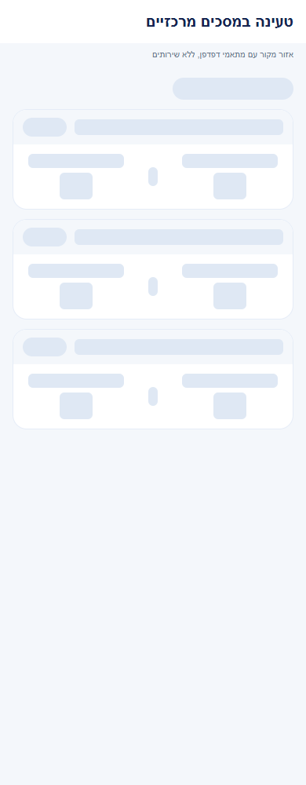
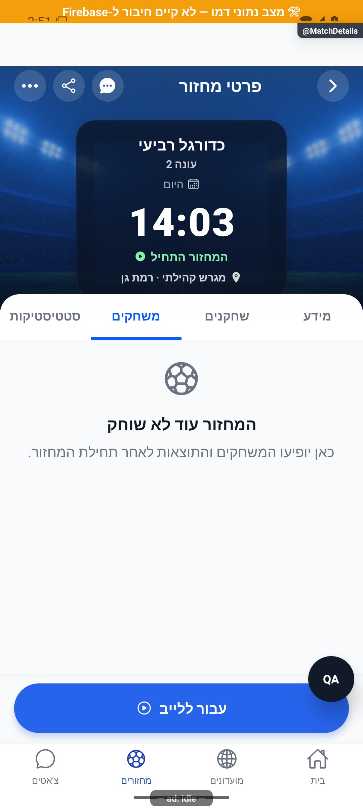

# תוצאות משחקים בתוך מחזור — הסבר פשוט

## עצירת מחזור קבוע ללא פעילות, 6.11.2026

נוספה במנגנון השרת עצירה של מחזור קבוע לאחר שלושה מחזורים רצופים ללא פעילות. ההשפעה כאן תחומה לתלות המשותפת בפתיחת מחזורים וניקוי מחזורים ריקים; אין אימות חדש של כל פעולות המסך. מנגנון השרת נפרס והופעל באישור הבעלים; אין צורך בגרסת טלפון חדשה להפעלתו. [ההתנהגות, מסלול הנתונים, הבדיקות ומגבלות ההפעלה](../../changes/2026-11-06-inactive-recurring-rounds.md).

## תיקו בשתיים או בשלוש קבוצות, 6.11.2026

נוספה אפשרות לסיים משחק בתיקו ולהמשיך במחזור. בשלוש קבוצות בוחרים ידנית מי נשארים, ללא סימון מראש, ורואים מי יוצאים, מי נכנסים ומה המשחק הבא. בשתי קבוצות שתיהן ממשיכות. התיקו נספר פעם אחת למועדון ולכל שחקן רשום ששיחק, ללא ניצחון או הפסד; הממתינים אינם נספרים. מקומי וטרם הופץ. נדרשת פריסת שירות השמירה החדש לפני הפצת הלקוח. [התנהגות, נתונים, בדיקות ומגבלות](../../changes/2026-11-06-manual-draw.md).

## קשר לכרטיס הפנדלים, 6.11.2026

פירוט הבעיטות בתוך המשחק נשאר כרגיל. נוסף ריכוז ביצועי פנדלים בלשונית הסטטיסטיקה של המחזור, עם מעבר בין בועטים לשוערים. הבדיקה המשותפת הותאמה לרכיב החדש; אין בדיקת מכשיר חדשה למסך המשחקים. [הכרטיס והראיות](match-stats.simple.md#פנדלים-במחזור-6112026). מקומי וטרם הופץ.

## ממצאי סבב הפולס, 5.11.2026

המשחק האחרון ששוחק יכול להישמר כתיקו בעת סיום המחזור, בלי לקבוע מנצחת ובלי לספור אותו פעמיים. מקומי, ללא הפצה או אימות מכשיר חדש. [ממצאים, בדיקות ומגבלות](../../changes/2026-11-05-pulse-sweep.md).

## מדידת פעולות ואמינות נתונים, 5.11.2026

נוספה הכנה למדידת הפעולות ברכיבים המתועדים כאן. בפולס אפשר לראות ביצועים וחשבונות ייחודיים לפי פעולה ותקופה, כאשר קיים כיסוי מדידה. איסוף החשבונות החדש עדיין כבוי והמימוש מקומי. [פירוט והיקף הבדיקות](../../audits/2026-11-04-system-night/product-measurement.md).

## חיפוש שחקנים וזמני טעינה, 4.11.2026

שופרה טעינת חיפוש השחקנים, כרטיס שחקן אחר ואיתור פנויים למחזור ברכיבים המשותפים למסך זה. מימוש מקומי שטרם הופץ. [השינוי, המדידות והבדיקות](../../changes/2026-11-04-player-discovery-speed.md).

## ציר פעילות פרטי בפולס, 4.11.2026

נוסף תיעוד פרטי של ביקורים ופעילות במערכת הניהול. התוספת מקומית והאיסוף החדש כבוי כברירת מחדל; אין בדיקת מכשיר חדשה של מסך זה. מקומי וטרם הופץ או נפרס. [היקף, מקורות, בדיקות ומגבלות](../shared/usage-activity.md).

## שיפורי טעינה משותפים, 4.11.2026

עודכנו מנגנוני הטעינה המשותפים כדי לצמצם עבודה וקריאות חוזרות. דרך השימוש בפיצר נשמרת. השינוי מקומי וטרם הופץ, ואין אימות מכשיר חדש של המסך הזה. [היקף, מדידות ומגבלות](../../changes/2026-11-04-screen-performance.md).

## הפצה פנימית 1.1.74, 3.11.2026

עדכוני הלקוח הנוגעים לטעינה ולחיווי, במקורות המשותפים המשויכים למסמך הזה, כלולים בגרסת האנדרואיד הפנימית 1.1.74/306. החבילה ומסלול החנות אומתו; האימות החזותי נשאר בצילומי הדפדפן של סבבי המימוש, ואין אימות התקנה במכשיר. [תכולה, בדיקות ומגבלות](../../changes/2026-11-03-internal-1.1.74.md).

## הרחבת טעינת השלד במסכים מרכזיים, 3.11.2026

טעינת המשחקונים מציגה מונה, מסננים בהתאם למסך ולוחות תוצאה לפי מבנה כרטיסי המשחקים. תשובה ריקה וכשל אינם מוצגים כטעינה. המימוש מקומי וטרם הופץ. נבדקו אזורי מקור בדפדפן, ללא בדיקת מכשיר חדשה. [הכיסוי, הבדיקות והמגבלות](../../changes/2026-11-03-central-screen-skeletons.md).

כל 6,831 הבדיקות ובדיקת הטיפוסים עברו. האימות החזותי בסבב הזה נעשה בדפדפן בלבד.

## אימות פרסום קבוצות בפולס, 2.11.2026

נבדק ההפרש התחום בשירות המשותף של המחזורים: נוספה בדיקת אישור לפרסום קבוצות כאשר תשובת הפעולה אובדת. אין שינוי בחישוב, במכנים או בפעולות העצמאיות של הפיצר המתואר כאן. התיקון מקומי וטרם הופץ; אין בדיקת מכשיר חדשה לפיצר זה.

[דוח הטיפול, הבדיקות והמגבלות](../../changes/2026-11-02-pulse-sweep.md).

## הרחבת אבחון דיווחים, 27.10.2026

הדיווחים יוכלו לכלול מה ניסו לבצע, מה היה מצב האפליקציה ומה החזיר השרת. פרטים חסרים מוצגים כלא ידועים, ומספר מוגבל של מופעים נשמר בלי למחוק את המופע הראשון. השינוי מקומי וטרם הופץ, ואינו משלים פרטים לדיווחים ישנים. [היקף, ראיות ומגבלות](../../changes/2026-10-27-diagnostic-context.md).

בדיקות הקוד הושלמו, אך השינוי עדיין מקומי ולא הופץ. פרטים שלא נאספו בדיווחים ישנים אינם משוחזרים בדיעבד.

## אחידות כפתורי הביטול - 25.10.2026

כפתור הביטול של פנדל ביומן המשחק נראה כעת בדיוק כמו כפתור ביטול גול רגיל: איקס אפור בתוך עיגול מלא בהיר. [ראיות ומגבלות](../../changes/2026-10-25-in-play-penalties.md#אחידות-כפתורי-הביטול). מקומי וטרם הופץ.

## הסרת עריכת פנדל - 25.10.2026

ביומן הלייב הוסר העיפרון לעריכת פנדל שנשמר. אין שינוי ברישום הבעיטות או בתצוגת דקת ההבקעה בהיסטוריה. [ראיות ומגבלות](../../changes/2026-10-25-in-play-penalties.md#הסרת-עריכת-פנדל). מקומי וטרם הופץ.

## דקת ההבקעה ביומן - 25.10.2026

ביומן אירועי המשחק ובהיסטוריה מוצגת שוב דקת ההבקעה, למשל 5, ולא השעון המדויק. חלון הפנדל נשאר עם השעון המדויק, וכיתוב ההבקעה נשאר אלין (פנדל). השינוי מקומי וטרם הופץ. [ראיות ומגבלות](../../changes/2026-10-25-in-play-penalties.md#החזרת-דקת-ההבקעה-ביומן).

## שעון מדויק וכיתוב פנדל - 25.10.2026

בחלון פנדל מוצג השעון המדויק של המשחק, למשל 04:32, במקום שדה דקה. הזמן מתקדם עם השעון ונשמר בעת האישור; עריכה שומרת על זמן האירוע. ביומן הבקעה מוצגת בשם השחקן ואחריו סוגריים, למשל אלין (פנדל). השינוי מקומי וטרם הופץ. [פרטים וראיות](../../changes/2026-10-25-in-play-penalties.md#שעון-מדויק-וכיתוב-אירוע).

## פנדל במהלך משחק חי - 25.10.2026

בהיסטוריית המשחק מוצג סימון של שער מפנדל במהלך משחק, ולצדו רשימת בעיטות הכוללת הבקעה, עצירה והחמצה. בעיטות ההכרעה נשארות בפירוט הנפרד שלהן.

השינוי מקומי. נדרשת פריסת שרת לפני הפצת לקוח שמשתמש באפשרות; לא בוצעו פריסה או שינוי הרשאות. [חוזה הנתונים, התהליך, הבדיקות ומגבלות ההפצה](../../changes/2026-10-25-in-play-penalties.md).

## חזרה מארון התארים לכרטיס המקורי — 24.10.2026

לערימת הניווט המשותפת נוסף רישום מקומי של ארון התארים, כדי שחזרה מכרטיס שחקן לא תחליף לשונית. אין שינוי מכוון בהתנהגות העצמאית המתוארת כאן, ואין בדיקת ממשק חדשה שלה. התיקון מקומי ולא הופץ. [מסלול הניווט, בדיקות, צילומים ומגבלות](../../changes/2026-10-24-cabinet-back.md).

## בדיקת סיום וסיכומים אחרי החלפת קבוצות — 24.10.2026

נבדק מסלול החלפת הקבוצות עד סיום המחזור והסיכומים: המשחק שאופס אינו מוסיף שערים, בישולים, הופעות או ניצחונות, והמשחק החדש נשמר עם הקבוצות והשחקנים הנכונים. סיום מיד אחרי איפוס אינו ממציא משחק 0:0. נבדקו גם אורחים, משלימים, תיקו וניסיון שמירה חוזר ללא ספירה כפולה. הבדיקה הפעילה את קוד הלקוח והשרת מול אחסון מבודד, ולא מסד חי; לא בוצעה בה בדיקת מכשיר חדשה. [התרחישים, המספרים והמגבלות](../../audits/2026-10-24-live-teams-end-to-end.md). התוספת מקומית וטרם הופצה.

## תיעוד כשלים — 20.10.2026

נוסף תיעוד אוטומטי לנקודות כשל במסלול הזה, עם מקור התקלה. הפעולה המקורית שומרת על ערכי החזרה והודעות השגיאה שלה. השינוי מקומי, טרם הופץ, ואין אימות מסירה חיה לפולס.

[דוח דיווח השגיאות והראיות](../../changes/2026-10-20-error-reporting-audit.md).

## שמירה מלאה וקישור ההכרעה להרכב — 18.10.2026

שמירת משחק חדש שומרת את כל השערים והמשתתפים הזכאים, גם לאחר חילופים רבים. אם הסגל או התוצאה השתנו בזמן שבוחרים הכרעה, צריך לפתוח את ההכרעה מחדש. ביטול בעיטת פנדל שנשמר לפני ניתוק אינו מבטל בעיטה נוספת בניסיון חוזר.

[דוח הביקורת, הבדיקות וגבולות האימות](../../changes/2026-10-18-preproduction-end-to-end.md).

## פריסת שרת מאושרת — 17.10.2026

השרת עודכן לשמירת בישולי אורחים וסוגי בעיטות שונים בהיסטוריית משחקים חדשים. אורח שתרם לאירוע ויצא מההרכב נשמר גם כמשתתף. היסטוריה ישנה לא תוקנה אוטומטית. [מצב הפריסה והראיות](../../changes/2026-10-17-server-preparation.md)

עדכון 17.10.2026: אם המשחקים לא נטענו, מופיעה הודעה עם כפתור ניסיון חוזר. תקלה אינה מוצגת כרשימה ריקה. אם רענון נכשל אחרי שהמשחקים כבר נטענו, הם נשארים מוצגים עם הודעה שלא התקבל עדכון. מעבר למחזור אחר או לחשבון אחר מסתיר מיד את הנתונים הקודמים.

בהיסטוריית הפנדלים רואים בנפרד גול, עצירה והחטאה. כאשר בבעיטה ישנה לא תועד מה קרה, כתוב ״לא הובקע״ בלי לנחש. בישול של אורח נשמר גם בפרטי השער, ומשתתף שכבש או בישל והוחלף החוצה נשאר בתיעוד לפי כללי הזקיפה. תיקוני השמירה בשרת דורשים פריסה עתידית; בדיקות הקוד המבודדות אינן אישור שהשינוי כבר זמין למשתמשים. [הראיות ומגבלות הבדיקה](../../changes/2026-10-17-live-action-pitch.md).

בבדיקת מחזור הבדיקה בייצור נמצא שאורח שבישל ואז הוחלף קיבל בישול, אך לא הופעה ותוצאת משחק. התיקון המקומי משאיר גם אורח כזה ברשימת מי ששיחקו ובנתוני המשחק, בלי להוסיף אותו להרכב הבא או לשנות את החילוף. אם אירוע השער בוטל לפני הסיום, הוא אינו משמש הוכחה להשתתפות. התיקון נבדק בקוד בהרכבי 4, 7 ו־11 בכל צד; שרת הייצור ונתונים שכבר נשמרו עדיין לא תוקנו.

לאחר שינוי צבע בהכנה, שם הקבוצה וצבעה ברשימת המשחקים תואמים ללייב. שמות כובש ומבשל מוצגים בשורות נפרדות ויכולים להישבר לשורות נוספות, כדי ששם ארוך וטקסט מוגדל לא יסתירו את הבישול. ברשומות הקיימות לא נשמר צבע נפרד לכל משחק, ולכן מוצגים צבעי הקבוצות השמורים במחזור, ללא שחזור מנוחש של שינויי צבע באמצע הערב.

תיקון הדמו מ־14.10.2026: משחקים שמסיימים באימולטור במצב דמו נשמרים כעת גם ברשימת המשחקים, עם התוצאה והמשתתפים. משחקים שהסתיימו לפני התיקון לא נשמרו ולכן לא יופיעו בדיעבד. השינוי אינו משנה נתונים של משתמשים אמיתיים.

כאן רואים את המשחקונים ששוחקו בתוך המחזור ואת התוצאות שלהם. אפשר לסנן לפי קבוצה ולפתוח הרכבים ושערים. זו רשימת המשחקונים של ערב אחד, לא רשימת המחזורים שלך.

[להסבר המעמיק ולמפת הקוד](match-rounds.md)

## צילום והיקף ההוכחה

הצילומים מציגים רק את המצבים המתועדים במסמך המעמיק. חלקם נתוני דמו, חלקם הוכחות מתיקון קודם, ובכמה מהם טעינה או הודעת הגנה; הם אינם אישור שכל התהליך או השרת נבדקו.

## תיקוני סבב הבאגים — 8.10.2026

התוצאה והסטטיסטיקה נשמרות יחד גם כששני מנהלים שולחים תוצאות במקביל.

בחוזה המקומי של 10.10.2026 גם ניקוי לוח המשחק נכלל באותה שמירה, כדי ששער שנוסף במקביל לא ייעלם. משחקון שהתחיל והסתיים ב־0:0 נכלל בהיסטוריה; משחקון שרק הוכן לא נחשב משחק נוסף. ניסיון חוזר משתמש בתוצאה שכבר נשמרה. הבדיקה מבודדת והשינוי מחייב פריסת שרת; לא בוצע תיקון היסטוריה אמיתית.

## תלות בעדכון העונות — 19.10.2026

קובץ תשתית משותף עודכן במסגרת העונות. שינוי זה אינו מוסיף פעולה חדשה למסך המתואר כאן; פרטי העונות והבדיקות מופיעים במסמך העונות.

[מצב המימוש, הבדיקות ומגבלות האימות של העונות](../clubs/seasons.md). מקומי בלבד; לא בוצעה פריסה במסגרת המשימה.

## תלות במידע על סגירת עונה — 23.10.2026

נוסף מידע משותף שמאפשר להסביר מדוע עונה מתעכבת בסגירה. אין שינוי נוסף בפעולות המתוארות כאן; השינוי מקומי וטרם הופץ. [המסלול, הבדיקות והמגבלות](../../changes/2026-10-23-season-automatic-recovery.md).

## תלות בשמירת צבעי המחזור — 24.10.2026

שמירת המידע המשותפת עודכנה כדי להעביר את צבעי הקבוצות ממסכי הכוחות להכנה וללייב. אין תוספת פעולה במסך הזה, והוא לא נבדק מחדש במכשיר במסגרת התוספת. השינוי מקומי וטרם הופץ. [פרטי התוספת ומגבלות הבדיקה](../rounds/draft-setup.md#צבעים-לפני-שיבוץ-ובכל-שיטת-חלוקה--24102026).

## תלות בניווט עריכת קבוצות - 25.10.2026

נבדק השינוי הממוקד במקורות המשותפים: `src/navigation/GameStack.tsx`. נוסף מעבר מתפריט הלייב לחלוקת הכוחות עם שימור מפתח מסך המקור. אין שינוי נוסף בתהליך העצמאי המתואר כאן ולא נערכה לו בדיקת מסך חדשה. [היקף, בדיקות ומגבלות](../../changes/2026-10-25-live-draft-entry.md).

## תאימות לשמירת פקודת רכיב הבית - 25.10.2026

נוספה הגנה פנימית מפני ביצוע חוזר של פעולת רכיב הבית. התהליך המתואר בעמוד זה לא השתנה במכוון, ונתונים ישנים נשארים נתמכים. התיקון מקומי וטרם הופץ. [מקור הבדיקה והמגבלות](../../changes/2026-10-25-widget-completion.md).

## שלמות החלוקה המתוזמנת, 29.10.2026

במקורות המשותפים תוקנה שמירת חלוקה מתוזמנת לשש ולשבע קבוצות וסוננו אורחים שממתינים. דרך חישוב האיזון נשמרה. אין שינוי מכוון בפעולות העצמאיות המתוארות בעמוד זה ואין אימות מסך חדש שלהן; השינוי מקומי וטרם הופץ.

[היקף, בדיקות, פערים פתוחים ומגבלות](../../changes/2026-10-29-scheduled-balance-integrity.md).

## איזון ופיזור רמות לפני גיוון, 30.10.2026

עודכן החישוב המשותף של חלוקת כוחות לפי הדירוג הכללי: איזון הממוצעים קודם לפיזור הרמות, והגיוון מכריע אחרי שניהם. אין שינוי מכוון במבנה המסך או בפעולות העצמאיות המתוארות כאן, ואין אימות מכשיר חדש שלהן. השינוי מקומי וטרם הופץ או נפרס.

[מימוש, נוסחאות, בדיקות ומגבלות](../../changes/2026-10-30-rating-balance-priority.md).

## אימות כשלים בקבלת פרסום, 2.11.2026

בבדיקת אישור פרסום הקבוצות, כשל שלא ניתן לאמת כהצלחה נשאר כשל גלוי ונשמר באבחון. הבדיקה אינה שולחת הודעות שוב ואינה משנה הרשאות. השינוי תחום לשירות המשותף, מקומי וטרם הופץ.

[דוח הטיפול והראיות](../../changes/2026-11-02-pulse-sweep.md).

## תלות משותפת בציון המחזור החדש, 6.11.2026

נוספה תמיכה מקומית בגרסת ציון למחזורי העתיד ובקריאת הרף הקפוא, תוך שמירת המודל של מחזורים קודמים. השינוי כאן תחום לתלות במקורות המשותפים, ואינו אימות חדש של כל המסלול העצמאי. אין פריסה, הסבת נתונים או שינוי ציוני עבר. [התנהגות, בדיקות ומגבלות](../../changes/2026-11-06-shared-evening-score.md).
