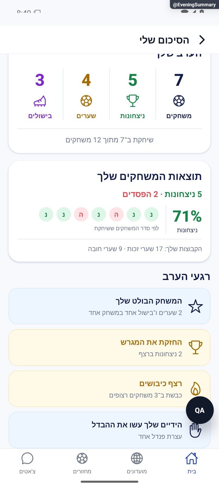
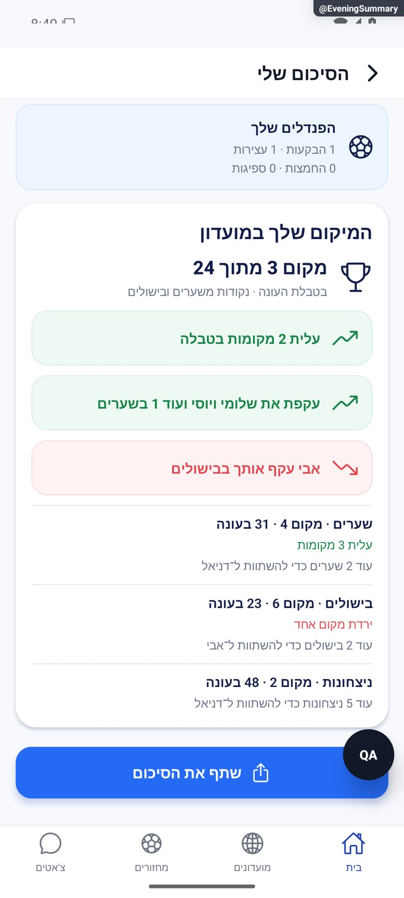
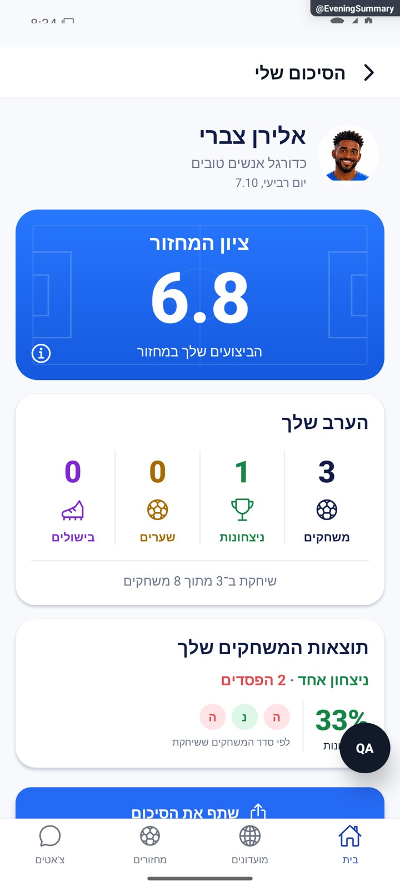
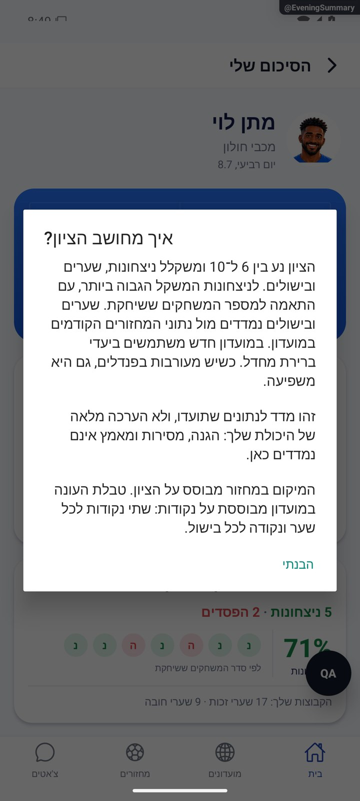

# סטטיסטיקה וסיכום אישי של מחזור

## בדיקת מסלול הנתונים עד הסיכום — 18.10.2026

ליבת שמירת המשחק שומרת את מלוא אירועי הלייב המאומתים ואת המשתתפים הזכאים, ללא חיתוך שקט. בדיקות החוזה מפעילות 4/7/11 בכל צד, שער רגיל עם בישול, ללא בישול, לא מזוהה ושער עצמי; נבדקות גם מניעת כפילות, קיבולת אטומית, סיום מול הרכב מיושן וההפרדה בין עצירה להחטאה. לא שונו נוסחאות `roundSummary`, מדיניות ההשתתפות או המכנים של עונה/מחזור/משחק. קריאת נתוני הייצור והצילומים בסבב החדש חייבת להיקרא בדוח הנפרד; בדיקות קוד אינן הוכחת שמירה בענן.

[דוח הביקורת, הבדיקות וגבולות האימות](../../changes/2026-10-18-preproduction-end-to-end.md).

## עיצוב משותף עם המועדון — 17.10.2026

לשונית הסטטיסטיקות בפרטי מחזור משתמשת באותם `ClubStatsSummary` ו־`ClubStatsAwards` של סקירת המועדון. המגרש הבהיר, פס הדשא, המסגרות, הטיפוגרפיה וסמלי התארים משותפים: טקסט כחול כהה, הדגשות כחולות וזהב לתארי השערים והניצחונות. גם הקבוצות, הצמד ואירועי המחזור הותאמו לכרטיסים הלבנים; הצמד מוצג בתמונות גדולות ובשם מתחת לכל שחקן. עיצוב זה מחליף את אריחי המספרים וכרטיסי המצטיינים הצבעוניים המתוארים בהיסטוריה להלן.

### נתונים ומצבים

- `roundSummaries/{gameId}` נשאר המקור המסכם: `stats.rounds` הוא מספר המשחקים במחזור, `stats.goals` שערים, `stats.assists` בישולים ו־`stats.shootouts` מספר הכרעות בפנדלים. אין ספירת בעיטות במקום הכרעות ואין הוספת מונה מחזורים של המועדון. לדוגמה, דמו קיים מציג 10 משחקים, 31 שערים, 18 בישולים ו־2 הכרעות.
- מצב הסיכום המשותף נקבע באיחוד טיפוסים: במועדון נדרש `evenings`, ובמחזור נדרש `shootouts`; אי אפשר להעביר את שניהם. אפס נשמר כאפס. לפני סיום מועבר ״—״ לכל ארבעת המדדים, באותם רכיבים.
- `star` ממשיך לסנן תואר חסר, ערך שאינו חיובי וזהות ללא שם. `ClubStatsAwards` מקבל `user` ו־`tiedUsers`: כל הזהויות והשמות בשוויון נשמרים, ומוצגות עד שלוש תמונות ומספר אחד משותף. שמות מעורבים מבודדים בכיווניות. אין המצאת מצטיין ואין ניווט חדש מכרטיסי המחזור.
- לפני סיום, לכל אחת מארבע קטגוריות התארים מוצג מציין מקום ללא זהות ובלי אפשרות פתיחת פרופיל. הטקסט ״יופיע בסיום המחזור״ יכול להישבר לשורות. זו הצצה למבנה, ולא דירוג זמני או תוצאה לדוגמה.
- בחירת הקבוצה עם הכי הרבה ניצחונות/הפסדים ונתוני הצמד נשמרו. `summaryLines` נשאר מקור האירועים. `GameChampionship` נשאר רכיב הטבלה, לרבות כל השורות, אורחים, אפסים, ציונים ומיון; `adminExtras` נשאר אחריו.
- טעינה, כשל, ניסיון חוזר, שימור נתונים ברענון ומסמך חסר נותרו כפי שהוגדרו במסמך זה. לא נוספו קריאות, כתיבות, ממירי נתונים, הרשאות, מסכים או נתיבי ניווט.

### בדיקות וראיות

`matchStatsReadState.test.tsx`: 27 בדיקות, כולל ארבעת ערכי המחזור ואפס הכרעות, היעדר מונה מחזורים, מצייני מקום ללא שחקנים, כל השמות בשוויון, אורחים, זהות קבוצות, מצבי הקריאה ושמירת פעולת כרטיסי המועדון. `npx tsc --noEmit` עבר; כל 383 חבילות הבדיקות, 4,550 בדיקות, עברו בריצה מלאה עם `npx jest --runInBand`.

[דוח וצילומים עם גבולות האימות](../../changes/2026-10-17-round-stats-style.md). בדיקה מקורית באמולטור אנדרואיד בנתוני דמו בלבד, ברוחב 411 ובמסך 320 עם גופן 140%. אין במשימה זו אימות קריאה או כתיבה בייצור, ואין בדיקת אייפון. השינוי מקומי ולא נבנתה או הועלתה גרסה.

## שורת צירוף ובדיקת הפולס — 17.10.2026

`StatsPreview` מציג הודעת תצוגה מקדימה, ארבעה מדדים עם value=— ואזור מצטיינים הסברי. מצב זה מחליף רק את הודעת המחזור שאינו finished; אין שאילתת סיכום מוקדמת, שינוי בסיכום קיים או השפעה על מצבי כשל/היעדר לאחר סיום. שדות השרת, ממירי הקריאה וחישובי הציון נשמרו. בדיקות מכסות גם מצב פתוח/פעיל עם כשל קריאה ישן, בלי הצגת שגיאה שקרית או נתונים לדוגמה.

[בדיקות, צילומים ומגבלות](../../changes/2026-10-17-roster-recruitment-and-pulse.md).

## בדיקות הפולס והגרסה הפנימית 1.1.55 — 17.10.2026

`useMatchRoundSummary` מופעל רק בלשונית שנפתחה ובמחזור `finished`. הקריאה מסוננת בשוויון לפי `groupId` ו־`gameId` ומוגבלת למסמך אחד; כך הכללים יכולים להוכיח חברות גם כאשר הסיכום אינו קיים. מטמון ריק ללא אישור שרת אינו הוכחת היעדר וזורק `unavailable`. לאחר תשובת שרת ריקה מופעל `watch` לאותה שאילתה, רק בזמן מיקוד. סיכום מאוחר מעדכן את המסך והזהויות; יציאה/החלפת זהות מנתקות את המאזין ומתעלמות מתשובות ישנות. בשרת `sealRoundSummary` מעביר את תוספת `seasons.playedRounds` אל אותה כתיבה של `guardFinishSeasonBatch`, עם אותו תנאי גרסה: אין עוד שילוב merge-set ללא תנאי ועדכון עם `lastUpdateTime` על אותו מסמך. היצירה החד־פעמית של הסיכום, המונים ושיאי השחקנים עדיין אטומית. פריסת `onGameRosterChanged` אושרה במפורש ואומתה מול 133 קבצים; 97 פונקציות אחרות נשמרו. לא שונו כללים ולא הורצה הסבת נתונים.

[ראיות, בדיקות ומגבלות](../../changes/2026-10-17-internal-1.1.55.md).

## פריסת שרת מאושרת — 17.10.2026

`onGameRosterChanged`, `addRetroGoal` ו־`removeRetroGoal` נפרסו עם ליבת `buildRoundSummary` המעודכנת. שער לא מזוהה ושער עצמי נוספים פעם אחת לצד שורות השחקנים; תיקון בדיעבד משתמש בבסיס השמור. כל שמונת ארכיוני הפריסה נבדקו מול המקור, אך לא שוכתבו סיכומי הבדיקה הישנים ולא הורץ כאן משחק חדש בייצור. [מצב הפריסה והראיות](../../changes/2026-10-17-server-preparation.md)

## תוויות מלאות, כל הסגל ומספרי דירוג — 17.10.2026

צילום `tmp/live-action-production/shots/eleven-summary-final-top.png` הראה תווית ״הכרעות בפ…״ גם ברוחב 411 ובגופן רגיל. בתיקון הקודם, שהוחלף בעיצוב המשותף המתואר בראש המסמך, `NumberTile` שמר את התווית המלאה עם עד שתי שורות, `lineHeight=15`, גובה מזערי 30 ורוחב התא, ביישור מרכז. כל ארבע התוויות חולקות את אותו תקציב; אין הקטנה או חסימה גורפת של הגדלת גופן. `stats.shootouts` נשאר מספר הכרעות המשחקים בפנדלים, ולא מספר הבעיטות; הערך האמיתי אפס נשמר.

`CommunityStatsTable` משמש גם טבלאות מועדון ומגביל כברירת מחדל ל־30 שורות לאחר המיון. `GameChampionship` מעביר כעת במפורש `limit={players.length}`, ולכן רק טבלת המחזור מציגה את כל השורות שהשירות החזיר, לרבות משתתף עם אפסים. ברירת המחדל של טבלאות המועדון לא השתנתה; לא השתנו מקור המשתתפים, השלמת שורות נוכחות, הרשאות, ציונים או סדר המיון. אין פנייה נוספת לשרת כדי להציג את שלוש השורות שנחתכו מהתשובה הקיימת.

בצילום `eleven-standings-final.png` נשבר מספר הדירוג 10 לשתי שורות. ברכיב המשותף `CommunityStatsTable` עמודת הדירוג והכותרת ברוחב 24 ללא כיווץ, ומספרי הדירוג מוגבלים לשורה אחת עם התאמה עד 75% לפי הצורך. עמודת השם נשארת ברוחב הקיים; סדר המשתתפים, גובה שורת הנתונים, המדליות והתנהגות לחיצה על אורח נשמרו. מספר הדירוג עדיין הוא מיקום השורה לאחר המיון הנבחר.

בדיקת הרכיב ב־`matchStatsReadState.test.tsx` מוודאת ארבעה ערכים ותוויות מלאות, כולל אפס הכרעות, ותקציב טקסט אחיד. `communityStatsRankResponsive.test.tsx` מפעיל את הטבלה האמיתית ב־33 שורות במצב מצטבר ויעילות, בודק מספרי דירוג מלאים ומיון לפי עמודה בלי שינוי שורות המקור, ומפעיל את `GameChampionship` ואז את `CommunityStatsTable` עם אותם מאפיינים שחזרו ממנו: כל 33 הזהויות מופיעות, כולל שורת האורח האחרונה עם אפסים. השמות בדויים ושירותי הקריאה מוחלפים, ללא קריאת פרופילים או כתיבה בייצור. יחד עם בדיקות מוני הבית וציוני המחזור עברו ארבע חבילות ו־81 בדיקות. צילומי הפגם המצוטטים קודמים לתיקון ואינם ראיות לתצוגה המתוקנת.

אימות מקורי חוזר ברוחב 411 ובגופן רגיל, אחרי פתיחה קרה באימולטור אנדרואיד מול מחזור הבדיקה בייצור: [תוויות הסיכום הרגיל](../screenshots/action-pitch-production-eleven-summary-labels-fixed-normal-2026-10-17.png) מציגות את ״הכרעות בפנדלים״ במלואו ואת הערכים 2 משחקים, 3 שערים, 3 בישולים ואפס הכרעות. [הדירוג הרגיל](../screenshots/action-pitch-production-eleven-standings-rank-fixed-normal-2026-10-17.png) מציג 10 ו־11 בשורה אחת. [סוף הטבלה הרגילה](../screenshots/action-pitch-production-eleven-standings-all33-fixed-normal-2026-10-17.png) מציג אביב 31, גיא 32 ויובל 33, עם אפסים, ולא חיתוך בשורה 30. [עמודת הבישולים המלאה](../screenshots/action-pitch-production-eleven-standings-assists-column-full-2026-10-17.png) מציגה כותרת מלאה ונדב עם בישול אחד. הצילומים נפתחו ונבחנו גם בסקירה עצמאית ונשמרו קנונית ללא שינוי.

הבדיקה הקטנה הסופית אחרי פתיחה קרה ב־320×569/140%: [תווית הפנדלים והלשוניות](../screenshots/action-pitch-production-eleven-tabs-summary-final-small-2026-10-17.png) שלמות, ו[סוף הטבלה](../screenshots/action-pitch-production-eleven-tabs-standings-final-small-2026-10-17.png) מציג 29–33 עם מספרי דירוג בשורה אחת ושורות מלאות. שני הצילומים נפתחו ונבחנו גם בנפרד. ההיררכיות הקפואות נכללות ב־`docs/changes/evidence/live-action-2026-10-17/manifest-eleven-final-ui.json`. [צילום הביניים הקטן לפני תיקון הלשוניות](../screenshots/action-pitch-production-eleven-summary-labels-fixed-small-before-tabs-2026-10-17.png) מוכיח את תווית המדד אך מתעד גם פגם לשוניות, ולכן אינו ראיית המוכנות הסופית. אין טענה לבדיקת אייפון, כל ענפי המיון במכשיר או כל טבלאות המועדון.

## מצבי קריאת הסיכום הכללי — 17.10.2026

`roundSummaryService.get(gameId)` מחזיר `null` רק עבור מסמך חסר שנקרא בהצלחה, או מזהה ריק שהמסך מונע את בקשתו. כשל קריאה זורק את השגיאה המקורית; סינון דיווחי הרשאה צפויים ב־`errorLog` נשמר. נבדקו כל הצרכנים: `MatchDetailsScreen` הוא הצרכן היחיד של `get`. `CommunityStatsScreen` משתמש ב־`listEveningStats`; המסלול הזה לא השתנה. `normalise` נשאר הממיר של הסיכום וממשיך להעביר זהויות, מספרים וכיסוי ולנרמל מערכים אופציונליים. אין שינוי כתיבה, חישוב, הרשאות או מבנה מסמך.

| מצב | תוצאה |
|---|---|
| לפני תשובה ראשונה | ״טוענים את נתוני המחזור…״; אין טענה על מחזור ישן או חוסר מדידה |
| כשל ראשון | הודעת כשל ו״ניסיון חוזר״; אין החלפה במצב ריק |
| הצלחה עם מסמך | המספרים, הכוכבים, האירועים והטבלה מתוך הסיכום הקיים |
| הצלחה עם מסמך חסר | מצב ריק לפי `didEveningHappen`: טרם הסתיים/ללא כיסוי |
| רענון באותו מחזור | הסיכום הקודם נשאר, עם חיווי עדכון; כשל משאיר אותו לצד ניסיון חוזר |
| מעבר מחזור או חשבון | נתונים קודמים מוסתרים כבר ברינדור הראשון, לפני אפקט האיפוס |
| תגובה מאוחרת, אובדן מיקוד או הסרה | התגובה אינה מעדכנת סיכום ואינה מתחילה השלמת שמות |

`useMatchRoundSummary` באותו קובץ מסך מחזיק מצב בבעלות צירוף מזהי המחזור והצופה, מספר ניסיון וייחוס לבעלים הנוכחי. `useFocusEffect` קורא רק לאחר ביקור ראשון בלשונית, ואז בחזרה למיקוד, בשינוי `retroRefreshKey` או בניסיון חוזר. הניסיון הישן מתבטל מבחינת פרסום תשובה בניקוי, ובנוסף נבדקת זהות `useUserStore.getState()` בזמן הגעת התשובה. הצלחה עם `null` מנקה סיכום קודם; כשל ברענון שומר נתונים רק אם הבעלות עדיין תואמת. `MatchStatsTab` מקבל `readStatus` ו־`onRetry`; ערך ברירת המחדל `ready` מיועד גם לתצוגת הבדיקה שמספקת מצב חסר ידוע מראש.

ראיה לקריאת ייצור מוגבלת: במחזור הבדיקה של שבעה, שמזההו נלקח ישירות מקובץ המקור השמור, קריאת מטמון ראשונה נכשלה כי המסמך לא היה במטמון. קריאת `getDoc` רגילה הצליחה אחרי 178 מילישניות וקריאת `getDocFromServer` הצליחה אחרי 327 מילישניות: בשתיהן `fromCache=false`, שלושה שערים, שני בישולים, שני משחקים והכרעת פנדלים אחת. הפלט נמצא ב־`tmp/live-action-production/native-qa/summary-sdk-read-result.json`. הקריאות היו לקריאה בלבד, לא שינו מסך או נתונים, ואינן מוכיחות מה קרה לאפקט המיקוד המקורי בעת הצילום. לא נצפה כשל הרשאה בבדיקה זו, ואין ראיה המחייבת כפיית מקור שרת בכל פתיחה; מסלול `getDoc` הרגיל נשמר.

בדיקות חדשות: `matchStatsReadState.test.tsx` מפעיל את גוף הוק המוצר עם מחזור חיים מדומה ואת רכיב הלשונית האמיתי; הוא מכסה טעינה, חסר מוצלח, כשל וניסיון חוזר, שימור ברענון, ניקוי בעקבות תשובה חסרה, מעבר מחזור/צופה, תגובה מאוחרת, אובדן מיקוד, הסרה וטעינה עצלה. `roundSummaryReadContract.test.ts` בודק נתון קיים, נרמול, חסר ושמירת השגיאה המקורית בכשל חיבור והרשאה. יחד עם שומרי סדר ההוקים והכיווניות עברו ארבע חבילות ו־342 בדיקות; בדיקת הטיפוסים עברה. אלו בדיקות קוד ורכיב עם מארחים מקוריים מדומים, ולא הוכחת פריסה או צילום של מצבי התקלה. סיכום קיים עם נתוני ייצור נצפה לאחר פתיחה קרה במחזור בדיקת 11, כמתועד בסעיף התוויות והטבלה לעיל. מצבי כשל וניסיון חוזר נבדקו אוטומטית בלבד; אין טענה שהם הופעלו במכשיר ייצור.

## שמות אורחים בסיכום הכללי — 17.10.2026

`playersMap` בייצור מכיל משתמשים שהושלמו מתוך `usersPublic`, ואינו מכיל אוטומטית את `game.guests`. לכן `summaryNameOf` ו־`summaryUserOf` משתמשים כעת ב־`resolveMatchSummaryUser`, דרך `resolveRosterEntry` הקיים. זהות עם הקידומת `guest:` נפתרת מול מזהה האורח הגולמי ב־`game.guests`, ולא מול מטמון משתמשים. מזהה גולמי ישן נתמך רק כאשר קיימת התאמה מדויקת לאורח ואין משתמש אמיתי בעל אותו מזהה. הזהות המוחזרת קנונית, עם הקידומת, כך שאותה דמות מקבלת אותו איור גם בין שני הייצוגים. שם נחתך מרווחים; אורח לא מוכר או שהוסר מחזיר שם ריק, ולכן אינו עובר את מסנן השמות של כרטיסי המובילים והצמד. תמונת משתמש ומזהה אוואטר נשמרים למשתמש רגיל. ל־`GameGuest` אין שדות תמונה או אוואטר, ו־`UserAvatar` מספק איור קבוע לפי זהותו בלי ליצור חשבון או לקרוא פרופיל חדש.

גבול הממצא: בסיכום השמור של בדיקת שבעה, `leaders` כולל את חשבון הבדיקה בלבד ו־`topAssisters=null`. אורחים כן מופיעים בשורות הסטטיסטיקה ובהיסטוריית השערים תחת מזהים עם `guest:`. קוד `buildRoundSummary` מסנן אורחים מתארי המועדון במפורש; התיקון אינו משנה מדיניות זו או את השרת. הוא מונע מהתצוגה להעלים אורח כאשר מסמך קיים כן מפנה אליו בכרטיס, בצמד או באירוע. כללי הסכומים וטבלת המחזור נשארו ללא שינוי; אין טענה שתואר אורח חסר היה שמור במסמך הייצור שנקרא.

נוספו חמש בדיקות ב־`matchStatsReadState.test.tsx`: זהות קנונית ושם מעודכן, שמירת תמונת משתמש והתנגשות מזהה, הצגת שני אורחים מתוך מסמך מובילים וצמד קיים, השמטת אורח חסר במקום שם מומצא, ובניית סיכום אמיתי עם ארבעה שערים ושני בישולים כולל אורחים תוך שמירת מדיניות התארים. הבדיקות מפעילות את גופי הפותרים האמיתיים ואת רכיב הלשונית, ומוודאות גם העברת האורחים והזהויות לטבלת המחזור. יחד עם חוזה הקריאה ומבחני החישוב עברו שלוש חבילות ו־31 בדיקות. בדיקת טיפוסים וצילום מקורי מעודכן מפורטים בנפרד בסבב האימות; בדיקת רכיב זו אינה ראיית שמירה או רינדור מקורי במכשיר.

## צבעי קבוצות בכרטיסי הסיכום — 17.10.2026

בעקבות צילום מקורי של סיכום בדיקת שבעה נמצא שכרטיס הניצחונות כינה את קבוצה מספר 2 ״הירוקים״ לפי ברירת המחדל, למרות שצבעה הוחלף ללבן בהכנה. כרטיסי `teamHighlights.best` ו־`teamHighlights.worst` מעבירים כעת את `game.draftTeams?.teams` אל `teamName`. המזהה המספרי נשאר המפתח של התוצאה; אין שינוי בניצחונות, הפסדים, משחקים או בסיכום השמור. צבעי הרקע הירוק/האדום של קטגוריות הניצחון וההפסד נשארו סמני הקטגוריה. אם אין צבע שמור או שהמפתח אינו מוכר, פותר הזהות המשותף מחזיר את ברירת המחדל. אין שחזור צבע היסטורי מומצא או שינוי נתונים.

ארבע בדיקות רכיב ב־`matchStatsReadState.test.tsx` מפעילות את `teamName` האמיתי: קבוצה לבנה, החלפת צבעים בין מזהים, ברירת מחדל ומפתח לא מוכר. הבדיקות בודקות את השם בכרטיס המרונדר, את מספרי הניצחונות/ההפסדים, את ארבעת מספרי הסיכום ואת שימור מסמך המקור. הצילום שהוביל לתיקון הוא לפני התיקון. [צילום הסיכום המתוקן של שבעה](../screenshots/action-pitch-production-seven-summary-team-colours-fixed-2026-10-17.png) נפתח ונבחן גם בנפרד: הלבנים מוצגים עם שני ניצחונות והאדומים עם שני הפסדים, לצד נתוני הסיכום 2 משחקים, 3 שערים, 2 בישולים והכרעת פנדלים אחת. זו ראיית שם הצבע ושימור המונים בסיכום שנקרא ממחזור הבדיקה בייצור, ולא בדיקת כל צבעי הבחירה במכשיר. שאר הפגמים המאוחרים בטיפוגרפיה ובטבלה מתועדים ונבדקים בנפרד בסעיף התוויות והדירוג לעיל.

## חלון הסבר הציון — 8.10.2026

`EveningScoreInfoSheet` מחליף את `Alert.alert` המקורי. לחיצה על סמל המידע ב־`EveningSummaryCard` מעדכנת את `scoreInfoVisible` במסך. החלון משתמש ב־`DraggableMenuSheet` המשותף: אפשר לסגור בכפתור ״הבנתי״, בסמל הסגירה, בלחיצה על הרקע, בכפתור החזרה של המכשיר או בגרירה מהידית. התוכן גולל בנפרד והכפתור נשאר בתחתית, עם מרווח בטוח לתחתית המכשיר וגובה מרבי של 88% מהמסך.

כותרת וסמל כחולים, פס טווח 6–10, שורות נפרדות לניצחונות, שערים ובישולים בצבעי הסיכום, הסבר על פנדלים ומועדון חדש, הודעת מגבלות המדידה והפרדה בין דירוג הציון במחזור למיון המועדון והעונה. ב־13.10.2026 תוקן ההסבר: טבלת המועדון והעונה ממוינת כברירת מחדל לפי ניצחונות, אחר כך שערים ובישולים, לפי `championship.comparePoints`. הנוסח הישן על שתי נקודות לשער ונקודה לבישול לא תיאר את המיון הזה. נוסחת הציון, הנתונים, המיון והרשאותיהם לא השתנו. רכיב ההסבר מחוץ לכרטיס המצולם לשיתוף ואינו נכלל בתמונת הסיכום.

ראיית התיקון: [צילום החלונית](../screenshots/overlays-score-copy-2026-10-13.png), דרך `_overlay_audit_score` בפיתוח ובדמו מנותק, 13.10.2026. נצפו הנוסח החדש, סמלים מימין, כל התוכן וכפתור ״הבנתי״ ללא חיתוך. אין בדיקת אייפון או נתוני ייצור בצילום; נוסחת המיון אומתה במקור ולא באמצעות ציונים אמיתיים בצילום זה.

## מצטיין המחזור בסיכום האישי — 8.10.2026

`EveningSummaryCard` מציג מתחת לציון את ״אתה מצטיין המחזור!״ בזהב רק כאשר `scoreRank === 1`, יש `scoreTotal >= 1` והמשתמש שיחק לפחות משחק אחד. השורה נכללת גם בכרטיס השיתוף. המקור הוא דירוג הציון השמור בסיכום המחזור, ולא דירוג העונה או נקודות האליפות. אין חישוב מחדש או קריאת שרת נוספת. דירוג חסר או מקום אחר אינם מציגים את השורה. בשרת הקיים, שוויון ציונים מוכרע לפי מזהה משתמש ולכן נשאר מצטיין יחיד; שינוי שיטת השוויון אינו חלק ממשימה זו.

`EveningSummaryTop` הוא קיצור בדיקה בדמו בלבד, עם מקום ראשון מתוך 15; המודל הרגיל נשאר במקום שלישי והמודל השקט ללא דירוג. אין מסך מוצר חדש.

לשורת המצטיין נוסף כתר משמאל לטקסט: `topPlayerRow` היא שורה עם הטקסט כילד ראשון והכתר כילד שני, לפי הכיווניות הכפויה במערכת. הכתר דקורטיבי ואינו משנה את תנאי הזכאות או את חישוב הציון; הוא נכלל באותו רכיב גם בשיתוף.

## עמודת הציון — 8.10.2026, לאחר אישור חשיפת הציונים

עדכון הפצה, 9.10.2026: פונקציית `getGameEveningScores` נפרסה בהצלחה, והלקוח נכלל בגרסה `1.1.38 / 272` במסלול הייצור והפנימי. אומתה חסימת קריאה ללא אימות עם `401 UNAUTHENTICATED`; לא בוצעה קריאה מאומתת לציונים אמיתיים או התקנה מהחנות. הערות ההמתנה לפריסה להלן מתארות את הבדיקה ההיסטורית. [יומן השחרור](../../changes/2026-10-09-production-1.1.38.md).

`GameChampionship` קורא במקביל את המונים ואת `getGameEveningScores(gameId)` ומעביר מפה לפי מזהה שחקן ל־`CommunityStatsTable.eveningScores`. העמודה היא עמודת הנתונים הראשונה אחרי שם השחקן, מימין לניצחונות, רק בטבלת המחזור. ברירת המחדל בטבלת המחזור היא ציון יורד; בטבלאות מועדון ועונות נותר מיון ניצחונות. שוויון מוכרע במנגנון האליפות הקיים, וחסרים בסוף. שמות ותמונות נטענים מחדש לפי השורות שנבחרו בפועל. `defaultSortKey` תלוי במצב הטבלה ובקיומה של עמודת הציון, לא בזהות מפת הציונים; הגעת ציונים אסינכרונית אינה מאפסת מיון שהמשתמש בחר ידנית.

### מסלול נתונים והרשאות

פונקציית השרת `getGameEveningScores` משתמשת ב־`readGameEveningScores` מתוך `functions/src/gameEveningScores.ts`. קהל הקריאה משקף את `canReadGame`: משתמש מחובר שצופה במחזור ציבורי, יוצר, שחקן ב־`players`/`participantIds`, או חבר/מנהל במועדון. רשימת המתנה לבדה אינה נותנת היתר. מזהה לא תקין, מחזור חסר וחוסר גישה מוחזרים כשגיאה, לא כמפה ריקה.

אחרי אימות גישה בלבד, השאילתה היא `eveningStandings.where('gameId','==',gameId).select('userId','score')`. התשובה מכילה רק מפת מזהה־ציון; אין דירוגים אישיים, שינויי מיקום, מדדי מועדון או מסמך פרטי מלא. `firestore.rules` לא שונה: מסמכי הסיכום נשארים לקריאה עצמית בלבד. המקור הוא אותו ציון שמור שמועדף בסיכום האישי, לרבות מחזורים היסטוריים שכבר נחתמו. אין חישוב מחדש לפי ממוצעי מועדון עדכניים, אין החלפה בנקודות אליפות, ואין שימוש בציון ממחזור אחר. לא נדרשת העברת נתונים היסטוריים.

### מצבים וחישובים

מספר סופי בטווח 0–10 מוצג בספרה עשרונית אחת; אפס אמיתי מוצג `0.0`. ציון חסר מוצג בקו, ללא המצאת ערך. `compareEveningScores` ממיין חסרים אחרי אפסים ואחרי ציונים ממשיים. אין נוסחה או מכנה חדש. בכשל קריאת ציונים, מוני הטבלה נשארים ומופיעה הודעה עם ניסיון חוזר. מעבר למחזור אחר/רענון מאפס את המפה ומונע החלת תשובה מהמחזור הקודם.

### ראיות ומגבלות

`tests/logic/gameEveningScores.test.ts` בודק קהלי קריאה, חסימת זר, המתנה בלבד, מזהה לא תקין, מחזור מחוק, כשל שירות, השמטת שדות פרטיים, אפס מול חסר ומיון עצמאי מנקודות האליפות. בדיקות טיפוסים של היישום והשרת עברו, השרת נבנה וכל 2,820 הבדיקות עברו. [מיון ניצחונות](../screenshots/evening-score-table.jpg) ו־[מיון ציונים](../screenshots/evening-score-table-sorted.jpg) נצפו בדמו באנדרואיד.

קיצור הבדיקה `FinishedMatchStats` פותח את מסך פרטי המחזור הקיים עם `gv2-7` בלשונית הסטטיסטיקות; אינו מסך מוצר חדש. מספרי הדמו הם דוגמאות תצוגה, ולא שחזור של היסטוריית האירועים לדוגמה. בדיקת שרת חי מול ציונים אמיתיים ממתינה לפריסה מאושרת. אין כאן פריסה או בניית חנות אוטומטית.

## תיקוני הפולס — 8.10.2026

`EveningSummaryCard` מציג אייקון מעל מספר מעל תווית. למשחקים מצויר מגרש בקווי מתאר, בעוד שערים שומרים על כדור. שורת שערי הזכות והחובה הוסרה מהתצוגה בלבד; שדות המודל וחישובי הסיכום נשמרו. כשיש היסטוריה מלאה, נוסף הסבר מפורש שסדר התוצאות מימין לשמאל; כשאין היסטוריה מלאה נשמרת תצוגת המאזן שאינה טוענת לסדר כרונולוגי. `EveningSummaryScreen` מציג טקסט ואחריו אייקון שיתוף; תחת הכיוון הקיים האייקון משמאל.

אומת באימולטור אנדרואיד עם נתוני דמו: [נתוני הערב והתוצאות](../screenshots/pulse-summary-results.jpg), [כפתור השיתוף](../screenshots/pulse-summary-share.jpg). לא בוצע שיתוף לרשת חיצונית. בדיקת טיפוסים ו־2,803 בדיקות עברו. בסבב הראשון עמודת ציוני כל השחקנים המתינה להחלטה; כעת מומשה במסלול הקריאה המצומצם המתועד לעיל. `eveningStandings` פרטיים לשחקן; אין לקרוא אותם כמקשה אחת מהלקוח או להחליף אותם בנקודות אליפות.

עודכן: 8.10.2026. הסיכום האישי עודכן מול `d57ccd7` עם שינויים מקומיים, על בסיס גרסה `1.1.36`; טרם פורסם. הסעיפים ההיסטוריים מתארים את `8e8fde5`; העדכון שלהלן גובר על תיאור הסיכום האישי הישן.

## כניסה ותפקידים

MatchDetails → סטטיסטיקה; סיכום אישי → EveningSummary {gameId}

משתתף רואה את סיכומו; הרשאת צפייה בנתוני מועדון נשמרת; השלמת שער למנהל במחזור שהסתיים.

## רכיבים ומצבים

| רכיב / מצב | התנהגות וחוזה |
|---|---|
| סיכום כללי | משחקים, שערים, בישולים והכרעות פנדלים לפי יחידותיהם; נתון חסר שונה מאפס |
| כוכבים ואירועים | כוכבי המחזור, מה קרה הערב והישגים; אינם נתונים של כל החיים |
| טבלה | עמודת זהות ודירוג נעוצים, מדדים גוללים ומיון; אורח ושחקן עם אפס נשארים |
| סיכום אישי | getEveningSummary: השתתפות, תוצאות ומדדים; eveningPlayed גובר על ניחוש מטיימר |
| שיתוף | captureRef לקובץ PNG ושיתוף; צילום שיתוף נוצר מהמודל ולא מחדש את החישובים |
| תיקון שער | RetroGoalsSheet: add/removeRetroGoal; clientid לאידמפוטנטיות; אין להוסיף לנתון אמיתי בשביל צילום |
| מצבים | טרם התקיים, היסטורי ללא נתונים, משתתף ללא שערים, רגיל ומתקדם |

## מסלול נתונים ומקומות שינוי

[`src/components/match/tabs/MatchStatsTab.tsx`](../../../src/components/match/tabs/MatchStatsTab.tsx); [`src/screens/games/EveningSummaryScreen.tsx`](../../../src/screens/games/EveningSummaryScreen.tsx); [`src/components/match/RetroGoalsSheet.tsx`](../../../src/components/match/RetroGoalsSheet.tsx)

eveningSummaryService, src/services/gameService.ts, src/utils/eveningPlayed.ts; add/removeRetroGoal בשרת. functions/statBatch ו־eveningRecords; ממיר משחק ורשומות. זמן ונתוני שחקן לא משוחזרים מהקבוצות האחרונות בלבד.

ממיר המחזור: [`src/firebase/firestore.ts`](../../../src/firebase/firestore.ts), `gameDocConverter.fromFirestore`; סוגים: [`src/types`](../../../src/types). שינוי שדה דורש מעקב כתיבה → ממיר → שירות/חנות → רכיב. ניווט: [`GameStack.tsx`](../../../src/navigation/GameStack.tsx), ובמסכים משותפים גם המחסניות שמארחות אותם.

## בדיקות וראיות

eveningSummary/eveningStats/eveningAttendance/eveningMovement/eveningScoreParity/eveningPlayedMirror; שיתוף וכיווניות עם שם ארוך/לטיני ואורח.

צילומי המיפוי מהאמולטור נעשו במצב נתוני דמו, המסומן בפס כתום. הם מוכיחים את הרכיב והמצב המוצגים בלבד, ולא ממירי Firebase, נתוני ייצור או כתיבה. צילומי תיקונים קודמים מסומנים בנפרד. שגיאת מזהה, מצב טעינה או שער הגנה אינם הוכחת הפעולה המלאה.

לסיכום האישי נאספו צילומי דמו עדכניים בסעיף הבא; הם אינם מוכיחים הרשאות או נתוני ייצור.

## העיצוב והנתונים החדשים — 8.10.2026

### רכיבים, ניווט וטעינה

`EveningSummaryScreen` נשאר רשום בכל ארבע המחסניות, עם הכותרת ״הסיכום שלי״. `EveningSummaryCard` מציג `UserAvatar` של המשתמש הנוכחי: תמונה שהעלה, אווטאר שבחר או איור אוטומטי. השם והתאריך מהמודל. ארבעה מדדים קבועים: משחקים ששוחקו, ניצחונות, שערים ובישולים. לוגו וכותרת כפולים הוסרו. הציון בכחול, ללא משפט שיפוטי או השוואת ציון למחזור הקודם. מידע פותח הסבר למדד ולמגבלותיו.

הסיכום הבסיסי נטען לפני השיאים. `getPersonalRecords` נקרא לאחר הצגת המודל, עם `alive` שמונע מתשובה מאוחרת להחליף סיכום אחרי ניווט/שינוי משתמש. מפתח הרכיב כולל מזהה מחזור ומשתמש כדי לאפס מצב הרחבה. כשל בקריאת שיאים אינו מוחק את הסיכום. משתמש שלא שיחק ממשיך לקבל הודעת אי־השתתפות ולא ציון 6; טעינה, כשל בסיסי וכשל שיתוף נשמרו.

### חישובים ומקורות

מקור הציון המועדף הוא `eveningStandings.score`, שהפיק גם את הדירוג. נוסחת הציון לא שונתה. בגיבוי המקומי נקראים גם `penScored/penSaved/penMissed/penConceded` ממסמך `gamePlayerStats` כשיש צבר מחויב; שדה חסר בצבר זה מקבל אפס כפי שעושה השרת. בהיעדרו משתמשים באירועי הפנדלים.

אחוז הניצחונות נשאר `round(100×wins/(wins+losses))`, ללא תיקו; אפס משחקים שהוכרעו מוצג כמקף. תיקו מוצג רק מתוך רצף מתועד מלא, ולצדו הסבר המכנה. מספר המשחקים האישי שונה ממספר משחקי המחזור; המכנה הכולל מוצג רק כש־`totalKnown` אמין.

סימוני ניצחונות/הפסדים/תיקו מוצגים כרצף רק כשמספר רשומות ההשתתפות שווה למונה המשחקים, והמונים של ניצחונות והפסדים תואמים בדיוק. הרשומות ממוינות ב־`at`, ורק משחקים שהמשתמש השתתף בהם נכללים. אחרת מוצג פס מאזן ללא טענת סדר. שערי זכות/חובה מגיעים קודם משני המונים המחויבים במסמך האישי; בגיבוי משתמשים בתוצאות `scoreA/scoreB` של היסטוריה מלאה, כולל שערים עצמיים, ולא ברשימת הכובשים החלקית.

### רגעים מותנים

[`eveningHighlights`](../../../src/utils/eveningHighlights.ts) בונה הדגשות מובנות. המשחק הבולט נבחר באמצעות `reduceRounds` לפי `2×goals+assists`, ומוצג מסף שלוש פעולות שער/בישול. לא מציינים מספר משחק משום שהמצמצם סופר משחקים אישיים ולא את מספר המשחק הכולל במחזור. רצף ניצחונות וכיבושים מוצג מסף שני משחקים; ישיבה בחוץ שוברת את הרצף לפי המצמצם הקיים. מחזור מושלם דורש לפחות שני משחקים שכולם ניצחונות. פנדלים מוצגים בעקבות מעורבות בפועל, כולל הבקעות, עצירות, החמצות וספיגות. מונים מחויבים יכולים לספק פנדלים גם כשההיסטוריה חלקית; רצף ומשחק בולט דורשים היסטוריה מלאה.

שתי הדגשות מוצגות כברירת מחדל והשאר מאחורי ״הצג עוד״. הסדר הוא משחק בולט, מחזור מושלם/רצף ניצחונות, רצף כיבושים ועצירות/הבקעות בפנדלים. אין מחמאת מאמץ גנרית ואין אזור ריק כשאין הדגשות. אפס בשערים ובבישולים נשאר במדדים הקבועים.

### שיאים אישיים

[`eveningRecordService`](../../../src/services/eveningRecordService.ts) משווה שערים, בישולים וניצחונות במחזור הנבחר למקסימום במחזורים קודמים באותו מועדון, בכלל העונות. הסינון הוא לפני `startsAt` של המחזור הנבחר, ללא עתיד/מחזור נוכחי/מועדון אחר, ובאמצעות `eveningPlayState==='happened'`. מחזור מהיר ללא מועדון אינו מקבל שיא מועדון או טבלת מועדון.

מסלול הקריאה משתמש בשאילתת היסטוריית המועדון הקיימת: `games` עם `groupId`, מצב `finished/cancelled`, סדר `startsAt desc`, עמודים של 100 ו־`startAfter`. לכל מחזור קודם קוראים רק שורה של המשתמש ב־`gamePlayerStats`, עם `gameId/userId` וגבול 2, כמו מסלול ההיסטוריה הקיים. שאילתה מאפשרת תשובה ריקה; קריאת מסמך חסר אינה יכולה לאמת כלל המבוסס על `resource.data.gameId`. מזהים מגיעים מהממיר, ללא הקלדה ידנית. אין כתיבה, שינוי כללים או צורך באינדקס חדש.

השוואה נעשית רק אחרי שנקראו כל העמודים. הגבול הוא 20 עמודים, עד 2,000 מסמכי מחזור; הגעה לגבול בלי הוכחת סיום מסתירה שיאים. קריאות סטטיסטיקה מוגבלות לשמונה במקביל. כפילות, מונים חסרים/לא תקינים, מטמון, הרשאה חסרה או שורה חסרה למשתמש שהיה רשום מבטלים טענת שיא. שורה קיימת נכללת גם אם ההרשמה הוסרה. נתונים שנמחקו לחלוטין אינם ניתנים לשחזור; השיא מתייחס להיסטוריה השמורה.

במחזור הראשון אין השוואה. תוצאה חיובית גדולה מהמקסימום הקודם היא שיא חדש, ושוויון למקסימום חיובי הוא השוואת שיא. אפס אינו הישג. הישג חיובי ראשון אחרי מחזורים מתועדים עם אפס יכול להיות שיא שהערך הקודם שלו אפס.

### דירוג ושיתוף

דירוג המחזור הוא לפי ציון בין המשתתפים; דירוג המועדון הוא תמונת הנקודות בעונה אחרי המחזור: `2×goals+assists`, ולא נתון לכל החיים. תנועה, עקיפות ותארים שומרים את הגנות האיפוס והשוויון של `eveningProgress`. לכל מדד מוצגים מקום וסכום עונתי; פער חיובי לשחקן שמעליך מתואר כהשתוות, לא כהבטחה לעקיפה. שמות מבודדים דו־כיוונית. השוואת ציון למחזור הקודם נשארת מוסתרת לפי ההחלטה הקודמת.

השיתוף ממשיך דרך `captureRef` ו־`expo-sharing`, ללא שמירת סטטיסטיקה. `captureMode` מציג את כל ההדגשות ומסתיר מידע וכפתור הרחבה בתמונה. שני פריימים מאפשרים לפריסה להתעדכן לפני הצילום. השיאים שכבר נטענו נכללים, ללא הבטחה להמתין לקריאה עתידית. כפתור השיתוף מחוץ לכרטיס. תמונת השיתוף נבדקת בלי לבחור יעד או לשלוח לאיש; אחרי סגירת החלון מצב ההרחבה הקודם נשמר.

### אימות ומגבלות

בדיקות חדשות: `eveningHighlights.test.ts`, `eveningRecordService.test.ts`, `eveningSummaryData.test.ts`. מכסות שיא חדש/שוויון/אפס/מחזור ראשון/היסטוריה חלקית, עימוד מעבר ל־100, מטמון והרשאות, כפילות ומונים חסרים, ציון השרת, שערים עצמיים, מונים מול תיעוד חלקי, סדר תוצאות ומחזור מהיר. תשובות מסד בבדיקות אלו מדומות; לא בוצעה בדיקת הרשאות חדשה מול הייצור.

אימות סופי: 188 חבילות ו־2,787 בדיקות עברו, ובדיקת טיפוסים נקייה. בדיקת זמן השעון של חלוקת הכוחות חרגה מעט כשהאמולטור היה פעיל; לאחר השהייתו עברה גם לבדה וגם בריצה מלאה. הסף והאלגוריתם לא שונו. פרטים ולוגים ב־[יומן השינוי](../../changes/2026-10-08-personal-summary.md).

הצילומים הם רכיבי האפליקציה באמולטור Android עם נתוני דמו. השיא הוא נתון דמו מפורש. הם מוכיחים נראות וכיווניות, ולא קריאת היסטוריית ייצור. `EveningSummaryQuiet` הוא קיצור פיתוח מאחורי שערי הבדיקה הקיימים. לא נוצר חשבון או מועדון בדיקה.

[כרטיס השיתוף המלא שנוצר באמולטור](../screenshots/personal-summary-share.jpg) — כל ההדגשות, בלי כפתורי מידע והרחבה; לא נשלח לאיש.

## גבולות והערות תחזוקה

הכלל ההיסטורי ״משחק רגיל מאפשר רק פרס אחד״ הוחלף: השלמת שערים יכולה להשפיע על פרסים נוספים. אין להחיל ממצא ארכיון בלי בדיקת הקוד.

לפני שינוי פתח את הקוד המקושר ואת [כללי הפרויקט](../../../AGENTS.md). לאחר שינוי עדכן במסמך זה את התאריך, נקודת הקוד, המצבים שהתעדכנו, הבדיקות והצילום. אין לטעון שכל מצב/תפקיד נבדק רק משום שקיים צילום אחד.

## פירוט טכני ממוקד: זרימה, חישוב ונקודות שינוי

[הסבר פשוט למשתמש](match-stats.simple.md)

העמקה: 07.10.2026, מול קוד המקור שב־`8e8fde5`. בעת הכתיבה HEAD הוא `50d508f`; בדיקת ההפרש בין הנקודות ב־`src` וב־`functions` לא מצאה שינוי קוד. הסעיפים וההסתייגויות הקיימים נשמרו. זו קריאת קוד ותיעוד, בלי הרצת תרחישי כתיבה חדשים.

[eveningScore](../../../src/utils/eveningScore.ts) מחזיר 6 אם `gamesPlayed<=0`. אחרת ציון ניצחונות הוא `10×(wins+1)/(gamesPlayed+2)`, מוגבל 0–10; שני המשחקונים הנוספים הם קירוב למדגם קטן, לא משחקונים שנרשמים בהיסטוריה. גולים ובישולים הם סכומי ערב חלקי יעד היסטורי של מלך השערים/הבישולים לערב, ולא חלקי מספר המשחקונים. יעד חסר משתמש 4 ו־2 בהתאמה, ורצפה 1.

ללא פנדלים: `weighted=0.5×winsScore+0.3×goalsScore+0.2×assistsScore`. ציון תצוגה `round1(6+0.4×weighted)`. לדוגמה 4 ניצחונות מתוך 5, 2 גולים מול יעד 4 ובישול מול יעד 2: 7.1429,5,5 → משוקלל 6.0714 → ציון 8.4. 1 מתוך 1 נותן 6.6667 בציר ניצחונות, לא 10.

מעורבות בפנדלים מוגדרת סכום חיובי של כבש/עצר/החמיץ/ספג. אז המשקלים 0.45/0.30/0.20/0.05, וציר פנדלים `clamp(5+2×scored+3×saved-2×missed-conceded,0,10)`. גול אחד והחמצה אחת נותנים 5 בציר הזה; זו אינה תוספת שני שערי שדה. יש לשמור התאמה עם חישובי השרת ומבחני `eveningScoreParity`.

זקיפה מפרידה `gamePlayerStats`, `communityPlayerStats`, מוני משתמש/מועדון וזוגות; ערך לכל החיים אינו מאופס בגלל בחירת עונה במסך. `getEveningSummary` משחזר מי השתתף מהתיעוד, לא מסגל הקבוצות האחרון. `RetroGoalsSheet` משתמש במזהה תיקון; אין להניח שאותו טאפ חדש לאחר כשל הוא תמיד אותו מזהה עסקי. שיתוף מצלם תצוגה קיימת ולא שומר מחדש סטטיסטיקה.

חוזה חידוש סיכום המחזור, 10.10.2026: `onGameRosterChanged` ממשיכה גם מחזור שכבר הסתיים אך אין לו `finishStages/complete`, עם `retry: true`. זקיפת הופעות נחתמת ב־`finishCredited`; דירוגים ומוני ממוצע נחתמים יחד ב־`finishStages/standings`. רשומות `eveningStandings` ישנות שכבר קיימות מוכרות ואינן גורמות להגדלת אותם מונים מחדש. בזמן חידוש קוראים את הציונים, המקומות והפרשי המיקום המקוריים, במקום לחשב אותם שוב מול המועדון שכבר השתנה.

צבירת הצמדים קודמת לסיכום העשוי לסגור עונה. רשימת הצמדים ממוינת ומחולקת למקטעים של עד 450, וכל מקטע נשמר עם חתימה אטומית תחת `communityPairRollups/{groupId}__{gameId}/chunks/{n}`. חתימת ההשלמה הראשית נוצרת אחרי כל המקטעים והמטא־נתונים. יצירת סיכום המחזור והמונים הנלווים — כולל `clubRecords`, מראה עונה ושיא ערב — מתבצעת יחד באצווה; כשל אינו משאיר סיכום חתום עם מונים חסרים. שומר העונה מצרף תנאי גרסת מועדון לכל אצווה מצטברת. שלב שכבר הושלם יכול להסתיים ללא כתיבה לאחר חתימת עונה; שלב חסר אינו נזקף לעונה החדשה.

בדיקות `preReleaseFinishRecovery` מריצות את בלוקי המקור מול אחסון מבודד ומזריקות כשלים לכל שלב, כשל במקטע השני של 451 צמדים, כשל אצוות סיכום ועונה חתומה. אין כאן אישור כתיבה ממכשיר או פריסה. נתון היסטורי חלקי שנחתם בקוד ישן אינו מתוקן אוטומטית; תיקון כזה דורש אבחון ואישור נפרדים.

נקודות שינוי: נוסחה בקובץ הטהור ומראה השרת, מכנים בשירותי הסיכום, תיעוד ב־statBatch והממיר. בדוק אפס משחקונים, מדגם קטן, יעד חסר/נמוך, פנדלים, תיקון חוזר והבדל אפס מול שורה חסרה.

8.10.2026: בפתיחה חדשה באימולטור, ללא לחיצה על כותרת עמודה, נצפה מיון הציונים 9.4, 8.9, 8.2, 7.8 ולבסוף ציון חסר. הציון מופיע מימין לניצחונות. זהו דמו באנדרואיד; אין כאן אימות שרת חי או אייפון. כל 2,820 הבדיקות ובדיקת הטיפוסים עברו.

התצוגה במקום הראשון נצפתה באמולטור. בדיקת הטיפוסים וכל 2,820 הבדיקות ב־191 חבילות עברו. לא נבדק באייפון, לא נשלחה תמונת שיתוף ולא פורסמה גרסה.

מיקום הכתר נבדק בפועל באמולטור. בדיקת הטיפוסים וכל 2,820 הבדיקות עברו; אייפון ושיתוף חיצוני לא נבדקו.

החלון נפתח ונצפה בפועל באמולטור; התוכן והאייקונים מיושרים לימין. אזהרת פיתוח מכסה את כפתור הבנתי בצילום. בדיקת הטיפוסים וכל 2,821 הבדיקות ב־191 חבילות עברו. לא נבדק באייפון, בהגדלת גופן או במכשיר קטן.

## עבודת ציור וגלילה — 9.10.2026

מקור: שינויים מקומיים מעל `a348b9f`, טרם פורסמו. תשתית `ScrollSurface` מחוברת לפרטי מועדון, ללשוניות פרטי מחזור, לסטטיסטיקות מועדון ולסיכום האישי. היא מסמנת תחילת/סוף מחווה ותנופה בלבד; אין שינוי נתונים או עדכון מצב בכל פריים. `CountUp` ו־`StatDonut` מתייצבים לערך הסופי במהלך גלילה; שורות ללא שינוי מיקום אינן מתזמנות תנועה. אנימציות `LivingIcon` ו־`Breathing` נעצרות כשמסך המקור מאבד מיקוד, כשהיישום ברקע, בזמן גלילה ובהגדרת צמצום תנועה. תמונות פרופיל ורקע משתמשות ב־`resizeMethod=resize`, לצמצום פענוח באנדרואיד לפי גודל התצוגה.

אין שינוי בחישובים, במכנים, בשדות המסד או בהרשאות. [התנהגות, בדיקות ומגבלות](../shared/menus-and-motion.md) · [מדידות וראיות](../reviews/scroll-performance-2026-10-09.md). הבדיקה בדמו אינה אימות גרסת חנות במכשיר פיזי.

## תיקון סקירת שחרור — 10.10.2026

קריאות המחזור ושורת הנתונים האישית הן מהותיות: כשל שלהן נזרק למסך, שמציג ניסיון חוזר, ואינו מתחזה לשחקן שלא שיחק. מסמך חסר מחזיר סיכום לא זמין; רק שורה קיימת עם אפסים יכולה להציג שלא שיחקת. ציוני שרת נשמרים כמקור המחייב. אם אין ציון שמור, החישוב החלופי מסומן בכרטיס ״ציון מחושב משוער״, לרבות בשיתוף. הנתונים האופציונליים אינם הופכים כשל מהותי לאפס. נבדק בשירות עם הדמיית שגיאות, מסמך חסר וציון שרת מול אומדן; ראו `tests/logic/eveningSummaryData.test.ts`. מצבי שגיאה לא הופעלו מול ייצור.

צילומי תצפית מהאמולטור נשמרו: `screenshots/release-ui-summary-2026-10-10.png`, `screenshots/release-ui-club-stats-2026-10-10.png`. מקור החבילה הפעילה אינו מאומת מול כל השינויים המקומיים. צילום הסיכום אינו מוכיח את תווית הציון המשוער או את מצב הניסיון החוזר; אלו נבדקו בקוד ובשירות בלבד.

### הגנת בעלות לפני טעינה
במעבר למחזור אחר או לחשבון אחר, `EveningSummaryScreen` משווה את מזהה המחזור והשחקן לבעלים של מצב הטעינה לפני הרינדור הראשון, עוד לפני איפוס המצב ב־effect. מוצג טוען במקום סיכום קודם, ושיתוף וחלונית הציון חסומים עד ההתאמה. בדיקה: `tests/logic/summaryOwnership.test.ts` מריצה את ביטויי הבעלות האמיתיים למעבר מחזור, שחקן ויציאה מחשבון. מצב מעבר זה נבדק אוטומטית בלבד ולא צולם באמולטור.

[צילום ציון משוער מעודכן](../screenshots/release-fixes-summary-2026-10-10.png) נצפה בדמו5556 מהחבילה הנוכחית; אינו הוכחת כשל קריאה חי.

## שמירת פעילות מקבילה — 13.10.2026

saveGamePhysical שומר max לכל מדד כפי שהיה, אך קריאת המסמך הקודם, חישוב וכתיבה נמצאים כעת ב־runTransaction. בהתנגשות החישוב רץ שוב מול המצב העדכני; אין שינוי בתחומי המספרים, הרשאות, מיקום המסמך או הגדרת המדד. שתי בדיקות physicalSaveConcurrency מפעילות את גוף המטפל האמיתי מול עסקה אופטימית מדומה: 1,000 ו־500 נשארים 1,000 בשני הסדרים, גם steps ו־hrZones נשמרים. זה אינו ניסוי Firestore או שעון חי. physicalSyncService אינו מיובא כרגע לצרכן מוצר; אין טענה לתקלה שנצפתה למשתמש פעיל. נדרשת פריסה עתידית מאושרת כדי ששינוי השרת יפעל.

### הרחבת אימות למסד אמיתי מקומי

נוספו תשעה מקרי בדיקה עם אצוות ועסקאות Firestore אמיתיות באמולטור: שבעה להשלמות שערים ושניים לפעילות. גופי המטפלים והתלויות המקומיות נלקחים מקוד המוצר; רק `onCall` מוחלף להזנת בקשה ישירה. תוספת והסרה כפולות, גם במקביל, משאירות את שבעת מוני השער/בישול מתואמים; כשל לפני commit לא משאיר סמן; שינוי עונה בין בדיקת ההקשר לכתיבה דוחה את כל האצווה לפי updateTime, ושינוי לפני עסקת הסרה מגן על המונים. בישול עצמי אינו מתווסף. בדיקות תנאי זהות/מנהל/סגל משתמשות ב־auth.uid מוזרק ואינן מאמתות אסימון או כללי הרשאות לקוח.

שמירות מרחק 1,000 ו־500 במקביל וקריאת אפס אחריהן שומרות 1,000 ו־2,000 צעדים. בתרחיש 10 שניות פעילות בקשה ל־500 מטר, 1,000 צעדים ו־50 ספרינטים נחתכת ל־120, 40 ו־2; המהירות מוגבלת ל־45. אלו תחומי הקוד הקיימים, ולא שינוי הגדרה או המלצה רפואית. כל המסד מקומי ביעד demo קבוע; אין נתוני שחקן או שעון אמיתיים. [ראיות וגבולות](../../audits/2026-10-13-statistics-firestore-integration.md).

## החלטות הבעלים — 13.10.2026

סיכום המחזור מחשב אחוז ניצחונות מכל המשחקים, כולל תיקו. השלמת שער מעדכנת מונים בלבד ואינה משנה תוצאה, נתוני צמד, ציון או תואר שכבר נחתם.

`EveningSummaryCard` מציג תיקו גם בהיעדר סדר תוצאות מלא, עם פס חלוקה ללא טענה לסדר כרונולוגי. `eveningSummaryService` מחלק wins/rounds. כותב המשחק שומר `actualTeamGoalsFor`, `actualTeamGoalsAgainst`, `teamScoreRounds` למשתמש ולאורח: תוצאות אמיתיות כוללות אורח ושער עצמי. שדות teamGoalsFor/Against הישנים נשמרים לצורך תאימות ואינם מהווים הוכחת תוצאה מלאה. הקורא סומך על החדשים רק בכיסוי מלא; אחרת נדרשת היסטוריית משחקים מלאה או teamGoalsKnown=false. דוגמה נבדקת: שער רשום, אורח ושער עצמי נותנים תוצאת קבוצה 3 לעומת זיכוי אישי 1. `eveningStats` משתמש בתוצאה המדויקת. אין מילוי היסטורי מנוחש. `retroNote` מבהיר את ההתנהגות הקיימת ללא שינוי הכותב.

השינוי מקומי וטרם נפרס. [פירוט הבדיקות והמעבר](../../changes/2026-10-13-approved-statistics-policy.md).

## השלמת שערים אחרי סיום — 14.10.2026

סיכום המחזור הכללי אינו נשאר קפוא לאחר תיקון שערים ובישולים: `addRetroGoal` ו־`removeRetroGoal` מכינים בעסקה אחת גם תיקון ציונים וגם `correctedRoundSummary`. המספרים ומלכי המחזור נבנים משורות `gamePlayerStats` המתוקנות; אורחים נספרים בסכומים בלבד. שערים עצמיים נשאבים מההיסטוריה, משחקים ותוצאות אינם משתנים, והשלמות נכללות פעם אחת בקשרי הצמד בלי להמציא משחק נוסף. במחזור האחרון של ״כדורגל אנשים טובים״ אומתו 26 שערים, 18 בישולים ו־6 משחקים; מלכי שערים מתן ושלומי סלע עם 4, מלך בישולים יניב עם 4. נתוני המקור וקריאה חוזרת: `artifacts/retro-summary-repair-plan.json`, `retro-summary-repair-after.json`.

חתימות חדשות שומרות `correctionBasis` כדי לחשב סיפורי שיאים מול בסיס ההשוואה המקורי. במסמך ישן ללא אותו בסיס לא נטענים שיאים מהעתיד; מתעדכנים המספרים, המובילים והצמד ונשמרים אירועים שאינם תלויים בתיקון. טענות שיא/אבני דרך תלויות שערים שאינן ניתנות לאימות מושמטות. [מסלול הנתונים, גבולות ובדיקות](match-details.md#סיכום-כללי-לאחר-השלמות--14102026).

לאחר פתיחת לשונית הסטטיסטיקה, `MatchDetailsScreen` טוען שוב את הסיכום במיקוד ובשינוי `retroRefreshKey`; עדכון זה מקומי בלקוח וטרם נבנתה עבורו גרסה. הנתונים המתוקנים בשרת זמינים גם בגרסה קיימת לאחר פתיחה חדשה. 315 חבילות ו־3,810 בדיקות עברו, טיפוסי לקוח ובניית שרת תקינים. אין שינוי מבנה חזותי או הוכחת השלמה ממכשיר ייצור במשימה זו.

תיקון השרת נפרס ואומת מול המקור שנבדק ב־14.10.2026, בשלוש הפונקציות שאושרו בלבד. [פרטי הפריסה והמגבלות](../rounds/match-details.md#אישור-ופריסה-ממוקדת--14102026). הרענון בלקוח עדיין מקומי; נתוני המחזור האחרון מתוקנים בייצור.

## סבב פולס — 15.10.2026

`MatchStatsTab` מציג את `he.gdStatsEmptyTitle` המעודכן. אין שינוי בתנאי הכיסוי או במכנה המשחקים. הרחבת תיקוני האורחים בשרת מתועדת בפרטי המחזור; היא ממתינה לפריסה. צילום של הרכיב האמיתי עם `summary=null` ונתוני דמו, ולא של מסמך ייצור.

השינויים בסבב זה מקומיים וטרם הופצו. [דוח הסבב](../../changes/2026-10-15-pulse-sweep.md).

## כלל שערי המחזור, כולל כובש לא ידוע — 17.10.2026

תוקן מקומית חוסר בסכום השערים הכללי כאשר נרשם גול ללא כובש ידוע. ב־`statsOf` שב־`src/utils/roundSummary.ts`, סכום שערי השחקנים מתוך `gamePlayerStats`, לרבות אורחים והשלמות בדיעבד, נשאר המקור לשערים המיוחסים. אליו מצטרף פעם אחת כל אירוע ב־`roundHistory` שהוא שער עצמי או שאין לו `scorerId`. התנאי המשותף מונע משער עצמי ללא כובש להיספר פעמיים. שער רגיל מזוהה אינו מתווסף שוב מההיסטוריה. בישולים נשארים סכום שורות השחקנים; שער לא ידוע ושער עצמי אינם מקבלים ייחוס אישי מומצא. תוצאות המשחקים, מספר המשחקים וכללי הובלת שחקנים ואורחים אינם משתנים.

דוגמה שנבדקה: בתוצאת 3:1, שער של אורח עם בישול של אורח, שער ללא כובש, שער עצמי לטובת אותה קבוצה ושער רגיל ליריבה נותנים ארבעה שערים ובישול אחד בסיכום. שורות השחקנים מכילות שני שערים, וההיסטוריה משלימה עוד שניים. לאחר השלמת שער נוסף לאורח הסכום הוא חמישה; ביטול ההשלמה מחזיר לארבעה בלי לשנות את תוצאת 3:1 המקורית.

עותק השרת `functions/src/roundSummary.ts` הופק מחדש באמצעות `functions/scripts/genRoundSummary.mjs`. החישוב משמש את `sealRoundSummary` במסלול `onGameRosterChanged`, וגם את `correctedRoundSummary` במסלולי `addRetroGoal` ו־`removeRetroGoal`. מסלולי הקריאה וההרשאות נשמרים. נדרשת פריסת פונקציות השרת בעת אישור עתידי; שינוי הלקוח לבדו אינו מעדכן סיכום שכבר נחתם. אין תיקון אוטומטי של מסמכים היסטוריים ואין טענה שסיכומי הייצור כבר תוקנו.

ראיות קוד: `dataLiveAuditSummary.test.ts` בודק עשרה תרחישים בלקוח, בעותק השרת ובמתאם התיקון. יחד עם חבילות הסיכום, התאמת העותקים, מחזור הייחוס והתיקונים בדיעבד עברו שבע חבילות ו־97 בדיקות. בדיקת טיפוסים ובניית שרת עברו. הפלטים נשמרו ב־`tmp/live-summary-tests.log`, ב־`tmp/live-summary-typecheck.log` וב־`tmp/live-summary-server-build.log`. זהו תיקון חישוב ללא שינוי פריסת מסך; לא צורפה לו הוכחת תצוגה או שמירה בייצור. [דוח עבודת הלייב](../../changes/2026-10-17-live-action-pitch.md).

## הופעת אורח שתרם שער והוחלף — 17.10.2026

לאחר פער שנצפה במחזור הבדיקה בייצור, `commitRoundStats` משתמש מקומית ב־`roundParticipantSides` לבניית סגל המשתתפים ההיסטורי, כולל אורח רשום שכבש או בישל לפני יציאה בחילוף. אותו סגל קובע את הופעת האורח, ניצחון/הפסד/תיקו, שער נקי ותוצאות הזכות והחובה המדויקות ב־`gamePlayerStats`. שחקן שנכנס ומי שתרם לפני שיצא מקבלים כל אחד הופעה אחת; סגל המשתתפים במשחק יכול להיות גדול מההרכב בו־זמנית. `buildRoundSides` נשאר המקור לחשבונות אמיתיים ולצמדים גלובליים; אין זקיפה גלובלית לאורח.

המצמצם `reduceRounds` משתמש באותו חוזה על היסטוריה אמינה, ולכן אירוע שער או בישול בעל צד וזהות תקפים יכול להוכיח השתתפות גם אם ההרכב השמור הישן מכיל רק את שחקני הסיום. הוא אינו משנה את רשומת ההיסטוריה או את שורות המסד. אם הזהות או הצד אבדו בשרת הישן אין אפשרות להסיק אותם. רישום שער בדיעבד אחרי המחזור אינו מוסיף הופעה או משנה תוצאה; רק אירועי המשחק המקוריים משמשים לשחזור זה.

המקור המשותף הוא `src/utils/roundParticipants.ts`; עותק השרת מופק עם `functions/scripts/genRoundParticipants.mjs`, ומבחן התאמה מונע סטייה. שירות הדמו משתמש בו לפני כתיבת צילום ההיסטוריה. הפונקציה בונה מערכים חדשים ואינה משנה קבוצות מקור, השאלות, סדר המתנה או הרכב המשחק הבא. גבולות צד היסטורי ואצווה נשמרו.

נוספו 29 בדיקות בחוזים ובהפעלת שירות/שרת מבודדים: 4/7/11, כובש ומבשל אורחים שיצאו, עצמי, ביטול, ניסיון חוזר, זהות זרה ושימור הרכב. יחד עם בדיקות הרגרסיה הרלוונטיות עברו 216 בדיקות ב־12 חבילות; טיפוסי לקוח ובניית שרת עברו. פלטים: `tmp/live-outgoing-guest-tests.log`, `tmp/live-outgoing-guest-regressions.log`, `tmp/live-outgoing-guest-typecheck.log`, `tmp/live-outgoing-guest-server-build.log`. נדרשת פריסה עתידית של `commitRoundStats`; אין הסבה אוטומטית של שורות ייצור חלקיות ואין הוכחת ממשק לתיקון החדש. [הפער שנצפה ותנאי השחזור](match-rounds.md#התאמת-ההיסטוריה-לנתונים-שנשמרו).

## כשל בטבלת מחזור וניסיון חוזר — 17.10.2026

`getGameChampionship` זורק את כשל הקריאה המקורי במקום להחזיר `players:[]`. `GameChampionship` מבדיל `playersFailed` מרשימה ריקה שהתקבלה בהצלחה; כפתור ניסיון חוזר בגובה מזערי 44 מפעיל מחדש קריאת טבלה וציונים. בעלות התוצאה נקשרת למחזור, רענון, משתתפים וניסיון; בעלות אחרת מוסתרת לפני הרצת האפקט, ותשובה מאוחרת נזרקת דרך `alive`. אין שינוי בדירוג, במכנים או בזכאות. `gameChampionshipReadFailure` ו־`gameChampionshipRecovery` מכסים דחיית רשת/הרשאה, ריק היסטורי, ניסיון חוזר ומעבר הקשר. בדמו הוזרק כשל קריאה, נראה החיווי, ולאחר החזרת השירות נלחץ ניסיון חוזר והטבלה חזרה. צילום סופי נוסף נלקח לאחר הוספת גובה הלחיצה המזערי; המלל, הכיווניות והתאוששות הטבלה נצפו בדמו.

[סקירת ההכנה, בדיקות ומגבלות](../../changes/2026-10-17-preinternal-audit.md).

## הפצה פנימית — 17.10.2026

שינויי הלקוח האחרונים המתועדים כאן נכללו בבינארי הפנימי `1.1.53 / 286` באנדרואיד. המסלול אומת בגוגל; הייצור נשאר בגרסה הקודמת. זה אינו אימות חדש של תרחיש ייצור או של מכשיר אפל. [מקור הבינארי, פריסת השרת, בדיקות ומגבלות](../../changes/2026-10-17-internal-1.1.53.md).
