# סטטיסטיקה וסיכום אישי של מחזור — הסבר פשוט

## הרחבת אבחון דיווחים, 27.10.2026

הדיווחים יוכלו לכלול מה ניסו לבצע, מה היה מצב האפליקציה ומה החזיר השרת. פרטים חסרים מוצגים כלא ידועים, ומספר מוגבל של מופעים נשמר בלי למחוק את המופע הראשון. השינוי מקומי וטרם הופץ, ואינו משלים פרטים לדיווחים ישנים. [היקף, ראיות ומגבלות](../../changes/2026-10-27-diagnostic-context.md).

בדיקות הקוד הושלמו, אך השינוי עדיין מקומי ולא הופץ. פרטים שלא נאספו בדיווחים ישנים אינם משוחזרים בדיעבד.

## טיפול מלא בפריטי הפולס הפתוחים, 27.10.2026

נוסף ניסיון חוזר מוגבל לזקיפת השתתפות כשעדכון מקביל משנה את גרסת המועדון. העונה ומניעת הספירה הכפולה נבדקות מחדש. התיקון מקומי וטרם נפרס. [ממצאים, בדיקות ומסירה](../../changes/2026-10-27-pulse-completion.md).

## השבתת פעילות אישית לקראת הגרסה הבאה, 27.10.2026

הפעילות האישית וחיבור נתוני הספורט מוסתרים זמנית לקראת הגרסה הבאה. האפליקציה לא תבקש הרשאות מדידה ולא תתחיל סנכרון פעילות בגרסה הזאת. הנתונים שכבר נשמרו נשארים, והטיימר ונתוני הכדורגל הרגילים ממשיכים לפעול. השינוי מקומי וטרם הופץ; [פרטים ומגבלות](../../changes/2026-10-27-sports-activity-disabled.md).

## כרטיס פעילות קומפקטי - 26.10.2026

הפעילות האישית מוצגת בכרטיס קצר עם זמן שנמדד במחזור, מרחק, צעדים, קלוריות ודופק. פרטי זמן המשחק המאושר, יחס הכיסוי וזמני המדדים נשמרים מתחתיו. החץ פותח את מסך הפעילות הפרטי. הכרטיס נשאר מחוץ לתמונת השיתוף.

הצילום הקודם מתייחס לעיצוב שהיה לפני הכרטיס הקומפקטי. [הכרטיס החדש צולם באנדרואיד](../screenshots/my-activity-round-card-android-2026-10-26.png) עם נתוני הדגמה במעטפת נפרדת. אין בכך בדיקת סנכרון מלא.

[מסך הפעילות, בדיקות ומגבלות](../profile/my-activity.md).

## צילום מהאמולטור - 26.10.2026

כרטיס הפעילות צולם גם באמולטור אנדרואיד, מתוך רכיב התצוגה המקורי ועם נתוני הדגמה מקומיים. זהו צילום של הכרטיס עצמו, ולא מדידה אמיתית מהשעון או בדיקת כל תהליך הסנכרון. [הצילום](../screenshots/personal-activity-android-emulator-2026-10-26.png).

## אישור המדידה - 26.10.2026

הרשאות הפעילות והדופק אושרו ונוספו למקור השעון. המדדים בסיכום נשארים פרטיים. הכנת הגרסאות הפנימיות נמשכת, וטרם הושלמה בדיקת מדידה בשעון אמיתי או העלאה לחנות.

## הפעילות האישית מהשעון - 25.10.2026

נבדק גם שכשל בסנכרון אינו מעביר ערכי מדידה לדיווח השגיאות ואינו מציג מידע מחשבון שכבר הוחלף. המימוש עדיין מקומי.

בסיכום המחזור נוסף אזור פרטי לפעילות שנמדדה בשעון אנדרואיד. הספירה מתייחסת רק לזמן שבו הטיימר רץ ואתה בקבוצה שמשחקת. מוצגים הזמן שנמדד ומדדים זמינים כגון מרחק, צעדים ודופק, עם הסבר כשחסר כיסוי. הנתונים אינם נכללים בתמונת השיתוף.

המימוש מקומי וטרם הופץ. הרשאות המדידה עדיין ממתינות לאישור, והצילומים נבדקו באמצעות רכיבי המקור בדפדפן, ללא חיישן או שעון אמיתי. [פירוט המימוש והבדיקות](../../changes/2026-10-26-android-personal-activity.md).

## שעון מדויק וכיתוב פנדל - 25.10.2026

במקורות המשותפים נוסף שימור השעון המדויק של פנדל במהלך משחק, וכיתוב ההבקעה ביומן קוצר. אין שינוי במונים או בתהליך העצמאי המתואר כאן; לא נערכה לו בדיקת ממשק חדשה במסגרת העדכון. השינוי מקומי וטרם הופץ. [פרטים וראיות](../../changes/2026-10-25-in-play-penalties.md#שעון-מדויק-וכיתוב-אירוע).

## פנדל במהלך משחק חי - 25.10.2026

עודכנו מקורות משותפים לצורך פנדלים במהלך משחק. אין שינוי מכוון בתהליך העצמאי המתואר במסמך הזה, ולא נערכה לו בדיקת ממשק חדשה במסגרת המשימה.

השינוי מקומי. נדרשת פריסת שרת לפני הפצת לקוח שמשתמש באפשרות; לא בוצעו פריסה או שינוי הרשאות. [חוזה הנתונים, התהליך, הבדיקות ומגבלות ההפצה](../../changes/2026-10-25-in-play-penalties.md).

## חזרה מארון התארים לכרטיס המקורי — 24.10.2026

לערימת הניווט המשותפת נוסף רישום מקומי של ארון התארים, כדי שחזרה מכרטיס שחקן לא תחליף לשונית. אין שינוי מכוון בהתנהגות העצמאית המתוארת כאן, ואין בדיקת ממשק חדשה שלה. התיקון מקומי ולא הופץ. [מסלול הניווט, בדיקות, צילומים ומגבלות](../../changes/2026-10-24-cabinet-back.md).

## בדיקת סיום וסיכומים אחרי החלפת קבוצות — 24.10.2026

נבדק מסלול החלפת הקבוצות עד סיום המחזור והסיכומים: המשחק שאופס אינו מוסיף שערים, בישולים, הופעות או ניצחונות, והמשחק החדש נשמר עם הקבוצות והשחקנים הנכונים. סיום מיד אחרי איפוס אינו ממציא משחק 0:0. נבדקו גם אורחים, משלימים, תיקו וניסיון שמירה חוזר ללא ספירה כפולה. הבדיקה הפעילה את קוד הלקוח והשרת מול אחסון מבודד, ולא מסד חי; לא בוצעה בה בדיקת מכשיר חדשה. [התרחישים, המספרים והמגבלות](../../audits/2026-10-24-live-teams-end-to-end.md). התוספת מקומית וטרם הופצה.

## תיעוד כשלים — 20.10.2026

נוסף תיעוד אוטומטי לנקודות כשל במסלול הזה, עם מקור התקלה. הפעולה המקורית שומרת על ערכי החזרה והודעות השגיאה שלה. השינוי מקומי, טרם הופץ, ואין אימות מסירה חיה לפולס.

[דוח דיווח השגיאות והראיות](../../changes/2026-10-20-error-reporting-audit.md).

## בדיקת מסלול הנתונים עד הסיכום — 18.10.2026

בדיקת הסיכום כוללת גם את מסלול שמירת המשחק, היסטוריית השערים ונתוני האורחים. שגיאה אינה נתון אפסי, ונתוני מחזורים ישנים אינם מתוקנים אוטומטית בעקבות עדכון השרת.

[דוח הביקורת, הבדיקות וגבולות האימות](../../changes/2026-10-18-preproduction-end-to-end.md).

## באותו סגנון של המועדון — 17.10.2026

הסיכום מציג כעת מגרש בהיר עם שערים ובישולים, ומתחתיו רשימת מצטיינים לבנה עם תמונות, שמות והדגשות כחולות וזהובות — כמו בסטטיסטיקות המועדון. גם הקבוצות, הצמד והאירועים קיבלו את אותו סגנון. כל נתוני המחזור והטבלה נשמרו, כולל מספר המשחקים וההכרעות בפנדלים ושחקנים שחולקים תואר.

לפני סיום המחזור רואים את אותו עיצוב עם מקפים ומקומות שמורים למצטיינים. אין תוצאות או שמות זוכים מומצאים.

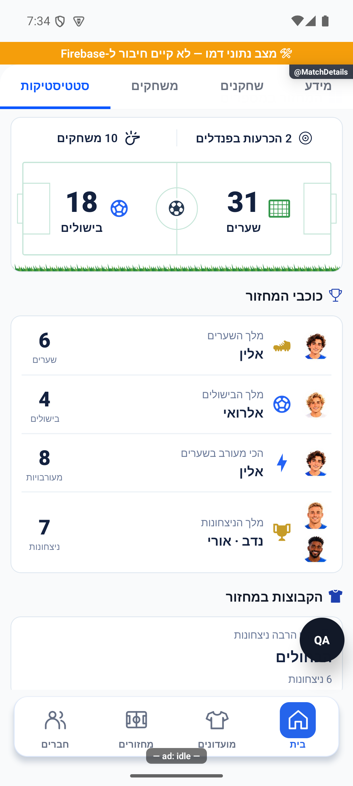
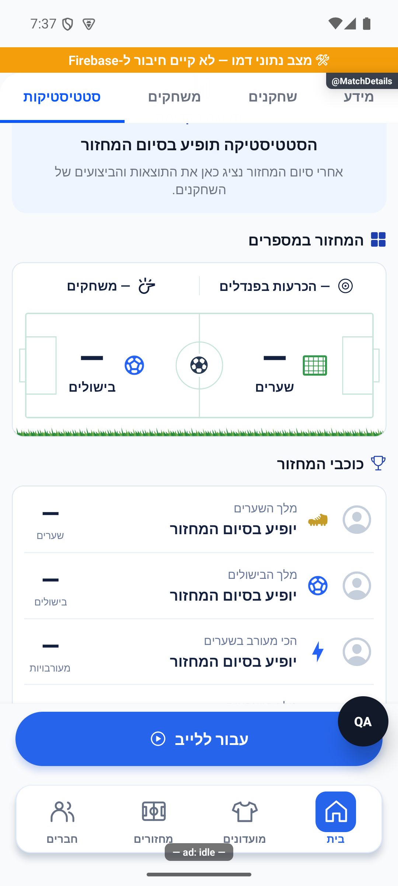

נבדק באמולטור אנדרואיד, כולל מסך צר וטקסט מוגדל, עם נתוני דמו. [בדיקות, צילומים ומגבלות](../../changes/2026-10-17-round-stats-style.md). השינוי מקומי וטרם הופץ.

## שורת צירוף ובדיקת הפולס — 17.10.2026

לפני סיום המחזור מופיעה תצוגה מקדימה של חלקי הסיכום, עם הסבר שהנתונים יופיעו בסיום. מקפים מייצגים נתונים שעדיין אינם קיימים; לא מוצגים אפסים או מצטיינים מומצאים.

[בדיקות, צילומים ומגבלות](../../changes/2026-10-17-roster-recruitment-and-pulse.md).

## בדיקות הפולס והגרסה הפנימית 1.1.55 — 17.10.2026

לפני סיום המחזור מוצג הסבר שהסטטיסטיקה תופיע בסיומו. סיכום שעדיין לא נוצר אינו מוצג כשגיאת הרשאה. אם הסיכום מגיע מהשרת כשהלשונית פתוחה, הוא מופיע בלי לפתוח אותה מחדש. תקלה אמיתית עדיין מאפשרת ניסיון חוזר.

[ראיות, בדיקות ומגבלות](../../changes/2026-10-17-internal-1.1.55.md).

## פריסת שרת מאושרת — 17.10.2026

נפרס תיקון השרת לספירת שערים בלי כובש ושערים עצמיים בסיכום, פעם אחת. נפרסו גם שירותי הוספה וביטול של גול בדיעבד. סיכומים שכבר נחתמו לא הוסבו. [מצב הפריסה והראיות](../../changes/2026-10-17-server-preparation.md)

## תוויות מדדים וכל שורות המחזור — 17.10.2026

תוויות ארבעת המדדים יכולות לתפוס שתי שורות בגובה אחיד, כך ש״הכרעות בפנדלים״ אינו נחתך. בטבלת אלופי המחזור מוצגים כל השחקנים שהוחזרו עבור המחזור, לרבות מי שיש לו אפסים. במחזור עם 33 שורות לא מוסתרות שלוש האחרונות. מספרי הדירוג מוצגים בשורה אחת גם בשתי ספרות; סדר הדירוג והנתונים לא השתנו.

התיקונים מקומיים ונבדקו אוטומטית. לאחר פתיחה קרה באימולטור אנדרואיד מול מחזור הבדיקה בייצור נצפו ברוחב רגיל תווית הפנדלים המלאה, דירוגים 10/11 בשורה אחת ושורות 31–33 עם אפסים. בבדיקה הסופית במסך קטן בגופן 140% נראו תווית הפנדלים מלאה בשתי שורות, כל ארבע הלשוניות שלמות בשורה אחת וסוף הטבלה עד שורה 33. הצילומים נבחנו גם בנפרד ונשמרו במפת הראיות; אין בכך בדיקת אייפון או כל מסכי המועדון. [החוזה והגבולות](match-stats.md#תוויות-מלאות-כל-הסגל-ומספרי-דירוג--17102026).

## טעינת נתוני המחזור — 17.10.2026

כשפותחים את לשונית הסטטיסטיקה, מופיעה טעינה עד שתתקבל תשובת הנתונים. תקלה בקריאה מציגה הודעה וכפתור ״ניסיון חוזר״, במקום לטעון שאין למחזור נתונים. ברענון של אותו מחזור נשאר הסיכום שכבר נטען, גם אם העדכון נכשל. מעבר למחזור אחר או לחשבון אחר מסתיר מיד את הסיכום הקודם. רק אחרי קריאה מוצלחת של מסמך חסר מופיע ההסבר על היעדר נתונים.

התיקון מקומי בלקוח. מצבי טעינה, תקלה, רענון ומעבר נבדקו אוטומטית; תצוגת סיכום קיים עם נתוני ייצור נצפתה אחרי פתיחה קרה במחזור הבדיקה. מצבי כשל וניסיון חוזר לא הופעלו במכשיר ייצור. [החוזה והראיות](match-stats.md#מצבי-קריאת-הסיכום-הכללי--17102026).

שמות אורחים שהסיכום מפנה אליהם נלקחים מרשימת אורחי המחזור, גם כשאין להם חשבון. האיור שלהם נשאר קבוע לפי מזהה האורח. אורח שהוסר ולא נשמר לו שם אינו מוצג כזוכה בשם מומצא. התיקון אינו משנה למי השרת מעניק תואר; אורחים ממשיכים להיכלל בסכומי המחזור ובטבלה לפי החוזה הקיים. [פירוט הבדיקה](match-stats.md#שמות-אורחים-בסיכום-הכללי--17102026).

כרטיסי הקבוצות המובילות בסיכום מציגים את צבע הקבוצה שנבחר בהכנה. קבוצה שהוחלפה ללבן תופיע כ״הלבנים״, עם אותם ניצחונות שהיו לה. כשלא נבחר צבע, נשמר שם ברירת המחדל. התיקון נבדק ברכיב ונצפה בסיכום מחזור הבדיקה של שבעה בייצור: הלבנים עם שני ניצחונות. [הצילום המקורי](../screenshots/action-pitch-production-seven-summary-team-colours-fixed-2026-10-17.png).

עדכון הפצה, 9.10.2026: השינויים נכללו בגרסה `1.1.38 / 272`, שנקלטה במסלול הייצור והפנימי בגוגל. פונקציית הציונים נפרסה בהצלחה. קריאה ללא התחברות נחסמה כצפוי; טעינת ציונים אמיתיים במכשיר והורדה ציבורית מהחנות עדיין לא אומתו. הערות הפריסה בהמשך מתארות את מועד הבדיקות המקורי. [יומן השחרור](../../changes/2026-10-09-production-1.1.38.md).

לחיצה על סמל המידע של הציון פותחת חלון בעיצוב האפליקציה, עם הסבר קצר ונפרד לכל גורם בציון. אפשר לגלול ולסגור ב״הבנתי״ או לגרור את הידית למטה. חישוב הציון נשאר ללא שינוי.

13.10.2026: ההסבר מבהיר שטבלת המועדון והעונה מדורגת קודם לפי ניצחונות, ובשוויון לפי שערים ובישולים. תוקן הנוסח בלבד, ללא שינוי במספרים או בדירוג.

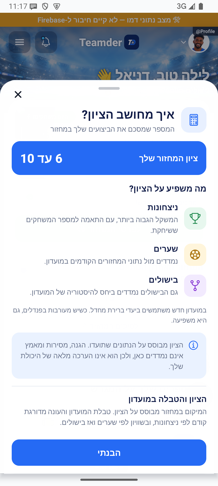

מי שסיים במקום הראשון בדירוג הציון של המחזור יראה מתחת לציון את ״אתה מצטיין המחזור!״. המשפט יופיע גם בתמונת הסיכום שמשתפים. כשאין דירוג שמור הוא לא מוצג.

כתר מופיע משמאל למשפט המצטיין כדי להבליט את ההישג.

8.10.2026: בטבלת אלופי המחזור עמודת „ציון” היא עמודת הנתונים הראשונה אחרי שם השחקן, מימין לניצחונות. הטבלה נפתחת ממיונת לפי הציון מהגבוה לנמוך. כשאין ציון שמור מופיע קו. אפשר למיין לפי נתון אחר בלחיצה על כותרתו; אם הטעינה נכשלה אפשר לנסות שוב. מי שרואה את המחזור יוכל לראות את הציונים בלבד; יתר הנתונים האישיים נשארים פרטיים. נבדק בדמו; קריאת השרת ממתינה לפריסה מאושרת.

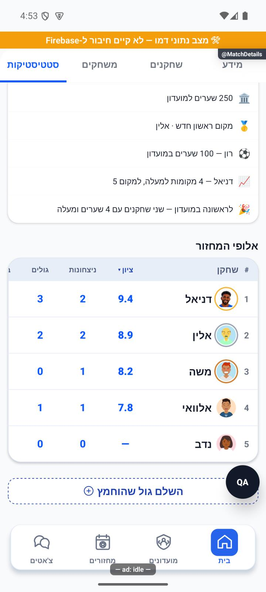

תיקוני דיווחים, 8.10.2026: האייקון נמצא מעל המספר, ולמשחקים יש אייקון מגרש. התוצאות מסודרות מימין לשמאל ויש לכך הסבר. שורת שערי הקבוצות הוסרה; אייקון השיתוף נמצא משמאל לכיתוב.

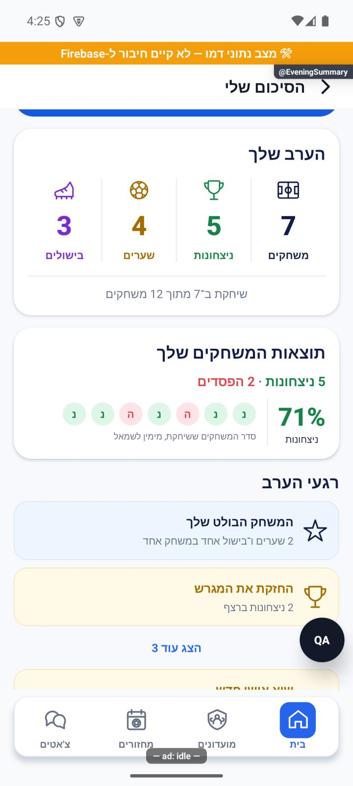

אחרי המחזור רואים את התוצאות והנתונים של הערב. הסיכום האישי מציג את מה שהמשתמש עשה באותו מחזור. אפשר לשתף את הסיכום, ונתון שלא קיים מוצג אחרת מאפס.

עדכון מקומי 10.10.2026: אם עיבוד סיכום המחזור נעצר, השרת יכול להמשיך מהשלב החסר בלי להוסיף שוב הופעות, ציונים וצמדים. ציון שכבר נשמר נשאר הציון המקורי. עונה שנסגרה לא מקבלת בטעות נתונים לעונה החדשה. אלו בדיקות קוד מבודדות, והשינוי מחייב פריסה; נתונים חלקיים היסטוריים דורשים טיפול נפרד.

עודכן ב־8.10.2026: הסיכום מציג את תמונת הפרופיל, ציון בכחול וארבעה נתונים: משחקים, ניצחונות, שערים ובישולים. ניצחונות בירוק והפסדים באדום. אפשר לפתוח הסבר לציון ולשתף את הכרטיס כתמונה.

רגעים בולטים, רצפים ופנדלים מופיעים רק כשיש נתונים מתאימים. שיא חדש או השוואת שיא נבדקים מול המחזורים הקודמים שלך במועדון, גם מעונות קודמות. במחזור הראשון או כשחסרה היסטוריה לא מציגים טענת שיא. אזור המועדון מציג בנפרד את דירוג העונה, שינויי מיקום, עקיפות והפער לשחקן שמעליך.

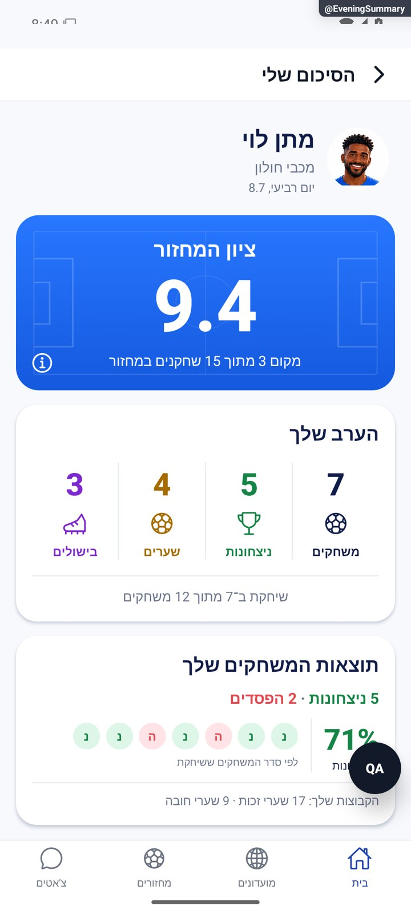

זהו צילום של רכיב האפליקציה עם נתוני דמו, ולא נתונים של משתמש אמיתי. השינוי מקומי וטרם פורסם בחנות.

[להסבר המעמיק ולמפת הקוד](match-stats.md)

## צילום והיקף ההוכחה

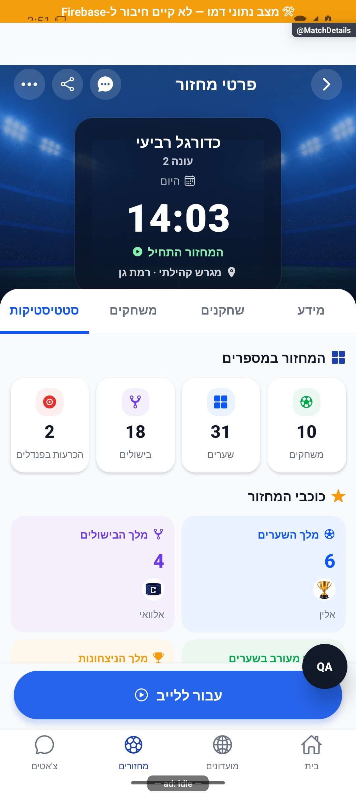

הצילומים מציגים רק את המצבים המתועדים במסמך המעמיק. חלקם נתוני דמו, חלקם הוכחות מתיקון קודם, ובכמה מהם טעינה או הודעת הגנה; הם אינם אישור שכל התהליך או השרת נבדקו.

8.10.2026: בפתיחה חדשה באימולטור, ללא לחיצה על כותרת עמודה, נצפה מיון הציונים 9.4, 8.9, 8.2, 7.8 ולבסוף ציון חסר. הציון מופיע מימין לניצחונות. זהו דמו באנדרואיד; אין כאן אימות שרת חי או אייפון. כל 2,820 הבדיקות ובדיקת הטיפוסים עברו.

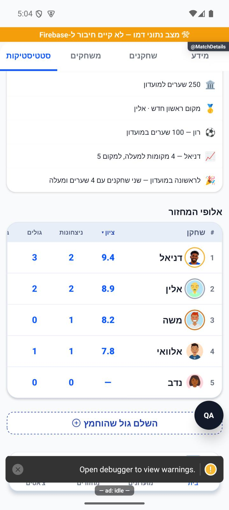

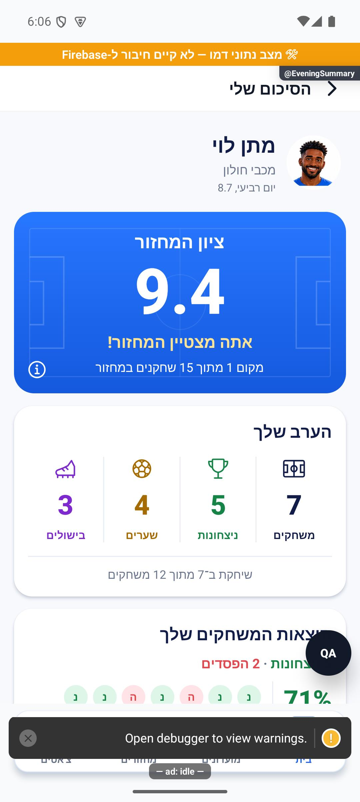

התצוגה במקום הראשון נצפתה באמולטור. בדיקת הטיפוסים וכל 2,820 הבדיקות ב־191 חבילות עברו. לא נבדק באייפון, לא נשלחה תמונת שיתוף ולא פורסמה גרסה.

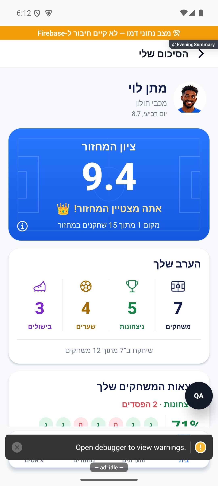

מיקום הכתר נבדק בפועל באמולטור. בדיקת הטיפוסים וכל 2,820 הבדיקות עברו; אייפון ושיתוף חיצוני לא נבדקו.

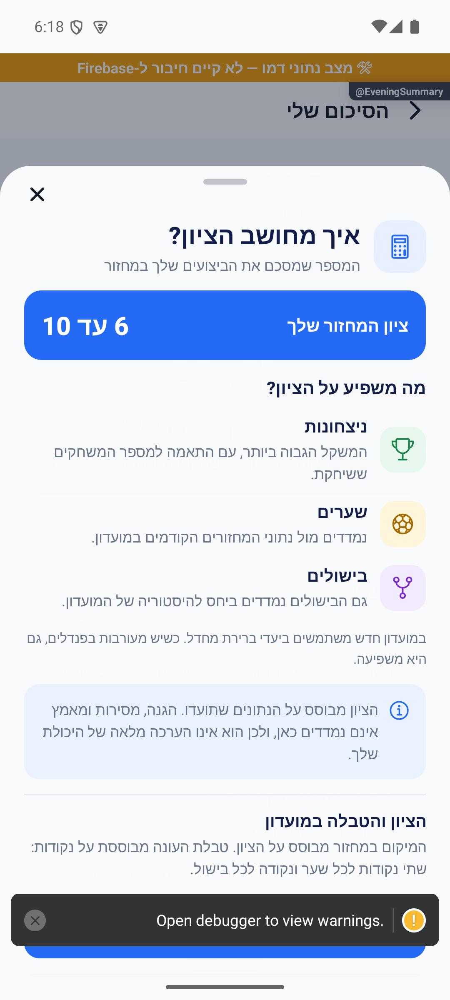

החלון נפתח ונצפה בפועל באמולטור; התוכן והאייקונים מיושרים לימין. אזהרת פיתוח מכסה את כפתור הבנתי בצילום. בדיקת הטיפוסים וכל 2,821 הבדיקות ב־191 חבילות עברו. לא נבדק באייפון, בהגדלת גופן או במכשיר קטן.

## שיפור תגובה בגלילה — 9.10.2026

צומצמה עבודה מיותרת של אנימציות ותמונות. מספרים מתייצבים בזמן גלילה, ואנימציות רקע מחזוריות נעצרות כשעוברים למסך אחר. הנתונים, סדר התוכן והניווט נשארים כפי שהיו. הבדיקה בוצעה באימולטור אנדרואיד עם נתוני דמו; טלפון פיזי ואייפון לא נבדקו.

### עדכון 10.10.2026

אם טעינת הסיכום נכשלת, אפשר לנסות שוב במקום לקבל בטעות הודעה שלא שיחקת. ציון שחושב באפליקציה ללא ציון שמור יסומן כמשוער גם בתמונה שמשתפים.

במעבר בין מחזורים או חשבונות רואים טעינה עד שהסיכום הנכון מוכן, כדי שלא יופיע לרגע סיכום של שחקן או מחזור אחר.

תוקן מקומית גם מצב שבו שתי שמירות פעילות במקביל יכלו להחליף מדידה גבוהה במדידה נמוכה. המסלול אינו מחובר כרגע למסך מוצר, והתיקון דורש פריסת שרת בעתיד.

התיקון נבדק כעת גם מול מסד מקומי: שתי שמירות לא הורידו מדידה גבוהה. נבדקו גם השלמת שער וביטולה בלי כפילות, והגנה על הנתונים כשהעונה מתחלפת באמצע הפעולה. אלו נתוני בדיקה מבודדים, ללא פעולה במחזור אמיתי.

## החלטות הבעלים — 13.10.2026

סיכום המחזור מחשב אחוז ניצחונות מכל המשחקים, כולל תיקו. השלמת שער מעדכנת מונים בלבד ואינה משנה תוצאה, נתוני צמד, ציון או תואר שכבר נחתם.

השינוי מקומי וטרם נפרס. [פירוט הבדיקות והמעבר](../../changes/2026-10-13-approved-statistics-policy.md).

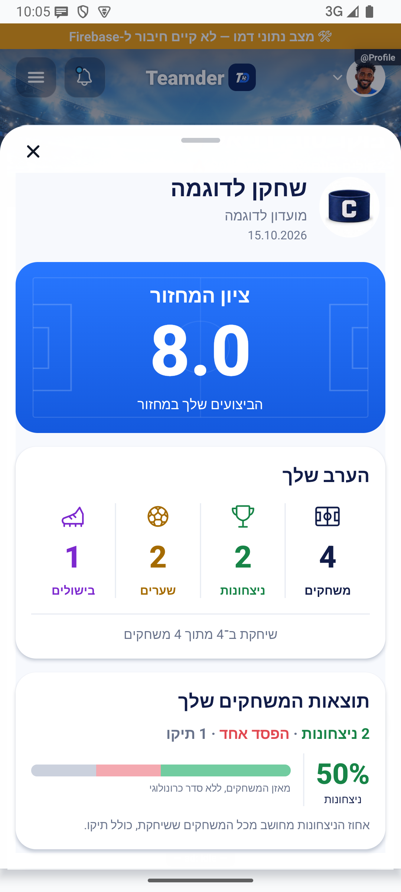

הוספה או ביטול של שער שהוחמץ אחרי סיום המחזור מעדכנים גם את סיכום המחזור: שערים, בישולים, מלכי המחזור והצמד המצטיין. מספר המשחקים ותוצאותיהם נשארים כפי שנרשמו. במחזור האחרון שביקשת תוקנו הנתונים ל־26 שערים ו־18 בישולים ב־6 משחקים. הוכן גם רענון אוטומטי במסך; עד להפצת גרסת הלקוח, פותחים מחדש את פרטי המחזור כדי לראות את התיקון. שיאים היסטוריים שאי אפשר לאמת מתוך מסמך ישן אינם מומצאים מחדש.

תיקון השרת נפרס ואומת ב־14.10.2026 באישור הבעלים. ציוני המחזור האחרון וסיכומו הכללי תוקנו בפועל. לא נבנתה גרסת יישום חדשה במשימה זו; הרענון המיידי באותו מסך ממתין להפצת הלקוח.

## סבב פולס — 15.10.2026

כשהסיכום עדיין אינו קיים, כתוב שהסטטיסטיקות יופיעו אחרי שהמחזור יסתיים. השלמת שערים לאורחים מעדכנת גם את סכומי הסיכום, בלי להפוך אורח למוביל אישי.

השינויים בסבב זה מקומיים וטרם הופצו. [דוח הסבב](../../changes/2026-10-15-pulse-sweep.md).

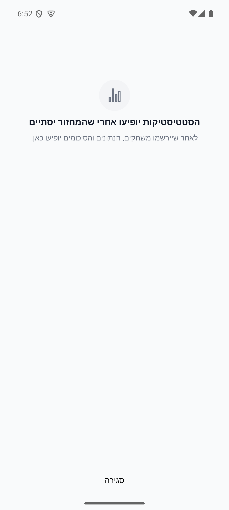

## כל השערים בסיכום המחזור — 17.10.2026

תוקן מקומית מצב שבו גול ללא כובש ידוע חסר בסך שערי המחזור. גם שערים כאלה, שערים עצמיים ושערי אורחים נכללים בסכום, בלי להוסיף לשחקן שער שלא כבש ובלי לספור אירוע פעמיים. לדוגמה, משחק שהסתיים בתוצאה 3:1 נספר כארבעה שערים גם אם אחד מהם ללא כובש ידוע ואחד עצמי. השלמת שער שנשכח וביטולה נשארות תקינות.

התיקון נבדק בחישובים בלקוח ובשרת. הוא ממתין לפריסת שרת באישור עתידי; סיכומים היסטוריים שכבר נשמרו אינם משתנים אוטומטית. אין כאן אישור שהסכום המתוקן כבר נצפה במחזור ייצור. [הפירוט והבדיקות](match-stats.md#כלל-שערי-המחזור-כולל-כובש-לא-ידוע--17102026).

תוקן מקומית גם מצב שבו אורח שכבש או בישל ואז הוחלף קיבל את הפעולה, אך לא את ההופעה ותוצאת המשחק. גם הוא וגם המחליף שהשתתף נספרים פעם אחת במשחק שהסתיים; הרכב המשחק הבא אינו משתנה בעקבות חישוב הסיכום. התיקון דורש עדכון שרת באישור עתידי, ואינו מתקן מעצמו נתונים חלקיים שכבר נשמרו. [הפירוט והבדיקות](match-stats.md#הופעת-אורח-שתרם-שער-והוחלף--17102026).

## כשל בטבלת מחזור וניסיון חוזר — 17.10.2026

אם טבלת המחזור אינה נטענת, מופיע הסבר שאפשר ללחוץ עליו לניסיון נוסף. כשל אינו נראה עוד כמו מחזור ללא נתונים, ובמעבר למחזור אחר הטבלה הקודמת מוסתרת מיד.

[סקירת ההכנה, בדיקות ומגבלות](../../changes/2026-10-17-preinternal-audit.md).

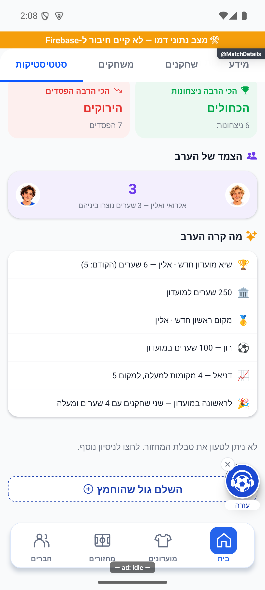

## הפצה פנימית — 17.10.2026

שינויי הלקוח האחרונים המתועדים כאן נכללו בבינארי הפנימי `1.1.53 / 286` באנדרואיד. המסלול אומת בגוגל; הייצור נשאר בגרסה הקודמת. זה אינו אימות חדש של תרחיש ייצור או של מכשיר אפל. [מקור הבינארי, פריסת השרת, בדיקות ומגבלות](../../changes/2026-10-17-internal-1.1.53.md).

## תלות בעדכון העונות — 19.10.2026

קובץ תשתית משותף עודכן במסגרת העונות. שינוי זה אינו מוסיף פעולה חדשה למסך המתואר כאן; פרטי העונות והבדיקות מופיעים במסמך העונות.

[מצב המימוש, הבדיקות ומגבלות האימות של העונות](../clubs/seasons.md). מקומי בלבד; לא בוצעה פריסה במסגרת המשימה.

## תלות במידע על סגירת עונה — 23.10.2026

נוסף מידע משותף שמאפשר להסביר מדוע עונה מתעכבת בסגירה. אין שינוי נוסף בפעולות המתוארות כאן; השינוי מקומי וטרם הופץ. [המסלול, הבדיקות והמגבלות](../../changes/2026-10-23-season-automatic-recovery.md).

## עדכון תלות משותפת בקריאות מידע — 23.10.2026

בקובצי השירות המשותפים נוספה אפשרות מפורשת לניסיון חוזר אחד בקריאה זמנית שנכשלה, תוך עצירה אם החשבון מתחלף. החיבור מוגבל ל־14 נקודות קריאה המפורטות בדוח; אין כאן טענה שכל פעולה בפיצ׳ר קיבלה ניסיון חוזר או שנבדק מסך חדש. בדיקות המאגר המלאות עברו (5,261 בדיקות ב־472 חבילות), אך אינן הוכחת הרצה במכשיר. הקוד מקומי וטרם הופץ. [מסלול, ראיות ומגבלות](../../changes/2026-10-23-four-open-errors.md).

## תלות בשמירת צבעי המחזור — 24.10.2026

שמירת המידע המשותפת עודכנה כדי להעביר את צבעי הקבוצות ממסכי הכוחות להכנה וללייב. אין תוספת פעולה במסך הזה, והוא לא נבדק מחדש במכשיר במסגרת התוספת. השינוי מקומי וטרם הופץ. [פרטי התוספת ומגבלות הבדיקה](../rounds/draft-setup.md#צבעים-לפני-שיבוץ-ובכל-שיטת-חלוקה--24102026).

## תלות בעריכת קבוצות בלייב — 24.10.2026

בקובץ השירות המשותף נוסף מסלול לעריכת הקבוצות והתור במשחק חי, כולל איפוס המשחק הנוכחי בלבד בעת החלפת קבוצה. לא שונו מסלולי הפיצ׳ר הזה במסגרת התוספת ולא בוצע לו אימות מסך חדש. [מסלול השינוי, הבדיקות והמגבלות](../rounds/live-advanced.md#עריכת-הקבוצות-והתור-בזמן-הלייב--24102026). מקומי וטרם הופץ.

## בדיקת עומק לעריכת הקבוצות — 24.10.2026

בקובץ השירות המשותף תוקן שימור זהות המשחק במחזור ישן בעת שינוי תור בלייב. הדיווח על הצלחת החלפה נשלח כעת רק אחרי שמירה. מסלולי הפיצ׳ר הזה לא שונו ולא בוצעה לו בדיקת מסך חדשה. כל 5,496 בדיקות הפרויקט עברו; אין בכך הוכחת מסד חי או הפצה. [הראיות ומגבלות הבדיקה](../../audits/2026-10-24-live-teams.md). מקומי וטרם הופץ.

## דיווחים ושגיאות וסגירה לפי גיל — 24.10.2026

סיכום אישי שאין עבורו סטטיסטיקה נשאר לא זמין במקום להיכשל בקריאת מסמך שאינו קיים. כשל אמיתי בקריאת הנתונים עדיין מגיע למצב הניסיון החוזר.

[מקור הדיווחים, הבדיקות ומגבלות הסבב](../../changes/2026-10-24-pulse-age-pass.md). השינויים מקומיים וטרם הופצו.

## המשך קיצור טעינות בלילה של 25.10.2026

עודכנו קריאות מידע משותפות או מתאם הבדיקה שלהן כדי לצמצם טעינות מיותרות. אין שינוי נוסף בפעולות העצמאיות המתוארות כאן, ואין אימות מכשיר חדש שלהן בסבב הזה. [בדיקות, ראיות ומגבלות](../../changes/2026-10-24-loading-performance.md).

## תגובה מיידית לכפתורי השעון - 25.10.2026

עודכן רכיב השעון המשותף למסכי הלייב. אין שינוי מכוון בהתנהגות הפיצר המתואר כאן. [בדיקות, ראיות ומגבלות](../../changes/2026-10-25-live-timer-response.md). התיקון מקומי וטרם הופץ.

## תלות בניווט עריכת קבוצות - 25.10.2026

נבדק השינוי הממוקד במקורות המשותפים: `src/navigation/GameStack.tsx`. נוסף מעבר מתפריט הלייב לחלוקת הכוחות עם שימור מפתח מסך המקור. אין שינוי נוסף בתהליך העצמאי המתואר כאן ולא נערכה לו בדיקת מסך חדשה. [היקף, בדיקות ומגבלות](../../changes/2026-10-25-live-draft-entry.md).

## תאימות לשמירת פקודת רכיב הבית - 25.10.2026

נוספה הגנה פנימית מפני ביצוע חוזר של פעולת רכיב הבית. התהליך המתואר בעמוד זה לא השתנה במכוון, ונתונים ישנים נשארים נתמכים. התיקון מקומי וטרם הופץ. [מקור הבדיקה והמגבלות](../../changes/2026-10-25-widget-completion.md).
