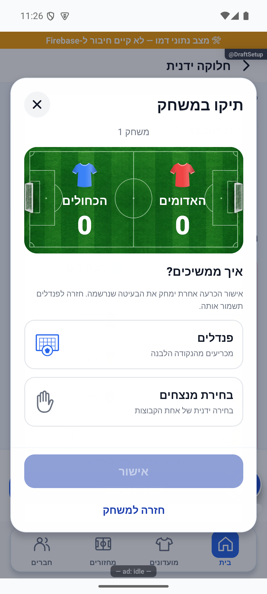
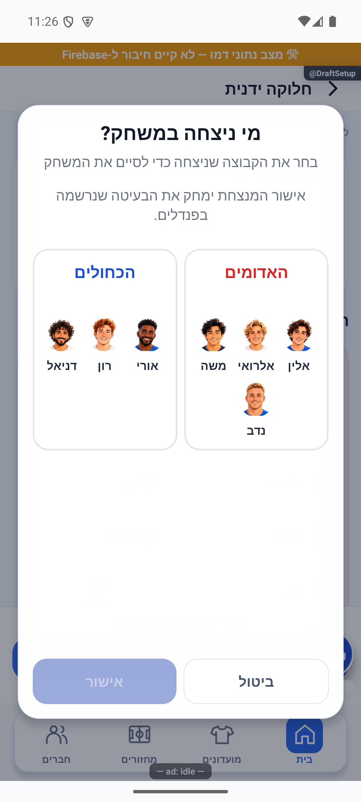
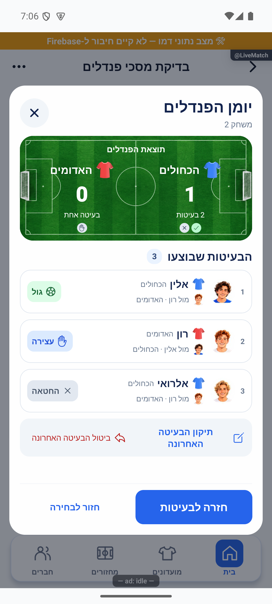
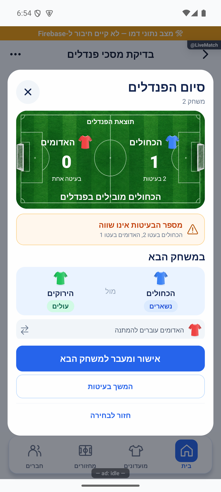
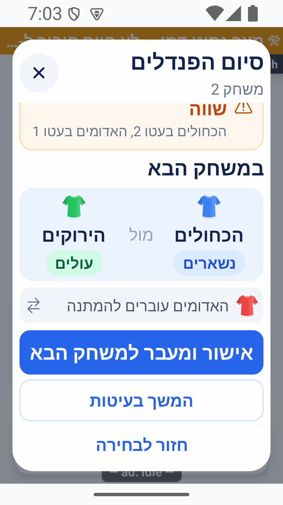
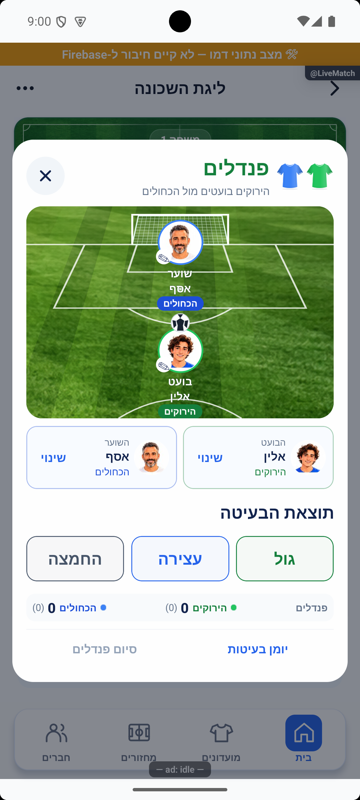
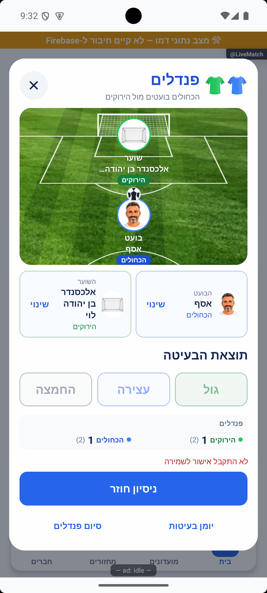
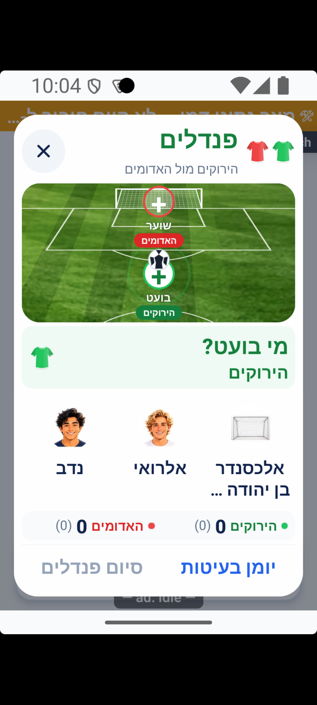
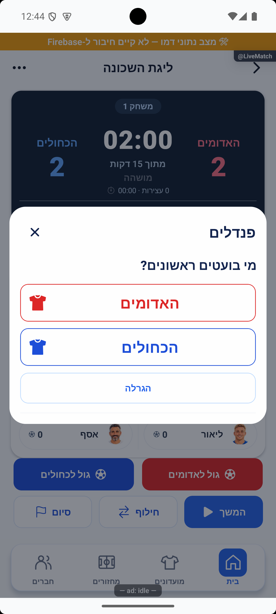
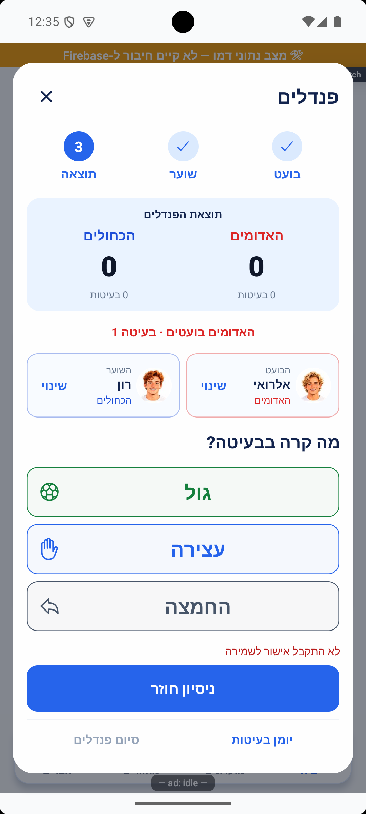

# הכרעת תיקו ופנדלים

## הכרעה חלופית אטומית — 18.10.2026

אישור מנצחת ידנית או יציאת שתי הקבוצות אחרי פנדלים אינו מפעיל עוד `clearShootout` לפני זקיפת התוצאה. המסך שומר בחזרה לבחירה את `ShootoutDecisionContext`, את `RoundDecisionContext` המלא ואת `alternativeFingerprint`; ביטול, סגירה ובחירה חוזרת בפנדלים אינם כותבים דבר. רק כפתור האישור הקיים מפעיל `prepareRoundResult`. הבחירה נשארת קשורה למצב שהמנהל ראה, ואין פעולה נוספת במסלול התקין.

`prepareRoundResult` משווה קריאה טרייה מהשרת להחלטה המקורית, לרבות הסדרה שעוד קיימת. `_commitRoundStatsAndClear` שולח ל־`commitRoundStats` שדה אופציונלי `alternativeDecision: {fingerprint}` ומערך `penalties: []`. השרת מאמת סטטוס כשיר, תיקו, מפתח משחק, זהות ההרכבים והשחקנים, סדר ממתינות, קפטנים, שערים וסדרה מלאה. `alternativeRoundFingerprint` בלקוח ובשרת מנרמל באותו אופן ערכי בעיטה ישנים וחסרים, ומתעלם מהשעון. `open` ו־`active` שקולים לצורך החלטה בלבד; מצבים סופיים אינם שקולים.

ההיסטוריה, הסטטיסטיקה, קבלת `committedRounds` ומחיקת הסדרה והלוח נכתבים באותו אוגד אטומי הקיים, עם תנאי גרסת המסמך. כשל לפני קבלת האוגד משאיר גם את הבעיטות וגם את יתר נתוני המקור; אין עוד חלון שבו המחיקה הצליחה אבל התוצאה לא נשמרה. שינוי במסמך בין קריאת השרת לכתיבה דוחה את האוגד כולו. הבעיטות שנדחו אינן מופיעות בהיסטוריה ואינן זוקפות בעיטות או נתוני שוער. מדיניות המשתתפים, האורחים וההופעות לא השתנתה.

הקבלה שומרת `alternativeDecisionFingerprint` יחד עם התוצאה והחלטת התיקו; התשובה מחזירה את אותה טביעה. אישור תשובה שאבד מאפשר ניסיון חוזר לפי אותו מפתח וטביעה, גם כשהסדרה כבר נמחקה, ללא כתיבה נוספת. טביעה, מנצחת או החלטת תיקו אחרות אינן מקבלות אישור מהקבלה הזאת. אם כבר נפתח משחק אחר, שומר ההחלטה מסרב להכין מעבר נוסף ואינו מוחק את הסדרה החדשה. לאחר אישור הכותב נשאר גישור `waitForCommittedRound` לקבלת אותה תוצאה ואותו הרכב; הוא אינו משגר את השמירה מחדש.

התאימות אינה דורשת שינוי כללים: לקוח ישן שמשמיט `alternativeDecision` ממשיך בחוזה הקודם ובתשובת `protocol: 2`. מול שרת ישן, סדרה לא ריקה אינה תואמת ל־`penalties: []` ונדחית בלי מחיקה. סדרה ריקה יכולה להישמר בחוזה הישן; הלקוח מקבל תשובת הצלחה ללא הד הטביעה רק אם הסדרה המקורית הייתה ריקה, התוצאה תואמת והקריאה המאשרת מצביעה על קבלת המשחק ואותו הרכב. כך הצלחה אמיתית אינה מוצגת ככשל ואינה נשלחת שוב בטעות. `clearShootout` וגישור המחיקה נשמרו למתקשרים הישנים בלבד; המסך הנוכחי אינו משתמש בהם לשינוי הכרעה.

`finalAtomicAlternativeAudit` מפעיל מטפלי מסך, שירות, ממיר ופעולת שרת מלאים עם תעבורה מבודדת ואוגד שבודק את כל תנאי הגרסה לפני כל שינוי. הוא מכסה כשל וניסיון חוזר, הכרעה ידנית ויציאת שני הצדדים, לחיצה כפולה, אישור שאבד, קבלה שונה, מעבר משחק, שינויים לפני ובזמן השמירה, שרת ישן וסדרה ריקה, ערכים חסרים ו־`null`, ושוויון טביעות אחרי הממיר האמיתי. בריצה הסופית עברו שבע חבילות ו־183 בדיקות ב־26.589 שניות, ובהן 54 תרחישים חדשים. טיפוסי השרת נקיים; טיפוסי הלקוח נעצרו בנתוני בדיקת יצירה שבבעלות סוכן אחר, והגבול מפורט בדוח. [הדוח וההרצה](../../changes/evidence/2026-10-18-production-blockers/atomic-alternative-audit.md). זו הוכחת קוד ותעבורה מבודדת; חוזה השרת החדש טרם נפרס וטרם נבדק במכשיר או בייצור. צילומי החלופה הישנה אינם ראיה לאטומיות החדשה. המוביל מרכז אישור פריסה, בדיקות נוספות ויומן; לא בוצעו כאן פריסה, כתיבת ייצור או שינוי הרשאות.

## כדור ההמתנה ליד הבועט — 18.10.2026

בשני צילומי המוביל, `tmp/live-action-production/shots/final-eleven-penalty-roster.png` ו־`final-eleven-penalty-result.png`, נצפה ונבחן כדור סטטי שמכסה חלק מתג ״הכחולים״ מתחת לשוער. `MatchActionPitch` השתמש באותה עמודה במרכז ובגובה שלפני עיגול הבועט, ללא הפרדה מטקסט השוער.

נקודת תחילת הפנדל נמצאת כעת לצד דיסק הבועט ובגובה מרכזו: ההפרש האופקי כולל את רדיוס הדיסק בפועל, רדיוס הכדור ומרווח של שמונה יחידות, מחולק ברוחב המגרש הנמדד. פונקציית `participantDiscSize` משותפת לעיגול ולחישוב ההיסט. הכדור הממתין והכדור בתחילת תנועת הבעיטה משתמשים באותה נקודה, ללא קפיצה אחרי אישור השמירה. מגרש גול, מסירה, יעדי תוצאות הפנדל, תגובת שוער ורשת והפחתת תנועה לא השתנו.

שלוש בדיקות הפרדה בגובה 140/180/248 וברוחב נמדד 250/300/340 נכשלו לפני התיקון ועברו אחריו; שלוש נוספות מאמתות אותה נקודת המתנה ותחילת בעיטה. ארבע חבילות עברו עם 105 בדיקות, כולל הפחתת תנועה ושלוש תוצאות הפנדל, והטיפוסים נקיים. [דוח, מקורות וגבולות](../../../artifacts/final-deep-audit-2026-10-17/penalty-ball-layout-audit.md).

לאחר התיקון נפתח ונבחן בנפרד [צילום הפנדלים הקטן](../screenshots/final-audit-production-eleven-small-penalty-fixed-ball-2026-10-18.png) שהמוביל צילם בלקוח הפיתוח `5556/8082` מול מחזור הבדיקה המאושר בייצור. קובץ המקור הוא 576×1024 בצפיפות 288, חלון כ־320×568.89 וגופן 140%. האדומים בועטים מול הירוקים; שני התפקידים עדיין ריקים, התוצאה 0:0 ואפס בעיטות. הכדור נמצא לצד עיגול הבועט ובגובה מרכזו, ותג הירוקים של השוער אינו מכוסה. זהו אימות מקורי למיקום כדור ההמתנה במצב הקומפקטי, ולא רצף הנפשה או הוכחת תוצאה שנשמרה.

באותו צילום אווטרי השורה הראשונה נראים בבורר, אך שמותיהם נחתכים בתחתית מול פעולות היומן והחזרה. אין לסווגו כהוכחת שורה מלאה או קריאות כל 11 המועמדים בגופן מוגדל. [צילום הסגל הרגיל](../screenshots/final-audit-production-eleven-penalty-roster-2026-10-18.png) ו[צילום המשתתפים והתוצאה](../screenshots/final-audit-production-eleven-penalty-result-2026-10-18.png) הם לפני תיקון הכדור: הראשון מציג עשרה מועמדים מלאים ותחילת האחד עשר לאחר גלילה, ובשני השם הארוך מלא בכרטיס המשתתף אך מקוצר במגרש. שניהם משמרים את החפיפה הישנה לתג השוער, ואינם צילום מתוקן במידה רגילה. המקור, חותמות הקבצים והמגבלות רשומים במניפסט וב־[רשומות הראיות](../../../artifacts/final-deep-audit-2026-10-17/eleven-proof-entries.json). אין כאן בדיקת חנות, אייפון או אימות לתיקון `baseTeams`.

## אזהרת מחיקה בלשון יחיד — 18.10.2026

נוסף ענף מלל עבור `discardedPenaltyCount === 1` ב־`TieDecisionModal`, שמוגדר ב־`src/components/match/Shootout.tsx`, וב־`WinnerPickerModal`. בתיקו נכתב ״אישור הכרעה אחרת ימחק את הבעיטה שנרשמה. חזרה לפנדלים תשמור אותה.״; בבורר המנצחת נכתב ״אישור המנצחת ימחק את הבעיטה שנרשמה בפנדלים.״. באפס האזהרה עדיין מוסתרת באמצעות אותו תנאי `> 0`, ובשניים ומעלה נשמר הנוסח הקיים. זה שינוי מלל בלבד: אין שינוי לפריסה, לבחירה, לאישור, למחיקת סדרה או לשמירת תוצאה.

שלושה תרחישים ב־`tests/logic/finalCountCopy.test.ts` מפעילים את ביטויי ה־JSX המקוריים ואת תנאי הנראות עם 0, 1 ו־2, בשני החלונות. יחד עם שלושת תרחישי השיבוץ נוספו שש בדיקות. הריצה עם `tieDecisionConfirmation`, `tieConfirmParity` ו־`manualAllocation` עברה 33 בדיקות בארבע חבילות. בדיקת הטיפוסים והריצה המלאה המשולבת מרוכזות אצל המוביל.

שני הרכיבים המקוריים נפתחו ונבחנו באימולטור הדמו בלבד, ב־5554 מול 8084 ובחשבון `p7`, אחרי אימות דגלי הדמו. הועבר `discardedPenaltyCount:1` בדוגמת תצוגה מבודדת, עם פעולות עסקיות מנוטרלות. לא נבחרה מנצחת ולא אושרה הכרעה. הצילומים מאמתים את נוסח היחיד בפועל, ולא את חישוב הכמות מסדרה שנשמרה. אפס ושניים אומתו בבדיקות הקוד ולא צולמו מחדש.

המידות שנקראו מהתהליך היו 411.43×914.29 וגופן 100%, במכשיר 1080×2400 בצפיפות 420. לא נבדקו כאן ייצור, אייפון או גופן מוגדל. בסיום נסגרו הדוגמאות ללא אישור, הושבו רכיבי התצוגה ונתוני הדמו, ונבדק שלא נוצרה טיוטה מקומית. [דוח, מקורות, שחזור וגבולות](../../../artifacts/final-deep-audit-2026-10-17/count-copy/report.md). התמונות הישנות ממחזור הבדיקה בשבעה מציגות את הנוסח שלפני התיקון, ואינן ראיה למלל המעודכן.

## קריאה ישנה מיד אחרי מחיקת סדרה מאושרת — 18.10.2026

זהו התיקון הקודם של קריאה ישנה אחרי מחיקה בשתי פעולות. [לכידת המקור](../../../artifacts/final-deep-audit-2026-10-17/seven-alternative-read-trace.json) הראתה שהסדרה הישנה חזרה בקריאה מיידית; [הלכידה לאחר התיקון](../../../artifacts/final-deep-audit-2026-10-17/seven-alternative-fixed-trace.json) הראתה הצלחה אחרי המתנה לתמונה המאושרת. החוזה הזה נשמר למתקשרים הישנים, אך המסך הנוכחי עבר ל[שמירה ומחיקה אטומיות](#הכרעה-חלופית-אטומית--18102026) ואינו מוחק לפני השמירה. הראיה ההיסטורית אינה הוכחת פריסה או מכשיר לחוזה החדש. גישור קבלת התוצאה המאוחרת נשאר בשימוש בלי כתיבה חוזרת.

## הוכחות דמו למסגרת ולמשוב בחירה מחדש — 18.10.2026

לאחר תיקון הגובה נפתחו ונבחנו היומן ואישור הביטול בדמו `5554/8084`, עם `__DEV__`, `USE_MOCK_DATA` ו־`p7` מאומתים. בהרצה הרגילה נקראו מידות כ־411.429×914.286 וגופן 100%; בשני השלבים נמדדו אותם גבולות `[37,340][1043,2125]`. בהרצה הקטנה נקראו כ־320×568.889 וגופן 140%; בשני השלבים הגבולות היו `[25,80][551,955]`. כפתור הביטול נשאר מחוץ לגלילה, בגבולות `[39,761][535,855]` במידה הקטנה. ההשוואה מבוססת על היררכיות מקוריות טריות, ולא על חישוב סגנונות בלבד. [אישור ביטול רגיל](../screenshots/final-audit-goal-penalty-undo-confirm-normal-2026-10-18.png), [אישור ביטול קטן](../screenshots/final-audit-goal-penalty-undo-confirm-small-2026-10-18.png).

נבדק גם משוב הדחיות במכשיר הקטן. מתאם מקומי דחה בעיטה לפני כתיבה עם `LIVE_ROSTER_CHANGED`: שמות ותמונות הבועט והשוער נשמרו, והודעה וכפתור בחירה מחדש נראו במלואם. בחירה מחדש חזרה לסגל הבועטים המעודכן בלי השחקן שהועבר להמתנה, עם אפס בעיטות. בכשל לא מסווג נשמרו אותם משתתפים ואותה תוצאה; לאחר שחרור המתאם ניסיון חוזר כתב בעיטת דמו יחידה באותו מזהה ובאותו תוכן. [דחיית סגל](../screenshots/final-audit-goal-penalty-penalty-roster-error-small-2026-10-18.png), [חזרה לבועטים](../screenshots/final-audit-goal-penalty-penalty-reselected-small-2026-10-18.png), [ניסיון חוזר](../screenshots/final-audit-goal-penalty-penalty-network-error-small-2026-10-18.png).

הצילומים נבחנו חזותית. בחירת התוצאה דרשה גלילה, ולכן המגרש נראה חלקית בחלק מצילומי הכשל; אין כאן אישור שכל הסגל והמגרש גלויים יחד. הביטול עצמו לא אושר בניסוי המכשיר הזה. הכשלים הוזרקו בזיכרון לפני כתיבה, ולכן אינם מוכיחים אישור שרת שאבד אחרי כתיבה, שני מכשירים או מסד ייצור. גיבוי ושחזור כללו משתמש, נתוני דמו והיסטוריה, מתודות, ניווט, החלפה חמה, תצוגה וגופן. [הדוח והבדיקות מול מקורות הלכידה](../../../artifacts/final-deep-audit-2026-10-17/goal-native-proof.md), [24 אימותי המקור שעברו](../../../artifacts/final-deep-audit-2026-10-17/goal-native/native-proof-checks.json). המוביל מרכז את המניפסט באמצעות `goal-native-proof-entries.json`.

## מסגרת אחידה גם באישור ביטול בעיטה — 18.10.2026

בבדיקת מכשיר נמצא שפתיחה, יומן ותיקון שמרו את גבולות החלון `[37,308][1043,2093]`, אך מסך אישור הביטול התכווץ ל־`[37,583][1043,1817]`. [צילום המקור שלפני התיקון](../../../tmp/live-action-production/shots/final-four-undo-before.png) נפתח ונבחן: חלונית הביטול אכן נמוכה יותר, עם כותרת פנימית בגובה 641. [היררכיית המקור](../../../artifacts/final-deep-audit-2026-10-17/four-undo-before.xml) מאשרת את גבולות `penalty-dialog` ואת כפתור הביטול שמחוץ לגלילה. זו ראיית התקלה, ולא ראיה לתיקון החדש.

הגורם היה חריג מפורש ב־`ShootoutWizard`: רק ב־`screen === 'undo'` הוחל `min(sheetHeight, 470 + max(0, fontScale - 1) × 160)`. החריג הוסר. כעת `height` ו־`maxHeight` של `penalty-dialog` מקבלים תמיד `sheetHeight = min(680, floor(windowHeight × 0.92))`, גם באישור ביטול. הכותרת, גוף הגלילה הגמיש והפעולות הקיימות נשארים באותה מעטפת. אין שינוי בשאלה, באישור המפורש, בתור, במזהה הבעיטה, בשירות, בכשל או בניסיון חוזר.

נוספו ל־`finalGoalAuditSelection` שלושה תרחישי רכיב: 390×844 בגופן 100%, ו־320×569 בגופן 100% וב־140%. הם עוברים מיומן לביטול, ממתינים לשמירה, מכשילים אותה ומנסים שוב את אותו מזהה, תוך דרישה שהמסגרת תישאר זהה ושכפתור האישור יישאר מחוץ לגלילה. לפני התיקון שתי בדיקות שחזרו הקטנה מ־680 ל־470 ומ־523 ל־470; בטקסט 140% התקרה כבר שמרה במקרה על גובה 523. גם הציפייה ב־`penaltyPitchFlow` עודכנה לאכוף גובה אחיד במקום לקבע את החריג הישן.

אחרי התיקון עברו `finalGoalAuditSelection`, `penaltyPitchFlow` ו־`shootoutPersistence`: שלוש חבילות ו־94 בדיקות. אלה בדיקות רכיב ושירות מבודדות; לאחריהן נבדקה במכשיר הדמו גם המסגרת הרגילה והקטנה, כמפורט בראש המסמך. לא בוצעה כתיבת ייצור, פריסה או שינוי הרשאות במסגרת תיקון הפריסה הזה. התיאורים ההיסטוריים של חלונית ביטול קומפקטית בהמשך אינם ההתנהגות הנוכחית.

## ביקורת סופית: סנכרון תור, סגל וניסיון שמירה — 18.10.2026

העדכון מטפל בשינוי הכרעה או סגל כשהחלונית פתוחה. המסלול הרגיל נשאר: בועט מהקבוצה הבועטת, שוער מהיריבה המשחקת, ואז תוצאה ששומרת מיד. הפלוסים אינם פעולות חובה ואין אישור נוסף. גול, עצירה והחטאה נשארים אירועים נפרדים; מכני נתוני השוער ומשמעות תוצאות ישנות לא שונו.

### מקור התור והבחירות

`ShootoutWizard` שומר בחירת קבוצה ראשונה זמנית ב־`firstChoice`, עם צד הבסיס והצד שנבחר. שינוי מאושר ב־`shootout.firstTeam` גובר עליה. גם באפס בעיטות מוצג הסגל של הצד העדכני, והתחלה חוזרת שפוגשת הכרעה קיימת אינה מציגה את הבחירה המקומית שהפסידה למנהל אחר.

`selectionSeriesKey` כולל את זהות המשחקון, הצד הראשון ומזהי הבעיטות וצדיהן בסדרה האפקטיבית, לרבות `shadow` שכבר אושר. `observedSeries` מזהה שינוי חיצוני בלי לאפס בחירת בועט חדש רק מפני שהמאזין אישר את אותה בעיטה שכבר התקבלה. השוואת מזהי הסגל נפרדת ואינה מגיבה לעצם יצירת מערך חדש עם אותם משתתפים.

| שינוי לפני שליחת ניסיון | תגובה |
|---|---|
| בעיטה חדשה מרחוק במסך בועט, שוער או תוצאה | ניקוי הבחירות הישנות וחזרה לבועט בתור העדכני |
| בועט כבר אינו זכאי | חזרה לבחירת בועט |
| שוער כבר אינו זכאי והבועט תקף | חזרה לשוער תוך שמירת הבועט |
| הסדרה השתנתה ביומן או בסיום | המסך נשאר פתוח; בחירת מנצחת מקומית מתאפסת |
| הבעיטה שבעריכה או בביטול כבר אינה האחרונה | חזרה ליומן בלי לשנות בעיטה אחרת |

הסנכרון אינו מנקה בחירות בזמן `writing`, ניסיון בעיטה ממתין, פעולת הגדרה ממתינה או `completed`. `attemptPeople` שומר את הבועט והשוער לתצוגה גם אם עברו מההרכב. כך שינוי חיצוני אינו מעלים שמות, מוחק ניסיון לא מאושר או מחליף משתתפים בחגיגה. הגנת דור החלונית, הניקוי בסגירה והנפשה רק אחרי אישור שמירה נשארים.

### דחייה ודאית לעומת אישור שלא התקבל

`recordShootoutKick` בודק תחילה אם מזהה הניסיון נשמר עם אותו תוכן. אם כן, הוא מאשר ללא כתיבה נוספת, גם כשהתור או הסגל כבר השתנו. אותו מזהה עם תוכן מתנגש נדחה ב־`SHOOTOUT_CHANGED`, ללא סיווג שמאפשר בחירה חדשה. רק אחרי בדיקת ניסיון קיים נבדקים התור והזכאות:

- משתתף שאינו זכאי נדחה עם `code: 'LIVE_ROSTER_CHANGED'`.
- אי־התאמת מספר הבעיטות המצופה או הצד הבועט נדחית עם `code: 'LIVE_KICK_CHANGED'`.
- דחיות אלה מציגות ״בחירת שחקנים מחדש״ במקום ״ניסיון חוזר״. בבעיטה חדשה חוזרים לבועט בתור הנוכחי; בתיקון שנדחה בשל הסגל חוזרים לתפקיד שאינו תקף ושומרים את מזהה הבעיטה המתוקנת.
- שגיאת רשת, אישור שאבד או כשל לא מסווג משאירים אותו ניסיון, אותם משתתפים ואותה תוצאה. אין ליצור מהם מזהה חדש.

בחירה מחדש היא פעולה מפורשת אחרי דחייה ודאית, ואינה מוסיפה לחיצה למסלול התקין. כללי הנעילה והניסיון הזהה שבהמשך ממשיכים לחול על כשל לא מסווג; הדחיות המסווגות הן החריג הבטוח.

### ביטול חוזר אחרי אישור שאבד

`undoLastShootoutKick(gameId, expectedId)` בודק אם המזהה קיים בסדרה לפני מחיקת האחרונה. כשהבעיטה כבר אינה קיימת, הניסיון מסתיים ללא כתיבה. כשהיא קיימת אך אינה האחרונה, הפעולה נדחית ב־`SHOOTOUT_CHANGED`. ביטול אחרונה בהכרעה סגורה ממשיך להידחות. כך סדרה עם שתי בעיטות אינה מאבדת את הראשונה כשביטול השנייה הצליח אך אישורו אבד. מסלולי הדמו והעסקה משתמשים באותו כלל, והפרמטר האופציונלי הישן נשמר לתאימות. אין שדה מסד או מונה חדש.

### סיום הכרעה ובדיקות

`onShootoutDecided` ויתר מסלולי ההכרעה מעבירים `RoundDecisionContext` ל־`prepareRoundResult`, כדי שהחלטה מאוחרת לא תסיים משחקון או לוח אחר. ההקשר כולל סגל, תוצאה, שערים ובעיטות ומוציא את השעון. בהכרעה חלופית משווים לסדרה המקורית ומוחקים אותה באותה כתיבה אטומית ששומרת את התוצאה. `commitRoundStats` מקבל גם `liveLineupFingerprint`, שמשווה בלקוח ובשרת הרכבים, צבעים, צדדים, השאלות ויוצאים הביתה. [מסלול הנתונים והתאימות](live-advanced.md#ביקורת-סופית-סגל-משתנה-והחלטת-סיום--18102026). ההגנה הנוספת בשרת טרם נפרסה בסבב הזה; לקוח ישן שמשמיט את הטביעה נשאר במסלול התאימות הקודם.

`finalGoalAuditSelection` משחזר שינוי קבוצה ראשונה, מנהל מתחרה, בעיטה מרחוק בבחירת תוצאה, שינוי בועט או שוער, מערכי סגל שקולים, שימור ניסיון ממתין ובחירה מחדש אחרי דחייה מסווגת. `finalGoalAuditServiceRejections` מריץ את מתודות השירות ומבדיל בין דחיית תור להתנגשות מזהה, מאשר ניסיון תואם לפני בדיקת סגל, ומוודא שביטול חוזר אינו מוחק קודמת. `finalGoalAuditDecisionContext` מכסה הכרעה מאוחרת מול משחק, סגל או בעיטות שהשתנו, לצד קבלת שינוי שעון בלבד.

עברו 12 חבילות ו־492 בדיקות רכיבים ואנימציה; 3 חבילות ו־50 בדיקות הכרעה, הרכב ושלמות זקיפה; ובהרצה מאוחרת 2 חבילות ו־21 בדיקות דחיות שירות ושמירת פנדלים, הכוללות את תיקון הביטול. אלה הרצות חופפות. [דוח השחזורים](../../../artifacts/final-deep-audit-2026-10-17/goal-penalty-audit.md), [ריצת הרכיבים](../../../artifacts/final-deep-audit-2026-10-17/goal-audit-focused-final.log), [הכרעה והרכב](../../../artifacts/final-deep-audit-2026-10-17/lineup-and-lifecycle.log), [אישור תיקון הביטול המאוחר](../../../artifacts/final-deep-audit-2026-10-17/undo-and-rejections.log). תיאור הביטול כממתין בדוח קדם לתיקון המאומת בלוג המאוחר.

הודעות בחירה מחדש ושינוי סגל בחלונית נבדקו לאחר ביקורת הקוד בדמו מאולץ, כמתואר בראש המסמך. שינוי תור מרחוק בין מנהלים ואובדן אישור אמיתי עדיין אינם מוכחים במכשיר מהראיות האלה. צילומי עבר ובדיקות רכיבים אינם מחליפים ניסוי כזה. בביקורת הקוד לא שונו הרשאות או ממירי קריאה ולא בוצעה פריסה; המוביל מרכז צילומים ומניפסט. אין מסך ניווט חדש או שינוי במספר הלחיצות הרגיל.

## יומן וסיום פנדלים עם תוכנית המשחק הבא — 17.10.2026

`ShootoutWizard` מציג במצבי `log` ו־`finish` את `ShootoutScorePanel`, המבוסס על `MatchResultPanel` ועל נכס המגרש והחולצות הקיימים. השערים בסדרה נספרים מתוך `kicks` בנפרד מתוצאת המשחק; ניסיונות נספרים לכל צד גם כשלא הובקע. ביומן מוצגות נקודות התוצאה, שלוש קטגוריות במלל/סמל/צבע, תמונת הבועט והשוער, חולצת הקבוצה ומספר הבעיטה. צבעי הצדדים מתורגמים דרך `rotation.playing`, גם כשהסדר שונה מהאינדקסים המקוריים. שם שוער בתוך שורה עברית מוקף בבידוד דו־כיווני. הרשומות מגיעות מ־`makeResolver`, כולל אורחים ותמונות חסרות. במסך צר שם הקבוצה מתחת לשם הבועט כדי למנוע דחיסה לאותיות בודדות. נתון ישן ללא `outcome` ועם `scored=false` נשאר ״לא הובקע״; לא מייחסים ממנו עצירה או החטאה.

פעולות תיקון וביטול הבעיטה האחרונה מרוכזות באזור משני ביומן ומשתמשות במסלולים הקיימים. אין שינוי במתודות השירות, הרשאות, ממירי קריאה או שדות מסד. הודעת יומן ריק נשארת. כפתור חזרה לבעיטות מקובע מחוץ לגלילה; חזרה לבחירת שיטת ההכרעה שומרת את חוזה השימור והמחיקה הקודם.

לפני הסיום `winnerRotationPreview` מחזיר את הזוג הבא וההמתנה ללא כתיבה. מנצחים נשארים, הראשון בהמתנה עולה והמפסידים עוברים לסוף ההמתנה. בלי ממתינים שני הצדדים נשארים. מנצחים שאינם בזוג הנוכחי אינם מייצרים תצוגה. גם `EndMatchModal` משתמש כעת באותו בורר, ללא שינוי חזותי מכוון במסך הסיום הרגיל. בדיקה משווה את ההצעה ל־`recordWinnerSkeleton` בשני סדרי מנצחים וללא ממתינים.

| מצב | תצוגה ופעולה |
|---|---|
| סדרה עם מובילים | מוצגת תוכנית המשחק הבא לפי המובילים; אישור מפורש יחיד מפעיל את `onDecided` |
| פער במספר ניסיונות | אזהרה נשמרת; אין שינוי בכללי האפשרות לסיים סדרה מוקדם |
| שוויון בפנדלים | האישור גלוי ומושבת עד בחירת מנצחים; בחירת צד מעדכנת הצעה מקומית בלבד, ואז אישור משותף |
| אין בעיטות | אין אפשרות לסיים או להמציא מנצחים |
| שמירה או כשל | האישור מושבת; הנעילה והניסיון החוזר הקיימים שומרים את אותה פעולת הכרעה |
| המשך/חזרה/סגירה | אין שמירת תוצאה חדשה; מעבר מסך פנימי מתחיל מראש אזור התוכן |

הפעולה המפורשת היא ״אישור ומעבר למשחק הבא״. היא נשארת מחוץ ל־`ScrollView` יחד עם המשך הבעיטות; התוצאה וההצעה נגללות במסך קטן. גובה מעטפת היומן והסיום קבוע בכל גודל. באותו סבב חלונית ביטול הבעיטה נשארה בגובה הקומפקטי; החריג הוסר בתיקון מ־18.10 המתועד בראש המסמך. במסלול הרגיל אין אישור נוסף אחרי פעולת האישור המשותפת. מילוי הרכב, אם נדרש, נשאר במסלול ההכנה הקיים אחרי שמירת התוצאה.

אימות: בדמו באנדרואיד 411×914, גופן 1, ו־320×569, גופן 1.4. גבולות מקוריים של היומן והסיום זהים: `[37,340][1043,2125]` ברוחב רגיל ו־`[37,117][803,1394]` במידה הקטנה. גלילה ביומן מגיעה לפעולות התיקון והביטול; בסיום מגיעים לקבוצות ולשורת ההמתנה בלי להזיז אישור. נפתחו ונבחנו צילומי המקור. כלי הקריאה המותאם נכשל באתחול תהליך, ולכן המדידות בוצעו באמצעות `uiautomator dump` הרשמי אחרי המעבר למסך סטטי; כשלי קריאה לא נספרו כהוכחה.

בדיקת אישור ממשית דרך הממשק בעותק `qa-shootout-summary-20261017`: סדרה 1:0 לכחולים עם גול, עצירה והחטאה; לאחר האישור הזוג `[0,2]`, הממתינים `[1]`, משחק 3 בתוצאה 0:0 ושעון עצור. היסטוריה אחת שומרת את שלוש הבעיטות ואת תוצאת המשחק המקורית 1:1. זו בדיקת שירותי הדמו והמסך, ללא ממירי או כתיבות ייצור. עותקי הדמו הייעודיים הוסרו; 16 המחזורים המקוריים וההיסטוריה זהים לגיבוי. המכשיר והמנוע חזרו ל־1080×2400, רוחב 411.43, גובה 914.29 ו־fontScale=1.

בדיקות חדשות ומורחבות: `shootoutSummaryViews`, `winnerRotationPreview`, `penaltyPitchFlow`. הן מכסות זהות שוער, משמעות נתון ישן, ספירת בעיטות, הקדמת הצעה ללא כתיבה, שוויון ובחירה מפורשת, לחיצה כפולה, כשל וניסיון חוזר ואישור מחוץ לגלילה. בדיקות טיפוסים וכל חבילת הבדיקות הורצו; הפלט והמספרים הסופיים בדוח המשימה. אייפון וייצור לא נבדקו; הרשאות ושרת לא שונו. אין מסך ניווט חדש או שינוי במפת הכיסוי.

ראיות מלאות: `artifacts/shootout-summary-2026-10-17/`; [דוח השינוי](../../changes/2026-10-17-shootout-summary.md).

## השלמת דיווחי הפולס — 17.10.2026

ShootoutWizard במצב undo משתמש ב־score/scoreRow/scoreHalf במקום לדחוס כותרת ושתי קבוצות לאותה שורת seriesScore. אישור הביטול נשאר מחוץ לגלילה. prepareRoundResult קורא מהשרת כשמועבר nonPenaltyDecision; המסך הנוכחי אינו מפעיל clearShootout לפניו; הגנת החלפת המשחק או חידוש הפנדלים נשמרת. הבדיקה מריצה את המסלול ושומרת דחייה אם הסדרה חודשה. אין טענה שהכשל המדווח שוחזר במכשיר המקורי.

[צילומים, בדיקות ומגבלות](../../changes/2026-10-17-roster-recruitment-and-pulse.md).

## שורת צירוף ובדיקת הפולס — 17.10.2026

`saveSetup` ו־`record` שולחים `logError` עם gameId, roundId ושלב או kickId. שגיאות closedSeasonGame/season-operation מקבלות הסבר עברי, שגיאות אחרות ממשיכות להציג הודעת שמירה כללית. ניסיון חוזר שומר את אותה פעולת setup ואת אותו מזהה בעיטה. `onShootoutDecided` זורק גם כשאין תוצאה מאושרת, כדי שלא תירשם הצלחת סיום שקרית. הדיווח המקורי כבר יצר commitRoundStats/liveShootoutDecided בפולס לפני פתיחת הדיווח; לא נטען שהיה חסר לוג במסלול זה.

[בדיקות, צילומים ומגבלות](../../changes/2026-10-17-roster-recruitment-and-pulse.md).

## בדיקות הפולס והגרסה הפנימית 1.1.55 — 17.10.2026

`ShootoutWizard`: שינוי בועט חוזר לתוצאה אם השוער עדיין שייך להרכב המגן; אחרת נדרשת בחירה חדשה. `changeShootoutFirstTeam` היא עסקה נפרדת מהתחלה חוזרת, ודורשת זהות משחקון תואמת, מחזור פתוח ואפס בעיטות. התחלה חוזרת נשארת חסינת כפילות ואינה מוחקת יומן. אפקט הפתיחה אינו תלוי ב־`screen`, ולכן אינו מבטל חזרה יזומה למסך הראשון. היומן פתוח גם באפס בעיטות. שורת הסדרה מעל המגרש; אישור ביטול מחוץ ל־`ScrollView` עם `flexShrink:0`, ומושבת בזמן שמירה או כשל שממתין לניסיון חוזר. `MatchActionPitch` מפעיל הילה גם על תמונה נבחרת, ומכבד הפחתת תנועה. ספירת שערים ובעיטות בסדרה אינה משנה את תוצאת המשחק.

[ראיות, בדיקות ומגבלות](../../changes/2026-10-17-internal-1.1.55.md).

## חשיפת המגרש אחרי אישור בעיטה — 17.10.2026

בבדיקת שבעה מול שבעה בייצור, במסך 320 ובטקסט 140%, נמצא שאחרי בחירת שוער מרשימה שנגללה מסך התוצאה שומר את מיקום הגלילה. בחירת התוצאה בתחתית שומרת את הבעיטה, אבל המגרש וההנפשה יכולים להישאר מחוץ לאזור הנראה. `ShootoutWizard` מחזיק כעת `contentScroll` לגוף; רק אחרי אישור `recordShootoutKick`, ובתוך הגנת הנראות והדור הקיימת, הוא קורא `scrollTo({y:0,animated:false})` לפני יצירת `completed`. כך הכדור נחשף בלי לחיצה או המתנה נוספת ובלי הנפשת גלילה מתחרה.

פתיחת החלונית, בחירת בועט ובחירת שוער אינן מזיזות את הגלילה אוטומטית. כשל שמירה, סגירה או החלפת משחק בזמן שמירה אינם מחזירים לראש ואינם מציגים הצלחה. ניסיון חוזר מוצלח מחזיר לראש פעם אחת, עם אותו מזהה ואותה תוצאה. אין שינוי במסלול הנתונים, בתור, בשמירה או במניעת כפילויות. בדיקות `penaltyPitchFlow` מאמתות סדר פעולות זה לכל שלוש התוצאות ולכשל, ניסיון חוזר ותשובה מאוחרת. צילום חוזר אחרי טעינת הגרסה נדרש מהמוביל; בדיקת הפקודה אינה הוכחה לתנועת הכדור במכשיר.

## העדפת תנועה חיה וניקוי בפנדלים — 17.10.2026

המגרש המשותף ושני המשתתפים משתמשים בהוק המקומי `useReducedMotion`, שכבר מאזין ל־`AccessibilityInfo.reduceMotionChanged`. התיקון הנוכחי מונע מתוצאת `isReduceMotionEnabled` מאוחרת לדרוס אירוע חדש, ומונע עדכון אחרי פירוק; אין שינוי בתור הבעיטות, בבחירת בועט או שוער, בתוצאות או בשמירה. [חוזה ההוק, סדר האירועים והניקוי](live-advanced.md#שמירת-העדפת-תנועה-חדשה-וניקוי-הנפשות--17102026).

שינוי להפחתת תנועה מבטל הילה, כניסת אווטר וזינוק שוער. תנועת הכדור והרשת מבוטלת, והתוצאה שאושרה מוצגת בקיצור ללא מסלול נע. הסתרת המגרש מבטלת גם את תזמון ההשלמה ואינה משאירה הכרזת חגיגה פעילה. כשל שמירה עדיין אינו מפעיל חגיגה; סגירה אינה מבטלת בעיטה שנשמרה.

נוספו עשר בדיקות `actionPitchReducedMotion` שמפעילות את ההוק ושני רכיבי `Participant` עם מארחים ומנוע הנפשה מבודדים, כולל העדפה חדשה מול קריאה ישנה, שני כיווני שינוי, עצירת הנפשות ושחרור שלושת המאזינים.30בדיקות המגרש והבורר עברו; בהרצה המלאה של המוביל עברו351חבילות ובהן4213בדיקות, ובדיקת הטיפוסים נקייה. אין בכך הוכחה לאירוע מערכת חי באימולטור: קריאת העדפה פעילה אחרי פתיחה קרה אומתה אצל המוביל, ואילו שינוי חי במחזור שבעה טרם תועד בעת עדכון זה. אין צילום חדש שמיוחס לתיקון המרוץ.

## פעולות סיום גלויות במסך קטן — 17.10.2026

במסך 320×569 נקודות ובטקסט 140% נמצא שכפתור אישור התיקו והחזרה עשויים להימצא מתחת לאזור הנראה. הגלילה הקודמת אפשרה להגיע לאישור, ולכן זה היה ליקוי גילוי ונגישות ולא חסימה מוחלטת. `TieDecisionModal` מציג כעת את האישור והחזרה בתוך `actions` שאינו מתכווץ, כאח נפרד אחרי אזור הגלילה. לוח התוצאה, האפשרויות וההסבר ליציאת שתי הקבוצות נשארים בתוכן הנגלל. אותו מבנה הוחל ב־`EndMatchModal`, שבו היה מבנה גלילה זהה; לוח התוצאה המשותף לא שונה. אין צמצום גורף של טקסט מוגדל.

האישור נשאר גלוי תמיד ומושבת ללא בחירה; הבחירה מקומית והפעולה מתרחשת רק באישור. גובה אזור הפעולות אינו תלוי בבחירה, וההסבר של יציאת שני הצדדים ממשיך לשמור מקום בתוכן. תנאי שלוש קבוצות ומטה, חסימת לחיצה כפולה ועומס, סגירה ללא שמירה, שיוך תוצאות ורוטציה נשמרו. אין שינוי במודל נתונים, שירותים, חישובים, מכנים, הרשאות או ניווט.

לאחר הפרדת הפעולות נמצא בבדיקה חוזרת שאזור הגלילה לא קיבל גובה תחום במסך הקטן, ותוכן האפשרויות נחתך בלי שניתן היה להגיע אליו בגלילה. בשני חלונות התוצאה נוספה מסגרת מספרית לפי `useWindowDimensions`: גובה המסגרת הוא `height - 80`, תחום בין 240 ל־700 נקודות, גם במסך רגיל עם תוכן ארוך; אזור התוכן מקבל `flexGrow:1/flexShrink:1/flexBasis:0/minHeight:0`, והפעולות נשארות ללא כיווץ. במכשיר הבדיקה 569 מתקבל גובה 489. בדיקות המבנה מאמתות תחימה ובחירה, ואימות הגלילה המקורית מתועד בנפרד בדוח הפיתוח.

אימות חוזר באימולטור 320×569 וגופן 140% עבר: גוף התיקו גולל, ״בחירת מנצחים״ נבחרה, האישור נשאר בגבולות הפיקסלים `[98,1066][744,1209]`, ולחיצה פתחה את בורר המנצחת. בבורר ההמשך נמצא שהרכב 11 גרם לחלון לחרוג משני צדי המסך. `WinnerPickerModal` קיבל אותה מסגרת תחומה, עם כותרת קבועה, שני סגלים באזור גלילה ופעולות ביטול ואישור קבועות. הבחירה נשארת מקומית, ואישור מוסר את אותו `teamIdx` וסוגר; הביטול אינו משנה את המשחק. נוספו תוויות נגישות לקבוצות והבחנה בין בחירה לאישור. בדיקות `penaltyPitchResultActions` מכסות את הרכב 4, 7 ו־11 ואת ביטול הבחירה; צילום הבורר הישן מתעד תקלה ולא תקינות.

גם הבורר המתוקן נבדק באותו מכשיר: הכותרת והפעולות נראו בפתיחה, גלילה הגיעה לשחקנים האחרונים בשני הסגלים, בחירת הירוקים הפעילה את האישור וסיום משחק הדמו שמר תוצאה 1:1 עם מנצחת בצד הראשון, שני סגלי 11 ומשחק שני מוכן ב־0:0. השמות בתוך `TeamScore` נשארים מקוצרים בשורה אחת לפי הרכיב הקיים; כל הסגל נגיש בגלילה. זו ראיה בדמו מקומי ולא אישור כתיבה לסביבת הייצור.

באשף הפנדלים הקומפקטי בלבד, מעטפת החלון משתמשת בריפוד 8, רווח 4, תוכן עם רווח 4 ומגרש בגובה 140 נקודות. הכותרת בגודל 21, חולצות 24 והמטא־דאטה המקוצרת שומרת על שמות שני הצדדים; כותרת ההמשך אומרת ״הבאים״ כשהבעיטה הקודמת מוצגת בהנפשה. במגרש הקומפקטי קוטר המשתתף 32 כשהגובה קטן מ־145, ובשאר המגרשים הקומפקטיים של הפנדל 36. שתי שורות המטא־דאטה הן תפקיד עם שם מבודד דו־כיוונית ושם קבוצה; הן אינן מוגדלות, כדי להישאר בתוך התרשים. שמות בבורר ממשיכים לקבל הגדלת מערכת.

סיכום הסדרה משמיט כותרת חוזרת, מקבל ריפוד אנכי 2 ונשבר בתוך רוחב החלון. כותרת החלון והמטא־דאטה העליונה מוגבלות למכפיל 1.15 בפריסה הזאת; כותרת הבורר והשמות ממשיכים לקבל הגדלת מערכת. הרשימה עצמה שומרת מקום לשורה מלאה ונגללת. היומן והסיום נשארים מחוץ לגלילה. בפתיחה הסופית ב־320×569 ובגופן 140% נצפו שורת שלושה שחקנים ושתי שורות שם ארוך עם קיצור רגיל, ללא חפיפה לסיכום או לפעולות. [הצילום והיקף ההוכחה המקומי](../../changes/2026-10-17-live-action-local-proof.md) מתעדים את הערכים אחרי הליטוש, ולא את תמונות הביניים שנחתכו.

בדיקות `penaltyPitchResultActions` מאמתות שהאישור והחזרה מחוץ לגלילה ונשארים פעילים לפי החוזה, שהחלופות עדיין מפעילות פעולה יחידה, ושחלון ניצחון משתמש באותו מבנה. בדיקות `tieDecisionConfirmation` נשמרו. תוצאות הרצה וצילומים מרונדרים מרוכזים ב־[דוח הפיתוח](../../changes/2026-10-17-live-action-pitch.md); בדיקות המבנה אינן הוכחת מיקום פיזי של הכפתורים.

## אישור קבוע ללא שינוי גובה בבחירה — 16.10.2026

כניסה: מנהל בלייב מתקדם ← סיום משחק בתוצאה שוויונית ← `TieDecisionModal`. האישור נבנה תמיד; `confirmDisabled=busy || !selected` משותף ל־`disabled`, לעיצוב ול־`accessibilityState`. ללא בחירה הוא בעוצמה חזותית 0.5; בחירה תקינה מפעילה אותו. `confirm` ממשיך לבדוק מצב עבודה, מניעת לחיצה כפולה ופעולה תקפה, ולכן גם קריאה ישירה ללא בחירה אינה מפעילה המשך. יציאת שתי הקבוצות עדיין דורשת לפחות ארבע קבוצות ושתי ממתינות; בחירה מיושנת משאירה אישור רגיל מושבת.

עובי מסגרות האפשרויות הוא תמיד 1.5; בחירה משנה רק צבע ורקע. כאשר יציאה כפולה זמינה, `confirmHint` נשאר בפריסה: לפני בחירתה שקיפות אפס והסתרה ממערכת הנגישות, ואחריה גלוי. לכן גם ההסבר אינו משנה גובה. כאשר האפשרות אינה זמינה אין מקום שמור להסבר. נוסח האישור נשאר רגיל, או ״אישור וסיום משחק״ ביציאה כפולה. אין שינוי נתונים, חישובים, מכנים, ממירים, הרשאות, מסלול שמירת התוצאה או ניווט.

נמדדו באימולטור גבולות הכותרת והאישור לפני ואחרי בחירה ידנית בשלוש קבוצות, ולפני ואחרי בחירת יציאה כפולה בחמש: המיקום והגודל זהים. ללא בחירה האישור מסומן מושבת בהיררכיה; אחרי הבחירה פעיל. לחיצה ללא בחירה לא הפעילה המשך. לא אושרה תוצאה בבדיקה. בדיקות `tieDecisionConfirmation` עודכנו לצפות לכפתור מושבת בפתיחה, בהקשר חדש ובבחירה מיושנת; בדיקות האישור הקיימות ממשיכות לכסות את שלוש הפעולות והחסימות. [נתונים, צילומים ובדיקות](../../changes/2026-10-16-tie-stable-confirmation.md).

## חלונית מגרש ובחירה ישירה — 17.10.2026

`ShootoutWizard` משתמש כעת ב־`MatchActionPitch` וב־`MatchPlayerPicker`, המשותפים להזנת גול. הבועט בנקודת הפנדל והשוער בשער; חולצות וכותרות מזהות כל תפקיד וקבוצה. רשימת הבועטים זמינה מיד. לחיצה על בועט עוברת לרשימת היריבה המשחקת; לחיצה על שוער עוברת לתוצאה; גול, עצירה או החטאה שומרים בלחיצה אחת ללא אישור נוסף. הפלוס הוא הכוונה חזותית ואינו פותח רשימה. בחירת השוער מקומית עד שמירת הבעיטה; שוער מפורש נבחר בכל תור. התיקון נעשה דרך תמונות השחקנים בלי להוסיף שלב במסלול הרגיל.

השמירה מתחילה לפני ההנפשה. רק לאחר אישור היא מפעילה תנועה שתואמת לתוצאה: הכדור נכנס לרשת, נעצר אצל השוער או יוצא מחוץ למסגרת. בחירה חדשה יכולה להתחיל בזמן הצגת האירוע הקודם; היא מפסיקה את ההנפשה הישנה. בכשל נשמרים בעלי התפקידים, התוצאה ומזהה הניסיון. גם אם ההאזנה כבר קיבלה את הבעיטה, ניסיון חוזר עם אותו מזהה משלים ללא כפילות. הכותרת והחולצות נשארות שייכות לניסיון הממתין, ולא מתחלפות בטעות לצד הבא. `uiEpoch` וניקוי האנימציות מונעים תגובה מאוחרת אחרי סגירה או שינוי משחק. הפחתת תנועה מכובדת.

במסך קטן ובטקסט מוגדל נשמרת שורת בחירה מלאה עם גלילה לשאר ההרכב. סיכום הסדרה נשבר לשורות; כרטיסי המשתתפים מסתדרים בטור כשהטקסט גדול. תוויות המגרש מוגבלות בהגדלה כדי לא לחתוך תפקידים, ואילו שמות השחקנים בבורר נשארים ניתנים להגדלה. רוחב התאים נמדד בפועל כדי לשמור חמש עמודות ברוחב רגיל, ארבע במסך צר ושלוש בטקסט גדול. אין נתיב ניווט חדש.

`assertLiveRosterMember` מאמת בתוך העסקה שהבועט בצד הבועט והשוער בצד היריב המשחק, כולל השאלות ומשלימים אפקטיביים. `recordShootoutKick` שומר באותה עסקה גם את השוער כברירת מחדל בצד המתגונן. אותו מזהה עם תוכן אחר נדחה. `reduceRounds` תוקן כך שהחטאה מפורשת אינה נזקפת כעצירה; מכנה אחוז העצירות כולל את כל הבעיטות. לקוחות ישנים ונתונים ללא סיווג נשמרים לפי החוזה ההיסטורי, ללא הסבה.

נוספו בדיקות `penaltyPitchFlow`, `actionPitchAnimation`, `actionPitchPicker`, `dataLiveAudit` ו־`dataLiveAuditServerCommit`. 19 בדיקות ממוקדות של סוכן הפנדלים עברו לאחר תיקוני המסך הקטן. בדיקות הקוד מפעילות את הרכיב או השירות עם תלויות מבודדות; הן אינן תחליף לצילום או לכתיבת ייצור. [דוח הראיות המקומיות](../../changes/2026-10-17-live-action-local-proof.md) מתעד בחירת שוער יריב, החלפת סגלים, אובדן אישור וניסיון חוזר ושלוש תנועות התוצאה אחרי הפעלה קרה. הוא מפריד בין צילום פתיחה לבין גלילה ובין דמו למסד אמיתי. [הדוח המשולב, הבדיקות הסופיות והגבולות](../../changes/2026-10-17-live-action-pitch.md).

## בחירת הכרעה מקומית ואישור משותף — 16.10.2026

`TieDecisionModal.choice` מחליף את `bothOutSelected`: מצב מקומי ריק, פנדלים, ידני או יציאת שני הצדדים. לחיצה באפשרות מעדכנת רק בחירה ומסגרת כחולה, בלי קריאת שירות או מעבר מסך. `confirm` הוא נקודת ההמשך היחידה ומפעיל רק את הפעולה הנבחרת. `confirming` חוסם לחיצה כפולה באותו פרק פתיחה. אין בחירת פנדלים מודגשת כברירת מחדל. נוסף נוסח `he.shDecideConfirm` לאישור רגיל; ביציאה כפולה נשאר הנוסח ״אישור וסיום משחק״ וההסבר על תיקו ללא מנצחים.

| מצב | התנהגות |
|---|---|
| ללא בחירה | אין סימון; האישור גלוי ומושבת |
| פנדלים או ידני נבחרו | סימון מקומי וכפתור אישור; ניתן להחליף אפשרות |
| יציאה כפולה נבחרה | הסבר וכפתור אישור וסיום משחק, רק אם שתי קבוצות ממתינות ולפחות ארבע בחלוקה |
| אישור | רק הפעולה שנבחרה מופעלת; בזמן עבודה ולחיצה כפולה אין פעולה נוספת |
| סגירה או שינוי הקשר | בחירה ומנעול האישור מתאפסים לפי נראות, זהות משחק וזוג/ממתינות, מספר קבוצות וזמינות יציאה כפולה |

פנדלים פותחים אחרי האישור את בחירת הראשונים; ידני פותח אחרי האישור את `WinnerPickerModal`; יציאה כפולה משתמשת במסלול השמירה והרוטציה הקיים. בחירה כפולה מיושנת משאירה את האישור גלוי ומושבת כאשר תנאי הזמינות נעלמו. הסטטיסטיקה, שערי המשחק והפנדלים, זהות המשחקון, מכנים, הממיר והרשאות נשארו כפי שהיו. אין נתיב חדש או שדות מסד חדשים.

נבדקו באימולטור: פתיחה ללא בחירה, בחירת פנדלים ואישור, החלפת בחירה לפתרון ידני ואישור, בחירת יציאה כפולה בלי שמירה ואישור שמוביל למשחק הבא. `tieDecisionConfirmation` כולל 12 בדיקות התנהגות, כולל חסימת לחיצה כפולה, עומס, סגירה, איפוס והגבלת שתי/שלוש קבוצות. [הצילומים, הנתונים ותוצאות הבדיקות](../../changes/2026-10-16-tie-selection-confirmation.md).

## החולצות באפשרות יציאת שני הצדדים — 16.10.2026

`TieDecisionModal` משתמש ב־`TeamShirtIllustration` ברוחב 27 עבור כל קבוצה ב־`incoming`, עם `teamColor` הקיים. אין שינוי במיקומן בממשק מימין לשמאל או בבחירת שתי הקבוצות הראשונות בתור. האפשרות עדיין מחייבת יותר משלוש קבוצות ושתי ממתינות, והבחירה דורשת אישור באותו חלון. ההדמיה בבדיקת הרכיב עודכנה לשם רכיב החולצה החדש; בדיקות הבחירה והאישור נשמרו. חלון חמש קבוצות נבדק באימולטור ללא אישור התוצאה. [ראיות ומגבלות](../../changes/2026-10-16-live-shirt-swap-polish.md).

## לוח תוצאה על דשא בחלונות סיום ותיקו — 16.10.2026

`MatchResultPanel`, המשותף ל־`EndMatchModal` ול־`TieDecisionModal`, משתמש מעתה באותה תמונה מקומית `live-scoreboard-pitch.png` ובאותו `TeamShirtIllustration` של `LiveScoreboardCard`. החולצה ברוחב 42 מקבלת צבע אמיתי מ־`teamColor`; השמות והתוצאות לבנים, עם צל עדין לקריאות. לתמונה אותה שכבת ירוק שקופה בעוצמה 0.12, מתיחה לגבולות הכרטיס וחיתוך לפינות מעוגלות. המפריד האפור הוסר, ובמקומו מופיעים קווי המגרש שבתמונה.

הקבוצות ממורכזות לגובה שורת התוצאה ומוצגות בסדר `rotation.playing`: הצד הראשון מימין בהתאם לכיווניות המערכת. `scoreA` ו־`scoreB` נשארים משויכים לאותם צדדים. הכיתוב על המנצחים והגביע נשאר בכרטיס הניצחון. לפי החידוד האחרון הוסר כיתוב התיקו מתוך לוח התוצאה; הכותרת מחוץ למגרש נשמרה. `caption` הוא שדה אפשרי, ושורתו נבנית רק אם יש תוכן, בלי לשמור רווח ריק. `TieDecisionModal` אינו מוסר כיתוב ללוח. אין שעון נוסף בחלונות האלה, אין קריאות שירות או כתיבות חדשות, ואין שינוי במנצחים, בהשלמת קבוצות, בהחלטת תיקו, בנתיבי ניווט או בשמירת תוצאה.

הורצו ונבדקו חזותית חלון ניצחון 1:0, תיקו 1:1 בשלוש קבוצות ותיקו 1:1 בחמש קבוצות עם צבעים לבן וכתום. בשלוש קבוצות אפשרות יציאת שני הצדדים נשארה מוסתרת, ובחמש נשארה זמינה. נבדקו השיוך של שמות ותוצאות לצבע, קריאות וכיווניות. [צילומים, בדיקות וגבולות](../../changes/2026-10-16-result-pitch.md). התיאור הקודם של לוח כהה עם חולצות קו הוחלף בעדכון הזה; יתר התהליך נשמר.

## פנדלים ללא מצב שעון קודם — 16.10.2026

`startShootout` יוצר `liveMatch` חסר באמצעות `readyLiveRound` ושומר את הסדרה באותה עסקה. הדבר דורש `expectedRoundId` התואם לרוטציה, חלוקה מאושרת, מחזור שאינו סופי ומשחק שלא נחתם. קריאה ישנה ללא זהות אינה יוצרת לוח חסר. לוח או סדרה קיימים נשמרים ללא איפוס, כולל שוערים ובעיטות בניסיון חוזר. שינוי זהות או משחק חתום נדחים באמצעות `SHOOTOUT_CHANGED`; מחזור סגור באמצעות `SHOOTOUT_CLOSED`.

חלון התיקו מקבל מהמסך תצוגת משחק מוכן, ולכן ניתן להגיע לאשף גם לפני ההאזנה למצב חי ראשון. שמירת בעיטה והכרעה ממשיכות במסלול הקיים; לא נוצר `startedAt` ולא מתחיל שעון. שער הפנדל נשאר נפרד מתוצאת המשחק. מכנה עצירות השוער ממשיך לכלול כל בעיטה מולו, והחמצה אינה עצירה.

באימולטור נרשמה בעיטה דרך בחירת צד, בועט ושוער, והסדרה הסתיימה דרך כפתור האישור. ההיסטוריה כוללת משחק אחד, תוצאה רגילה 0:0 ובעיטה אחת, והמשחק השני נפתח עם זמן אפס. בדיקות השירות בודקות גם כניסה ישירה ללא לוח וניסיון חוזר ששומר שוער. [ראיות, מגבלות ובדיקות](../../changes/2026-10-16-optional-match-clock.md).

[הסבר פשוט](penalties.simple.md). עודכן 16.10.2026 מול `4a3cb346` ושינויים מקומיים; אין הפצה או פריסת שרת בסבב זה.

## חלון ההכרעה המחודש — 16.10.2026

`TieDecisionModal` מציג את תוצאת השדה ושתי הקבוצות ב־`MatchResultPanel`, המשותף לאישור סיום עם מנצחים. פנדלים פותחים לאחר אישור את בחירת הראשונים הקיימת, ובחירה ידנית פותחת לאחר אישור את `WinnerPickerModal` עם צבעי החלוקה השמורים. שלוש קבוצות ומטה אינן מאפשרות יציאה כפולה. מארבע, ורק עם שתי ממתינות, בוחרים יציאה ומאשרים באותו חלון; אותו כפתור אישור משמש כעת גם את שתי דרכי ההכרעה האחרות. `choice` מקומי בלבד עד הלחיצה באישור. חישובי הפנדלים, השמירה וההכרעה עצמה לא השתנו בסבב זה.

[טבלת מצבים, חיבורי המארח והבדיקות](live-advanced.md) · [דוח וגבולות האימות](../../changes/2026-10-16-tie-popup.md).

## כניסה, תפקידים ומסכים

מנהל בלייב המתקדם → סיום משחק בתיקו → `TieDecisionModal` → `ShootoutWizard`. אחרי סגירה, ״המשך פנדלים״ פותח את אותה סדרה. אלה מצבים בחלונית קיימת, ללא נתיב ניווט חדש.

| מצב | התנהגות |
|---|---|
| בחירת ראשונים | שתי קבוצות לפי צבעיהן או הגרלה; התחלה ממתינה לאישור וניסיון חוזר אינו מאפס סדרה קיימת |
| בועט | מגרש עם פלוס פעיל ורשימה זמינה; בחירה מתוך ההרכב האפקטיבי כולל משלימים |
| שוער | השחקן הבועט נשאר גלוי; בחירה מתוך הקבוצה המתגוננת; שוער נשמר לכל צד |
| תוצאה | שני בעלי התפקידים עם אווטרים, שם וקבוצה; גול, עצירה או החמצה; לחיצה שומרת מיד |
| שמירה ממתינה | חסימת רישום נוסף, ניווט וסיום; אין חגיגה לפני אישור. לאחר האישור ההנפשה אינה חוסמת את הבחירה הבאה |
| כשל | שומר מזהה, בעלי תפקידים, תוצאה, צד, מספר בעיטות ומפתח משחקון לניסיון חוזר |
| יומן | כל הבעיטות בסדר כרונולוגי, תוצאה מול שוער; תיקון וביטול האחרונה בלבד |
| תיקון | בחירת בועט, שוער ותוצאה בלי לשנות צד, מזהה, זמן ומיקום; באירוע ישן לא מנחשים עצירה במקום החמצה |
| ביטול | אישור מפורש, הסרת האחרונה וחזרת התור לצד שבוטל; מזהה האחרונה נבדק מחדש |
| סיום | תמיד ידני, ללא חמש בעיטות או עצירה אוטומטית; אזהרה על מספר לא שווה; בשוויון ממשיכים או בוחרים מנצחת |
| סגירה | נשמרות הבעיטות והשוערים; אין `clearShootout` ואין סיום משחק בגלל סגירה |

## פונקציות ומסלול נתונים

[`ShootoutWizard.tsx`](../../../src/components/match/ShootoutWizard.tsx) מארח את המגרש והבורר המשותפים. [`Shootout.tsx`](../../../src/components/match/Shootout.tsx) משמר את בחירת סוג ההכרעה ומייצא את החלונית. [`MatchActionPitch.tsx`](../../../src/components/match/MatchActionPitch.tsx) מציג תפקידים והנפשה, ו־[`MatchPlayerPicker.tsx`](../../../src/components/match/MatchPlayerPicker.tsx) את הבחירה הישירה. `PenaltyPitch` נשאר קובץ היסטורי שאינו מוצג בזרימה הנוכחית.

`startShootout/setShootoutKeeper/recordShootoutKick/updateLastShootoutKick/undoLastShootoutKick` ב־[`gameService.ts`](../../../src/services/gameService.ts) כותבים את `liveMatch.shootout` בעסקאות. כל בעיטה נושאת `id/kickerId/keeperId/team/scored/at` ו־`outcome=goal/save/miss`. השדה החדש אופציונלי לנתונים ישנים ונשמר ב־[`readLiveMatch`](../../../src/firebase/firestore.ts), במטען הזקיפה, בהיסטוריית משחקון ובמודל ההיסטוריה.

התור נגזר מזוגיות מספר הבעיטות ומהקבוצה הראשונה. `recordShootoutKick` מאמת `expectedKickCount/expectedRoundId` ומזהה ניסיון שכבר קיים לפני דחיית תור ישן; כך אובדן תשובה אינו יוצר כפילות. `shadow` מקומי של כתיבה שאושרה מגשר על ההמתנה להאזנת המסד. בחירה ושמירה משתמשות בנעילה סינכרונית. `uiEpoch` מונע מתשובה ממסך, מחזור או משחקון קודם לשנות תצוגה חדשה. `saveSetup` שומר גם בחירת ראשונים, שוער, תיקון, ביטול וסיום לניסיון חוזר.

סיום מגיע ל־`AdvancedLiveMatchScreen.onShootoutDecided → prepareRoundResult → beginFillFlow`. כשל או תשובה שאינה מכריעה אינם סוגרים את החלונית. שערי הפנדלים אינם משנים את תוצאת השדה. [`functions/src/liveRoundCommit.ts`](../../../functions/src/liveRoundCommit.ts) משווה גם את סיווג התוצאה מול הסדרה שנשמרה; אין אפשרות לשנות החמצה לעצירה רק במטען הסיום.

## חישובים ומכנים

בועט: כל בעיטה מגדילה ניסיונות; גול מגדיל כיבושים, עצירה והחמצה מגדילות החטאות. שוער: כל בעיטה מולו מגדילה בעיטות מולו; גול מגדיל ספיגות, רק עצירה מפורשת מגדילה עצירות, והחמצה אינה עצירה או ספיגה. אחוז עצירות הוא `100 × saved / faced`, כאשר `faced` כולל החמצות. לדוגמה 24 בעיטות: 8 גולים, 8 עצירות ו־8 החמצות → 8 עצירות מתוך 24, כלומר כ־33.3%.

נתונים ישנים ללא `outcome` משמרים את החישוב שהיה קיים: `scored:false` נחשב עצירה, כי אי אפשר לשחזר אם הכדור יצא. אין הסבה היסטורית. אורחים מוצגים בהיסטוריה אך אינם מקבלים סטטיסטיקת חשבון. זכאות שחקנים ממשיכה דרך קבוצות המשתתפים המאומתות.

[`aggregatePenalties`](../../../src/utils/penaltyStats.ts) סופר את כל הבעיטות כברירת מחדל. בשרת, סדרת לייב שאומתה מול המסד נספרת ונשמרת במלואה; קריאות ישנות שאינן מאומתות שומרות את מגבלת הקלט ההיסטורית 16. כתיבות חוזרות לאותו שחקן מתקפלות באצוות המונים ולכן מספר בעיטות רב אינו מוסיף כתיבה לכל בעיטה. מגבלות גודל מסמך המסד עדיין חלות; אין הבטחה לסדרה שאינה מוגבלת בגודל נתון.

## בדיקות וראיות

בדיקות `openingTeams/liveGameWrites/liveSubstitution/shootoutPersistence/penaltyStats/releaseLogicFixes/preReleaseRoundIntegrity` וכן כלל בדיקות הרוטציה. נשמרו בדיקות הביקורת הקודמות לאחר התאמתן לשמות המסכים החדשים. בדיקות הממיר מפעילות את הקורא האמיתי, ולא רק נתוני דמו.

בדמו באנדרואיד הורצו בחירת צד ראשון, בועט, שני שוערים, שלוש תוצאות, תור לסירוגין, סגירה וחידוש, יומן, תיקון, ביטול, סיום לא שווה, שוויון, וכשל חד־פעמי וניסיון חוזר. [דוח הרצות והגבולות](../../changes/2026-10-16-live-game-redesign.md). אין הוכחת כתיבה לחשבון אמיתי, סנכרון שני מנהלים או בדיקת אייפון. שינוי סיווג הבעיטות וההיסטוריה בשרת דורש פריסה עתידית לפני הפצת הלקוח; לא נפרס בסבב זה.

## מה הוחלף

ב־16.10 הוחלף המגרש הישן בשלבים; בסבב הנוכחי השלבים החזותיים הוחלפו במגרש המשותף ובבחירה ישירה. ההנפשה מתחילה לאחר אישור השמירה ואינה מחייבת המתנה לפני הבחירה הבאה. סגירה אינה מנקה סדרה. תיקוני האמינות הקודמים — מזהה ניסיון יציב, עסקה, ביטול מול האחרונה והגנת תשובה ישנה — נשמרו. הצילומים הישנים בהמשך המסמך הם ראיות היסטוריות לעיצוב הקודם. ראיות היסטוריות נוספות נמצאות ב־[תיקוני 8.10](../../changes/2026-10-08-audit-fixes.md).

## שינוי שיטת הכרעה בלי לאבד סדרה — 17.10.2026

מסלול מנהל: `AdvancedLiveMatchScreen → ShootoutWizard.onChangeDecision → TieDecisionModal`. הכפתור ״חזור לבחירה״ הוא הילד הראשון בשורת התחתית ולכן מופיע מימין תחת `forceRTL`. שלוש הפעולות מקבלות רוחב גמיש שווה. זו חזרה בתוך המסך הקיים; אין נתיב או מסך חדש.

| פעולה או מצב | תוצאה וכתיבה |
|---|---|
| חזור לבחירה | סגירת הפנדלים ופתיחת בחירת הכרעה; צילום זהות המשחק, מפתח המשחק הפנימי, הזוג המשחק וטביעת הסדרה; אין מחיקה |
| בחירה חוזרת בפנדלים ואישור | פתיחת הסדרה הקיימת והמשך התור הנוכחי; אין איפוס |
| בחירת מנצחים ואז ביטול | חזרה לבחירת שיטת ההכרעה; כל הבעיטות נשארות |
| סגירת בחירת השיטה | חזרה ללייב; הסדרה נשמרת ואפשר להמשיך |
| אישור מנצחת אחרת או יציאת שתי הקבוצות | שמירת ההכרעה ומחיקת הסדרה המאומתת באותו אוגד אטומי; בתצוגה השמורה ובהיסטוריה אין בעיטות מהסדרה שנמחקה |
| בעיטה או שינוי ממתינים לשמירה, או כשל ללא ניסיון חוזר מוצלח | כפתור החזרה מושבת ומוגן גם בתוך המטפל; אין יציאה עם ניסיון בעל תשובה לא ידועה |
| המשחק, הזוג המשחק, השוויון או הבעיטות השתנו | המחיקה נדחית; אין זקיפת הכרעה חלופית מתוך צילום מיושן |

`shootoutDecision.ts` מגדיר טביעת סדרה לפי הצד הראשון, שוערים, מזהי הבעיטות, משתתפים, צד, תוצאה וזמן. חזרה לבחירה מצלמת כעת גם את החלטת הלוח ואת טביעת התעבורה. רק האישור מעביר את ההקשר המקורי ל־`prepareRoundResult`; השרת מאמת אותו ושומר תוצאה בלי זקיפת הפנדלים שנדחו, תוך מחיקת הסדרה באותו אוגד. כשל לפני האוגד משאיר את הסדרה. קבלת החלופה מונעת מחיקה או זקיפה חוזרת אחרי אישור שאבד, ומסרבת לטביעה או החלטה אחרות. לא השתנו מכני הסטטיסטיקה או הרשאות. [חוזה, תאימות ובדיקות עדכניים](#הכרעה-חלופית-אטומית--18102026).

הבדיקות והצילומים להלן מתעדים את המסלול ההיסטורי בשתי פעולות בלבד; אינם הוכחת מכשיר לחוזה האטומי החדש.

`liveGameWrites.test.ts` בודק במסלול הדמו ובתחליפי עסקאות מסד מחיקה מול טביעה תואמת, דחיית טביעה או משחק/הרכב/שוויון שגויים, ניסיון חוזר, שמירת גולים רגילים, היסטוריה בלי פנדלים והגנה מול סדרה חדשה לאחר המחיקה. `penaltyPitchFlow.test.tsx` בודק חזרה ללא כתיבה וחסימה בזמן שמירה וכשל. שלוש חבילות ממוקדות עברו עם 74 בדיקות; כל החבילה עברה: 360 חבילות ו־4,368 בדיקות. `npx tsc --noEmit` נקי. אין שינוי כללים ולכן לא הורצו בדיקות כללים נוספות.

באימולטור אנדרואיד, 411×914 נקודות וגופן רגיל, הורצו דרך הממשק חזרה, בחירה חוזרת בפנדלים, בחירת מנצחת וביטול, ואז אישור מנצחת. ארבע הבעיטות נשמרו זהות עד האישור; לאחריו נשמרה בהיסטוריה תוצאה 2:2, מנצחת בצד הראשון, ארבעה גולים רגילים ומערך פנדלים ריק, והוצג המשחק הבא. מקור הבדיקה הוא עותק דמו זמני שנוקה; המחזור המקורי וההיסטוריה שלו נשארו זהים. [נתוני לפני ואחרי ולוגים](../../../artifacts/penalty-reconsider-2026-10-17/verification.json). העסקה האמיתית, סנכרון בין מכשירים, מסך קטן וטקסט מוגדל לא הורצו בתיקון זה; הבדיקות המבודדות אינן ראיה לכתיבה בייצור.

[כפתור החזרה](../screenshots/penalty-reconsider-back-2026-10-17.png) · [בחירת הכרעה והסבר המחיקה](../screenshots/penalty-reconsider-choice-2026-10-17.png) · [אזהרה לפני אישור מנצחת](../screenshots/penalty-reconsider-winner-2026-10-17.png). שלושת הצילומים המקוריים נפתחו ונבחנו; הכפתור נראה מימין והשמות והמספרים קריאים בעברית.

## בחירת קבוצה ראשונה במגרש הקיים — 17.10.2026

השלב `first` ב־`ShootoutWizard` מציג `MatchActionPitch` עם `teamPreview=true`. המצב משתמש באותה תמונת דשא, סימוני מגרש ורשת, ומציג את `TeamShirtIllustration` של שני הצדדים; אין בו פלוסים, משתתפים או כדור קבוע. כרטיסי הבחירה נבנים מזוג הקבוצות המשחקות, עם `shirtColor/tint/label` הקיימים. תחת הכיווניות הכפויה הצד הראשון במקור מופיע מימין גם במגרש וגם בכרטיסים. מסגרות ורקע בהיר בצבע הקבוצה, חולצה ברוחב 72 או 52 במצב קומפקטי, ותווית נגישה מציינים מי יבעטו ראשונים. שמירת ההתחלה נשארת `startFirst → saveSetup → startShootout` עם מפתח המשחק; ההגרלה נערכת פעם אחת, וניסיון חוזר משתמש בסגירת אותה בחירה. אין אישור נוסף. בזמן שמירה או כשל שטרם טופל הכרטיסים וההגרלה מושבתים. אין שינוי בנתונים, מכנים, ממירים, הרשאות או שירותי שרת.

גובה החלון הקיים נשמר: `min(680, floor(windowHeight × 0.92))`, ללא תלות בשלב, בתוכן או בתוצאה. אזור גלילה גמיש מאפשר תוכן ארוך בתוך אותה מסגרת, והפעולות נשארות בתחתית. במכשיר 411×914 וגופן רגיל נמדדו גבולות `[37,340][1043,2125]` בכל שמונת השלבים: פתיחה, בועט, שוער, תוצאה, יומן, תיקון, ביטול וסיום. [המדידות המקוריות](../../../artifacts/penalty-first-2026-10-17/bounds.json). בעותק דמו נבחרו הירוקים, הבועט גל והשוער איתן מהיריבה, ונשמרה בעיטת גול אחת. התיקון והביטול נפתחו לצפייה אך לא אושרו. לאחר הבדיקה עותק הדמו הוסר, וכל המחזורים המקוריים וההיסטוריה הושוו ונשארו זהים.

בדיקת הטיפוסים נקייה וכל 360 החבילות, 4,375 בדיקות, עברו. נוספו מבחנים לבחירה ישירה בשני הצדדים, לחיצות כפולות, כשל הגרלה וניסיון חוזר ששומר את הצד שנבחר, היעדר כדור ומשתתפים בתצוגת הפתיחה ושמירת גובה דרך השלבים גם ב־320×569 וגופן 140%. שתי החבילות הממוקדות עברו עם 52 בדיקות. [לוגים והוכחות](../../../artifacts/penalty-first-2026-10-17/jest.log). מסך קטן וטקסט מוגדל לא נבדקו במכשיר במסגרת תיקון זה; בדיקת המבנה אינה מדידת פריסה מקורית. לא בוצעה כתיבת משחק בייצור, פריסה, בנייה או העלאה.

[פתיחה](../screenshots/penalty-first-first-2026-10-17.png) · [תוצאה](../screenshots/penalty-first-result-2026-10-17.png) · [סיום](../screenshots/penalty-first-finish-2026-10-17.png). הצילומים נפתחו ונבחנו; גם הבועט והיומן נבחנו חזותית. שלבי השוער, התיקון והביטול נמדדו ונשמרו בהיררכיה המקורית. אין מסך חדש. בסבב הראשון תצוגת השחקנים הייתה הצעה בלבד; המימוש והצילום המעודכן מתוארים בסעיף הבא.

## תצוגת סגל בכרטיס הקבוצה הראשונה — 17.10.2026

הסקיצה עם שחקני הקבוצות מומשה כעת. בכל כרטיס בשלב `first`, `rosterOf(side)` מספק את הסגל האפקטיבי שכבר נבנה דרך `buildRoster`: הקבוצות מתוך `rotation.playing`, סינון מי שעזב, ושיוך משלימים לפי ההשאלות. שני הראשונים בסדר ההרכב מוצגים עם `UserAvatar` ו־`player.name`; לא נבחרים שמות או תמונות קבועים. `UserAvatar` משמר את העדפת תמונת הפרופיל, האווטר שנבחר וברירת המחדל הקיימת, כולל טיפול בכשל תמונה. מקור התמונות והנתונים זהה לזה של בחירת הבועט והשוער. אורח משתמש בשם שנפתר דרך `makeResolver` ובאווטר הרגיל לאורח.

כמות הנותרים היא `max(0, roster.length - 2)`: אחד מציג ״ושחקן נוסף״, שניים ומעלה ״ועוד מספר שחקנים״; בלי נותרים מוצג ״כל ההרכב״, ובהרכב ריק ״ההרכב לא זמין״. אין המצאת שחקן לצורך מילוי התא. השם מקבל שתי שורות, קיצור בסוף ואינו מקטין את התמונה; רמז הנגישות של כרטיס הבחירה כולל את כל שמות ההרכב. הכרטיס נשאר פעולת בחירה אחת; התמונות אינן כפתורי פתיחה נוספים.

כדי לשמור על המסגרת הקיימת, מגרש הפתיחה הוקטן ל־`min(180, height × 0.22)` או 110 במצב קומפקטי, וחולצת הכרטיס ל־48 או 40. האווטרים 38 או 30. הגובה החיצוני נשאר `min(680, floor(height × 0.92))`, ואזור התוכן נגלל בעת הצורך. נתוני משחק, שמירה, מכנים, ממירים, תור בעיטות והרשאות לא שונו.

נוספו שבע בדיקות רכיב: הרכבים של 4, 7 ו־11 עם זוג משחק שונה מסדר הקבוצות, זהות ושם ותמונת פרופיל/אווטר, מניעת הצגת קבוצת ההמתנה, מספר נותרים מדויק ורמז מלא; ועוד הרכבים של 0 עד 3 לבדיקת חוסרים ולשון יחיד. תחליף `buildRoster` במבחן מעביר גם נתוני תמונות כדי לשקף את חוזה הרכיב. בדיקות אלה אינן בדיקת טעינת תמונה מהרשת. בדיקות גובה החלון ופעולה ישירה ממשיכות לעבור; כל 360 החבילות ו־4,382 הבדיקות עברו, ובדיקת טיפוסים נקייה.

באימולטור דמו, ברוחב 411 ובגופן רגיל, נבחנו תמונות ושמות גל ותומר בירוקים, איתן וליאור באדומים, ועוד שלושה בכל צד. לאחר טעינת האווטרים צולם [המסך המרונדר](../screenshots/penalty-first-roster-2026-10-17.png). נגיעה בכרטיס פתחה את בחירת הבועט ללא אישור נוסף; נבחרו גל ואיתן מהיריבה. גבולות החלון בפתיחה, בבועט, בשוער ובתוצאה היו זהים `[37,340][1043,2125]`. לא נשמרה בעיטה; עותק הבדיקה נוקה וכל המקורות וההיסטוריה נשארו זהים. [מדידות](../../../artifacts/penalty-roster-2026-10-17/bounds.json) · [בדיקות](../../../artifacts/penalty-roster-2026-10-17/jest.log). יומן, תיקון וסיום נבדקו במכשיר בסבב הקודם ונשארו ללא שינוי; גובה כל השלבים נבדק שוב אוטומטית. במכשיר לא הורצו בסבב זה שמות ארוכים, טקסט מוגדל, מסך קטן, סגלי 7/11 או תמונת פרופיל מרוחקת. אין הוכחת כתיבת ייצור חדשה ואין שינוי שרת או פריסה.

## החזקה להרכב וחלון משותף לבחירת הכרעה — 17.10.2026

בשורת הנותרים נוסף אזור `Pressable` עצמאי, אח נפרד מפעולת בחירת הקבוצה. לאחר 350 מילישניות `onLongPress` קובע `peekTeam`. שכבה מוחלטת בתוך הגיליון מציגה את כל `rosterOf(side)` בארבע עמודות, עם `UserAvatar` ושם עד שתי שורות. `pointerEvents=none` משאיר את המגע באזור המקורי; `onPressOut/onTouchCancel` מסירים מיד את השכבה. לחיצה קצרה אינה פעולה, אין `startFirst` באזור ההחזקה, ושחרור אינו מועבר לכפתור הבחירה. הסגל האפקטיבי ממשיך לכלול משלימים. ההחזקה חסומה בזמן שמירה או כשל. סגירה, החלפת משחק/משחק פנימי או מעבר לבחירת הכרעה מנקים את התצוגה הזמנית. אין השהיית מערכת, כתיבת מסד או שינוי שחקנים.

הכרטיס עצמו הפך למעטפת תצוגה עם שני אזורי פעולה נפרדים. כדי לפנות מקום להנחיית ההחזקה בלי להסתיר את ההגרלה, גובה מגרש הפתיחה הוא `min(150, height × 0.20)` או 100 במצב קומפקטי. שכבת ההרכב אינה משתתפת בחישוב הפריסה, והגיליון נשאר `min(680, floor(height × 0.92))`. הגובה אינו נגזר ממספר השחקנים.

`AdvancedLiveMatchScreen` מארח מעתה גם את בחירת ההכרעה באמצעות אותו `Shootout`. הנראות החיצונית היא איחוד `shootoutOpen || (isAdmin && decisionOpen)` בתוך תנאי ההרשאות והעומס הקיימים. `decisionContent` מחליף את גוף החלונית ב־`TieDecisionModal embedded`; במצב זה הבורר אינו יוצר `SafeModal` נוסף ומקבל את אותו גובה, ריווח חיצוני ופינות. `SafeModal` של הפנדלים נשאר מותקן וגלוי בין המעברים. חזרת מערכת בזמן בחירת שיטה מופנית ל־`onDecisionClose`, ובפנדלים למנגנון הסגירה הקיים. בחירה ידנית במנצחת עדיין משתמשת בבורר הנפרד הקיים; הוא לא אוחד במסגרת השינוי. אין נתיב ניווט חדש.

בחירות הבועט והשוער נשמרות בזמן מעבר פנימי. השכבה הזמנית וחגיגת הבעיטה הקודמת מתנקות בכניסה לבורר, כדי שלא להפעיל אותה שוב בחזרה. רכיב המגרש מתפרק בהחלפת הגוף ולכן מנקה הנפשות. מנגנוני ההגנה על ניסיון שמירה ממתין, המשך הבעיטות ומחיקה רק לאחר אישור הכרעה חלופית לא שונו. אין שינוי בשירותים, בחוזה מסד, מכנים או הרשאות.

נוספו מבחני התנהגות להחזקה בסגלי 4,7,11, לזהויות וסדר מלא, מסגרת קבועה, שחרור ללא בחירת קבוצה, ביטול מגע וסגירה; וכן לבורר משובץ ללא חלונית נוספת, מעבר עם חלונית גלויה אחת, חזרת מערכת וחזרה לבחירת שוער בלי איפוס. בדיקה נוספת מוודאת שהחגיגה המאושרת אינה חוזרת אחרי הבורר ושלא נשמרת בעיטה נוספת. כל 360 החבילות ו־4,389 הבדיקות עברו; `npx tsc --noEmit` נקי.

באימולטור דמו, 411×914 וגופן רגיל, מחוות החזקה מקורית חשפה את חמשת הירוקים עם שמות ואווטרים; השחרור הסיר את השכבה, ולא התחילה סדרת בעיטות. המעבר בחירת שיטה → פנדלים → בחירת שיטה → פנדלים הורץ בממשק. `dumpsys window` החזיר אותו מזהה חלון בכל ארבעת המצבים, וההיררכיה המקורית מדדה בכל מצב `[37,340][1043,2125]`. [הוכחת זהות חלון וגודל](../../../artifacts/penalty-hold-2026-10-17/transition-proof.json). אלה צילומי מצב וזהות חלון, לא מדידת קצב פריימים. עותקי הבדיקה נוקו לאחר השוואה מלאה של נתוני המחזורים המקוריים וההיסטוריה. לא בוצעה כתיבת משחק בייצור. הרכב 11, שמות ארוכים, הגדלת גופן, מסך קטן ונגישות קורא מסך לא נבדקו במכשיר בסבב זה; אין לייחס להם את צילומי הדמו של חמישה.

[החזקה](../screenshots/penalty-hold-held-2026-10-17.png) · [לאחר שחרור](../screenshots/penalty-hold-released-2026-10-17.png) · [בחירת שיטה](../screenshots/penalty-hold-decision-again-2026-10-17.png) · [חזרה לפנדלים](../screenshots/penalty-hold-first-again-2026-10-17.png). ארבעת הצילומים נפתחו ונבחנו, כולל סדר מימין לשמאל. [לוג הבדיקות](../../../artifacts/penalty-hold-2026-10-17/jest-final.log).

## הפצה פנימית — 17.10.2026

שינויי הלקוח האחרונים המתועדים כאן נכללו בבינארי הפנימי `1.1.53 / 286` באנדרואיד. המסלול אומת בגוגל; הייצור נשאר בגרסה הקודמת. זה אינו אימות חדש של תרחיש ייצור או של מכשיר אפל. [מקור הבינארי, פריסת השרת, בדיקות ומגבלות](../../changes/2026-10-17-internal-1.1.53.md).

## דיווחים חדשים בפולס — 17.10.2026

ההצעה המשותפת `winnerRotationPreview` משמרת את התא של המנצחים ב־`rotation.playing` ומחליפה רק את המפסידים. כך הצעת סיום הפנדלים תואמת את `recordWinnerSkeleton` המתוקן. אין שינוי בחישוב בעיטות או בשמירתן. שני סדרי המנצחים נבדקו בקוד; בתרחיש המרונדר בסבב זה נבדק סיום רגיל בלבד, ואין טענה חדשה על הרצת הכרעת פנדלים.

[דוח התיקון, הצילומים וגבולות האימות](../../changes/2026-10-17-new-pulse-live-and-chat.md).
