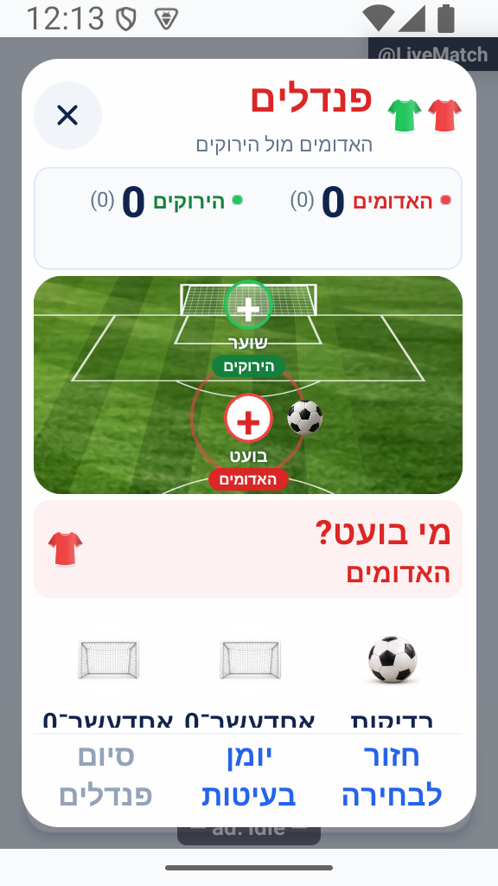

# הכרעת תיקו ופנדלים — הסבר פשוט

## הרחבת אבחון דיווחים, 27.10.2026

הדיווחים יוכלו לכלול מה ניסו לבצע, מה היה מצב האפליקציה ומה החזיר השרת. פרטים חסרים מוצגים כלא ידועים, ומספר מוגבל של מופעים נשמר בלי למחוק את המופע הראשון. השינוי מקומי וטרם הופץ, ואינו משלים פרטים לדיווחים ישנים. [היקף, ראיות ומגבלות](../../changes/2026-10-27-diagnostic-context.md).

בדיקות הקוד הושלמו, אך השינוי עדיין מקומי ולא הופץ. פרטים שלא נאספו בדיווחים ישנים אינם משוחזרים בדיעבד.

## טיפול בתקלות הפולס, 26.10.2026

כפתור השעון בחלון הפנדל חוסם לחיצה כפולה מיד, ומציג בתוך החלון כשל בשמירה. אפשר לנסות שוב בלי לשמור פנדל בטעות.

השינוי מקומי וטרם הופץ. [בדיקות, מסירה ומגבלות](../../changes/2026-10-26-pulse-fixes.md).

## השפעת מקור משותף במשימת השעון - 26.10.2026

במקור המחזורים המשותף תוקן שימור זמן הריצה בזמן עצירת רוטציה ומעבר למשחק הבא. עצירת רוטציה מפורשת מסירה גם הכרעה ישנה מהלוח המאופס. רישום בעיטה, תוצאתה ומוני הפנדלים אינם משתנים בתיקון זה. לא נערכה כאן בדיקה חדשה של כל מצבי המסך. השינוי מקומי, ומצב ההפצה ומגבלות הבדיקה מפורטים בדוח המקושר. [היקף המימוש, הבדיקות, מגבלות האישור והצילומים](../../changes/2026-10-26-android-personal-activity.md).

## זמן אירועים מלא אחרי משך המשחק - 25.10.2026

גולים ופנדלים במהלך משחק נשמרים כעת לפי הזמן המלא של המשחק, גם אחרי משך המשחק שנקבע. לדוגמה, במשחק של שמונה דקות שהגיע לעשר דקות ושלושים שניות, גול נשמר בדקה האחת עשרה ובחלון הפנדל מופיע הזמן עשר דקות ושלושים שניות. התיקון מקומי וטרם הופץ. [בדיקות, צילום ומגבלות](../../changes/2026-10-25-overtime-event-time.md).

## הפצה פנימית 1.1.61 - 25.10.2026

הבינארי `1.1.61/295` הופץ ואומת במסלול הפנימי באנדרואיד. תיקוני הלקוח נכללים בו, ושירות הפרופיל נפרס ואומת בנפרד. גם תיקוני הסגל, שמירת התוצאה והתראת השגיאה בשרת נפרסו ואומתו באישור מפורש. שינויי יישום הפולס עצמו טרם הופצו. אין שינוי כללי הרשאה או הסבת נתונים. ניסוחי המצב המקומי בסעיפים הקודמים נכתבו לפני ההפצה; [דוח ההפצה](../../changes/2026-10-25-internal-1.1.61.md) מפרט בדיוק מה נכלל, מה נבדק ומה עדיין מקומי.

## תיקוני הפולס - 25.10.2026

בחלון הפנדל הכותרת היא פנדל!, סמל צבע הקבוצה משמאל לטקסט וסימן ההוספה ממורכז. הגובה הקבוע נשמר בהחלפת קבוצות עם מספרי שחקנים שונים. מקומי וטרם הופץ.

[מקורות, בדיקות, צילומים ומגבלות](../../changes/2026-10-25-pulse-fixes.md).

## מרכוז המגרש בהזנת פנדל - 25.10.2026

השער, השוער והבועט ממורכזים לרוחב המגרש כבר מהפתיחה, גם לפני שמתקבלת מדידת הרוחב. השינוי משותף גם למגרש בפנדלי ההכרעה ובהזנת גול. נבדק באנדרואיד בדמו; הסטייה הנמדדת עד חצי פיקסל. התיקון מקומי וטרם הופץ. [צילום, מדידות, בדיקות ומגבלות](../../changes/2026-10-25-penalty-pitch-center.md).

## חלונות הזנה מלמטה - 25.10.2026

חלונות הזנת גול, פנדל במהלך משחק והפנדלים בסיום משחק נפתחים באנימציה מלמטה, ברוחב מלא וצמודים לתחתית, בדומה להוסף אירוע. הפינות מעוגלות למעלה בלבד. שלבי הבחירה, השמירה והאנימציות בתוך החלונות נשארו כפי שהיו. נבדק באנדרואיד בדמו; התיקון מקומי וטרם הופץ. [צילומי לפני ואחרי, בדיקות ומגבלות](../../changes/2026-10-25-bottom-match-sheets.md).

## תהליך זהה לפנדל יחיד - 25.10.2026

בוחרים בועט, עוברים אוטומטית לבחירת שוער, ואז לוחצים גול, עצירה או החמצה. הלחיצה שומרת מיד בלי המשך או אישור נוסף. אותה אנימציה מופעלת אחרי אישור השמירה, ובסיומה חוזרים ללייב אחרי בעיטה אחת. השעון המדויק והאפשרות לציין שוער לא ידוע נשמרו. כפתורי התוצאה קבועים מתחת לתוכן הנגלל. התיקון מקומי וטרם הופץ; הוא אינו נכלל בגרסה 1.1.60. [תהליך, צילום, בדיקות ומגבלות](../../changes/2026-10-25-in-play-penalty-flow.md).

## הפצה פנימית 1.1.60 - 25.10.2026

נכלל בגרסה הפנימית `1.1.60/294`. שירותי הפנדלים במהלך משחק נפרסו ואומתו, לרבות שמירת הפירוט וארכיון העונות. הייצור בחנות נשאר `1.1.57/291`. הסעיפים ההיסטוריים שמתארים מימוש מקומי קדמו להפצה זו. אין בסבב ההפצה בדיקת התקנה, משחק מלא מול שרת או צילום ממשק חדש. [מקור מדויק, בדיקות וקבלות](../../changes/2026-10-25-internal-1.1.60.md).

## פלוס מודגש בכרטיסי הגול - 25.10.2026

הפלוס בכרטיסי הגול הוגדל ועובה, בצבע הקבוצה ומשמאל לטקסט, כדי שהוספת גול תבלוט יותר. [ראיות ומגבלות](../../changes/2026-10-25-event-picker-bold-plus.md). מקומי וטרם הופץ.

## כרטיסי אירוע לבנים - 25.10.2026

חלון הוסף אירוע עוצב ללא מגרש. שני כרטיסים לבנים מוצגים זה לצד זה, עם צל עדין, פס בצבע הקבוצה, חולצה רגילה ופלוס משמאל לכיתוב. כל הכרטיס לחיץ. הפנדל נמצא מתחתיהם באותו רוחב, עם מסגרת ירוקה עדינה ואייקון שער משמאל לטקסט. [צילומים, בדיקות ומגבלות](../../changes/2026-10-25-event-picker-white-cards.md). מקומי וטרם הופץ.

## כפתורי פעולה ברורים על המגרש - 25.10.2026

על המגרש מופיעים כעת כפתורי גול מלאים בצבעי הקבוצות, מתחת לחולצות הרגילות. לכל כפתור פלוס משמאל לטקסט. הפנדל מופיע בכפתור לבן ברוחב המגרש עם מסגרת ירוקה ואייקון שער משמאל לטקסט. כל חצי מגרש נשאר לחיץ, ולחיצה מקבלת משוב חזותי ורטט עדין במכשירים תומכים. [צילומים, בדיקות ומגבלות](../../changes/2026-10-25-event-picker-actions.md). מקומי וטרם הופץ.

## חולצות אחידות בחלון האירוע - 25.10.2026

בחולצות שבחלון הוסף אירוע הוסר עיטור הכדור. הן משתמשות כעת באותה חולצה רגילה שמופיעה בשאר האפליקציה, בצבע הקבוצה. כפתור הפנדל ותהליך ההזנה לא שונו. [צילומים ומגבלות](../../changes/2026-10-25-event-picker-shirts.md). מקומי וטרם הופץ.

## בחירת אירוע על מגרש - 25.10.2026

חלון הוסף אירוע מציג מגרש דשא עם שתי חולצות: לחיצה על כל חצי פותחת הוספת גול לקבוצה שמופיעה בו. הפנדל נמצא בכפתור תכלת בהיר מתחת למגרש, ללא כיתוב נוסף. החלון נשאר קומפקטי ושמות הקבוצות וצבעיהן מתעדכנים לפי המשחק. [צילומים, מקור התמונה ומגבלות](../../changes/2026-10-25-pitch-match-event.md). מקומי וטרם הופץ.

## חלון אירוע קומפקטי - 25.10.2026

חלון הוסף אירוע צומצם: שני כרטיסי הגול והפנדל מתחתיהם נשארו, עם אייקונים קטנים יותר, רווחים קצרים וצל עדין. התווית פנדל נשארה ללא כיתוב נוסף. אזורי הלחיצה נשארו גדולים ונוחים, והטקסט תומך בהגדלת גופן. [צילום, בדיקות ומגבלות](../../changes/2026-10-25-compact-match-event.md). מקומי וטרם הופץ.

## הוסף אירוע - 25.10.2026

שלושת הכפתורים במסך הלייב הוחלפו בכפתור אחד, הוסף אירוע, עם פלוס משמאל לטקסט. בלחיצה נפתח חלון בחירה עם שני כרטיסי גול זה לצד זה לפי הקבוצות שמשחקות וצבעיהן, ומתחתיהם פנדל ללא כיתוב נוסף. כל בחירה פותחת את תהליך ההזנה הקיים; סגירה אינה רושמת אירוע. [ראיות ומגבלות](../../changes/2026-10-25-add-match-event.md). מקומי וטרם הופץ.

## אחידות כפתורי הביטול - 25.10.2026

כפתור הביטול של פנדל ביומן המשחק נראה כעת בדיוק כמו כפתור ביטול גול רגיל: איקס אפור בתוך עיגול מלא בהיר. [ראיות ומגבלות](../../changes/2026-10-25-in-play-penalties.md#אחידות-כפתורי-הביטול). מקומי וטרם הופץ.

## הסרת עריכת פנדל - 25.10.2026

העיפרון ליד דקת הפנדל הוסר. לאחר שמירת פנדל אין ביומן אפשרות לערוך אותו. אפשרות ביטול הפנדל נשארה. דקת ההבקעה, הכיתוב והסטטיסטיקה לא השתנו. [צילום ומגבלות](../../changes/2026-10-25-in-play-penalties.md#הסרת-עריכת-פנדל). מקומי וטרם הופץ.

## דקת ההבקעה ביומן - 25.10.2026

ביומן אירועי המשחק ובהיסטוריה מוצגת שוב דקת ההבקעה, למשל 5, ולא השעון המדויק. חלון הפנדל נשאר עם השעון המדויק, וכיתוב ההבקעה נשאר אלין (פנדל). השינוי מקומי וטרם הופץ. [ראיות ומגבלות](../../changes/2026-10-25-in-play-penalties.md#החזרת-דקת-ההבקעה-ביומן).

## שעון מדויק וכיתוב פנדל - 25.10.2026

בחלון פנדל מוצג השעון המדויק של המשחק, למשל 04:32, במקום שדה דקה. הזמן מתקדם עם השעון ונשמר בעת האישור. אין אפשרות לערוך פנדל לאחר שמירתו. ביומן הבקעה מוצגת בשם השחקן ואחריו סוגריים, למשל אלין (פנדל). השינוי מקומי וטרם הופץ. [פרטים וראיות](../../changes/2026-10-25-in-play-penalties.md#שעון-מדויק-וכיתוב-אירוע).

## פנדל במהלך משחק חי - 25.10.2026

אפשר לרשום גם פנדל בודד במהלך משחק חי. הבקעות במהלך משחק ובהכרעה מוצגות בנפרד לצד סך הפנדלים המשולב; עצירות והחמצות מצטרפות למונים הקיימים. גול במשחק מקבל גם שער רגיל, ובעיטת הכרעה אינה מוסיפה שער רגיל.

השינוי מקומי. נדרשת פריסת שרת לפני הפצת לקוח שמשתמש באפשרות; לא בוצעו פריסה או שינוי הרשאות. [חוזה הנתונים, התהליך, הבדיקות ומגבלות ההפצה](../../changes/2026-10-25-in-play-penalties.md).

## בדיקת עומק לעריכת הקבוצות — 24.10.2026

נבדק ששינוי התור שומר את הפנדלים, ושלאחר החלפת הקבוצות אפשר לפתוח סדרה חדשה עם השחקנים הנכונים. פעולה ישנה שנשלחה עבור המשחק שנזרק אינה משנה את המשחק החדש. [פירוט ומגבלות הבדיקה](../../audits/2026-10-24-live-teams.md). מקומי וטרם הופץ.

## פנדלים כשמחליפים קבוצות — 24.10.2026

החלפת קבוצות במשחק דרך תפריט הלייב מאפסת, אחרי אישור, גם את סדרת הפנדלים הנוכחית. הבעיטות שנמחקו אינן נספרות בנתונים. שינוי סדר הממתינות בלבד שומר את הסדרה. [פרטים ומגבלות](live-advanced.md#עריכת-הקבוצות-והתור-בזמן-הלייב--24102026). מקומי וטרם הופץ.

## מיקום הכדור ומסלול גול — 23.10.2026

הכדור ממתין כעת ממול לבועט, לכיוון השער. בגול הוא נע לפינה והשוער מזנק לצד השני, כך שהכדור אינו עובר דרך דמותו. תג השוער הוזז לצד כדי שלא יכסה את הכדור. נבדקו שלושה גדלים בתצוגת דפדפן של רכיב המקור; התיקון טרם הופץ ולא נבדק במכשיר מקורי.

## תיעוד כשלים — 20.10.2026

נוסף תיעוד אוטומטי לנקודות כשל במסלול הזה, עם מקור התקלה. הפעולה המקורית שומרת על ערכי החזרה והודעות השגיאה שלה. השינוי מקומי, טרם הופץ, ואין אימות מסירה חיה לפולס.

[דוח דיווח השגיאות והראיות](../../changes/2026-10-20-error-reporting-audit.md).

## בדיקת הכרעה אחרת אחרי פנדלים — 18.10.2026

בגרסה `1.1.56` (`289`), ממקור `96e94`, נבדקו מול השרת שלוש בעיטות במשחק של 11 מול 11: גול, עצירה והחטאה. חזרה לבחירה ולפנדלים שמרה אותן באותה נקודה. גם כשניסיון השמירה נכשל בלי חיבור, הבעיטות והבחירות נשארו.

אחרי חזרת החיבור ואישור ניצחון ידני נשמרה התוצאה, ורק אז הוסרו הפנדלים. הבעיטות שבוטלו לא הוסיפו נתוני בועט או שוער. המחזור הסתיים עם שני משחקים בלבד ו־44 הופעות, והנתונים הקודמים נשמרו. זהו כשל חיבור לפני שמירה; אין כאן טענה שנבדקה תשובת שרת שאבדה אחרי שמירה מוצלחת. [הראיות והגבולות](penalties.md#אימות-חלופה-במחזור-חדש-בגרסה-1156--18102026), [דוח הגרסה](../../changes/2026-10-18-internal-1.1.56.md).

## הכדור ממתין ליד הבועט — 18.10.2026

כדור הפנדל הוזז לצד הבועט, כדי להפריד אותו משם קבוצת השוער. אחרי אישור השמירה הוא יוצא מאותה נקודה לשער, בלי קפיצה. במכשיר הקטן עם גופן 140%, מול מחזור הבדיקה בייצור, נצפה הכדור לצד הבועט בלי לכסות את תג השוער. זו תמונת המתנה לפני בעיטה, ולא הוכחה לתנועת הכדור או לשמירה. באותה תמונה שמות השורה הראשונה נחתכים מול הפעולות, ולכן קריאות הסגל עדיין אינה מאומתת בה. [התקלה, הצילום והגבולות](penalties.md#כדור-ההמתנה-ליד-הבועט--18102026).

## אזהרה על בעיטה יחידה — 18.10.2026

כשיש בעיטה אחת, ההסבר בחלון התיקו ובבחירת המנצחת משתמש בלשון יחיד: ״הבעיטה שנרשמה״. גם החזרה לפנדלים מתוארת כפעולה שתשמור ״אותה״. כשאין בעיטות האזהרה נשארת מוסתרת, ובריבוי בעיטות נשמר הנוסח הקיים.

המלל נצפה בדוגמת דמו ללא אישור הכרעה; לא נמחקה או נשמרה בעיטה לצורך הצילום.

## אישור הכרעה אחרת אחרי פנדלים — 18.10.2026

בחזרה מפנדלים אפשר להמשיך באותה סדרה, לבחור מנצחים או לאשר יציאת שתי הקבוצות כאשר האפשרות זמינה. עד האישור המפורש שום בעיטה אינה נמחקת. כעת גם אחרי הלחיצה הבעיטות נשמרות אם שמירת התוצאה נכשלה: השמירה והמחיקה מצליחות יחד. ניסיון חוזר אחרי הצלחה אינו שומר את המשחק פעמיים, ושינוי אמיתי בהרכב או בתוצאה מחייב בדיקה מחדש.

התיקון עבר בדיקות קוד עם כשלים מכוונים ופעולת השמירה המלאה. לאחר עדכון השרת נבדק גם ניסיון חוזר אחרי כשל חיבור במחזור החדש המתועד בראש המסמך; צילומי הבדיקה הקודמת לבדם אינם אישור לחוזה החדש. [הפרטים והגבולות](penalties.md#הכרעה-חלופית-אטומית--18102026).

## מסגרת ומשוב שנבדקו במכשיר הדמו — 18.10.2026

היומן ואישור ביטול הבעיטה נפתחו באותו גובה, גם בגודל רגיל וגם במסך קטן עם טקסט מוגדל. הכפתור האדום נשאר זמין מחוץ לגלילה. [צילום המסך הקטן](../screenshots/final-audit-goal-penalty-undo-confirm-small-2026-10-18.png).

נבדקו גם דחיית שחקן שאינו זכאי וכשל אישור: במקרה הראשון מופיעה בחירה מחדש, ובשני נשמרים הבועט, השוער והתוצאה לניסיון חוזר. אחרי ניסיון חוזר נוצרה בדמו בעיטה אחת בלבד. אלו כשלים מקומיים מכוונים, ולא בדיקת רשת ייצור או שני מנהלים. נתוני הדמו, השינויים הזמניים והתצוגה הוחזרו בסיום. [הוכחות וגבולות](penalties.md#הוכחות-דמו-למסגרת-ולמשוב-בחירה-מחדש--18102026).

## גם ביטול בעיטה באותו גודל חלון — 18.10.2026

מסך אישור ביטול הבעיטה האחרונה נשאר כעת באותו גובה של שאר שלבי הפנדלים. תוקן חריג שהקטין אותו באמצע התהליך. האישור עדיין מפורש ונמצא מחוץ לתוכן הנגלל; כשל וניסיון חוזר פועלים כמו קודם ואינם משנים את המסגרת.

התקלה נצפתה במכשיר, והתיקון עבר 94 בדיקות ממוקדות, כולל מסך קטן וטקסט מוגדל. לאחר מכן נבדקה המסגרת גם במכשיר הדמו, כמפורט בראש המסמך; צילום התקלה נשמר בנפרד מהצילומים המתוקנים. [המקור, התיקון והבדיקות](penalties.md#מסגרת-אחידה-גם-באישור-ביטול-בעיטה--18102026).

## התור והבחירות מתעדכנים כשהמשחק משתנה — 18.10.2026

בחירת בעיטה נשארת בשלוש לחיצות: בועט, שוער מהיריבה המשחקת ותוצאה ששומרת מיד. אם מנהל אחר משנה מי מתחילים או מוסיף בעיטה לפני ששלחתם את שלכם, הבחירות הישנות מתנקות ומוצג התור העדכני. אם רק השוער שבחרתם יצא מההרכב, בוחרים שוער חדש והבועט התקף נשמר.

ניסיון שכבר נשלח נשמר עם השמות, התמונות והתוצאה בזמן המתנה או כשל. כשלא התקבל אישור לשמירה, מנסים שוב את אותה בעיטה. רק דחייה ודאית בגלל שינוי בהרכב או בתור מציעה ״בחירת שחקנים מחדש״. חגיגה מופיעה רק אחרי אישור שמירה.

גם ביטול הבעיטה האחרונה בטוח לניסיון חוזר: אם הביטול הצליח אך אישורו אבד, ניסיון חוזר אינו מבטל בטעות את הבעיטה שלפניה. אם נוספה בעיטה והיעד לביטול עדיין קיים אך כבר אינו האחרון, הביטול נדחה.

סיום ההכרעה נבדק מול המשחק, הסגל והתוצאה שעליהם החלטתם. שינוי באלה מחייב לבדוק את המצב המעודכן; השהיית שעון לבדה אינה מבטלת את הבחירה. אפשר עדיין לבצע פנדלים ולסיים משחק בלי להפעיל שעון.

התיקונים נבדקו בקוד. הודעות המסך הקטן והבחירה מחדש נבדקו לאחר מכן גם בדמו מאולץ. שינוי מרחוק בין מנהלים ואישור שאבד ברשת אמיתית עדיין אינם מוכחים מכך. במועד ביקורת הקוד הגנת הסיום הנוספת בשרת עדיין נזקקה לפריסה; אין להסיק על מצב הפריסה מבדיקת הדמו. [בדיקות וגבולות](penalties.md#ביקורת-סופית-סנכרון-תור-סגל-וניסיון-שמירה--18102026).

## יומן וסיום הפנדלים — 17.10.2026

היומן מציג לוח תוצאות עם דשא וחולצות, ולכל בעיטה את הבועט, השוער והתוצאה. לפני אישור הסיום רואים מי נשארים, מי עולים ומי עוברים להמתנה. האישור מציין במפורש שהוא מעביר למשחק הבא. בשוויון בוחרים מנצחים לפני האישור; אפשר גם להמשיך בבעיטות.

החלון שומר על אותו גודל ביומן ובסיום. במסך קטן אפשר לגלול את התוכן כשהאישור והחזרה נשארים זמינים. נבדק בדמו באנדרואיד גם בטקסט מוגדל; לא נבדק בייצור או באייפון.

## השלמת דיווחי הפולס — 17.10.2026

תוצאת הפנדלים בחלונית ביטול הבעיטה ממורכזת: כותרת מעל שתי קבוצות שוות ברוחבן ומספר מתחת לכל קבוצה.

[צילומים, בדיקות ומגבלות](../../changes/2026-10-17-roster-recruitment-and-pulse.md).

## שורת צירוף ובדיקת הפולס — 17.10.2026

כשל בשמירת פנדלים נרשם אוטומטית עם שלב הפעולה. הודעת בעיית עונה מסבירה שהבעיטות נשמרו ביומן, ואפשר לנסות שוב בלי לרשום אותן פעמיים.

[בדיקות, צילומים ומגבלות](../../changes/2026-10-17-roster-recruitment-and-pulse.md).

## בדיקות הפולס והגרסה הפנימית 1.1.55 — 17.10.2026

תוצאת הפנדלים מוצגת מעל המגרש. שינוי הבועט שומר על השוער שנבחר, וגם תמונה של שחקן נבחר מסומנת כשהיא בעריכה. לפני הבעיטה הראשונה אפשר לחזור לבחירת הקבוצה שמתחילה; יומן ריק נפתח ומסביר שעדיין אין בעיטות. באותו סבב חלונית ביטול הבעיטה הייתה קומפקטית; בתיקון מ־18.10 הוחזר לה גובה זהה לשאר השלבים. כפתור האישור נשאר גלוי מחוץ לתוכן הנגלל.

[ראיות, בדיקות ומגבלות](../../changes/2026-10-17-internal-1.1.55.md).

## רואים את הבעיטה גם אחרי גלילה — 17.10.2026

אם גללתם כדי לבחור שחקן או תוצאה, אחרי שהבעיטה נשמרה החלונית חוזרת מיד למגרש כדי להראות את הכדור. בחירת המשתתפים נשארת באותן לחיצות; אין המתנה או אישור נוסף. בכשל שמירה המיקום והבחירות נשמרים לניסיון חוזר, בלי להציג הצלחה.

## שמירת העדפת תנועה חדשה — 17.10.2026

שינוי בהעדפת התנועה בזמן שהאפליקציה פתוחה כבר משפיע על מגרש הפנדל. תוקן מקרה שבו בדיקה ראשונית מאוחרת יכלה להחזיר בטעות את ההעדפה הישנה. כשמפחיתים תנועה, ההילה, תנועת השחקנים והכדור נעצרות; אחרי שמירת הבעיטה מוצגת תגובה קצרה לפי התוצאה, בלי לעכב את הבחירה הבאה. סגירה מנקה את ההנפשות ומשאירה את הבעיטה שנשמרה.

המרוץ וניקוי ההנפשות והמאזינים נבדקו בקוד. קריאת ההעדפה בפתיחה קרה אומתה אצל המוביל, אך החלפת ההעדפה החיה במכשיר עדיין דורשת תיעוד נפרד. [פרטי המימוש ומגבלות האימות](penalties.md#העדפת-תנועה-חיה-וניקוי-בפנדלים--17102026).

## אישור וחזרה זמינים גם במסך קטן — 17.10.2026

בחלונות תיקו וסיום משחק, כפתור האישור והחזרה נשארים בתחתית החלון. אפשר לגלול את התוצאה והאפשרויות בלי לחפש את כפתורי ההמשך. בחלון התיקו האישור גלוי אך מושבת עד שבוחרים אפשרות; הבחירה עצמה אינה מסיימת את המשחק.

במסך קטן או עם טקסט מוגדל, גובה אזור התוכן מוגדר בנפרד כדי שהגלילה תגיע לכל האפשרויות מעל כפתורי ההמשך.

גם בבחירת מנצחת ידנית אפשר לגלול את שני ההרכבים, לרבות 11 שחקנים בכל צד, כשהכותרת והאישור נשארים זמינים. בחירת קבוצה רק מסמנת אותה; אישור מסיים את הבחירה וביטול חוזר בלי לשמור.

בפנדלים, מסך קטן משתמש במגרש וברווחים קומפקטיים כדי להשאיר מקום לשורת שחקנים מלאה. השמות ממשיכים להתאים להגדלת הטקסט, והרשימה נגללת בתוך האזור שלה. [בדיקות, צילומים ומגבלות](../../changes/2026-10-17-live-action-pitch.md).

## אישור גלוי וגובה קבוע בחלון התיקו — 16.10.2026

כפתור האישור מופיע תמיד. ללא בחירה הוא מושבת; בחירת אפשרות מפעילה אותו באותו מקום, בלי להאריך את החלון. גם ההסבר של ״שתי הקבוצות יוצאות״ משתמש במקום שמור. סגירת החלון אינה מאשרת.

[צילומים והשוואת המיקום](../../changes/2026-10-16-tie-stable-confirmation.md). נבדק באימולטור בשלוש ובחמש קבוצות; טרם הופץ.

## בחירת בועט ושוער על המגרש — 17.10.2026

בועט בנקודת הפנדל ושוער בשער מבהירים מי נבחר ומי הבא. חולצות וצבעים מזהים את הקבוצות. רשימת הבועטים פתוחה מיד; בוחרים בועט, שוער מהיריבה המשחקת ותוצאה. התוצאה נשמרת מיד, בלי כפתור אישור נוסף. הפלוסים מכוונים את העין ואינם דורשים לחיצה. אפשר לתקן דרך תמונת השחקן במגרש.

אחרי אישור השמירה הכדור נע בהתאם לגול, לעצירה או להחטאה. בכשל הבחירות נשמרות לניסיון חוזר, והפעולה אינה מוכפלת. ההנפשה מתחשבת בהפחתת תנועה ואינה מעכבת את הבחירה הבאה. במסך קטן המגרש והכותרות קומפקטיים והרשימה נגללת, כדי לפנות מקום לשמות ולפעולות. [צילומים ונתונים שנבדקו בדמו](../../changes/2026-10-17-live-action-local-proof.md) מפרידים בין מה שנצפה לבין מה שעדיין דורש אימות; אינם הוכחת שמירה בייצור. [הדוח המשולב](../../changes/2026-10-17-live-action-pitch.md).

## אישור אחרי בחירת דרך ההכרעה — 16.10.2026

בחלון התיקו בוחרים פנדלים, בחירת מנצחים או יציאת שתי הקבוצות, ואז מאשרים בכפתור הגלוי כבר מפתיחת החלון. עד לבחירת אפשרות הכפתור מושבת. הבחירה רק מסמנת את האפשרות ואפשר לשנות אותה לפני האישור. אין בחירה מראש, וסגירת החלון אינה מאשרת. יציאת שתי הקבוצות עדיין זמינה רק עם לפחות ארבע קבוצות ושתי ממתינות.

[מסכי ההמשך, בדיקות ומגבלות](../../changes/2026-10-16-tie-selection-confirmation.md). נבדק בדמו באימולטור; טרם הופץ.

## חולצות אחידות גם לקבוצות הנכנסות — 16.10.2026

באפשרות ״שתי הקבוצות יוצאות״ מופיעות כעת אותן חולצות מוצללות של לוח המשחק, לפי הצבעים של שתי הקבוצות הנכנסות. תנאי הזמינות והאישור נשארו. [צילום ובדיקות](../../changes/2026-10-16-live-shirt-swap-polish.md).

## מגרש וחולצות בחלונות התוצאה — 16.10.2026

לוח התוצאה בחלונות סיום המשחק והתיקו מציג את אותו מגרש ירוק עם שערים ואותן חולצות מוצללות שמופיעים בזמן המשחק. החולצות תואמות לצבע שנבחר לקבוצה; השמות והתוצאות לבנים. הודעת הניצחון נשארת מתחת לתוצאה. בחלון התיקו אין כיתוב נוסף על הדשא; הכותרת ״תיקו במשחק״ מופיעה רק מעליו.

נבדקו ניצחון, תיקו וקבוצה לבנה באימולטור. [ראיות ומגבלות](../../changes/2026-10-16-result-pitch.md). השינוי מקומי וטרם הופץ.

## גם בלי שעון — 16.10.2026

אפשר להיכנס לפנדלים ולסיים אותם אחרי אישור ההרכבים גם אם השעון לא הופעל כלל. בחירת צד ראשון, בועט, שוער ותוצאת בעיטה פועלות כרגיל, וההכרעה נשמרת בלי להתחיל זמן. [בדיקת התהליך באימולטור](../../changes/2026-10-16-optional-match-clock.md).

חלון התיקו מציג את התוצאה והקבוצות עם חולצות, ואפשר לבחור פנדלים או מנצחים באופן ידני. בשלוש קבוצות ומטה אלה שתי האפשרויות היחידות. אם יש לפחות ארבע קבוצות ושתי ממתינות, אפשר גם להוציא את שני הצדדים; בוחרים את האפשרות ומאשרים באותו חלון, בלי חלונית נוספת.

[פרטי האישור והבדיקות](../../changes/2026-10-16-tie-popup.md).

אחרי תיקו בוחרים פנדלים, ואז מי בועטים ראשונים. רושמים בעיטות לסירוגין: בועט, שוער, ותוצאה — גול, עצירה או החמצה. השוער נשמר בנתונים, אך בכל בעיטה בוחרים אותו במפורש מתוך היריבה המשחקת. אין מספר בעיטות קבוע; המנהל מחליט מתי לסיים.

בחירת התוצאה שומרת את הבעיטה ומעבירה לתור הבא רק לאחר אישור. בכשל הבחירה נשארת לניסיון חוזר. סגירת החלון שומרת את הסדרה, ו״המשך פנדלים״ מחזיר אליה. ביומן אפשר לתקן או לבטל את הבעיטה האחרונה. לפני סיום מוצגת אזהרה אם מספר הבעיטות שונה; בשוויון אפשר להמשיך או לקבוע מנצחת ידנית.

אחוז העצירות מחושב מכל הבעיטות שנבעטו מול השוער, כולל החמצות. רק ״עצירה״ מוסיפה עצירה לזכותו. שערי הפנדלים נפרדים משערי המשחק הרגילים.

המימוש מקומי וטרם הופץ. [להסבר המעמיק ולמפת הקוד](penalties.md) · [בדיקות, צילומים ומגבלות](../../changes/2026-10-16-live-game-redesign.md).

## חזרה לבחירת ההכרעה — 17.10.2026

בתחתית חלון הפנדלים, בצד ימין, מופיע ״חזור לבחירה״. הוא מחזיר לבחירה בין פנדלים לבין הכרעה אחרת, ושומר את הבעיטות שכבר נרשמו. בחירה חוזרת בפנדלים ממשיכה מאותה נקודה. גם ביטול בחירת מנצחת או חזרה למשחק שומרים את הסדרה.

רק אישור סופי של הכרעה אחרת מוחק את הבעיטות. מוצג הסבר לפני האישור, והבעיטות שנמחקו אינן נכללות בסיכום או בסטטיסטיקות הפנדלים. בזמן שמירה ממתינה או כשל שטרם טופל, החזרה מושבתת כדי שלא לאבד ניסיון שמירה.

נבדק באימולטור דמו: ארבע בעיטות נשמרו בחזרה, בהמשך ובביטול; אישור מנצחת ידני שמר משחק 2:2 ללא פנדלים. בדיקת הטיפוסים ו־4,368 בדיקות עברו. כתיבה אמיתית בסביבת הייצור לא נבדקה בתיקון זה.

## בחירת הבועטים הראשונים עם זיהוי חזותי — 17.10.2026

בפתיחת הפנדלים מוצג המגרש הקיים עם חולצות שתי הקבוצות. מתחתיו שני כרטיסי קבוצה זה לצד זה, עם חולצה גדולה, שם וצבע. לחיצה על קבוצה או על הגרלה מתחילה מיד את הבחירה, בלי אישור נוסף. כשל בהתחלה מאפשר ניסיון חוזר ששומר את אותה בחירת צד.

החלון נשאר באותו גודל לאורך בחירת הקבוצה, הבועט, השוער, התוצאה, היומן, התיקון, הביטול והסיום. תוכן ארוך נגלל בתוכו. באימולטור נמדדו אותם גבולות בכל שמונת השלבים. [מסך הפתיחה המרונדר](../screenshots/penalty-first-first-2026-10-17.png).

בסבב הראשון תמונות ושמות בכרטיסים הוצעו בלבד; הם מומשו בהמשך כמתואר בסעיף תצוגת הסגל להלן. [מימוש, בדיקות ומגבלות](penalties.md#בחירת-קבוצה-ראשונה-במגרש-הקיים--17102026).

## שחקנים לזיהוי הקבוצה לפני הפנדלים — 17.10.2026

בכל כרטיס מופיעים כעת התמונות והשמות של שני השחקנים הראשונים בהרכב שמשחק בפועל, כולל משלימים. מתחת מופיע כמה שחקנים נוספים בקבוצה. התמונה היא תמונת הפרופיל או האווטר של השחקן, כמו בשאר מסכי המשחק. גם נגיעה בתמונה בוחרת את הקבוצה מיד, ללא מסך נוסף.

כדי לפנות מקום המגרש והחולצות בכרטיסים קומפקטיים יותר; גודל החלון נשמר. שמות ארוכים מוצגים עד שתי שורות, וההרכב המלא זמין ברמז הנגיש של הכרטיס. נבדק באימולטור דמו שהשמות והתמונות נטענו ושהגובה זהה במעבר לבועט, לשוער ולתוצאה.

## הרכב בהחזקה ומעבר בלי סגירה — 17.10.2026

החזקה על ״ועוד שחקנים״ מציגה את כל ההרכב עם תמונות ושמות בתוך החלון. כשמשחררים הוא נעלם. אזור ההחזקה נפרד מבחירת הקבוצה: הוא אינו קובע מי בועטים ראשונים, וגם נגיעה קצרה בו אינה בוחרת קבוצה. ההסבר ״החזיקו להצגת ההרכב״ מופיע תחת המספר.

״חזור לבחירה״ מחליף את התוכן לבחירת שיטת ההכרעה, בתוך אותו חלון ובאותו גודל. בחירה חוזרת בפנדלים ממשיכה בלי סגירה ופתיחה מחדש. הבעיטות נשמרות כפי שסוכם, ומחיקתן מתרחשת רק באישור הכרעה אחרת.

נבדקו באימולטור החזקה ושחרור והמעבר בשני הכיוונים; זוהה אותו חלון מערכת בכל המעברים. [בדיקות ומגבלות](penalties.md#החזקה-להרכב-וחלון-משותף-לבחירת-הכרעה--17102026).

## הפצה פנימית — 17.10.2026

שינויי הלקוח האחרונים המתועדים כאן נכללו בבינארי הפנימי `1.1.53 / 286` באנדרואיד. המסלול אומת בגוגל; הייצור נשאר בגרסה הקודמת. זה אינו אימות חדש של תרחיש ייצור או של מכשיר אפל. [מקור הבינארי, פריסת השרת, בדיקות ומגבלות](../../changes/2026-10-17-internal-1.1.53.md).

## דיווחים חדשים בפולס — 17.10.2026

גם בתוכנית המשחק הבא אחרי פנדלים הקבוצה שנשארת שומרת על אותו צד. הקבוצה העולה תופסת את מקום היוצאת. תיקון מקומי שדורש גרסה חדשה.

[דוח התיקון, הצילומים וגבולות האימות](../../changes/2026-10-17-new-pulse-live-and-chat.md).

## תלות בעדכון העונות — 19.10.2026

קובץ תשתית משותף עודכן במסגרת העונות. שינוי זה אינו מוסיף פעולה חדשה למסך המתואר כאן; פרטי העונות והבדיקות מופיעים במסמך העונות.

[מצב המימוש, הבדיקות ומגבלות האימות של העונות](../clubs/seasons.md). מקומי בלבד; לא בוצעה פריסה במסגרת המשימה.

## עדכון תלות משותפת בקריאות מידע — 23.10.2026

בקובצי השירות המשותפים נוספה אפשרות מפורשת לניסיון חוזר אחד בקריאה זמנית שנכשלה, תוך עצירה אם החשבון מתחלף. החיבור מוגבל ל־14 נקודות קריאה המפורטות בדוח; אין כאן טענה שכל פעולה בפיצ׳ר קיבלה ניסיון חוזר או שנבדק מסך חדש. בדיקות המאגר המלאות עברו (5,261 בדיקות ב־472 חבילות), אך אינן הוכחת הרצה במכשיר. הקוד מקומי וטרם הופץ. [מסלול, ראיות ומגבלות](../../changes/2026-10-23-four-open-errors.md).

## תלות בשמירת צבעי המחזור — 24.10.2026

שמירת המידע המשותפת עודכנה כדי להעביר את צבעי הקבוצות ממסכי הכוחות להכנה וללייב. אין תוספת פעולה במסך הזה, והוא לא נבדק מחדש במכשיר במסגרת התוספת. השינוי מקומי וטרם הופץ. [פרטי התוספת ומגבלות הבדיקה](../rounds/draft-setup.md#צבעים-לפני-שיבוץ-ובכל-שיטת-חלוקה--24102026).

## טיפול בפולס — 24.10.2026

השוער והבועט מוצגים עם כיתוב ממורכז מתחת לעיגול. לפני בחירה מופיעה רק בקשת הבחירה; אחרי הבחירה מופיעים התפקיד ושם השחקן.

[פירוט התיקונים, הבדיקות והמגבלות](../../changes/2026-10-24-pulse-current.md). התיקונים מקומיים וטרם הופצו.

## המשך קיצור טעינות בלילה של 25.10.2026

עודכנו קריאות מידע משותפות או מתאם הבדיקה שלהן כדי לצמצם טעינות מיותרות. אין שינוי נוסף בפעולות העצמאיות המתוארות כאן, ואין אימות מכשיר חדש שלהן בסבב הזה. [בדיקות, ראיות ומגבלות](../../changes/2026-10-24-loading-performance.md).

## תגובה מיידית לכפתורי השעון - 25.10.2026

עודכן רכיב השעון המשותף למסכי הלייב. אין שינוי מכוון בהתנהגות הפיצר המתואר כאן. [בדיקות, ראיות ומגבלות](../../changes/2026-10-25-live-timer-response.md). התיקון מקומי וטרם הופץ.

## תלות בניווט עריכת קבוצות - 25.10.2026

נבדק השינוי הממוקד במקורות המשותפים: `src/screens/AdvancedLiveMatchScreen.tsx`. נוסף מעבר מתפריט הלייב לחלוקת הכוחות עם שימור מפתח מסך המקור. אין שינוי נוסף בתהליך העצמאי המתואר כאן ולא נערכה לו בדיקת מסך חדשה. [היקף, בדיקות ומגבלות](../../changes/2026-10-25-live-draft-entry.md).

## תלות בסדר תפריט הלייב - 25.10.2026

במקור המשותף `src/screens/AdvancedLiveMatchScreen.tsx` הועבר כפתור העזרה לראש התפריט בלבד. אין שינוי בפעולות הפיצר המתואר כאן ולא נערכה לו בדיקת מסך חדשה. [היקף וראיות](../../changes/2026-10-25-live-help-first.md).
