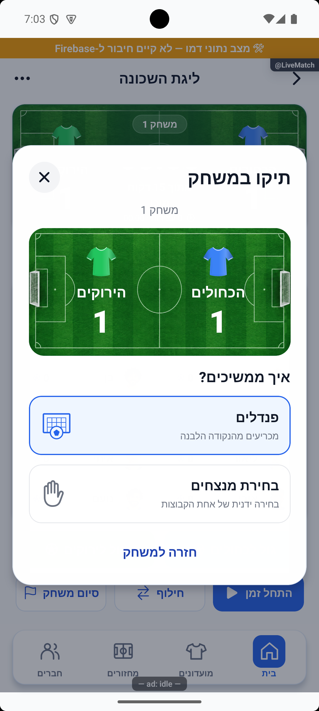
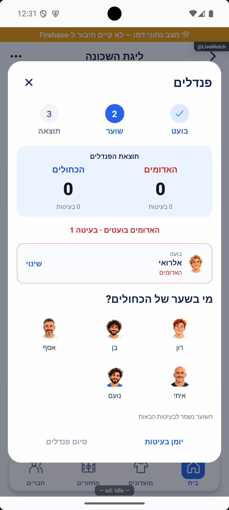
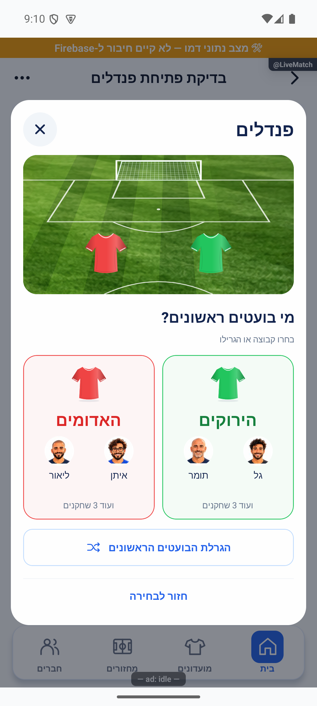
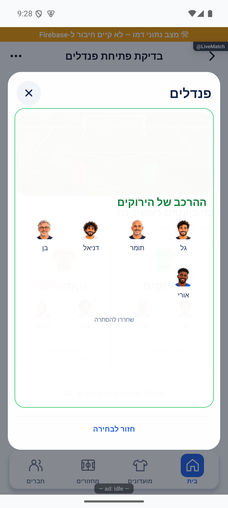

# הכרעת תיקו ופנדלים — הסבר פשוט

## יומן וסיום הפנדלים — 17.10.2026

היומן מציג לוח תוצאות עם דשא וחולצות, ולכל בעיטה את הבועט, השוער והתוצאה. לפני אישור הסיום רואים מי נשארים, מי עולים ומי עוברים להמתנה. האישור מציין במפורש שהוא מעביר למשחק הבא. בשוויון בוחרים מנצחים לפני האישור; אפשר גם להמשיך בבעיטות.

החלון שומר על אותו גודל ביומן ובסיום. במסך קטן אפשר לגלול את התוכן כשהאישור והחזרה נשארים זמינים. נבדק בדמו באנדרואיד גם בטקסט מוגדל; לא נבדק בייצור או באייפון.

## השלמת דיווחי הפולס — 17.10.2026

תוצאת הפנדלים בחלונית ביטול הבעיטה ממורכזת: כותרת מעל שתי קבוצות שוות ברוחבן ומספר מתחת לכל קבוצה.

[צילומים, בדיקות ומגבלות](../../changes/2026-10-17-roster-recruitment-and-pulse.md).

## שורת צירוף ובדיקת הפולס — 17.10.2026

כשל בשמירת פנדלים נרשם אוטומטית עם שלב הפעולה. הודעת בעיית עונה מסבירה שהבעיטות נשמרו ביומן, ואפשר לנסות שוב בלי לרשום אותן פעמיים.

[בדיקות, צילומים ומגבלות](../../changes/2026-10-17-roster-recruitment-and-pulse.md).

## בדיקות הפולס והגרסה הפנימית 1.1.55 — 17.10.2026

תוצאת הפנדלים מוצגת מעל המגרש. שינוי הבועט שומר על השוער שנבחר, וגם תמונה של שחקן נבחר מסומנת כשהיא בעריכה. לפני הבעיטה הראשונה אפשר לחזור לבחירת הקבוצה שמתחילה; יומן ריק נפתח ומסביר שעדיין אין בעיטות. חלונית ביטול הבעיטה קומפקטית וכפתור האישור נשאר גלוי מחוץ לתוכן הנגלל.

[ראיות, בדיקות ומגבלות](../../changes/2026-10-17-internal-1.1.55.md).

## רואים את הבעיטה גם אחרי גלילה — 17.10.2026

אם גללתם כדי לבחור שחקן או תוצאה, אחרי שהבעיטה נשמרה החלונית חוזרת מיד למגרש כדי להראות את הכדור. בחירת המשתתפים נשארת באותן לחיצות; אין המתנה או אישור נוסף. בכשל שמירה המיקום והבחירות נשמרים לניסיון חוזר, בלי להציג הצלחה.

## שמירת העדפת תנועה חדשה — 17.10.2026

שינוי בהעדפת התנועה בזמן שהאפליקציה פתוחה כבר משפיע על מגרש הפנדל. תוקן מקרה שבו בדיקה ראשונית מאוחרת יכלה להחזיר בטעות את ההעדפה הישנה. כשמפחיתים תנועה, ההילה, תנועת השחקנים והכדור נעצרות; אחרי שמירת הבעיטה מוצגת תגובה קצרה לפי התוצאה, בלי לעכב את הבחירה הבאה. סגירה מנקה את ההנפשות ומשאירה את הבעיטה שנשמרה.

המרוץ וניקוי ההנפשות והמאזינים נבדקו בקוד. קריאת ההעדפה בפתיחה קרה אומתה אצל המוביל, אך החלפת ההעדפה החיה במכשיר עדיין דורשת תיעוד נפרד. [פרטי המימוש ומגבלות האימות](penalties.md#העדפת-תנועה-חיה-וניקוי-בפנדלים--17102026).

## אישור וחזרה זמינים גם במסך קטן — 17.10.2026

בחלונות תיקו וסיום משחק, כפתור האישור והחזרה נשארים בתחתית החלון. אפשר לגלול את התוצאה והאפשרויות בלי לחפש את כפתורי ההמשך. בחלון התיקו האישור גלוי אך מושבת עד שבוחרים אפשרות; הבחירה עצמה אינה מסיימת את המשחק.

במסך קטן או עם טקסט מוגדל, גובה אזור התוכן מוגדר בנפרד כדי שהגלילה תגיע לכל האפשרויות מעל כפתורי ההמשך.

גם בבחירת מנצחת ידנית אפשר לגלול את שני ההרכבים, לרבות 11 שחקנים בכל צד, כשהכותרת והאישור נשארים זמינים. בחירת קבוצה רק מסמנת אותה; אישור מסיים את הבחירה וביטול חוזר בלי לשמור.

בפנדלים, מסך קטן משתמש במגרש וברווחים קומפקטיים כדי להשאיר מקום לשורת שחקנים מלאה. השמות ממשיכים להתאים להגדלת הטקסט, והרשימה נגללת בתוך האזור שלה. [בדיקות, צילומים ומגבלות](../../changes/2026-10-17-live-action-pitch.md).

## אישור גלוי וגובה קבוע בחלון התיקו — 16.10.2026

כפתור האישור מופיע תמיד. ללא בחירה הוא מושבת; בחירת אפשרות מפעילה אותו באותו מקום, בלי להאריך את החלון. גם ההסבר של ״שתי הקבוצות יוצאות״ משתמש במקום שמור. סגירת החלון אינה מאשרת.

[צילומים והשוואת המיקום](../../changes/2026-10-16-tie-stable-confirmation.md). נבדק באימולטור בשלוש ובחמש קבוצות; טרם הופץ.

## בחירת בועט ושוער על המגרש — 17.10.2026

בועט בנקודת הפנדל ושוער בשער מבהירים מי נבחר ומי הבא. חולצות וצבעים מזהים את הקבוצות. רשימת הבועטים פתוחה מיד; בוחרים בועט, שוער מהיריבה המשחקת ותוצאה. התוצאה נשמרת מיד, בלי כפתור אישור נוסף. הפלוסים מכוונים את העין ואינם דורשים לחיצה. אפשר לתקן דרך תמונת השחקן במגרש.

אחרי אישור השמירה הכדור נע בהתאם לגול, לעצירה או להחטאה. בכשל הבחירות נשמרות לניסיון חוזר, והפעולה אינה מוכפלת. ההנפשה מתחשבת בהפחתת תנועה ואינה מעכבת את הבחירה הבאה. במסך קטן המגרש והכותרות קומפקטיים והרשימה נגללת, כדי לפנות מקום לשמות ולפעולות. [צילומים ונתונים שנבדקו בדמו](../../changes/2026-10-17-live-action-local-proof.md) מפרידים בין מה שנצפה לבין מה שעדיין דורש אימות; אינם הוכחת שמירה בייצור. [הדוח המשולב](../../changes/2026-10-17-live-action-pitch.md).

## אישור אחרי בחירת דרך ההכרעה — 16.10.2026

בחלון התיקו בוחרים פנדלים, בחירת מנצחים או יציאת שתי הקבוצות, ואז מאשרים בכפתור הגלוי כבר מפתיחת החלון. עד לבחירת אפשרות הכפתור מושבת. הבחירה רק מסמנת את האפשרות ואפשר לשנות אותה לפני האישור. אין בחירה מראש, וסגירת החלון אינה מאשרת. יציאת שתי הקבוצות עדיין זמינה רק עם לפחות ארבע קבוצות ושתי ממתינות.

[מסכי ההמשך, בדיקות ומגבלות](../../changes/2026-10-16-tie-selection-confirmation.md). נבדק בדמו באימולטור; טרם הופץ.

## חולצות אחידות גם לקבוצות הנכנסות — 16.10.2026

באפשרות ״שתי הקבוצות יוצאות״ מופיעות כעת אותן חולצות מוצללות של לוח המשחק, לפי הצבעים של שתי הקבוצות הנכנסות. תנאי הזמינות והאישור נשארו. [צילום ובדיקות](../../changes/2026-10-16-live-shirt-swap-polish.md).

## מגרש וחולצות בחלונות התוצאה — 16.10.2026

לוח התוצאה בחלונות סיום המשחק והתיקו מציג את אותו מגרש ירוק עם שערים ואותן חולצות מוצללות שמופיעים בזמן המשחק. החולצות תואמות לצבע שנבחר לקבוצה; השמות והתוצאות לבנים. הודעת הניצחון נשארת מתחת לתוצאה. בחלון התיקו אין כיתוב נוסף על הדשא; הכותרת ״תיקו במשחק״ מופיעה רק מעליו.

נבדקו ניצחון, תיקו וקבוצה לבנה באימולטור. [ראיות ומגבלות](../../changes/2026-10-16-result-pitch.md). השינוי מקומי וטרם הופץ.

## גם בלי שעון — 16.10.2026

אפשר להיכנס לפנדלים ולסיים אותם אחרי אישור ההרכבים גם אם השעון לא הופעל כלל. בחירת צד ראשון, בועט, שוער ותוצאת בעיטה פועלות כרגיל, וההכרעה נשמרת בלי להתחיל זמן. [בדיקת התהליך באימולטור](../../changes/2026-10-16-optional-match-clock.md).

חלון התיקו מציג את התוצאה והקבוצות עם חולצות, ואפשר לבחור פנדלים או מנצחים באופן ידני. בשלוש קבוצות ומטה אלה שתי האפשרויות היחידות. אם יש לפחות ארבע קבוצות ושתי ממתינות, אפשר גם להוציא את שני הצדדים; בוחרים את האפשרות ומאשרים באותו חלון, בלי חלונית נוספת.

[פרטי האישור והבדיקות](../../changes/2026-10-16-tie-popup.md).

אחרי תיקו בוחרים פנדלים, ואז מי בועטים ראשונים. רושמים בעיטות לסירוגין: בועט, שוער, ותוצאה — גול, עצירה או החמצה. השוער נשמר בנתונים, אך בכל בעיטה בוחרים אותו במפורש מתוך היריבה המשחקת. אין מספר בעיטות קבוע; המנהל מחליט מתי לסיים.

בחירת התוצאה שומרת את הבעיטה ומעבירה לתור הבא רק לאחר אישור. בכשל הבחירה נשארת לניסיון חוזר. סגירת החלון שומרת את הסדרה, ו״המשך פנדלים״ מחזיר אליה. ביומן אפשר לתקן או לבטל את הבעיטה האחרונה. לפני סיום מוצגת אזהרה אם מספר הבעיטות שונה; בשוויון אפשר להמשיך או לקבוע מנצחת ידנית.

אחוז העצירות מחושב מכל הבעיטות שנבעטו מול השוער, כולל החמצות. רק ״עצירה״ מוסיפה עצירה לזכותו. שערי הפנדלים נפרדים משערי המשחק הרגילים.

המימוש מקומי וטרם הופץ. [להסבר המעמיק ולמפת הקוד](penalties.md) · [בדיקות, צילומים ומגבלות](../../changes/2026-10-16-live-game-redesign.md).

## חזרה לבחירת ההכרעה — 17.10.2026

בתחתית חלון הפנדלים, בצד ימין, מופיע ״חזור לבחירה״. הוא מחזיר לבחירה בין פנדלים לבין הכרעה אחרת, ושומר את הבעיטות שכבר נרשמו. בחירה חוזרת בפנדלים ממשיכה מאותה נקודה. גם ביטול בחירת מנצחת או חזרה למשחק שומרים את הסדרה.

רק אישור סופי של הכרעה אחרת מוחק את הבעיטות. מוצג הסבר לפני האישור, והבעיטות שנמחקו אינן נכללות בסיכום או בסטטיסטיקות הפנדלים. בזמן שמירה ממתינה או כשל שטרם טופל, החזרה מושבתת כדי שלא לאבד ניסיון שמירה.

נבדק באימולטור דמו: ארבע בעיטות נשמרו בחזרה, בהמשך ובביטול; אישור מנצחת ידני שמר משחק 2:2 ללא פנדלים. בדיקת הטיפוסים ו־4,368 בדיקות עברו. כתיבה אמיתית בסביבת הייצור לא נבדקה בתיקון זה.

## בחירת הבועטים הראשונים עם זיהוי חזותי — 17.10.2026

בפתיחת הפנדלים מוצג המגרש הקיים עם חולצות שתי הקבוצות. מתחתיו שני כרטיסי קבוצה זה לצד זה, עם חולצה גדולה, שם וצבע. לחיצה על קבוצה או על הגרלה מתחילה מיד את הבחירה, בלי אישור נוסף. כשל בהתחלה מאפשר ניסיון חוזר ששומר את אותה בחירת צד.

החלון נשאר באותו גודל לאורך בחירת הקבוצה, הבועט, השוער, התוצאה, היומן, התיקון, הביטול והסיום. תוכן ארוך נגלל בתוכו. באימולטור נמדדו אותם גבולות בכל שמונת השלבים. [מסך הפתיחה המרונדר](../screenshots/penalty-first-first-2026-10-17.png).

בסבב הראשון תמונות ושמות בכרטיסים הוצעו בלבד; הם מומשו בהמשך כמתואר בסעיף תצוגת הסגל להלן. [מימוש, בדיקות ומגבלות](penalties.md#בחירת-קבוצה-ראשונה-במגרש-הקיים--17102026).

## שחקנים לזיהוי הקבוצה לפני הפנדלים — 17.10.2026

בכל כרטיס מופיעים כעת התמונות והשמות של שני השחקנים הראשונים בהרכב שמשחק בפועל, כולל משלימים. מתחת מופיע כמה שחקנים נוספים בקבוצה. התמונה היא תמונת הפרופיל או האווטר של השחקן, כמו בשאר מסכי המשחק. גם נגיעה בתמונה בוחרת את הקבוצה מיד, ללא מסך נוסף.

כדי לפנות מקום המגרש והחולצות בכרטיסים קומפקטיים יותר; גודל החלון נשמר. שמות ארוכים מוצגים עד שתי שורות, וההרכב המלא זמין ברמז הנגיש של הכרטיס. נבדק באימולטור דמו שהשמות והתמונות נטענו ושהגובה זהה במעבר לבועט, לשוער ולתוצאה.

## הרכב בהחזקה ומעבר בלי סגירה — 17.10.2026

החזקה על ״ועוד שחקנים״ מציגה את כל ההרכב עם תמונות ושמות בתוך החלון. כשמשחררים הוא נעלם. אזור ההחזקה נפרד מבחירת הקבוצה: הוא אינו קובע מי בועטים ראשונים, וגם נגיעה קצרה בו אינה בוחרת קבוצה. ההסבר ״החזיקו להצגת ההרכב״ מופיע תחת המספר.

״חזור לבחירה״ מחליף את התוכן לבחירת שיטת ההכרעה, בתוך אותו חלון ובאותו גודל. בחירה חוזרת בפנדלים ממשיכה בלי סגירה ופתיחה מחדש. הבעיטות נשמרות כפי שסוכם, ומחיקתן מתרחשת רק באישור הכרעה אחרת.

נבדקו באימולטור החזקה ושחרור והמעבר בשני הכיוונים; זוהה אותו חלון מערכת בכל המעברים. [בדיקות ומגבלות](penalties.md#החזקה-להרכב-וחלון-משותף-לבחירת-הכרעה--17102026).

## הפצה פנימית — 17.10.2026

שינויי הלקוח האחרונים המתועדים כאן נכללו בבינארי הפנימי `1.1.53 / 286` באנדרואיד. המסלול אומת בגוגל; הייצור נשאר בגרסה הקודמת. זה אינו אימות חדש של תרחיש ייצור או של מכשיר אפל. [מקור הבינארי, פריסת השרת, בדיקות ומגבלות](../../changes/2026-10-17-internal-1.1.53.md).

## דיווחים חדשים בפולס — 17.10.2026

גם בתוכנית המשחק הבא אחרי פנדלים הקבוצה שנשארת שומרת על אותו צד. הקבוצה העולה תופסת את מקום היוצאת. תיקון מקומי שדורש גרסה חדשה.

[דוח התיקון, הצילומים וגבולות האימות](../../changes/2026-10-17-new-pulse-live-and-chat.md).
