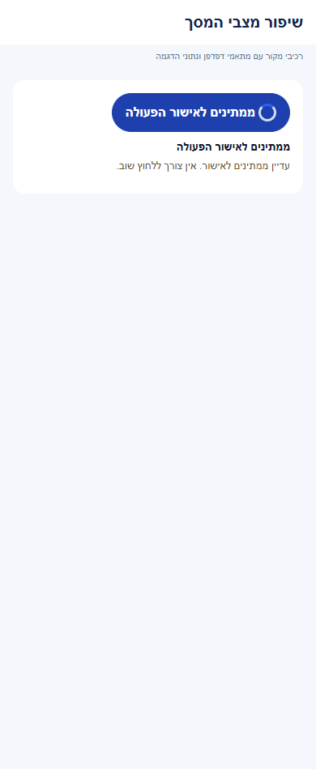
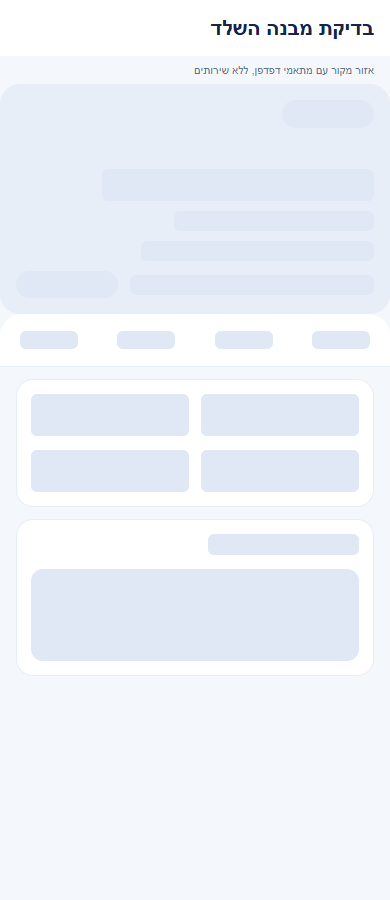
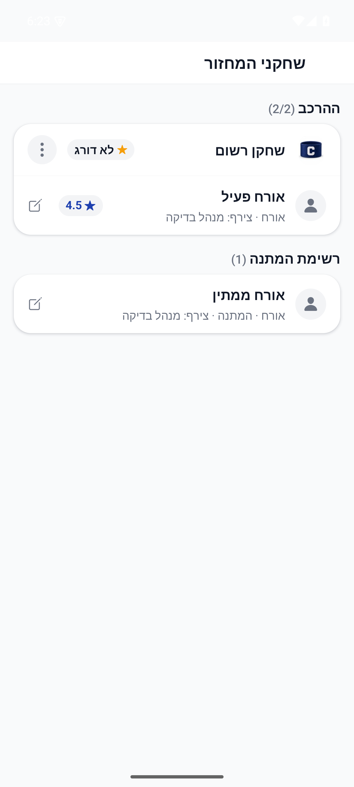
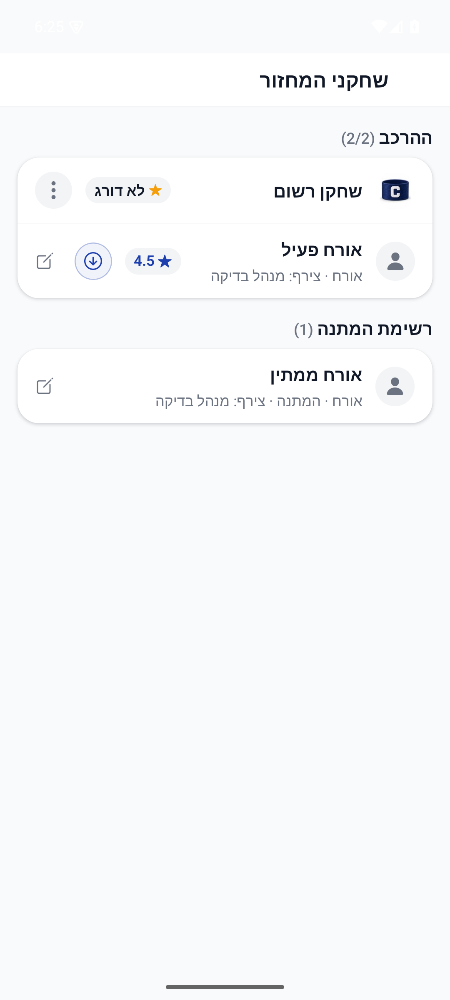
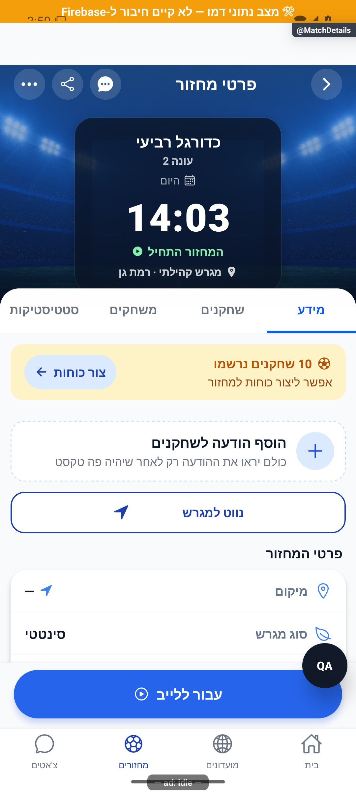
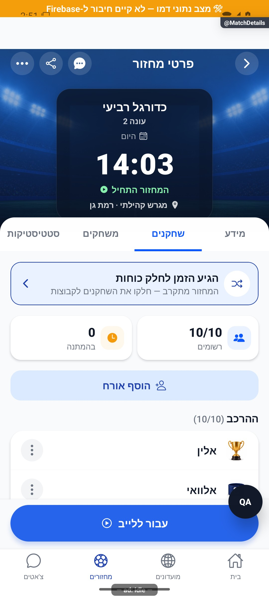
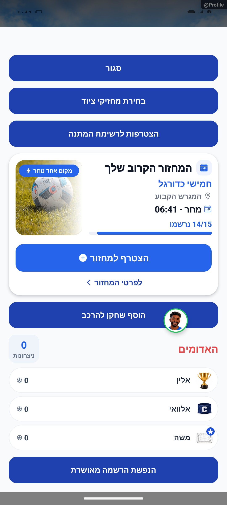

# הרשמה, המתנה ואישור מקום

## דירוג בסיס לשחקן ללא דירוג, 6.11.2026

נבדק שינוי תחום במקורות המשותפים של הכוחות האוטומטיים: שחקן ללא דירוג מחושב כ-2.5 מתוך 5, וההסברים תואמים. דירוג מפורש נשמר. אין כאן אימות חדש של כל מצבי הפיצר העצמאי; השינוי מקומי וטרם הופץ. המקורות המשותפים שנבדקו בהפרש זה: `src/screens/games/MatchDetailsScreen.tsx`. [ההתנהגות, הבדיקות ומגבלות האימות](../rounds/draft-setup.md#דירוג-בסיס-לשחקן-ללא-דירוג-6112026).

## מדידת פעולות ואמינות נתונים, 5.11.2026

במיפוי מקור הרכיבים המוזכרים במסמך נמצאו 102 נקודות מטפל ו-93 מזהי פעולה. הספירה מתארת קוד וכוללת רכיבים משותפים; אין לחבר אותה לספירות של מסמכים אחרים ואין לראות בה הרצת כל המסך. המדידה מפורטת לפי גבול פקד מקורי, פעולה עסקית ומצב חשבון. תשובה מאוחרת נבדקת מול בעל הפעולה, ומצב קיים או בקשה חוזרת אינם תמיד הצלחה חדשה. רשימת המקרים שהורצו ומגבלות המסד, המכשיר והכיסוי נשמרות [בדוח המדידה](../../audits/2026-11-04-system-night/product-measurement.md) ובדוחות המקושרים אליו. המימוש מקומי; לא בוצעה בדיקה חדשה של כל מצבי הפיצר.

## סדר הרשמה בין מכשירים ותוקף הצעת מקום, 4.11.2026

`requestJoinGame` משתמש ב-`src/services/enqueueGameJoin.ts`. עסקת לקוח על מסמך הבקשה של השחקן יוצרת בקשה כשאין אחת ושומרת בקשה ממתינה בלי לכתוב אותה מחדש. אם נשמרה קבלה סופית, העסקה קוראת גם את הסגל. מי שכבר רשום, ממתין או ממתין לאישור מקבל את המצב האמיתי. אם השחקן עזב, הקבלה הישנה נמחקת, ועסקה נוספת יוצרת בקשה רק אם מכשיר אחר של השחקן לא הקדים אותה. שתי עסקאות נדרשות משום שהכללים הקיימים מתירים יצירה ומחיקה עצמית ואוסרים על הלקוח לעדכן קבלה. אין עסקה על מסמך מחזור משותף בהכנסה הראשונה. אין התחייבות לשמור בקשה חדשה במכשיר מנותק.

התשובה למכשיר נשענת על קבלה שהמסד אישר. תשובה מהמטמון או כתיבה מקומית שעדיין ממתינה לאישור אינן מזכות במקום. תור השרת מכריע לפי זמן הלחיצה לאחר החלת גבול ההקדמה, אחר כך לפי זמן קבלה ולבסוף לפי מזהה. יש להבחין בין סדר הלחיצות בתוך אצוות התור הרגיל לבין אישור השלמה בידי מנהל, שבו העסקה הראשונה שהסתיימה מקצה את המקום.

אירוע `GameJoinRequested` מציין ניסיון. `GameJoined` במסלול התור נרשם רק אם המכשיר יצר את הבקשה, השרת החזיר `registrationCreated: true` וזמן הלחיצה תואם את הקבלה. מטפל ההתראה מעביר מקור לשירות ואינו מוסיף אירוע משלו. בקשה שהתקבלה כבר במכשיר קודם, הרשמה ממסלול אחר וקבלת שרת ישן ללא הוכחת יצירה אינן נספרות כהצטרפות חדשה. ביטול חוזר שאינו משנה הרשמה או הצעה אינו כותב סגל מחדש ואינו נמדד כביטול. אובדן תשובה אחרי שמירה עלול להביא לספירת חסר במדידת הלקוח. [בדיקת מדידה](../../../tests/logic/joinConfirmationAnalytics.test.ts).

`functions/src/spotOfferDecision.ts` משמש גם את מסלול הדגמה וגם את פעולת השרת. להצעה עם זמן יצירה, אישור מתקבל עד וכולל זמן היצירה בתוספת מספר הדקות שהוגדר במחזור, וברירת המחדל היא 20 דקות. הסריקה התקופתית משתמשת באותו חישוב. קבלה ישנה ללא חותמת זמן ממשיכה להתנהג לפי המצב הקיים. קידום או ויתור נמדדים פעם אחת רק כאשר תשובת הפעולה מאשרת שהמצב השתנה.

ההשפעה היא על ההרשמה מכרטיס המחזור וממסלולים המשתמשים באותו שירות וכן על אישור הצעת המקום. אין שינוי ניווט או שינוי חזותי. [בדיקות מסד, שני פערי הרשאות ומגבלות](../../audits/2026-11-04-system-night/registration.md).

## רישום רגיל אחרי בקשת השלמה, 4.11.2026

הסגל, ההמתנה והבקשות הרגילות למחזור נבדקים מול המועמדות החיצונית. מנגנון הרישום הרגיל לא שונה. functions/src/fillerRosterReview.ts חותם רק בקשה ממתינה שקדמה לאירוע הרישום ואינו מוחק היסטוריה או מסב רשומות קיימות. מקומי וטרם הופץ. [הראיות והמגבלות](../../changes/2026-11-04-filler-requests.md) · [דרכי הכניסה וההמלצות](../../specs/2026-11-04-outside-round-players.md).

## התאמה למסך ולגופן, 4.11.2026

ב-`GamesListScreen`, שממנו אפשר להיכנס למחזור ולהירשם, תג הבקשות יכול לגדול עם המספר, ופקדי הסינון יכולים לעבור לשורה נוספת. הפרטים נמצאים בתיעוד רשימת המחזורים. [פרטי השינוי](games-list.md).

## ציר פעילות פרטי בפולס, 4.11.2026

בציר הפעילות, תשובת שרת על מצב הרשמה קיים אינה נספרת כהרשמה חדשה. קבלה ללא סימון יצירה מפורש מוצגת עם מגבלת אמינות.

החיבור נמצא ב-`requestJoinGame`: ניסיון נוצר לפני הפעולה, ולתוצאה שמור מספר סידורי באותו ביקור ובאותה זהות. אישור השמה נלקח מקבלת השרת, כולל המתנה ואישור מנהל נדרש, בלי לספור תשובת לקוח כהצלחה מאומתת ובלי לשנות את מסלול ההרשמה העסקי. מקומי וטרם הופץ או נפרס. [היקף, מקורות, בדיקות ומגבלות](../shared/usage-activity.md).

## השפעת שיפורי הטעינה המשותפים, 4.11.2026

מסכי המחסניות נרשמים באמצעות טעינת מודול לפי צורך, וכל שמות המסלולים נשמרו. הבית מורכב מתחת לספלאש. אין מסלול חדש או שינוי בתנאי ניווט של הפיצר הזה.

מקורות משויכים שנבדקו בהיקף השינוי: `src/navigation/GameStack.tsx`, `src/screens/games/GamesListScreen.tsx`.

מימוש מקומי וטרם הופץ. אין בכך אימות מכשיר חדש של הפיצר הזה או מדידת מהירות של כל מסלוליו. [המדידות התחומות, הבדיקות והמגבלות](../../changes/2026-11-04-screen-performance.md).

## הפצה פנימית 1.1.74, 3.11.2026

עדכוני הלקוח ב-`src/components/ReadStatusNotice.tsx`, `src/hooks/useRoundChanges.ts`, `src/services/roundVisitService.ts`, `src/utils/photoPhase.ts`, `src/utils/roundVisit.ts`, `src/screens/games/GamesListScreen.tsx`, `src/screens/games/MatchDetailsScreen.tsx` כלולים בחבילה הפנימית 1.1.74/306. ארכיון המקור המקומי וחתימת החבילה אומתו מול החבילה שהחזירה גוגל. מקור הבסיס הוא `06417f6132f4c7636aaee25574354ed7722966b9` עם שינויים שלא נשמרו לגיט.

עברו 6864 בדיקות יישום, בדיקות טיפוסים, 360 בדיקות הרשאות בסדרה ו-38 בדיקות שרת במסד הדגמה. ההרשאות והשירותים הפעילים נשמרו, ללא הסבת נתונים או קידום לייצור. האימות החזותי הוא מצילומי המקור בדפדפן שכבר תועדו, ללא התקנה או הרצת הפיצר הזה במכשיר בגרסה החדשה. אין בכך הכרזה על הפצת שינויים אחרים המתועדים במסמך. [מקור, קבלות, תכולה ומגבלות](../../changes/2026-11-03-internal-1.1.74.md).

## מצבים ריקים והמשכיות פעולה, 3.11.2026

בזמן המתנה ארוכה לאישור הרשמה מופיע הסבר שאין צורך ללחוץ שוב. הצלחה ממשיכה להיות תלויה בתוצאת הפעולה.

מקורות משויכים שנערכו: `src/screens/games/GamesListScreen.tsx`, `src/screens/games/MatchDetailsScreen.tsx`.

ההתנהגות, טבלת המצבים, מסלול הנתונים, בידוד הזהות, ניווט, שמירת שישים ביקורי מחזור מקומיים, השהיית חיווי של שש שניות ושלבי התמונה מתועדים ב[דוח השינוי](../../changes/2026-11-03-experience-followup.md). מקורות המנגנונים: `src/components/ReadStatusNotice.tsx`, `src/hooks/useRoundChanges.ts`, `src/services/roundVisitService.ts`, `src/utils/roundVisit.ts`, `src/utils/photoPhase.ts`. אין שינוי בחישובים, במכנים או בהרשאות. חיווי עיכוב אינו הוכחה להתנתקות ואינו אישור כתיבה; אין מטמון תוכן קבוע חדש.

המימוש מקומי. נבדקו עשרים ושניים מצבי מקור ושני אזורי השוואה ב-72 בדיקות רוחב בדפדפן. תמונות וסמלים הוחלפו במצייני מקום; מצב עיכוב מוזן למתאם והתזמון נבדק בקוד. אין אימות מכשיר, שרת חי או מסך מלא חדש.

תוצאות האימות בסבב זה: כל 6864 הבדיקות ב-614 חבילות ובדיקת הטיפוסים עברו. בדיקות המצבים הממוקדות עברו ב-83 מקרים. נבדקו 72 פריסות של אזורי מקור בדפדפן, ונבדקה כיווניות בצילומים. אין אימות מכשיר או שירות חי חדש.

## התאמת מבנה שלדי הטעינה, 3.11.2026

באזורים המשויכים לפיצר הזה נבדק שלד `match` במתאם דפדפן. אין בכך אימות המסך המלא או כל מצב נתונים. ההתאמה עוסקת בפריסה ובהודעת ההמתנה הנגישה; שירותי הטעינה, מצבי הכשל, המיון, החישובים, המכנים והניווט נשארו ללא שינוי. מקורות משויכים שנערכו: `src/screens/games/MatchDetailsScreen.tsx`.

[טבלת השינויים לפי אזור, המידות, השוואות למקור, הבדיקות והמגבלות](../../changes/2026-11-03-skeleton-layout-alignment.md). מקומי וטרם הופץ, ללא בדיקת מכשיר או שרת חי חדשה.

אימות במשימה זו: 6,820 בדיקות ב-608 חבילות ובדיקת טיפוסים עברו; 84 בדיקות רוחב של אזורי מקור ותשע השוואות מידות לכרטיסים אמיתיים עברו. אין בכך אימות מכשיר חדש של הפיצר או של מצבי נתונים שלא נבדקו.

## העברת אורח לרשימת המתנה, 3.11.2026

למנהל המועדון נוסף כפתור חץ מטה נגיש בשורת אורח פעיל, לצד העריכה הקיימת. הוא מופיע בלשונית השחקנים המוטמעת וגם במסך העצמאי, ואינו מוצג לחבר רגיל או במחזור סופי. `moveGuestToWaitlist` מעביר את האורח לסוף מערך האורחים עם `waitlisted: true`, תוך שימור מזהה, שם, מי שצירף, זמן ודירוג. מזהי המשתמשים ב-`players` וב-`waitlist` אינם משתנים. `persistGuests` משתמש ב-`adminReorderGuests` הקיים; הרשאות, בדיקת קבוצת המזהים ועסקת הכתיבה נשמרו. כשל שמירה טוען מחדש את הנתון הסמכותי.

התפוסה היא `players.length + activeGuestCount(guests)`; ההמתנה היא `waitlist.length` בתוספת אורחים עם `waitlisted`. בדוגמה שנבדקה, רשום אחד, אורח פעיל ואורח ממתין השתנו מהרכב 2/2 והמתנה 1 להרכב 1/2 והמתנה 2. האורח שעבר שומר דירוג 4.5 ומופיע אחרי הממתין הקודם.

ב-`onGameRosterChanged`, ירידה בספירת האורחים הפעילים לבדה אינה עוד `guestSeatFreed`: נדרשת גם הסרה של מזהה אורח שהיה פעיל. כך מעבר ידני להמתנה אינו מפעיל מילוי מחדש, בעוד הסרה אמיתית ממשיכה במסלול הקידום הקיים. אורח שהועבר ידנית אינו מוסר מהמסמך ואינו הופך למשתמש. אין שינוי מכנים, כללי הרשאה או ניווט.

בדיקות המקור ב-`tests/logic/guestWaitlistMove.test.tsx` מכסות שני מסלולי תצוגה, סוף תור, שמירת פרטים וספירות, חבר רגיל, מצבים סופיים ושחזור אחרי כשל. `tests/logic/finalForcesGuestServerAudit.test.ts` מריץ את ביטויי הגילוי המקוריים של השרת ומכסה מעבר ידני לעומת הסרת אורח פעיל או ממתין. `tests/logic/guestPromotion.test.ts` נשאר בכיסוי הקידום האוטומטי.

צילומי לפני ואחרי נבדקו באנדרואיד בכיווניות עברית, במארח של רכיב המסך המקורי עם נתונים ומתאם שמירה מקומיים. הלחיצה והמונים נקראו חזרה מעץ הפקדים וממצב הרכיב. אין אימות כתיבה מול שרת, ייצור, אייפון או גרסת חנות. התיקון מקומי וטרם הופץ; נדרשת פריסת `onGameRosterChanged` המתוקן לפני הפצת הלקוח, כדי שהשרת הקודם לא יקדם את האורח מחדש.

[היקף, תוצאות וראיות](../../changes/2026-11-03-guest-waitlist.md).

## נעילת חלון התנגשות בזמן ביטול, 3.11.2026

`src/components/games/RegistrationConflictModal.tsx` שומר את חלון ההתנגשות פתוח בזמן ביטול ההרשמה האחרת. חזרת אנדרואיד, לחיצה ברקע, כפתור סגירה ופעולת צפייה במחזור האחר נבדקים מול אותו מצב בקשה עדכני. השינוי אינו משנה יעד הצטרפות, קיבולת, זמן, נתוני מחזור או הרשאות.

`onCancelOther` תומך ב-`void` וב-`Promise<void>`. `cancelOther` נועל סינכרונית באמצעות `pendingRef` לפני הפעלת הצרכן, מונע אישור חוזר ומשחרר ב-`finally`. `externalBusyRef` נשאר מקור עצמאי ל-`cancelBusy` החיצוני. לכן גם אירוע סגירה שנשמר לפני ציור ההמתנה אינו עוקף אותה, וסיום ההבטחה המקומית אינו משחרר דגל חיצוני שעוד פעיל. `busy` המוצג נגזר מהדגל החיצוני ומההמתנה המקומית יחד. `requestClose` ופעולת הצפייה קוראים את ההפניות העדכניות במקום מצב של ציור קודם.

כשל משחרר את הנעילה המקומית בלי לסגור את החלון ובלי לבלוע את השגיאה. הצרכן הקיים ב-`src/screens/games/GamesListScreen.tsx` נשאר ללא שינוי: הוא מבטל את ההרשמה האחרת, מנסה להצטרף למחזור היעד, מטפל בשגיאה ומחזיק את הדגל החיצוני עד סיום הרענון. הצלחה אינה גורמת לסגירה נוספת ברכיב; הצרכן מנהל את סיום התהליך כפי שניהל קודם.

ב-`tests/logic/overnightRegistrationConflictModal.test.tsx` עברו שש בדיקות מקור עם מצב הוקים נשמר ומתאמי פקדים מקוריים: סגירה רגילה, דגל חיצוני, אירועים ישנים, חסימה לפני ציור, אישור כפול, הצלחה, כשל, ניסיון חוזר וצרכן שתופס שגיאה בעצמו. לפני התיקון שלוש משש הבדיקות נכשלו; אחרי התיקון כולן עברו. קבלות: [לפני](../../../artifacts/overnight-2026-11-02/conflict-tests-before.json), [אחרי](../../../artifacts/overnight-2026-11-02/conflict-tests-after.json).

במארח דמו מקומי עם דגל המתנה קבוע, [צילום לפני](../../../artifacts/overnight-2026-11-02/functional-native/conflict-busy-before.png) הראה את החלון עם כפתורים מושבתים, ו[צילום לאחר חזרה לפני התיקון](../../../artifacts/overnight-2026-11-02/functional-native/conflict-busy-before-back-closed.png) הראה שהוא נסגר. אחרי התיקון, חזרת אנדרואיד ולחיצה ברקע השאירו את [חלון המקור פתוח](../../../artifacts/overnight-2026-11-02/functional-native/conflict-busy-after-back-blocked.png). שלושת הצילומים נפתחו ונבדקו. זו בדיקת רכיב מקור במארח בלבד, ללא ביטול הרשמה, הצטרפות, שרת או מסך מוצר מלא. השינוי מקומי וטרם הופץ; האימות הכולל מרוכז בדוח המשימה.

## ליטוש מקומי והשפעת רכיבים, 3.11.2026

השפעה עקיפה דרך `ConfirmDestructiveModal`, `Avatar`, `Button`: הסכמה נחשפת כפקד יחיד ואינה משתנה בזמן בקשה; כשל כתובת תמונה מציג אותיות שם באותן מידות, וכתובת חדשה מתחילה ניסיון חדש; רק variant="danger" משתמש במלל הכהה; כפתורים רגילים לא שונו. אין שינוי בנתוני המחזור, בקיבולת או בהרשאות הפעולה. לפירוט הנעילה, הנתונים, הכשל וגבולות ההרצה ראו [חוזי הרכיבים המשותפים](../shared/menus-and-motion.md). אין כאן טענה שכל זרימת הרשמה, המתנה ואישור מקום הורצה.

השינוי הישיר ב-`src/screens/games/GamesListScreen.tsx` מסיר כיווניות סותרת בשני סגנונות הודעת גילוי בלבד. חוזה ההרשמה, זמן הלחיצה, רשימת ההמתנה ואישור מקום לא שונו. צילומי הלפני כבר נראו מיושרים; 17 בדיקות כיווניות ממוקדות עברו, ללא אימות הרשמה חדש בשרת.

השינוי מקומי וטרם הופץ. אין כאן אימות חדש של מסך מוצר מלא, מכשיר, קורא מסך או שרת. [הראיות והמגבלות של המשימה](../../changes/2026-11-03-overnight-mission.md).

## בדיקת קצה ואימות מקורי, 2.11.2026

נבדק ההפרש התחום במקור או בבדיקה המשותפים: תיקוני מדידת גלילה, שימור נתוני סגל בכשל נלווה, הפרדת מצב שיחות וכיוון קיצור ההודעות. כלי הבדיקה החדש מוגבל לשלושת שערי ההדגמה ואינו משנה נתיב מוצר. אין שינוי מכוון בתנאי הרשאות, בחישובים, במכנים או בכתיבות העסקיות של הפיצר העצמאי. אין כאן טענה להרצת כל מסלוליו במכשיר או בשרת. מקומי וטרם הופץ. [שחזור, תיקונים, בדיקות ומגבלות](../../changes/2026-11-02-experience-review.md).

## המשכיות ומשוב בשימוש, 2.11.2026

`useConfirmedFeedback` נקרא רק לאחר תשובת שירות מאושרת. `registrationFeedback` מבדיל בין `players`, `waitlist` ו-`pending`, ללא ברירת מחדל מוצלחת לערך לא מוכר. הכפתור מציג אישור וסימן בדיקה במשך 1400 אלפיות שנייה, עם רטט עדין והודעה באותה משמעות. תשובה ממסך שנעזב או מחשבון קודם אינה מפעילה משוב. מצב המתנה שומר תווית לצד המחוון; כשל אינו מציג אישור. בבית וברשימת המחזורים נשמר עדכון הכרטיס לפי התשובה והפיוס המאוחר הקיימים. פרטי מחזור שומרים את חגיגת ההרשמה והביקורת המאוחרת, ומסירים רטט כפול. אישור הצעת מקום מקבל אותו משוב אחרי כתיבה מאושרת. נעילת לחיצה סינכרונית נוספה גם להרשמה בבית. אין שינוי בתנאי קבלה, הרשאות, קיבולת, המתנה או קידום. `tests/logic/roundJoinLoading.test.ts` מריץ את המטפל האמיתי עם תשובה מעוכבת ובודק שלא מוצג אישור לפני התשובה או בכשל.

בדיקות התנהגות חדשות: `tests/logic/experiencePolish.test.ts`. האימות החזותי כולל אזורי מקור עם נתוני הדגמה ומתאמי דפדפן בלבד, ללא אימות מכשיר או מסד. מימוש מקומי שטרם הופץ. [התנהגות, בדיקות, צילומים ומגבלות](../../changes/2026-11-02-experience-polish.md).

## הרחבת שלדי הטעינה, 2.11.2026

נבדק ההפרש התחום במקור או בבדיקה המשותפים. השינוי מוסיף מציגי טעינה או חושף לשימוש חוזר את בסיס השלדים; בדיקות החברים כוללות כעת סמן תשובה מוכן, ובכשל בודקות שרשימה קיימת אינה נדרסת ואין סימון של תשובה ריקה מוצלחת. תנאי הרשאות, כתיבות, חישובים, מכנים, פעולות וניווט של הפיצר העצמאי נשמרו. כותרת מצב ורענון אינן אישור חדש לתקינות הפיצר כולו או למכשיר. מימוש מקומי שטרם הופץ. [התנהגות, בדיקות, צילומים ומגבלות](../../changes/2026-11-02-loading-skeletons-expanded.md).

## טיפול בפולס, 2.11.2026

נוסף סדר קבלה ב-`src/screens/games/MatchDetailsScreen.tsx`: מספר טעינה אחרון ומונה שינויי נתונים מגינים על הסגל. המונה מתקדם לאחר הרשמה או ביטול שאושרו ובקבלת עדכון חי לסגל שכבר מוצג. העדכון המקומי דורש גם התאמת מזהה המחזור. אין שינוי ב-`requestJoinGame`, בתור, בהקצאת מקום או במכנים. מבחן `tests/logic/matchDetailsReadOrdering.test.ts` מאמת שקריאה מושהית אינה דורסת שחקן שכבר נרשם בעדכון חי, וששגיאה שהתיישנה אינה מעלימה את הסגל. זו הוכחת הגנה מקומית; האירוע המקורי באייפון לא שוחזר במכשיר.

[דוח הטיפול, הבדיקות והמגבלות](../../changes/2026-11-02-pulse-sweep.md).

## בקשות לשיחה אישית, 2.11.2026

נבדקה השפעת תוספת בקשות השיחה במקורות המשותפים. השינוי ממוקד בהרשאת שיחה, בשדות פרטיות ההודעות ובחיבורי הבדיקות; אין מכך אימות חדש של מסך זה במכשיר. המימוש מקומי וטרם הופץ או נפרס. [התנהגות, בדיקות ומגבלות](../chat/message-requests.md).

מקורות משותפים שנבדקו בהיקף השינוי הזה: `src/firebase/firestore.ts`, `src/types/index.ts`. אין בסעיף זה טענה להרצת כל המסלולים ההיסטוריים של הפיצר. [מסירת המימוש](../../changes/2026-11-02-message-requests.md).

## החלפת הקבוצה הבועטת בפנדלים, 30.10.2026

נבדק ההבדל התחום במשימה במקורות המשותפים `src/services/gameService.ts`, `src/types/index.ts` ו-`src/firebase/firestore.ts`: הוא מוסיף ומשמר תור מפורש לפנדלי ההכרעה ומעדכן אותו ברישום ובביטול בעיטה. אין שינוי בשדות, בחישובים או במסלול הנתונים העצמאי של הפיצר המתואר כאן. בדיקת הקורא והעסקאות מפורטת בדוח; אין בכך הרצה מחדש של המסך הזה. [התנהגות, בדיקות ומגבלות](../../changes/2026-10-30-shootout-turn.md).

## שגיאות אייפון שנקלטו בסיום, 28.10.2026

בחירת חלופת הניווט נבדקת לפי מערכת ההפעלה של הטלפון. בדיקת הטיפוסים עברה אחרי השלמת תלות הפלטפורמה.

השינוי במקור המסך המשותף src/screens/games/MatchDetailsScreen.tsx מוגבל לפונקציית openWaze: החלופה השלישית באייפון פונה למפות אפל במקום לקישור geo של אנדרואיד. אין שינוי בהרשמה, בסגל או בביקורת ההרשמה המאוחרת. tests/logic/iosPulseRecovery.test.ts מפעיל את מסלול הניווט; הוא אינו שחזור של שגיאת ההרשמה ההיסטורית שנשארת פתוחה.

[מקור, בדיקות ומגבלות](../../changes/2026-10-28-pulse-errors.md). תיקון מקומי וטרם הופץ.

## הרחבת אבחון דיווחים, 27.10.2026

נוספה מעטפת אבחון מקומית עם מצב בזמן הכשל, שלבים בעלי מזהה ותזמון, מצב רשת ובנייה ומופעים נפרדים לשגיאה. נקודת הכניסה לתעבורת השרת עוברת כעת דרך העטיפה המשותפת; תשובות, חריגות, אפשרויות קריאה ומדיניות הפיצר נשמרות. אין כאן שינוי בהרשאות או בחישובי המוצר. הבדיקות המלאות ומגבלות האימות מתועדות בדוח המקושר; אין טענה לאימות מכשיר או להפצה. [היקף, ראיות ומגבלות](../../changes/2026-10-27-diagnostic-context.md).

באימות הסופי עברו כל 6,231 הבדיקות ב-555 חבילות, ובדיקות הטיפוסים של הלקוח, השרת והפולס נקיות. צילום הדפדפן והידור מקורות האנדרואיד הם בדיקות מקומיות; אין הוכחת מכשיר, הידור אייפון או מסירה חיה של הבנייה החדשה. רישום יומן השחרור נחשב מאומת רק לפי קבלת הקריאה החוזרת בדוח השינוי.

## הפצה פנימית 1.1.61 - 25.10.2026

הבינארי `1.1.61/295` הופץ ואומת במסלול הפנימי באנדרואיד. תיקוני הלקוח נכללים בו, ושירות הפרופיל נפרס ואומת בנפרד. גם תיקוני הסגל, שמירת התוצאה והתראת השגיאה בשרת נפרסו ואומתו באישור מפורש. שינויי יישום הפולס עצמו טרם הופצו. אין שינוי כללי הרשאה או הסבת נתונים. ניסוחי המצב המקומי בסעיפים הקודמים נכתבו לפני ההפצה; [דוח ההפצה](../../changes/2026-10-25-internal-1.1.61.md) מפרט בדיוק מה נכלל, מה נבדק ומה עדיין מקומי.

## תיקוני הפולס - 25.10.2026

נבדקה השפעת שינוי המקור המשותף: `src/screens/games/MatchDetailsScreen.tsx`. השינוי מוגבל לטיפול בדחיות צפויות, ניסיונות קריאה חוזרים או רכיב חזותי משותף, כמפורט בדוח הסבב. אין שינוי נוסף בחוזה התהליך המתואר כאן, במכנים, בזכאות או בהרשאות; לא נערכה הרצה חדשה של כל מצבי הפיצר.

[מקורות, בדיקות, צילומים ומגבלות](../../changes/2026-10-25-pulse-fixes.md).

## שעון מדויק וכיתוב פנדל - 25.10.2026

במקורות המשותפים נוסף שימור השעון המדויק של פנדל במהלך משחק, וכיתוב ההבקעה ביומן קוצר. אין שינוי במונים או בתהליך העצמאי המתואר כאן; לא נערכה לו בדיקת ממשק חדשה במסגרת העדכון. השינוי מקומי וטרם הופץ. [פרטים וראיות](../../changes/2026-10-25-in-play-penalties.md#שעון-מדויק-וכיתוב-אירוע).

## פנדל במהלך משחק חי - 25.10.2026

נבדק השינוי הממוקד במקורות המשותפים: נוספו חוזי אירועי פנדל במהלך משחק, קוראים ומוני סטטיסטיקה, והגנות בעסקאות סיום ואיפוס משחק. מסלול הפיצר המתואר כאן אינו נקודת הכניסה להזנה החדשה. בדיקות המאגר עברו, אך אינן הוכחת הרצה חדשה של כל מצבי התהליך או של פריסה.

השינוי מקומי. נדרשת פריסת שרת לפני הפצת לקוח שמשתמש באפשרות; לא בוצעו פריסה או שינוי הרשאות. [חוזה הנתונים, התהליך, הבדיקות ומגבלות ההפצה](../../changes/2026-10-25-in-play-penalties.md).

## חזרה מארון התארים לכרטיס המקורי — 24.10.2026

לערימת הניווט המשותפת נוסף רישום מקומי של ארון התארים, כדי שחזרה מכרטיס שחקן לא תחליף לשונית. אין שינוי מכוון בהתנהגות העצמאית המתוארת כאן, ואין בדיקת ממשק חדשה שלה. התיקון מקומי ולא הופץ. [מסלול הניווט, בדיקות, צילומים ומגבלות](../../changes/2026-10-24-cabinet-back.md).

## פריסת שיפור ההרשמה — 24.10.2026

נפרסה רק הפונקציה `onJoinRequestCreated` באזור `us-central1`, במהדורה `onjoinrequestcreated-00024-lav`, ב־2026-10-24 בשעה 14:01 בזמן אוניברסלי. אותו גוף `reconcileGameJoins` הפעיל מופעל ישירות דרך `functions/src/joinReconcileDispatch.ts` אחרי יתרת חלון של 500 מילישניות; אין עוד תור לעובד נוסף. אומתה מדיניות `RETRY_POLICY_RETRY`, עם אותה עסקה אטומית; `reconcileJoinsTask` נשמרה ללא שינוי למשימות קיימות.

כל 198 רשומות החבילה הפעילה נמצאו זהות לחבילה המבודדת שנבדקה, ו־103 הפונקציות האחרות לא השתנו. החבילה עברה בדיקת טיפוסים והרצת המטפל המקופל, ו־14 בדיקות הרשמה עברו שוב. לא נמדדה הרשמה חדשה ואין להסיק זמן תגובה קבוע. אין שינוי לממיר קריאה, לזכאות, למכסה או למסלול אישור המקום בלקוח.

[היקף הפריסה, ראיות ומגבלות](../../changes/2026-10-24-join-speed-deployment.md). סעיף זה מחליף את מצב טרם הפריסה של תיקון השרת בסעיף הטיפול בפולס למטה; שינויים מקומיים אחרים המתוארים במסמך לא הופצו במסגרת זו.

## קיצור טעינה ומניעת קריאות כפולות — 23.10.2026

עודכנו רק מסלולי קריאה ב־`MatchDetailsScreen` וב־`GamesListScreen`: `useFocusEffect` מכסה את הכניסה הראשונה ואת החזרה, בלי אפקט הרכבה נוסף. לא שונו פעולות הרשמה/ביטול, סדר בקשות, מנגנון אישור, בדיקת התנגשות או כללי הרשאות. בדיקת הרישום האמיתי מאמתת טעינה אחת במיקוד ועוד אחת בחזרה; אין כאן בדיקת הרשמה חדשה בייצור.

[בדיקות, צילומים ומגבלות](../../changes/2026-10-23-screen-loading.md).

## תלויות משותפות — 23.10.2026

הפעמון/מונה המשותף מדלג על טעינה במצב אורח ומבטל קבלת תשובה מחשבון קודם בניקוי האפקט. מסלולי ההצטרפות והאישור לא שונו; [פרטי החוזה והבדיקות](../profile/requests.md#טעינת-בקשות-במצב-אורח--23102026).

## תיעוד כשלים — 20.10.2026

נוספו תצפיות דיווח בנקודות הכשל של המקורות המשויכים לפיצ׳ר, במסגרת הרחבה רוחבית. נשמרו ערכי החזרה, הזריקות ותנאי הפעולה הקיימים; נוסף מקור קוד והקשר לדיווח. כיסוי תחבירי אינו הוכחת הרצה של כל מצב. השינוי מקומי וטרם הופץ; בדיקות המסירה, מגבלות מניעת הכפילויות והמסלולים שטרם חוברו מתועדים בדוח המשותף.

[דוח דיווח השגיאות והראיות](../../changes/2026-10-20-error-reporting-audit.md).

## פריסת שרת מאושרת — 17.10.2026

`onJoinRequestCreated` ו־`reconcileJoinsTask` נפרסו עם `JOIN_SETTLE_MS=500`. חותמות המקור הפעיל נבדקו מול הקוד והבדיקות. סדר ההכרעה ממשיך לפי `tappedAt`; לא הוחל שינוי הרשאה או שכתוב בקשות ישנות. בדיקת הרשמה חדשה במכשיר אחרי הפריסה אינה חלק מראיות הסבב הזה. [מצב הפריסה והראיות](../../changes/2026-10-17-server-preparation.md)

עודכן: 7.10.2026. מקור הקוד: `8e8fde5`, גרסה `1.1.35`. מסמך זה מתאר את הקוד; מצב חנות ופריסת שרת דורשים ראיה נפרדת.

## כניסה ותפקידים

כפתור בכרטיס מחזור או בפרטי מחזור; הצעת מקום בשחקנים

משתמש מבקש מקום; מנהל מאשר/דוחה/מקדם. התחברות אנונימית אינה אורח ידני ברשימה.

## רכיבים ומצבים

| רכיב / מצב | התנהגות וחוזה |
|---|---|
| הרשמה פתוחה | requestJoin; בתהליך אישור מנהל המשתמש ממתין לבקשה ולא נחשב משתתף |
| מחזור מלא | המתנה לפי הגדרות; אין לצבוע משתמש בהמתנה כאילו הוא רשום |
| הצעת מקום | confirmSpotOffer / passSpotOffer; הצעה מוגבלת בזמן; מנהל יכול adminAdvanceOffer |
| התנגשות | RegistrationConflictModal מפריד התנגשות מועדים משגיאת רשת |
| תזמון | scheduled/open/locked; פתיחת מועדון/ציבור/אורחים אינה אותה נקודת זמן |
| ביטול | מועד אחרון לביטול וסמכות מנהל; פעולה בחשבון אמיתי דורשת הרשאה, אינה כלי בדיקה |
| חזרה מהתחברות | pendingAction / draftStore / actionCoordinator חידוש פעולה פעם אחת |

## מסלול נתונים ומקומות שינוי

[`src/screens/games/MatchDetailsScreen.tsx`](../../../src/screens/games/MatchDetailsScreen.tsx); [`src/screens/games/GamesListScreen.tsx`](../../../src/screens/games/GamesListScreen.tsx); [`src/screens/games/MatchPlayersScreen.tsx`](../../../src/screens/games/MatchPlayersScreen.tsx)

gameService, gameLifecycle, שירותי חידוש פעולה ו־functions. יש לאמת זהות/קיבולת בשרת. הצעות והרשומים מגיעים מהמחזור דרך הממיר; אין להסיק השתתפות מסטטוס כללי בלבד.

ממיר המחזור: [`src/firebase/firestore.ts`](../../../src/firebase/firestore.ts), `gameDocConverter.fromFirestore`; סוגים: [`src/types`](../../../src/types). שינוי שדה דורש מעקב כתיבה → ממיר → שירות/חנות → רכיב. ניווט: [`GameStack.tsx`](../../../src/navigation/GameStack.tsx), ובמסכים משותפים גם המחסניות שמארחות אותם.

## בדיקות וראיות

בדיקות הרשמה ותזמון, pendingActionMachine, homeRoundState; תרחישים: אישור ממתין, המתנה, הצעה, פקיעה, מלא, התנגשות וסשן ישן.

צילומי המיפוי מהאמולטור נעשו במצב נתוני דמו, המסומן בפס כתום. הם מוכיחים את הרכיב והמצב המוצגים בלבד, ולא ממירי Firebase, נתוני ייצור או כתיבה. צילומי תיקונים קודמים מסומנים בנפרד. שגיאת מזהה, מצב טעינה או שער הגנה אינם הוכחת הפעולה המלאה.

## גבולות והערות תחזוקה

אישור הצטרפות מונפש רק אחרי תשובת שירות מוצלחת. רישום אינו הבטחה שהערב התקיים.

לפני שינוי פתח את הקוד המקושר ואת [כללי הפרויקט](../../../AGENTS.md). לאחר שינוי עדכן במסמך זה את התאריך, נקודת הקוד, המצבים שהתעדכנו, הבדיקות והצילום. אין לטעון שכל מצב/תפקיד נבדק רק משום שקיים צילום אחד.

## פירוט טכני ממוקד: זרימה, חישוב ונקודות שינוי

[הסבר פשוט למשתמש](registration.simple.md)

העמקה: 07.10.2026, מול קוד המקור שב־`8e8fde5`. בעת הכתיבה HEAD הוא `50d508f`; בדיקת ההפרש בין הנקודות ב־`src` וב־`functions` לא מצאה שינוי קוד. הסעיפים וההסתייגויות הקיימים נשמרו. זו קריאת קוד ותיעוד, בלי הרצת תרחישי כתיבה חדשים.

הרישום דרך `requestJoinGame` כותב בקשה ב־`games/{gameId}/joinRequests/{uid}` עם זמן לחיצה. מנגנון השרת אוסף חלון של כ־500 אלפיות שנייה ומיישב לפי `tappedAt`; ניבוי הלקוח אינו הכרעת מקום אחרון. שמירת מזהה המשתמש כנתיב בקשה אינה אומרת שכל פעולה בהמשך אידמפוטנטית מעצמה.

מקום פנוי נבחן מול קיבולת, רשומים, אורחים פעילים ומקום שמור להצעה, בהתאם לפעולה. לדוגמה, 8 רשומים+אורח פעיל+הצעה אחת במחזור 10 ממלאים את המכסה, אף שעל המסך יש רק 9 משתתפים מאושרים. בקשות אישור ואורחים בהמתנה אינם שחקנים על המגרש.

`confirmSpotOffer` ו־`passSpotOffer` שולחים החלטה לפונקציית `resolveSpotOffer`; `adminAdvanceOffer` נשאר פעולה מנהלית. השרת משתמש במזהה המאומת של הפונה ובעסקה על המחזור, דרך `decideSpotOffer` ב־`spotOfferDecision.ts`. האישור דורש הצעה קיימת של אותו משתמש, חברות ברשימת ההמתנה, תוקף וקיבולת פנויה הכוללת אורחים פעילים. אישור חוזר של מי שכבר רשום מצליח ללא הוספה נוספת. ויתור על הצעה של אדם אחר אינו משנה אותה. לאחר החלטה נבנה `participantIds` מחדש ונבדקת הצעה לממתין הבא; התראת ההצעה ממשיכה דרך מנגנון המחזור הקיים.

מצב `locked` חוסם הרשמות חדשות, אך משמר מקום רשום והמתנה קיימת ומאפשר למקבל הצעה קיימת לאשר אותה. אין בפונקציה מסלול להרשמה חדשה או הרשאה לפעול בשם מישהו אחר. הלקוח בודק גם התאמה בין `auth.currentUser.uid` למשתמש המבוקש. לא שונו כללי המסד; פונקציית השרת החדשה חייבת להיות פרוסה לפני הפצת הלקוח. אין להמיר כל ביטול לוויתור על הצעה בלי לבדוק שרשרת תור ופקיעה. סשן אנונימי בחידוש פעולה שונה מאורח ידני שהוסף לסגל.

אימות 10.10.2026: בדיקות `preReleaseRoundIntegrity` על מודול השרת המקורי מכסות זהות, הצעה שפגה, קיבולת כולל אורחים, אישור חוזר, מחזור נעול והעברת ההצעה. אלו בדיקות מבודדות; לא אושר מקום אמיתי ממכשיר ולא בוצעה פריסה בסבב זה.

יש לבדוק באופן ממוקד: שני לוחצים על מקום אחרון, ביטול בחלון היישוב, הצעה שפגה, שינוי מנהל ורשת שנפלה אחרי שהשרת כתב. חגיגה מקומית חייבת להתאים לתשובה סמכותית; מוק אינו משחזר את מנגנון התחרות. שינוי נראות/הרשאות נדרש להצעה נפרדת ואינו שינוי תצוגה.

## השלמת הנפשות — 8.10.2026

RegistrationSuccessAnimation מציגה UserAvatar מתוך currentUser במקום הכדור במסלול registered הרגיל. מסלול המקום האחרון נשאר חגיגת שער וכדור. ההפעלה נשארת אחרי תשובת השירות; waitlisted ו־pendingApproval אינם מקבלים תנועת אווטאר של מקום מאושר. במסלול הרגיל התנועה 520 אלפיות שנייה וסיום אחרי 700; פירוק/שינוי visible או הפחתת תנועה מבטלים ערכי הנפשה וטיימר מקומי. אין כתיבה בסיום תנועה. המסלול עולה ממרכז התחתית ומוסט לרוחב, ואינו מודד תא סגל פיזי. MatchDetails מציג HeightReveal לסטטוס waitlist: המיקום הוא indexOf(user.id)+1; מזהה שאינו נמצא מקבל מלל ללא מקום, לא מיקום 0. חישובי הקיבולת וההצעה נשארו בשירותים הקיימים.

[פרטי האימות והמגבלות](../../changes/2026-10-08-motion-completion.md). מקור: `9ec0dfd` עם שינויים מקומיים; טרם פורסמה גרסה.

## תזמון חוזר ושימור זכויות — 10.10.2026

תזמון מחדש ממשיך לשמור `status=scheduled` ואת הרשומים, ההמתנה והבקשות; אין להשתמש ב־`open` עם שדה זמן נפרד בלבד, משום שכללי הרשמה עצמית הקיימים אינם בודקים את זמן הפתיחה. `decideSpotOffer` ומסלול הדמו מכירים כעת גם בהצעה קיימת במחזור `scheduled`: נדרשות זהות ההצעה והמתנה קיימת, ונבדקת קיבולת הכוללת אורחים. אין מסלול הצטרפות חדשה בפונקציה זו. התיקון בשרת דורש פריסה נפרדת; לא בוצעה כאן פריסה.

ביטול עצמי במחזור שתוזמן מחדש מחייב כלל מצומצם נוסף. בשלב כתיבת סעיף זה הכלל טרם אושר, ולכן `firestore.rules` ו־`canCancelRegistration` לא שונו. ההצעה בקובץ `artifacts/registration-scheduled-withdrawal-proposed.patch`; שש בדיקות `tests/rules/scheduled-withdrawal.test.mjs` מריצות את כל קובץ הכללים עם החלפת הסעיף בזיכרון בלבד, ללא שינוי מקור. הן הוכיחו ביטול רשום/ממתין/מבקש, וחסימת הרשמה חדשה, שינוי מועד, פתיחת מצב, הסרת אדם אחר והוספה עצמית בהצעה. בדיקות שלילה נתקלות גם במגבלת הביטויים הקיימת; בדיקות החיוב מוכיחות שהמסלול המורשה מצליח. אין להכריז שהתקלה תוקנה מקצה לקצה לפני אישור ויישום הכלל והתאמת הלקוח.

## תלות בעדכון העונות — 19.10.2026

נבדק ההפרש בקבצים המשותפים הרשומים כאן: `src/firebase/firestore.ts`. השינוי ממוקד במדיניות העונות, קריאת מצבן, שיוך מחזור ופקודות ניהולן; אין שינוי מכוון בחוזה העצמאי המתואר במסמך זה. אין להסיק מכך שהמסך הזה הורץ מחדש.

[מצב המימוש, הבדיקות ומגבלות האימות של העונות](../clubs/seasons.md). מקומי בלבד; לא בוצעה פריסה במסגרת המשימה.

## תלות במידע על סגירת עונה — 23.10.2026

בדיקת ההבדל ב־`src/firebase/firestore.ts` וב־`src/types/index.ts` מראה שהשינוי מוגבל לקריאת `seasons.closureStatus` בחוזה `GroupSeasons`. יתר ממירי הנתונים והמסלולים המתועדים כאן לא שונו במשימה זו. אימות הריצה החדש מתייחס להתאוששות ולכרטיס העונה, ולא להרצה חדשה של כל מצבי המסך הזה. [המסלול, הבדיקות והמגבלות](../../changes/2026-10-23-season-automatic-recovery.md).

## תלות בשמירת צבעי המחזור — 24.10.2026

במסגרת בחירת צבעים לפני שיבוץ עודכנו מקורות משותפים הרשומים לפיצ׳ר: `src/firebase/firestore.ts`, `src/types/index.ts`. השינוי מוסיף מפת צבעים למחזור, קריאה וכתיבה שלה ושימורה במסלולי הכוחות וההכנה. אין כאן פעולת ממשק חדשה במסך זה. זו בדיקת השפעת התוספת הממוקדת, ולא חקירה או אימות חזותי מחודש של הפיצ׳ר. כל 480 חבילות הבדיקה ו־5,343 הבדיקות עברו; טיפוסי הלקוח והשרת נקיים. השינוי מקומי וטרם הופץ. [מסלול הנתונים, ראיות ומגבלות](../rounds/draft-setup.md#צבעים-לפני-שיבוץ-ובכל-שיטת-חלוקה--24102026).

## טיפול בפולס — 24.10.2026

`onJoinRequestCreated` מפעיל ישירות את `reconcileGameJoins` אחרי יתרת חלון ההוגנות בן 500 מילישניות, דרך `functions/src/joinReconcileDispatch.ts`. זמן המתנה הוא המקסימום בין אפס לבין מינימום החלון ויצירה+חלון פחות עכשיו; חותמת חסרה או לא תקינה ממתינה חלון שלם. אין עובד נוסף בדרך החדשה; `reconcileJoinsTask` נשמר למשימות ישנות. האירוע מאפשר מסירה חוזרת וזורק כשל. אותה עסקה אטומית, קדימות וקיבולת; הלקוח עדיין ממתין לקבלת שרת. עשר בדיקות `pulseCurrentJoinDispatch.test.ts` עברו: תזמון, אירוע אמיתי, מקביליות, מסירה חוזרת, כשל והתאוששות ומחזור סגור. קבלה מקורית נמשכה כ־10.5 שניות; אין מדידת שרת לאחר התיקון ואין פריסה.

[פירוט התיקונים, הבדיקות והמגבלות](../../changes/2026-10-24-pulse-current.md). התיקונים מקומיים וטרם הופצו.
## טעינת הסגל לאחר ניווט - 25.10.2026

במקור המשותף `src/screens/games/MatchPlayersScreen.tsx` הוסרה טעינה כפולה בפתיחה. המיקוד מרענן פעם אחת, ומספר דור וזהות חשבון מונעים מתשובה קודמת להחליף את הסגל או את מצב הטעינה. מצב `gameState` בשליטת ההורה נשאר ללא טעינה עצמאית; קריאות רענון אחרי אישור, דחייה או שינוי שחקנים נשמרו. לא השתנו הרשמה, מגבלת מקומות, תור המתנה או אישור שרת. [חוזה הסגל, הבדיקות והמגבלות](match-players.md#טעינה-אחת-בפתיחת-הסגל---25102026).

## תלות בניווט עריכת קבוצות - 25.10.2026

נבדק השינוי הממוקד במקורות המשותפים: `src/navigation/GameStack.tsx`. נוסף מעבר מתפריט הלייב לחלוקת הכוחות עם שימור מפתח מסך המקור. אין שינוי נוסף בתהליך העצמאי המתואר כאן ולא נערכה לו בדיקת מסך חדשה. [היקף, בדיקות ומגבלות](../../changes/2026-10-25-live-draft-entry.md).

## תאימות לשמירת פקודת רכיב הבית - 25.10.2026

השינוי התחום במקורות המשותפים `src/types/index.ts` ו-`src/firebase/firestore.ts` מוסיף ומשמר את `liveMatch.lastWidgetCommandId`, מזהה אטום למניעת ביצוע חוזר של פקודת רכיב הבית. הוא אופציונלי במסמכים ישנים ואינו משנה מונים, הכרעות, ניווט או הרשאות של הפיצר המתואר כאן. בדיקה מפעילה את ממיר הקריאה המקורי ומאמתת שימור ערך והיעדרו. אין בכך בדיקת מכשיר חדשה לכל מצבי הפיצר. [מקור הבדיקה והמגבלות](../../changes/2026-10-25-widget-completion.md).

## השפעת תיקוני השיחה והחזרה, 27.10.2026

נבדק ההבדל במסך פרטי המחזור: יעד החזרה כשאין היסטוריה נבחר מרישומי המחסנית הנוכחית. ההרשמה, ההמתנה והאישור לא שונו. אין בדיקת מכשיר חדשה. [בדיקות וגבולות](match-details.md#חזרה-ממחזור-ללא-היסטוריית-ניווט-27102026).

## שלמות החלוקה המתוזמנת, 29.10.2026

נבדק השינוי הממוקד במקורות המשותפים: נוספו אזורי קבוצה שש ושבע למתאמי החלוקה ולקורא ההשמות, וסוננו אורחים ממתינים בשני מסלולי היצירה בשרת. אין שינוי בליבת האיזון או בחישובים העצמאיים של המסלול המתואר כאן. 15 בדיקות ממוקדות של החלוקה וקורא הנתונים עברו, וכן בדיקות הטיפוסים של הלקוח והשרת. אין אימות מכשיר חדש, שינוי חזותי מתוכנן או פריסה.

[היקף, בדיקות, פערים פתוחים ומגבלות](../../changes/2026-10-29-scheduled-balance-integrity.md).

## איזון ופיזור רמות לפני גיוון, 30.10.2026

נבדק שינוי תחום במקורות המשותפים של חלוקת הכוחות ומדדי השמירה. החישוב נותן עדיפות לפער ממוצעים, אחריו לפיזור הקצוות ולפרופיל הרמות, ולבסוף לציוותים חוזרים. התג rating_priority_v3 נוסף בלי להסיר קריאת דורות ישנים. אין שינוי מכוון בחישובים העצמאיים או בניווט המתוארים כאן. 112 בדיקות ממוקדות ובדיקות הטיפוסים של הלקוח והשרת עברו; אין בכך הרצה של המסך במכשיר או הפצה.

[מימוש, נוסחאות, בדיקות ומגבלות](../../changes/2026-10-30-rating-balance-priority.md).

## אימות כשלים בקבלת פרסום, 2.11.2026

בבדיקת אישור פרסום הקבוצות, כשל שלא ניתן לאמת כהצלחה נשאר כשל גלוי ונשמר באבחון. הבדיקה אינה שולחת הודעות שוב ואינה משנה הרשאות. השינוי תחום לשירות המשותף, מקומי וטרם הופץ.

נוסף תיעוד תצפית בנקודות הכשל של אימות קבלת הפרסום ב-`src/services/gameService.ts`. בדיקת `tests/logic/authTransientReads.test.ts` סופרת כעת גם את קריאת הקבלה, עם הרשאת ניסיון חוזר לקריאה בלבד; כתיבת תחילת העונה נשארת ללא ניסיון חוזר זמני. אין שינוי בזרימות העצמאיות האחרות המתוארות במסמך זה.

[דוח הטיפול והראיות](../../changes/2026-11-02-pulse-sweep.md).

## הכנת נתוני בדיקות ההרשאות, 3.11.2026

ב-`tests/rules/scheduled-withdrawal.test.mjs` חיבור המסד של הקשר הכנת הנתונים נשלף פעם אחת ומשמש את שתי כתיבות הזריעה. קודם נקרא `ctx.firestore()` שוב לאחר כתיבה, והספרייה ניסתה להגדיר מחדש מסד שכבר הופעל. אין שינוי בציפיות או בנתונים הנזרעים.

כל 360 בדיקות ההרשאות עברו ב-34 קבוצות ובסדרה אחת, מתיקיית `tests/rules`, עם קובץ הכללים המלא. קובץ הכללים נשאר זהה לפני ואחרי. הבדיקה ההיסטורית של ביטול מתוזמן עדיין מדמה הצעת סעיף בזיכרון, כפי שעשתה קודם; אין להציג את הצלחתה כהוכחת הרשאה פעילה. לא שונתה ההצעה במסגרת תיקון הכנת הנתונים.

התלויות הותקנו לפי הנעילה הקיימת עם `--legacy-peer-deps`, עקב הצהרת תאימות סותרת בחבילת הבדיקות. קובצי הגרסאות והנעילה לא שונו. ההפעלה הראשונה מתיקיית השורש הכשילה נתיבים יחסיים ותוקנה לתיקיית הבדיקה. הלוגים והקבלה נמצאים ב-`artifacts/overnight-2026-11-02/rules-validation.json` וב-`rules-full-serial.log`.

## תיקו בשתיים או בשלוש קבוצות, 6.11.2026

נבדק שינוי תחום במקורות המשותפים `src/services/gameService.ts`, `src/types/index.ts`: נוסף מסלול סיום משחק בתיקו בשתיים או בשלוש קבוצות, עם בחירה ידנית של הקבוצה שנשארת ושמירה במוני התיקו הקיימים. אין שינוי מכוון בפעולות העצמאיות של הפיצר המתועד כאן. בדיקות המסלול מפעילות שירות לקוח, ממירים וגוף שרת במאגר זיכרון; אין בכך הרצה חדשה של מסך זה. המימוש מקומי, ללא הפצה או פריסת שירות השמירה החדש. [התנהגות, נתונים, בדיקות ומגבלות](../../changes/2026-11-06-manual-draw.md).

## תלות משותפת בציון המחזור החדש, 6.11.2026

נוספה תמיכה מקומית בגרסת ציון למחזורי העתיד ובקריאת הרף הקפוא, תוך שמירת המודל של מחזורים קודמים. השינוי כאן תחום לתלות במקורות המשותפים, ואינו אימות חדש של כל המסלול העצמאי. המקורות המשותפים שנבדקו בהפרש התחום: src/firebase/firestore.ts, src/types/index.ts. אין פריסה, הסבת נתונים או שינוי ציוני עבר. [התנהגות, בדיקות ומגבלות](../../changes/2026-11-06-shared-evening-score.md).
