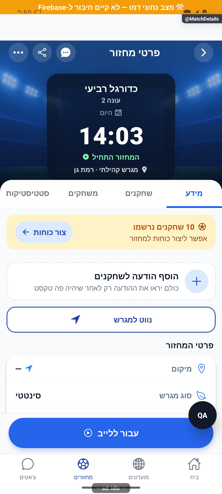
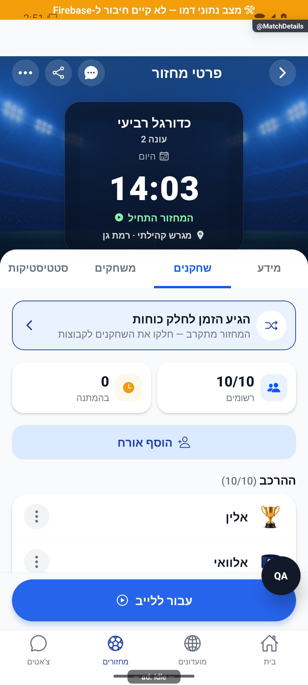
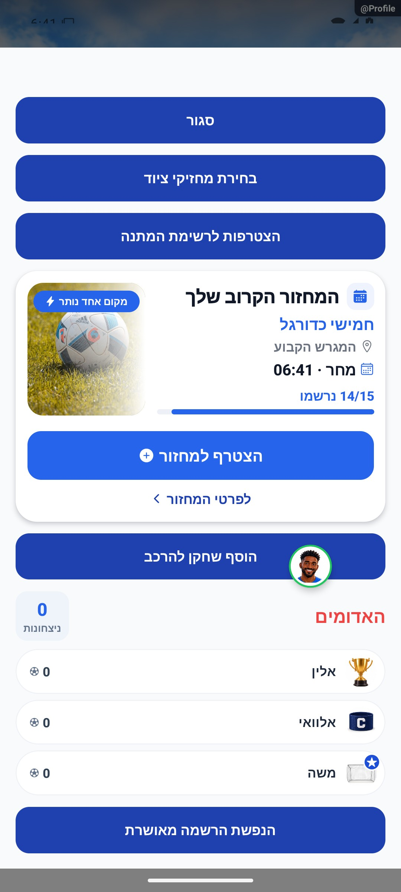

# הרשמה, המתנה ואישור מקום — הסבר פשוט

## הרחבת אבחון דיווחים, 27.10.2026

הדיווחים יוכלו לכלול מה ניסו לבצע, מה היה מצב האפליקציה ומה החזיר השרת. פרטים חסרים מוצגים כלא ידועים, ומספר מוגבל של מופעים נשמר בלי למחוק את המופע הראשון. השינוי מקומי וטרם הופץ, ואינו משלים פרטים לדיווחים ישנים. [היקף, ראיות ומגבלות](../../changes/2026-10-27-diagnostic-context.md).

בדיקות הקוד הושלמו, אך השינוי עדיין מקומי ולא הופץ. פרטים שלא נאספו בדיווחים ישנים אינם משוחזרים בדיעבד.

## הפצה פנימית 1.1.61 - 25.10.2026

הבינארי `1.1.61/295` הופץ ואומת במסלול הפנימי באנדרואיד. תיקוני הלקוח נכללים בו, ושירות הפרופיל נפרס ואומת בנפרד. גם תיקוני הסגל, שמירת התוצאה והתראת השגיאה בשרת נפרסו ואומתו באישור מפורש. שינויי יישום הפולס עצמו טרם הופצו. אין שינוי כללי הרשאה או הסבת נתונים. ניסוחי המצב המקומי בסעיפים הקודמים נכתבו לפני ההפצה; [דוח ההפצה](../../changes/2026-10-25-internal-1.1.61.md) מפרט בדיוק מה נכלל, מה נבדק ומה עדיין מקומי.

## תיקוני הפולס - 25.10.2026

נבדק תיקון ממוקד בקובץ משותף במהלך סבב הפולס. אין שינוי מכוון בתהליך העצמאי המתואר כאן ואין טענה לבדיקת מסך חדשה שלו. מקומי וטרם הופץ.

[מקורות, בדיקות, צילומים ומגבלות](../../changes/2026-10-25-pulse-fixes.md).

## שעון מדויק וכיתוב פנדל - 25.10.2026

במקורות המשותפים נוסף שימור השעון המדויק של פנדל במהלך משחק, וכיתוב ההבקעה ביומן קוצר. אין שינוי במונים או בתהליך העצמאי המתואר כאן; לא נערכה לו בדיקת ממשק חדשה במסגרת העדכון. השינוי מקומי וטרם הופץ. [פרטים וראיות](../../changes/2026-10-25-in-play-penalties.md#שעון-מדויק-וכיתוב-אירוע).

## פנדל במהלך משחק חי - 25.10.2026

עודכנו מקורות משותפים לצורך פנדלים במהלך משחק. אין שינוי מכוון בתהליך העצמאי המתואר במסמך הזה, ולא נערכה לו בדיקת ממשק חדשה במסגרת המשימה.

השינוי מקומי. נדרשת פריסת שרת לפני הפצת לקוח שמשתמש באפשרות; לא בוצעו פריסה או שינוי הרשאות. [חוזה הנתונים, התהליך, הבדיקות ומגבלות ההפצה](../../changes/2026-10-25-in-play-penalties.md).

## חזרה מארון התארים לכרטיס המקורי — 24.10.2026

לערימת הניווט המשותפת נוסף רישום מקומי של ארון התארים, כדי שחזרה מכרטיס שחקן לא תחליף לשונית. אין שינוי מכוון בהתנהגות העצמאית המתוארת כאן, ואין בדיקת ממשק חדשה שלה. התיקון מקומי ולא הופץ. [מסלול הניווט, בדיקות, צילומים ומגבלות](../../changes/2026-10-24-cabinet-back.md).

## פריסת שיפור ההרשמה — 24.10.2026

עדכון השרת שנועד לקצר את ההמתנה לשיבוץ נפרס ואומת. בקשות הרשמה מטופלות ישירות, תוך שמירת חלון ההוגנות וסדר הקדימות הקיימים. אין צורך בעדכון האפליקציה לשינוי הזה; זמן הרשמה חדש לאחר הפריסה עדיין לא נמדד.

[היקף הפריסה, ראיות ומגבלות](../../changes/2026-10-24-join-speed-deployment.md). סעיף זה מחליף את מצב טרם הפריסה של תיקון השרת בסעיף הטיפול בפולס למטה; שינויים מקומיים אחרים המתוארים במסמך לא הופצו במסגרת זו.

## קיצור טעינה ומניעת קריאות כפולות — 23.10.2026

מסכי המחזורים טוענים את המידע פעם אחת בכל כניסה במקום פעמיים במקביל. תהליך ההרשמה, ההמתנה ואישור המקום נשאר כפי שהיה. השינוי מקומי וטרם הופץ.

[בדיקות, צילומים ומגבלות](../../changes/2026-10-23-screen-loading.md).

## תלויות משותפות — 23.10.2026

מונה הבקשות המשותף אינו טוען בקשות עבור אורח ואינו מקבל תשובה מאוחרת מחשבון קודם. התיקון מקומי וטרם הופץ.

## תיעוד כשלים — 20.10.2026

נוסף תיעוד אוטומטי לנקודות כשל במסלול הזה, עם מקור התקלה. הפעולה המקורית שומרת על ערכי החזרה והודעות השגיאה שלה. השינוי מקומי, טרם הופץ, ואין אימות מסירה חיה לפולס.

[דוח דיווח השגיאות והראיות](../../changes/2026-10-20-error-reporting-audit.md).

## פריסת שרת מאושרת — 17.10.2026

שירותי קליטת בקשות ההצטרפות עודכנו. השרת אוסף בקשות במשך כחצי שנייה ומכריע לפי זמן הלחיצה; התצוגה המקדימה במכשיר אינה הבטחה למקום. [מצב הפריסה והראיות](../../changes/2026-10-17-server-preparation.md)

נרשמים למחזור ומקבלים מקום בהרכב, מקום בהמתנה או בקשה לאישור המנהל. אם מקום מתפנה, אפשר לקבל הצעה ולאשר אותה בזמן שהוגדר. עצם ההרשמה אינה אומרת שהמשתמש השתתף בפועל.

חסימת הרשמה חדשה משאירה את הרשומים ואת הממתינים במקומם. מי שכבר ממתין וקיבל הצעת מקום תקפה יכול לאשר אותה גם כשההרשמה חסומה; אי אפשר לאשר הצעה בשם אדם אחר. השרת בודק שהמקום עדיין פנוי ואישור חוזר אינו רושם פעמיים.

עדכון 10.10.2026: התנאים נבדקו בקוד מבודד; הפונקציה החדשה צריכה להיפרס לפני הפצת הלקוח. לא אושר מקום אמיתי ממכשיר בסבב זה.

[להסבר המעמיק ולמפת הקוד](registration.md)

## צילום והיקף ההוכחה

הצילומים מציגים רק את המצבים המתועדים במסמך המעמיק. חלקם נתוני דמו, חלקם הוכחות מתיקון קודם, ובכמה מהם טעינה או הודעת הגנה; הם אינם אישור שכל התהליך או השרת נבדקו.

## השלמת הנפשות — 8.10.2026

אחרי הרשמה מאושרת תמונת המשתמש נעה בקצרה על המסך. ההמתנה מציגה את המיקום בתור בהרחבה עדינה; היא אינה אישור למקום בהרכב.

[פרטי האימות והמגבלות](../../changes/2026-10-08-motion-completion.md). מקור: `9ec0dfd` עם שינויים מקומיים; טרם פורסמה גרסה.

## תזמון חוזר — 10.10.2026

סגירת הרשמה עד למועד חדש שומרת על הרשומים ורשימת ההמתנה. הוכן טיפול לשימור הצעת מקום קיימת; ביטול עצמי בזמן הסגירה עדיין ממתין לאישור הרשאה מצומצמת, ולכן אינו מוצג כאן כתיקון שהושלם או פורסם.

## תלות בעדכון העונות — 19.10.2026

קובץ תשתית משותף עודכן במסגרת העונות. שינוי זה אינו מוסיף פעולה חדשה למסך המתואר כאן; פרטי העונות והבדיקות מופיעים במסמך העונות.

[מצב המימוש, הבדיקות ומגבלות האימות של העונות](../clubs/seasons.md). מקומי בלבד; לא בוצעה פריסה במסגרת המשימה.

## תלות במידע על סגירת עונה — 23.10.2026

נוסף מידע משותף שמאפשר להסביר מדוע עונה מתעכבת בסגירה. אין שינוי נוסף בפעולות המתוארות כאן; השינוי מקומי וטרם הופץ. [המסלול, הבדיקות והמגבלות](../../changes/2026-10-23-season-automatic-recovery.md).

## תלות בשמירת צבעי המחזור — 24.10.2026

שמירת המידע המשותפת עודכנה כדי להעביר את צבעי הקבוצות ממסכי הכוחות להכנה וללייב. אין תוספת פעולה במסך הזה, והוא לא נבדק מחדש במכשיר במסגרת התוספת. השינוי מקומי וטרם הופץ. [פרטי התוספת ומגבלות הבדיקה](../rounds/draft-setup.md#צבעים-לפני-שיבוץ-ובכל-שיטת-חלוקה--24102026).

## טיפול בפולס — 24.10.2026

טופלה מקומית המתנה מיותרת בדרך לשיבוץ בהרשמה. התיקון דורש הפצת שרת; מהירות חדשה עדיין לא נמדדה בשירות הפעיל.

[פירוט התיקונים, הבדיקות והמגבלות](../../changes/2026-10-24-pulse-current.md). התיקונים מקומיים וטרם הופצו.
## רשימת השחקנים נטענת פעם אחת - 25.10.2026

בפתיחת סגל המחזור נמנעת בקשת נתונים כפולה. הרענון אחרי שינוי הרשמה נשמר, ותשובה ישנה אינה דורסת רשימה עדכנית. אין שינוי בתנאי ההרשמה או בתור ההמתנה. מקומי וטרם הופץ; [בדיקות ומגבלות](../../changes/2026-10-24-loading-performance.md).

## תלות בניווט עריכת קבוצות - 25.10.2026

נבדק השינוי הממוקד במקורות המשותפים: `src/navigation/GameStack.tsx`. נוסף מעבר מתפריט הלייב לחלוקת הכוחות עם שימור מפתח מסך המקור. אין שינוי נוסף בתהליך העצמאי המתואר כאן ולא נערכה לו בדיקת מסך חדשה. [היקף, בדיקות ומגבלות](../../changes/2026-10-25-live-draft-entry.md).

## תאימות לשמירת פקודת רכיב הבית - 25.10.2026

נוספה הגנה פנימית מפני ביצוע חוזר של פעולת רכיב הבית. התהליך המתואר בעמוד זה לא השתנה במכוון, ונתונים ישנים נשארים נתמכים. התיקון מקומי וטרם הופץ. [מקור הבדיקה והמגבלות](../../changes/2026-10-25-widget-completion.md).

## השפעת תיקוני השיחה והחזרה, 27.10.2026

נבדק ההבדל במסך פרטי המחזור: יעד החזרה כשאין היסטוריה נבחר מרישומי המחסנית הנוכחית. ההרשמה, ההמתנה והאישור לא שונו. אין בדיקת מכשיר חדשה. [בדיקות וגבולות](match-details.md#חזרה-ממחזור-ללא-היסטוריית-ניווט-27102026).
