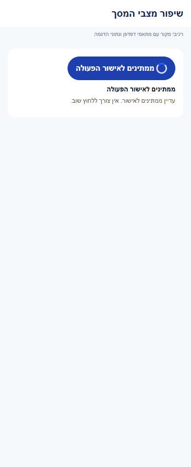
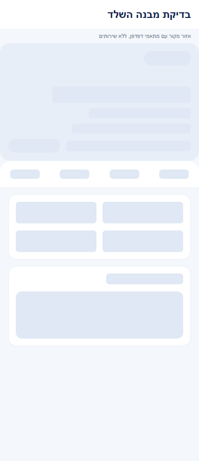
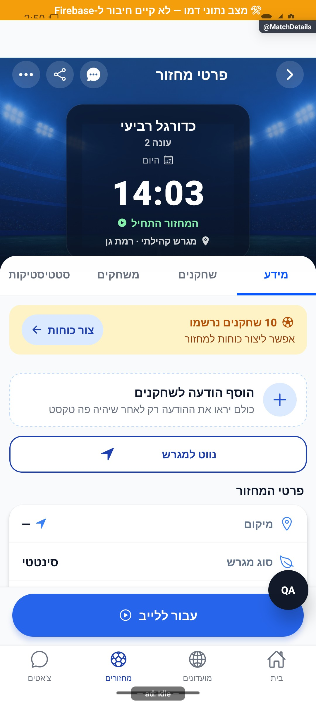
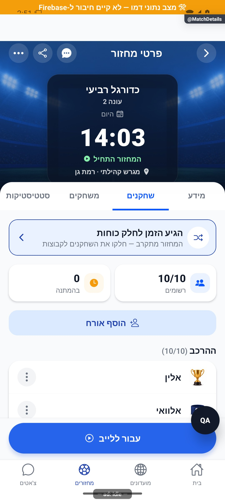
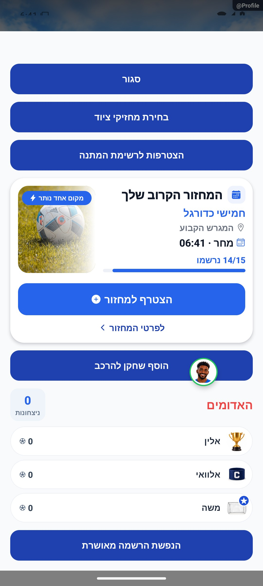

# הרשמה, המתנה ואישור מקום — הסבר פשוט

## דירוג בסיס לשחקן ללא דירוג, 6.11.2026

נבדק שינוי תחום במקורות המשותפים של הכוחות האוטומטיים: שחקן ללא דירוג מחושב כ-2.5 מתוך 5, וההסברים תואמים. דירוג מפורש נשמר. אין כאן אימות חדש של כל מצבי הפיצר העצמאי; השינוי מקומי וטרם הופץ. [ההתנהגות, הבדיקות ומגבלות האימות](../rounds/draft-setup.md#דירוג-בסיס-לשחקן-ללא-דירוג-6112026).

## מדידת פעולות ואמינות נתונים, 5.11.2026

נוספה הכנה למדידת הפעולות ברכיבים המתועדים כאן. בפולס אפשר לראות ביצועים וחשבונות ייחודיים לפי פעולה ותקופה, כאשר קיים כיסוי מדידה. איסוף החשבונות החדש עדיין כבוי והמימוש מקומי. [פירוט והיקף הבדיקות](../../audits/2026-11-04-system-night/product-measurement.md).

## הרשמה חוזרת והצעת מקום, 4.11.2026

אם לחצת על הרשמה שוב בזמן שהבקשה כבר מחכה, גם מטלפון אחר, נשמר המקום לפי הלחיצה הראשונה. אחרי שיצאת אפשר להירשם מחדש. כשפג הזמן של הצעה מרשימת ההמתנה, אי אפשר לאשר אותה באיחור גם אם התור עוד לא התקדם. התיקון נבדק מקומית. [תוצאות הבדיקות](../../audits/2026-11-04-system-night/registration.md).

הצטרפות מהתראה נספרת פעם אחת כשהשרת מאשר שנוספה הרשמה. בקשת השלמה נמדדת בנפרד. אם הביטול שלך כבר נקלט, לחיצה חוזרת אינה משנה את המחזור.

## רישום רגיל אחרי בקשת השלמה, 4.11.2026

אם שחקן שהגיש בקשה מבחוץ נרשם בדרך הרגילה או נכנס להמתנה, הבקשה הקודמת מפסיקה להופיע למנהל. אין החלטה שנייה עבור אותו מקום. מקומי וטרם הופץ. [הראיות והמגבלות](../../changes/2026-11-04-filler-requests.md) · [דרכי הכניסה וההמלצות](../../specs/2026-11-04-outside-round-players.md).

## התאמה למסך ולגופן, 4.11.2026

ברשימת המחזורים שממנה נכנסים להרשמה, מונה הבקשות גדל לפי הכיתוב והמסננים יכולים לרדת לשורה נוספת. [פרטי השינוי](games-list.simple.md).

## ציר פעילות פרטי בפולס, 4.11.2026

בציר הפעילות, תשובת שרת על מצב הרשמה קיים אינה נספרת כהרשמה חדשה. קבלה ללא סימון יצירה מפורש מוצגת עם מגבלת אמינות.

נוסף תיעוד פרטי של ביקורים ופעילות במערכת הניהול. התוספת מקומית והאיסוף החדש כבוי כברירת מחדל; אין בדיקת מכשיר חדשה של מסך זה. מקומי וטרם הופץ או נפרס. [היקף, מקורות, בדיקות ומגבלות](../shared/usage-activity.md).

## שיפורי טעינה משותפים, 4.11.2026

עודכנו מנגנוני הטעינה המשותפים כדי לצמצם עבודה וקריאות חוזרות. דרך השימוש בפיצר נשמרת. השינוי מקומי וטרם הופץ, ואין אימות מכשיר חדש של המסך הזה. [היקף, מדידות ומגבלות](../../changes/2026-11-04-screen-performance.md).

## הפצה פנימית 1.1.74, 3.11.2026

עדכוני הלקוח הנוגעים לטעינה ולחיווי, במקורות המשותפים המשויכים למסמך הזה, כלולים בגרסת האנדרואיד הפנימית 1.1.74/306. החבילה ומסלול החנות אומתו; האימות החזותי נשאר בצילומי הדפדפן של סבבי המימוש, ואין אימות התקנה במכשיר. [תכולה, בדיקות ומגבלות](../../changes/2026-11-03-internal-1.1.74.md).

## מצבים ריקים והמשכיות פעולה, 3.11.2026

בזמן המתנה ארוכה לאישור הרשמה מופיע הסבר שאין צורך ללחוץ שוב. הצלחה ממשיכה להיות תלויה בתוצאת הפעולה. המימוש מקומי וטרם הופץ. האימות החזותי נעשה באזורים מהמקור בדפדפן בלבד. [התנהגות, בדיקות ומגבלות](../../changes/2026-11-03-experience-followup.md).

תוצאות האימות בסבב זה: כל 6864 הבדיקות ב-614 חבילות ובדיקת הטיפוסים עברו. בדיקות המצבים הממוקדות עברו ב-83 מקרים. נבדקו 72 פריסות של אזורי מקור בדפדפן, ונבדקה כיווניות בצילומים. אין אימות מכשיר או שירות חי חדש.

## התאמת מבנה שלדי הטעינה, 3.11.2026

השלד הותאם למבנה התוכן, כולל מיקום התמונות, האזורים והריווח. אין שינוי בנתונים או בפעולות המסך. השינוי מקומי וטרם הופץ. נבדקו אזורי מקור בדפדפן בשלושה רוחבים, ללא בדיקת מכשיר חדשה. [המידות, הבדיקות והמגבלות](../../changes/2026-11-03-skeleton-layout-alignment.md).

כל 6,820 הבדיקות ובדיקת הטיפוסים עברו. האימות החזותי במשימה זו הוא בדפדפן בלבד.

## העברת אורח לרשימת המתנה, 3.11.2026

מנהל יכול להעביר אורח שכבר בהרכב לרשימת ההמתנה באמצעות חץ מטה בשורת האורח. האורח עובר לסוף התור ושומר את שמו ודירוגו; מוני ההרכב וההמתנה מתעדכנים. חבר רגיל אינו מקבל את הפעולה. נבדק במסך המקורי עם נתוני הדגמה בלבד. התיקון מקומי וטרם הופץ, ונדרש גם עדכון שרת לפני הפעלתו למשתמשים.

[בדיקות, צילומים ומגבלות](../../changes/2026-11-03-guest-waitlist.md).

## חלון התנגשות נשאר פתוח בזמן פעולה, 3.11.2026

כשמבטלים הרשמה למחזור אחר כדי לפתור התנגשות, החלון נשאר פתוח עד סיום הפעולה. גם חזרת המכשיר ולחיצה ברקע אינן מסתירות את ההמתנה, ולחיצה כפולה אינה מפעילה את הביטול שוב. כשל מאפשר לנסות שוב בלי לסגור את החלון.

נבדקו רכיב המקור והתנהגות חזרת אנדרואיד במארח מקומי בלבד, בלי לבטל הרשמה או להצטרף למחזור. השינוי מקומי וטרם הופץ. [התנהגות, בדיקות ומגבלות](registration.md).

## ליטוש מקומי והשפעת רכיבים, 3.11.2026

השיפור ברכיבים המשותפים המשמשים את הרשמה, המתנה ואישור מקום כולל נעילה והסכמה בחלון פעולה רגישה, חלופת שם לתמונה שנכשלה, מלל כהה יותר בכפתור אזהרה. אין שינוי בנתוני המחזור, בקיבולת או בהרשאות הפעולה. הבדיקה הממוקדת של רכיבי המקור אינה בדיקה חדשה של המסך המלא במכשיר.

[הראיות והמגבלות של המשימה](../../changes/2026-11-03-overnight-mission.md).

## בדיקת קצה ואימות מקורי, 2.11.2026

נבדקה השפעת תיקוני ההמשכיות במקור המשותף ובבדיקות. ההתנהגות העצמאית והחישובים של הפיצר נשמרו. מקומי וטרם הופץ. [שחזור, תיקונים, בדיקות ומגבלות](../../changes/2026-11-02-experience-review.md).

## המשכיות ומשוב בשימוש, 2.11.2026

בעת הרשמה מופיעה תווית עם מחוון. אחרי תשובת השרת מתקבל אישור בכפתור, עם הבחנה בין הרשמה, המתנה ובקשה לאישור. תשובה מאוחרת לאחר מעבר מסך אינה מציגה הצלחה. מימוש מקומי שטרם הופץ. [התנהגות, בדיקות, צילומים ומגבלות](../../changes/2026-11-02-experience-polish.md).

## הרחבת שלדי הטעינה, 2.11.2026

נבדקה השפעת הרחבת שלדי הטעינה במקור משותף. אין שינוי בפעולות או בחישובים העצמאיים של הפיצר הזה. מימוש מקומי שטרם הופץ. [התנהגות, בדיקות, צילומים ומגבלות](../../changes/2026-11-02-loading-skeletons-expanded.md).

## טיפול בפולס, 2.11.2026

לאחר הרשמה או ביטול, תשובת טעינה שהתחילה קודם אינה מחזירה את הסגל הישן למסך. גם עדכון חי חדש מוגן מדריסה על ידי קריאה קודמת. התיקון מקומי וטרם הופץ; לא בוצעה הרשמה בחשבון אמיתי.

[דוח הטיפול, הבדיקות והמגבלות](../../changes/2026-11-02-pulse-sweep.md).

## בקשות לשיחה אישית, 2.11.2026

נבדקה השפעת תוספת בקשות השיחה במקורות המשותפים. השינוי ממוקד בהרשאת שיחה, בשדות פרטיות ההודעות ובחיבורי הבדיקות; אין מכך אימות חדש של מסך זה במכשיר. המימוש מקומי וטרם הופץ או נפרס. [התנהגות, בדיקות ומגבלות](../chat/message-requests.md).

## החלפת הקבוצה הבועטת בפנדלים, 30.10.2026

בפנדלי ההכרעה נוספה אפשרות לבחור את הקבוצה שבועטת כעת, בלי למחוק את הבעיטות הקודמות. זהו עדכון תחום במקורות משותפים; אין שינוי מתוכנן במסך המתואר כאן ואין אימות מכשיר חדש שלו. [התנהגות, בדיקות ומגבלות](../../changes/2026-10-30-shootout-turn.md).

## שגיאות אייפון שנקלטו בסיום, 28.10.2026

בחירת חלופת הניווט נבדקת לפי מערכת ההפעלה של הטלפון. בדיקת הטיפוסים עברה אחרי השלמת תלות הפלטפורמה.

תוקנה חלופת הניווט באייפון במקור המסך המשותף. התיקון אינו משנה את פעולת ההרשמה ואינו פותר את אירוע ההרשמה ההיסטורי שנשאר לבדיקה.

[מקור, בדיקות ומגבלות](../../changes/2026-10-28-pulse-errors.md). תיקון מקומי וטרם הופץ.

## הרחבת אבחון דיווחים, 27.10.2026

הדיווחים יוכלו לכלול מה ניסו לבצע, מה היה מצב האפליקציה ומה החזיר השרת. פרטים חסרים מוצגים כלא ידועים, ומספר מוגבל של מופעים נשמר בלי למחוק את המופע הראשון. השינוי מקומי וטרם הופץ, ואינו משלים פרטים לדיווחים ישנים. [היקף, ראיות ומגבלות](../../changes/2026-10-27-diagnostic-context.md).

בדיקות הקוד הושלמו, אך השינוי עדיין מקומי ולא הופץ. פרטים שלא נאספו בדיווחים ישנים אינם משוחזרים בדיעבד.

## הפצה פנימית 1.1.61 - 25.10.2026

הבינארי `1.1.61/295` הופץ ואומת במסלול הפנימי באנדרואיד. תיקוני הלקוח נכללים בו, ושירות הפרופיל נפרס ואומת בנפרד. גם תיקוני הסגל, שמירת התוצאה והתראת השגיאה בשרת נפרסו ואומתו באישור מפורש. שינויי יישום הפולס עצמו טרם הופצו. אין שינוי כללי הרשאה או הסבת נתונים. ניסוחי המצב המקומי בסעיפים הקודמים נכתבו לפני ההפצה; [דוח ההפצה](../../changes/2026-10-25-internal-1.1.61.md) מפרט בדיוק מה נכלל, מה נבדק ומה עדיין מקומי.

## תיקוני הפולס - 25.10.2026

נבדק תיקון ממוקד בקובץ משותף במהלך סבב הפולס. אין שינוי מכוון בתהליך העצמאי המתואר כאן ואין טענה לבדיקת מסך חדשה שלו. מקומי וטרם הופץ.

[מקורות, בדיקות, צילומים ומגבלות](../../changes/2026-10-25-pulse-fixes.md).

## שעון מדויק וכיתוב פנדל - 25.10.2026

במקורות המשותפים נוסף שימור השעון המדויק של פנדל במהלך משחק, וכיתוב ההבקעה ביומן קוצר. אין שינוי במונים או בתהליך העצמאי המתואר כאן; לא נערכה לו בדיקת ממשק חדשה במסגרת העדכון. השינוי מקומי וטרם הופץ. [פרטים וראיות](../../changes/2026-10-25-in-play-penalties.md#שעון-מדויק-וכיתוב-אירוע).

## פנדל במהלך משחק חי - 25.10.2026

עודכנו מקורות משותפים לצורך פנדלים במהלך משחק. אין שינוי מכוון בתהליך העצמאי המתואר במסמך הזה, ולא נערכה לו בדיקת ממשק חדשה במסגרת המשימה.

השינוי מקומי. נדרשת פריסת שרת לפני הפצת לקוח שמשתמש באפשרות; לא בוצעו פריסה או שינוי הרשאות. [חוזה הנתונים, התהליך, הבדיקות ומגבלות ההפצה](../../changes/2026-10-25-in-play-penalties.md).

## חזרה מארון התארים לכרטיס המקורי — 24.10.2026

לערימת הניווט המשותפת נוסף רישום מקומי של ארון התארים, כדי שחזרה מכרטיס שחקן לא תחליף לשונית. אין שינוי מכוון בהתנהגות העצמאית המתוארת כאן, ואין בדיקת ממשק חדשה שלה. התיקון מקומי ולא הופץ. [מסלול הניווט, בדיקות, צילומים ומגבלות](../../changes/2026-10-24-cabinet-back.md).

## פריסת שיפור ההרשמה — 24.10.2026

עדכון השרת שנועד לקצר את ההמתנה לשיבוץ נפרס ואומת. בקשות הרשמה מטופלות ישירות, תוך שמירת חלון ההוגנות וסדר הקדימות הקיימים. אין צורך בעדכון האפליקציה לשינוי הזה; זמן הרשמה חדש לאחר הפריסה עדיין לא נמדד.

[היקף הפריסה, ראיות ומגבלות](../../changes/2026-10-24-join-speed-deployment.md). סעיף זה מחליף את מצב טרם הפריסה של תיקון השרת בסעיף הטיפול בפולס למטה; שינויים מקומיים אחרים המתוארים במסמך לא הופצו במסגרת זו.

## קיצור טעינה ומניעת קריאות כפולות — 23.10.2026

מסכי המחזורים טוענים את המידע פעם אחת בכל כניסה במקום פעמיים במקביל. תהליך ההרשמה, ההמתנה ואישור המקום נשאר כפי שהיה. השינוי מקומי וטרם הופץ.

[בדיקות, צילומים ומגבלות](../../changes/2026-10-23-screen-loading.md).

## תלויות משותפות — 23.10.2026

מונה הבקשות המשותף אינו טוען בקשות עבור אורח ואינו מקבל תשובה מאוחרת מחשבון קודם. התיקון מקומי וטרם הופץ.

## תיעוד כשלים — 20.10.2026

נוסף תיעוד אוטומטי לנקודות כשל במסלול הזה, עם מקור התקלה. הפעולה המקורית שומרת על ערכי החזרה והודעות השגיאה שלה. השינוי מקומי, טרם הופץ, ואין אימות מסירה חיה לפולס.

[דוח דיווח השגיאות והראיות](../../changes/2026-10-20-error-reporting-audit.md).

## פריסת שרת מאושרת — 17.10.2026

שירותי קליטת בקשות ההצטרפות עודכנו. השרת אוסף בקשות במשך כחצי שנייה ומכריע לפי זמן הלחיצה; התצוגה המקדימה במכשיר אינה הבטחה למקום. [מצב הפריסה והראיות](../../changes/2026-10-17-server-preparation.md)

נרשמים למחזור ומקבלים מקום בהרכב, מקום בהמתנה או בקשה לאישור המנהל. אם מקום מתפנה, אפשר לקבל הצעה ולאשר אותה בזמן שהוגדר. עצם ההרשמה אינה אומרת שהמשתמש השתתף בפועל.

חסימת הרשמה חדשה משאירה את הרשומים ואת הממתינים במקומם. מי שכבר ממתין וקיבל הצעת מקום תקפה יכול לאשר אותה גם כשההרשמה חסומה; אי אפשר לאשר הצעה בשם אדם אחר. השרת בודק שהמקום עדיין פנוי ואישור חוזר אינו רושם פעמיים.

עדכון 10.10.2026: התנאים נבדקו בקוד מבודד; הפונקציה החדשה צריכה להיפרס לפני הפצת הלקוח. לא אושר מקום אמיתי ממכשיר בסבב זה.

[להסבר המעמיק ולמפת הקוד](registration.md)

## צילום והיקף ההוכחה

הצילומים מציגים רק את המצבים המתועדים במסמך המעמיק. חלקם נתוני דמו, חלקם הוכחות מתיקון קודם, ובכמה מהם טעינה או הודעת הגנה; הם אינם אישור שכל התהליך או השרת נבדקו.

## השלמת הנפשות — 8.10.2026

אחרי הרשמה מאושרת תמונת המשתמש נעה בקצרה על המסך. ההמתנה מציגה את המיקום בתור בהרחבה עדינה; היא אינה אישור למקום בהרכב.

[פרטי האימות והמגבלות](../../changes/2026-10-08-motion-completion.md). מקור: `9ec0dfd` עם שינויים מקומיים; טרם פורסמה גרסה.

## תזמון חוזר — 10.10.2026

סגירת הרשמה עד למועד חדש שומרת על הרשומים ורשימת ההמתנה. הוכן טיפול לשימור הצעת מקום קיימת; ביטול עצמי בזמן הסגירה עדיין ממתין לאישור הרשאה מצומצמת, ולכן אינו מוצג כאן כתיקון שהושלם או פורסם.

## תלות בעדכון העונות — 19.10.2026

קובץ תשתית משותף עודכן במסגרת העונות. שינוי זה אינו מוסיף פעולה חדשה למסך המתואר כאן; פרטי העונות והבדיקות מופיעים במסמך העונות.

[מצב המימוש, הבדיקות ומגבלות האימות של העונות](../clubs/seasons.md). מקומי בלבד; לא בוצעה פריסה במסגרת המשימה.

## תלות במידע על סגירת עונה — 23.10.2026

נוסף מידע משותף שמאפשר להסביר מדוע עונה מתעכבת בסגירה. אין שינוי נוסף בפעולות המתוארות כאן; השינוי מקומי וטרם הופץ. [המסלול, הבדיקות והמגבלות](../../changes/2026-10-23-season-automatic-recovery.md).

## תלות בשמירת צבעי המחזור — 24.10.2026

שמירת המידע המשותפת עודכנה כדי להעביר את צבעי הקבוצות ממסכי הכוחות להכנה וללייב. אין תוספת פעולה במסך הזה, והוא לא נבדק מחדש במכשיר במסגרת התוספת. השינוי מקומי וטרם הופץ. [פרטי התוספת ומגבלות הבדיקה](../rounds/draft-setup.md#צבעים-לפני-שיבוץ-ובכל-שיטת-חלוקה--24102026).

## טיפול בפולס — 24.10.2026

טופלה מקומית המתנה מיותרת בדרך לשיבוץ בהרשמה. התיקון דורש הפצת שרת; מהירות חדשה עדיין לא נמדדה בשירות הפעיל.

[פירוט התיקונים, הבדיקות והמגבלות](../../changes/2026-10-24-pulse-current.md). התיקונים מקומיים וטרם הופצו.
## רשימת השחקנים נטענת פעם אחת - 25.10.2026

בפתיחת סגל המחזור נמנעת בקשת נתונים כפולה. הרענון אחרי שינוי הרשמה נשמר, ותשובה ישנה אינה דורסת רשימה עדכנית. אין שינוי בתנאי ההרשמה או בתור ההמתנה. מקומי וטרם הופץ; [בדיקות ומגבלות](../../changes/2026-10-24-loading-performance.md).

## תלות בניווט עריכת קבוצות - 25.10.2026

נבדק השינוי הממוקד במקורות המשותפים: `src/navigation/GameStack.tsx`. נוסף מעבר מתפריט הלייב לחלוקת הכוחות עם שימור מפתח מסך המקור. אין שינוי נוסף בתהליך העצמאי המתואר כאן ולא נערכה לו בדיקת מסך חדשה. [היקף, בדיקות ומגבלות](../../changes/2026-10-25-live-draft-entry.md).

## תאימות לשמירת פקודת רכיב הבית - 25.10.2026

נוספה הגנה פנימית מפני ביצוע חוזר של פעולת רכיב הבית. התהליך המתואר בעמוד זה לא השתנה במכוון, ונתונים ישנים נשארים נתמכים. התיקון מקומי וטרם הופץ. [מקור הבדיקה והמגבלות](../../changes/2026-10-25-widget-completion.md).

## השפעת תיקוני השיחה והחזרה, 27.10.2026

נבדק ההבדל במסך פרטי המחזור: יעד החזרה כשאין היסטוריה נבחר מרישומי המחסנית הנוכחית. ההרשמה, ההמתנה והאישור לא שונו. אין בדיקת מכשיר חדשה. [בדיקות וגבולות](match-details.md#חזרה-ממחזור-ללא-היסטוריית-ניווט-27102026).

## שלמות החלוקה המתוזמנת, 29.10.2026

במקורות המשותפים תוקנה שמירת חלוקה מתוזמנת לשש ולשבע קבוצות וסוננו אורחים שממתינים. דרך חישוב האיזון נשמרה. אין שינוי מכוון בפעולות העצמאיות המתוארות בעמוד זה ואין אימות מסך חדש שלהן; השינוי מקומי וטרם הופץ.

[היקף, בדיקות, פערים פתוחים ומגבלות](../../changes/2026-10-29-scheduled-balance-integrity.md).

## איזון ופיזור רמות לפני גיוון, 30.10.2026

עודכן החישוב המשותף של חלוקת כוחות לפי הדירוג הכללי: איזון הממוצעים קודם לפיזור הרמות, והגיוון מכריע אחרי שניהם. אין שינוי מכוון במבנה המסך או בפעולות העצמאיות המתוארות כאן, ואין אימות מכשיר חדש שלהן. השינוי מקומי וטרם הופץ או נפרס.

[מימוש, נוסחאות, בדיקות ומגבלות](../../changes/2026-10-30-rating-balance-priority.md).

## אימות כשלים בקבלת פרסום, 2.11.2026

בבדיקת אישור פרסום הקבוצות, כשל שלא ניתן לאמת כהצלחה נשאר כשל גלוי ונשמר באבחון. הבדיקה אינה שולחת הודעות שוב ואינה משנה הרשאות. השינוי תחום לשירות המשותף, מקומי וטרם הופץ.

[דוח הטיפול והראיות](../../changes/2026-11-02-pulse-sweep.md).

## הכנת נתוני בדיקות ההרשאות, 3.11.2026

תוקנה הכנת נתונים בבדיקה מקומית, כך שאותו חיבור מסד משמש את שתי פעולות ההכנה. כל 360 בדיקות ההרשאות עברו בסדרה. זהו תיקון תשתית בדיקה בלבד; כללי ההרשאות והתנהגות ההרשמה במוצר לא שונו או נפרסו.

[ראיות וגבולות הבדיקה](registration.md#הכנת-נתוני-בדיקות-ההרשאות-3112026).

## תיקו בשתיים או בשלוש קבוצות, 6.11.2026

נבדק שינוי תחום במקורות המשותפים `src/services/gameService.ts`, `src/types/index.ts`: נוסף מסלול סיום משחק בתיקו בשתיים או בשלוש קבוצות, עם בחירה ידנית של הקבוצה שנשארת ושמירה במוני התיקו הקיימים. אין שינוי מכוון בפעולות העצמאיות של הפיצר המתועד כאן. בדיקות המסלול מפעילות שירות לקוח, ממירים וגוף שרת במאגר זיכרון; אין בכך הרצה חדשה של מסך זה. המימוש מקומי, ללא הפצה או פריסת שירות השמירה החדש. [התנהגות, נתונים, בדיקות ומגבלות](../../changes/2026-11-06-manual-draw.md).

## תלות משותפת בציון המחזור החדש, 6.11.2026

נוספה תמיכה מקומית בגרסת ציון למחזורי העתיד ובקריאת הרף הקפוא, תוך שמירת המודל של מחזורים קודמים. השינוי כאן תחום לתלות במקורות המשותפים, ואינו אימות חדש של כל המסלול העצמאי. אין פריסה, הסבת נתונים או שינוי ציוני עבר. [התנהגות, בדיקות ומגבלות](../../changes/2026-11-06-shared-evening-score.md).
