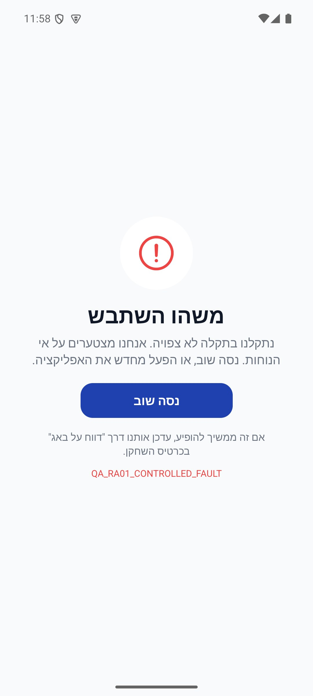

# חלונות מערכת, עדכונים וכשלים

## בדיקות הפולס והגרסה הפנימית 1.1.55 — 17.10.2026

`AppAlertOptions.football` הוא עיצוב מפורש לשתי נקודות הקריאה בלבד. הוא מועבר ל־`DialogRequest`, מציג סמל כדור, עיטור עדין וכפתורי `lg` בערימה; שאר החלוניות שומרות על העיצוב הקיים. `handlePress` סוגר לפני הרצת הפעולה, ולחיצה על הרקע ממשיכה להשתמש ב־`onDismiss`. אין שינוי הרשאות או פעולות מחיקה אוטומטיות.

[ראיות, בדיקות ומגבלות](../../changes/2026-10-17-internal-1.1.55.md).

[הסבר פשוט](global-gates.simple.md) · מסמך טכני מעמיק

עודכן 17.10.2026; מקור `4a3cb346` עם שינויים מקומיים. חלונית העדכון נצפתה באנדרואיד דמו רגיל ובגופן מוגדל; זמינות חנות חיה לא הורצה. הראיות ההיסטוריות לשאר השערים נשמרות בהמשך. לא שונו הגדרות ייצור.

## משטחים ותנאים

| משטח | מקור ותנאי | פעולה והשפעה |
|---|---|---|
| עדכון חובה | עדכון זמין בחנות ומדיניות `minimumSupportedVersion` מחייבת | חסימת שימוש ופתיחת החנות; מינימום אייפון אינו גבוה מהגרסה שפורסמה |
| עדכון אפשרי | גוגל מאשרת גרסת בנייה חדשה לחשבון/מכשיר, או גרסת אפל שפורסמה חדשה מהמותקנת | חלונית בתוך כותרת הבית שאפשר לדחות ליממה לכל יעד |
| תחזוקה | `maintenance_mode` בהגדרות מרוחקות | שכבה מלאה חוסמת; הודעה ניתנת לשינוי מרחוק |
| הודעת מערכת | announcement_enabled וטקסט שאינו ריק | פס עליון, קישור אופציונלי, סגירה מקומית עד להרכבה מחדש |
| מה חדש | `appConfig/whatsNew` | שינויים בטווח הגרסאות שטרם נראה; סימון מקומי אחרי רינדור פעיל |
| הודעה לקהל | `campaigns` פעילים, פילוח ותדירות למשתמש | חלון אחד, פעולה מוגדרת, רישום חשיפה/לחיצה/סגירה |
| שגיאת רינדור | חריגה תחת ErrorBoundary | מסך התאוששות; App.tsx מעביר logRenderError לדיווח |

מקורות: [`App.tsx`](../../../App.tsx), [`updateService.ts`](../../../src/services/updateService.ts), [`RemoteGates.tsx`](../../../src/components/RemoteGates.tsx), [`WhatsNewGate.tsx`](../../../src/components/WhatsNewGate.tsx), [`whatsNewService.ts`](../../../src/services/whatsNewService.ts), [`CampaignGate.tsx`](../../../src/components/CampaignGate.tsx), [`campaignService.ts`](../../../src/services/campaignService.ts), [`ErrorBoundary.tsx`](../../../src/components/ErrorBoundary.tsx).

## חוזים וגבולות

בדיקת חנות שנכשלת מחזירה `null` כדי לא לחסום פתיחה בשל רשת; זו אינה הוכחה שהגרסה עדכנית. מסמך מדיניות חסר אינו מסתיר עדכון זמין שאומת בחנות. שתי החנויות נפתחות תחילה בקישור מקורי, עם גיבוי לכתובת רשת מדויקת. בדמו בדיקת החנות מדולגת.

חלון מה חדש מציג רק גרסאות עד הגרסה המותקנת. ללא בסיס מקומי מציג את הגרסה הנוכחית בלבד; בדמו קיים בסיס מלאכותי. סימון ״נראה״ נשמר אחרי רינדור פעיל. סגירה באמצע עלולה להשאיר פריטים שהמשתמש לא קרא. אם אין תוכן מתאים הזכאות נשמרת לפרסום מאוחר.

חלון קמפיין נטען כשהשער פעיל ולא בזמן שער העדכון; בדיקת הפילוח נעשית בצד הלקוח. אין לבלבל קמפיין חלון עם הודעת דחיפה שנשלחת בשרת. ערכי ברירת המחדל בקוד אינם צילום ההגדרות בפועל של הייצור.

## בדיקות נדרשות

עדכון חובה מול חגיגת הישג; סגירת מה חדש; חלון הודעת מערכת מול הצעת התראות; תחזוקה בזמן מסך חי; הפעלה ללא רשת; כשל רינדור עם ניסיון חוזר. יש לבדוק סדר שכבות בפועל לפני שינוי. אין להפעיל תחזוקה או לשנות מינימום גרסה בייצור כדי לצלם.

## מקום שינוי

תנאי תצוגה משתנים בשירותים וב־App.tsx; מראה החלון ברכיבים. שינוי סדר שערים דורש מעבר על כולם, ולא רק צילום החלון ששונה. שער עדכון מודולרי נקרא גם ממסך הישגים כדי לא להציג חגיגה מעל חסימה.

## מאחורי הקלעים — זרימה וחישובים

### חישוב גרסה

`compareVersions` מסירה סיומת אחרי מקף, מפצלת לנקודות, ממירה כל חלק למספר שלם שאינו שלילי ומשווה חלקים לפי סדר. חלק חסר נחשב 0. לכן `1.1.9 < 1.1.35`, וגם `1.1` שווה ל־`1.1.0`; אין השוואה אלפביתית של מחרוזות.

`checkForUpdate` קוראת את גרסת היישום המקורית ואת `appConfig/{Platform.OS}`. אם `current < minimumSupportedVersion` מוחזר `force`; אחרת אם `current < latestVersion` מוחזר `optional`; אחרת `none`. כשל/מסמך חסר/שדות לא תקינים מחזירים `none` כדי לא לחסום שימוש בגלל תקלה בקריאה. לדוגמה: מותקנת 1.1.27, מינימום 1.1.20 והאחרונה 1.1.35 → הצעה; מינימום 1.1.30 → חובה. זו דוגמת חישוב, לא ערכי ייצור שנקראו.

### מה חדש והודעות לקהל

`resolveWhatsNew` מסננת לגרסאות בתחום `(seen, current]`, ממיינת מהחדשה לישנה ומחזירה רשימה אחת. ללא בסיס קודם נכללת רק הגרסה הנוכחית. `WhatsNewGate` מסמנת את הבסיס אחרי רינדור פעיל. הגדרה חסרה/מושבתת או אפס פריטים אינם מקדמים בסיס; כשל קריאה נזרק למארח לניסיון חוזר אחרי 30 שניות או בחזרה לקדמה. ביטול בקשה בעת מעבר שער אינו צורך זכאות. יש להבחין בין שמירת בסיס לבין הוכחה שהטקסט נקרא.

`getEligiblePopup` ב־`campaignService.ts` מסננת את הודעות החלון לפי חלון פעילות, פילוח ותדירות מקומית, וממיינת מועמדים לפי `createdAt` יורד. הצינון מחושב `cooldownHours × 60 × 60 × 1,000`. `markPopupSeen` מטפלת ברישום מקומי, ואירועי חשיפה/לחיצה/סגירה נשלחים דרך `trackCampaignEvent`. שליחת הודעת דחיפה בשרת היא מסלול נפרד. שערי `App.tsx` קובעים מתי המארחים פעילים; אין לתאר אותם כאוסף חלונות בלתי תלוי.

### התאוששות ונקודת שינוי

`ErrorBoundary` עוטפת רינדור ומקבלת ב־`App.tsx` דיווח `logRenderError`; היא אינה תחליף לטיפול בשגיאה של כל בקשת רשת. שינוי נוסחת גרסה שייך לשירות; שינוי שכבות ותזמון שייך גם ל־`App.tsx` ולרכיבי השערים. הבדיקה המכריעה היא התנגשות חלונות, התחלה ללא רשת ומעבר רקע, בלי שינוי הגדרות ייצור לצורך צילום.

## התאמה למסך — 8.10.2026

המסך והחלונות משתמשים בגבול השטח הבטוח ובמעטפת המקלדת המשותפת. פירוט המדידה, קואורדינטות החלון, מצבי פלטפורמה ומגבלות האימות נמצא ב־[התיעוד המשותף](../shared/menus-and-motion.md#התאמה-לשטח-הבטוח--8102026). מדידות השורש מגינות על השכבות הגלובליות; חלונות שערים שלא נפתחו עדיין מתועדים כבדיקת קוד בלבד.

## צירוף ראיות לשגיאות — 09.10.2026

`errorLog.logError` מקפיא `lastJournal` ו־`lastTrail` ברגע הכשל. שגיאות ממתינות נשמרות מקומית, כולל בזמן בקשת רשת, ומשוחזרות באותו חשבון בלבד. `ErrorUtils` מבקש שמירה לפני העברה למטפל הקודם; אין התחייבות לכיסוי קריסה מקורית של התהליך. אין שינוי בחלונות המערכת או במנגנון הסינון של תקלות רשת. [הארכיטקטורה, המגבלות והבדיקות](diagnostic-journal.md).

## התאוששות בזמן מעבר — 10.10.2026

`ErrorBoundary` נמצאת מחוץ ל־`NavigationContainer`. חריגת רינדור או אפקט נתפסת ב־`getDerivedStateFromError`, תוכן הניווט מוחלף במסך שגיאה, ו־`componentDidCatch` מפעילה דיווח מוגן מכשל. `handleReset` מאפסת את מצב המעטפת רק לאחר לחיצה, ומרכיבה מחדש את הניווט; אין ניסיון חוזר אוטומטי. אין שינוי בזהות החשבון או מחיקת אחסון כחלק מכך.

במסך השגיאה בלבד מורכבת `StatusBar` של React Native עם `barStyle="dark-content"` ורקע `colors.bg`, באותו ממשק שמשמש את שורש היישום. אין שינוי מכוון בשקיפות או בשטח החלון. כך סמלי המערכת יישארו קריאים על הרקע הבהיר גם כשהמסך שקדם לכשל השתמש בסמלים בהירים. שינוי זה אינו משנה את צבעי שורת המצב במסכים רגילים.

ניסוי מבוקר באנדרואיד הוכיח ששגיאת תוכן בזמן מעבר עלולה לגרור כשל הורות מקורי ולמנוע הצגת התאוששות. הטלאי הממוקד למעטפת הסצנה והבדיקות לפני ואחרי מפורטים ב־[ניווט והתאוששות](navigation-dock.md). לאחר הטלאי הופיע מסך התאוששות, ולחיצה על ״נסה שוב״ החזירה לבית באותו תהליך. זו הוכחת תרחיש דמו במעטפת מקומית חדשה עם Fabric/Hermes; אין מכאן הוכחת טריגר קריסה בייצור, אייפון או בינארי חנות.

הטקסט האדום בתחתית הוא שגיאה יזומה בפיתוח; הזרקת השגיאה הוסרה מהמקור לפני סבב הבדיקות הסופי. אין פעולה על נתוני ייצור במהלך הבדיקה.

## הכנת ההפצה — 13.10.2026

תוקנו אובדן זכאות בכשל רשת וביטול בזמן מעבר שער, טיפול בשגיאות אחסון ונראות כשהשער אינו פעיל. פריטים עם גוף או איור שאינם מחרוזת מסוננים. `tests/logic/whatsNewDelivery.test.ts` ו־`whatsNewGateLifecycle.test.tsx` בודקים ניתוק וחיבור, תוכן מאוחר, דילוג גרסאות, ביטול וניסיון חוזר. הסימון מקומי למכשיר ואינו חסין להסרת היישום; לא שונו הרשאות או הגדרות ייצור. [נוסח ותהליך ההפצה](../../changes/2026-10-13-update-launch-plan.md). אין שינוי עיצוב, ואין כאן הוכחת הרצת חלונית התוכן החדש במכשיר.

## חלונית עדכון לפי החנות ומדידת השלמה — 17.10.2026

`checkForUpdate` מחזירה `StoreUpdate|null` עם גרסת ובניית מוצא, יעד, מקור ו־`kind`. תוסף `withStoreUpdate` מעתיק את גשר Kotlin, מוסיף ספריית גוגל ורושם חבילה; באנדרואיד הזכאות נקבעת לפי זמינות לחשבון/מכשיר ומספר בנייה חדש. באייפון Apple Lookup מאמת מספר יישום, חבילה וגרסה ציבורית במדינת הגדרות המכשיר. `appConfig` בוחר חובה בלבד אחרי אישור זמינות; כשל מדיניות משאיר הצעה רגילה. חסר גשר או כשל חנות אינם חוסמים שימוש, ובדמו אין בדיקה חיה.

`applyStoreUpdate` מעדכנת את `useUpdatePromptStore`; `dismissStoreUpdate` שומרת `storeUpdateSnooze:v2` עם יעד וחותמת דחייה ל־24 שעות. מונה שינוי מונע מקריאת אחסון מאוחרת לדרוס חובה או דחייה. `HomeHero` מציג `UpdateBanner` במקום שורת התפריט/אווטאר/פעמון כשההצעה רגילה; הברכה נשמרת. סגירה מחזירה את השורה. חובה נשארת ב־`UpdateModal`; רק היא מדווחת דרך `setUpdateGateOpen` וחוסמת שערים אחרים. אין מסך או נתיב חדש.

`openTrackedUpdate` רושמת לחיצה וקבלה לפני יציאה, פותחת קישור חנות מקורי עם גיבוי רשת, מסמנת פתיחה מוצלחת ומונעת פתיחות מקבילות. `reconcileStoreUpdate` רצה אחרי מסך פתיחה וטעינת זהות; רק חשבון תואם ובינארי חדש שעומד ביעד בתוך 14 יום מפיקים `update_prompt_completed`. פתיחת חנות בלבד אינה השלמה. הקבלה מסומנת לפני שיגור כדי למנוע כפילות מקומית; כלי המדידה הוא המנגנון הקיים ואין כתיבה לאוסף חדש או שינוי הרשאות.

תנאים, פרטי כל ששת האירועים, מכנים למשפך, מסלול הנתונים ומגבלות הייחוס מפורטים ב־[דוח השינוי](../../changes/2026-10-17-store-update-banner.md). מימושי האחסון והמדידה הם `src/store/updatePromptStore.ts` ו־`src/services/updateAttributionService.ts`; ההצעה עצמה ב־`src/components/UpdateBanner.tsx`. בדיקות זמינות, ייחוס, דחייה ותוסף הן `storeUpdateAvailability`, `storeUpdateAttribution`, `storeUpdateSnooze`, `storeUpdatePlugin`. הידור Kotlin מקומי עבר ללא יצירת קובץ התקנה. הרינדור, כשל קישור ודחייה נבדקו בדמו באנדרואיד, כולל רוחב 320 וגופן 1.4. לא נבדקו חנות חיה, קבלת אירועים מרחוק, אייפון או עדכון בינארי אמיתי; הגשר מחייב בנייה עתידית. מדינת חשבון אפל עלולה להיות שונה ממדינת המכשיר, והשיוך מעיד על גרסה חדשה אחרי פתיחת חנות, לא על סיבת הורדה בלעדית.

## הפצה פנימית — 17.10.2026

שינויי הלקוח האחרונים המתועדים כאן נכללו בבינארי הפנימי `1.1.53 / 286` באנדרואיד. המסלול אומת בגוגל; הייצור נשאר בגרסה הקודמת. זה אינו אימות חדש של תרחיש ייצור או של מכשיר אפל. [מקור הבינארי, פריסת השרת, בדיקות ומגבלות](../../changes/2026-10-17-internal-1.1.53.md).

במסך קטן ובגופן מוגדל חלונית הכדורגל מוגבלת לגובה החלון פחות 80 נקודות. התוכן נגלל וכפתורי הפעולה נמצאים מחוץ לגלילה ואינם מתכווצים. נבדק בפועל ברוחב 320 ובגופן 140%, כולל גלילה לסוף הטקסט. שאר חלוניות המערכת אינן משתנות.
