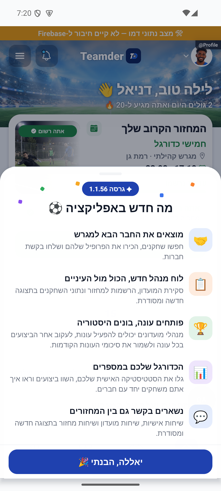
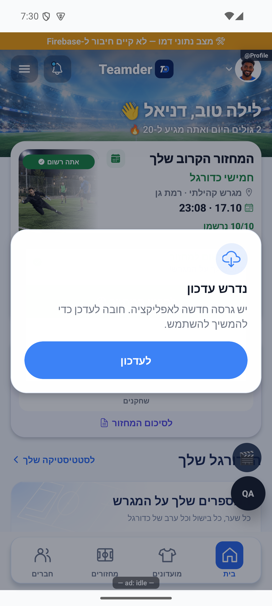

# הודעות מערכת ועדכונים — הסבר פשוט

## תיעוד כשלים — 20.10.2026

נוסף תיעוד אוטומטי לנקודות כשל במסלול הזה, עם מקור התקלה. הפעולה המקורית שומרת על ערכי החזרה והודעות השגיאה שלה. השינוי מקומי, טרם הופץ, ואין אימות מסירה חיה לפולס.

[דוח דיווח השגיאות והראיות](../../changes/2026-10-20-error-reporting-audit.md).

## בדיקות הפולס והגרסה הפנימית 1.1.55 — 17.10.2026

אישורי מחיקת גול והמשך במחזור ללא כוחות משתמשים בחלונית כדורגל עם כותרת מרכזית, סמל כדור וכפתורים רחבים. פעולת הביטול נשארת זמינה.

[ראיות, בדיקות ומגבלות](../../changes/2026-10-17-internal-1.1.55.md).

לפעמים מוצגת הודעת עדכון, תחזוקה או הסבר על מה חדש. עדכון חובה עוצר את השימוש עד לעדכון; הודעות אחרות מאפשרות להמשיך בהתאם למה שמוצג.

[איך זה עובד מאחורי הקלעים](global-gates.md)

## התאמה למסך — 8.10.2026

נוספה התאמה שמרחיקה תוכן משורות המערכת של הטלפון. [פירוט ומגבלות הבדיקה](../shared/menus-and-motion.md#התאמה-לשטח-הבטוח--8102026).

## שחזור תקלות — 09.10.2026

לשגיאה מצורף רצף הפעולות שהיה במכשיר ברגע הכשל. שגיאה שלא נשלחה יכולה להישלח בהפעלה הבאה באותו חשבון בלבד. סגירה פתאומית של התהליך עלולה למנוע שמירה. [פירוט](diagnostic-journal.simple.md).

## חזרה אחרי שגיאה — 10.10.2026

אם מתרחשת שגיאה במסך, מוצג הסבר עם כפתור ״נסה שוב״. תוקן באנדרואיד מצב שבו תקלה נוספת מנעה את הופעת המסך הזה; בבדיקה מקומית הכפתור החזיר לבית בלי להפעיל מחדש את האפליקציה. סמלי שורת המצב במסך השגיאה כהים וקריאים על הרקע הבהיר. זו בדיקת דמו, ולא בדיקת אייפון או מכשיר משתמש.

## מה חדש אחרי עדכון — 13.10.2026

תקלה בחיבור לא תסמן את החדשות כאילו כבר הוצגו: האפליקציה תנסה שוב. החלונית ממתינה עד שאפשר להציג אותה בלי חלון עדכון מעליה. הסימון נשמר במכשיר; התקנה מחדש עשויה להציג שוב. עדכון חובה יופעל לכל חנות רק לאחר שהעדכון זמין בה בפועל. הנוסח החדש עם לוח המנהל והעונות פורסם לגרסה 1.1.56 ב־18.10.2026.

## חלונית העדכון החדשה — 17.10.2026

כשזמין עדכון מתאים בחנות, מופיע בראש הבית כרטיס בעיצוב שאושר עם ״יש עדכון חדש״ וכפתור ״לעדכון״. הכפתור פותח את דף האפליקציה בחנות. ״אחר כך״ או סגירה מחזירים את התפריט הרגיל ומסתירים את אותו עדכון ליממה; עדכון חדש יותר יכול להופיע קודם. עדכון חובה נשאר חלון שאי אפשר לדחות.

נמדדות לחיצה ופתיחת החנות בנפרד. השלמה נרשמת רק כאשר האפליקציה נפתחת אחר כך באותו חשבון בגרסה חדשה מתאימה, בתוך שבועיים. חזרה מהחנות בלי עדכון אינה נספרת. זהו שיוך לפי הרצף במכשיר, ואינו יכול להוכיח שההורדה נגרמה רק מהכרטיס.

נבדקו עיצוב, עברית, כשל פתיחת חנות וגופן מוגדל באנדרואיד דמו. החיבור החדש לגוגל עבר הידור מקומי וייכלל בבנייה הבאה; אין עדיין הוכחת עדכון חי בחנות או אייפון. [פרטים ומגבלות](global-gates.md#חלונית-עדכון-לפי-החנות-ומדידת-השלמה--17102026).

## הפצה פנימית — 17.10.2026

שינויי הלקוח האחרונים המתועדים כאן נכללו בבינארי הפנימי `1.1.53 / 286` באנדרואיד. המסלול אומת בגוגל; הייצור נשאר בגרסה הקודמת. זה אינו אימות חדש של תרחיש ייצור או של מכשיר אפל. [מקור הבינארי, פריסת השרת, בדיקות ומגבלות](../../changes/2026-10-17-internal-1.1.53.md).

במסך קטן ובגופן מוגדל חלונית הכדורגל מוגבלת לגובה החלון פחות 80 נקודות. התוכן נגלל וכפתורי הפעולה נמצאים מחוץ לגלילה ואינם מתכווצים. נבדק בפועל ברוחב 320 ובגופן 140%, כולל גלילה לסוף הטקסט. שאר חלוניות המערכת אינן משתנות.

## מה חדש בגרסה 1.1.56 — 18.10.2026

החלונית עם חמשת החידושים הופעלה לאחר אימות שגרסה 1.1.56 זמינה בגוגל. היא מוצגת פעם אחת במכשיר לאחר העדכון, אחרי התחברות והשלמת ההיכרות. גם מי שכבר עדכן עשוי לראות אותה בפתיחה הבאה. בכניסות הבאות היא אינה מוצגת שוב לאותה גרסה. התקנה מחדש או מחיקת נתוני האפליקציה עשויות להציג אותה שוב. חובת העדכון לא השתנתה.

הצילום הוא מהדגמה מקומית של הרכיב הקיים; אינו בדיקת עדכון דרך החנות. [אימות הפרסום והמגבלות](../../changes/2026-10-18-whats-new-publication.md).

## עדכון חובה באנדרואיד — 18.10.2026

לאחר אישור צילום החלונית הופעל עדכון חובה בגוגל לגרסאות שמתחת ל־1.1.56. המשתמש מקבל הודעת ״נדרש עדכון״ עם כפתור ״לעדכון״ שפותח את החנות; אין אפשרות לדחות או לסגור את החלונית. אחרי העדכון אפשר להמשיך, וחלונית ״מה חדש״ מוצגת בהתאם לסימון המקומי שלה. מי שכבר בגרסה 1.1.56 אינו נדרש לעדכן בגלל הגדרה זו. ההגדרה של אייפון לא השתנתה.

ההפעלה מתבצעת בבדיקת העדכון הבאה באפליקציה. אם המכשיר אינו מצליח לבדוק את החנות או את ההגדרה, ייתכן שהחלונית לא תופיע באותו ניסיון. [פרטי האימות והמגבלות](../../changes/2026-10-18-force-update-google.md).

## עדכון חובה באייפון — 19.10.2026

לאחר שגרסה 1.1.56 הופיעה בחנות של אפל, הופעל גם באייפון עדכון חובה לגרסאות ישנות ממנה. בבדיקת העדכון הבאה מופיעה חלונית ״נדרש עדכון״ עם מעבר לחנות, ללא אפשרות לדחות. מי שכבר בגרסה הזו אינו נחסם בגלל ההגדרה הזאת.

אחרי העדכון חמשת החידושים שכבר פורסמו זמינים גם באייפון. החלונית מוצגת פעם אחת במכשיר אחרי התחברות והשלמת ההיכרות, ולא בכל כניסה. התקנה מחדש, מחיקת הנתונים או כשל בשמירת הסימון עשויים לגרום להצגה נוספת. גם מי שכבר עדכן וטרם ראה את החלונית יכול לקבל אותה בפתיחה הבאה. ההגדרה בגוגל לא השתנתה.

אומתו גרסת החנות וההגדרות המרוחקות; לא הורץ תהליך העדכון במכשיר אפל. [ראיות ומגבלות](../../changes/2026-10-19-force-update-ios.md).
