# תפריטים, חלונות ותנועה משותפת

## תחקור לחיצות אחרי גלילה — 13.10.2026

נוסף תיקון ב־`patches/react-native+0.79.6.patch` לכותרות דביקות ב־`Fabric`: סנכרון המדידה נרשם ל־`scrollAnimatedValue`, שמקבל את אירועי הגלילה המקוריים, ומחשב את עקומת הכותרת הקיימת. אפס אמיתי בחזרה לראש אינו נזרק. יצירת העקומה מחדש מסנכרנת גם מצב עומד; פירוק מסיר את המנוי והטיימר. תנועת הכותרת נשארת מקורית. [הוכחת המנגנון ובדיקות לפני ואחרי](../../audits/2026-10-13-scroll-native-analysis.md). זו אינה הוכחה שכל דיווחי הגלילה נבעו מאותו מנגנון.

מסך הבית ורשימת המחזורים משתמשים כעת ב־`ScrollSurface` במשטח הראשי. ההפניה לגלילה, רענון במשיכה, התוכן, הסינון, ההרשמה וסדר הכרטיסים נשמרו. כך גם הם מקבלים את הגנת אירוע סיום התנע החסר ואת רישום תחילת/סיום גרירה ותנע; קודם השתמשו ב־`ScrollView` רגיל ללא ההגנה וללא האירועים. זוהי הרחבת כיסוי של הגנה קיימת, ולא הוכחה שהאירוע החסר גרם לכל הדיווחים.

`ClubTabs` שומר על `Pressable` רגיל ועל בחירה רק ב־`onPress`. אין עקיפת ביטול מחווה או הגדלת שטח לחיצה. `createTabTouchTrace` מתעד פעם אחת בכל מחווה תחילת לחיצה, מדידת המלבן המקורי, תנועה ראשונה, יציאה מלחיצה וסיום או ביטול המגע. בסיום נשמרת התזוזה המרבית שנצפתה. מדידה מאוחרת ממחווה קודמת/רכיב שפורק נזרקת. נשמרים רק גאומטריה ומפתח לשונית; האירוע הגולמי, תוויות משתמש ותוכן אינם מועברים ליומן. אין מאזין נוסף לכל פריים גלילה.

בדיווח 1.1.48 שנצפה עם צילום, הגלילה מסתיימת בהיסט אפס, ואחריה 17 אירועי תחילת לחיצה ללא בחירה. הדבר מוכיח שהמגע הגיע ל־`Pressable`; אינו מוכיח שהלחיצה הושלמה או שהמדידה שלו תואמת למיקום המצויר. הדיווח הישן מפרטי המועדון אינו מכיל אירועי תחילת לחיצה ולכן אין להסיק ששני המקרים חולקים גורם אחד. ההערות בקוד שתיארו סיבה יחידה או היעדר הנפשה בכותרת הדביקה תוקנו.

בדיקות ממוקדות: `tabTouchTrace.test.ts` בודק חסימת הצפת אירועים, גבולות מדידה, ביטול, מדידות ישנות ופרטיות; `clubTabsTouchDiagnostics.test.tsx` מפעיל את הרכיב ומוודא שביטול אינו בוחר לשונית, לחיצה רגילה בוחרת פעם אחת ולשונית נעולה ממשיכה להסבר. אלה בדיקות קוד עם מארח מקורי מדומה; אינן אימות במכשיר המדווח או באייפון. לא בוצעה פריסה בסבב הזה.

## קמפיין מובנה — 13.10.2026

`NativeCampaignView` הוא מציג טהור חדש שהופרד מהענף המובנה של `InAppMessageHost`. המארח שומר קבלה, סנכרון, מדידה, קישורים וכפתורים; המציג מקבל `msg`, אטימות ופונקציות. אין מסך או נתיב מוצר חדש. ענף HTML של המארח נשאר כפי שהיה, כולל משטח שקוף ללא ריפוד וכפתור סגירה עצמאי; לא חובר למשטח המובנה.

חלונית/באנר מובנים מקבלים כעת `overlaySurfaces.dialog`, רקע כהה משותף ופינות 24 כשאין ערך מפורש. צבעי קמפיין, גופן, גודל, משקל, יישור ורדיוס מפורש (גם 0) גוברים על ברירת המחדל. מסך מלא נשאר בגאומטריה וברדיוס הקודמים. כאשר יש כפתור סגירה בחלונית קטנה נוסף רווח עליון פנימי כדי שלא יכסה כותרת עברית; החפיפה נצפתה בצילום ראשון ותוקנה לפני הראיה הסופית.

בדיקות `nativeCampaignView.test.tsx`: אין פעולות בהרכבה; סגירה דרך callback; לחיצת רקע מכבדת `backdropDismissible`; כפתור מעביר את אובייקט הפעולה; עיצוב מפורש ורדיוס אפס נשמרים; מסך מלא נשמר וסגירה אופציונלית. אלה מבחני רכיב עם כפילי רכיבים מקוריים, ולא הוכחת דיווח מדידה או הפעלת כתובת.

כלי הדמו המוגן תומך ב־`campaign`, `campaign_custom`, `campaign_banner` ומרכיב רק את המציג הטהור. נצפו [חלונית ברירת מחדל](../screenshots/overlays-campaign-native-2026-10-13.png), [עיצוב מפורש](../screenshots/overlays-campaign-custom-2026-10-13.png) ו[מצב תחתון](../screenshots/overlays-campaign-banner-2026-10-13.png). חזרת מכשיר נבדקה בין המצבים, וכפתור אישור במצב התחתון סגר לבית בדמו. אין סנכרון קמפיין/חשיפה/לחיצה מרוחקת בבדיקה. אין בדיקת HTML מרונדר, אייפון, טקסט ארוך, גופן מוגדל או מסך מלא בסבב זה.

[הסבר פשוט](menus-and-motion.simple.md) · מסמך טכני מעמיק

## איחוד מעטפות — 12.10.2026

מקור `b8a8ccf4` עם שינוי מקומי. `src/theme/overlays.ts` מרכז משטח ערכת נושא, מסגרת עדינה וצל משותף. פינות חלונית מרכזית 24, חלונית תחתונה 28 ותפריט מעוגן 18. אטימות הרקע מאחור 0.44, ובתפריט מעוגן 0.22. החלוקה לפי תפקיד משמרת הבדל שימושי בין מפת מסך מלא, אישור ותפריט קטן.

הוחלו מעטפות ב־52 קבצים, כולל `SpringSheet` ו־`DraggableMenuSheet`, ללא שינוי בנתונים, הרשאות, ניווט, פונקציות אישור/סגירה, מיקום, גובה, מחוות או מקלדת. המארח עדיין קובע סגירה וטעינה; אין הבטחה שכל חלונית נסגרת בגרירה. איורים ותוכן פנימי נשמרו.

נוסף `src/dev/OverlayAuditPreview.tsx`, נגיש דרך `QARouteLauncher` ב־`footy://qa/_overlay_audit_<kind>` ורק בשלושת שערי הפיתוח: `__DEV__`, `EXPO_PUBLIC_QA_ROUTES=1`, `EXPO_PUBLIC_FOOTY_FORCE_MOCK=1`. ערכי הבדיקה `confirm`, `destructive`, `filter`, `score`, `cover` מציגים רכיבים אמיתיים עם פונקציות סגירה מקומיות בלבד. אין מסך מוצר חדש או יצירת חשבון/מועדון.

עברו בדיקת טיפוסים ו־3,593 בדיקות ב־280 חבילות. נצפו שישה רכיבים באימולטור אנדרואיד, לרבות עברית ואישור ביטול נעול. זו אינה הוכחה שכל החלוניות הורצו; נשארו סקירת קמפיינים/הדרכה/חגיגת זכייה, בדיקות גופן מוגדל, מקלדת, מצב כהה ואייפון. [מיפוי כל המארחים ומצב האימות](../../audits/2026-10-12-overlay-audit.md).

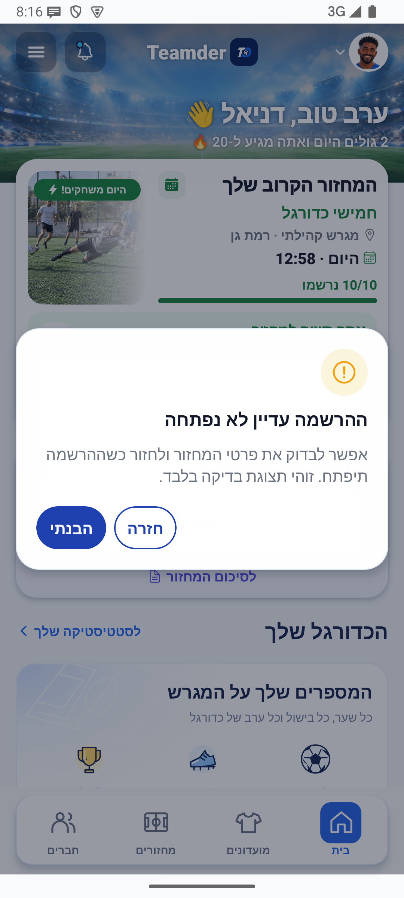
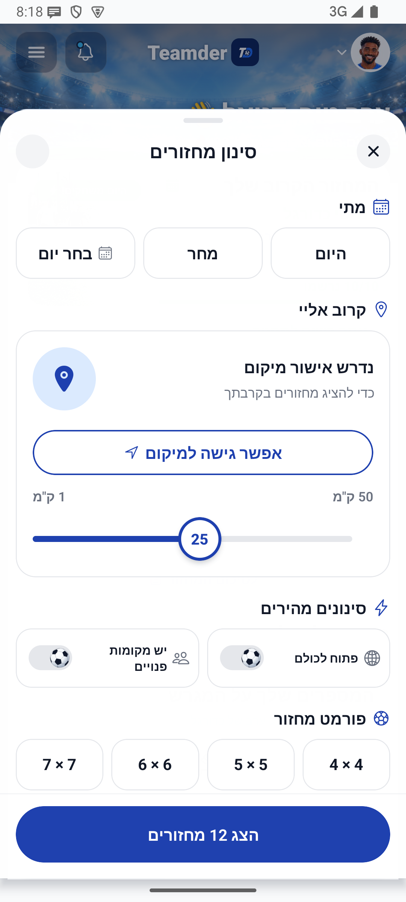

עודכן 7.10.2026; מקור `8e8fde5`. התפריטים שעוצבו מחדש משתמשים בשפה של חלון תחתון, אייקונים ורשימות פעולות, עם סגירה בגרירה מהידית. אין להניח שכל חלון באפליקציה כבר משתמש באותו רכיב.

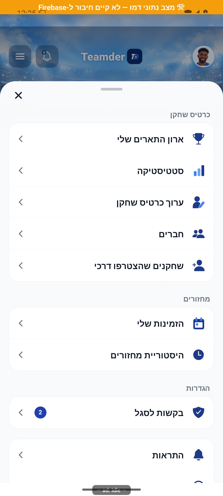
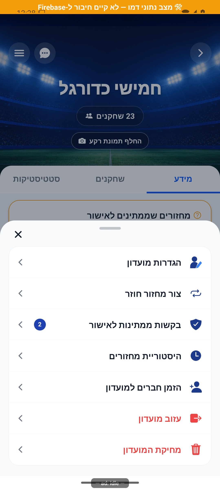
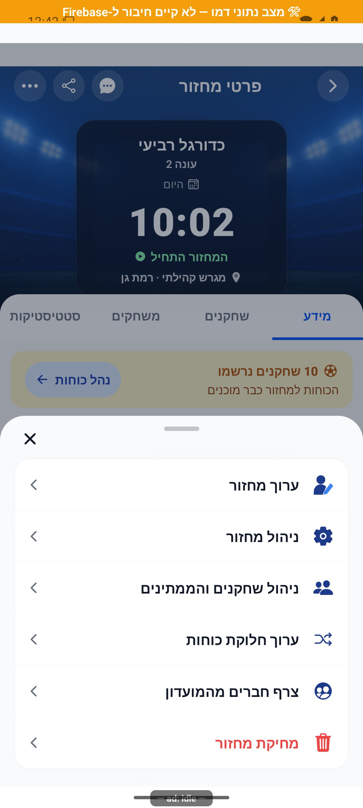
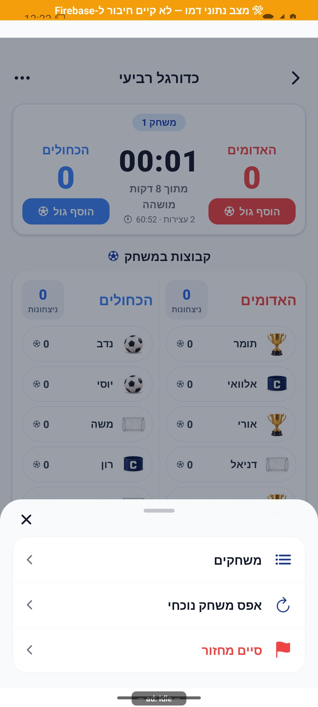
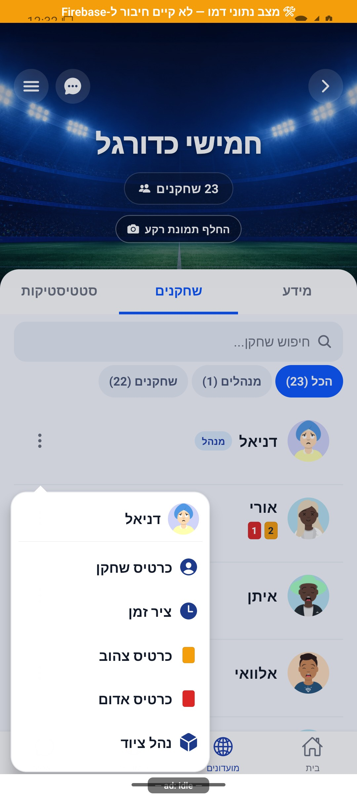

מקורות: רכיבי התפריט תחת [`src/components`](../../../src/components), ובפרט DraggableMenuSheet. בעת שינוי בדוק איזה רכיב המסך באמת משתמש בו; SpringSheet הוא רכיב אחר, ואין להסיק מהידית בלבד שהוא תומך באותה מחווה.

מצבים לבדיקה: פתיחה, גרירה קצרה שחוזרת, גרירה ארוכה שסוגרת, הקשה על רקע, כפתור חזרה, רשימה ארוכה עם גלילה ופעולה מושבתת. הגרירה אינה צריכה לגנוב גלילה רגילה או לחסום נגישות. יש לצלם כיווניות לאחר שינוי סדר אייקון וטקסט.

תנועה קיימת כוללת קרוסלת הידעת, ספירת מספרי סטטיסטיקה, תנועת פנדלים ופתיחת חלונות. השערים העסקיים נשארים מקור האמת; אנימציה לא משנה זהות, הרשמה, תוצאה או טיימר. [רעיונות נוספים](../reviews/animations.md) הם הצעות בלבד.

הדמות הניסיונית נשארת מוסתרת ואינה מסלול מוצר פעיל. אין לייבא אותה למסך הבית כחלק מעדכון תיעוד או להפעילה בטעות בשחרור.

בחלון הצמד נבדקה גרירה ארוכה מהידית בסביבת הדמו: החלון נשאר פתוח, וכפתור חזרה סגר אותו. [ראיית הבדיקה](../screenshots/CommunityStats-pair-after-drag.jpg). חלון PairCard ממומש באמצעות Modal עצמאי; הבדיקה שלו אינה הוכחה להתנהגות SpringSheet.

## מאחורי הקלעים — זרימה וחישובים

### מנגנון הגרירה בפועל

[`DraggableMenuSheet.tsx`](../../../src/components/DraggableMenuSheet.tsx) מקבלת `visible`, `onClose` וילדים. היא מחזיקה `Animated.Value` למיקום אנכי, סימון `closing` למניעת סגירה כפולה והפניה מעודכנת לפונקציית הסגירה. שינוי `visible` עוצר תנועה ומאפס את המיקום והסימון; פירוק הרכיב עוצר תנועה.

`PanResponder` מחובר לידית בלבד, כדי שגלילת רשימת פעולות לא תסגור חלון. התזוזה היא `max(0, dy)` ולכן אין גרירה כלפי מעלה. בשחרור נסגר אם `dy > 70`, או אם `dy > 18` וגם `vy > 0.65`. לדוגמה: גרירה 40 ללא מהירות מספקת חוזרת למקום; גרירה 80 נסגרת. שוויון ל־70 לבדו אינו מספיק. אלו יחידות המחווה של המערכת ולא פיקסלים שנמדדו בתמונה.

סגירה מניעה את החלון עד גובה המסך במשך 190 אלפיות שנייה ורק בסיום מוצלח קוראת `onClose`. גרירה קצרה חוזרת בקפיץ עם `tension=100`, `friction=16`. במצב תנועה מופחתת מסלול הסגירה קורא מייד לפונקציה והחלון משתמש בדהייה; הקפיץ של החזרה הקצרה עדיין מופעל לפי הקוד הקיים. הקשה ברקע, כפתור סגירה וחזרה מערכתית עוברים באותה פונקציה.

### גבול הרכיב

לחלון גובה מרבי 88% ופינות עליונות 28; הרכיב המארח אחראי לפעולות ולגלילה. האנימציה משנה מיקום בלבד, לא נתוני מסד. חלון הצמד משתמש ב־`Modal` נפרד, והידית שלו אינה מקבלת את חוזה הגרירה הזה. לפני שינוי מצא את הייבוא במסך ולא רק שם דומה. בדיקות הגרירה המצרפיות המצולמות נשארות במסמך, אך בדיקה חזותית חדשה נדרשת כשמשנים ספים או נגישות.

## עדכון 8.10.2026 — תנועה ותיקוני דיווחים

`ChangeMotion` אינו מחזיק תוצאה עסקית: שינוי `triggerKey` מפעיל דהייה 0.78–1 והיסט אנכי עד 5, או פעימה חד־פעמית עד 1.06. פירוק או שינוי טריגר מבטלים תנועה קודמת. `ReorderMotion` מזיז שורות בלבד. שני הרכיבים, `AppearItem` ו־`PulseOnChange` מכבדים `useReducedMotion`. `EmptyState` מנפיש את האיור בלבד בכניסה במשך 550; אין הזזת כפתור הפעולה. מסלולי הבדיקה עברו ממזהה דמו שלא קיים למזהה `gv2-live`.

**ראיה ומגבלות:** ההקלטות הן סרטוני `adb screenrecord` אמיתיים, ולא מצגת פריימים. נבדקו היסטוריה, זמינות, דראפט, שעון ואישור בקשה בדמו. רשימה ריקה ותנועה מופחתת עדיין דורשות אימות חזותי ממוקד.

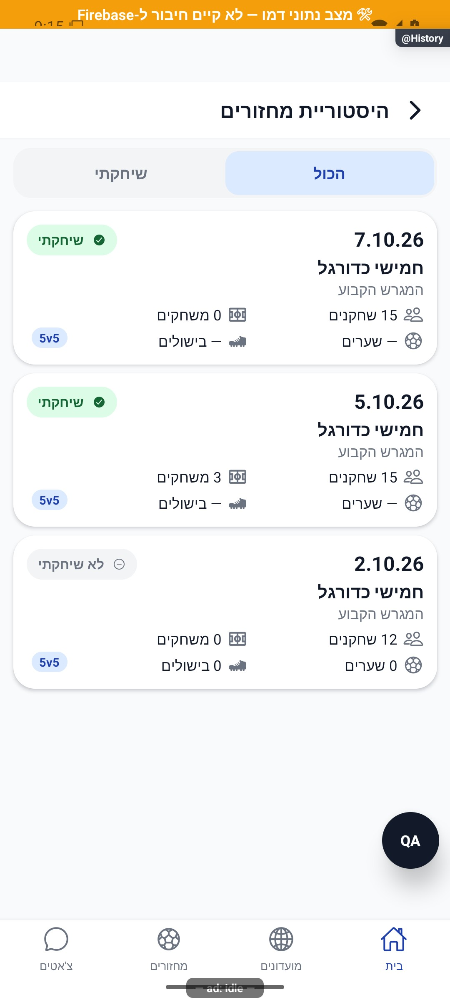

בדיקת הטיפוסים ו־183 חבילות הבדיקות עברו, 2,752 בדיקות. מצב המקור: `9ec0dfd` עם שינויים מקומיים; אין גרסה חדשה שפורסמה. [יומן השינוי וההקלטות](../../changes/2026-10-08-motion-and-pulse.md).

## השלמת הנפשות — 8.10.2026

נוספו useArrivalTracker, ArrivalMotion, HeightReveal ו־TransferIcon. המעקב מקבל מזהים מאושרים, יוצר בסיס ראשון, מגביל גל לחמישה, שומר חותמת זמן ומנקה אחרי 500. שינוי תחום/פירוק מונעים שימוש בתשובה ישנה. ArrivalMotion מנפישה רק חותמת צעירה מ־400, במשך 300: opacity 0.35→1, translateX 22→0, scale 0.94→1. במצב reduced או חותמת ישנה הערך מיד סופי. HeightReveal מודדת גובה תוכן פנימי מוחלט, ומנפישה את גובה המעטפת בלי לשנות נתונים; ביטול נראות מכבה מגע וקורא מסך. TransferIcon משתמשת במידות פיזיות של אותה שורה ולכן לא גוזרת כיוון מ־RTL. כל רכיב מבטל הנפשה קודמת בפירוק/שינוי. MotionPreview ו־footy://qa/_motion נגישים רק עם שלושת השערים __DEV__, QA_ROUTES=1 ו־FORCE_MOCK=1. כל הכפתורים בה נוגעים ב־state מקומי; שירותי אישור ממלאים/צאט הוחלפו זמנית רק בזמן צילומי הבדיקה והוחזרו במדויק. אין ניווט חדש במוצר. בדיקת מחזור חיים כוללת פתיחה, מזהה חדש, סידור מחדש, ניקוי, מעבר שיחה, גבול גל ופירוק; אין הדמיית מכשיר חלש.

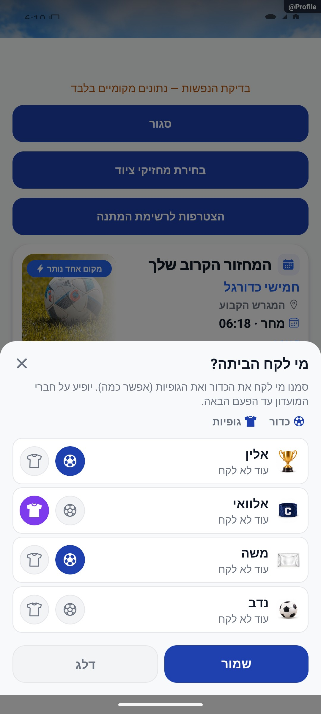

[פרטי האימות והמגבלות](../../changes/2026-10-08-motion-completion.md). מקור: `9ec0dfd` עם שינויים מקומיים; טרם פורסמה גרסה.

## התאמה לשטח הבטוח — 8.10.2026

מקור `d57ccd7` עם שינויים מקומיים. `App.tsx` מציבה `SystemSafeArea` סביב הניווט והשכבות הגלובליות. גבול השטח נמדד לכל מכשיר, כולל מגרעת, שורת מצב, מחוון בית ושורת ניווט. יש גבול נפרד בחלונות מקוריים: 58 ייבואי Modal הופנו ל־`SafeModal`; סמנטיקת חזרה, סגירה ונגישות נשארת של החלון המקורי.

`SystemSafeArea` משתמשת ב־SafeAreaView עם כל ארבעת הקצוות, ובתוכו SafeAreaProvider שמודד מחדש את השטח שכבר הוגן. לכן המסכים הקיימים וסרגל הלשוניות מקבלים רק מרווח שנותר, ולא מוסיפים שוב את אותו מרווח. `safeContentMetrics` מכינה מדידה התחלתית: רוחב פחות שמאל וימין, גובה פחות עליון ותחתון, מקור מוזז בשמאל ובעליון, ויתרת המרווחים אפס; ממד שלילי נחתך לאפס. המדידה המקורית מתעדכנת בעקבות שינוי פריסה. הרקע בשטח המערכת משתמש בצבע הרקע; לא מוסיפים גובה קבוע של מכשיר מסוים.

`SafeModal` פותחת חלון עם שורות מערכת שקופות, מאפסת הקשר מדידה שהגיע מהמסך שמתחת וממתינה למדידת החלון החדש לפני הצגת ילדים. לאחר מכן היא משתמשת באותו גבול משותף ובמדידה פנימית. כך אין פריים ראשון שנסמך על מרווחי אפס מהמסך שמתחת לחלון. אין להשתמש בחלון המקורי ישירות ברכיבי המוצר; בדיקת רגרסיה סורקת את הייבואים.

מיקומי תפריט שחקן, תפריט הודעה ובועת הסבר עוברים מקואורדינטות החלון לקואורדינטות השטח הבטוח באמצעות חיסור x/y של `useSafeAreaFrame`. תמונת הפתיחה משתמשת בממדי השטח הזמין. `SafeKeyboardAvoidingView` מוסיפה את מקור y של השטח הבטוח להיסט שהקורא ביקש; כאשר התנהגות המקלדת אינה מוגדרת באנדרואיד 35 ומעלה היא בוחרת padding. התנהגות מפורשת קיימת ומדיניות אנדרואיד ישן נשמרות. עשרה משטחים הועברו למעטפת המקלדת.

אין שינוי בנתונים, מכנים, הרשאות, ניווט מוצר או כתיבות למסד. אימות מספרי: באמולטור 1080×2400 תוכן מוגן מתחיל ב־128 ומסתיים ב־2337 עם מחוות, או ב־2274 עם שלושה כפתורים. הרשימה בתפריט נגללת; שורות מחוץ לאזור הגלילה אינן כפתורים שיש להפעיל מאחורי שורת המערכת.

ראיות: מסך בית, סיכום אישי, סגל, תפריט בית בשני מצבי ניווט, חלון התחברות וטופס דיווח. נבדקו כיווניות וכפתור השליחה מעל מקלדת. לא נשלחו דיווחים או הודעות, ולא נעשתה התחברות. מעבר לשיחה דרך כלי הבדיקה נתקל בכשל המקורי addViewAt; צ׳אט עם מקלדת לא אומת. אייפון, טאבלט, רוחב והגדלת גופן לא הורצו; מדידות אייפון ורוחב נבדקו ביחידה בלבד. אין להסיק מהבדיקות שכל דגם נבדק פיזית.

בדיקה: `tests/logic/safeContentMetrics.test.ts` — שני מצבי ניווט אנדרואיד, מגרעת/מחוון אייפון, שוליים לרוחב, מניעת מרווח כפול, שטח קטן ואיסור עקיפת חלון בטוח. [יומן השינוי](../../changes/2026-10-08-safe-area.md).

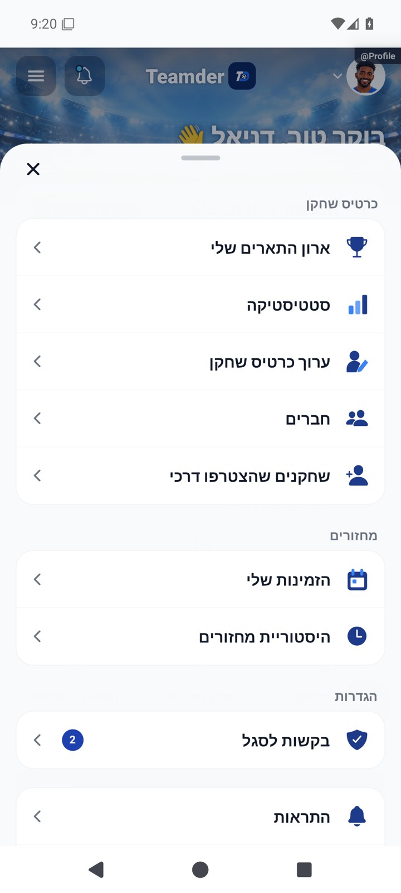
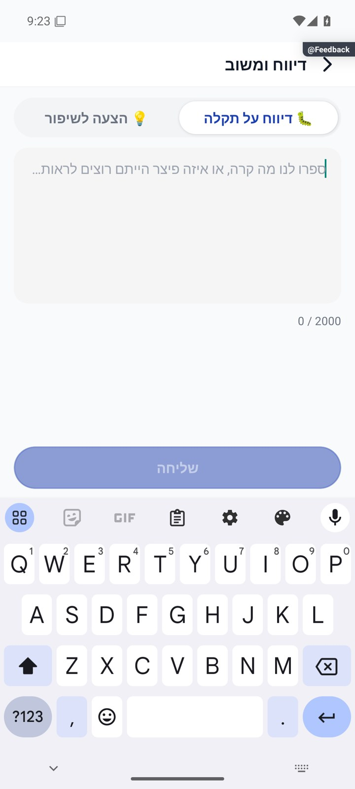

## צמצום עומס גלילה — 9.10.2026

מקור: `a348b9f` עם שינויים מקומיים. אין פריסה או גרסת חנות חדשה במשימה זו.

- `ScrollSurface` עוטפת את הגלילה הקיימת בארבע נקודות הכניסה: פרטי מועדון, `TabScroll` של פרטי מחזור, סטטיסטיקות מועדון וסיכום אישי. סדר הילדים, `stickyHeaderIndices`, רענון, ריווח, הפניה המקורית ואירועי הקורא מועברים כפי שהם. אין מאזין חדש לכל פריים ואין שמירת היסט גלילה ב־React.
- תחילת גרירה או תנופה מסמנת פעילות. סיום גרירה ממתין 120 מילישניות, כדי לא לשחרר פעילות ברווח שלפני אירוע תחילת התנופה. תחילת תנופה מבטלת את ההמתנה; סיום תנופה מסיים מיד. פירוק מנקה את הטיימר. הקשר מוגבל לעץ אותה גלילה.
- `CountUp` שומר את המחרוזת המוצגת לאחר עיגול `toFixed(decimals)`, במקום לעדכן מצב עבור כל שבר בלתי נראה. יעד חדש באמצע תנועה מתחיל מהערך הנוכחי, ולא קופץ ליעד הקודם. גלילה או משך לא חיובי מציבים את היעד ללא תזמון פריימים; ביטול מסיר את הפריים הממתין. סוף גלילה אינו מפעיל שוב ספירה שכבר הושלמה.
- `ReorderMotion` אינה מפעילה `withTiming` כאשר הפרש המיקום אפס או כשהתנועה מצומצמת. מיון ששינה מיקום ממשיך לקבל משוב תנועה.
- `StatDonut` מבטלת תנועה ומציבה את אחוז היעד בזמן גלילה או צמצום תנועה. הניקוי מבטל גם תנועה מושהית. ערך שהושלם אינו מתחיל מחדש בסוף המחווה.
- `useAmbientMotion` מאזינה למיקוד המסך ולמצב היישום באמצעות `useSyncExternalStore`, ומצרפת את העדפת הנגישות ואת פעילות הגלילה. `LivingIcon` ו־`Breathing` משתמשות בה: לולאה מחזורית מתבטלת במסך מוסתר, ברקע או בזמן גלילה. חזרה למסך פעיל יכולה לחדש את הלולאה. תצוגה ללא הקשר ניווט נתמכת. כל מאזיני המיקוד ומצב היישום מתנקים בפירוק. אין השפעה על טיימר עסקי או תוצאת פעולה.
- `Card` מעבירה `unstable_pressDelay=100` לכרטיס לחיץ בלבד, כך שגרירה קצרה אינה מתחילה בכיווץ תוכן. ההשהיה היא לתגובת תחילת המגע; כפתורי הפעולות הרגילים לא השתנו.
- `UserAvatar`, `Avatar`, `CoverCrossfade` ו־`MatchStadiumHero` משתמשים ב־`resizeMethod=resize`. באנדרואיד ברירת `auto` של הגרסה המותקנת מפענחת מחדש לפי מידה רק עבור קובץ מקומי/תוכן, ולא בהכרח עבור תמונת רשת או משאב ארוז. הבקשה המפורשת מקטינה את גודל מפת הפיקסלים לפי מידת התצוגה. תוכן התמונה, בחירה, קדימות תמונה שהועלתה וחלופת שגיאה לא השתנו. באייפון זהו מאפיין שאינו משנה את מנגנון הפענוח של הפלטפורמה.

ניסוי בשמירת כרטיסים כמרקמי חומרה, הן קבועה והן לפי מחווה, הוסר: לא נמצא שיפור עקבי והוא הוסיף עומס בחלק מהריצות. לא הופעלה הסרת תתי־תצוגות מחוץ למסך, ולכן אין מסלול חדש שמנתק תוכן או משנה צילום שיתוף. `metro.config.js` מחריגה כלי עבודה, צילומי קבצים ועותקי מקור מתוך סריקת המודולים; זהו תיקון סביבת פיתוח נפרד שאינו שיפור זמן ציור בטלפון.

בדיקות ההתנהגות ב־`tests/scrollAnimationLifecycle.test.ts` מכסות עיגול וערך סופי, יעד חדש באמצע תנועה, ביטול פריים, גלילה ללא תנופה, רצף גרירה/תנופה, פירוק טיימר, שימור אירועים וסדר הכותרות, רקע, מסך מוסתר, נגישות והסרת מאזינים. אלה בדיקות מחזור חיים עם מארחים מקוריים מדומים, ולא מדידת קצב ציור. הגדרת הבדיקות מתרגמת כעת JSX כדי לאפשר בדיקות אלו.

[מדידות וצילומי אימות, כולל שונות ומגבלות](../reviews/scroll-performance-2026-10-09.md). אין להסיק מהאימולטור ביצועי כל מכשיר, ולא בוצעה בדיקת אייפון או התקנת החנות.

## הגנת לחיצות אחרי גלילה — 9.10.2026

תיקון opt-in ב-patches/react-native+0.79.6.patch: ScrollSurface מעבירה recoverStaleMomentumAfterMs=250. RN שומרת זמן פריים גלילה אחרון, ורק כש-begin חדש מ-end ולא היו פריימים במשך 250ms היא מסיימת את נעילת responder. תנופה ארוכה עם פריימים טריים עדיין חוסמת לחיצת עצירה כרגיל. scrollEventThrottle מוגבל ל-64ms (ברירת 16), ללא listener נוסף, מצב או חישוב בכל פריים ברכיב היישום. onStaleMomentumRecovered מתעדת stale_momentum_recovered ביומן המקומי ומשחררת מצב moving; momentum_start מתועד גם הוא. MatchRoundsScreen משתמשת ב-ScrollSurface בכל ענפי הגלילה. patch-package מוחל בהתקנה דרך scripts/postinstall.cjs החוצה פלטפורמות; אין שינוי native או הרשאות. tests/scrollStaleMomentum.test.ts מריצה את תנאי RN המותקן עצמו: החמצת end נכשלת לפני התיקון ועוברת אחריו; נבדקים תנופה ארוכה, התחלה, מרווח הסיום הרגיל והיעדר opt-in. אין טענה שהמסלול הזה הוא סיבת השורש המוכחת במכשיר המדווח; שני הדיווחים נותרו פתוחים לאימות.

[בדיקות ומגבלות](../../changes/2026-10-09-pulse-round2.md).

## תיקוני עיצוב ונגישות — 10.10.2026

מקור: `a348b9f235f1e1433497600555303231512a0834` עם שינויים מקומיים. אין בסעיף זה הוכחת גרסת חנות.

`CountUp` מאפשרת `allowFontScaling=true` כברירת מחדל ותקרת `maxFontSizeMultiplier=1.8`, שניתן להתאים לצרכן. בצמצום תנועה היא מדלגת לערך הסופי. `StepIndicator` מבטלת תנועה קודמת ומסיימת סיבוב מחזורי; `TeamsEditModal` מבטלת הבהוב ואנימציית חלון; `BallSwitch` ו־`SpringSheet` מציבות את היעד ללא קפיץ; `PressableScale` אינה מכווצת או מרחיבה טבעת ומאפסת תנועה פעילה בעת החלפת ההעדפה. מצב נבחר נשאר מוצג. `BallSwitch` מעבירה מאפייני AccessibilityProps וממזגת checked/disabled. כל צרכן מספק שם או שורת מתג נגישה יחידה. `InputField`, `RatingSlider` ו־`RangeSlider` מספקים סמנטיקה ופעולות המתועדות בזוגות הטפסים והזמינות. בדיקות `accessibleControls` מפעילות תפקידי קלט ומחוונים; צמצום תנועה וקורא מסך במכשיר טרם הורצו. ניסיון גופן 130% במעטפת הפיתוח הוביל למסך לבן והגופן הוחזר ל־1.0; לכן אין אישור חזותי לגופן מוגדל או לבינארי שחרור.

בדיקה נוספת ב־`tests/scrollAnimationLifecycle.test.ts` מפעילה את `CountUp` עם צמצום תנועה ומוודאת ערך סופי 8.8 ללא תזמון פריימים, יחד עם הפעלת הגדלת גופן ותקרה 1.8. זו בדיקת מחזור חיים עם תצוגה מקורית מדומה, ולא צילום מכשיר בהגדלת גופן.

## הרחבת איחוד החלוניות — 13.10.2026

RoundReviewSheet משתמש במשטח התחתון המשותף ובצבעו גם לרגל הכפתורים. בועת HomeGuideOverlay משתמשת במשטח הדיאלוג, צל, מסגרת ורקע ההחשכה המשותפים; זנב הבועה והדמות נשמרו. שני קבצים נוספים מעבר ל־52 שבסבב הראשון. לא שונו תנאי סגירה, כתיבה, תזמון, תוכן או אישור. חלונית חגיגת הישג נשארה מופע מיוחד ללא קופסה; עורך במסך מלא ומסמך קמפיין שנכתב מרחוק אינם מומרצים למשטח לבן.

נצפו באימולטור הדמו הדרכה, תקציר סגור ופתיחת ההגדרות. הכפתורים נשארו נגישים בתחתית והרשימה הארוכה נגללת. אין צילום תקף לטעינה: ניסיון מסלול בדיקה שלא תמך במקף פתח רכיב אחר, ולכן אינו נספר כהוכחה. ניסיון גופן מוגדל תועד בנפרד ועדיין דורש הכרעה, ולא נכלל באישור החזותי. [הדרכה](../screenshots/overlays-home-guide-2026-10-13.png) · [תקציר](../screenshots/overlays-round-review-2026-10-13.png) · [הגדרות פתוחות](../screenshots/overlays-round-review-expanded-2026-10-13.png).

### תוצאת בדיקת הגופן המוגדל

ב־130% לאחר פתיחה קרה התקציר שמר על התוכן: תגים עברו שורה, שורת התזמון התפצלה והכפתורים נשארו נגישים. [צילום](../screenshots/overlays-round-review-large-font-2026-10-13.png). שינוי גופן תוך כדי תהליך חי גרם לחיתוך גם ברכיבי המסך מאחור; זהו ממצא נפרד שדורש בידוד ולא סיבה לקבע גודל גופן או להסיר הגדלה. הגופן המקורי 1.0 הוחזר ונעשה אתחול תהליך בלבד.

תיקון תיאור הכיסוי: HomeGuideOverlay אינו מיובא כיום באפליקציית המוצר; הוא צולם דרך כלי הבדיקה בלבד. השינוי שומר רכיב קיים אך אינו מוסיף הדרכה חדשה למשתמשים. המשטח הפעיל שנוסף בסבב הוא RoundReviewSheet.

### השלמת צילום טעינה

לאחר פתיחה קרה נטען מסלול הבדיקה review_busy ונצפה מחוון הטעינה האמיתי של הכפתור. לחיצה על חזרת המכשיר השאירה את החלונית פתוחה. [צילום](../screenshots/overlays-round-review-loading-2026-10-13.png). מדובר ב־busy מוזרק ללא פעולת רשת, לא הוכחת שמירה או התאוששות. זה מחליף את מגבלת הצילום של ניסיון המקף הכושל, ולא מסתיר אותה.

### תוכן קמפיין ארוך — 13.10.2026

ב־NativeCampaignView כותרת וגוף נמצאים ב־ScrollView עם flexGrow:0 ו־flexShrink:1. גובה הכרטיס מוגבל ל־100% מהשטח שמקצה המעטפת. הסגירה וכפתורי הפעולה אחים של אזור הגלילה ולכן נשארים נגישים. במצב הישן גוף ארוך הרחיב את החלונית מעבר למסך והסתיר את הפעולות; אין שינוי בפעולות, במדידה או בקמפיין HTML. תוכן קצר אינו מקבל גובה ריק קבוע.

נבדק המציג האמיתי עם 24 פסקאות בדמו מנותק: תחילה, אמצע וסוף הגלילה. [תוכן ארוך](../screenshots/overlays-campaign-long-2026-10-13.png) · [סוף התוכן](../screenshots/overlays-campaign-long-end-2026-10-13.png). בדיקת רכיב רביעית מוודאת שהפעולות מחוץ לגלילה והגובה חסום. כל החבילה: 283 חבילות ו־3,607 בדיקות; טיפוסים תקינים. בדיקת גופן מוגדל מתועדת בנפרד ואינה נלמדת מבדיקת הרכיב.

גם [גופן 130%](../screenshots/overlays-campaign-long-large-font-2026-10-13.png) נצפה אחרי פתיחה קרה: תוכן ארוך נשאר בתחום הגלילה והסגירה ושני הכפתורים נראים. בצילום הראשון אזהרת כלי הפיתוח כיסתה את הכפתורים; היא נסגרה והצילום בוצע מחדש. זו אינה הסתרה של תקלה במוצר. הגופן המקורי 1.0 הוחזר, כמתועד ב־artifacts/night-campaign-font-scale.json.

## סבב סגירה — 13.10.2026

נוספו צילומי רכיבים אמיתיים: כללי צ׳אט, הסבר התראות רגיל וחסום, התנגשות הרשמה, הפעלת עונות, מתן כרטיס עם/בלי מקלדת ואישור מחיקת שער. כל הפעולות בכלי הדמו מקומיות בלבד. הרחבת הכיסוי היא ל־18 רכיבי חלוניות שונים (כולל AppDialogHost), לא לכל 66 הקבצים במיפוי. הודעת שגיאת הכימיה היא מציג מצב ולא רכיב חלונית נוסף. מצבי אפל, כהה, כל גודל גופן ומדידת תנועה מופחתת לא הורצו. מקור ומגבלות לכל צילום במניפסט.

## הרחבת כיסוי עשירית — 13.10.2026

נוספו תצוגות מנותקות של AvailabilityNudgeModal, WinnerPickerModal ו־EquipmentHandoffModal; סך הכיסוי בביקורת הוא כעת 21 רכיבים שונים, לא 21 מארחים עסקיים מלאים. חמש תמונות נוספו למניפסט, כעת 508. תזכורת זמינות מציגה שלוש תועלות ושתי פעולות; בורר המנצחת נבדק לפני/אחרי בחירה ותוקן סימון שהסתיר את הכותרת; מסירת ציוד נבדקה בגלילה עד שחקן 12 ותוקן סדר פעולות עברי. מקור: b8a8ccf4 עם שינויים מקומיים. התצוגות מוגנות בשערי הפיתוח והדמו הקיימים; הקריאות החוזרות סוגרות בלבד, בלי כתיבת נתונים או ניווט לפעולה אמיתית.

[זמינות](../screenshots/overlays-tenth-availability-2026-10-13.png) · [בחירת מנצחת](../screenshots/overlays-tenth-winner-selected-2026-10-13.png) · [ציוד בסוף הרשימה](../screenshots/overlays-tenth-equipment-scroll-2026-10-13.png). חזרת מכשיר סגרה למסך הבית המנותק, צילום artifacts/home-carousel-height/night-tenth-closed.png נצפה. אין הוכחת שמירה, אישור תוצאה, כל מארח, אייפון, מצב כהה או גופן מוגדל בסבב הזה.

## הרחבת כיסוי אחד־עשר — 13.10.2026

כעת 24 רכיבים שונים נצפו בביקורת: נוספו ניהול ציוד לשחקן, בורר משלים ותפריט שחקן מעוגן. שבע תמונות overlays-eleventh-* נוספו, כעת 515 במניפסט. ManageEquipmentSheet מקבל יישור פאנל לתחתית וסמלים מימין; שמירה מושבתת לפני שינוי ופעילה אחרי שינוי טיוטה. בבורר נצפו 2/2, 1/2, סוף רשימה של 12 ומאגר ריק. תפריט עם עוגן מדוד בתחתית מתהפך למעלה, כל פריטיו נראים ופריט מושבת אינו מגיב. צילום הסגירה artifacts/home-carousel-height/night-eleventh-closed.png נצפה.

הכול בדמו המנותק מאחורי השערים הקיימים; פעולות סוגרות בלבד. אין שמירת ציוד, שינוי סגל או תוצאה. אין הוכחה לכל המארחים או לכל תנאי הנגישות. [פירוט ומגבלות](../../changes/2026-10-13-overlay-eleventh-pass.md).
