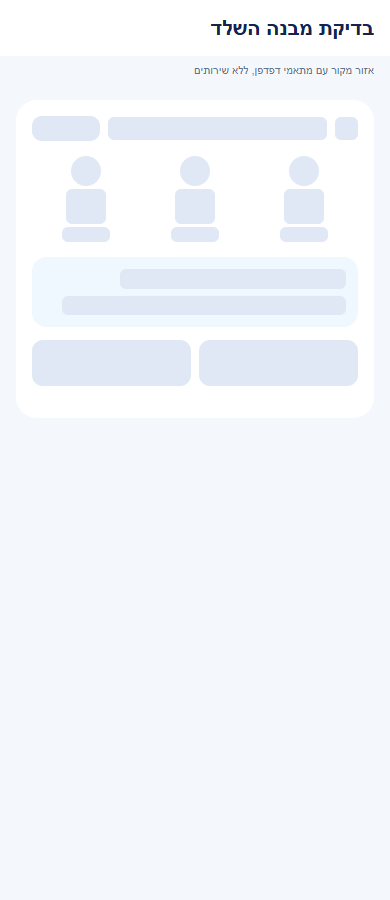
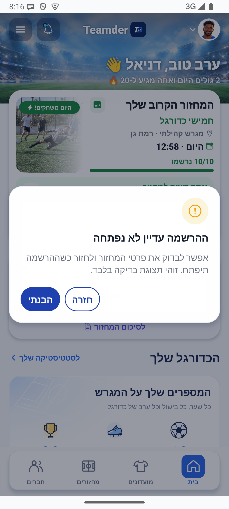
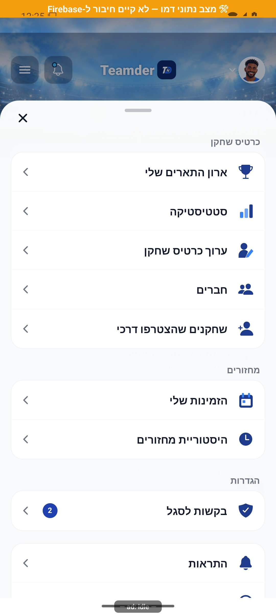
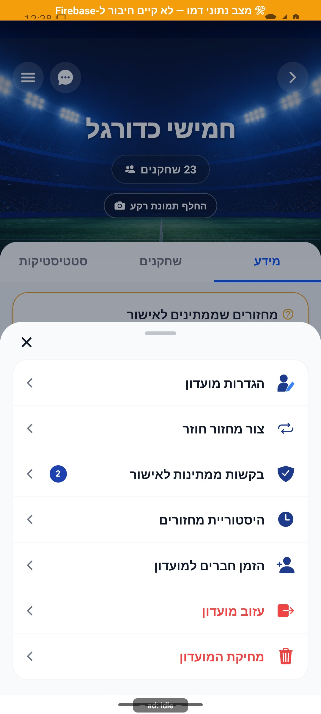
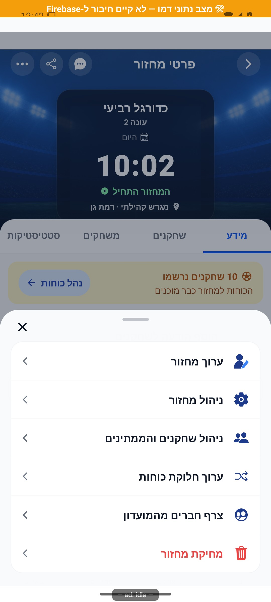
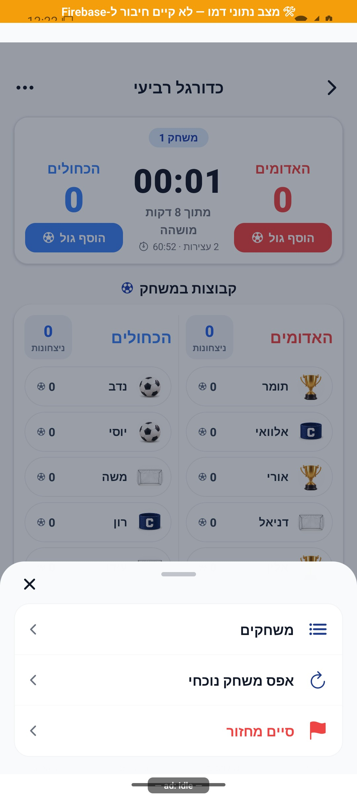
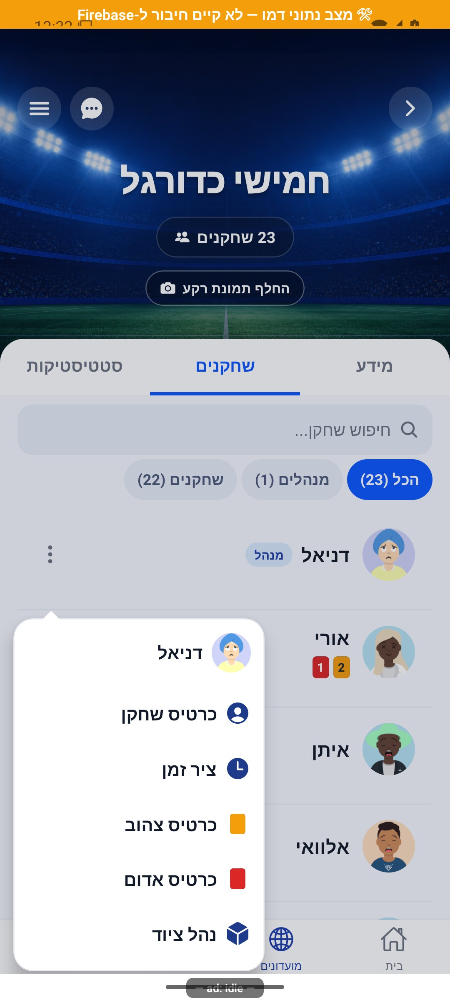
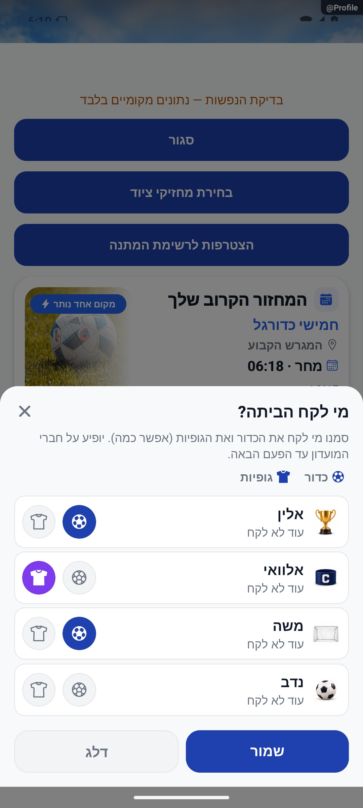
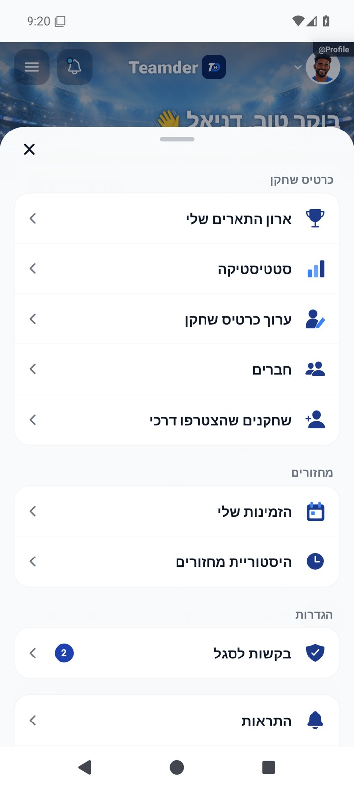

# תפריטים שנפתחים מלמטה — הסבר פשוט

## מדידת פעולות ואמינות נתונים, 5.11.2026

נוספה הכנה למדידת הפעולות ברכיבים המתועדים כאן. בפולס אפשר לראות ביצועים וחשבונות ייחודיים לפי פעולה ותקופה, כאשר קיים כיסוי מדידה. איסוף החשבונות החדש עדיין כבוי והמימוש מקומי. [פירוט והיקף הבדיקות](../../audits/2026-11-04-system-night/product-measurement.md).

## גופן גדול וחלונות נמוכים, 4.11.2026

כשמגדילים את הכתב או פותחים את האפליקציה במסך צר, כותרות, כיתובי כפתורים, הצעות חיפוש וערכים שנבחרו בטופס יכולים להופיע בכמה שורות. בחלונות האישור אפשר לגלול כדי לקרוא את ההודעה ולהגיע לכפתור גם כשהמסך נמוך. אפשר לגלול גם בבורר התאריך והשעה, והמרווח בין השעות והדקות מתאים את עצמו לכתב המוגדל.

## שיפורי טעינה משותפים, 4.11.2026

עודכנו מנגנוני הטעינה המשותפים כדי לצמצם עבודה וקריאות חוזרות. דרך השימוש בפיצר נשמרת. השינוי מקומי וטרם הופץ, ואין אימות מכשיר חדש של המסך הזה. [היקף, מדידות ומגבלות](../../changes/2026-11-04-screen-performance.md).

## התאמת מבנה שלדי הטעינה, 3.11.2026

השלד הותאם למבנה התוכן, כולל מיקום התמונות, האזורים והריווח. אין שינוי בנתונים או בפעולות המסך. השינוי מקומי וטרם הופץ. נבדקו אזורי מקור בדפדפן בשלושה רוחבים, ללא בדיקת מכשיר חדשה. [המידות, הבדיקות והמגבלות](../../changes/2026-11-03-skeleton-layout-alignment.md).

כל 6,820 הבדיקות ובדיקת הטיפוסים עברו. האימות החזותי במשימה זו הוא בדפדפן בלבד.

## ליטוש מקומי והשפעת רכיבים, 3.11.2026

חלונות אישור אינם מפעילים בקשה כפולה ואינם נסגרים בזמן שהפעולה ממתינה. בחלון מחיקת חשבון גם העריכה וגילוי הסיסמה חסומים בזמן ההמתנה, וכשל שומר את הקלט. תמונת שחקן שלא נטענת מוחלפת באותיות שמו, ונוספו שמות ומצבי פעולה לשדות ההצעות ולפעולות נוספות בכותרת. מלל כפתור אזהרה הוכהה. נבדקו רכיבי המקור בבדיקות ממוקדות, ללא בדיקה מלאה של כל מסך או של קורא מסך במכשיר.

[הראיות והמגבלות של המשימה](../../changes/2026-11-03-overnight-mission.md).

## בדיקת קצה ואימות מקורי, 2.11.2026

נבדקו שלדי הטעינה והשיפורים החדשים באנדרואיד במצב הדגמה. תוקנו מצבי חזרה לרשימה, תוצאה ריקה, כשל בנתוני הסגל והמשכיות בין שיחות. נבדקו גם לחיצה כפולה, ביטול וצמצום תנועה. מקומי וטרם הופץ. [שחזור, תיקונים, בדיקות ומגבלות](../../changes/2026-11-02-experience-review.md).

## המשכיות ומשוב בשימוש, 2.11.2026

נוספו מעבר עדין מהמתנה לתוכן, משוב לאחר פעולה שהושלמה, שמירת מקום ברשימות, ביטול ארכוב והצגת עדכונים בלי לקפוץ בקריאה. התנועה מכבדת את הגדרות המכשיר. מימוש מקומי שטרם הופץ. [התנהגות, בדיקות, צילומים ומגבלות](../../changes/2026-11-02-experience-polish.md).

## הכדורגל שלי בעמוד הראשון של הקרוסלה - 25.10.2026

עודכנה הקרוסלה האישית בבית, בקובץ משותף לתהליך הזה או לכלי הבדיקה שלו. אין שינוי נוסף בפעולות המתוארות כאן ולא נערכה להן בדיקת ממשק חדשה. מקומי וטרם הופץ. [השינוי והבדיקות](../../changes/2026-10-25-home-profile-carousel.md).

תוקן סנכרון אזור הלחיצה בלשוניות שנצמדות לראש המסך: הכפתור צריך להגיב במקום שבו הוא מוצג, גם אחרי חזרה לראש. התיקון מקומי ונבדק באימולטור; עדיין אין אישור מהטלפון שבו דווחה התקלה.

עדכון מקומי מ־13.10.2026: הגנת הלחיצות אחרי גלילה הורחבה גם לבית ולרשימת המחזורים. תיעוד לשוניות המועדון והמחזור מאפשר להבחין בין נגיעה, תנועה, ביטול ולחיצה שהושלמה. פעולות הלשוניות נשארו כפי שהיו. אין עדיין אישור שכל מקרי התקלה נפתרו במכשיר שבו דווחו.

עדכון מקומי מ־13.10.2026: הודעות קמפיין מובנות מקבלות את אותו משטח עדין של שאר החלוניות. עיצוב שהוגדר לקמפיין נשמר, והכותרת אינה מתנגשת בכפתור הסגירה. נבדקו תצוגה רגילה ותחתונה באנדרואיד עם נתוני דמו בלבד; לא נשלחה הודעה אמיתית. [צילום](../screenshots/overlays-campaign-native-2026-10-13.png).

התפריטים מרכזים פעולות שקשורות למסך שבו נמצאים. בתפריטים התומכים בכך אפשר לסגור באמצעות גרירת הידית למטה, הקשה מחוץ לחלון או כפתור הסגירה.

[איך זה עובד מאחורי הקלעים](menus-and-motion.md)

## מראה אחיד לחלונות — 12.10.2026

החלוניות מקבלות משטח נקי, מסגרת עדינה, צל ופינות עקביות שמתאימים לעיצוב האפליקציה. חלון אישור, תפריט תחתון ומידע קטן משתמשים באותה שפה, במבנה שמתאים לתפקידם. דרכי הסגירה והפעולות נשמרות.

בדקנו וצילמנו שש חלוניות באימולטור אנדרואיד עם נתוני הדגמה. המעבר על כל החלוניות עדיין בעבודה, ולא בוצעה בדיקת אייפון.

## כך זה נראה

הצילומים מציגים את המצבים המתועדים; פרטי מקור ומגבלות במסמך המעמיק.

## עדכון 8.10.2026 — תנועה ותיקוני דיווחים

נוספו מעברים קצרים לבחירה, סינון ושינוי מצב. איור ברשימה ריקה מופיע פעם אחת; אין לולאת תנועה חדשה קבועה.

## השלמת הנפשות — 8.10.2026

נוספו תנועות קצרות להרשמה, המתנה, ממלאים, ציוד, עונות, הודעות ובחירת סמן. ההנפשות מכבדות הפחתת תנועה ואינן תנאי להצלחת הפעולה.

[פרטי האימות והמגבלות](../../changes/2026-10-08-motion-completion.md). מקור: `9ec0dfd` עם שינויים מקומיים; טרם פורסמה גרסה.

## התאמה למסך הטלפון — 8.10.2026

המסכים והחלונות שומרים מקום לשורת השעה ולשורת הניווט, בהתאם למכשיר. ההתאמה כוללת גם מקלדת, כך שכפתור השליחה בטופס הדיווח נשאר גלוי. נבדק באמולטור אנדרואיד עם מחוות ושלושה כפתורים; בדיקה על אייפון עדיין נדרשת.

## גלילה ואנימציות — 9.10.2026

בעת גלילה המספרים מתייצבים כדי לפנות משאבים לתנועה. אנימציות חוזרות במסך שעזבת נעצרות ומתחדשות כשחוזרים אליו. כרטיס לחיץ ממתין רגע לפני תגובת הכיווץ כדי שלא יכווץ את התוכן בתחילת גרירה. השינוי מקומי; אומת בדמו באנדרואיד, ללא בדיקת אייפון או טלפון פיזי.

## הגנת לחיצות אחרי גלילה — 9.10.2026

נוספה הגנה למצב שבו הגלילה כבר עצרה אבל המכשיר לא דיווח שסיים: הכפתורים אינם נשארים חסומים בגלל אירוע הסיום החסר. עדיין נדרש אישור במכשיר שבו דווחה התקלה.

[בדיקות ומגבלות](../../changes/2026-10-09-pulse-round2.md).

## תיקוני עיצוב ונגישות — 10.10.2026

מקור: `a348b9f235f1e1433497600555303231512a0834` עם שינויים מקומיים. אין בסעיף זה הוכחת גרסת חנות.

כשהמכשיר מבקש לצמצם תנועה, מחוון השלבים, מתג הכדור, חלון ההחלפה, הגיליון הקפיצי ומשוב הלחיצה מציגים מצב סופי בלי קפיצה או הבהוב. המספרים המונפשים מכבדים הגדלת גופן.

## עוד חלוניות באותו סגנון

תיקון מקומי מ־13.10.2026: גם תקציר המחזור ובועת ההדרכה משתמשים באותה שפה של מסגרת, פינות וצל. העיצוב והאיורים הייחודיים נשמרו. נבדקו בגופן רגיל בדמו אנדרואיד; הבדיקה אינה אישור לכל גודל גופן או לכל חלונית.

התקציר נבדק גם בגופן 130% לאחר פתיחה מחדש: הפרטים עוברים שורה והכפתורים נשארים נגישים. רכיב ההדרכה שצולם קיים בקוד אך אינו מחובר כיום למסך מוצר; לא נוספה הצגה חדשה שלו.

חלונית עם הודעה ארוכה מאפשרת כעת לגלול את התוכן, בזמן שכפתורי הפעולה והסגירה נשארים במקומם. נבדקה בדמו אנדרואיד עם 24 פסקאות, כולל הגעה לסוף התוכן. הבדיקה אינה קמפיין שנשלח למשתמשים.

הבדיקה חזרה גם עם גופן מוגדל ל־130% לאחר פתיחה מחדש; שני הכפתורים והסגירה נראים. הגופן המקורי הוחזר.

בסבב הסגירה נבדקו גם חלוניות הצ׳אט, התראות, התנגשות הרשמה, עונות וכרטיס לשחקן. כפתורי חלונית הכרטיס נשארים גלויים עם המקלדת. נבדק גם אישור מחיקת שער בעיצוב האחיד, בלי למחוק שער.

נבדקו גם תזכורת זמינות, בחירת מנצחת ומסירת ציוד. תוקן סימון שכיסה את שם הקבוצה, וסדר כפתורי הציוד הותאם לעברית. רשימת הציוד נגללת בלי להסתיר את הפעולות. הבדיקות נעשו בדמו ללא שמירה.

נבדקו גם בורר משלים, תפריט שחקן וניהול ציוד לשחקן. חלונית ניהול הציוד תוקנה כך שתיפתח בתחתית; תפריט ליד שחקן בתחתית נפתח מעליו וכל הפעולות נראות. לא נשמרו נתונים בבדיקה.

## אימות לחיצות באנדרואיד — 23.10.2026

התיקון הקיים ללחיצות לאחר גלילה נבדק מחדש באימולטור אנדרואיד 35 עם נתוני דמו: לשונית השחקנים במועדון, פתיחת כרטיס השיתוף ולשונית משחקים נעוצה במחזור פעלו בלחיצה הראשונה לאחר הגלילה. נשמר יומן אירועים מקומי; אין שינוי נוסף במנגנון ואין אימות במכשיר המדווח או באייפון. [ראיות וגבולות](../../changes/2026-10-23-crash-test-and-pulse-followup.md).

## עדכון מסבב הפולס — 23.10.2026

תוקנה הצגת זמינות ישנה בכרטיס שחקן, פריסת הטקסט בקרוסלת הטיפים ועיצוב חלונית שמירת העונה. נוסף טיפול מוגבל בתקלות זמניות בטעינת מועדונים ובספק הכתובת באנדרואיד. אלו שינויים ברכיבים משותפים; לא כל פעולה במסך השתנתה. התיקונים מקומיים וטרם הופצו. [בדיקות, צילומים ומגבלות](../../changes/2026-10-23-pulse-resweep.md).

## סריקת לילה ואחידות ממשק — 24.10.2026

סמל כללי השיחה הועבר לצד ימין של הכותרת, ונקודות חוקי המועדון הועברו לימין הטקסט. חלונות חילוף שחקנים והשלמת הרכבים משתמשים במעטפת העיצוב הקיימת של החלונות התחתונים. אין שינוי בפעולות, בחירות או תנאי סגירה. נבדקו מציגי מקור מבודדים בדמו אנדרואיד; מקומי וטרם הופץ.

[צילום אחרי](../screenshots/night-chat-terms-after-2026-10-24.png) · [דוח הסריקה והגבולות](../../audits/2026-10-24-night-scan.md).

## טיפול בפולס — 24.10.2026

חלונות הלייב מציגים סמל קטן וכפתורים אחידים. בחלון צר או עם גופן מוגדל הכפתורים עוברים לטור.

[פירוט התיקונים, הבדיקות והמגבלות](../../changes/2026-10-24-pulse-current.md). התיקונים מקומיים וטרם הופצו.
