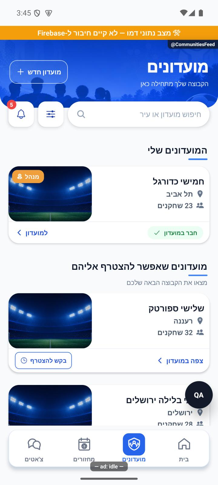
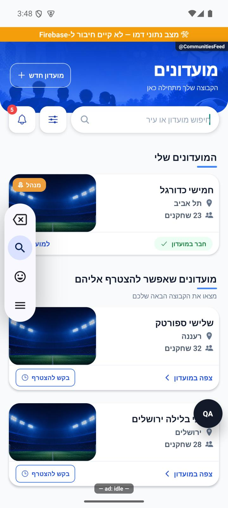
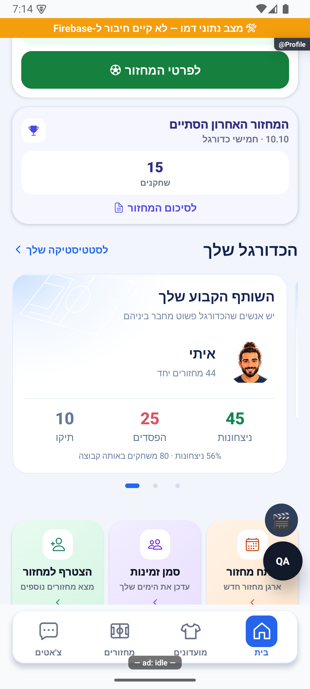
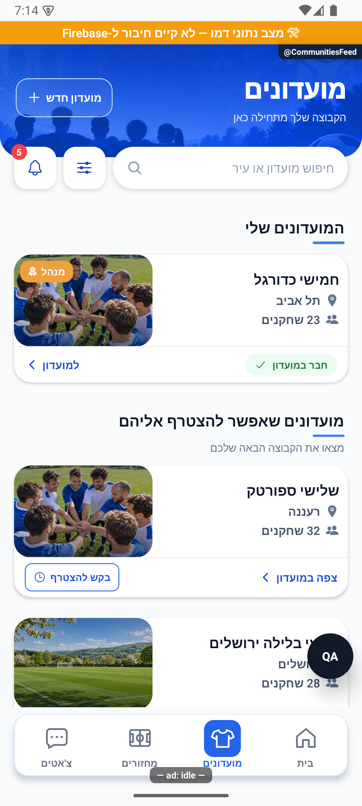

# שורת הניווט הראשית

## התאמה למסך ולגופן, 4.11.2026

בקובץ `src/navigation/MainTabs.tsx` ארבע התוויות מוצגות ללא הגבלת שורות ועם גודל הגופן שבחר המשתמש. `onLayout` מודד את הגובה של כל תווית לאחר הפריסה. גובה הסרגל הוא 54 נקודות ועוד הגבוה מבין 16 נקודות וארבע המדידות. הוא יכול גם להתכווץ כאשר הטקסט שוב נכנס בשורה. הסמלים נשארים באותו קו מעל התוויות.

ראיות התצוגה והמגבלות של בדיקת המכשיר מרוכזות בתיעוד כרטיס השחקן. [תיעוד הבדיקה](../profile/player-card.md)

המעטפת מודדת גם את הגובה הכולל עם המודעה והריווח. בועת התמיכה שמוצגת מעל מחסנית הניווט משתמשת במדידה זו. [מיקום בועת התמיכה](support-chat.md)

[הסבר פשוט](navigation-dock.simple.md)

עודכן 11.10.2026 עם שינויים מקומיים; אין הפצת חנות במשימה זו.

## מראה ומיקום

שורת הניווט הלבנה נמצאת בתוך האזור הבטוח. מרווח הצד הוא 16 נקודות, המרווח העליון 8 והתחתון 10. רדיוס הפינות הוא 16 נקודות. יש מסגרת בהירה וצל עדין. גובה השורה מתחיל ב-70 נקודות. ארבע הלשוניות מסודרות מימין לשמאל לפי סדר המקור. אלה בית, מועדונים, מחזורים וחברים. השורה נמצאת בזרימת הפריסה, והמודעות מופיעות מעליה. `SystemSafeArea` מקצה את שולי המערכת פעם אחת. יתרת השוליים מועברת למעטפת, וגבולות `BottomTabBar` מאופסים כדי למנוע ריווח כפול.

## אייקונים והנפשה

src/components/NavigationDock.tsx מצייר אייקוני SVG בקו אחיד: בית, חולצת כדורגל, מגרש במבט על ובועת שיחה יחידה עם שלוש נקודות. האייקון הפעיל לבן, השאר אפורים; תוויות תמיד מתחת לאייקון. ההדגשה הכחולה42×42 עם רדיוס11 נעה במשך280 מילישניות בעקומת inOut cubic.

כאשר רוחב המסך חלקי מקדם גודל הגופן קטן מ-235, מרווחי הצד מצטמצמים לשש נקודות. הלשוניות מקבלות חלקים יחסיים ברוחב הסרגל. ללשונית בית מוקצה חלק קטן יותר כדי לפנות מקום לשמות הארוכים של המועדונים והמחזורים. בשאר המצבים החלוקה שווה. `DockCenterContext` מעביר את מרכז התא הנבחר כיחס לרוחב הסרגל. `DockHighlight` משקף את היחס עבור עברית וממקם את מרכז הרקע הכחול מעל מרכז התא. ההדגשה עוקבת אחרי הלשונית שנפתחה בפועל ומכבדת את הגדרת הפחתת התנועה.

## ניווט, מקלדת והתראות

BottomTabBar המקורי נשמר: אירועי tabPress ו־tabLongPress, נגישות ומצב selected. resetTabToRoot, planTabPress, inFlightSettled ו־maybeInterceptTabLeave לא שונו. לחיצה חוזרת מחזירה לשורש לפי החוזה הקיים; מעבר מהיר כפול נשאר תחת ההגנה הקיימת. מנוי unread של הצ׳אט נשמר, כולל ספירת הודעות ו־99+ מעל99; לא הוחלף בנקודה בלבד.

TabBarWithBanner מאזין לאירועי מקלדת, will ב־iOS ו־did באנדרואיד. בזמן מקלדת כל המעטפת, כולל הפרסומת, מוסתרת בלי להשאיר רצועה ריקה. הסגירה מחזירה את השורה ואת ההדגשה למצב הניווט הנוכחי. אין כתיבה למסד כחלק משורת הניווט.

## ראיות ובדיקות

### יציבות מסך בזמן התאוששות משגיאה

הדגשת הלשוניות אינה מנהלת את עץ המסכים המקורי. במחסנית המקורית נמצאה בעיה נפרדת: ב־`@react-navigation/native-stack@6.11.0`, מעטפת `styles.scene` הייתה ניתנת למיזוג עם תוכנה בזמן מיקוד, ואז התממשה מחדש כשהמאפיין `importantForAccessibility` השתנה ל־`no-hide-descendants`. כאשר `ErrorBoundary` החיצוני הסיר את מחסנית הניווט בעקבות שגיאה בזמן מעבר, העברת התוכן למעטפת החדשה התנגשה בהורה שהמעבר המקורי עדיין החזיק.

התיקון ב־`patches/@react-navigation+native-stack+6.11.0.patch` מציב `collapsable={false}` **רק** במעטפת הסצנה הזו. אין שינוי בסדר הלשוניות, הפניות, סמנטיקת נגישות, זמני מעבר או מנגנון הניסיון החוזר. לא שונו קוד מקורי או גרסאות תלות. `scripts/postinstall.cjs` מחיל את הטלאים עם `--error-on-fail`, ואז `scripts/verify-native-stack-scene.cjs` בודק את הגרסה, נקודת הכניסה שמטרו קורא ואת מאפיין המעטפת בעץ התחביר. שינוי תלות מחייב אימות מחדש; אין לדלג על הבדיקה כדי לאפשר בנייה.

באותה בניית פיתוח מקומית של אנדרואיד עם מנוע התצוגה החדש הושווה כשל מכוון באפקט של מסך צ׳אט: לפני התיקון שוחזרה חריגת הורות; מועמד מוקדם של מעטפת הקשר לא פתר אותה והוסר; אחרי תיקון הסצנה הופיע מסך ההתאוששות, ולאחר הסתרת הודעות הפיתוח הכפתור ״נסה שוב״ החזיר לבית באותו תהליך. אומת בקובץ החבילה הטרי שמטרו כלל את שורת התיקון. ההזרקה הוגבלה לפיתוח ולדמה. שש בדיקות שומר עברו, ובדיקת התקנה הסירה את הטלאי, הוכיחה כשל על המקור המקורי והחילה אותו מחדש בהצלחה. [הראיות והגבולות](../../../artifacts/pre-release-2026-10-10/native-ra01/source-investigation.md).

הטריגר הראשוני של הצ׳אט היה גישה לשירות אמיתי במצב דמה ותוקן בנפרד. אין כאן הוכחה לקריסת צ׳אט בייצור, לכל סוג שגיאה או לאייפון. מסך ההתאוששות משתמש ב־`StatusBar` של `react-native` עם `barStyle="dark-content"` ו־`backgroundColor={colors.bg}`, ללא שינוי שקיפות או שטח החלון. `fallback-rn-statusbar-visible.png` בתיקיית הראיות מאמת שעה וסמלי מצב כהים על הרקע הבהיר. לאחר הצילום ההזרקה הוסרה לגמרי ושש בדיקות השומר הורצו שוב ועברו (`native-scene-guard-tests-rn-final.log`). אין קוד בדיקה מכוון שממתין להפצה.

בסבב רגיל נוסף עם הטלאי וללא הזרקה נבדקו צ׳אט וחזרה, מיקוד כלי הקלט ללא הקלדה, מחזור, משחקים, סטטיסטיקות וגלילה. `final-patched-navigation-logcat.txt` נקי מחריגת הורות ומסימון הכשל. אין זו בדיקת שליחת הודעה או אימות התנהגות אייפון.

בדיקת טיפוסים וכל2,802 הבדיקות ב־190 חבילות עברו. יומנים artifacts/navigation-dock-tsc.log ו־artifacts/navigation-dock-jest.log. נלחצו ארבע הלשוניות בנתוני דמו באימולטור אנדרואיד. המעברים הוקלטו דרך screenrecord של האימולטור ב־artifacts/navigation-dock.mp4. נבדק רצף פריימים מההקלטה ב־artifacts/navigation-dock-motion.jpg, כולל מיקומי ביניים של הרקע הכחול. נתוני המסכים בזמן המעבר יכולים עדיין להיות בטעינה; אין זו תקלה שנמצאה בשורת הניווט.

נפתח חיפוש עם מקלדת כתב היד של האימולטור, והשורה נעלמה; לאחר סגירה היא חזרה. זה אינו אימות מקלדת iOS או מקלדת צ׳אט. מצב הפחתת תנועה, קורא מסך, גופן מוגדל, מסך רחב והודעות שלא נקראו נבדקו בקוד בלבד ולא הורצו. סימוני הדמו והפרסומת בפיתוח אינם חלק מהשורה. לא בוצעו יצירה, הצטרפות או כתיבה למסד במהלך בדיקות המסכים.

## החלפת האייקונים — 11.10.2026

הוחלפו נתיבי האייקונים בלבד בהתאם לסקיצה שאושרה. מידות האייקון, צבעי הבחירה, ההדגשה הנעה, התוויות, אירועי הלחיצה ומסלול הנתונים לא השתנו. נלחצו ארבע הלשוניות באימולטור אנדרואיד עם נתוני דמו ונבדקו המצב הפעיל והסדר מימין לשמאל. מסך המחזורים היה עדיין בטעינת נתונים בצילום; הצילום מאמת את שורת הניווט בלבד. לא הוקלט סרטון חדש ולא נבדק אייפון. בדיקת טיפוסים וכל 3,331 הבדיקות ב־240 חבילות עברו.

## עדכון 11.10.2026 — חברים וחיפוש שחקנים

האפיון והמימוש המעודכנים נמצאים ב[גילוי שחקנים ופרטיות](../profile/player-discovery.md). זהו עדכון מקומי, והוא גובר על תיאור ההתנהגות הישן כאשר קיימת סתירה. `PlayerCard` ו־`Statistics` נשארים המסלולים הקיימים; `ChatsList` מארח שתי לשוניות. ברירת המחדל לסטטיסטיקה היא חברים, ולתהליך החדש נשלח היטל מצומצם מהשרת. נצפו תצוגות נתוני המחשה באימולטור ונבדקו הפונקציות במסד מקומי. בהמשך התקבל אישור מפורש והושלמה הקשחת ההרשאות מקומית, לרבות התאמת קוראי הזהות הישנים. טרם נפרס; תלות עדכון הלקוחות מפורטת במסמך החדש.

### השלמת הרשאות מקומית — 11.10.2026

המדיניות המאושרת וקוראי הנתונים מפורטים ב[גילוי שחקנים ופרטיות](../profile/player-discovery.md). `userService.getUserById` מחזיר זהות בלבד לשחקן אחר; רק העצמי מקבל מסמך פרטי. טבלאות מועדון נשארו במסלול הרשאות המועדון. כללי ההודעות נאכפים גם בכתיבה ישירה, חברות מאושרת מוגנת, והיסטוריה נשמרת. אין כאן שינוי חזותי נוסף; הצילומים הקודמים הם מנתוני המחשה, ולא בדיקת שרת ייצור.

## בדיקת הלשוניות ברוחב 320, 4.11.2026

בגופן 200% נצפו ארבעת שמות הלשוניות בשורה אחת לאחר התאמת הרוחב. [סרגל הניווט מתחת לכרטיס השחקן](../screenshots/font-layout-city-2026-11-04.png).
