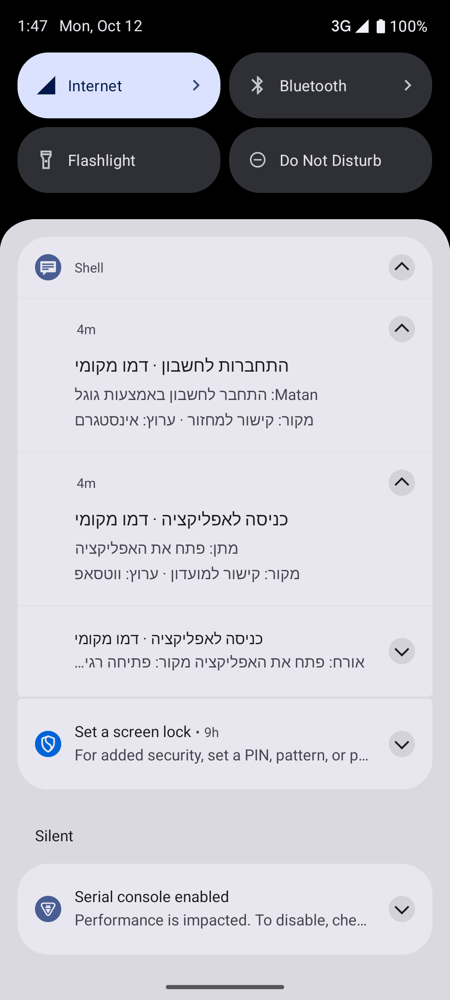

# מסלול ההצטרפות בפולס — תיעוד טכני

## הרחבת אבחון דיווחים, 27.10.2026

נוספה מעטפת אבחון מקומית עם מצב בזמן הכשל, שלבים בעלי מזהה ותזמון, מצב רשת ובנייה ומופעים נפרדים לשגיאה. נקודת הכניסה לתעבורת השרת עוברת כעת דרך העטיפה המשותפת; תשובות, חריגות, אפשרויות קריאה ומדיניות הפיצר נשמרות. אין כאן שינוי בהרשאות או בחישובי המוצר. הבדיקות המלאות ומגבלות האימות מתועדות בדוח המקושר; אין טענה לאימות מכשיר או להפצה. [היקף, ראיות ומגבלות](../../changes/2026-10-27-diagnostic-context.md).

באימות הסופי עברו כל 6,231 הבדיקות ב-555 חבילות, ובדיקות הטיפוסים של הלקוח, השרת והפולס נקיות. צילום הדפדפן והידור מקורות האנדרואיד הם בדיקות מקומיות; אין הוכחת מכשיר, הידור אייפון או מסירה חיה של הבנייה החדשה. רישום יומן השחרור נחשב מאומת רק לפי קבלת הקריאה החוזרת בדוח השינוי.

## הפצה פנימית 1.1.61 - 25.10.2026

הבינארי `1.1.61/295` הופץ ואומת במסלול הפנימי באנדרואיד. תיקוני הלקוח נכללים בו, ושירות הפרופיל נפרס ואומת בנפרד. גם תיקוני הסגל, שמירת התוצאה והתראת השגיאה בשרת נפרסו ואומתו באישור מפורש. שינויי יישום הפולס עצמו טרם הופצו. אין שינוי כללי הרשאה או הסבת נתונים. ניסוחי המצב המקומי בסעיפים הקודמים נכתבו לפני ההפצה; [דוח ההפצה](../../changes/2026-10-25-internal-1.1.61.md) מפרט בדיוק מה נכלל, מה נבדק ומה עדיין מקומי.

## תור עמיד בכשל רשת - 25.10.2026

`src/services/onboardingActivity.ts` משתמש בסיווג `isTransientReadError` מתוך `src/services/readRetry.ts`. כשל זמני אינו מדווח בשני הניסיונות הראשונים; הכשל השלישי מדווח פעם אחת, והתור ממשיך להמתין לאישור בלי להסיר את האירועים. הצלחה מאפסת את מונה הכשלים ומחזירה את זמן הניסיון לבסיס. כשל אחר נשאר מדווח. `tests/logic/onboardingActivityQueue.test.ts` מאמת שלושה כשלים, דיווח יחיד, שימור מזהה האירוע והתאוששות שמנקה רק אירוע מאושר. כל 5835 הבדיקות עברו; אין הוכחת מסירה חדשה למכשיר או פריסה בסבב.

[בדיקות ומגבלות](../../changes/2026-10-25-pulse-fixes.md).

## אימות דיווחי הכשל — 20.10.2026

בדיקת `onboardingActivity.test.ts` מתאימה כעת את תחליף מפעיל המסמכים לחבילת השרת המותקנת, כדי לבדוק את המטפל אחרי הוספת מעטפת הדיווח. אין שינוי בחוזה אירועי ההצטרפות או ביעדי ההתראות. [מסלול הדיווח ומגבלות האימות](../../changes/2026-10-20-error-reporting-audit.md).

## מקור הגעה מרוכז במסך משתמש — 20.10.2026

`App` מפרידה בין מקור ההפעלה הנוכחית לבין `PendingInvite` שנשמר ב־`AsyncStorage` לצורך ניווט או ייחוס בהרשמה מאוחרת. כאשר נמצא ייחוס תקין מהפעלה קודמת ללא `initialUrl`, האירוע `entry_source_resolved` מדווח `entry_source: organic` ללא `entry_channel`, `entry_campaign` או יעד מהייחוס הישן. קישור שנפתח בהפעלה הנוכחית ממשיך לדווח את יעדו ואת מקורו. כך פתיחה רגילה מאייקון אינה מוצגת בטעות כהגעה מקמפיין קודם, בלי למחוק את הייחוס הדרוש להשלמת ההרשמה.

`fetchUserActivity` קוראת עד 100 רשומות `onboardingActivity` של המשתמש ומאתרת את רשומת `entry_source_resolved` האחרונה לפי `occurredAt` או `createdAt`. היא מחזירה ל־`UserActivity.entryAttribution` רק שדות ייחוס שאינם מזהים אישיים: `entry_source`, `resolved_by`, `target_type`, `target_id`, `entry_channel`, `entry_campaign`, `entry_link_id`, זמן ומזהה ביקור. `entry_link_id` הוא מזהה הקישור הקצר, לא מזהה של אדם.

`UserDetailScreen` מציגה את הייחוס באזור ״מקור הכניסה שנשמר״ בתוך ״קישור הזמנה ומקור הגעה״. היא מציגה בנפרד גם את `users.acquisition.source`, `campaign`, `linkId` ו־`at`, כך שמזהה הקישור נשאר זמין גם כאשר אירוע מסלול ההצטרפות חסר. מקור הקמפיין אינו מוסתר כאשר קיים `invitedBy`; מזמין אישי ומקור פרסומי מוצגים יחד. באירועים חדשים מזהה הקישור נשמר בקטלוג המשותף ועובר בין אצוות ההיסטוריה.

הקריאה מוגבלת למשתמש שנבחר ונעשית באמצעות שאילתת שוויון קיימת על `onboardingActivity.uid`; כשל בקריאה אינו הופך לרשומת מקור ריקה אלא נרשם ב־`failedSources` כמו שאר מקורות מסך המשתמש. השדות החסרים מוצגים כ״לא תועד״. לא נוספה כתיבה, לא שונו כללים ולא בוצעה פריסה. התצוגה לא אומתה בצילום מסך של פולס לאחר השינוי, ולכן אין כאן טענה שהמסך הורץ.

## פריסת שרת מאושרת — 17.10.2026

`recordOnboardingActivity` נפרסה ב־`us-central1` ו־`onOnboardingActivity` נשמרה ב־`europe-west1`. המלאי נבדק בכל האזורים כדי למנוע כפילות. המקור הפעיל והתוצר תואמים לתיקוני הקשר הביקור ופתרון שם המזמין. לא נבדקה מסירה חדשה לטלפון ולא השתנו הרשאות או נתונים היסטוריים. [מצב הפריסה והראיות](../../changes/2026-10-17-server-preparation.md)

## תיקון מקומי: שם המזמין בהתראות הראשונות — 16.10.2026

בצילום הדיווח החדש נראה מקור קישור למועדון ללא שם המזמין, בעוד התראת ההרשמה הישנה כן הציגה אותו. `onboardingPushContent` לא קיבלה זהות מזמין. `App.reportEntrySource` מעבירה כעת את `pending.invitedBy` כ־`inviter_uid` להקשר המקומי של מסלול ההצטרפות בלבד; המזהה אינו נוסף לאירוע הנשלח למדידה הכללית. `recordOnboardingActivity` משמרת אותו ב־entryContext בין אצוות של אותו ביקור. `onOnboardingActivity` פותרת את השם מתוך מסמך המשתמש בשרת, אחרי בדיקת מבנה המזהה, ומוסיפה ״דרך …״ לנוסח.

אין שימוש ב־invitedBy היסטורי של פרופיל המשתמש: הוא עלול להיות מזמין אחר מביקור קודם. שם שהלקוח שולח אינו מתקבל כמקור. אם ידוע שיש מזמין אך אין מזהה/שם שניתן לפתור, מופיע ״המזמין טרם זוהה״; לקוח ישן שלא שלח מזהה אינו מקבל שם מומצא. אין שינוי הרשאות, זכאות הזמנה, קצב התראות או מספור אורחים. נדרשים לקוח חדש ופריסה נפרדת של שתי פונקציות הפעילות כדי להפעיל את כל השרשרת; לא בוצעה פריסה. הבדיקות מריצות קליטת ביקור, אצווה מאוחרת ושליחת התראה דרך מתאם בדיקה. לא נשלח פוש למכשיר אמיתי בסבב זה. [דוח](../../changes/2026-10-16-pulse-sweep.md).

[הסבר פשוט](onboarding-activity.simple.md)

עודכן 14.10.2026; בסיס `b8a8ccf4` ושינויים מקומיים. המימוש נפרד מיומן השחזור המקומי; הוא אינו מעלה את כלל פעולות המשתמש. מדיניות ההתראות העדכנית מתוארת בסעיף הבא; הסעיפים המתוארכים בהמשך משמרים היסטוריה.

## מספור אורחים ושינוי בחירה — נפרס 14.10.2026

`onboardingGuestNumber` מקצה מספר שלם חיובי רציף בטרנזקציה: `adminConfig/onboardingGuestCounter.lastNumber + 1`, ושומר אותו ב־`onboardingGuests/{uid}`. הזהות מגיעה מאסימון האימות; מספר שהלקוח שולח אינו מתקבל. ההקצאה אינה יוצרת מסמך משתמש ואינה משנה הרשאות. מונה לא תקין גורם לכשל ולא לאיפוס שיכול למחזר מספרים. מספר קיים נקרא גם אחרי שדרוג אנונימי ששומר UID, בכל ביקור חדש ובניסיון חוזר. הסדר הוא סדר הקצאת השרת, לא סדר התקנות היסטורי. לא הוסבו נתוני ייצור.

`recordOnboardingActivity` מצרפת `guestNumber` לרשומה. בטרנזקציית כתיבת האירועים נקרא מצב `onboardingJourneyState/{sha256(uid:sessionId)}`. אירועים חדשים ממוינים לפי `sequence`; `intent` ו־`intentSequence` שומרים את הבחירה האחרונה. בחירה שונה מקבלת `previousIntent`; בחירה זהה או ישנה מסומנת `repeatedIntent`. מסירה מחדש אינה משנה מצב או מכסה. סמני `intent-event:eventId` מאפשרים א׳→ב׳→א׳ עם שלוש התראות, ומונעים שליחה נוספת של אותו אירוע. סדר הפעלת טריגרי ההתראות אינו משנה את ניסוח המעבר שנשמר בזמן הקליטה. אירוע ישן שמגיע לאחר בחירה מאוחרת נשמר ללא התראת בחירה חדשה; אין שחזור סדר שלא התקבל בזמן.

אותו מצב שומר רק את שדות מקור הכניסה המותרים מאירוע `entry_source_resolved`, ומעשיר פעולות מאוחרות שהלקוח שלח ללא מקור. שדות מפורשים באירוע הנוכחי קודמים למקור ששמור. אין ניחוש לפי מקור התקנה היסטורי, זמן סמוך או זהות אחרת, ואין כאן הוספת `linkId` למסע.

| אירוע | נוסח ומניעת כפילות |
|---|---|
| פתיחת אורח | ״אורח 42: פתח את האפליקציה״; מספר זהה בביקורים הבאים |
| בחירה ראשונה | הנוסח הקיים בצירוף מספר אורח |
| בחירה שונה | ״אורח 42: שינה בחירה: מ־הקמת מועדון ל־יצירת מחזור חד־פעמי״, עם בידוד כיווניות לתוויות |
| לחיצה חוזרת על הבחירה הנוכחית | היסטוריה בלבד |
| `auth_prompt_shown` עם מספר אורח | ״פתח את תהליך ההרשמה או ההתחברות״, פעם לביקור; אין טענה שהושלם |
| התחברות מוצלחת | שם ומספר אורח אם קיים; נשמר הסמן המשותף לשני אירועי הצלחה |
| `onNewUserJoined` | התראת ההרשמה הקיימת קוראת את המספר לאחר חלון ההמתנה הקיים ומצרפת אותו אם כבר הוקצה |
| כניסה של חשבון רשום | ההתראה נשארת פעילה; חשבון שמעולם לא מוספר אינו מקבל מספר אורח חדש |

המספר מייצג UID אנונימי, לא אדם או התקנה ייחודיים. שדרוג במקום שומר אותו. מעבר לחשבון קיים עם UID אחר אינו מעביר אותו, כדי לא לקשר זהויות ללא הוכחה. התראת הרשמה עלולה להגיע לפני שאירועי האורח הועלו; במקרה כזה אין מספר בהתראת ההרשמה ההיא, אך התראת ההצלחה המאוחרת מציגה אותו כשאותו UID כבר מוספר. אורחים שכבר פעלו לפני הפריסה יקבלו מספר עם אירוע אורח חדש; אירוע ישן שכבר נשלח אינו נשלח שוב.

בדיקות ממוקדות מכסות UID מאומת, מספר יציב בין ביקורים ושדרוג, התעלמות ממספר שהלקוח שלח, מונה נפרד לאורח נוסף, א׳→א׳→ב׳→א׳, סדר טריגרים הפוך, משלוח חוזר, הקשר מקור בין בקשות, תחילת הרשמה והצלחה עם אותו מספר. תצוגה ומסירה חיה כפופות לראיות בדוח השינוי. שלוש הפונקציות `recordOnboardingActivity`, `onOnboardingActivity`, `onNewUserJoined` נפרסו ב־14.10.2026 באישור הבעלים. שלושת השירותים פעילים ושמונת קובצי המקור של כל ארכיון פרוס תואמים לחבילה שנבדקה. אין צורך בקובץ התקנה חדש עבור לקוחות שכבר שולחים אירועי הצטרפות. בקשה ללא אימות נדחתה ב־401; מסירת התראה חדשה למכשיר טרם אומתה.

## דיוק התראות — 12.10.2026, מימוש מקומי

`onboardingPushPolicy` שולחת התראת פתיחה לכל משתמש שמקור כניסתו נפתר ומצב האורח שלו ידוע, לרבות חשבון רשום. `auth_completed` ו־`sign_in_success` שאינו אורח משתפים אבן דרך אחת של התחברות; השרת אינו שולח אותה לזהות אנונימית. בחירת מסלול שולחת התראה רק לאורח ובארבעת המסלולים המוגדרים. פתיחה והתחברות נשארות מוגבלות לאחת מכל סוג לביקור. החל מ־14.10 בחירות שהתקבלו במימוש החדש מזוהות לפי מעבר ולא לפי סוג בחירה, כמפורט להלן. רשומות כפולות נשמרות כהיסטוריה בלי התראה נוספת. ערוצי הרשמה ויצירת מועדון/מחזור הקיימים נשמרים.

`onboardingPushContent` מפרידה בין ״פתח את האפליקציה״ לבין ״התחבר לחשבון״. שם נלקח מפרופיל השרת לפי `name`, אחריו `displayName`, ואחריו `actorName` שנשמר בשרת. חשבון רשום בלי שם מוצג כמשתמש מחובר ללא שם, ולא כאורח. תווי בקרה מוסרים ושמות מבודדים בכיווניות כדי לתמוך גם בשם לועזי. הזהות עצמה עדיין נגזרת מאסימון האימות.

`App.reportEntrySource` שומרת גם `entry_channel` ו־`entry_campaign` כאשר הם קיימים בקישור. `entrySource.getEntryContext` מחזירה עותק של הקשר ההפעלה הנוכחית; `recordOnboardingActivity` מצרפת אותו לפעולות הבאות, לרבות התחברות ובחירה. `userStore` מוסיף את אמצעי ההתחברות לאירוע ההצלחה. הקטלוג המשותף בשלושת העותקים מסנן שדות ומחרוזות עם כתובות רשת, דואר או מספרי טלפון. אין שימוש במקור ההתקנה ההיסטורי כדי לנחש מקור פתיחה נוכחית. קישור מועדון או מחזור מזוהה גם ללא מזמין; קישור כללי ללא מזמין אינו מכונה הזמנה אישית. מקור חסר מוצג כלא ידוע. המקור מתאר את ההפעלה; לא נוסף כאן מעקב עצמאי לכל קישור שנפתח כשהאפליקציה כבר פועלת.

לאחר ניסיון מסירה נשמרים גם `pushTitle` ו־`pushBody` לצורכי אבחון. כיבוי ההתראות, ניסיונות חוזרים, תור מבודד לפי זהות, יעדים שכבר קיבלו ומזהה איחוד באייפון נשמרים. אין שינוי בהרשאות, במונים או בניווט מההתראה אל הביקור.

נבדקו בקריאה בלבד 30 אירועים אחרונים מהשרת. נמצאו פתיחות של חשבונות רשומים שנשמרו כהיסטוריה בלבד וקישור כללי ללא מזמין ללא פירוט מקור בהתראה. בדיקות אוטומטיות מכסות מקורות כניסה, זהות ושמות, הקשר הפעלה, סינון מידע, אמצעי התחברות ומניעת התראה כפולה באותו ביקור. כל 3,593 הבדיקות ב־280 חבילות עברו, בדיקות הטיפוסים של טימדר ופולס ובניית פונקציות השרת עברו.

זהו צילום התראות דמו מקומיות של מערכת אנדרואיד שנוצרו מפלט הפונקציה החדשה, עם שם בעברית ושם לועזי. הוא מוכיח את הצגת הנוסח בלבד; לא נשלחה התראה חיה, לא נבדק מקבל ההתראות של פולס ולא נבדק אייפון. השינוי טרם נפרס. נדרשת פריסת פונקציות השרת ועדכון טימדר כדי לקבל את פרטי הערוץ והקמפיין החדשים. לקוחות ישנים ממשיכים להיתמך, ומידע שלא שלחו אינו מומצא. שינוי תיאור ההגדרה בפולס דורש עדכון פולס; קבלת התראה אינה תלויה בתיאור ההגדרה.

## ניווט והרשאות

פולס → עוד → מסלול ההצטרפות (`OnboardingActivityScreen`). לחיצה על התראה פותחת את הביקור המזוהה ב־`sessionId`, גם בפתיחה קרה. הממשק משתמש בחיבור המנהלי הקיים; לא שונו כללי מסד או הרשאות. לקוח טימדר משתמש בפונקציה מאומתת, לרבות חשבון אורח אנונימי שכבר נוצר בתהליך הרגיל; התיעוד אינו יוצר חשבון.

## זרימת הנתונים

`analyticsService.logEvent` → סינון בקטלוג `src/utils/onboardingActivity.ts` → `onboardingActivity.recordOnboardingActivity` → תור `AsyncStorage` → `recordOnboardingActivity` → אוסף `onboardingActivity` → `onOnboardingActivity` → סינון אבני דרך → התראה מנהלית. פולס קורא עם `runQuery`, ולא עם רשימת המסמכים שעלולה להיות לא עדכנית.

הקטלוג מועתק ל־`functions/src/onboardingActivityCatalog.ts` ול־`pulse/src/services/onboardingActivityCatalog.ts`. בדיקת זהות מלאה מונעת התפצלות; אחרי שינוי יש לסנכרן את שלושת העותקים. כותרות הפעולות והפירוט נגזרים מ־`activityLabel`.

כל אירוע מכיל UUID של ביקור, מזהה אירוע יציב, מספר סידורי, `occurredAt` משעון המכשיר, שם פעולה ופרמטרים מותרים. השרת מוסיף UID מתוך האימות, שם שחקן מהפרופיל, מצב אנונימי ו־`createdAt` משעון השרת. מספר סידורי מסדר את הביקור גם אם השעון השתנה. זמן המכשיר אינו הוכחה לזמן שרת; התור יכול להישלח באיחור.

## כיסוי תהליך פעיל

| מסלול | פעולות |
|---|---|
| פתיחה ומקור | התחלת אורח, מקור כניסה, פתיחה רגילה, מסך פתיחה והמשך |
| בחירת דרך | צפייה, כל שלוש הבחירות, ההזמנה הנוספת כשהיא קיימת, חשבון קיים |
| הזמנה | מקור נדחה, הזמנה אישית, פתיחת מועדון או מחזור מההזמנה, חקירה, הזמנה לא זמינה |
| התחברות | פתיחת חלון, ספק, ביטול ספק, כשל והצלחה; סגירה מכפתור, רקע וגב מערכת; מייל, החלפת מצב, איפוס, הצגה/הסתרה של סיסמה, יציאה |
| פרופיל | צפייה, מיקוד וסיום עריכת שם ללא תוכן, עיר נבחרת ללא תוכן, פתיחת בוחר תמונה, ביטול/כשל/הצלחה, אוואטר, לחיצת שמירה, הצלחה/כשל |
| המשכיות | שמירת פעולה ממתינה, חזרה או כשל, שלבי הקמת מועדון ומחזור, יצירה או כשל |
| הרשאות התראה | הסבר, בחירה, תוצאת הרשאה, מעבר להגדרות |

מסך השקופיות `OnboardingScreen` הוא מסך היסטורי שאינו רשום במסלול הפעיל. אין לטעון שהמעבר בין שקופיות בו כוסה או הורץ. חלון מערכת וספקי התחברות חיצוניים נמדדים בתוצאה שחוזרת לאפליקציה; אין גישה ללחיצות בתוכם. הקלדה לפי תו אינה נשלחת.

## כמויות, מכנים ומצבים

ספירה היא מספר הרשומות לפי הפעולה והבחירה/שלב, כולל לחיצות חוזרות; אינה מספר אנשים או התקנות. ביקורים שונים נספרים לפי `sessionId` ולא לפי UID, משום שהזהות יכולה להשתנות מהאורח לחשבון בתוך אותו ביקור. ברירת המחדל מציגה פעולות שהתקבלו בשרת ב־24 שעות; ביקור שנבחר נשלף בפני עצמו ומסודר לפי `sequence`. תקרה של 2,000 רשומות מוצגת במפורש כספירה חלקית. אין אחוזי המרה או מכנה שהוסק בטעות מתוך חלק מהרשומות.

| מצב | התנהגות |
|---|---|
| אין עדיין אימות | תור מקומי; האימות הקיים מעיר את השליחה |
| רשת מנותקת/כשל | האירועים נשארים עד אישור מפורש; ניסיון חוזר 2–60 שניות |
| אישור שרת | מוסרות רק הרשומות שאושרו; עד 20 בכל בקשה |
| שליחה חוזרת | אותו מזהה אירוע מניב אותה רשומת מסד; אין פעולה נוספת |
| עומס חריג | עד 600 אירועים לשעה ל־UID; חריגה מוחזרת ככשל והתור ממתין |
| התראות כבויות | היסטוריה נשמרת; `pushStatus=muted` |
| אין מכשירים רשומים | ההיסטוריה נשמרת עם `no_devices` |
| כשל מסירה זמני | מצב `retrying`; פונקציית האירוע מבקשת ניסיון חוזר |
| טעינת פולס נכשלה | הודעת כשל ואפשרות ניסיון חוזר, לא אפס מדומה |

לא משתמשים במגבלת 20 השניות הכללית של `pushToAdmins`; היא הייתה מפילה לחיצות שונות. התראה ממוספרת במזהה האירוע באנדרואיד כדי לא להחליף התראה אחרת. `sent` הוא אישור שירות ההתראות ולא הוכחה שהאדם ראה אותה. ניסיונות מסירה חוזרים עלולים לייצר התראה חוזרת במכשיר שכבר קיבל אותה אם הייתה הצלחה חלקית או שהפונקציה נעצרה לאחר שליחה ולפני עדכון המסמך. ההיסטוריה עצמה אינה כפולה. תיעוד מקומי תלוי באחסון זמין; קריסה מיד לפני השלמת כתיבה יכולה לאבד את הפעולה האחרונה.

## בדיקות וראיות

`tests/logic/onboardingActivity.test.ts`: זהות הקטלוגים, הסרת שדות פרטיים, אימות, דחיית מזהים כפולים ואירוע לא מוכר, אישור חוזר ללא ספירה כפולה, שתי התראות סמוכות וכיבוי ללא מחיקת היסטוריה. `onboardingActivityQueue.test.ts`: לחיצות לפני אימות, כשל רשת, מזהים יציבים, לחיצות חוזרות וסינון פעולה שאינה שייכת לתהליך.

נדרש אימות חי לאחר אישור פריסה והפצת לקוח חדש. לא נוצרו חשבונות או מועדונים לבדיקה, ולא הופעלו פעולות יצירה בחשבון הבעלים. צילום הממשק ומצב הפריסה יתועדו ביומן המשימה; בדיקת קוד אינה הוכחה לקבלת התראה במכשיר אמיתי.

## צילום בפועל

הצילום מפולס 1.0.90 / 97 באמולטור. מצב עם רשומות והתראה חיה עדיין לא אומתו מול שרת פרוס.

## הבהרת התראות בטלפון — 10.10.2026

כל הפעולות ממשיכות להישמר בהיסטוריה. פוש חדש נשלח רק ל־`entry_source_resolved` כאשר `is_guest=true`, ול־`entry_intent_selected` כאשר `is_guest=true` והבחירה היא אחת מארבע הבחירות המותרות. אין פוש על צפייה בשלב, ספק התחברות, עריכת פרופיל, כפתור שמירה או לחיצה רגילה. הרשמה לאפליקציה, יצירת מועדון, יצירת מחזור ועדכון זמינות נשארים בהתראות הקיימות; הערוץ החדש אינו שולח עליהם פוש נוסף.

`onboardingPushPolicy.onboardingPushMilestone` קובעת את המדיניות בשרת, בלי לצמצם את התיעוד. מזהה סמן מחושב מ־sessionId וסוג אבן הדרך; בחירה כוללת גם את סוג הבחירה. טרנזקציה באוסף `onboardingMilestonePushes` שומרת את מזהה האירוע הראשון. כניסה חוזרת שנמדדה באותו ביקור או אותה בחירה שוב נשמרות עם `milestone_duplicate` בלי פוש נוסף. בחירה אחרת יכולה לשלוח פוש אחד נוסף; ביקור חדש מקבל סמן חדש. יתר הפעולות מקבלות `history_only`. אין תלות בהגבלת 20 השניות של ההתראות הקודמות.

פולס 1.0.91 / 98 מעדכן את כותרת ההגדרה ואת מצבי המסירה. לא בוצעה פריסה; קובץ 1.0.90 הקודם אינו מפעיל בעצמו שליחה של כל הלחיצות. מסירת התראות חיה נשארת לא מאומתת עד לפריסה ולעדכון לקוח טימדר.

## אימות חי — 10.10.2026

שתי הפונקציות `recordOnboardingActivity` ו־`onOnboardingActivity` נפרסו באישור מפורש, כולל ניסיונות חוזרים. באמולטור בדיקות נפרד מול הייצור נשמר רצף פתיחה ובחירת הקמת מועדון. שירות ההתראות אישר שליחה לחמישה מכשירים בכל אחת משתי אבני הדרך; זו קבלת בקשת השליחה, לא אישור צפייה בטלפון. פעולות הצפייה וההמשך נשמרו כהיסטוריה בלבד.

נמצא ותוקן מקומית מרוץ: אירוע מקור הכניסה נשלח לפני שחזור זהות המשתמש, ולכן אורח סומן כחבר ולא קיבל התראת כניסה. מעתה מקור הכניסה מתפרסם לניווט מיד, אך האירוע ממתין לזהות משוחזרת דרך `entryGuestAfterHydration`. אחרי התיקון נצפה `is_guest: true` ושליחה מוצלחת. נוספו שתי בדיקות נסיגה; בדיקת הטיפוסים נקייה וכל 3,258 הבדיקות ב־231 חבילות עברו.

האימות בוצע עם קוד מקומי עדכני בתוך מעטפת פיתוח, ולא עם גרסה שהועלתה לחנות. בדיקות הזמנה למועדון ולמחזור, מעבר מחנות להתקנה והתחברות באפל טרם הושלמו בסבב החי הזה.

## המשך הבדיקה החיה — 10.10.2026

נבדקו בפועל הזמנת מועדון והזמנת מחזור דרך Chrome באמולטור נפרד: דף נחיתה, לחיצה על הכפתור הראשי, פתיחת האפליקציה במצב נקי והצגת אפשרות עם שם המזמין. במועדון נפתח היעד הנכון ונדרשה התחברות לבקשת הצטרפות. במחזור סגור נשמר היעד אך אורח נחסם לסגל בלבד. נבדקה גם הזמנה כללית בעת שהאפליקציה פעילה. מקור הכניסה נשמר עם היעד ועם זיהוי אורח; שירות השליחה אישר מסירה לחמישה מכשירים, בלי אישור הצגה בטלפון.

הבדיקה השתמשה בקוד מקומי במעטפת פיתוח ואינה הוכחת התקנה מהחנות. התחברות באפל ובגוגל, מעבר מהחנות לאחר התקנה והשלמת הצטרפות אחרי אישור מנהל לא אומתו. הממצאים, הצילומים וגבולות הכיסוי מפורטים ב־[דוח הבדיקה החיה](../../changes/2026-10-10-onboarding-live-qa.md).

## הקשחת זהות ותור — סקירת שחרור 10.10.2026

אירוע מקומי כולל כעת `ownerUid` שנקבע מתוך Firebase בצד הלקוח. הוא משמש רק לסינון מקומי. בקשת השליחה כוללת `expectedUid`; השרת משווה אותו ל־`request.auth.uid` ודוחה מעבר זהות שקרה בזמן הקריאה. מקור הזהות לכתיבה נשאר אסימון האימות בלבד. לקוח ישן שאין בו `expectedUid` נשאר נתמך.

המסע מתחיל לפני האימות אם צריך, ואירועי אותו מסע נקשרים לזהות הראשונה באותו תהליך. שדרוג אורח באמצעות `linkWithCredential` ששומר אותו UID משמר תור ומסע. כניסה לחשבון קיים עם UID אחר מפרידה מסע ואינה מייחסת לו את פעולות האורח הקודם: הן ממתינות רק לבעליהן. אין העברת בעלות בלתי מוכחת. יציאה מוצלחת מפעילה גם `resetOnboardingJourney` ב־`userService.signOut`, בנוסף להאזנה לשינוי האימות, כדי לכסות callbacks מאוחרים. אם הקריאה ליציאה נכשלת, הגבול המפורש לא מופעל.

תור ישן ללא שדה בעלים אינו משויך בדיעבד לחשבון הנוכחי. רשומה בעלת מבנה לא תקין, JSON פגום או זמן מתקדם ביותר מיום מבודדים מקומית. האבחון ב־`teamder:onboarding-activity:quarantine` מכיל רק זמן ומספר רשומות, ללא התוכן. במקרה דחייה סופית `invalid-argument` מבודדות הרשומות באמצעות משלוח יחידני; כשל רשת נשאר בר־ניסיון חוזר. בכך רשומה פסולה אינה חוסמת את האירועים התקינים שאחריה. שמירת מונה אבחון אינה מבטיחה שחזור התוכן שנדחה.

במסירה חלקית של פוש נשמרות טביעות SHA-256 של היעדים שהצליחו ושל אסימונים לא תקינים. ניסיון חוזר שולח רק ליעדים שלא קיבלו ושלא נכשלו לצמיתות. מוני המסירה מצטברים בין הניסיונות. עדיין קיימת אפשרות לכפילות אם התהליך נעצר אחרי משלוח ולפני שמירת התוצאה, או אם שתי הפעלות רצות במקביל; אין הבטחת בדיוק־פעם־אחת של שירות רשת.

נוספו בדיקות להחלפת חשבון עם תור ממתין, שדרוג אותו אורח, גבול יציאה מפורש, JSON/רשומה/זמן פסולים, דחייה סופית לצד אירוע תקין, בדיקת הזהות בשרת ומסירה חלקית עם ניסיון חוזר ליעד שנכשל בלבד. לא שונה ממשק ולכן אין צילום חדש. השינויים מקומיים: לא נפרסו פונקציות ולא אומתה מסירה חיה לאחר ההקשחה.

### השלמת בידוד מסע שנקטע לפני אימות

אירוע עם `ownerUid=null` נשמר רק אם הוא מהמסע הנוכחי או שמסעו נקשר לזהות בתהליך הנוכחי. לאחר הפעלה מחדש, מסע לא מאומת מהתהליך הקודם מבודד ואינו ממתין בדיסק ללא הגבלה. נשמר רק מונה אבחון מקומי; לא מנסים לנחש שזה אותו אדם. נוספה בדיקה של עצירה לפני אימות, הפעלה מחדש וחשבון אחר.

הודעות APNS כוללות כעת `apns-collapse-id` שהוא SHA-256 של מזהה האירוע — 64 תווי ASCII, בתוך מגבלת 64 הבתים. הוא עשוי לאחד הודעות ממתינות חוזרות לאותו אירוע באייפון, אך אינו מבטל התראה שכבר נמסרה ואינו מבטיח מסירה פעם אחת. חלון הכפילות בין שליחה לשמירת התוצאה נשאר מתועד. 37 בדיקות ממוקדות עברו בשלוש חבילות. אין שינוי במדיניות ניסיונות חוזרים, הרשאות או פריסה.

## בדיקה לילית והחלפת ביקור — 13.10.2026

במדגם קריאה בלבד של 100 אירועי ייצור נמצאו 5 אירועי מקור כניסה שנמסרו לשירות ההתראות ו־15 שנשמרו בהיסטוריה בלבד. כניסות חשבונות רשומים עדיין משקפות את מדיניות השרת הישנה; התיקונים המקומיים אינם פרוסים. אין זו הוכחת הצגה במכשיר. [ראיות ומגבלות](../../audits/2026-10-12-onboarding-night-review.md).

מסך OnboardingActivityScreen משתמש ב־createOnboardingActivityLoader. לכל טעינה מספר דור עולה; רק התשובה האחרונה מעדכנת שורות, שגיאה וסיום טעינה. מעבר ביקור או יציאה מהמסך מבטלים את זכות העדכון של בקשות קודמות, ללא ביטול בקשת הרשת עצמה. נשמרים המיון, טווח הקריאה, תקרת 2,000, חזרה לכל הביקורים וניסיון חוזר. ארבע בדיקות onboardingActivityLoader משתמשות בתשובות מאוחרות, שגיאה ישנה, יציאה מהמסך וניסיון חוזר. אין שינוי עיצוב או צילום חדש; לא הורצה החלפת ביקור במכשיר פולס אמיתי.

אימות עדכון 14.10: 3,761 בדיקות ב־310 חבילות עברו, בדיקות הטיפוסים ובניית השרת עברו. התצוגה לא אומתה: האמולטור לא החזיר צילום. [דוח השינוי ומגבלות האימות](../../changes/2026-10-14-onboarding-guest-numbers.md).
