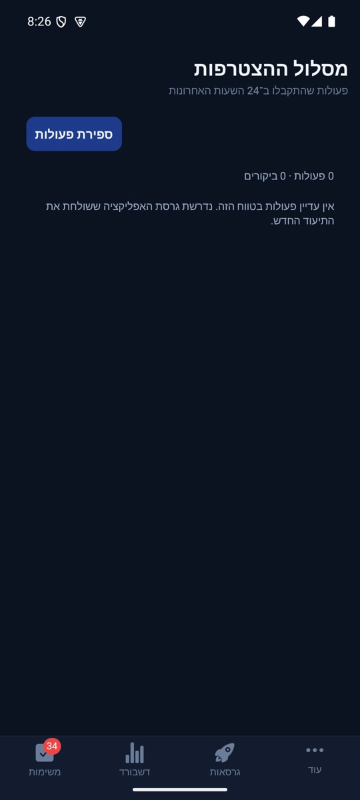

# מסלול ההצטרפות בפולס — הסבר פשוט

## הרחבת אבחון דיווחים, 27.10.2026

הדיווחים יוכלו לכלול מה ניסו לבצע, מה היה מצב האפליקציה ומה החזיר השרת. פרטים חסרים מוצגים כלא ידועים, ומספר מוגבל של מופעים נשמר בלי למחוק את המופע הראשון. השינוי מקומי וטרם הופץ, ואינו משלים פרטים לדיווחים ישנים. [היקף, ראיות ומגבלות](../../changes/2026-10-27-diagnostic-context.md).

בדיקות הקוד הושלמו, אך השינוי עדיין מקומי ולא הופץ. פרטים שלא נאספו בדיווחים ישנים אינם משוחזרים בדיעבד.

## הפצה פנימית 1.1.61 - 25.10.2026

הבינארי `1.1.61/295` הופץ ואומת במסלול הפנימי באנדרואיד. תיקוני הלקוח נכללים בו, ושירות הפרופיל נפרס ואומת בנפרד. גם תיקוני הסגל, שמירת התוצאה והתראת השגיאה בשרת נפרסו ואומתו באישור מפורש. שינויי יישום הפולס עצמו טרם הופצו. אין שינוי כללי הרשאה או הסבת נתונים. ניסוחי המצב המקומי בסעיפים הקודמים נכתבו לפני ההפצה; [דוח ההפצה](../../changes/2026-10-25-internal-1.1.61.md) מפרט בדיוק מה נכלל, מה נבדק ומה עדיין מקומי.

## תור עמיד בכשל רשת - 25.10.2026

פעולות ההצטרפות נשארות בתור בזמן כשל רשת ומנסות להישלח שוב עם אותם מזהים. הכשל השלישי ברצף מדווח פעם אחת עד התאוששות. אין שינוי במדדי ההצטרפות או בקהל ההתראות; התיקון מקומי וטרם הופץ.

[בדיקות ומגבלות](../../changes/2026-10-25-pulse-fixes.md).

## בדיקת תקלות — 20.10.2026

נוספו דיווחים על כשלים בלי לשנות את תהליך ההצטרפות. בדיקות ההתראות הותאמו למנגנון החדש; אין בכך הוכחה שדיווח חדש הגיע לפולס החי. [פרטים ומגבלות](../../changes/2026-10-20-error-reporting-audit.md).

## מקור הגעה במסך המשתמש — 20.10.2026

פתיחה רגילה בלחיצה על אייקון האפליקציה מופרדת כעת מייחוס ישן שנשמר במכשיר לצורך הרשמה עתידית. לכן ערוץ מקישור קודם לא יוצג שוב כאילו המשתמש נכנס עכשיו דרך אותו קישור; רק קישור שנפתח בהפעלה הנוכחית או מקור התקנה שנפתר בהפעלה זו מדווח כמקור כניסה.

במסך פרטי משתמש בפולס מופיע כעת אזור קבוע שמרכז את מקור הכניסה שנשמר: סוג כניסה, ערוץ, קמפיין, מזהה קישור, דרך הפתרון, היעד, המועד ומזהה הביקור. מזהה הקישור נשמר גם באירוע הכניסה החדש, כדי שאפשר יהיה לאתר את הקישור המדויק ולא רק את סוג המקור. האזור מציג גם את מקור ההגעה שנרשם בביקור האחרון, ולכן אפשר לבדוק משתמש מסוים בלי לחפש רק בהתראות.

אם אין נתון, מוצג במפורש ״לא תועד״. אין השלמה לפי ניחוש, לפי שם הקישור או לפי מקור היסטורי אחר. השינוי מקומי בקוד; לא בוצעה בנייה, התקנה או פריסה, ולכן לא נוצר צילום מסך חדש.

## פריסת שרת מאושרת — 17.10.2026

שתי פונקציות תיעוד ההצטרפות עודכנו, כולל שימור זהות המזמין והצגת שמו מהשרת. לא נשלחה התראת ניסוי ולא הועלתה גרסת אפליקציה חדשה. [מצב הפריסה והראיות](../../changes/2026-10-17-server-preparation.md)

## תיקון מקומי — 16.10.2026

בהתראות הראשונות יופיע גם מי הזמין, כאשר הקישור מספק את הזהות ואפשר למצוא את שמו. מקור הקישור נשאר מוצג. אם אין מספיק מידע לזיהוי, ההתראה אומרת זאת במפורש ולא משתמשת במזמין מביקור קודם. התיקון מוכן בקוד אך עדיין דורש עדכון אפליקציה ופריסת שרת; לא נשלחה התראת בדיקה למכשיר אמיתי. [פירוט ובדיקות](onboarding-activity.md).

פולס מקבל רשומה נפרדת לכל פעולה נתמכת בתהליך ההצטרפות: כניסה, בחירה בהקמת מועדון או מחזור, המשך מהזמנה, התחברות והשלמת פרופיל. אפשר לראות את השעה, את סדר הפעולות בביקור ואת מספר הפעמים שנבחרה כל אפשרות. לחיצה על פעולה מציגה את הביקור שלה.

אפשר לקבל התראה על פתיחת האפליקציה, התחברות לחשבון ועל בחירת אורח איך להתחיל, ולכבות אותן בהגדרות פולס. כשידוע שם המשתמש הוא מופיע בהתראה, יחד עם מקור הפתיחה וערוץ הקישור כשנמסר. כיבוי ההתראות משאיר את ההיסטוריה. תיעוד בלי חיבור לרשת ממתין במכשיר ונשלח כשהחיבור וההתחברות זמינים. אין תיעוד של סיסמאות או טקסט מוקלד.

עדכון שנפרס ב־14.10.2026: לכל זהות אורח מוקצה מספר קבוע, למשל ״אורח 42״, שנשמר בין ביקורים ובהפיכת אותו אורח לחשבון רשום. ההתראות על כניסה של משתמשים רשומים ממשיכות כרגיל. מספר אורח אינו מספר התקנה או הוכחה לאדם ייחודי; זהות אנונימית חדשה מקבלת מספר חדש.

הבחירה הראשונה מתוארת כבחירה. שינוי מתואר עם שני הצדדים, למשל ״אורח 42 שינה בחירה: מהקמת מועדון ליצירת מחזור חד־פעמי״. לחיצה חוזרת על הבחירה הנוכחית נשמרת בהיסטוריה בלי התראה נוספת; חזרה לבחירה קודמת אחרי שינוי כן שולחת התראה.

פתיחת חלון ההתחברות של האורח מתוארת כפתיחת תהליך הרשמה או התחברות, בלי לטעון שהושלם. בהצלחה מופיעים השם ומספר האורח. גם התראת ההרשמה הקיימת מצרפת את המספר אם כבר נשמר. מעבר לחשבון קיים בעל זהות אחרת אינו משויך לאורח הקודם ללא הוכחת קישור.

השינוי נפרס בשרת ב־14.10.2026 באישור הבעלים. אין צורך בקובץ התקנה חדש עבור לקוחות שכבר שולחים את אירועי ההצטרפות. ייחוס מקור שכבר התקבל באותו ביקור נשמר גם לפעולות של לקוחות ישנים שאינם שולחים אותו בכל פעולה; פרטים שלא התקבלו אינם מומצאים. פירוט ההוכחות ומגבלות התצוגה נמצא במסמך הטכני.

[הפירוט הטכני והגבלות האימות](onboarding-activity.md).

## צילום בפועל

הצילום מפולס 1.0.90 / 97 באמולטור. מצב עם רשומות והתראה חיה עדיין לא אומתו מול שרת פרוס.

## הבהרת התראות בטלפון — 10.10.2026

כל הפעולות נשמרות בהיסטוריה, אבל ההתראות לטלפון ממוקדות: אורח נכנס לאפליקציה, ואז בחר להקים מועדון, ליצור מחזור, למצוא משחק או להמשיך מהזמנה. אותה בחירה חוזרת באותו ביקור אינה שולחת שוב התראה. אם בחר מסלול אחר, תיתכן התראה נוספת.

ההתראות הקיימות על הרשמה לאפליקציה, יצירת מועדון, יצירת מחזור ועדכון זמינות ממשיכות כרגיל. אין התראה חדשה על כל לחיצה, צפייה במסך או עריכת פרופיל.

פולס 1.0.91 / 98 מעדכן את הגדרת ההתראות. ההפעלה ממתינה לפריסת השרת ולעדכון טימדר; מסירה חיה עדיין לא אומתה.

## אימות חי — 10.10.2026

שתי הפונקציות `recordOnboardingActivity` ו־`onOnboardingActivity` נפרסו באישור מפורש, כולל ניסיונות חוזרים. באמולטור בדיקות נפרד מול הייצור נשמר רצף פתיחה ובחירת הקמת מועדון. שירות ההתראות אישר שליחה לחמישה מכשירים בכל אחת משתי אבני הדרך; זו קבלת בקשת השליחה, לא אישור צפייה בטלפון. פעולות הצפייה וההמשך נשמרו כהיסטוריה בלבד.

נמצא ותוקן מקומית מרוץ: אירוע מקור הכניסה נשלח לפני שחזור זהות המשתמש, ולכן אורח סומן כחבר ולא קיבל התראת כניסה. מעתה מקור הכניסה מתפרסם לניווט מיד, אך האירוע ממתין לזהות משוחזרת דרך `entryGuestAfterHydration`. אחרי התיקון נצפה `is_guest: true` ושליחה מוצלחת. נוספו שתי בדיקות נסיגה; בדיקת הטיפוסים נקייה וכל 3,258 הבדיקות ב־231 חבילות עברו.

האימות בוצע עם קוד מקומי עדכני בתוך מעטפת פיתוח, ולא עם גרסה שהועלתה לחנות. בדיקות הזמנה למועדון ולמחזור, מעבר מחנות להתקנה והתחברות באפל טרם הושלמו בסבב החי הזה.

## המשך הבדיקה החיה — 10.10.2026

נבדקו בפועל הזמנת מועדון והזמנת מחזור דרך Chrome באמולטור נפרד: דף נחיתה, לחיצה על הכפתור הראשי, פתיחת האפליקציה במצב נקי והצגת אפשרות עם שם המזמין. במועדון נפתח היעד הנכון ונדרשה התחברות לבקשת הצטרפות. במחזור סגור נשמר היעד אך אורח נחסם לסגל בלבד. נבדקה גם הזמנה כללית בעת שהאפליקציה פעילה. מקור הכניסה נשמר עם היעד ועם זיהוי אורח; שירות השליחה אישר מסירה לחמישה מכשירים, בלי אישור הצגה בטלפון.

הבדיקה השתמשה בקוד מקומי במעטפת פיתוח ואינה הוכחת התקנה מהחנות. התחברות באפל ובגוגל, מעבר מהחנות לאחר התקנה והשלמת הצטרפות אחרי אישור מנהל לא אומתו. הממצאים, הצילומים וגבולות הכיסוי מפורטים ב־[דוח הבדיקה החיה](../../changes/2026-10-10-onboarding-live-qa.md).

## שמירה על זהות המשתמש ועל רצף תקין

לאחר יציאה מהחשבון מתחיל מסלול חדש, והפעולות שממתינות לשליחה נשארות שייכות לאדם שביצע אותן. הפיכת אותו אורח לחשבון שומרת על המסלול שלו. כניסה לחשבון אחר אינה מעבירה אליו פעולות של מישהו קודם.

רשומה פגומה אינה עוצרת את המשך התיעוד. אם רק חלק מהטלפונים קיבלו התראה, הניסיון הבא מתמקד בטלפונים שנכשלו זמנית. עדיין ייתכן כפל נדיר אם השירות נעצר מיד אחרי שליחה. ההקשחה נבדקה בבדיקות אוטומטיות; היא עדיין לא נפרסה ולא נבדקה במסירה חיה.

אם התהליך נסגר לפני שזוהה המשתמש, הפעולות הישנות ללא בעלים אינן מועברות לחשבון הבא. באייפון נוסף מזהה קבוע לכל התראה שמסייע לאחד ניסיונות משלוח חוזרים ממתינים; הוא אינו מבטיח שלא תהיה כפילות לאחר מסירה.

## מעבר בין ביקורים — תיקון מקומי מ־13.10.2026

כשעוברים לביקור אחר או לכל הביקורים, תשובה ישנה מהשרת לא תחליף את הרשימה החדשה ולא תציג שגיאה מהביקור הקודם. נבדק עם תשובות שהגיעו בסדר הפוך, ללא שינוי עיצוב. מסירת התראות אמיתית עדיין דורשת אימות לאחר פריסה מאושרת.

אימות עדכון 14.10: 3,761 בדיקות ב־310 חבילות עברו, בדיקות הטיפוסים ובניית השרת עברו. התצוגה לא אומתה: האמולטור לא החזיר צילום. [דוח השינוי ומגבלות האימות](../../changes/2026-10-14-onboarding-guest-numbers.md).
