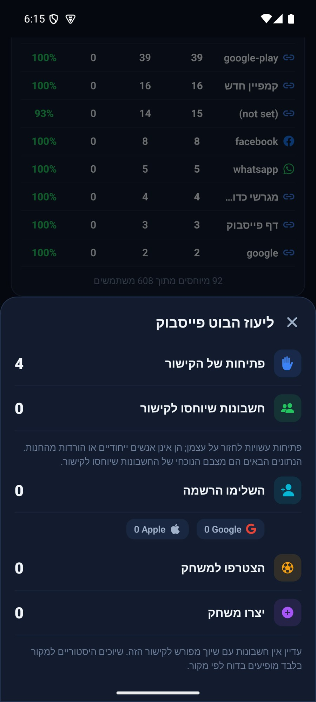

# מדידת קישורים בפולס

## ארגון הפולס — 18.10.2026

המסך מופיע כעת בשם האחיד ״קישורים ומקורות״ בקבוצת הגיוס בתפריט. יצירת קישור והמדידה שלו נשארו כפי שהיו.

שינוי מקומי, טרם בנייה והתקנה.

[הסבר טכני](pulse-links.md)

בפולס, תחת ״מקורות״, יוצרים קישור נפרד לכל פרסום. בחלון הקישור רואים כמה פעמים פתחו אותו וכמה חשבונות יוחסו במפורש לקישור הזה. פתיחות יכולות לחזור על עצמן; הן אינן מספר אנשים שונים או הורדות מהחנות.

מתוך החשבונות האלה רואים כמה השלימו הרשמה, השתתפו במחזור או יצרו מחזור, לפי מצבם הנוכחי. חשבונות ישנים שיש להם רק מקור, למשל פייסבוק, נשארים בדוח המקור ולא נזקפים לקישור מסוים. כשאין חשבונות מיוחסים מוצג אפס ללא אחוז המרה. בכשל טעינה מוצגת שגיאה עם אפשרות לנסות שוב.

התיקון מוכן במקור הפולס הנפרד. בניית עדכון מקומי ואימות חזותי מתועדים במסמך הטכני; אין מכאן אישור לפריסה או לגרסת חנות.

העדכון `Pulse-1.0.89-v96.apk` הותקן באימולטור מעל הפולס הקיים ללא מחיקת נתונים. בקישור שנבדק רואים ארבע פתיחות ואפס חשבונות שיוחסו לו; שמונת החשבונות הישנים נשארים בדוח פייסבוק. הקובץ נמצא גם על שולחן העבודה. טרם נבדקה התקנה בטלפון שלך.

## עיצוב ואיחוד — 18.10.2026

קמפיינים, קהלים, קישורים ומדבקות אוחדו למרכז גיוס וקשר. כל לשונית נטענת רק בפתיחתה ושומרת טיוטות במעבר; קישורים ישנים מופנים ללשונית המתאימה.

[התנהגות, קריאות, צילומים ומגבלות](pulse-management.md#עיצוב-פחם-ואיחוד-מרכזי-העבודה--18102026). שינוי מקומי; לא נבנה או נפרס.

## יישור עברית — 18.10.2026

תוקן יישור הכותרות, השמות, הטקסט והמסננים במסכי הפולס החדשים. גם ערכים שמופיעים מול כותרת ושמות באנגלית מקבלים כיוון מתאים. אין שינוי בנתונים או בפעולות; השינוי עדיין מקומי וצריך להיכלל בהתקנה חדשה כדי שיופיע בטלפון. [פירוט הבדיקה](../../audits/2026-10-18-pulse-rtl.md).

אימות נוסף ב־19.10.2026: נבדקו באימולטור מסך המשתמשים, שלוש לשוניות פרטי השחקן, החיפוש והסינון. תוקנו גם כיוון ההקלדה ושגיאת תצוגה בסקירת השחקן. יתר המסכים נבדקו בקוד; התיקונים טרם הופצו.
