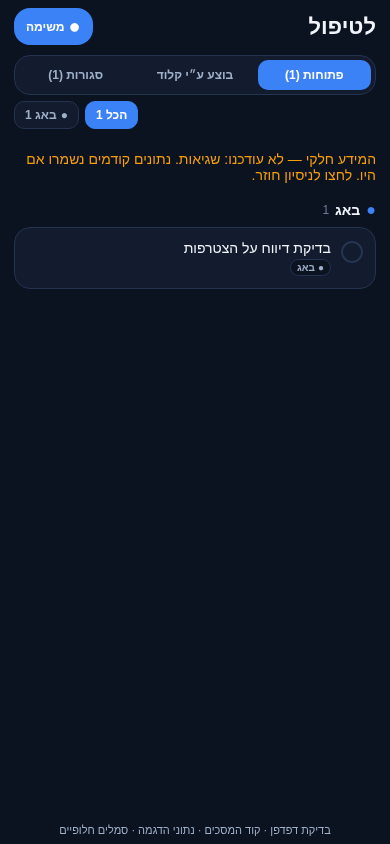
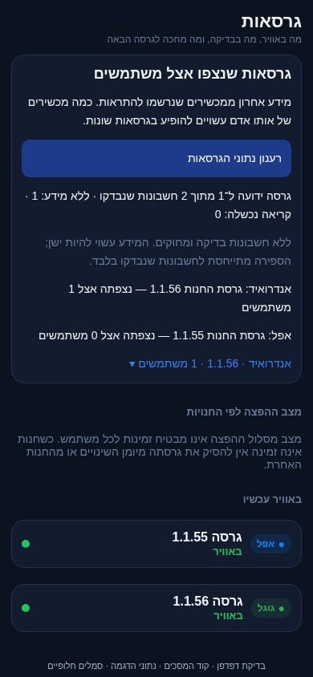
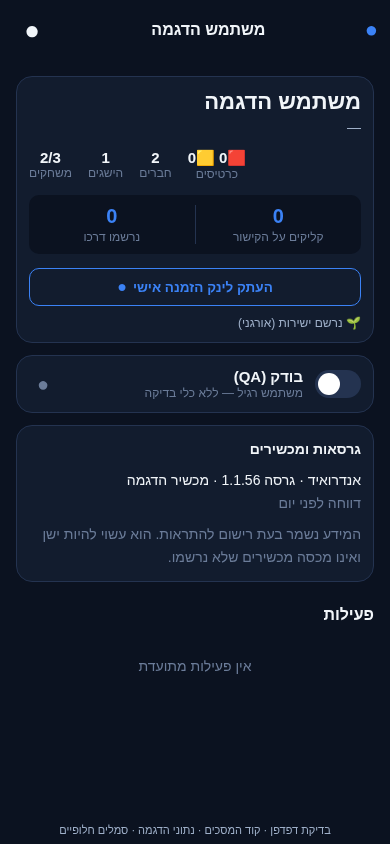
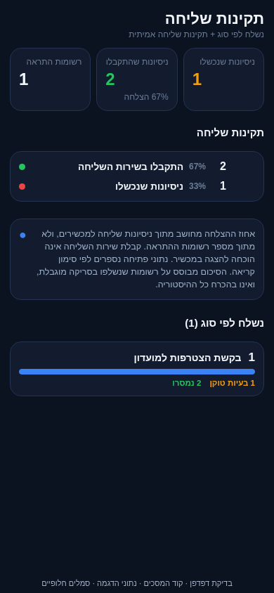
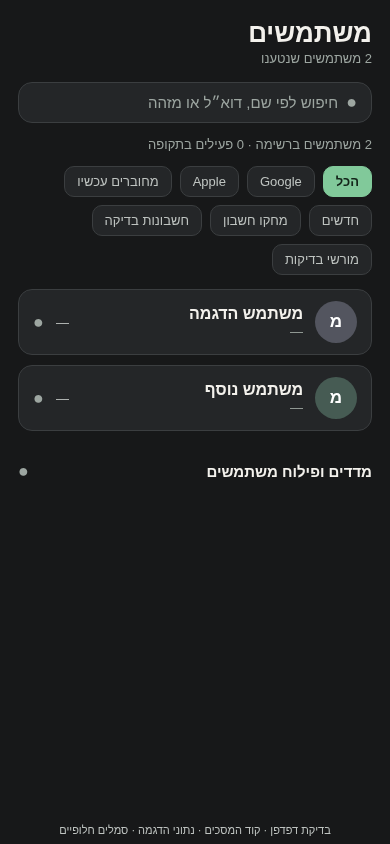
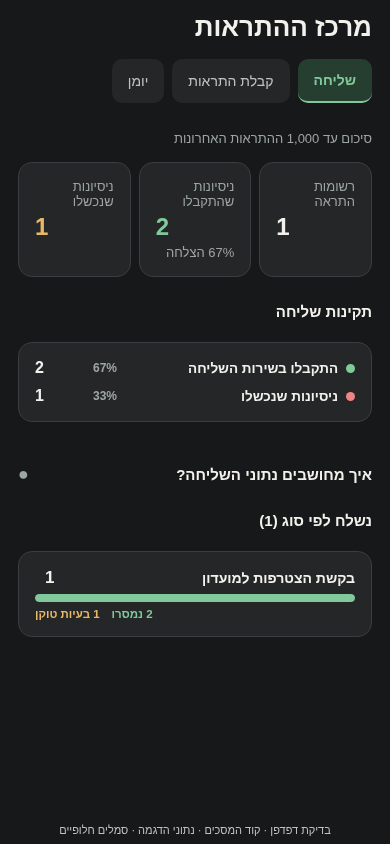
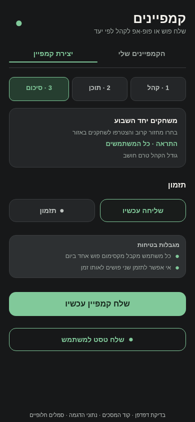
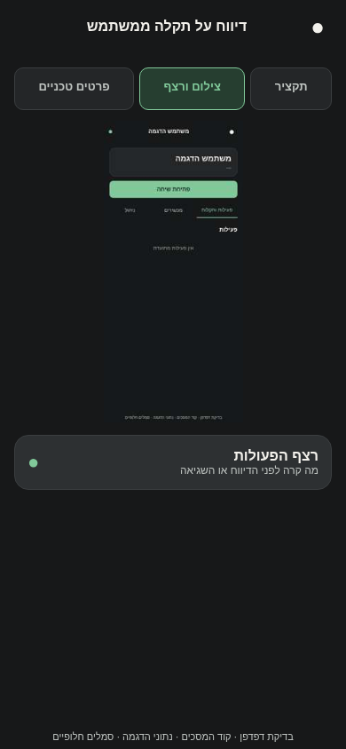
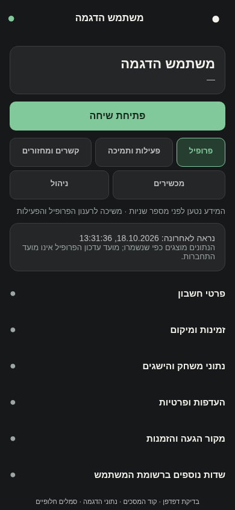
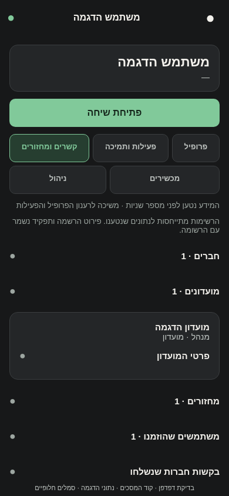

# מיפוי, ארגון וניהול בפולס

## תמונת גרסאות בבית, 2.11.2026

נוסף `pulse/src/components/VersionAdoptionPanel.tsx` אחרי ארבעת מדדי הפעילות של `pulse/src/screens/HomeScreen.tsx`, לפני סעיפי הטיפול. אין מסך או נתיב חדש. הפירוט נפתח בתוך הכרטיס, עשרים משתמשים תחילה, עם סינון לפי גרסה או מידע חסר. קישור משתמש מפעיל `Users/UserDetail` עם המזהה שהגיע מהשאילתה. חלונית ההסבר מבהירה את מקור הגרסה, המכנה ומגבלות האיסוף. הכרטיסים הקיימים ב-`pulse/src/components/VersionInventory.tsx` וב-`pulse/src/components/DeviceVersions.tsx` מסבירים גם את מקור הפעילות הישירה החדש.

### מקורות וספירות

`pulse/src/services/versionAdoption.ts` קורא את כל עמודי המשתמשים דרך `readHomePages` ב-`pulse/src/services/homeDashboard.ts`, עם הקרנה של `name`, `email`, `qa`, `platform`, `lastSeenAt`, בסדר עולה לפי מזהה. אין חיתוך במאה או בחמשת אלפים חשבונות. חשבונות בדיקה לפי המסנן הקיים, `qa === true` ומשתמש שהוסר אינם נכללים. לאחר מכן נקרא `users/{uid}/private/push`, עד שש קריאות במקביל, דרך המטמון המשותף של `pulse/src/services/deviceVersions.ts`. אסימוני התראות אינם מוחזרים מהקורא לתצוגה.

גרסת היעד של אנדרואיד נקראת מתוך `appConfig/releaseLog.versions`, ורק עם `androidPublicAvailabilityVerified` או `androidPublicAvailabilityConfirmedByOwner` ששווים במפורש ל-`true`. נבחרת הגרסה המספרית החדשה ביותר שקודמה לייצור או שזמינותה אושרה. אם קיימת גרסת ייצור חדשה יותר ללא אישור זמינות, היעד חסר, במקום להציג את הקודמת כאחרונה. הכותרת אומרת "גרסה ציבורית מאומתת". אין פתיחת פעולת עריכה בחנות מתוך הרענון האוטומטי, כדי לא להתנגש בהעלאה אחרת. גרסת האייפון נקראת דרך `fetchAppleVersions` ב-`pulse/src/services/appStoreConnect.ts`; רק `READY_FOR_SALE` או `READY_FOR_DISTRIBUTION` נחשבות ציבוריות. גרסה בביקורת או בהמתנה לשחרור אינה יעד. כשל או יעד חסר אינם מוחלפים בגרסת הבינארי המקומי או באפס אחוז.

| נתון | תחום ומכנה |
|---|---|
| משתמשים במערכת | משתמש ייחודי שמערכת ההפעלה האחרונה בפרופיל שלו מתאימה, או שיש לו דיווח מכשיר במערכת הזו. אדם יכול להופיע בשתי מערכות. מערכת לא ידועה נספרת בנפרד בכלל המדידה. |
| גרסה ידועה | הדיווח המאוחר ביותר במערכת הזו, עם זמן חיובי שאינו בעתיד וגרסה מספרית תקינה. דיווחים סותרים באותו זמן נותנים מידע חסר. כשל קריאה נשאר כשל, בנפרד מחסר. |
| אחרונה, ישנה, חדשה מהחנות | השוואה מספרית בין מקטעי הגרסה, לפי הדיווח האחרון של המשתמש באותה מערכת. מכשיר ישן נוסף של אותו אדם אינו מוסיף ספירה. גרסה חדשה מהיעד אינה נחשבת ישנה. |
| אחוז | עיגול של מאה כפול מספר המשתמשים ביעד, חלקי מספר בעלי הגרסה הידועה במערכת. לדוגמה, ארבעה מתוך 69 הם שישה אחוזים, ולא ארבעה מתוך כלל 270 משתמשי אנדרואיד. חסר וכשל אינם במכנה. |
| נצפו היום | דיווח גרסה מהיום, או `lastSeenAt` מהיום עם מערכת תואמת בפרופיל. היום מתחיל בחצות בישראל לפי `homeDayStart`. זהו איחוד אנשים, ולא מספר כניסות או מכשירים. |
| היום בגרסה האחרונה | רק דיווח גרסה מהיום ששווה ליעד. נוכחות מהיום לצד גרסה שנצפתה אתמול אינה הוכחה לשימוש בגרסה היום, ומוצגת כמידע גרסה חסר להיום. |
| דיווח ישן | הדיווח האחרון בן יותר משלושים יום. עדיין מוצג כהיסטוריה ידועה, עם מונה בולט של דיווחים ישנים; אינו הוכחה שהמכשיר לא עודכן מאז. |

המדידה נשמרת במטמון לעשר דקות, כולל בקשה בתהליך. בדיקת הדקה הקיימת בבית משתמשת במטמון ואינה סורקת מחדש כל דקה. רענון ידני של הכרטיס או משיכה במסך עוקפים את המטמון. פירוט וסינון מקומיים אינם יוצרים קריאות נוספות. כשל בסריקה משאיר מדידה קודמת עם אזהרה; זמן המדידה מוצג, ואחרי חצות מדידה מאתמול אינה מוצגת כאפס פעילות היום. דור בקשה מונע מתשובת רענון ישנה לדרוס מדידה חדשה. כשל בחנות אחת אינו מוחק את נתוני המשתמשים או את יעד המערכת האחרת.

### דיווח ישיר בלקוח

`src/services/appVersionPresence.ts` מחובר ב-`App.tsx` אחרי שחזור החשבון וסיום הפתיחה, ובחזרה לחזית. נכתב רק עבור החשבון המחובר שאינו אורח, באנדרואיד ובאייפון, עם `Application.nativeApplicationVersion`. אין תלות באישור התראות או בדגל הקמפיינים. הדיווח נשמר ב-`appSessions.android` או `appSessions.ios` באותו מסמך פרטי, עם `platform`, `appVersion` ו-`observedAt` של השרת. נשמר רק דיווח אחרון לכל מערכת; לא נאספת היסטוריית כניסות ולא מזהה מכשיר נוסף. `setDoc` עם מיזוג משמר אסימונים, העדפות ואת המערכת האחרת.

מטמון מקומי נפרד לחשבון ולמערכת מגביל לאחת לשעה באותה גרסה, עם כתיבה מיידית בשינוי גרסה או ביום ישראלי חדש. בקשות מקבילות מאוחדות. אימות החשבון חוזר אחרי קריאת האחסון, והמנעול המקומי נכתב רק לאחר אישור הכתיבה, כך שכשל אינו מדכא ניסיון נוסף. אין כתיבה באורח, במצב הדגמה, בדפדפן, מתוך יישום מארח אחר או ללא גרסה מקורית תקינה. מזהה החבילה חייב להיות `com.studiogameslime.soccerapp`, כדי שגרסת יישום מארח לא תירשם כגרסת המוצר. המסמך משתמש בהפניה הגולמית `docs.userPrivatePush`, ללא ממיר `User`.

`readDeviceVersions` משלב `appSessions` עם מטא נתוני אסימונים שעדיין רשומים. `parseFields` של `pulse/src/services/firestoreRest.ts` ממיר זמן שרת לאלפיות שנייה; בדיקה חדשה מפעילה את הממיר האמיתי. כללי הגישה הקיימים למסמכים הפרטיים כבר מגבילים קריאה וכתיבה לבעל החשבון. לא שונו כללים, הרשאות, שרת או נתוני משתמשים בייצור. קורא משלוחי ההתראות בשרת ממשיך להעדיף שדות פרטיים קיימים וליפול לשדות הקודמים כשאינם קיימים; השדה החדש אינו משנה אסימונים או העדפות.

### בדיקות, מצב וראיות

המימוש מקומי. אין בנייה, התקנה, הפצה או אימות כתיבת הדיווח הישיר ממכשיר. קריאה חיה בשירות הסופי מצאה 640 חשבונות ללא שגיאות, מהם 270 באנדרואיד, 331 באייפון ו-39 ללא מערכת ידועה. לאנדרואיד יש 69 בעלי גרסה ידועה, ארבעה ב-1.1.72, 65 בישנות ו-201 ללא גרסה; באייפון 71 ידועים, שמונה ב-1.1.69, 63 בישנות ו-260 ללא גרסה. נתוני היום הוכחו לארבעה בגרסת האנדרואיד ולשניים בגרסת האייפון. זו מדידה מ-2.11.2026 בשעה 15:42 לפי זמן עולמי, ולא מונה הורדות כולל.

מקורות הבדיקות: `tests/logic/pulseVersionAdoption.test.ts`, `tests/logic/appVersionPresence.test.ts`, `tests/logic/pulseVersionPresenceReader.test.ts`, ובדיקות הספירה והמכשירים הקיימות. כל 6,568 הבדיקות ב-590 חבילות ובדיקות הטיפוסים של שני היישומים עברו. הצילומים מציגים רכיבי מקור עם נתוני דוגמה ומתאמי דפדפן, בשלושה רוחבים, ואינם צילום מכשיר. רישום ביומן וצילום ההוכחה נשמרו ונקראו חזרה; אין פריט לוח מאומת לבקשה מהשיחה והמסירה נשמרה מקומית. [התוצאות המלאות, הצילומים וקבלות השמירה](../../changes/2026-11-02-version-adoption-dashboard.md).

## בקשות לשיחה אישית, 2.11.2026

נבדקה השפעת תוספת בקשות השיחה במקורות המשותפים. השינוי ממוקד בהרשאת שיחה, בשדות פרטיות ההודעות ובחיבורי הבדיקות; אין מכך אימות חדש של מסך זה במכשיר. המימוש מקומי וטרם הופץ או נפרס. [התנהגות, בדיקות ומגבלות](../chat/message-requests.md).

מקורות משותפים שנבדקו בהיקף השינוי הזה: `src/services/userService.ts`. אין בסעיף זה טענה להרצת כל המסלולים ההיסטוריים של הפיצר. [מסירת המימוש](../../changes/2026-11-02-message-requests.md).

## שישה סעיפי טיפול ומעקב בבית, 1.11.2026

הבקשה בשיחה היא להוסיף את כל ששת הסעיפים שהוצעו. `pulse/src/components/HomeActionPanel.tsx` נוסף בתוך `pulse/src/screens/HomeScreen.tsx`, מתחת לארבעת מדדי הפעילות ולפני רשימת פניות המועדונים. יש שש שורות עם מונים; בכל פעם נפתחת שורה אחת לפירוט, עשרה פריטים תחילה ואפשרות להמשך. לא נוסף מסך או נתיב חדש. תצוגת ארבעת המדדים ורשימת הפניות נשארו.

מקור חדש: `pulse/src/services/homeActions.ts`. מקורות משותפים ב־`pulse/src/services/homeDashboard.ts`: `readHomePages`, `fetchHomeGroups`, `fetchHomeRoundWindow`. קבוצות נקראות עם הקרנת שדות בלבד, לפי מזהה בסדר עולה, בדפדוף מלא. סדר יורד לפי מזהה בלבד נכשל בקריאה החיה בגלל דרישת אינדקס; הוחלף לקריאה קיימת שאינה דורשת שינוי תשתית. לא נוצר אינדקס ולא שונו הרשאות. קריאת המחזורים משותפת למונים ולמקומות הפנויים, וקריאת המועדונים משותפת לכרטיסים, לבקשות ולמעקב. המטמון שומר גם בקשות בתהליך, כך שקריאות מקבילות אינן מוכפלות.

### הסעיפים, התחום ויחידות הספירה

| סעיף | תנאי, חישוב ונתונים |
|---|---|
| חדשים עם מארגן בלבד | `soloOrganizerClubs`: מועדון שאינו אישי ונוצר מ־`HOME_CLUBS_SINCE`, עם רשימות חברים ומנהלים תקינות. איחוד `playerIds` ו־`adminIds` כולל רק מזהה אחד, והוא המארגן לפי `clubOrganizer`. נתוני סגל חסרים נספרים בנפרד כמידע שלא נבדק במלואו. |
| חדשים ללא מחזור ראשון | לכל מועדון חדש מתבצעת שאילתת קיום של מסמך אחד ב־`games` לפי `groupId`, עם הקרנת השדה בלבד. גם מחזור עתידי, שבוטל או שהסתיים מוכיח שנפתח מחזור. אין בדיקה אם שיחקו ואין חישוב חלופי ל־`eveningPlayed`. עד ארבע שאילתות קיום במקביל; כשל במועדון מסוים מסומן כלא ידוע, ולא כמי שלא פתח. |
| מחזורים שחסרים בהם שחקנים | `shortageRounds`: מחזור שלא הסתיים ולא בוטל, שמתחיל בין עכשיו לעוד 72 שעות, עם קיבולת חיובית וסגל תקין. מקומות בסגל הם `maxPlayers` פחות מזהי רשומים ייחודיים, פחות אורחים שאינם בתור המתנה ופחות מקום אחד אם קיימת הצעת קידום עם `pendingPromotion.uid`. התוצאה מוגבלת מלמטה לאפס. לדוגמה, קיבולת 12, רשום אחד ואורח פעיל אחד משאירים עשרה מקומות. אין הנחה שכל מקום מאפשר הרשמה אוטומטית; נראות, נעילה ואישור מנהל עדיין חלים. קיבולת או סגל חסרים מסומנים כחסר, לא כאפס מקומות. |
| הגיע הזמן לבדוק שוב | `homeFollowUps`: רק מועדונים שכבר סומנה להם פנייה למארגן הנוכחי. עברו לפחות 72 שעות מהמאוחר מבין `contactedAt` ו־`lastFollowUpAt`. המוקדמים לבדיקה ראשונים. זהו מעקב ידני, ללא זיהוי תשובת המארגן וללא שליחת הודעה או התראה אוטומטית. |
| בקשות הצטרפות שממתינות | `pendingClubRequests`: כל המועדונים שאינם אישיים, ללא סף תאריך היצירה של מעקב הפניות. מזהים ייחודיים מתוך `pendingPlayerIds`, ללא מי שכבר נמצא ב־`playerIds` או ב־`adminIds`. בקשה של אותו אדם בשני מועדונים נספרת פעמיים. זהו מספר בקשות למועדונים, לא מספר אנשים ייחודיים. |
| שיחות שממתינות לתשובה | כל שיחות `dmConversations` עם המשתתף הרשמי `teamder`, בדפדוף מלא ועם הקרנת מטא נתונים בלבד. מתקבלים רק שני משתתפים ומזהה שיחה קנוני לפי `convIdFor`. ההודעה האחרונה צריכה להיות של המשתמש, ולא פתורה לפי `isSupportResolved` הקיים ב־`teamderChatService.ts`, עם אותו מזהה הודעה ואותו זמן. שיחה עם מענה מהצוות או שנפתרה אינה נכללת. יש השלמה של הודעה אחרונה אחת לשיחות ישנות ללא סיכום, עד ארבע השלמות במקביל. כשל בהשלמה גורם לסעיף חסר, לא למונה אפס. מיון לפי זמן ההמתנה, מהישן לחדש. |

מוני המועדונים החדשים אינם מוגבלים לחלון נע ואינם כוללים מועדונים קודמים ל־1.11.2026, בהתאם לבחירת הבעלים הקודמת. בקשות ושיחות הן תורים כלליים. כל המקורות נבדקים פעם בדקה כשמסך הבית ממוקד וברענון ידני, ללא שינוי בתזמונים או בשירותי השרת. שמות משתמשים נקראים רק לפריטים הנראים בפירוט ולמארגני הכרטיסים, עד ארבעים מזהים נוספים בכל פתיחה; שם שלא נקרא מוצג כחסר, עם שמירת הקישור לפי המזהה המקורי.

### שמירת בדיקה חוזרת

`setClubFollowUp` קורא שוב את המועדון ומוודא שהמארגן לא התחלף. נדרשת רשומת פנייה קיימת ומתאימה, עם `contactedAt` תקין שאינו בעתיד. מתעדכנים רק `lastFollowUpAt` ו־`updatedAt`, בכתיבה עם תנאי שהמסמך קיים. תאריך הפנייה המקורית אינו נכתב מחדש. קריאה חוזרת מאמתת את המועדון, המארגן, תאריך הפנייה המקורי וזמן הבדיקה החדש לפני שהפריט נעלם מרשימת הבדיקות החוזרות.

שדה `lastFollowUpAt` נוסף להקרנת סימוני הפנייה ולקורא `homeClubRows`. מסמכים ישנים ללא השדה נקראים כמי שלא נבדקו שוב. פנייה חדשה או ביטול פנייה מאפסים את השדה ל־`null`, וגם ערך זה נבדק בקריאה חוזרת. שינוי מארגן מבטל את שיוך הסימון הקודם כמו קודם. אין הסבת נתונים, שינוי הרשאות או כתיבה למועדון. כשל או קריאה חוזרת שאינה תואמת משאירים את המצב הקודם ומחייבים רענון; אין טענת שמירה. אין עסקה אטומית בין מסמך המועדון לרשומת המעקב.

### טעינה, כשלים וניווט

`HomeScreen.load` מפעיל את נתוני הפעילות ואת סעיפי המעקב במקביל, ומציג כל קבוצת נתונים מיד כשהיא מגיעה. `fetchHomeActions` מפריד כשלים בין המקורות. מונה חסר מציג לא זמין; ספירה חלקית מציגה לפחות ומספר הפריטים שלא נבדקו. אפס מוצג רק על בסיס תשובה שנקראה, ותצוגה ריקה אינה מכריזה שכל המערכת מסודרת. כתיבות חסומות בזמן טעינה או כתיבה, ודור בקשה מונע מתשובה ישנה לדרוס סימון מאומת. תצפיות השגיאות מחוברות ל־`observeSettledErrors` ולמנגנון האבחון הקיים.

מועדון נפתח ב־`Clubs/ClubDetail`; מארגן או מבקש ב־`Users/UserDetail`; מחזור ב־`Games/GameDetail`. שיחת תמיכה נפתחת ישירות ב־`Messages` עם `userId` ו־`messageId`, במסלול הקיים הפותח את חלונית השיחה. אין קריאה לפונקציית שליחת הודעות ואין אישור בקשות מתוך כרטיס הבית.

### ראיות ובדיקות

מקורות הבדיקה: `tests/logic/pulseHomeActions.test.ts`, `tests/logic/pulseHomeDashboard.test.ts`, `tests/logic/errorCatchCoverage.test.ts`. נבדקים סף המועדונים, סגל מארגן יחיד, קיום מחזור מכל מצב, כשל שאינו תוצאה ריקה, חלון 72 שעות, אורחים ותור המתנה, מקום שמור, בקשות כפולות ומי שכבר חבר, פתרון השיחה המדויק, דפדוף מעבר למאה שיחות, שמירת בדיקה חוזרת ושימור תאריך הפנייה.

תוצאות סופיות: בדיקות הטיפוסים של שני היישומים נקיות וכל 6,490 הבדיקות ב־578 חבילות עברו. נבנה והועלה למסירה `1.0.104/111`; המקור המוטמע, החתימה וההורדה החוזרת אומתו. אין בדיקת התקנה של ההרחבה במכשיר או כתיבת בדיקה חוזרת אמיתית. רישום היומן וצילום ההוכחה נשמרו ונקראו חזרה. [הקובץ, קבלות האימות ומגבלות בדיקת התיעוד הכללית](../../changes/2026-11-01-pulse-home-actions.md#קובץ-התקנה-ומסירה).

[לפני ההרחבה](../screenshots/pulse-home-actions-before-2026-11-01.png), [לאחר ההרחבה](../screenshots/pulse-home-actions-after-2026-11-01.png). שניהם מצילומי רכיבי מקור בדפדפן עם נתוני דוגמה, לא מצילומי מכשיר. נבדקו שש הרשימות הנפתחות ברוחבים 320, 390 ו־430, יעדי הניווט, מקומות בסגל, מצב חסר, רשימות ריקות, סימון וביטול ובדיקה חוזרת ששורדת טעינה מחדש. נבדקה גם סימולציית שעון ל־5.11.2026 כדי לבדוק פנייה שהגיע זמנה, בלי ליצור נתוני ייצור. בקריאה חיה ללא כתיבה נמצאו בזמן הבדיקה מועדון חדש אחד עם מארגן בלבד, חדש אחד ללא מחזור, מחזור קרוב אחד עם מקומות, אפס פניות שהגיע זמנן, 75 בקשות ושיחת תמיכה אחת; לא נמצאו כשלים או מונים חלקיים. אין בדיקת כתיבה חיה או התקנה במכשיר של ההרחבה. [מצב הבדיקות והמסירה](../../changes/2026-11-01-pulse-home-actions.md).

## מסך בית ומעקב פנייה למועדונים, 1.11.2026

תיקון מדדי ההרשמה בעקבות צילום הבעלים באותו יום: הכרטיס הימני הוא כעת מחזורים עם רשומים, והכרטיס השמאלי סוכם את ההרשמות בכולם. מחזורים עתידיים נכללים גם לפני המשחק. הגדרת הספירה הנוכחית בטבלה להלן מחליפה את זו שבקובץ `1.0.102/109`. נבנה והועלה למסירה `1.0.103/110`; החתימה, המקור וההורדה החוזרת אומתו. אין בדיקת התקנה של התיקון במכשיר. [התנהגות, צילומים ומצב המסירה המעודכן](../../changes/2026-11-01-pulse-registration-rounds.md).

עדכון מסירה באותו יום: נבנה קובץ התקנה `1.0.102/109`. הגרסה, החתימה וכלילת ארבעת קובצי השינוי בחבילה אומתו. אין התקנה או בדיקת מכשיר. אמירות בהמשך על מצב טרם בנייה מתארות את שלב המימוש שקדם לבקשת הקובץ. [הקובץ ואימות המקור](../../changes/2026-11-01-pulse-apk-1.0.102.md).

מסך חדש: `pulse/src/screens/HomeScreen.tsx`. מקור נתונים ייעודי: `pulse/src/services/homeDashboard.ts`. `pulse/src/navigation/RootTabs.tsx` רושם את `Home` ראשון וגם מגדיר `initialRouteName="Home"`. הלשוניות הן בית, משימות, אנשים, מועדונים ועוד. `Versions` עבר לרשימת הנתיבים הנסתרים ונשאר בתפריט. `Overview` נשאר סביבת הפעילות הישנה. בתפריט `pulse/src/components/AppMenu.tsx` נוספה תמונת מצב. המשימות והסגירה שלהן נשארו במסלול הקיים.

### נתונים, פונקציות ומכנים

`fetchHomeDashboard` מפעיל ארבעה מקורות נפרדים באמצעות מטמון בן דקה וקריאות עם הקרנת שדות. מקור שנכשל מחזיר שדה חסר ואזהרה, ללא השלמה באפס. מקור המועדונים תלוי גם בהצלחת קריאת סימוני הפנייה, כדי שכשל בקריאתם לא ייראה כאילו כל המועדונים ממתינים.

| נתון | מקור וחישוב |
|---|---|
| מחזורים עם רשומים | מסמכי `games` עם מועד `startsAt` שאינו ישן מעכשיו פחות שמונה שעות, מצב שאינו `finished` או `cancelled`, ולפחות מזהה רשום אחד ב־`players`. מחזור עתידי פתוח, נעול או מתוזמן ומחזור שכבר התחיל נכללים. אין גבול תאריך עתידי עליון ואין דרישה למצב משחק פעיל, לשעון או לתוצאה. תחום הזמן זהה לרשימת המחזורים הקיימת ב־`gamesService.ts`: כל הקרובים, ובנוסף מחזורים אחרונים בטווח חסד של שמונה שעות. זו ספירת הרשמה ולא הכרעה היסטורית אם ערב התקיים; אין תחליף ל־`eveningPlayed`. |
| רשומים | סכום מספר מזהי `players` הייחודיים בכל אחד מהמחזורים הנכללים בכרטיס הימני. אין תוספת של `waitlist`, `pending` או `guests`. מחזור ללא רשומים אינו נחשב בגלל תור המתנה או בקשות בלבד. לדוגמה, שני מחזורים עתידיים עם שני שחקנים כל אחד מציגים שני מחזורים וארבע הרשמות, גם אם שחקן אחד משותף. מספר המשחקים בתוך המחזור אינו נוסף למונה. |
| נרשמו היום | `users.createdAt` מאז חצות בישראל ועד רגע הקריאה, ללא חשבונות בדיקה לפי `isTestAccount`, ללא `qa === true` וללא חשבונות שהוסרו. מזהה נספר פעם אחת. |
| התחברו היום | אותה ספירת אנשים ייחודיים לפי `lastSeenAt`. זהו דיווח פעילות שנכתב בלקוח באמצעות `touchPresence` ב־`src/services/userService.ts`, תחת דגל הפיצר ובהשהיה של עד שש שעות בין כתיבות. אין כאן נתוני התחברות מלאים משירות הזדהות ואין ספירת פתיחות. חסר דיווח יכול לגרום לחסר בספירה, בפרט אחרי חצות. המגבלה מוצגת במסך. |
| חברי מועדון | איחוד מזהי `playerIds` ו־`adminIds`, ללא כפילויות. |
| מארגן | `clubOrganizer` מעדיף את היוצר אם הוא עדיין מנהל או שלא נרשמו מנהלים, אחרת את המנהל הראשון. כשאין מארגן אין סימון פעיל. |

`homeRoundTotals` מחזיר `withRegistrations`, `registered` ו־`at`. שאילתת המחזורים משתמשת רק בגבול תחתון של `startsAt`, ללא תנאי שמוציא מחזורים עתידיים. מפתח המטמון הוא `home-registration-rounds`, כדי לא לצרוך תוצאה בעלת משמעות ישנה. `homeDayStart` משתמש ב־`Asia/Jerusalem`, כולל החלפת שעון, ולא באזור הזמן של המכשיר. `readPages` ממשיך את `queryDocumentPage` בכל עמוד של מאה מסמכים, עם סמן הכולל מזהה, עד סוף התוצאות. אין הצגת חלון של מאה אנשים כמספר כולל. סמן שחוזר גורם לכשל. הנתונים נקראים דרך `firestoreRest.ts`, כולל `parseDoc`, `parseFields` ו־`parseValue`; אין ממיר לקוח אחר שמשמיט שדות אלו.

### מעקב פנייה ושמירה

החלטת הבעלים בשיחה: רק מועדונים שנוצרו מהיום. `HOME_CLUBS_SINCE` קבוע לחצות בישראל ב־1.11.2026, כלומר `2026-10-31T22:00:00Z`. השאילתה וגם `homeClubRows` מסננות לפי אותו גבול. זהו סף קבוע, ולא חלון נע: מועדון ממתין אינו נעלם כשהוא מתיישן. מועדון אישי או מועד יצירה חסר או עתידי אינם נכללים. חדשים מוצגים ראשונים, עשרים בכל פעם עם כפתור להמשך. מונה ההמתנה כולל את כל המקור. שמות המארגנים נטענים לפי המזהים בכרטיסים הנראים, ללא טעינת כלל החשבונות. שם שלא נקרא מוצג כחסר, עם קישור לכרטיס המארגן לפי המזהה המקורי.

מסמך סימון: `adminConfig/pulseClubContact_{groupId}`. השדות הם `kind: 'pulseClubContact'`, `groupId`, `organizerId`, `contactedAt` ו־`updatedAt`. קריאת הסימונים מסוננת לפי `kind`. אין כתיבה למסמך המועדון או שינוי הרשאות. הנתיב נמצא תחת אוסף שמותר כבר בחיבור הניהול לפי `functions/src/pulseProxyPolicy.ts`; המדיניות לא שונתה ולא נפרס שרת.

`setClubContact` קורא שוב את המועדון ומוודא שהוא קיים, שאינו אישי, שנוצר מהסף המוסכם ושהמארגן לא התחלף. המזהה מועבר ממסמך השאילתה ואינו מוקלד מחדש. יצירה משתמשת ב־`createDocOnly`; התנגשות עוברת ל־`patchDoc` עם `mustExist: true`. לאחר הכתיבה נקרא המסמך חזרה ונבדקים סוג הרשומה, המועדון, המארגן וערך הסימון. רק אז משתנה התצוגה. ביטול שומר `contactedAt: null` וגם הוא מאומת. שינוי מארגן גורם לסימון הקודם לא להיחשב עבור המארגן החדש. אין איתור אוטומטי של הודעות קודמות ואין שליחת הודעה מפעולת הסימון.

הכפתורים חסומים בזמן טעינה או כתיבה. כשל אימות שומר את התצוגה הקודמת ומחייב רענון לפני ניסיון נוסף, מפני שייתכן שהכתיבה נשמרה והתגובה אבדה. הצלחת טעינה חדשה מאפשרת ניסיון נוסף. דור בקשה מונע מרענון קודם לדרוס סימון מאומת. זו אינה עסקה אטומית בין המועדון למסמך הסימון; אין הבטחה למניעת כל שינוי מקביל ממכשיר אחר.

### מצבים, ניווט ואימות

| מצב | תצוגה או התנהגות |
|---|---|
| טעינה | מחוון וערכים חסרים, ללא אפסים מומצאים. |
| הצלחה ואפס | אפס נמדד, או הודעה שאין מועדונים ברשימה הנבחרת. |
| כשל במקור | אזהרה, ערך חסר וניסיון נוסף. מקורות אחרים יכולים להצליח. |
| כשל בסימונים | אין רשימת ממתינים ואין סימון זמין. |
| הצלחת סימון | מונה ההמתנה קטן והמועדון עובר לכבר פניתי. ביטול מחזיר אותו. |
| כשל כתיבה או קריאה חוזרת | הודעה שהסימון לא אומת. אין טענת שמירה או שינוי מוצג. |
| חזרה ורענון | טעינה עם מטמון בן דקה. רענון ידני או מחזורי פעם בדקה עוקף אותו. אין רענון מחזורי כשהמסך אינו ממוקד. |
| מעבר יום | נתון אנשים ממטמון של יום קודם אינו מוצג כמספר של היום. |

מועדון פותח `Clubs/ClubDetail` עם `groupId`; מארגן פותח `Users/UserDetail` עם `userId`, שממנו אפשר לפתוח את שיחת התמיכה הקיימת. נתוני מחזורים פותחים `Games/GamesList`; הרשמות היום פותחות `Users/NewPeople`; פעילות אנשים פותחת `Users/UsersList`. נבדקו פרמטרי יעד המארגן בדפדפן, לא מעטפת הניווט המקורית.

בדיקות ממוקדות: `tests/logic/pulseHomeDashboard.test.ts`, כולל חצות בישראל ומעברי שעון, הפרדה בין מחזורים למשחקים, כפילות הרשמות מול אנשים, חשבונות בדיקה, המשך עמודים, מידע חלקי, סף המועדונים ושרידות מעקב, מארגן שהתחלף, תנאי קיום וקריאה חוזרת וביטול סימון. לאחר השינוי הסופי עברו בדיקות הטיפוסים של טימדר ופולס וכל 6,468 הבדיקות ב־576 חבילות. תוצאות, מגבלות בדיקת התיעוד וקבלת רישום היומן מפורטות ב[דוח השינוי](../../changes/2026-11-01-pulse-home.md).

צילום עדכני: [מסך הבית לאחר תיקון ההרשמות](../screenshots/pulse-registration-rounds-after-2026-11-01.png). המקור הוא רכיבי `HomeScreen` ו־`Screen` והשירות האמיתי, עם מתאמי דפדפן, תעבורה ונתוני בדיקה. נבדקו רינדור וכיווניות ברוחבי 320, 390 ו־430, שלושה מחזורים וחמש הרשמות כולל מחזור עתידי, סימון וביטול, שרידות טעינה מחדש, מידע חלקי, כשל סימונים, כשל כתיבה והתאוששות ברענון ורשימה ריקה. צילום הבעלים במכשיר נשמר בנפרד כראיית המצב הקודם. אין צילום מכשיר של הגרסה המתוקנת. בקריאה חיה דרך אישור המשתמש המקומי נבדקו בונה השאילתות והממיר האמיתיים ללא כתיבה, ונמצא מחזור אחד עם הרשמה אחת בזמן הבדיקה. עברו 6,480 בדיקות ב־577 חבילות ובדיקות הטיפוסים של שני היישומים. נבנה `1.0.103/110`, עם אימות מקור, חתימה והורדה חוזרת. חיבור הניהול ושמירת סימון חי מהבנייה המתוקנת לא אומתו; אין התקנה של הגרסה המתוקנת במכשיר או פריסת שרת.

## התאוששות משגיאות בפולס, 28.10.2026

ב-`functions/src/crashlyticsBridge.ts`, `readCrashPage` מנסה עד שלוש קריאות אחרי כשל זמני, בהשהיות של שנייה ושתי שניות. כל ניסיון שומר את גוף הקריאה, חלון הזמן וסמן העמוד, ומוגבל לשלושים שניות. תשובות 429, 500, 502, 503, 504 וכשלי תעבורה מסוימים מאפשרים ניסיון נוסף; שגיאת הרשאה או פענוח אינה מאפשרת זאת. כשל מתמשך נזרק, נקודת ההמשך אינה מתקדמת והנעילה משתחררת בתנאי שהעובד עדיין בעליה. הייבוא ומסירת ההתראות נשארים עם הגנות הכפילות הקיימות. בדיקות: `tests/logic/crashlyticsPulseBridge.test.ts`.

ב-`pulse/src/services/quota.ts`, `quotaRead` מנסה עד שלוש פעמים גם במקרה `SocketException` ובתשובות שרת זמניות, בהשהיות 250 ו-750 אלפיות שנייה. כשל סופי מוחזר כנתון לא זמין ומדווח; הוא אינו מספר אפס. ב-`pulse/src/services/poller.ts`, תמונת הביקורות והדירוגים מתמזגת בנפרד לפי ספק: מקור שנכשל שומר את נתונו הקודם, תשובת ביקורות תקינה וריקה מנקה נתון ישן. תקרת כל מקור נשארת שתים עשרה שניות, ושגיאת התקרה כוללת את שם המקור. בדיקות: `tests/logic/pulseQuotaRecovery.test.ts`, `tests/logic/pulsePollRecovery.test.ts`.

השינוי מקומי וטרם הופץ או נפרס. אין שינוי חזותי ואין צילום מכשיר חדש. [ממצאים, בדיקות ומגבלות](../../changes/2026-10-28-pulse-errors.md).

## הרחבת אבחון דיווחים, 27.10.2026

נוספה מעטפת אבחון מקומית עם מצב בזמן הכשל, שלבים בעלי מזהה ותזמון, מצב רשת ובנייה ומופעים נפרדים לשגיאה. נקודת הכניסה לתעבורת השרת עוברת כעת דרך העטיפה המשותפת; תשובות, חריגות, אפשרויות קריאה ומדיניות הפיצר נשמרות. אין כאן שינוי בהרשאות או בחישובי המוצר. הבדיקות המלאות ומגבלות האימות מתועדות בדוח המקושר; אין טענה לאימות מכשיר או להפצה. [היקף, ראיות ומגבלות](../../changes/2026-10-27-diagnostic-context.md).

באימות הסופי עברו כל 6,231 הבדיקות ב-555 חבילות, ובדיקות הטיפוסים של הלקוח, השרת והפולס נקיות. צילום הדפדפן והידור מקורות האנדרואיד הם בדיקות מקומיות; אין הוכחת מכשיר, הידור אייפון או מסירה חיה של הבנייה החדשה. רישום יומן השחרור נחשב מאומת רק לפי קבלת הקריאה החוזרת בדוח השינוי.

## טיפול בתקלות הפולס, 26.10.2026

`pulse/src/services/downloads.ts` משמיט דוח שלא קיים ומחזיר `null` כאשר כל החלון חסר; שגיאות אחרות דוחות את הקריאה. פענוח דוח דחוס נבחר לפי חתימת הקובץ. איסוף יומי לחודש הנוכחי אינו מבקש את היום הנוכחי ומשתמש בתאריכים אחידים; אין שינוי במדד הורדות מול הרשמות. `pulse/src/services/poller.ts` משמר כל פלטפורמה בנפרד ומוסיף את שם המקור לכשל זמן. `tests/logic/pulseDownloadsRecovery.test.ts` ו-`tests/logic/pulsePollRecovery.test.ts` מאמתים היעדר נתון, דוח תקין, דחיות הרשאה ורשת ושימור נתון הפלטפורמה השנייה. זמני זמינות הדוחות נבדקו מול התיעוד הרשמי של אפל; אין כאן אימות רשת חי מול חשבון החנות.

השינוי מקומי וטרם הופץ. [בדיקות, מסירה ומגבלות](../../changes/2026-10-26-pulse-fixes.md).

מקורות שנבדקו בסבב: `pulse/src/services/downloads.ts`, `pulse/src/services/poller.ts`.

## קישורי שיתוף בדומיין החדש - 26.10.2026

קישורי ההפצה, דוגמת הכתובת והקישור האישי שנוצרים בפולס משתמשים בדומיין החדש. קישורים שכבר נשמרו אינם נכתבים מחדש.

המימוש המשותף משתמש ב-`src/utils/linkDomains.ts`, ב-`src/services/inviteLinkService.ts`, ב-`src/services/deepLinkService.ts` וב-`src/services/incomingInvite.ts`. קישורים קצרים אינם משכפלים את `invitedBy`; הבעלות נקראת מהמסמך הקיים. כשל שמירת קוד מחזיר כתובת מלאה, ופענוח שנכשל נשמר לשחזור. אין שינוי במונים, בהרשאות או במסלול ההצטרפות.

השינוי מקומי וטרם הופץ. הבדיקות, מסלולי הנתונים ומגבלות האימות מפורטים ב[דוח השינוי](../../changes/2026-10-26-share-domain.md). אין כאן אימות חדש של כל מצבי המסך.

## הפצה פנימית 1.1.61 - 25.10.2026

הבינארי `1.1.61/295` הופץ ואומת במסלול הפנימי באנדרואיד. תיקוני הלקוח נכללים בו, ושירות הפרופיל נפרס ואומת בנפרד. גם תיקוני הסגל, שמירת התוצאה והתראת השגיאה בשרת נפרסו ואומתו באישור מפורש. שינויי יישום הפולס עצמו טרם הופצו. אין שינוי כללי הרשאה או הסבת נתונים. ניסוחי המצב המקומי בסעיפים הקודמים נכתבו לפני ההפצה; [דוח ההפצה](../../changes/2026-10-25-internal-1.1.61.md) מפרט בדיוק מה נכלל, מה נבדק ומה עדיין מקומי.

מקורות ממוקדים בסבב: `pulse/src/services/errorPresentation.ts`, `pulse/src/services/errorCatalog.ts`.

## תיקוני הפולס - 25.10.2026

`errorCatalog.describeError` משתמש בכותרת ובסיבה של `errorPresentation`; מידע גולמי אינו מחליף את הסיבה ברשימה כאשר המקרה לא מוכר. הקוד, המחסנית, הפעולה וההקשר נשארים זמינים בפירוט. המימוש משוכפל במכוון בין הפולס לשרת, ובדיקה משווה את שני הקבצים.

[מקורות, בדיקות, צילומים ומגבלות](../../changes/2026-10-25-pulse-fixes.md).

## עיצוב הודעות המסע, 25.10.2026

`scripts/joryio_invite_journey.py` מטמיע כעת את תמונת האצטדיון הקיימת כנתונים בתוך תוכן שתי הודעות המסע, והתבנית הוחלפה בעיצוב כחול ובהתאמה למצב כהה. מספר הצמתים, המזהים, תנאי הכניסה, זמני ההמתנה, כתובת השיתוף, מסלול הסנכרון ומכני המדדים נשמרו. בוצע עדכון טיוטה בלבד, עם השוואת קריאה חוזרת של הגרף. לא עודכן מסך הפולס ולא הופעל מסע. [מקור העיצוב, הרינדור ומגבלותיו](../clubs/covers-and-invitations.md#עיצוב-הודעת-ההזמנה-25102026).

## מסע הזמנת חברים למועדון, 24.10.2026

מסלול: עוד, גיוס וקשר, מסעות. `pulse/src/screens/WorkspacesScreen.tsx` רושם את `pulse/src/screens/JoryioJourneyScreen.tsx` כלשונית בתוך סביבת העבודה הקיימת. לא נוסף נתיב במחסנית נפרדת. המסך משתמש ברכיבי העיצוב הירוקים של המעקב האישי.

### מסלול הנתונים

`scripts/joryio_invite_journey.py --sync-pulse` קורא בשרת הייצור בלבד את המסע, `/stats` ו־`/node-analytics`. הוא שומר ספירות מצטברות בלבד במסמך `appConfig/joryioInviteJourney` וקורא אותו חזרה לאימות. אין שמות משתמשים, פרטי ריצות אישיות או מפתח ניהול במסמך. הנתיב המדויק קבוע בקוד ואינו מזהה מסמך שהוקלד מפלט.

`pulse/src/services/joryioJourneys.ts` קורא את המסמך באמצעות התעבורה המאומתת הקיימת של פולס. אין שינוי בכללי הרשאות או ברשימת היעדים של השרת. מטמון הקריאה הוא דקה; רענון עוקף את משך המטמון, אך אינו מפעיל את סקריפט הסנכרון. אין תזמון אוטומטי, פונקציה חדשה או פריסה.

המפתח נקרא ממשתנה `JORYIO_API_KEY` או מהקובץ המוחרג `credentials/joryio-management-key.txt`. מפתחות הערכה אינם מתקבלים כמפתחות ניהול. הפקודה `--create-draft` שומרת טיוטה בלבד, מאתרת יצירה קודמת לפי תג ייחודי, מסרבת לעדכן מסע פעיל, וקוראת חזרה את הגרף. פרטי השמירה ב־`docs/joryio-journeys/05-organiser-invites.receipt.json`. אין פקודת הפעלה בסקריפט.

### מצבים וחישובים

| מצב | תוצאה |
|---|---|
| טעינה ראשונה | מחוון טעינה; אין ספירות מומצאות |
| כשל או מסמך חסר | הודעת כשל וניסיון חוזר; מידע קודם יכול להישאר עם אזהרת הכשל |
| טיוטה ואפס מאומת | אפס מוצג עם הסבר שהמסע לא הופעל |
| שדה מונה חסר או לא תקין | לא זמין, גם אם מונים אחרים תקינים |
| עותק בן יותר מיום | אזהרה שצריך לסנכרן לפני הסקת מסקנות על המצב הנוכחי |
| שינוי מסך בזמן טעינה | דור בקשה מונע מתשובה ישנה לדרוס מצב חדש |

נכנסו לשלב הוא `entered`; התקדמו הוא `proceededToNext`. אין להציג `exited` של צומת כיציאה מהמסע. שיעור ההגעה הוא מספר הכניסות לצומת חלקי כלל הכניסות למסע, כפול מאה ובעיגול למספר שלם. לדוגמה, 5 מתוך 10 הם 50%. מכנה אפס או חסר מוצג ללא אחוז. אלה כניסות ולא בהכרח משתמשים ייחודיים, והן אינן ספירות של העונים בחיוב לתנאי. הטווח הוא כל הזמנים.

הצגות ולחיצות מוצגות רק כאשר הספק מחזיר מספר מפורש. העברת ריצה לצומת ההודעה או הלאה ממנו אינה הוכחת הצגה, קבלה או שיתוף. ברמת המסע, `completed` פירושו השלמת הזרימה ולא הצלחה עסקית. הצלחת הצטרפות דרך הזמנה אינה נמדדת כאן כמדד נפרד.

### המסע והגבלות הפעלה

הגרף נשמר ב־`docs/joryio-journeys/05-organiser-invites.json`: יצירת מועדון, הודעה בתוך האפליקציה, יום המתנה, בדיקת יעד, בדיקת שיתוף, בדיקת הרשאת התראות, פוש אפשרי, יומיים נוספים, בדיקת יעד והודעה אחרונה. יש לכל היותר שתי הודעות בתוך האפליקציה ופוש אחד בכל ריצה. שיתוף קודם מדלג על הפוש. אירועי שיתוף ואבן דרך מסוננים לפי `groupId` של אירוע הכניסה, באמצעות `{{ trigger.properties.groupId }}`. אין שימוש בנתון גודל המועדון הגדול ביותר של המשתמש.

לפני הפעלה יש לאמת עם חשבון הבדיקה המאושר: ערכי ההקשר, דילוג על פוש אחרי שיתוף, תוקף הודעות והגבלת תדירות, שעות שקט, פתיחה מפוש בשתי הפלטפורמות, ואירוע יעד למועדון הנכון. אירוע גודל הסגל הקיים מדווח מתוך מסכי המארגן ואינו מתעדכן בשרת בזמן אמת. בדיקת הכנה ללא חסמים אינה מאמתת התנהגות זו בריצה.

הכפתור לשיתוף הישיר דורש את קוד `src/services/clubInviteCampaign.ts` בגרסה עתידית של האפליקציה. אסור להפעיל את הטיוטה למכשירים ישנים לפני שילוב הקוד ואימותו. ההרשמה למסע חסומה בזמן ריצה קיימת וכוללת מרווח חזרה של 43,200 דקות; לכן מארגן שיוצר כמה מועדונים בזמן ריצה לא בהכרח ייכנס לכל אחד מהם. הגדרה זו מונעת הצפה, ואינה הוכחה שהמסע הורץ.

### ראיות ובדיקות

שרת הייצור החזיר את הטיוטה והגרף בקריאה חוזרת. נשמרו ספירות מקור של אפס כניסות ונקרא עותק הפולס חזרה. בדיקת ההכנה של גוריו החזירה רשימת חסמים ריקה; אין בכך אימות ריצה, מסירה או גרסת מכשיר. לא הופעל מסע ולא נשלחה הודעה.

`tests/logic/clubInviteCampaign.test.ts` בודק את יעד השיתוף, זהות המשתמש, חברות ניהול, יעד סגל, מועדון אישי, ביטול שיתוף וכשל קריאה. `tests/logic/pulseJoryioJourney.test.ts` בודק אפס מול חסר, מקור ייצור, חותמת זמן, כפילות צמתים ומכנה אפס. `scripts/tests/test_joryio_invite_journey.py` בודק שיוך אירועים למועדון, מבנה ערוצים והפרדת תור מהצגה. הראיות לתצוגה ולבדיקות המלאות מרוכזות ב־`docs/changes/2026-10-24-organiser-invite-journey.md`.

בדיקות הטיפוסים של האפליקציה ושל פולס עברו וכל 5,661 הבדיקות ב־500 חבילות עברו. שלוש בדיקות הסקריפט עברו. מסך המקור והודעת המסע נצפו בדפדפן בלבד, ברוחבי 320 ו־390 ובמצבי טיוטה, נתוני דוגמה וכשל. אין אימות מכשיר או מסירה חיה. בדיקת התיעוד הכללית אינה נקייה בגלל קישורים היסטוריים חסרים ושינוי מקור לא קשור; אין ממצא שלה על זוג המסמכים הזה או על מסך המסע.

## אנשים חדשים ומועדונים — 24.10.2026

[הסבר פשוט](pulse-management.simple.md#אנשים-חדשים-ומועדונים--24102026). מימוש מקומי ללא בנייה, התקנה, שינוי הרשאות או פריסה.

### מסכים וניווט

- `pulse/src/screens/NewPeopleScreen.tsx` הוא המסך הראשון ב־`UsersStack`. מסנני 7/30 ימים מתייחסים ל־`createdAt`, ולא למועד הפעילות. חשבונות מחוקים ובדיקות לפי המסנן הקיים אינם מוצגים. כפתור ״כל המשתמשים״ פותח את `UsersList` הקיים על כל מסנניו ועימודו.
- `pulse/src/screens/PersonJourneyScreen.tsx` נפתח לפי `userId`, ומציג פרופיל, רצפי כניסה, כיוון למעקב ומחברת היכרות. הוא מקשר ל־`UserDetail` באותה מחסנית ול־`OnboardingActivity` במחסנית האב. בכרטיס השחקן הקיים נוסף קישור חזרה למסלול. תצוגת אבחון הרצף הקיימת לא שונתה.
- `pulse/src/screens/ClubsScreen.tsx` ו־`pulse/src/screens/ClubDetailScreen.tsx` נרשמו ב־`pulse/src/navigation/ClubsStack.tsx`. `RootTabs` כולל משימות, אנשים, מועדונים, גרסאות ועוד; מסך הפתיחה נשאר משימות. מהפירוט נפתחים `Users/UserDetail` ו־`Games/GameDetail` דרך ניווט האב. תפריט המשתמשים מכוון לתצוגה החדשה; אין שני פריטי תפריט עם אותו מסלול.
- `pulse/src/components/GrowthUI.tsx` מרכז את צבעי הירוק העמוק והליים, הריווח, הכרטיסים, כיווניות ופלט מצב מקור. `GrowthShell` משתמש באזור בטוח, גלילה ורענון. הצבעים של יתר מסכי הפולס לא הוחלפו.

### קריאה ושיתוף

`pulse/src/services/growthData.ts` משתמש במטמון הבקשות הקיים לשלוש דקות, עם מפתח לכל מקור. טעינת רשימה מפעילה במקביל שלוש קריאות: עד 100 משתמשים לפי `createdAt` יורד, ועד 1,000 מועדונים ועד 1,000 מחזורים בעימוד לפי שם מסמך. ההיטלים אינם כוללים תמונות, סיסמאות או אסימונים. נתוני הוכחת קיום הערב כן כלולים כדי להשתמש במכריע המשותף. אין בקשה לרצף כניסה עבור כל שורת משתמש ואין טעינה של כלל רישומי ההתחברות.

מקור שנכשל מחזיר `null` ושמו ב־`failed`, ונרשמת תצפית דרך `observeSettledErrors`; המקורות האחרים נשארים זמינים. כשל אינו נשמר כתוצאה תקינה במטמון המקור. הגעה לתקרה מסומנת, וכל מספר מוגבל לנתונים שנקראו. חלון המשתמשים הוא 100 החדשים ביותר, ולכן אינו מבטיח כיסוי מלא של 30 ימים. מונים מחושבים מאותן תוצאות, ללא שאילתות ספירה נוספות. כפתור הרענון עוקף את המטמון; בקשה חופפת ממשיכה להיות משותפת. התצוגה מוגנת מדור בקשה ישן בהחלפת מסך וחשבון דרך מחזור החיים הקיים.

פירוט אדם קורא מסמך מדויק בהיטל ועד 2,000 רשומות `onboardingActivity` עם `uid` שווה. מיון ב־`journeySessions` לפי זמן ההתרחשות ואז רצף; הקיבוץ לפי `sessionId` נעשה רק עבור המזהה המדויק. אין ניחוש זהות לפי שם או מכשיר. אין חישוב משך ביקור ואין הבטחה שכל פעולה או מסך נשמרו; מזהה הרצף הקיים עשוי לשרוד חזרה מרקע. מקור כניסה מפורט משוחזר גם מפעולת `entry_source_resolved` כשהיא קיימת. רשומות ללא מקור אינן מסומנות כאורגניות.

פירוט מועדון קורא מסמך מדויק ומשתמש במקורות המשותפים. שמות חסרים של מנהלים ומארגנים נטענים לפי מזהים מקוריים, עד 20 מסמכים בהיטל `name`; כשל שם גלוי ואינו מוחק ספירה. לא נטענות תמונות משתמשים. ההגדרות הן להצגה בלבד: הצטרפות אוטומטית או אישור מנהל, מגבלת חברים שמורה, דירוג פנימי, תיאור וכללים. מועד והרשמה נקבעים במחזור ואינם מומצאים כברירת מחדל של מועדון.

### הכרעות וחישובים

`pulse/src/services/growthInsights.ts` הוא מקור ההכרעות למסכים החדשים. `personInsight` מבחין בין השתתפות שנרשמה ב־`stats.attended`, ניהול מועדון, הרשמה מאושרת מתוך `players`, בקשת מועדון שממתינה וחברות. הרשמה למחזור שהסתיים אינה מוצגת כראיית השתתפות. הצעות המעקב הן עזרה מוצעת, לא אבחון של נטישה או תקלה; כשמקורות החברות והמחזורים חלקיים לא נקבעת היעדרות ודאית.

ב־`clubInsight`, חברים הם איחוד ייחודי של `playerIds` ו־`adminIds`. מספר המחזורים ב־30 ימים סופר פעם אחת מסמך מחזור ששייך למועדון, זמן ההתחלה שלו בטווח כולל הגבולות, ו־`didEveningHappen` מהמודול הקיים החזיר אמת. מחזור מבוטל, עתידי או ללא אישור קיום אינו נספר. משחקים פנימיים אינם מוסיפים למונה. מחזורים לאימות מסווגים דרך `eveningPlayState`; אין העתקה של תנאי הכרעת קיום ערב.

מצב ״משחקים בפועל״ דורש לפחות מחזור אחד בטווח. מצב ״מתכוננים למחזור״ דורש מחזור עתידי במצב `open`, `locked` או `live`. מקור חסר או חתוך אינו מאפשר לקבוע חוסר פעילות. רק מקור מלא בלי ערב בטווח אבל עם היסטוריה נותן ״ללא מחזור ב־30 יום״; מועדון ללא היסטוריית משחק מזוהה כמתארגן. מספרים חיוביים בחלון חלקי הם מה שנמצא, ולא ספירה כוללת.

יוצרי מחזורים מקובצים לפי `createdBy` בכל חלון המחזורים שנקרא, כולל מחזור שלא התקיים; הדבר נאמר במסך. גיוס נספר רק עבור חבר נוכחי שמסמך המשתמש שלו נקרא, עם `invitedByType=team`, יעד המועדון המדויק ומזהה מזמין שמור. זהו מספר הצטרפויות משויכות בחשבונות שנטענו, לא מספר קישורים שנשלחו ולא מלוא גיוס המועדון.

ההיטל כולל גם `isPersonal` ו־`hidden`. `isClubGroup` מסנן מכולות אישיות טכניות של מחזור חד־פעמי הן מרשימת המועדונים והן מהסקת ניהול מועדון אצל אדם; הן אינן הוכחה שהמשתמש הקים מועדון לגיוס. מועדון רגיל עם `hidden=true` נשאר נגיש למנהל ומקבל תגית נראות. מסנן ״בתחילת הדרך״ נשען על המצב המחושב, ולא על בדיקה חדשה של שדה סיום. `GrowthStatus` מציג זמן קריאה לכל מקור באמצעות `sourceAge`, ולא את זמן הרכבת תמונת המצב כאילו כל המקורות נטענו מחדש. רענון פירוט מועדון מאפשר ניסיון חוזר גם לשמות שחסרו.

### הערות וכתיבה

`pulse/src/components/GrowthNotes.tsx` שומר הערה מקומית ב־`AsyncStorage` לפי אדם או מועדון, רק בלחיצה מפורשת. מוצגת מגבלת מכשיר יחיד; אין שליחת הודעה או כתיבה למסמכי משתמשים ומועדונים. טעינה ושמירה מוגנות מהחלפת נושא, ושמירה אינה זמינה לפני הצלחת קריאת ההערה. כשל קריאה מאפשר ניסיון נוסף; כשל שמירה משאיר את הטיוטה. אין כאן שינוי בהרשאות או בכלי התמיכה הקיימים.

### ראיות וגבולות

- `tests/logic/pulseGrowthInsights.test.ts` מכסה קיום מחזור, תחום זמן, תוצאה חלקית, שיוך הזמנה, רשום לעומת משתתף, כיוון מעקב והפרדת זהויות ורצפים. `tests/logic/pulseGrowthData.test.ts` מכסה גבולות והיטלים, טעינה עצלה של רצף וכשל מקור שאינו אפס.
- `artifacts/pulse-growth-preview/browser-results.json` מתעד רינדור של רכיבי המקור עם מתאמי דפדפן ונתוני בדיקה, מעבר מאדם לרצף ומרשימת מועדונים לפירוט, הערה שנשמרת בין מסכים, מצב ריק, כשל מקור ורוחבי 320/390. אין בו הרצת אנדרואיד או אייפון או אימות של מעטפת הניווט המקורית.
- `artifacts/pulse-growth-preview/live-read-results.json` מתעד ארבע שאילתות קריאה חיות: מסמך אחד מכל מקור בסיסי, ורצף של עד שתי פעולות של המשתמש שהוחזר. אומתו שדות ההיטל ושיוך זהות בלבד, בלי שמירת שמות, מזהים או אסימונים בקבלה. זה אינו אימות כל האוסף, כניסת הפולס או חיבור דרך המתווך במכשיר.
- צילומים: [רשימת המשתמשים הקודמת](../screenshots/pulse-people-before-2026-10-24.png), [אנשים חדשים](../screenshots/pulse-new-people-after-2026-10-24.png), [מסלול אדם](../screenshots/pulse-person-journey-after-2026-10-24.png), [רשימת מועדונים](../screenshots/pulse-clubs-after-2026-10-24.png), [פירוט מועדון](../screenshots/pulse-club-detail-after-2026-10-24.png). כולם מרכיבי המקור בדפדפן בנתוני בדיקה; אינם צילום של מסך חי בייצור או של התקנה במכשיר.
- בדיקות הטיפוסים של טימדר ופולס עברו. בהרצה מלאה ראשונה עברו 5,561 מתוך 5,562 בדיקות; בדיקת ייחוד נתיבי התפריט חשפה שתי כניסות ל־`Users`. התפריט אוחד ונוספה בדיקת החרגת מכולה אישית. בהרצה הסופית עברו כל 490 החבילות ו־5,563 הבדיקות. רישומי האנשים והמועדונים נוספו ל־`appConfig/releaseLog` במצב `next`, כל אחד עם `shotId`, ושתי התמונות והרישומים נקראו חזרה ואומתו. [קבלות וגבולות](../../changes/2026-10-24-pulse-growth.md).

## קטגוריית הלא־פתורים וסקירה חיה — 23.10.2026

`workCategory` משמש מקור משותף לשיוך קבוצות, סינון ומונים. שגיאה, דיווח או באג פתוח עם סיווג `unresolved` מופיעים פעם אחת בקבוצת ״באגים לא פתורים״, אחרי הבאגים הרגילים; סדר הפריטים בכל קבוצה יורד בזמן. `reviewReason` נכלל בהיטלי הקריאה ובממירים ומוצג בפירוט הפריט. אין שינוי ניווט, הרשאות או מצב סופי.

בסקירה חיה של 39 פריטים נשמרה סיבת אי־סגירה לכל פריט, עם אימות קריאה חוזרת ושימור מצבים והערות קודמות. שבעה ללא פתרון מאומת סווגו בהתאם, ו־32 ממתינים לאישור הבעלים. כל 5,236 הבדיקות ושתי בדיקות הטיפוסים עברו. אין צילום חדש, בניית התקנה או פריסה. [מסלול הנתונים, בדיקות וקבלות](pulse-work-inbox.md).

## צפיפות ומיון המשימות — 23.10.2026

`TasksScreen` מציג שורות קומפקטיות עם תגית סוג בשורת הפרטים, ריווח אנכי 9 במקום 16 וסמל 28 במקום 32. `boardSections` ממיין רק לפי זמן יורד בתוך כל סוג; בורר הדחיפות הוסר. אין שינוי נתונים, הרשאות או ניווט. השינוי מאוחר מקובץ `1.0.101 / 108`, טרם נבנה וטרם אומת בצילום. [פרטי המימוש והמגבלות](pulse-work-inbox.md).

## קובץ התקנה 1.0.101 — 23.10.2026

נבנה ואומת קובץ התקנה חתום `1.0.101 / 108` הכולל את סדר הקטגוריות. כל 5,202 הבדיקות ובדיקות הטיפוסים של שני היישומים עברו לאחר התקנת תלויות הפולס. הוכחת המקור היא השוואת קוד השינוי למפת המקור וחבילת הקוד שבתוצר; אין אימות התקנה, כניסה או צילום חדש במכשיר. אין שינוי בנתונים או בהרשאות. [קבלה ומגבלות](../../changes/2026-10-23-pulse-apk-1.0.101.md).

## סדר קטגוריות במשימות — 23.10.2026

מסך `TasksScreen` משתמש כעת בקבוצות סוג בסדר שגיאות, דיווחים, באגים, פיצ׳ר, עיצוב ורעיון, ושיחות ממתינות בסוף. הבורר הובהר ל״מיון בתוך קטגוריה״; שתי אפשרויותיו שומרות על הקבוצות. השינוי מקומי ללא שינוי נתונים או ניווט. כל 5,202 הבדיקות ובדיקת הטיפוסים הראשית עברו; בדיקת הטיפוסים של הפולס מצאה בעיות בקבצים שלא שונו. צילום ואימות חזותי חסרים בשל חסימת פתיחת התצוגה המקומית במדיניות הדפדפן. [התנהגות, מקורות ומגבלות](pulse-work-inbox.md#מיון-לפי-קטגוריות--23102026).

## תיעוד כשלים — 20.10.2026

נוספו תצפיות דיווח בנקודות הכשל של המקורות המשויכים לפיצ׳ר, במסגרת הרחבה רוחבית. נשמרו ערכי החזרה, הזריקות ותנאי הפעולה הקיימים; נוסף מקור קוד והקשר לדיווח. כיסוי תחבירי אינו הוכחת הרצה של כל מצב. השינוי מקומי וטרם הופץ; בדיקות המסירה, מגבלות מניעת הכפילויות והמסלולים שטרם חוברו מתועדים בדוח המשותף.

[דוח דיווח השגיאות והראיות](../../changes/2026-10-20-error-reporting-audit.md).

## מקור הגעה בכרטיס משתמש — 20.10.2026

`UserDetailScreen` מציגה בתוך ״קישור הזמנה ומקור הגעה״ כרטיס ייעודי עם ערוץ, קמפיין, מזהה קישור, `resolved_by`, סוג ויעד הקישור ומועד הייחוס. מקור פרסומי אינו מוסתר כאשר קיים גם `invitedBy`; שם המזמין והייחוס הפרסומי מוצגים יחד.

`fetchUserActivity` קוראת עד 100 אירועי `entry_source_resolved` של המשתמש, בוחרת את האחרון לפי `occurredAt`/`createdAt` ומחזירה אותו כ־`entryAttribution`. השדות `acquisition.source`, `campaign`, `linkId` ו־`at` נקראים מרשומת המשתמש ומוצגים לצד האירוע, כדי לאפשר איתור קישור מדויק למשתמשים חדשים ולשמור על תאימות לחשבונות ישנים. כשל קריאת האירועים נכנס ל־`failedSources`; הוא אינו מוצג כמקור ריק.

השינוי מקומי. בדיקת טיפוסים ובדיקות המאגר עברו, אך המסך לא נבדק בצילום של פולס לאחר השינוי ולא בוצעה בנייה, התקנה או פריסה.

## מלאי קובצי מסך למפתח המצב — 19.10.2026

מלאי קבצים סטטי, לא רשימת מסכים שנבדקו בהרצה. השיוך למפתח הניהול כולל גם קבצים ישנים, גופי לשוניות ומסכי עומק; עצם קיום הקובץ אינו מוכיח נתיב עצמאי פעיל. שלושת מרכזי העבודה שומרים גופים משותפים, וכינויים ישנים מפנים ללשונית המתאימה. מקורות הניווט שנקראו לצורך המיפוי: `pulse/src/navigation/RootTabs.tsx`, `pulse/src/navigation/UsersStack.tsx`, `pulse/src/navigation/GamesStack.tsx`, `pulse/src/navigation/ErrorsStack.tsx` ו־`pulse/src/screens/WorkspacesScreen.tsx`. לא בוצעו שינוי קוד, הרצה או צילום חדשים.

[כרטיסי מצב](../status/shared.md) · [מלאי המסכים והשיוכים](../status/screens.md). התנהגות, חישובים, בדיקות וחסמים נשארים בסעיפים הקיימים להלן ובמיפוי המפורט המקושר.

- `pulse/src/screens/AdminLoginScreen.tsx`
- `pulse/src/screens/AdsScreen.tsx`
- `pulse/src/screens/AnalyticsScreen.tsx`
- `pulse/src/screens/AvailabilityScreen.tsx`
- `pulse/src/screens/CampaignsScreen.tsx`
- `pulse/src/screens/ChatMessagesScreen.tsx`
- `pulse/src/screens/ChatReportsScreen.tsx`
- `pulse/src/screens/ChatsScreen.tsx`
- `pulse/src/screens/DevInboxScreen.tsx`
- `pulse/src/screens/ErrorDetailScreen.tsx`
- `pulse/src/screens/ErrorsScreen.tsx`
- `pulse/src/screens/FeaturesScreen.tsx`
- `pulse/src/screens/GameDetailScreen.tsx`
- `pulse/src/screens/GamesScreen.tsx`
- `pulse/src/screens/IdeasScreen.tsx`
- `pulse/src/screens/MapScreen.tsx`
- `pulse/src/screens/MessagesScreen.tsx`
- `pulse/src/screens/NotificationsLogScreen.tsx`
- `pulse/src/screens/OnboardingActivityScreen.tsx`
- `pulse/src/screens/OverviewScreen.tsx`
- `pulse/src/screens/PushScreen.tsx`
- `pulse/src/screens/QaUserDetailScreen.tsx`
- `pulse/src/screens/QaUsersScreen.tsx`
- `pulse/src/screens/QuotaScreen.tsx`
- `pulse/src/screens/ReportsScreen.tsx`
- `pulse/src/screens/RevenueScreen.tsx`
- `pulse/src/screens/ReviewsScreen.tsx`
- `pulse/src/screens/SegmentScreen.tsx`
- `pulse/src/screens/SettingsScreen.tsx`
- `pulse/src/screens/SourcesScreen.tsx`
- `pulse/src/screens/StickersScreen.tsx`
- `pulse/src/screens/TasksScreen.tsx`
- `pulse/src/screens/TokenHealthScreen.tsx`
- `pulse/src/screens/UserDetailScreen.tsx`
- `pulse/src/screens/UsersScreen.tsx`
- `pulse/src/screens/VersionsScreen.tsx`
- `pulse/src/screens/WorkspacesScreen.tsx`

[הסבר פשוט](pulse-management.simple.md)

עודכן: 18.10.2026, בסיס `5148f63c`, שינויים מקומיים. לא בוצעו בנייה או פריסה. [מפת כל המסכים והרכיבים](../../audits/2026-10-18-pulse-screen-map.md) ו־[ממצאים והחלטות](../../audits/2026-10-18-pulse-structure.md).

## כניסה וכיסוי

`RootTabs` מציג את `Tasks`, `Users`, `Versions` ו־`Menu`. `Overview` נשאר יעד רשום דרך התפריט. מזהי כל הנתיבים הקיימים נשמרו. `AppMenu` מקבץ תמיכה, פעילות, גיוס, התראות, חנויות ומערכת. `DevInbox` נקרא ״אבחון ודיווחים״; ארבע הלשוניות נשמרות אך כל גוף מורכב רק בביקור הראשון. במעבר ללשונית אחרת נשמר המצב המקומי שלה.

תיבת הפיתוח לא הוסרה: קיבוץ דיווחים, סימון לתיקון, יצירת פיצ׳ר, צילומים ופעילות מדווח הם יכולות עומק קיימות שעדיין נדרשות. `ErrorsBody` טוען שגיאות טכניות בלבד. `fetchIssues` עדיין קיים לצרכנים הזקוקים לשילוב, עם תרגום `feedback.status=done` ל־`resolved` במודל הקריאה. כתיבת סגירה דרך `setErrorStatus` מתרגמת בחזרה ל־`done` בדיווח.

`ErrorDetail` מקבל `{id, collection}` וטוען מסמך יחיד דרך `fetchIssue`. הקישורים ממשתמש, מדווח ורשימת השגיאות מעבירים את האוסף. פרמטר ישן בלי אוסף מקבל ברירת מחדל `errors` לשם תאימות. מזהים זהים באוספים שונים אינם סיבה לבחור את המסמך הראשון מתוך שתי רשימות.

## גרסאות ומכשירים

`UserDevicesCard` מופיע בתוך `UserDetailScreen`; `VersionAdoptionPanel` בתוך `VersionsScreen`. אין כתיבה לנתוני המכשירים. הכרטיס נטען רק בפתיחת לשונית ״מכשירים״.

מסלול הקריאה: `deviceVersions.fetchUserDevices` → מטמון בן חמש דקות → `getDoc(users/{uid}/private/push)` → `readDeviceVersions`. רק המפתחות הכלולים גם ב־`fcmTokens` נקראים מתוך `devices`; כפילות של אותו אסימון אינה מכפילה שורה. אסימונים עצמם אינם מוחזרים לתצוגה. כל שורה דורשת גרסה לא ריקה ומועד `registeredAt` מספרי חיובי. גרסה חסרה, `unknown` או מועד חסר אינם הופכים לנתון ידוע. פלטפורמה לא מזוהה מוצגת בנפרד.

לוח הסיכום נטען רק בלחיצה מפורשת. `fetchVersionInventory` קורא את רשימת המשתמשים, מוציא `isTest` וחשבונות מחוקים וקורא את רישומי המכשירים בעד שש בקשות מקבילות. רענון מפורש עוקף גם את מטמון המשתמשים וגם את מטמון המכשירים. אין סריקה מחזורית ואין קריאה עבור כל משתמש בעת פתיחת מסך הגרסאות.

| מצב | תוצאה |
|---|---|
| טעינה ראשונה | מחוון; טרם מוצגים מספרים |
| מסמך מכשירים חסר או ללא גרסה תקפה | ״ללא מידע״, לא גרסה ישנה |
| קריאת מסמך נכשלת | ״קריאה נכשלה״; אינה נכללת בחסרי המידע |
| טעינת רשימת המשתמשים נכשלת | הודעה; הסיכום הקודם נשאר אם היה |
| מספר מכשירים באותה גרסה ואותה מערכת | משתמש אחד בשורת הסיכום, כל המכשירים בכרטיס |
| מספר גרסאות או מערכות לאותו משתמש | המשתמש מופיע בשורות המתאימות; אין לסכום אותן לאנשים ייחודיים |
| לחיצה על שורת גרסה | רשימת משתמשים; לחיצה על משתמש פותחת `Users > UserDetail` |
| קריאת חנות חסרה | אין הסקת גרסה מהחנות השנייה או מתאריך ביומן |

מכנים: `known` הוא מספר חשבונות בעלי לפחות רישום תקף אחד. `unknown` הם חשבונות שנקראו בהצלחה בלי רישום תקף. `failed` הם חשבונות שקריאתם נכשלה. סכומם שווה למספר החשבונות שנסרקו. בכל `(platform, version)` סופרים מזהי משתמשים ייחודיים. לדוגמה, אדם אחד עם שני מכשירי אנדרואיד בגרסה א׳ ומכשיר אפל בגרסה ב׳ נספר כאדם אחד בכיסוי וכאדם אחד בכל אחת משתי שורות הגרסאות.

המספר ליד גרסת החנות הוא גודל הקבוצה התואמת למערכת ולגרסה; אין כאן טענה שכל המכשירים של אותו אדם מעודכנים. יעד האנדרואיד נגזר ממצב המסלול שלו בלבד. הפצה הדרגתית או מצב מסלול אינם הוכחה לזמינות בחנות לכל אדם. גרסה שמופיעה רק ביומן מסומנת כמצב חנות שלא אומת.

מגבלות: רישום להתראות אינו מדידת נוכחות כללית, `registeredAt` אינו בהכרח פתיחת האפליקציה האחרונה, משתמש בלי רישום אינו מכוסה, אין עדיין מספר בנייה, והרשימה כפופה לתקרת `listAll` הקיימת (5,000 לכל היותר). אין הצגת אחוז אימוץ מתוך כלל המשתמשים. מדידה מלאה בעתיד דורשת איסוף עצמאי מהסכמה להתראות, הגדרת פעילות ובדיקת מסלול הכתיבה; לא מומשה בסבב זה.

## אמינות תור העבודה

`listWorkSnapshot` מחזיר `items` ו־`failedStreams`. `retainFailedWork` שומר רשומות קודמות רק של מקורות שנכשלו, ומחליף מקורות שהצליחו. המסך מציג אזהרה וניסיון חוזר; המונים אינם מוצגים כמידע מלא. `listWork` נשאר מתאם לצרכנים קיימים, אך זורק על תמונה חלקית כדי שהמונה בסרגל יסומן `?`. חוסר יכולת קריאה אינו מפעיל דמו; רק `MOCK_WORK` מפורש עושה זאת.

`sourceId` נוסף להיטל המשימות. משימה שהועתקה מטימדר מקבלת `sourceReportId` וקישור לדיווח המקור. לא אוחדו מצבי שני מסמכים ולא נמחקו עותקים: ייתכן שהמשימה מכילה עבודה נוספת או מצב שונה. המונים עדיין סופרים רשומות עבודה, ולא משפחות תקלות ייחודיות. בפתיחת פריט יש קישור לכרטיס המשתמש ולפרטי האבחון. שיחת תמיכה אינה מוצגת עוד כרעיון שממתין לאפיון.

דיווחים: פעולת שינוי מצב/סימון לתיקון/מחיקה מתעדכנת במסך רק לאחר אישור הצלחה. `saving` חוסם בקשה כפולה לאותו מזהה. כשל משאיר את הדיווח במצבו ומציג הודעה. מטמוני `raw:feedback` ו־`work:report` מתבטלים אחרי הצלחת הכתיבה. אין שינוי בהרשאות או במילות המצב המקוריות.

## מדדי שליחה ומשתמשים

`pushStats.totalSent` סופר מסמכי התראה; `totalAttempts = Σ(ok + failed)` סופר ניסיונות למכשירים. שיעור קבלת השירות הוא `Σok / totalAttempts`, מעוגל לאחוז שלם, ואפס כאשר אין ניסיונות. ״ללא אסימון״ ו״כיבו בהעדפות״ נשארים קטגוריות נפרדות. לדוגמה, מסמך אחד עם שני ניסיונות מוצלחים ואחד שנכשל נותן 67%, ולא 200%. קריאת מסד שנכשלת נזרקת למסך במקום להחזיר אפסים. הסריקה מוגבלת ולכן אינה כל ההיסטוריה בהכרח.

מסך משתמשים מבדיל בין חשבונות בדיקה לפי `isTest` לבין הרשאת בדיקות לפי `qa`. רענון `fetchUsersWithAuth(force)` מעביר `force` גם לקריאת המשתמשים. תקלת טעינה ברשימה ובכרטיס מציגה ניסיון חוזר. מסך המדווחים נקרא ״מדווחים״, משום שהוא נגזר ממי ששלח דיווח ואינו רשימת מורשי בדיקות.

## בדיקות וראיות

`pulseStructure.test.ts`: תרגום מצבים, זהות אוסף+מזהה, תמונה חלקית ושמירת מידע קודם, היטל קישור מקור, פענוח מכשירים ללא חשיפת אסימונים, כיסוי מול כשל, ייחוד משתמשים בגרסה ומכנה שליחה. `pulseNavigationCoverage.test.ts` מוודא שכל יעד תפריט רשום ושאין רישומי ניווט כפולים. בדיקות הטיפוסים מתבצעות בנפרד לפרויקט הראשי ולפולס.

צילומי `pulse-structure-*-2026-10-18.png` נוצרו מקוד המסכים דרך מתאם דפדפן, עם שירותים מדומים וסמלים חלופיים. הרכיבים הוצגו ברוחב 390; אין הוכחה לכניסה חיה, התנהגות מגע במכשיר או כתיבה לייצור. [תוצאות התצוגה](../../audits/evidence/pulse-structure/preview-results.json). תוצאות הבדיקות הסופיות מפורטות ב־[יומן השינוי](../../changes/2026-10-18-pulse-management.md).

## עיצוב פחם ואיחוד מרכזי העבודה — 18.10.2026

העדכון חל על הפולס בלבד. `theme.ts` מגדיר רקע `#171819`, כרטיסים `#242628`, משטח נוסף `#2D3032`, טקסט `#F3F1EC`, טקסט משני בהיר וירוק `#81C99A`. על כפתור ירוק מוצג טקסט כהה `onPrimary`. כחול, סגול וטורקיז מרוככים נשארים לצבירות; צהוב ואדום משמשים מצבים. רקעי האפליקציה והסמלים המערכתיים הותאמו בהגדרות, ללא שינוי גרסה או בנייה. תוכן חיצוני כגון מפה ותצוגה מקדימה של קמפיין אינו נצבע כאילו הוא ממשק הפולס עצמו.

`Screen` ו־`Card` מספקים ריווח 18/16, כותרת ברורה ומשטחים משותפים. כיווניות מוגדרת בשורש ובמכל הניווט. שורות ישנות שהשתמשו בהיפוך הוחלפו בסדר עברי רגיל. אין שינוי בהרשאות או בפעולות הניהול עצמן.

| יעד מרכזי | לשוניות | מסלולים ישנים |
|---|---|---|
| `Overview` — פעילות ומדדים | סקירה, מדדי שימוש, מפה | `Analytics`, `Map` מפנים ללשונית המתאימה |
| `Campaigns` — גיוס וקשר | קמפיינים, קהלים, קישורים, מדבקות | `Segment`, `Sources`, `Stickers` מפנים ללשונית המתאימה |
| `Push` — מרכז ההתראות | שליחה, קבלת התראות, יומן | `TokenHealth`, `NotificationsLog` מפנים ללשונית המתאימה |

`WorkspacesScreen.tsx` ו־`Workspace.tsx` מיישמים את המרכזים. שבע כניסות כפולות הוסרו מהתפריט; מזהי המסלולים נשמרו למעבר מקישורים קיימים. `sectionRequest` גורם גם לכניסה חוזרת לאותו קישור לבחור מחדש בלשונית המבוקשת. `EmbeddedScreen` מונע כותרת ראשית ואזור בטוח כפולים. רק לשונית שנפתחה מורכבת; היא נשארת מורכבת בהסתרה לשמירת סינון, גלילה וטפסים. אזורים מוסתרים אינם חשופים לקורא מסך.

לא אוחדו שיחות תמיכה עם פיקוח על שיחות בין משתמשים, ולא הוסרו כלי אבחון, רעיונות או פעולות ייחודיות. לא מוזגו מסמכים או מצבי עבודה במסד.

### מסכי העבודה

- ״לטיפול״: חיפוש לפי פנייה, תוכן, משתמש או מסך, לצד מצב וסוג. מטא־נתונים משניים מופיעים בהרחבה. סינון ריק נבדל מתור ריק. המונה מקבל את `WorkSnapshot` האחרון ללא סריקה או שעון משלו; `?` מציין שטרם התקבלה תמונה מלאה.
- ״משתמשים״: חיפוש לפי שם, עיר, דוא״ל ומזהה בראש; מדדים וגרפים נפתחים באזור מתקפל אחרי הרשימה. `FlatList` מרנדר חלון שורות במקום אלפי שורות בבת אחת. זהו שיפור ברינדור בלבד; מאגר הנתונים עדיין מוגבל לעד 5,000 חשבונות.
- כרטיס משתמש: שם וכפתור ״פתיחת שיחה״, ולשוניות פעילות ותקלות, מכשירים וניהול. העתקת קישור והרשאת בדיקות נשמרו בניהול. תאריך וגרסה מדווחים נמצאים במכשירים, והקריאה הפרטית מתבצעת רק בפתיחת הלשונית.
- שיחות: פנייה יזומה הועברה לאזור מתקפל שמורכב רק כשמבקשים אותו.
- התראות: מקור משותף של עד 1,000 האחרונות; היומן מציג עד 250. הסבר המכנים נפתח לפי צורך. כשל מוצג ככשל, ולא כאפס.

### יעילות ואמינות

[ביקורת הקריאות המלאה](../../audits/2026-10-18-pulse-read-efficiency.md) מפרטת לפני/אחרי, נוסחאות, תקרות וסיכונים. שירות המטמון מאחד גם רענונים מקבילים; `collectionData` משותף למשתמשים, מחזורים ומועדונים. `listAll` משתמש בשאילתות עם סמן ותקרה מדויקת. ספק המדדים אינו פונה לרשת בכל פתיחת הפולס. אין שינוי בתדירות או בסכמת איסוף הנתונים של אפליקציית השחקנים.

### ראיות לעיצוב

הצילומים הם רינדור קוד אמיתי בדפדפן, עם שירותים וסמלים חלופיים, ברוחב 390 ו־320. אינם צילום מהתקנה מקורית, ואינם מאמתים מקלדת, אנימציות מקוריות, התחברות או חיבור לנתונים חיים. [כל הראיות והבדיקות](../../audits/evidence/pulse-redesign/README.md).

אימות הסבב הסופי: 421 חבילות / 4,976 בדיקות עברו; בדיקות הטיפוסים של האפליקציה והפולס נקיות; 44 צילומים נרשמו עם חותמות. בודק התיעוד מצא 107 קישורים חסרים שהיו קיימים לפני הסבב, ללא תוספת כשלים. היומן המרוחק לא נכתב: אין חיבור ניהול מאומת בסביבה; הרישום המוכן נמצא ב־`docs/audits/evidence/pulse-redesign/release-log-pending.json`.

## השלמת מבנה העבודה — 18.10.2026

השלב הזה ממשיך את העיצוב האחיד ומשנה את סדר העבודה בתוך המסכים:

| מסך | המבנה הנוכחי | נתונים וכתיבה |
|---|---|---|
| גרסאות | חנויות / גרסאות המשתמשים / יומן שינויים | סיכום מכשירים עדיין נטען בלחיצה בלבד; היומן כולל גם גרסאות חיות; כשל מקור מזוהה במפורש, רענון מציג מחוון |
| אבחון | חיפוש מקומי בשגיאות; קיבוץ דיווחים מתקפל; פעולות הדיווח נפתחות לפי הצורך | מסלול הדיווח מעביר `collection: feedback` למסך הפרטים המשותף; פעולות סטטוס, סימון ומחיקה קיימות נשמרו |
| פרטי דיווח | תקציר / צילום ורצף / פרטים טכניים | `mapFeedback` שומר את `image`; צילום מגיע עם קריאת המסמך היחיד, ללא סריקה נוספת. רצף פעולות נטען רק בפתיחתו |
| שיחות | ברירת מחדל ממתינים, סיכום אחד, תבניות וציטוטים מתקפלים | סדר השיחות הממתינות לפי `lastMessageAt` עולה; שאר השיחות לפי אותו שדה יורד. זהו זמן ההודעה האחרונה, לא זמן תחילת ההמתנה |
| קמפיינים | רשימה תחילה; יצירה בשלבים קהל / תוכן / סיכום | כל שדות הטיוטה נשמרים במצב ההורה; שליחה ובדיקה רק בסיכום; אישור השליחה המקורי נשמר. נדרשים כותרת ותוכן; תזמון חייב להיות מספר שעות חיובי וסופי |
| קהלים | רשימה שמורה / בנייה | חישוב קהל יזום; כשל חישוב עוצר שמירה. הסרת כפתור המחיקה הכפול. שינוי תנאים מבטל את הספירה הקודמת |
| סקירה | תקלות ומשתמשים ראשונים; כניסה למשימות, שיחות וגרסאות | נתוני קישורים ומודעות מתקפלים; מקורות ומטמון מהשלב הקודם נשמרים |
| מדדים | תמונת מצב / מעורבות / מקורות ומכשירים | החלפת לשונית היא מקומית; שינוי טווח טוען את אותו שירות. מזהה בקשה מונע מתשובה ישנה להחליף תקופה חדשה. נתוני מעורבות הקהילות והמחזורים מסומנים כמצטברים |
| מחזורים | חיפוש לפי שם, מועדון או מזהה; מחזורים חיים ראשונים | חיפוש ומיון ברשימה שכבר נטענה; פרטי ניהול נוספים מופיעים בהרחבה |
| זמינות | הנתונים לפני הגדרות תצוגת היומן | שינוי עיר ממשיך במסלול הקיים; מתג הניהול שמור תחת הגדרות מתקפלות |
| מסלול ההצטרפות | רצף / ספירה, חיפוש מקומי; פרטי פעולה ומסירה מתקפלים | החיפוש מסנן גם את הספירה; הכותרת מציגה את סך הנתונים שנטענו. תקרת 2,000 הרשומות ומעבר לביקור ספציפי נשמרו |
| מכסות | לתשומת לב / הכל | לתשומת לב כולל `used == null` או `limit > 0 && used / limit >= 0.5`; היעדר מידע אינו מוצג כמצב תקין. התראה ראשית מעל 80% רק במכסות מתחדשות |
| הגדרות | התראות / מערכת / חשבון | יציאה נפרדת מהעדפות ההתראות; פעולות שרת קיימות ללא שינוי הרשאות |

`SectionTabs` מספק יעדי מגע בגובה 48 ולשוניות עם מצב נגישות. `Panel` מרכיב תוכן בביקור הראשון ומשאיר אותו מורכב אך מוסתר בהמשך. גם `Disclosure` משמר ילדים אחרי פתיחה, כדי לא לאבד טיוטה או נתונים. ההסתרה אינה מבטלת טיימר של ילד: במסכים אלה אין טיימר חדש, ובשיחות נשמר רענון רק בזמן מיקוד ופעילות האפליקציה. מעבר בין שלבי קמפיין אינו קורא למסד.

החישובים עצמם לא שונו: שיעור חזרה, ממוצע זמן ונתוני משפך נשארו באותם מקורות ומכנים. מספר המשתמשים המתאימים לקמפיין הוא אומדן לפני מגבלות המסירה, כפי שמופיע בסיכום. ספירת מכשירים אינה מדידה של כלל ההתקנות.

### אימות ומגבלות השלב

[ראיות והוראות שחזור](../../audits/evidence/pulse-workflows/README.md). בדיקת הממיר קוראת `fetchIssue` עם מסמך מדומה דרך `getDoc` האמיתי הממופה, ולא מחליפה את הממיר. בדיקת תעדוף השיחות כוללת ערבוב שיחות ממתינות ושיחות שנענו, חיפוש ואי־שינוי קלט.

הצילומים הם רינדור קוד המסכים עם נתוני הדגמה בדפדפן, ברוחבים 320 ו־390. אין להסיק מהם אימות מקלדת מערכת, מחוות, אזור בטוח, הודעות פוש או כתיבות ייצור. אין כאן כלי מכשיר או מדמה זמינים; בדיקת מכשיר אמיתי נשארה פתוחה. לא בוצעו בנייה, התקנה, פריסה או עדכון יומן מרוחק.

## כרטיס משתמש מאוחד — השלמה ב־18.10.2026

לפי בקשת הבעלים, לא נוסף כרטיס תמיכה נפרד. הנתיב `Users > UserDetail` נשאר הכניסה היחידה למידע המשתמש. חמש לשוניות: פרופיל, פעילות ותמיכה, קשרים ומחזורים, מכשירים וניהול. השיחה הרשמית נפתחת בכפתור הקיים; אין מסך חדש או שינוי הרשאות.

### מקור הנתונים ומה מוצג

| מקור | מידע | מועד טעינה וגבולות |
|---|---|---|
| `users/{uid}` | כל השדות העסקיים שנשמרו, כולל שדות עתידיים; חשבון, זמינות, העדפות, פרטיות, נתוני משחק, הישגים וייחוס הזמנות; נתוני משמעת וכרטיסים מוחרגים מהתצוגה לבקשת הבעלים | מסמך יחיד בפתיחה; `userRecord` משמיט ערכי אסימונים וסודות לפני העברתם לרכיב |
| `games` | מחזורים שבהם המשתמש משתתף בשדה החדש או הישן, וכן מחזורים שיצר | שאילתות ממוקדות; 200 לכל שאילתת חברות, 500 ליצירה; איחוד לפי מזהה. נשלחים רק שדות התקציר וההרשמה הדרושים |
| `groups` | חברות, ניהול ויצירה, לרבות מועדון אישי שמסומן במפורש | 200 לכל שאילתת חברות/ניהול, 500 ליצירה; איחוד לפי מזהה |
| `feedback` | הדיווחים ששלח, סטטוס, מסך, תוכן וקישור לפרטים ולצילום | עד 500 לפי `userId`; ללא תמונות או יומני אבחון בתשובת הרשימה |
| `errors` | תקלות שבהן המשתמש הוא `lastUserId` | עד 500; השיוך אינו היסטוריה מלאה של כל נפגעי התקלה. `count` הוא מצטבר לתקלה ולא למשתמש, כפי שמוסבר במסך |
| `inviteClicks/{uid}`, `users.invitedBy` | כניסות לקישור, משתמשים שהוזמנו ופרטי המזמין | מסמך אחד ועד 500 מוזמנים; פרטי המזמין בקריאה יחידה רק אם קיים |
| `usersPublic/{uid}` | הפרופיל הציבורי כפי שנשמר | רק בפתיחת הסעיף, מטמון של שלוש דקות |
| `playerStats/{uid}` | רשומת סטטיסטיקות נוספת כפי שנשמרה | רק בפתיחת הסעיף, מטמון של שלוש דקות; נתונים אלה אינם מתמזגים אוטומטית עם `users.stats` |
| `users/{uid}/private/push` | גרסאות, מכשירים ויתר מטא־נתוני רישום ההתראות | רק בלשונית מכשירים; `fetchUserPushRecord` משותף לתצוגת הגרסאות ולפרטי הרישום. מפת מכשירים ממופתחת באסימון מומרת לרשימת ערכים כדי לא לחשוף את המפתחות |
| `notifications.recipientId` | התראות השייכות למשתמש | בפתיחה בלבד, עד 100 רשומות |
| `onboardingActivity.uid` | מסלול ההצטרפות וקישור לביקור | בפתיחה בלבד, עד 100 רשומות; כפתור מעביר `sessionId` למסך הקיים |
| `friendRequests.fromUserId / toUserId` | בקשות חברות שנשלחו והתקבלו | שתי פתיחות עצמאיות; עד 100 בכל מקור |
| `groupJoinRequests.userId` | בקשות להצטרף למועדונים | בפתיחה בלבד, עד 100 |
| `tasks.reporterId` | משימות המשויכות למדווח | בפתיחה בלבד, עד 100; אין טענה שזהו כל פריט עבודה שבו הוא מוזכר |
| `pairStats.a / b` | נתוני משחק משותף משני צדדי הזוג | שתי פתיחות עצמאיות; עד 100 בכל מקור |
| שירות ההתחברות | ספקים, דואר, טלפון אם נשמר, אימות כתובת, השבתה ומועדי התחברות | כפתור מפורש בתוך הסעיף. מדיניות החיבור הקיימת מאפשרת `accounts:batchGet` בלבד ולכן הסנכרון משותף לכל החשבונות; לא מתבצע אוטומטית עבור כרטיס בודד |

רשימת החברים מציגה את המזהים השמורים ומאפשרת פתיחת אותו כרטיס משתמש דרך `push('UserDetail')`, ללא סריקת פרופילים לשם השלמת שמות. משתמשים שהוזמנו כוללים גם את השם שכבר התקבל בשאילתה. מזהי רשומות נשמרים מהקריאה, ולא נבנים מחדש מטקסט.

### טעינה, כשל ויעילות

`fetchUserActivity` משתמש במטמון לפי משתמש לשלוש דקות. פתיחה ראשונה קוראת שני מסמכים ותשע שאילתות מסוננות, ועוד מסמך מזמין רק אם יש מזמין. משיכה מרעננת את המקורות האלה בלבד. שינוי סימון בודק מוצלח מבטל גם את מטמון הפעילות. מסמך משתמש חסר או שירות לא זמין גורמים לכשל גלוי, ולא למשתמש ריק מדומה.

`failedSources` מציג מקורות שנכשלו; `limitedSources` מציג מקורות שהגיעו לתקרה. הנתונים שהצליחו עדיין מוצגים, אך אין לפרש אפס בתת־רשימה שנכשלה כקביעה שאין מידע. לכל מקור נוסף יש כשל וניסיון חוזר עצמאיים ורענון יזום. הלשוניות והסעיפים שנפתחו נשמרים במעבר; אין שאילתה מחזורית חדשה.

`queryEquals` ו־`queryArrayContains` תומכות כעת בהיטל שדות אופציונלי. הקריאות הקיימות בלי היטל נשארות תואמות. בכרטיס, רשימת דיווחים לא מורידה את `image`, ורשימת שגיאות לא מורידה `lastJournal`, `lastStack` או הקשרים גדולים. פתיחת הפריט המדויק ממשיכה להציג אותם במסך האבחון הקיים.

המקורות הנוספים ב־`USER_SOURCES` מוגבלים ל־100, ללא מיון שרת לפי זמן. לכן התצוגה אומרת במפורש שהחלון אינו מבטיח את הרשומות האחרונות או היסטוריה מלאה; המיון המקומי חל רק על הרשומות שהתקבלו. אין סריקה של כלל המשתמשים לצורך המקורות האלה. הסנכרון האופציונלי של ההתחברות הוא חריג מפורש הנובע ממדיניות החיבור, ונשמר במטמון משותף לחמש דקות. כשל באחד מעמודי ההתחברות דוחה את הסנכרון במקום להציג תוצאה חלקית כמלאה.

`mapAuthRecord` מעביר רק רשימת שדות חשבון מותרת, ללא גיבובי סיסמה, מלח או אישורים. מידע טכני נוסף מרשומת המשתמש עובר `userRecord` רקורסיבי. זו תצוגת ניהול של נתונים עסקיים ומטא־נתונים; אין כאן חיפוש בתוכן שיחות פרטיות בין משתמשים או קריאת כל תתי־האוספים הפרטיים שלהם. לא נוספה הרשאה לצורך זה.

### רכיבים ובדיקות

`UserInformation.tsx`: `RecordFields`, `UserProfileInformation`, `UserRelationships`, `UserRelatedRecords` ו־`PublicInformation`. פירוט מבנים מקוננים נפתח לפי צורך; בכל רמה מוצגים עד 25 שדות עם כפתור להמשך. שדות לא מוכרים נשמרים תחת ״שדות נוספים״ ולא נעלמים בממיר. אין סכימה חשבונית חדשה: נתוני משחק נשמרים כמונים גולמיים, ולא נגזרים מהם מדדי נוכחות חדשים.

בדיקות `pulseUserDetails` מפעילות את שירות הכרטיס עם מתאם מסד, ומכסות שדות לא מוכרים, איחוד קשרים, יצירה ללא השתתפות, כשל, תקרה, שאילתות לפי המשתמש והסתרת סודות. `pulseReadPagination` מאמת את היטל השדות בגוף בקשת המסד האמיתית.

[ראיות וצילומים](../../audits/evidence/pulse-user-complete/README.md). הצילומים הם קוד המסך בדפדפן עם נתוני הדגמה; אינם התקנה או אימות נתוני ייצור. סקיצת איכות הגרסה היא הצעת עיצוב נפרדת, לא מסך שמומש ולא ראיית תקינות.

### הסרת כרטיסי משתמש — 2026-10-18

לבקשת הבעלים הוסרו מוני הכרטיסים הצהובים והאדומים מסיכום הניהול, אירועי `card` מציר הזמן, והשדות `discipline`, `yellowCards`, `redCards` מהפירוט הרקורסיבי. הנתונים במסד ובשירותים נשמרו; זהו שינוי תצוגה בלבד ללא קריאות נוספות.

[צילום הפרופיל הנוכחי](../screenshots/pulse-no-cards-profile-390-2026-10-18.png). צילום דפדפן של קוד מקומי עם נתוני הדגמה וסמלים חלופיים; אינו עדכון מותקן.

### כרטיס שחקן בשלוש לשוניות — 18.10.2026

הכרטיס מחולק לסקירה, מידע והיסטוריה בשורת לשוניות אחת. שם השחקן מופיע פעם אחת והכותרת היא ״פרטי שחקן״. המחזורים והמועדונים מוצגים בשמם בלבד ללא תמונות. פעולת פתיחת השיחה נשמרה, וכלי הבדיקה וההזמנות נגישים מתוך מידע. דיווחים ושגיאות נשארו נגישים בהיסטוריה; דיווחים פתוחים מופיעים גם בסקירה. אין יומן חדש המייחס פעולות למנהלים ואין הערות פנימיות.

`playerRoundFacts` מפריד בין `players` (הרשמה), `waitlist` (המתנה), `pending` (אישור) לבין יוצר המחזור. `participantIds` הוא איחוד של המצבים ואינו הוכחת הרשמה. מחזור עתידי דורש תאריך בעתיד ואינו מבוטל או גמור. המחזור הבא הוא הראשון לפי תאריך מבין ההרשמות המאושרות שנמצאו. אין הבטחה לתוצאה מלאה כאשר אחד המקורות הגיע לתקרה או נכשל.

״מחזורים ששיחק״ סופר לפי כלל ההשתתפות באפליקציה: מחזור שהתקיים לפי `didEveningHappen`, מועד עבר, המשתמש ב־`players`, וללא `no_show`. סימון הגעה חסר אינו חוסם ספירה. עד תיקון19.10.2026 הפולס דרש בטעות `arrived` או `late`, ולכן ספירת משתמשים היסטוריים הוצגה כאפס. מדיניות קיום הערב מועתקת ללא שינוי מן המקור `src/utils/eveningPlayed.ts` אל `pulse/src/services/eveningPlayed.ts`; בדיקת התאמה מחייבת זהות מלאה. בדיקת מטריצה משווה ישירות את תוצאת הפולס ל־`isAttendedGame` בכל 1,152 צירופי התנאים שנבדקו.

אימות נוסף ב־19.10.2026: RtlTextInput מגדיר יישור פיזי לימין בנפרד מתוויות, ושומר הפניות ואירועים. הוסר טקסט רווח לא חוקי מתוך View ב־PlayerOverview ונוספה בדיקת מניעה. עברו 5,078 בדיקות ו־13 מדידות פריסה מקוריות; ההיקף והמגבלות בדוח המקושר לעיל. נקודת הכניסה הזמנית הוסרה; אין שינוי מסלולי ניווט או נתונים.

## תיקון ספירת מחזורים ששיחק — 19.10.2026

`playerRoundFacts(game, uid, now)` שומר את משמעות ההרשמה והניהול, ומתקן רק את תנאי ההשתתפות להתאמה למקור האפליקציה. בקריאה אמיתית ללא כתיבה נמצאו אצל החשבון המדווח 64 מחזורים קשורים, 60 מהם זכאים; הספירה הקודמת הייתה אפס מפני שבכולם חסר סימון הגעה. אין שאילתה נוספת במוצר, שינוי מטמון, הסבת נתונים או שינוי הרשאות. מקור המחזורים, הקרנת השדות והפירוט בלשונית מידע נשארו זהים; מדדי כשל/תקרה ממשיכים לסמן מידע חלקי.

[דוח וגבולות האימות](../../audits/2026-10-19-pulse-player-count.md). [צילום מקורי של התצוגה המתוקנת](../screenshots/pulse-player-played-count-native-2026-10-19.png): ספירת ההשתתפות חושבה מקריאה אמיתית, אך מזהים ושמות הוסוו, יתר פרטי הכרטיס הם נתוני הדגמה והחיבור לייצור חסום. התיקון מקומי וטרם הופץ.

## תלות בעדכון העונות — 19.10.2026

העותק pulse/src/services/eveningPlayed.ts נשמר זהה למקור src/utils/eveningPlayed.ts, כולל isOrganizedEveningAwaitingDecision. אין שינוי בלוח המשימות, בחיבור או בהרשאות. בדיקת זהות העותקים הורצה; מסך הפולס לא הורץ מחדש.

[מצב המימוש, הבדיקות ומגבלות האימות של העונות](../clubs/seasons.md). מקומי בלבד; לא בוצעה פריסה במסגרת המשימה.

## קריסות מקוריות באותו לוח — 24.10.2026

`functions/src/crashlyticsBridge.ts` סורק כל חמש דקות את זרם האירועים הרשמי, עם נעילה, דפדוף וחלון חופף. `functions/src/crashlyticsIngest.ts` מאמת אירוע ומבצע עסקה של קבלת קליטה וצבירה ב־`errors`, כך ש־`pulse/src/services/workItems.ts` ו־`pulse/src/services/errorsService.ts` קוראים אותו ללא תור עבודה נוסף. `crashlyticsEvents` משמש קבלות ותור פוש בלבד. מונה מופעים עולה רק לאירוע מקור חדש, ולא לניסיון משלוח חוזר; אירוע ישן אינו מחליף את פרטי החדש. קישור המסוף נשמר בהודעה ובהקשר הטכני. שליחה לנמענים הקיימים מכבדת השתקה, מונעת פוש כפול מהטריגר הישן ומנסה שוב כשל חלקי לפי מזהה מכשיר מגובב. לא שונו כללי מסד, מבנה המסכים או ניווט. `tests/logic/crashlyticsPulseBridge.test.ts` מכסה תשעה תרחישי מקור מול תחליפי מסד, ספק יומנים ושירות משלוח; אין לייחס לבדיקה זו קליטה חיה או הצגה במכשיר. [מצב פריסה, ראיות ומגבלות](../../changes/2026-10-24-crashlytics-pulse.md).

## המשך חיפוש מדורג ביומני הקריסות — 24.10.2026

בהרצה החיה הראשונה התגלה שספק היומנים יכול להחזיר עמוד ריק עם מזהה המשך. הגשר שומר כעת חלון חיפוש ומזהה המשך בין הרצות, עד 20 עמודים בכל הרצה; רק השלמה מלאה מקדמת את נקודת הסריקה. עשר בדיקות ממוקדות עברו, כולל המשך כזה. אין בכך הוכחה שקליטת קריסה והתראה במכשיר הושלמו. [מצב הפעלה והחסם](../../changes/2026-10-24-crashlytics-pulse.md).

## גבול זמן לחיפוש ביומן — 24.10.2026

לצד חלון זמן הקליטה נוסף גבול `timestamp` של 30 ימים, בהתאם לשימור היומן, כדי שהחיפוש ישתמש באינדקס הזמן. חלון ומזהה המשך נשמרים עם גרסת מסנן; מסנן חדש אינו משתמש במזהה שנוצר למסנן הישן. שאילתת המסנן המדויקת אומתה מול השירות והסתיימה בתוך 4.78 שניות, ללא אירועים וללא המשך, לפני הפעלת הייצוא. [המקור, התוצאות והחסם](../../changes/2026-10-24-crashlytics-pulse.md).

## שרת פעיל, ייצוא ממתין לאישור — 24.10.2026

רכיב הסנכרון ושומר הפוש הכפול נפרסו ומקורותיהם אומתו. ההרצה החיה הסופית הסתיימה בתשובה 200, בעמוד יחיד וללא אירועים, ואומתה הפעלת המתזמן ללא שינוי בשאר המתזמנים. כל 5,299 הבדיקות ובדיקות הטיפוסים עברו. ייצוא הקריסות עצמו עדיין ממתין לאישור בעקבות דחיית הבקרה האוטומטית; טרם אומתו קליטת קריסה בפולס או הצגת פוש במכשיר, ואין טענת השלמה מקצה לקצה. [הקבלה והשלב שנותר](../../changes/2026-10-24-crashlytics-pulse.md).

## דיווחים ושגיאות וסגירה לפי גיל — 24.10.2026

`pulse/src/services/quota.ts` מוסיף `quotaRead` לקריאות GET בלבד: עד שלושה ניסיונות לכשלי רשת מוכרים, בהמתנות 250 ו־750 מילישניות. כשל מתמשך מדווח פעם אחת ומחזיר `null` דרך קוראי המדדים. `schedulerJobs` דורש הצלחה מכל האזורים לפני פרסום ספירה; תשובות תקינות ריקות נותנות אפס, ותשובה חסרה או שגויה משאירה את הספירה לא זמינה. שבע בדיקות מכסות התאוששות DNS, מיצוי ניסיונות, כשל אחר, אפס אמיתי וספירה חלקית. המימוש מקומי ולא נבנה או הופץ.

[מקור הדיווחים, הבדיקות ומגבלות הסבב](../../changes/2026-10-24-pulse-age-pass.md). השינויים מקומיים וטרם הופצו.
# תכנון פרו, 30.10.2026

מסלול: עוד, תכנון פרו. `pulse/src/navigation/RootTabs.tsx` רושם את `ProPlanning`; `pulse/src/components/AppMenu.tsx` מוסיף כניסה בקבוצת תמיכה ועבודה. המסך `pulse/src/screens/ProPlanningScreen.tsx` זמין למנהלי הפולס דרך שער הכניסה הקיים.

קטלוג `pulse/src/data/proPlanningFeatures.ts` כולל 84 רשומות עם מזהה יציב, תחום, כותרת, הסבר ומקור תיעוד. `scripts/generate-pro-planning.cjs` מפיק אותו ממפת הזוגות בתוספת פירוט כלי מנהל ושילובים. מחולל הקטלוג מסרב לפיצ'ר חדש שלא תואר או הוחרג במפורש. כלי הפולס הפנימיים, חוזי תשתית ומסכים ישנים מוסתרים אינם אפשרויות פרו. הקטלוג הוא צילום מקומי של מפת המוצר, ולא טענה שכל יכולת הופצה או זמינה.

`pulse/src/services/proPlanning.ts` משתמש רק באחסון המכשיר של הפולס תחת `pulse.proPlanning.v1`. אין קריאות מסד, כתיבת הגדרות לאפליקציה, שינוי הרשאות או מסלול הפעלה של מנוי. אחסון זה משותף לשימושי הפולס באותו מכשיר ואינו מסתנכרן למכשירים אחרים; הסרת נתוני היישום תמחק את התכנון. מזהים שלא קיימים עוד נשמרים בנתוני הבחירה אך אינם נכללים במונים.

| מצב | התנהגות | כתיבה |
|---|---|---|
| טעינה | מחוון טעינה, ללא אפשרות עריכה | אין |
| אין נתונים שמורים | כל הרשומות לא פרו | רק לאחר שינוי |
| כשל קריאה או נתון פגום | הודעת כשל וניסיון נוסף, ללא החלפה ברשימה ריקה | אין |
| החלפת מתג | נעילת מתגים בזמן השמירה, עדכון התצוגה רק אחרי הצלחה | מפת הסימונים במכשיר בלבד |
| כשל שמירה | הודעה, שימור הבחירה הקודמת ואפשרות לנסות שוב | אין הצלחה נטענת |
| אין התאמות | הודעה לשינוי החיפוש או הסינון | אין |

`parseProPlan` מקבל רק מפת ערכים בוליאניים; `loadProPlan` ו-`saveProPlan` מעבירים כשלים לצרכן. `filterPlanningFeatures` מחיל חיתוך של תחום, חיפוש בשם ובהסבר וסימון פרו. רק הערך `true` נחשב פרו; סימון חסר או `false` נחשב לא פרו. מונה פרו הוא מספר רשומות הקטלוג המסומנות, מונה לא פרו הוא 84 פחות מספר זה; מונה מוצגים הוא גודל החיתוך. אין מכנה של משתמשים, מחזורים או משחקים.

בדיקות: `tests/logic/pulseProPlanning.test.ts` מכסה ייחודיות מזהים, קיום מקורות, היעדר כלי פולס, סינון משולב, מכני ספירה, נתון פגום, מפתח אחסון וכשלי קריאה ושמירה. תוצאות ההרצה והראיות מתועדות ב-[מסירת המשימה](../../changes/2026-10-30-pro-planning.md). שינוי מקומי, ללא בנייה לחנויות או הפצה.

באימות הסופי עברו 6,401 בדיקות ב-569 חבילות ובדיקות הטיפוסים של האפליקציה והפולס. נצפו שני מצבי המסך בתצוגה מבודדת של רכיבי המקור באנדרואיד, ונקראה חזרה שמירת הסימון לפני ואחרי הפעלה מחדש. סביבת הריצה בתצוגה שונה מהפולס המותקן; מסלול התפריט והתקנת הפולס לא הורצו. [כל הרשימה](../screenshots/pulse-pro-all-2026-10-30.png), [סינון פרו](../screenshots/pulse-pro-only-2026-10-30.png). רשומת היומן והצילום הנפרד נשמרו ונקראו חזרה; לא עודכן סטטוס משימה ללא מזהה.
