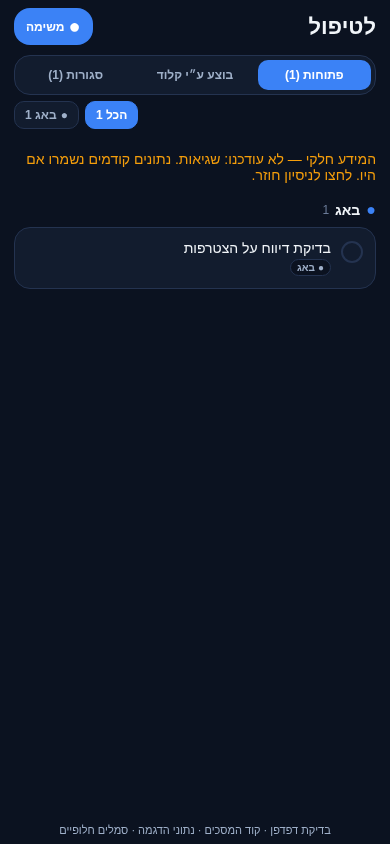
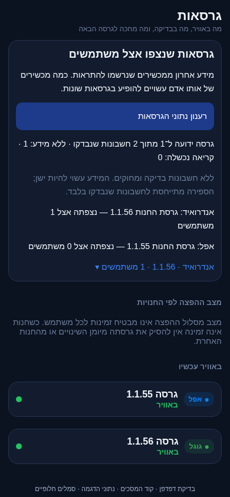
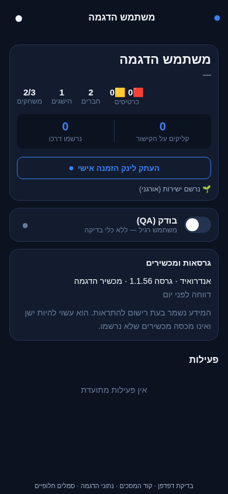
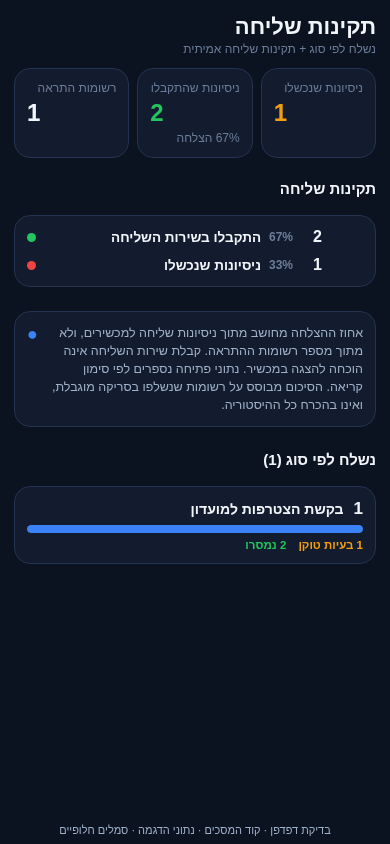
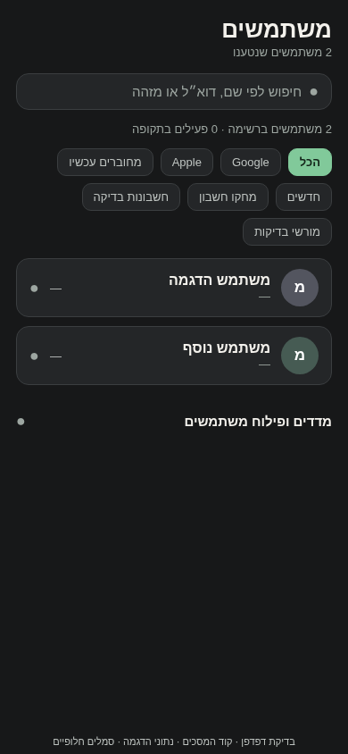
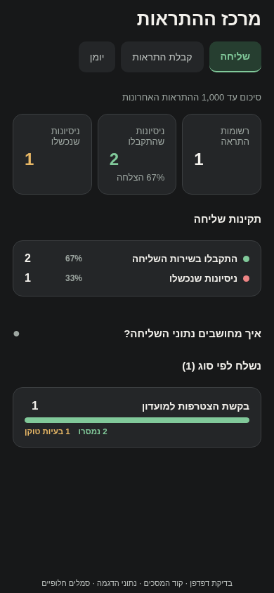
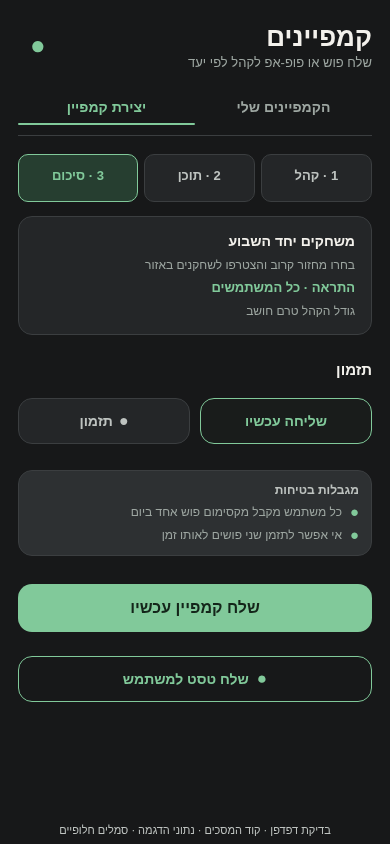
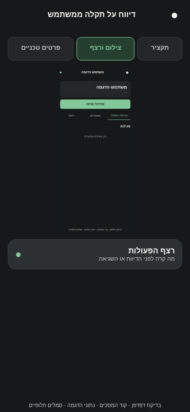
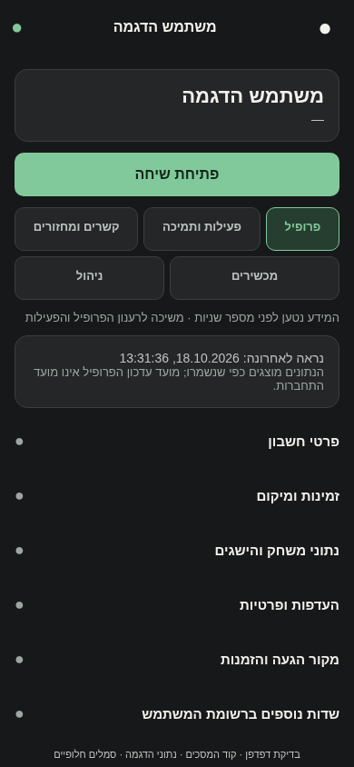
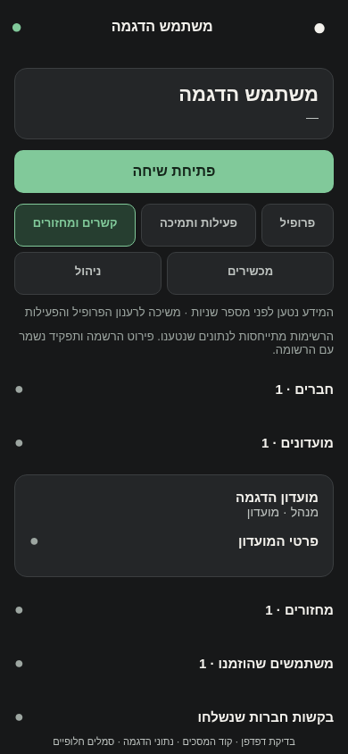

# מיפוי, ארגון וניהול בפולס

## מקור הגעה בכרטיס משתמש — 20.10.2026

`UserDetailScreen` מציגה בתוך ״קישור הזמנה ומקור הגעה״ כרטיס ייעודי עם ערוץ, קמפיין, מזהה קישור, `resolved_by`, סוג ויעד הקישור ומועד הייחוס. מקור פרסומי אינו מוסתר כאשר קיים גם `invitedBy`; שם המזמין והייחוס הפרסומי מוצגים יחד.

`fetchUserActivity` קוראת עד 100 אירועי `entry_source_resolved` של המשתמש, בוחרת את האחרון לפי `occurredAt`/`createdAt` ומחזירה אותו כ־`entryAttribution`. השדות `acquisition.source`, `campaign`, `linkId` ו־`at` נקראים מרשומת המשתמש ומוצגים לצד האירוע, כדי לאפשר איתור קישור מדויק למשתמשים חדשים ולשמור על תאימות לחשבונות ישנים. כשל קריאת האירועים נכנס ל־`failedSources`; הוא אינו מוצג כמקור ריק.

השינוי מקומי. בדיקת טיפוסים ובדיקות המאגר עברו, אך המסך לא נבדק בצילום של פולס לאחר השינוי ולא בוצעה בנייה, התקנה או פריסה.

## מלאי קובצי מסך למפתח המצב — 19.10.2026

מלאי קבצים סטטי, לא רשימת מסכים שנבדקו בהרצה. השיוך למפתח הניהול כולל גם קבצים ישנים, גופי לשוניות ומסכי עומק; עצם קיום הקובץ אינו מוכיח נתיב עצמאי פעיל. שלושת מרכזי העבודה שומרים גופים משותפים, וכינויים ישנים מפנים ללשונית המתאימה. מקורות הניווט שנקראו לצורך המיפוי: `pulse/src/navigation/RootTabs.tsx`, `pulse/src/navigation/UsersStack.tsx`, `pulse/src/navigation/GamesStack.tsx`, `pulse/src/navigation/ErrorsStack.tsx` ו־`pulse/src/screens/WorkspacesScreen.tsx`. לא בוצעו שינוי קוד, הרצה או צילום חדשים.

[כרטיסי מצב](../status/shared.md) · [מלאי המסכים והשיוכים](../status/screens.md). התנהגות, חישובים, בדיקות וחסמים נשארים בסעיפים הקיימים להלן ובמיפוי המפורט המקושר.

- `pulse/src/screens/AdminLoginScreen.tsx`
- `pulse/src/screens/AdsScreen.tsx`
- `pulse/src/screens/AnalyticsScreen.tsx`
- `pulse/src/screens/AvailabilityScreen.tsx`
- `pulse/src/screens/CampaignsScreen.tsx`
- `pulse/src/screens/ChatMessagesScreen.tsx`
- `pulse/src/screens/ChatReportsScreen.tsx`
- `pulse/src/screens/ChatsScreen.tsx`
- `pulse/src/screens/DevInboxScreen.tsx`
- `pulse/src/screens/ErrorDetailScreen.tsx`
- `pulse/src/screens/ErrorsScreen.tsx`
- `pulse/src/screens/FeaturesScreen.tsx`
- `pulse/src/screens/GameDetailScreen.tsx`
- `pulse/src/screens/GamesScreen.tsx`
- `pulse/src/screens/IdeasScreen.tsx`
- `pulse/src/screens/MapScreen.tsx`
- `pulse/src/screens/MessagesScreen.tsx`
- `pulse/src/screens/NotificationsLogScreen.tsx`
- `pulse/src/screens/OnboardingActivityScreen.tsx`
- `pulse/src/screens/OverviewScreen.tsx`
- `pulse/src/screens/PushScreen.tsx`
- `pulse/src/screens/QaUserDetailScreen.tsx`
- `pulse/src/screens/QaUsersScreen.tsx`
- `pulse/src/screens/QuotaScreen.tsx`
- `pulse/src/screens/ReportsScreen.tsx`
- `pulse/src/screens/RevenueScreen.tsx`
- `pulse/src/screens/ReviewsScreen.tsx`
- `pulse/src/screens/SegmentScreen.tsx`
- `pulse/src/screens/SettingsScreen.tsx`
- `pulse/src/screens/SourcesScreen.tsx`
- `pulse/src/screens/StickersScreen.tsx`
- `pulse/src/screens/TasksScreen.tsx`
- `pulse/src/screens/TokenHealthScreen.tsx`
- `pulse/src/screens/UserDetailScreen.tsx`
- `pulse/src/screens/UsersScreen.tsx`
- `pulse/src/screens/VersionsScreen.tsx`
- `pulse/src/screens/WorkspacesScreen.tsx`

[הסבר פשוט](pulse-management.simple.md)

עודכן: 18.10.2026, בסיס `5148f63c`, שינויים מקומיים. לא בוצעו בנייה או פריסה. [מפת כל המסכים והרכיבים](../../audits/2026-10-18-pulse-screen-map.md) ו־[ממצאים והחלטות](../../audits/2026-10-18-pulse-structure.md).

## כניסה וכיסוי

`RootTabs` מציג את `Tasks`, `Users`, `Versions` ו־`Menu`. `Overview` נשאר יעד רשום דרך התפריט. מזהי כל הנתיבים הקיימים נשמרו. `AppMenu` מקבץ תמיכה, פעילות, גיוס, התראות, חנויות ומערכת. `DevInbox` נקרא ״אבחון ודיווחים״; ארבע הלשוניות נשמרות אך כל גוף מורכב רק בביקור הראשון. במעבר ללשונית אחרת נשמר המצב המקומי שלה.

תיבת הפיתוח לא הוסרה: קיבוץ דיווחים, סימון לתיקון, יצירת פיצ׳ר, צילומים ופעילות מדווח הם יכולות עומק קיימות שעדיין נדרשות. `ErrorsBody` טוען שגיאות טכניות בלבד. `fetchIssues` עדיין קיים לצרכנים הזקוקים לשילוב, עם תרגום `feedback.status=done` ל־`resolved` במודל הקריאה. כתיבת סגירה דרך `setErrorStatus` מתרגמת בחזרה ל־`done` בדיווח.

`ErrorDetail` מקבל `{id, collection}` וטוען מסמך יחיד דרך `fetchIssue`. הקישורים ממשתמש, מדווח ורשימת השגיאות מעבירים את האוסף. פרמטר ישן בלי אוסף מקבל ברירת מחדל `errors` לשם תאימות. מזהים זהים באוספים שונים אינם סיבה לבחור את המסמך הראשון מתוך שתי רשימות.

## גרסאות ומכשירים

`UserDevicesCard` מופיע בתוך `UserDetailScreen`; `VersionAdoptionPanel` בתוך `VersionsScreen`. אין כתיבה לנתוני המכשירים. הכרטיס נטען רק בפתיחת לשונית ״מכשירים״.

מסלול הקריאה: `deviceVersions.fetchUserDevices` → מטמון בן חמש דקות → `getDoc(users/{uid}/private/push)` → `readDeviceVersions`. רק המפתחות הכלולים גם ב־`fcmTokens` נקראים מתוך `devices`; כפילות של אותו אסימון אינה מכפילה שורה. אסימונים עצמם אינם מוחזרים לתצוגה. כל שורה דורשת גרסה לא ריקה ומועד `registeredAt` מספרי חיובי. גרסה חסרה, `unknown` או מועד חסר אינם הופכים לנתון ידוע. פלטפורמה לא מזוהה מוצגת בנפרד.

לוח הסיכום נטען רק בלחיצה מפורשת. `fetchVersionInventory` קורא את רשימת המשתמשים, מוציא `isTest` וחשבונות מחוקים וקורא את רישומי המכשירים בעד שש בקשות מקבילות. רענון מפורש עוקף גם את מטמון המשתמשים וגם את מטמון המכשירים. אין סריקה מחזורית ואין קריאה עבור כל משתמש בעת פתיחת מסך הגרסאות.

| מצב | תוצאה |
|---|---|
| טעינה ראשונה | מחוון; טרם מוצגים מספרים |
| מסמך מכשירים חסר או ללא גרסה תקפה | ״ללא מידע״, לא גרסה ישנה |
| קריאת מסמך נכשלת | ״קריאה נכשלה״; אינה נכללת בחסרי המידע |
| טעינת רשימת המשתמשים נכשלת | הודעה; הסיכום הקודם נשאר אם היה |
| מספר מכשירים באותה גרסה ואותה מערכת | משתמש אחד בשורת הסיכום, כל המכשירים בכרטיס |
| מספר גרסאות או מערכות לאותו משתמש | המשתמש מופיע בשורות המתאימות; אין לסכום אותן לאנשים ייחודיים |
| לחיצה על שורת גרסה | רשימת משתמשים; לחיצה על משתמש פותחת `Users > UserDetail` |
| קריאת חנות חסרה | אין הסקת גרסה מהחנות השנייה או מתאריך ביומן |

מכנים: `known` הוא מספר חשבונות בעלי לפחות רישום תקף אחד. `unknown` הם חשבונות שנקראו בהצלחה בלי רישום תקף. `failed` הם חשבונות שקריאתם נכשלה. סכומם שווה למספר החשבונות שנסרקו. בכל `(platform, version)` סופרים מזהי משתמשים ייחודיים. לדוגמה, אדם אחד עם שני מכשירי אנדרואיד בגרסה א׳ ומכשיר אפל בגרסה ב׳ נספר כאדם אחד בכיסוי וכאדם אחד בכל אחת משתי שורות הגרסאות.

המספר ליד גרסת החנות הוא גודל הקבוצה התואמת למערכת ולגרסה; אין כאן טענה שכל המכשירים של אותו אדם מעודכנים. יעד האנדרואיד נגזר ממצב המסלול שלו בלבד. הפצה הדרגתית או מצב מסלול אינם הוכחה לזמינות בחנות לכל אדם. גרסה שמופיעה רק ביומן מסומנת כמצב חנות שלא אומת.

מגבלות: רישום להתראות אינו מדידת נוכחות כללית, `registeredAt` אינו בהכרח פתיחת האפליקציה האחרונה, משתמש בלי רישום אינו מכוסה, אין עדיין מספר בנייה, והרשימה כפופה לתקרת `listAll` הקיימת (5,000 לכל היותר). אין הצגת אחוז אימוץ מתוך כלל המשתמשים. מדידה מלאה בעתיד דורשת איסוף עצמאי מהסכמה להתראות, הגדרת פעילות ובדיקת מסלול הכתיבה; לא מומשה בסבב זה.

## אמינות תור העבודה

`listWorkSnapshot` מחזיר `items` ו־`failedStreams`. `retainFailedWork` שומר רשומות קודמות רק של מקורות שנכשלו, ומחליף מקורות שהצליחו. המסך מציג אזהרה וניסיון חוזר; המונים אינם מוצגים כמידע מלא. `listWork` נשאר מתאם לצרכנים קיימים, אך זורק על תמונה חלקית כדי שהמונה בסרגל יסומן `?`. חוסר יכולת קריאה אינו מפעיל דמו; רק `MOCK_WORK` מפורש עושה זאת.

`sourceId` נוסף להיטל המשימות. משימה שהועתקה מטימדר מקבלת `sourceReportId` וקישור לדיווח המקור. לא אוחדו מצבי שני מסמכים ולא נמחקו עותקים: ייתכן שהמשימה מכילה עבודה נוספת או מצב שונה. המונים עדיין סופרים רשומות עבודה, ולא משפחות תקלות ייחודיות. בפתיחת פריט יש קישור לכרטיס המשתמש ולפרטי האבחון. שיחת תמיכה אינה מוצגת עוד כרעיון שממתין לאפיון.

דיווחים: פעולת שינוי מצב/סימון לתיקון/מחיקה מתעדכנת במסך רק לאחר אישור הצלחה. `saving` חוסם בקשה כפולה לאותו מזהה. כשל משאיר את הדיווח במצבו ומציג הודעה. מטמוני `raw:feedback` ו־`work:report` מתבטלים אחרי הצלחת הכתיבה. אין שינוי בהרשאות או במילות המצב המקוריות.

## מדדי שליחה ומשתמשים

`pushStats.totalSent` סופר מסמכי התראה; `totalAttempts = Σ(ok + failed)` סופר ניסיונות למכשירים. שיעור קבלת השירות הוא `Σok / totalAttempts`, מעוגל לאחוז שלם, ואפס כאשר אין ניסיונות. ״ללא אסימון״ ו״כיבו בהעדפות״ נשארים קטגוריות נפרדות. לדוגמה, מסמך אחד עם שני ניסיונות מוצלחים ואחד שנכשל נותן 67%, ולא 200%. קריאת מסד שנכשלת נזרקת למסך במקום להחזיר אפסים. הסריקה מוגבלת ולכן אינה כל ההיסטוריה בהכרח.

מסך משתמשים מבדיל בין חשבונות בדיקה לפי `isTest` לבין הרשאת בדיקות לפי `qa`. רענון `fetchUsersWithAuth(force)` מעביר `force` גם לקריאת המשתמשים. תקלת טעינה ברשימה ובכרטיס מציגה ניסיון חוזר. מסך המדווחים נקרא ״מדווחים״, משום שהוא נגזר ממי ששלח דיווח ואינו רשימת מורשי בדיקות.

## בדיקות וראיות

`pulseStructure.test.ts`: תרגום מצבים, זהות אוסף+מזהה, תמונה חלקית ושמירת מידע קודם, היטל קישור מקור, פענוח מכשירים ללא חשיפת אסימונים, כיסוי מול כשל, ייחוד משתמשים בגרסה ומכנה שליחה. `pulseNavigationCoverage.test.ts` מוודא שכל יעד תפריט רשום ושאין רישומי ניווט כפולים. בדיקות הטיפוסים מתבצעות בנפרד לפרויקט הראשי ולפולס.

צילומי `pulse-structure-*-2026-10-18.png` נוצרו מקוד המסכים דרך מתאם דפדפן, עם שירותים מדומים וסמלים חלופיים. הרכיבים הוצגו ברוחב 390; אין הוכחה לכניסה חיה, התנהגות מגע במכשיר או כתיבה לייצור. [תוצאות התצוגה](../../audits/evidence/pulse-structure/preview-results.json). תוצאות הבדיקות הסופיות מפורטות ב־[יומן השינוי](../../changes/2026-10-18-pulse-management.md).

## עיצוב פחם ואיחוד מרכזי העבודה — 18.10.2026

העדכון חל על הפולס בלבד. `theme.ts` מגדיר רקע `#171819`, כרטיסים `#242628`, משטח נוסף `#2D3032`, טקסט `#F3F1EC`, טקסט משני בהיר וירוק `#81C99A`. על כפתור ירוק מוצג טקסט כהה `onPrimary`. כחול, סגול וטורקיז מרוככים נשארים לצבירות; צהוב ואדום משמשים מצבים. רקעי האפליקציה והסמלים המערכתיים הותאמו בהגדרות, ללא שינוי גרסה או בנייה. תוכן חיצוני כגון מפה ותצוגה מקדימה של קמפיין אינו נצבע כאילו הוא ממשק הפולס עצמו.

`Screen` ו־`Card` מספקים ריווח 18/16, כותרת ברורה ומשטחים משותפים. כיווניות מוגדרת בשורש ובמכל הניווט. שורות ישנות שהשתמשו בהיפוך הוחלפו בסדר עברי רגיל. אין שינוי בהרשאות או בפעולות הניהול עצמן.

| יעד מרכזי | לשוניות | מסלולים ישנים |
|---|---|---|
| `Overview` — פעילות ומדדים | סקירה, מדדי שימוש, מפה | `Analytics`, `Map` מפנים ללשונית המתאימה |
| `Campaigns` — גיוס וקשר | קמפיינים, קהלים, קישורים, מדבקות | `Segment`, `Sources`, `Stickers` מפנים ללשונית המתאימה |
| `Push` — מרכז ההתראות | שליחה, קבלת התראות, יומן | `TokenHealth`, `NotificationsLog` מפנים ללשונית המתאימה |

`WorkspacesScreen.tsx` ו־`Workspace.tsx` מיישמים את המרכזים. שבע כניסות כפולות הוסרו מהתפריט; מזהי המסלולים נשמרו למעבר מקישורים קיימים. `sectionRequest` גורם גם לכניסה חוזרת לאותו קישור לבחור מחדש בלשונית המבוקשת. `EmbeddedScreen` מונע כותרת ראשית ואזור בטוח כפולים. רק לשונית שנפתחה מורכבת; היא נשארת מורכבת בהסתרה לשמירת סינון, גלילה וטפסים. אזורים מוסתרים אינם חשופים לקורא מסך.

לא אוחדו שיחות תמיכה עם פיקוח על שיחות בין משתמשים, ולא הוסרו כלי אבחון, רעיונות או פעולות ייחודיות. לא מוזגו מסמכים או מצבי עבודה במסד.

### מסכי העבודה

- ״לטיפול״: חיפוש לפי פנייה, תוכן, משתמש או מסך, לצד מצב וסוג. מטא־נתונים משניים מופיעים בהרחבה. סינון ריק נבדל מתור ריק. המונה מקבל את `WorkSnapshot` האחרון ללא סריקה או שעון משלו; `?` מציין שטרם התקבלה תמונה מלאה.
- ״משתמשים״: חיפוש לפי שם, עיר, דוא״ל ומזהה בראש; מדדים וגרפים נפתחים באזור מתקפל אחרי הרשימה. `FlatList` מרנדר חלון שורות במקום אלפי שורות בבת אחת. זהו שיפור ברינדור בלבד; מאגר הנתונים עדיין מוגבל לעד 5,000 חשבונות.
- כרטיס משתמש: שם וכפתור ״פתיחת שיחה״, ולשוניות פעילות ותקלות, מכשירים וניהול. העתקת קישור והרשאת בדיקות נשמרו בניהול. תאריך וגרסה מדווחים נמצאים במכשירים, והקריאה הפרטית מתבצעת רק בפתיחת הלשונית.
- שיחות: פנייה יזומה הועברה לאזור מתקפל שמורכב רק כשמבקשים אותו.
- התראות: מקור משותף של עד 1,000 האחרונות; היומן מציג עד 250. הסבר המכנים נפתח לפי צורך. כשל מוצג ככשל, ולא כאפס.

### יעילות ואמינות

[ביקורת הקריאות המלאה](../../audits/2026-10-18-pulse-read-efficiency.md) מפרטת לפני/אחרי, נוסחאות, תקרות וסיכונים. שירות המטמון מאחד גם רענונים מקבילים; `collectionData` משותף למשתמשים, מחזורים ומועדונים. `listAll` משתמש בשאילתות עם סמן ותקרה מדויקת. ספק המדדים אינו פונה לרשת בכל פתיחת הפולס. אין שינוי בתדירות או בסכמת איסוף הנתונים של אפליקציית השחקנים.

### ראיות לעיצוב

הצילומים הם רינדור קוד אמיתי בדפדפן, עם שירותים וסמלים חלופיים, ברוחב 390 ו־320. אינם צילום מהתקנה מקורית, ואינם מאמתים מקלדת, אנימציות מקוריות, התחברות או חיבור לנתונים חיים. [כל הראיות והבדיקות](../../audits/evidence/pulse-redesign/README.md).

אימות הסבב הסופי: 421 חבילות / 4,976 בדיקות עברו; בדיקות הטיפוסים של האפליקציה והפולס נקיות; 44 צילומים נרשמו עם חותמות. בודק התיעוד מצא 107 קישורים חסרים שהיו קיימים לפני הסבב, ללא תוספת כשלים. היומן המרוחק לא נכתב: אין חיבור ניהול מאומת בסביבה; הרישום המוכן נמצא ב־`docs/audits/evidence/pulse-redesign/release-log-pending.json`.

## השלמת מבנה העבודה — 18.10.2026

השלב הזה ממשיך את העיצוב האחיד ומשנה את סדר העבודה בתוך המסכים:

| מסך | המבנה הנוכחי | נתונים וכתיבה |
|---|---|---|
| גרסאות | חנויות / גרסאות המשתמשים / יומן שינויים | סיכום מכשירים עדיין נטען בלחיצה בלבד; היומן כולל גם גרסאות חיות; כשל מקור מזוהה במפורש, רענון מציג מחוון |
| אבחון | חיפוש מקומי בשגיאות; קיבוץ דיווחים מתקפל; פעולות הדיווח נפתחות לפי הצורך | מסלול הדיווח מעביר `collection: feedback` למסך הפרטים המשותף; פעולות סטטוס, סימון ומחיקה קיימות נשמרו |
| פרטי דיווח | תקציר / צילום ורצף / פרטים טכניים | `mapFeedback` שומר את `image`; צילום מגיע עם קריאת המסמך היחיד, ללא סריקה נוספת. רצף פעולות נטען רק בפתיחתו |
| שיחות | ברירת מחדל ממתינים, סיכום אחד, תבניות וציטוטים מתקפלים | סדר השיחות הממתינות לפי `lastMessageAt` עולה; שאר השיחות לפי אותו שדה יורד. זהו זמן ההודעה האחרונה, לא זמן תחילת ההמתנה |
| קמפיינים | רשימה תחילה; יצירה בשלבים קהל / תוכן / סיכום | כל שדות הטיוטה נשמרים במצב ההורה; שליחה ובדיקה רק בסיכום; אישור השליחה המקורי נשמר. נדרשים כותרת ותוכן; תזמון חייב להיות מספר שעות חיובי וסופי |
| קהלים | רשימה שמורה / בנייה | חישוב קהל יזום; כשל חישוב עוצר שמירה. הסרת כפתור המחיקה הכפול. שינוי תנאים מבטל את הספירה הקודמת |
| סקירה | תקלות ומשתמשים ראשונים; כניסה למשימות, שיחות וגרסאות | נתוני קישורים ומודעות מתקפלים; מקורות ומטמון מהשלב הקודם נשמרים |
| מדדים | תמונת מצב / מעורבות / מקורות ומכשירים | החלפת לשונית היא מקומית; שינוי טווח טוען את אותו שירות. מזהה בקשה מונע מתשובה ישנה להחליף תקופה חדשה. נתוני מעורבות הקהילות והמחזורים מסומנים כמצטברים |
| מחזורים | חיפוש לפי שם, מועדון או מזהה; מחזורים חיים ראשונים | חיפוש ומיון ברשימה שכבר נטענה; פרטי ניהול נוספים מופיעים בהרחבה |
| זמינות | הנתונים לפני הגדרות תצוגת היומן | שינוי עיר ממשיך במסלול הקיים; מתג הניהול שמור תחת הגדרות מתקפלות |
| מסלול ההצטרפות | רצף / ספירה, חיפוש מקומי; פרטי פעולה ומסירה מתקפלים | החיפוש מסנן גם את הספירה; הכותרת מציגה את סך הנתונים שנטענו. תקרת 2,000 הרשומות ומעבר לביקור ספציפי נשמרו |
| מכסות | לתשומת לב / הכל | לתשומת לב כולל `used == null` או `limit > 0 && used / limit >= 0.5`; היעדר מידע אינו מוצג כמצב תקין. התראה ראשית מעל 80% רק במכסות מתחדשות |
| הגדרות | התראות / מערכת / חשבון | יציאה נפרדת מהעדפות ההתראות; פעולות שרת קיימות ללא שינוי הרשאות |

`SectionTabs` מספק יעדי מגע בגובה 48 ולשוניות עם מצב נגישות. `Panel` מרכיב תוכן בביקור הראשון ומשאיר אותו מורכב אך מוסתר בהמשך. גם `Disclosure` משמר ילדים אחרי פתיחה, כדי לא לאבד טיוטה או נתונים. ההסתרה אינה מבטלת טיימר של ילד: במסכים אלה אין טיימר חדש, ובשיחות נשמר רענון רק בזמן מיקוד ופעילות האפליקציה. מעבר בין שלבי קמפיין אינו קורא למסד.

החישובים עצמם לא שונו: שיעור חזרה, ממוצע זמן ונתוני משפך נשארו באותם מקורות ומכנים. מספר המשתמשים המתאימים לקמפיין הוא אומדן לפני מגבלות המסירה, כפי שמופיע בסיכום. ספירת מכשירים אינה מדידה של כלל ההתקנות.

### אימות ומגבלות השלב

[ראיות והוראות שחזור](../../audits/evidence/pulse-workflows/README.md). בדיקת הממיר קוראת `fetchIssue` עם מסמך מדומה דרך `getDoc` האמיתי הממופה, ולא מחליפה את הממיר. בדיקת תעדוף השיחות כוללת ערבוב שיחות ממתינות ושיחות שנענו, חיפוש ואי־שינוי קלט.

הצילומים הם רינדור קוד המסכים עם נתוני הדגמה בדפדפן, ברוחבים 320 ו־390. אין להסיק מהם אימות מקלדת מערכת, מחוות, אזור בטוח, הודעות פוש או כתיבות ייצור. אין כאן כלי מכשיר או מדמה זמינים; בדיקת מכשיר אמיתי נשארה פתוחה. לא בוצעו בנייה, התקנה, פריסה או עדכון יומן מרוחק.

## כרטיס משתמש מאוחד — השלמה ב־18.10.2026

לפי בקשת הבעלים, לא נוסף כרטיס תמיכה נפרד. הנתיב `Users > UserDetail` נשאר הכניסה היחידה למידע המשתמש. חמש לשוניות: פרופיל, פעילות ותמיכה, קשרים ומחזורים, מכשירים וניהול. השיחה הרשמית נפתחת בכפתור הקיים; אין מסך חדש או שינוי הרשאות.

### מקור הנתונים ומה מוצג

| מקור | מידע | מועד טעינה וגבולות |
|---|---|---|
| `users/{uid}` | כל השדות העסקיים שנשמרו, כולל שדות עתידיים; חשבון, זמינות, העדפות, פרטיות, נתוני משחק, הישגים וייחוס הזמנות; נתוני משמעת וכרטיסים מוחרגים מהתצוגה לבקשת הבעלים | מסמך יחיד בפתיחה; `userRecord` משמיט ערכי אסימונים וסודות לפני העברתם לרכיב |
| `games` | מחזורים שבהם המשתמש משתתף בשדה החדש או הישן, וכן מחזורים שיצר | שאילתות ממוקדות; 200 לכל שאילתת חברות, 500 ליצירה; איחוד לפי מזהה. נשלחים רק שדות התקציר וההרשמה הדרושים |
| `groups` | חברות, ניהול ויצירה, לרבות מועדון אישי שמסומן במפורש | 200 לכל שאילתת חברות/ניהול, 500 ליצירה; איחוד לפי מזהה |
| `feedback` | הדיווחים ששלח, סטטוס, מסך, תוכן וקישור לפרטים ולצילום | עד 500 לפי `userId`; ללא תמונות או יומני אבחון בתשובת הרשימה |
| `errors` | תקלות שבהן המשתמש הוא `lastUserId` | עד 500; השיוך אינו היסטוריה מלאה של כל נפגעי התקלה. `count` הוא מצטבר לתקלה ולא למשתמש, כפי שמוסבר במסך |
| `inviteClicks/{uid}`, `users.invitedBy` | כניסות לקישור, משתמשים שהוזמנו ופרטי המזמין | מסמך אחד ועד 500 מוזמנים; פרטי המזמין בקריאה יחידה רק אם קיים |
| `usersPublic/{uid}` | הפרופיל הציבורי כפי שנשמר | רק בפתיחת הסעיף, מטמון של שלוש דקות |
| `playerStats/{uid}` | רשומת סטטיסטיקות נוספת כפי שנשמרה | רק בפתיחת הסעיף, מטמון של שלוש דקות; נתונים אלה אינם מתמזגים אוטומטית עם `users.stats` |
| `users/{uid}/private/push` | גרסאות, מכשירים ויתר מטא־נתוני רישום ההתראות | רק בלשונית מכשירים; `fetchUserPushRecord` משותף לתצוגת הגרסאות ולפרטי הרישום. מפת מכשירים ממופתחת באסימון מומרת לרשימת ערכים כדי לא לחשוף את המפתחות |
| `notifications.recipientId` | התראות השייכות למשתמש | בפתיחה בלבד, עד 100 רשומות |
| `onboardingActivity.uid` | מסלול ההצטרפות וקישור לביקור | בפתיחה בלבד, עד 100 רשומות; כפתור מעביר `sessionId` למסך הקיים |
| `friendRequests.fromUserId / toUserId` | בקשות חברות שנשלחו והתקבלו | שתי פתיחות עצמאיות; עד 100 בכל מקור |
| `groupJoinRequests.userId` | בקשות להצטרף למועדונים | בפתיחה בלבד, עד 100 |
| `tasks.reporterId` | משימות המשויכות למדווח | בפתיחה בלבד, עד 100; אין טענה שזהו כל פריט עבודה שבו הוא מוזכר |
| `pairStats.a / b` | נתוני משחק משותף משני צדדי הזוג | שתי פתיחות עצמאיות; עד 100 בכל מקור |
| שירות ההתחברות | ספקים, דואר, טלפון אם נשמר, אימות כתובת, השבתה ומועדי התחברות | כפתור מפורש בתוך הסעיף. מדיניות החיבור הקיימת מאפשרת `accounts:batchGet` בלבד ולכן הסנכרון משותף לכל החשבונות; לא מתבצע אוטומטית עבור כרטיס בודד |

רשימת החברים מציגה את המזהים השמורים ומאפשרת פתיחת אותו כרטיס משתמש דרך `push('UserDetail')`, ללא סריקת פרופילים לשם השלמת שמות. משתמשים שהוזמנו כוללים גם את השם שכבר התקבל בשאילתה. מזהי רשומות נשמרים מהקריאה, ולא נבנים מחדש מטקסט.

### טעינה, כשל ויעילות

`fetchUserActivity` משתמש במטמון לפי משתמש לשלוש דקות. פתיחה ראשונה קוראת שני מסמכים ותשע שאילתות מסוננות, ועוד מסמך מזמין רק אם יש מזמין. משיכה מרעננת את המקורות האלה בלבד. שינוי סימון בודק מוצלח מבטל גם את מטמון הפעילות. מסמך משתמש חסר או שירות לא זמין גורמים לכשל גלוי, ולא למשתמש ריק מדומה.

`failedSources` מציג מקורות שנכשלו; `limitedSources` מציג מקורות שהגיעו לתקרה. הנתונים שהצליחו עדיין מוצגים, אך אין לפרש אפס בתת־רשימה שנכשלה כקביעה שאין מידע. לכל מקור נוסף יש כשל וניסיון חוזר עצמאיים ורענון יזום. הלשוניות והסעיפים שנפתחו נשמרים במעבר; אין שאילתה מחזורית חדשה.

`queryEquals` ו־`queryArrayContains` תומכות כעת בהיטל שדות אופציונלי. הקריאות הקיימות בלי היטל נשארות תואמות. בכרטיס, רשימת דיווחים לא מורידה את `image`, ורשימת שגיאות לא מורידה `lastJournal`, `lastStack` או הקשרים גדולים. פתיחת הפריט המדויק ממשיכה להציג אותם במסך האבחון הקיים.

המקורות הנוספים ב־`USER_SOURCES` מוגבלים ל־100, ללא מיון שרת לפי זמן. לכן התצוגה אומרת במפורש שהחלון אינו מבטיח את הרשומות האחרונות או היסטוריה מלאה; המיון המקומי חל רק על הרשומות שהתקבלו. אין סריקה של כלל המשתמשים לצורך המקורות האלה. הסנכרון האופציונלי של ההתחברות הוא חריג מפורש הנובע ממדיניות החיבור, ונשמר במטמון משותף לחמש דקות. כשל באחד מעמודי ההתחברות דוחה את הסנכרון במקום להציג תוצאה חלקית כמלאה.

`mapAuthRecord` מעביר רק רשימת שדות חשבון מותרת, ללא גיבובי סיסמה, מלח או אישורים. מידע טכני נוסף מרשומת המשתמש עובר `userRecord` רקורסיבי. זו תצוגת ניהול של נתונים עסקיים ומטא־נתונים; אין כאן חיפוש בתוכן שיחות פרטיות בין משתמשים או קריאת כל תתי־האוספים הפרטיים שלהם. לא נוספה הרשאה לצורך זה.

### רכיבים ובדיקות

`UserInformation.tsx`: `RecordFields`, `UserProfileInformation`, `UserRelationships`, `UserRelatedRecords` ו־`PublicInformation`. פירוט מבנים מקוננים נפתח לפי צורך; בכל רמה מוצגים עד 25 שדות עם כפתור להמשך. שדות לא מוכרים נשמרים תחת ״שדות נוספים״ ולא נעלמים בממיר. אין סכימה חשבונית חדשה: נתוני משחק נשמרים כמונים גולמיים, ולא נגזרים מהם מדדי נוכחות חדשים.

בדיקות `pulseUserDetails` מפעילות את שירות הכרטיס עם מתאם מסד, ומכסות שדות לא מוכרים, איחוד קשרים, יצירה ללא השתתפות, כשל, תקרה, שאילתות לפי המשתמש והסתרת סודות. `pulseReadPagination` מאמת את היטל השדות בגוף בקשת המסד האמיתית.

[ראיות וצילומים](../../audits/evidence/pulse-user-complete/README.md). הצילומים הם קוד המסך בדפדפן עם נתוני הדגמה; אינם התקנה או אימות נתוני ייצור. סקיצת איכות הגרסה היא הצעת עיצוב נפרדת, לא מסך שמומש ולא ראיית תקינות.

### הסרת כרטיסי משתמש — 2026-10-18

לבקשת הבעלים הוסרו מוני הכרטיסים הצהובים והאדומים מסיכום הניהול, אירועי `card` מציר הזמן, והשדות `discipline`, `yellowCards`, `redCards` מהפירוט הרקורסיבי. הנתונים במסד ובשירותים נשמרו; זהו שינוי תצוגה בלבד ללא קריאות נוספות.

[צילום הפרופיל הנוכחי](../screenshots/pulse-no-cards-profile-390-2026-10-18.png). צילום דפדפן של קוד מקומי עם נתוני הדגמה וסמלים חלופיים; אינו עדכון מותקן.

### כרטיס שחקן בשלוש לשוניות — 18.10.2026

הכרטיס מחולק לסקירה, מידע והיסטוריה בשורת לשוניות אחת. שם השחקן מופיע פעם אחת והכותרת היא ״פרטי שחקן״. המחזורים והמועדונים מוצגים בשמם בלבד ללא תמונות. פעולת פתיחת השיחה נשמרה, וכלי הבדיקה וההזמנות נגישים מתוך מידע. דיווחים ושגיאות נשארו נגישים בהיסטוריה; דיווחים פתוחים מופיעים גם בסקירה. אין יומן חדש המייחס פעולות למנהלים ואין הערות פנימיות.

`playerRoundFacts` מפריד בין `players` (הרשמה), `waitlist` (המתנה), `pending` (אישור) לבין יוצר המחזור. `participantIds` הוא איחוד של המצבים ואינו הוכחת הרשמה. מחזור עתידי דורש תאריך בעתיד ואינו מבוטל או גמור. המחזור הבא הוא הראשון לפי תאריך מבין ההרשמות המאושרות שנמצאו. אין הבטחה לתוצאה מלאה כאשר אחד המקורות הגיע לתקרה או נכשל.

״מחזורים ששיחק״ סופר לפי כלל ההשתתפות באפליקציה: מחזור שהתקיים לפי `didEveningHappen`, מועד עבר, המשתמש ב־`players`, וללא `no_show`. סימון הגעה חסר אינו חוסם ספירה. עד תיקון19.10.2026 הפולס דרש בטעות `arrived` או `late`, ולכן ספירת משתמשים היסטוריים הוצגה כאפס. מדיניות קיום הערב מועתקת ללא שינוי מן המקור `src/utils/eveningPlayed.ts` אל `pulse/src/services/eveningPlayed.ts`; בדיקת התאמה מחייבת זהות מלאה. בדיקת מטריצה משווה ישירות את תוצאת הפולס ל־`isAttendedGame` בכל 1,152 צירופי התנאים שנבדקו.

אימות נוסף ב־19.10.2026: RtlTextInput מגדיר יישור פיזי לימין בנפרד מתוויות, ושומר הפניות ואירועים. הוסר טקסט רווח לא חוקי מתוך View ב־PlayerOverview ונוספה בדיקת מניעה. עברו 5,078 בדיקות ו־13 מדידות פריסה מקוריות; ההיקף והמגבלות בדוח המקושר לעיל. נקודת הכניסה הזמנית הוסרה; אין שינוי מסלולי ניווט או נתונים.

## תיקון ספירת מחזורים ששיחק — 19.10.2026

`playerRoundFacts(game, uid, now)` שומר את משמעות ההרשמה והניהול, ומתקן רק את תנאי ההשתתפות להתאמה למקור האפליקציה. בקריאה אמיתית ללא כתיבה נמצאו אצל החשבון המדווח 64 מחזורים קשורים, 60 מהם זכאים; הספירה הקודמת הייתה אפס מפני שבכולם חסר סימון הגעה. אין שאילתה נוספת במוצר, שינוי מטמון, הסבת נתונים או שינוי הרשאות. מקור המחזורים, הקרנת השדות והפירוט בלשונית מידע נשארו זהים; מדדי כשל/תקרה ממשיכים לסמן מידע חלקי.

[דוח וגבולות האימות](../../audits/2026-10-19-pulse-player-count.md). [צילום מקורי של התצוגה המתוקנת](../screenshots/pulse-player-played-count-native-2026-10-19.png): ספירת ההשתתפות חושבה מקריאה אמיתית, אך מזהים ושמות הוסוו, יתר פרטי הכרטיס הם נתוני הדגמה והחיבור לייצור חסום. התיקון מקומי וטרם הופץ.

## תלות בעדכון העונות — 19.10.2026

העותק pulse/src/services/eveningPlayed.ts נשמר זהה למקור src/utils/eveningPlayed.ts, כולל isOrganizedEveningAwaitingDecision. אין שינוי בלוח המשימות, בחיבור או בהרשאות. בדיקת זהות העותקים הורצה; מסך הפולס לא הורץ מחדש.

[מצב המימוש, הבדיקות ומגבלות האימות של העונות](../clubs/seasons.md). מקומי בלבד; לא בוצעה פריסה במסגרת המשימה.
