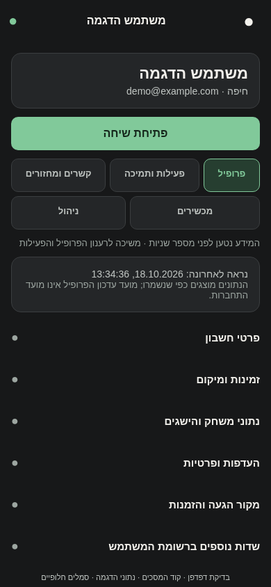
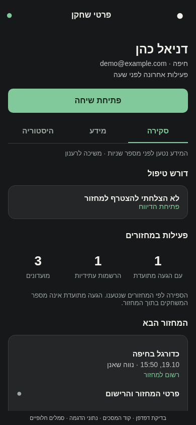
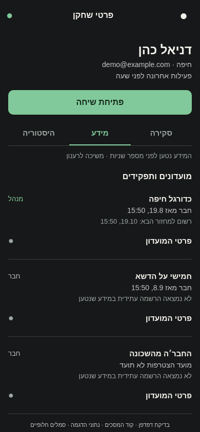
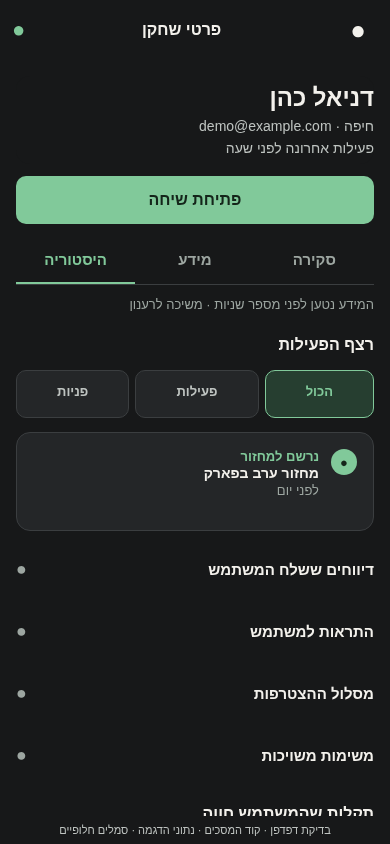
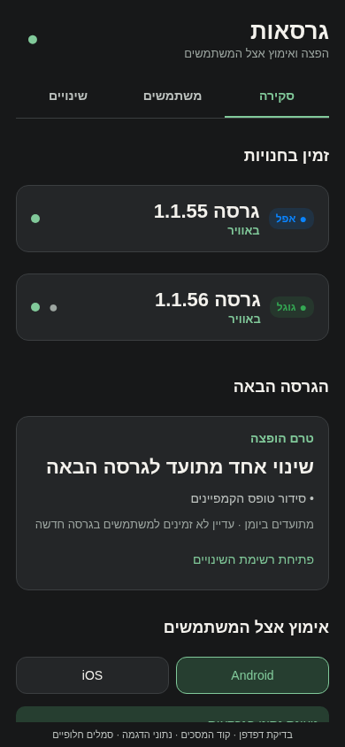
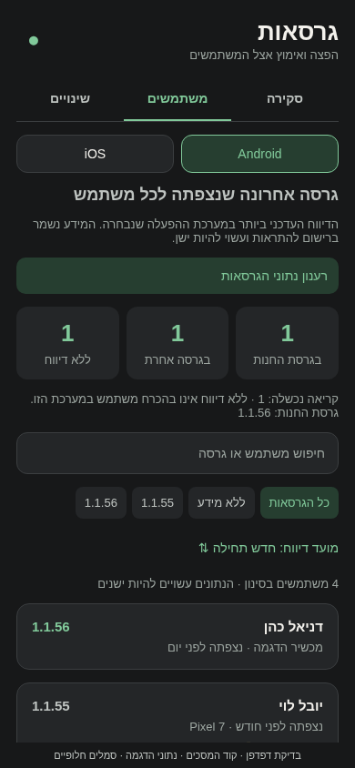

# עבודה וניהול בפולס

## תיעוד כשלים — 20.10.2026

נוסף תיעוד אוטומטי לנקודות כשל במסלול הזה, עם מקור התקלה. הפעולה המקורית שומרת על ערכי החזרה והודעות השגיאה שלה. השינוי מקומי, טרם הופץ, ואין אימות מסירה חיה לפולס.

[דוח דיווח השגיאות והראיות](../../changes/2026-10-20-error-reporting-audit.md).

## מקור הגעה בכרטיס משתמש — 20.10.2026

בכרטיס של כל משתמש מופיע עכשיו ריכוז של מקור הכניסה: סוג כניסה, ערוץ, קמפיין, מזהה הקישור, הדרך שבה המקור נפתר, היעד, המועד ומזהה הביקור. מזהה הקישור נשמר גם בכניסות חדשות. המידע מופיע גם כשיש למשתמש מזמין אישי, כדי שלא נצטרך לבחור בין שני סוגי המקור.

השינוי מקומי בקוד ועדיין לא נבנה או הותקן. לא נוצר צילום חדש, ולכן צריך לאמת את התצוגה בפולס לאחר התקנה.

19.10.2026: נוסף [מפתח מצב קצר לכל קובצי מסכי הפולס](../status/screens.md).
הוא מפנה לתיעוד הקיים ולמגבלות הבדיקות, כדי שלא יהיה צורך ללמוד מחדש
את כל המסכים בכל משימה. זהו עדכון תיעוד בלבד, ללא שינוי במסכים או בהפצה.

הפולס קיבל עיצוב כהה בגוני פחם ואפור, עם ירוק לפעולות החשובות. החיפוש ורשימות העבודה מופיעים לפני הגרפים. בכרטיס המשתמש אפשר לפתוח שיחה ולעבור בין פעילות, מכשירים וניהול.

מסכים דומים רוכזו בשלושה מקומות: פעילות ומדדים, גיוס וקשר, ומרכז התראות. היכולות נשארו זמינות בלשוניות, והמעבר ביניהן שומר את העבודה. כלי התמיכה והאבחון נשארו נפרדים כשיש להם תפקיד שונה.

המסכים משתפים נתונים שכבר נטענו ומונעים רענונים כפולים. סיכומי ההתראות מוגבלים לאלף הרשומות האחרונות, והמידע מוצג עם הגבול הזה. בדיקת גרסאות המשתמשים נשארת פעולה יזומה; היא מבוססת על מכשירים שנרשמו להתראות ועלולה להיות חלקית או ישנה.

[הסבר טכני ומגבלות](pulse-management.md)

זהו צילום קוד המסך בדפדפן עם נתוני הדגמה וסמלים חלופיים. השינויים מקומיים וטרם נבנה או הותקן עדכון למכשיר.

השלמת הסידור: הגרסאות מחולקות לחנויות, משתמשים ויומן; הדיווח נפתח במקום אחד עם תקציר, צילום ורצף פעולות. השיחות הממתינות מוצגות ראשונות לפי מועד ההודעה האחרונה, ותבניות התשובה נפתחות לפי הצורך.

יצירת קמפיין נעשית בשלושה שלבים ששומרים את הטיוטה. קהלים שמורים נפרדים מבניית קהל. גם המדדים, המכסות וההגדרות מחולקים לפי משימה; במחזורים ובמסלול ההצטרפות נוסף חיפוש. הגדרות הזמינות הועברו מתחת לנתונים.

הצילומים נבדקו בדפדפן ברוחבי טלפון עם נתוני הדגמה. בדיקת המקלדת ומחוות במכשיר אמיתי עדיין נדרשת; לא נשלחו קמפיינים או הודעות במסגרת הבדיקה.

כרטיס המשתמש הנוכחי הורחב במקום להוסיף כרטיס תמיכה נפרד. אפשר לעבור בין הפרופיל, הפעילות והדיווחים, החברים והמועדונים, המחזורים, המכשירים והניהול. זמינים גם פירוט הזמינות, ההעדפות, ההישגים, מקור ההגעה והמשתמשים שהוזמנו.

סעיפים נוספים מציגים התראות, הצטרפות, בקשות חברות, בקשות למועדונים ונתוני התחברות. הם נטענים כשפותחים אותם, עם רענון נפרד והסבר כשיש מידע חסר או חלקי. פרטי ההתחברות דורשים לחיצה מפורשת לסנכרון. לא מוצגים סיסמאות או אסימוני מכשיר.

מקור הצילום: רינדור קוד המסך בדפדפן עם נתוני הדגמה; לא צילום של עדכון מותקן.

הכרטיסים הצהובים והאדומים הוסרו מכרטיס המשתמש בפולס: מהסיכום, מהפעילות ומפירוט הנתונים. המידע המקורי במסד לא נמחק.

צילום של הקוד המקומי בדפדפן עם נתוני הדגמה וסמלים חלופיים; טרם הותקן עדכון במכשיר.

כרטיס השחקן מסודר עכשיו בשלוש לשוניות: סקירה, מידע והיסטוריה. בסקירה רואים הרשמות עתידיות, המחזור הבא, סיכום מועדונים ותפקידים ודיווחים פתוחים. במידע רואים את המועדונים בשמם בלבד, האם השחקן מנהל או חבר, ופירוט מחזורים, מכשירים ופרטי חשבון. בהיסטוריה אפשר לסנן פעילות ופניות.

המתנה ואישור ממתין אינם הרשמה מאושרת. ספירת ההגעה מתייחסת למחזור שהתקיים ויש בו תיעוד הגעה; היא אינה מספר המשחקים בתוך המחזור. מידע חלקי מסומן במפורש.

אלה צילומי הקוד בדפדפן עם נתוני הדגמה וסמלים חלופיים. השינוי מקומי וטרם הותקן במכשיר.

מסך ״משימות״ מרכז כעת את העבודה עם תצוגות לטיפול, לאישור, רעיונות וסגורות. צילום הדיווח וסיכום התיקון זמינים בפירוט. [הסבר וצילומים](pulse-work-inbox.simple.md).

מסך הגרסאות עוצב לפי הסקיצה עם סקירה, משתמשים ושינויים. בסקירה רואים את מצב כל חנות ומה מתועד לגרסה הבאה. לאחר טעינה יזומה אפשר לראות כמה מהמשתמשים בעלי גרסה ידועה נמצאים בגרסת החנות. אפשר לחפש משתמש, לסנן לפי גרסה ולפתוח את הכרטיס שלו.

כל משתמש נספר פעם אחת בכל מערכת הפעלה, לפי דיווח המכשיר העדכני שלו. נתונים חסרים וכשלי קריאה מוצגים בנפרד, ודיווחים ישנים מסומנים. מעבר בין לשוניות אינו טוען שוב את כל המשתמשים.

במשימות יש עכשיו בדיוק שלוש לשוניות: פתוחות, בוצע ע״י רובנס וסגורות. רעיונות נשארים בפתוחות ואפשר לסנן אותם לפי סוג.

הצילומים מהקוד בדפדפן עם נתוני הדגמה וסמלים חלופיים. השינוי מקומי וטרם הותקן במכשיר.

### התאמה לסקיצות — 18.10.2026

מסכי המשימות, הגרסאות וכרטיס השחקן סודרו לפי הסקיצות: רווחים, כותרות, אייקונים, תגיות ושורות סינון. פרטי המועדון נפתחים בלחיצה על השורה, וכפתור השיחה נמצא לצד שם השחקן. צילום הדיווח וסיכום התיקון נשמרים בנפרד בפרטי המשימה.

נבדקו תצוגות מובייל בדפדפן עם נתוני הדגמה. התיקון עדיין מקומי; נדרשת בדיקה באפליקציה המותקנת לפני שאפשר לאשר התאמה פיקסלית.

### מחזורים והזמנות — 18.10.2026

בסקירה מופיע כעת ״מחזורים ששיחק״. לצד הפעילות מוצגים כמה חברים נרשמו דרך המשתמש וכמה לחיצות נרשמו על הקישור האישי שלו. הלחיצות עשויות לכלול כמה לחיצות של אותו אדם; לחיצה על הכרטיס מובילה למידע ולפירוט הקיים.

### כרטיס שחקן בשורות — 18.10.2026

כרטיס השחקן סודר לפי הסקיצה: הסקירה מציגה מספרים ושורת הרשמה קצרה. רשימת המועדונים מופיעה רק במידע, יחד עם התפקידים, ההרשמות והמכשירים. לחיצה על מספר המועדונים מובילה לפירוט.

ההיסטוריה מחולקת לימים עם סינון לפי סוג ותקופה. היא כוללת את הפעילות והתקלות שתועדו, עם קישור לפרטי התקלה. כל המידע הנוסף נשאר נגיש בלחיצה על שורת הפירוט המתאימה. השינוי מקומי ונבדק בדפדפן, ולא באפליקציה המותקנת.

### הרשימות ופרטי המחזור — 18.10.2026

מסכי שיחות התמיכה, המשתמשים והמחזורים עוצבו לפי הסקיצה, עם שורות נקיות, חיפוש וסינון. משתמשים נטענים בעמודים של עד עשרים מהשרת; חזרה לעמוד שכבר נפתח אינה מורידה אותו שוב. המיון לפי הפעילות האחרונה שנשמרה באפליקציה. חשבונות ללא זמן פעילות זמינים בעיון לפי מזהה. החיפוש הוא לפי תחילת שם או דוא״ל, ולא חיפוש בכל הטקסט; בעת חיפוש התוצאות מסודרות לפי השם או הדוא״ל.

לחיצה על מחזור פותחת מסך עם סקירה, שחקנים ונתונים. אפשר לראות רשומים, המתנה, אישורים, אורחים, ביטולים, דירוגים, הגדרות המשחק המורחב, כוחות, תוצאות, סיכומים וכרטיסים מתועדים. כרטיס שניתן במועדון בעבר מוצג כהקשר, בלי לשייך אותו בטעות למחזור. שחקן ללא דירוג מוצג כלא מדורג; כשקריאת הנתון נכשלה הוא מוצג כלא ידוע.

המסכים נבדקו בדפדפן עם נתוני הדגמה. השינוי מקומי וטרם הופץ או נבדק במכשיר.

### בקשת קובץ התקנה — 18.10.2026

הוכנה גרסה 1.0.97 עם מספר בנייה 104 וחתימה תואמת לפולס הקיים. קוד המסכים נארז בהצלחה, אך קובץ ההתקנה עדיין לא נוצר מפני שסביבת הבנייה חוסמת את שרת ההורדה `repo.reactnative.dev`. לאחר שהדומיין יתווסף לאתרים המותרים אפשר להמשיך בבנייה. אין עדיין קובץ חדש להתקנה.

## יישור עברית — 18.10.2026

תוקן יישור הכותרות, השמות, הטקסט והמסננים במסכי הפולס החדשים. גם ערכים שמופיעים מול כותרת ושמות באנגלית מקבלים כיוון מתאים. אין שינוי בנתונים או בפעולות; השינוי עדיין מקומי וצריך להיכלל בהתקנה חדשה כדי שיופיע בטלפון. [פירוט הבדיקה](../../audits/2026-10-18-pulse-rtl.md).

אימות נוסף ב־19.10.2026: נבדקו באימולטור מסך המשתמשים, שלוש לשוניות פרטי השחקן, החיפוש והסינון. תוקנו גם כיוון ההקלדה ושגיאת תצוגה בסקירת השחקן. יתר המסכים נבדקו בקוד; התיקונים טרם הופצו.

## ספירת המחזורים ששיחקת — 19.10.2026

תוקן מצב שבו פולס הראה אפס מחזורים משום שמנהל לא סימן הגעה במפורש. כעת נספרים המחזורים שהתקיימו והמשתמש היה בהרכב שלהם, כל עוד לא סומן שלא הגיע, בהתאם לאפליקציה. בבדיקת החשבון המדווח נמצאו 60 מחזורים לספירה. התיקון טרם הופץ; נתוני המחזורים לא שונו. [צילום התיקון עם פרטים מוסווים](../screenshots/pulse-player-played-count-native-2026-10-19.png).

## תלות בעדכון העונות — 19.10.2026

הגדרת מחזור שהתקיים נשמרת משותפת לאפליקציה ולפולס. לא טופלה או נסגרה משימת פולס במסגרת שינוי העונות.

[מצב המימוש, הבדיקות ומגבלות האימות של העונות](../clubs/seasons.md). מקומי בלבד; לא בוצעה פריסה במסגרת המשימה.
