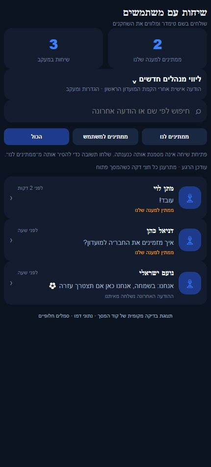
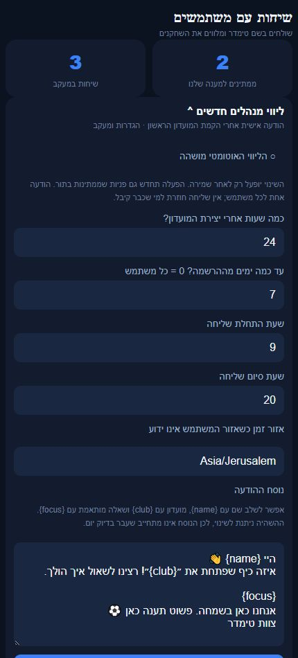
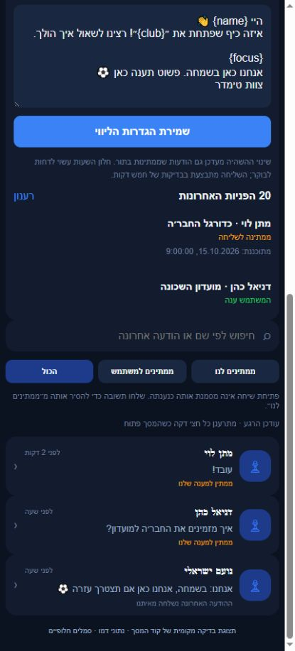
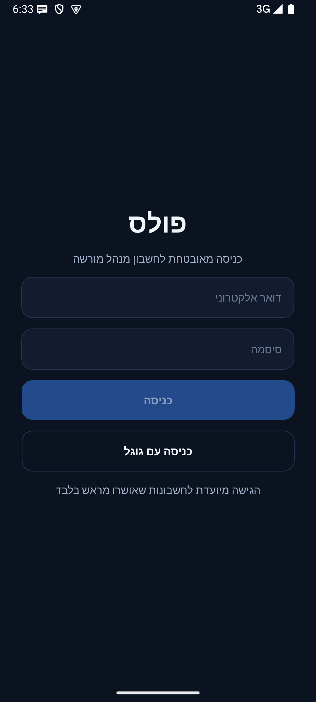
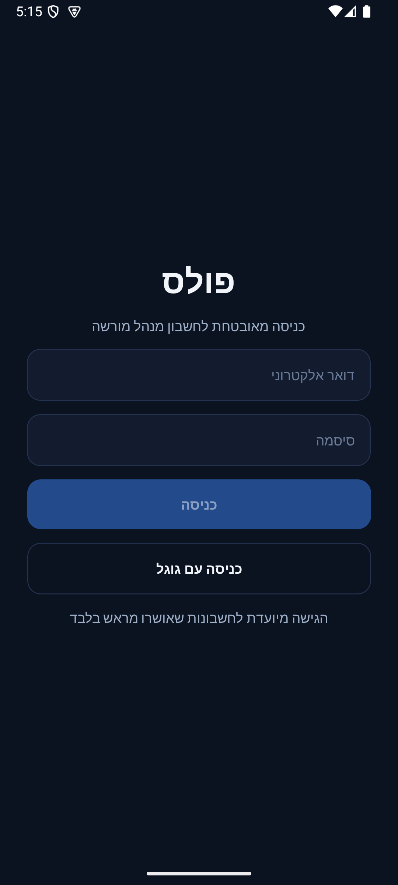

# שיחות צוות עם משתמשי קצה — פולס

## ארגון הפולס — 18.10.2026

נתיב `Messages` וחלונית `TeamderChatSheet` נשמרו; שם היעד השתנה ל״שיחות תמיכה״ ומיקומו הועבר לקבוצת התמיכה. `UserDetailScreen` כולל `UserDevicesCard` לקריאת מידע גרסה קיים בלבד. אין שינוי בפרוטוקול ההודעות או כתיבה לשיחות. [פירוט](pulse-management.md).

שינוי מקומי, טרם בנייה והתקנה.

## תיקון כלי ההדמיה המקומי — 17.10.2026

כלי ההדמיה `prepare-pulse-preview.cjs` משתמש כעת ב־`scripts/audits/compile-native-preview.cjs`, עם `esModuleInterop: true`, כדי שיבוא ברירת המחדל של React יתאים ליצוא CommonJS שנלקח מ־Metro. בלי ההגדרה, הפעלת JSX של `TeamderChatSheet` יצרה גישה ל־`default.createElement` כאשר default אינו קיים. שתי בדיקות מפעילות את מקור הרכיב המלא: אחת משחזרת את התקלה בהגדרה הישנה והשנייה מרנדרת בהגדרה המתוקנת. לא השתנה קוד רכיב הפולס או תעבורת ההודעות; אין כאן בדיקה חדשה של הפולס המותקן. [בירור התקלה ואימות חלונית טימדר](../../changes/2026-10-17-support-open-verification.md).

## קובץ התקנה 1.0.96 — 17.10.2026

נבנה קובץ התקנה של הפולס 1.0.96, מספר בנייה 103, עם סימון שיחה כפתורה ללא תשובה, פתיחה מחדש וחזרה לטיפול בהודעה חדשה. החתימה זהה לגרסה 1.0.95 ולכן הקובץ מתאים לעדכון מעל ההתקנה הקודמת. לא בוצעו התקנה במכשיר הבעלים או שינוי של שיחות אמיתיות.

הושוו 179 קובצי מקור, תצורה, משאבים וחתימה לצילום המקור ללא שינוי. שבעת קובצי הפיצ׳ר הושוו גם למפת המקור של החבילה; שדות הסימון נמצאו בקוד המהודר. לא נמצאו בחבילה האישורים המנהליים הישנים. גודל הקובץ 68,623,004 בתים; SHA-256: `4d83f5f8a2337883d86a87d28a7d1aa78f20ae623fddea528189404191acd841`. הבנייה עברה עם כלי AAPT2 המקומי מ־build-tools/36.0.0 לאחר כשל בהפעלת עותק המטמון. זו דריסת בנייה מקומית, ללא שינוי התנהגות או הרשאות. קבלות: artifacts/pulse-resolution-build-receipt.json ו־artifacts/pulse-resolution-apk-verified.json.

## סימון שיחה כפתורה ללא תשובה — 17.10.2026

resolveSupportThread שומר ב־dmConversations/{convId} רק supportResolvedMessageId, supportResolvedMessageAt ו־supportResolvedAt. patchDoc עם mustExist=true אינו יוצר שיחה שנמחקה. אין כתיבה ל־messages, אין שינוי senderId או updatedAt ואין הודעה או התראה למשתמש. isSupportResolved דורש התאמה למזהה ולזמן של ההודעה האחרונה; הודעה חדשה בעלת מזהה אחר, גם באותה אלפית שנייה, אינה מכוסה בסגירה הישנה. loadThread קורא את מסמך השיחה במקביל להודעות; listThreads משתמש באותה הכרעה גם במסלול הסיכום וגם בקריאת ההודעות כגיבוי. awaitingReply הוא שולח משתמש ללא התאמת סגירה. המסנן sent אינו כולל resolved, ו־resolved מציג רק שיחות מסומנות. reopenSupportThread מאפס את שלושת שדות הסימון בלבד. מונה הממתינים, רשימת המשימות ותפריט השיחות צורכים אותו listAwaitingReply. אין שינוי ברשימת ההודעות או בספירתן.

TeamderChatSheet מציג ״סמן כפתורה ללא תשובה״ אחרי טעינה מוצלחת של שיחה שאינה ריקה; אחרי סגירה ״פתורה · פתיחה מחדש״. נעילה משותפת מונעת שליחה ושינוי מצב במקביל; כשל מוצג ולא משנה את המצב. הטיוטה נשמרת. שינוי מאושר מרענן את השיחה ואת המסך שהפעיל אותה. לא נדרש שרת חדש או שינוי הרשאות, אך רכיבי הלקוח עדיין דורשים בנייה והתקנה של הפולס.

אימות: כל 384 חבילות / 4,553 בדיקות הפרויקט עברו; בדיקת הטיפוסים בטימדר ובפולס נקייה. pulseSupportResolution מריץ את שירות הקריאה והכתיבה עם מתאם מסד: סגירה בלי יצירת הודעה, הודעה חדשה באותו זמן, קריאת גיבוי, פתיחה מחדש, כשל ויעד לא תקין. pulseWorkStatusSave מריץ את callback השמירה של המסך ומאמת כשל, חריגה, חסימת לחיצה כפולה ועדכון מצב רק אחרי אישור. בדיקת התיעוד הכוללת עברה. קוד המסכים רונדר במתאם דפדפן עם נתוני דמו וסמלים חלופיים. הצילומים אינם צילום מיישום הפולס המותקן ואינם מוכיחים מגע או כתיבה חיה. אין בנייה, פריסה או סגירה של שיחת משתמש אמיתית במשימה זו.

[הסבר פשוט](pulse-support.simple.md). עודכן 13.10.2026 על בסיס `4a3cb346` עם שינויים מקומיים. בסבב ההיסטורי של 13.10 לא שונו מסכי טימדר; ההרחבה המקומית מ־14.10 מתועדת בהמשך. מנוע הליווי מומש ונפרס באישור הבעלים ב־13.10.2026, ונשאר מושהה עד הפעלה מפורשת בפולס. נבנה יישום פולס `1.0.93` בקוד גרסה `100`.

## מקור, ניווט ונתונים

נשמר הנתיב הקיים `Messages` ב־`pulse/src/navigation/RootTabs.tsx`, והתווית בתפריט היא ״שיחות עם משתמשים״. המסך שופר במקום להוסיף מסך כפול. התחלת שיחה מכרטיס המשתמש הקיים, ומענה מתוך `TeamderChatSheet`. כל הכתיבות משתמשות בשירות `pulse/src/services/teamderChatService.ts`. השולח הרשמי הוא `teamder`, ללא חשבון שחקן אמיתי.

מזהה שיחה: מיון שני המזהים וחיבור ב־`__`, בדיוק כמו `dmConvId` בטימדר. המטא־נתונים ב־`dmConversations/{convId}`, והודעות בתת־אוסף `messages`. האפליקציה קוראת וכותבת במסלול הצ׳אט הקיים, עם חריג חשבון רשמי בשער החברות; אין צורך להפוך את הצוות לחבר. אין כאן הרשאה לשחקן להתחזות לחשבון הרשמי.

## מצבים וחישובים

| מצב | הכרעה | תצוגה/פעולה |
|---|---|---|
| ממתין לנו | השולח של ההודעה האחרונה אינו `teamder` וההודעה אינה מכוסה בסימון פתרון | קודם ברשימה, סימון בצבע ענבר |
| הודעה אחרונה מאיתנו | השולח האחרון הוא `teamder` | נשמר ברשימה; מסנן ״ממתינים למשתמש״ אינו הוכחה שהמשתמש חייב לענות |
| טעינה ראשונה | טרם חזרה תשובה | מחוון טעינה |
| כשל קריאה | השאילתה נכשלה | הודעת ניסיון חוזר ושימור הנתונים הקודמים; אין המרה לשיחה ריקה |
| שליחה | בקשה אחת פעילה | מחוון ושלילת לחיצה נוספת; הטקסט נשמר בכשל |
| תשובה חדשה | ההודעה האחרונה שוב מהמשתמש | חזרה לממתינים; התראת שרת לפי ההעדפות |

המונה הוא מספר השיחות הממתינות, ולא מספר ההודעות שלא נקראו. סדר: ממתינים קודם, ואז מועד הודעה אחרונה יורד. חיפוש לפי שם או הודעה אחרונה, ללא סריקת כל היסטוריית השיחה. הרשימה משתמשת בגבול הקיים של 200 שיחות; חלון השיחה ב־100 ההודעות האחרונות ומציג הסבר כשהחלון מלא. זו מגבלת גרסה, לא הבטחת טעינת היסטוריה מלאה.

## שליחה, מניעת כפילות וכשל

`sendTeamderMessage` מוודאת הצלחת כתיבת ההורה לפני ההודעה. מזהה הודעה אקראי, ושימוש ב־`createDocOnly` מבטיח שניסיון חוזר באותו מזהה אינו מחליף הודעה קיימת. במצב התנגשות נבדקים השולח והטקסט; שינוי תוכן באותו מזהה אינו נחשב הצלחה. חלונית השליחה שומרת את המזהה בניסיון חוזר עם אותו טקסט ויעד. שתי שליחות חדשות באותה אלפית שנייה אינן מקבלות מזהה זהה. הטקסט מוגבל ל־1,000 תווים; השירות דוחה חריגה ולא חותך אותה בשקט. מזהה חשבון רשמי, מזהי נתיב לא תקינים וטקסט ריק נדחים.

החלונית מרעננת כל 15 שניות כשהיא גלויה והיישום בקדמה, והרשימה כל 30 שניות כשהמסך ממוקד. שינוי יעד או סגירה מבטלים עדכון תוצאת טעינה קודמת; פתרון שם המשתמש אינו מוחק טיוטה. כשל טעינת דיווחים אופציונליים אינו מונע קריאת שיחה.

## שרת, עומס והתראות

`onDmChatMessage` ממשיכה לאמת זהות ומועד דרך `trustedChatMessage`, ומעדכנת תקציר רשמי בעסקה: `supportLastMessageId`, `supportLastMessageAt`, `supportLastSenderId`, `supportLastText`. הודעה ישנה שמטופלת באיחור אינה דורסת תקציר חדש יותר. הרשימה משתמשת בתקציר כאשר קיים, ובשאילתת הודעה אחת לשיחות ישנות. שמות משתמשים נשמרים במטמון לחמש דקות. חלון מלא אינו נסרק בכל רענון של הרשימה.

`notifySupportReply` מאמתת זוג מזהים קנוני הכולל `teamder` ושולח שהוא המשתמש השני. אין התאמת תת־מחרוזת. הודעות יוצאות אינן שולחות התראה לצוות. `pushToAdmins` משתמשת בהעדפה `teamderReply` וברשימת מכשירי מנהלים קיימת; התראת דחיפה פועלת גם כשהפולס סגור אחרי פריסה. מנגנון הגנת ההצפה הקיים נשמר: לכל היותר התראה אחת ב־20 שניות **לשיחה**, כדי ששיחה אחת לא תשתיק משתמש אחר. כל ההודעות נשמרות ברשימה גם אם ההתראה צוננה. אין הבטחת מסירה או בדיוק־פעם מרשת ההתראות.

נשלחים `parentId`, `userId`, `messageId`, `eventId`; פתיחה מהתראה פעילה או מהפעלה קרה מגיעה ל־`Messages` ומרימה את השיחה המתאימה. היעד נשמר גם ביומן ההתראות המקומי ונפתח משם. ההתראה המקומית הישנה מתוך סריקת כל הצ׳אטים הוסרה לשיחות רשמיות, למניעת כפילות לאחר פריסת המסלול החדש.

## הרשאות ופריסה

הבעלים אישר במפורש שינוי מקומי מצומצם ב־`functions/src/pulseProxyPolicy.ts`: בקשת `POST :runQuery` מתחת לשיחת תמיכה רשמית קנונית בלבד. לא הורחבו משתמשי מנהל, פרויקט, שירותים אחרים או הרשאות משתמשי קצה. `firestore.rules` לא נערך. השער המאובטח הקיים עדיין מחייב משתמש מנהל מורשה.

תיאור ההכנה ההיסטורי, שהושלם בפריסה המאושרת: נדרשה בנייה של הפולס ופריסת `pulseAdminProxy` דרך נקודת הכניסה הנפרדת שלו, וכן עדכון `onDmChatMessage`. **לא לפרוס את נקודת הכניסה הנפרדת בלי לקרוא את `pulse/docs/secure-access.md` ואת הגדרות הפריסה המתאימות.** שינויים מקומיים אינם מוכיחים שהשירות המאובטח זמין למכשיר הקיים. ב־13.10.2026 נפרסו באישור חמש פונקציות: `pulseAdminProxy`, `onDmChatMessage`, `onSupportClubCreated`, `onSupportOutreachConfigChanged`, `cronSupportOutreach`. לא נפרסו כללי מסד, לא בוצעה בנייה לחנויות ולא בוצעה דחיפה לגיט. שני חשבונות המנהלים שהבעלים ציין הוגדרו ברשימת מזהים מדויקת. האישורים הועברו בזיכרון לאחסון הסודות ללא עותק מקומי חדש; מפתחות ישנים לא בוטלו.

## ראיות ובדיקות

בדיקות הסגירה עברו: 3,677 בדיקות ב־296 חבילות; טיפוסים בטימדר ובפולס ובניית פונקציות נקיים. שמונה בדיקות מסד מקומי עברו, כולל הליווי האוטומטי. בדיקת התיעוד מאמתת 208 מסמכים, 82 זוגות ו־527 צילומים. העבודה נרשמה ביומן כתיקון ממתין עם ראיית הדפדפן, תוך שמירת כל ההיסטוריה.

- `tests/logic/pulseSupportMessaging.test.ts`: עשר בדיקות שליחה, מענה, מניעת כפילות, שגיאות, סינון ויעד התראה.
- `pulseSupportTransport.test.ts`: שאילתה מצומצמת אמיתית של מתאם הקריאה וממיר השדות, ושימור שגיאת הרשאות.
- `supportAdminPush.test.ts`: צינון לפי שיחה, ללא השתקת משתמש אחר.
- `pulseProxyPolicy.test.ts`: קבלה של שאילתת תמיכה קנונית וחסימת שיחות אחרות ונתיבים רחבים.
- `tests/integration/supportMessaging.firestore.cjs`: שלוש בדיקות מול מסד מקומי מבודד `demo-teamder-support` ב־`127.0.0.1:8187` ומלוא כללי ההרשאות; שירות פולס אמיתי עם מתאם מקומי, טריגר שרת אמיתי בהפעלה ישירה, קריאה ומענה של משתמש מאומת, עדכון מונה, הסרת המתנה במענה וחסימת צד שלישי/התחזות. התראת המנהלים מוחלפת בלוכד מקומי; אין שליחה לרשת התראות. התהליך סוגר רק את האמולטור שיצר.
- באישור מפורש נשלחה הודעת בדיקה אחת למתן לוי מתוך שירות הפולס, עם מתאם מנהלי זמני ישיר למסד. הפרופיל אותר במערכת ההתחברות באמצעות הדוא״ל שסיפק הבעלים. מתן השיב **״עובד!״**, ותשובתו נקראה מהשיחה. **לא הוכח שימוש בממשק הפולס החדש או בשרת התיווך החדש, ולא הוכחה מסירת דחיפה.** מזהי הבדיקה והקבלה נשמרים מקומית ב־`artifacts/support-matan-test-receipt.json` ואינם חלק מהמקור.

## חזות ומגבלות

## טעינה הדרגתית ומקביליות — 13.10.2026

רשימת המשימות הקיימת ממתינה לסיום שישה מקורות ב־`listWork`, כולל שיחות צוות. נוספה קריאת התקדמות אופציונלית שמציגה כל מקור כשהוא מסתיים, עם אותו מיון ותקרת 20 פריטים סגורים; התוצאה הסופית נשמרת כפי שהייתה. `TasksScreen` משתמשת בהתקדמות בטעינה הראשונה ומפסיקה לעדכן אחרי פירוק המסך. הרענון הידני נשאר אטומי, כדי לא להחליף רשימה מלאה ברשימה חלקית בזמן רענון. שיחות רשמיות נקראות כעת באמצעות עד ארבעה עובדים במקביל; שיחה שאינה תקינה ממשיכה להידחות ותקציר קיים מונע קריאת הודעות מיותרת. אין בקשות ללא הגבלה ואין הסבת נתונים.

בשרת, `pulseRequestQueue.ts` מרכזת בקשות מכסה מקבילות של אותו מנהל למנות סדרתיות בכל מופע. כל מנה עדיין נשמרת בעסקת מסד משותפת לכל המופעים; רק מספר הבקשות שעבורו נשמר מקום רשאי לעבור. מכסת 500 בדקה, אימות ביטול אסימונים ורשימת המנהלים נשארים ללא שינוי. כשל בעסקה דוחה את המנה, ומנהלים שונים אינם חוסמים זה את זה.

בדיקות: `pulseWorkLoading.test.ts` מעכבת שיחות ומוכיחה שמשימה מופיעה לפני השלמתן ושכל המקורות נוכחים בתוצאה הסופית. `pulseSupportMessaging.test.ts` משהה פתרון שמות ומוכיחה ארבע קריאות מקבילות לכל היותר. `pulseRequestQueue.test.ts` מוכיחה 21 בקשות בשתי עסקאות הזמנה, קיבולת חלקית, כשל וסבב נוסף. אלה מדדי מקביליות בבדיקה מבוקרת, לא מדידת זמן תגובה במכשיר הבעלים. קריאת יומן זמני השרת הוגבלה ב־429; לא הוסקה ממנה מסקנה מספרית על זמני הייצור. אין שינוי בעיצוב המסך.

זהו רינדור של קוד `MessagesScreen` עצמו באמצעות מתאם רכיבי דפדפן ונתוני בדיקה מקומיים, ברוחב 430. הסמלים חלופיים והצילום מסומן בהתאם; אינו צילום ממכשיר או אמולטור ואינו מוכיח מגע, מקלדת או התראות מקוריות. פולס `1.0.93 / 100` הותקן באמולטור ומסך הכניסה צולם; מסך השיחות לאחר כניסה בחשבון אמיתי טרם נבדק במכשיר. לפני הפצה נדרשים צילום ובדיקות במכשיר: פתיחת שיחה מהתראה כשהיישום סגור, מקלדת, גלילה ורענון בזמן מענה.

## מנוע הליווי האוטומטי — מומש ונפרס

במסך השיחות הקיים נפתח הרכיב ״ליווי מנהלים חדשים״. אפשר לשנות השהיה, חלון חדשנות, שעות שליחה, אזור זמן ונוסח חופשי. עריכה אינה מפעילה עד לחיצה על שמירה. ברירת המחדל נשמרה בשרת עם `enabled:false`: 24 שעות, מועדון ראשון עד 7 ימים מההרשמה, 09:00–20:00 באזור המשתמש אם ידוע ואחרת `Asia/Jerusalem`. ערך 0 בחלון הימים כולל כל יוצר מועדון ראשון. הפעלה מחדשת גם פניות קיימות בתור; אין שליחה חוזרת לפנייה שהושלמה.

`supportOutreachPolicy.ts` מרכזת אימות הגדרות, אזורי זמן, מועד השליחה והחלפת `{name}`, `{club}`, `{focus}`. המיקוד נגזר ממספר החברים והאם קיים מחזור. חלון השעות דוחה שליחה מחוץ לשעות; הסורק פועל כל חמש דקות, לכן אין התחייבות לשליחה בשנייה המדויקת. גיל המשתמש מחושב קודם ממועד יצירת חשבון ההתחברות ורק בהיעדרו משדה הפרופיל.

`onSupportClubCreated` פותחת פנייה רק למועדון ראשון אמיתי של משתמש פעיל, שאינו אורח, בתוך החלון שהוגדר. אין הסבת מועדונים קיימים. מסמך אחד למשתמש ב־`supportOutreach/{uid}`; מצב: ממתין, נשלח, המשתמש ענה, דולג או נכשל. שליחה בעסקה בודקת מחדש הגדרות, חשבון, מועדון ותפקיד מנהל. הודעה אנושית מטעם הצוות מאז הקמת המועדון מבטלת פנייה אוטומטית מיותרת. מזהה הודעה קבוע ויצירה בלבד מונעים כפילות בין סורקים. כשל זמני מתוזמן מחדש עד חמישה ניסיונות; כשל סופי גלוי למנהל. שינוי הגדרות מתזמן מחדש פניות ממתינות, בלי לשנות פניות שנשלחו. מוצגות 20 הפניות האחרונות, ללא טענה שזהו סך כל הפניות.

תשובת משתמש מעדכנת פנייה שנשלחה למצב ״המשתמש ענה״ גם אם טריגר ישן הגיע אחרי תשובת צוות חדשה. הודעות אוטומטיות אינן מסומנות כתשובה אנושית. אין יצירת מונה הודעות שלא נקראו לחשבון הרשמי הבדיוני.

## קובץ התקנה וראיות סגירה

נבנה `artifacts/Pulse-1.0.93-v100.apk`, בגודל 68,606,468 בתים ובאותה חתימה של הגרסה הקודמת. חותמת: `db60e306b31f048ede6a44bd0cf18961d6f653f9721835ca638d755209cf159b`. הושוו 120 קובצי מקור לצילום הבנייה, ללא שינוי; לא נמצאו ערכי האישורים הישנים בחבילה המקובצת. חמש הפונקציות פעילות; 43 השוואות מקור מתוך חמש חבילות הפריסה עברו; בקשת ניהול ללא התחברות נדחתה ב־401. כל אלה אינם בדיקת כניסה אמיתית או הוכחת מסירת דחיפה במכשיר.

רישום טביעת חתימת אנדרואיד לצורך כניסה עם גוגל אושר ובוצע. בדיקת כניסה ומסירת התראה במכשיר נותרו פתוחות; אין להפעיל את הליווי האוטומטי לפני בדיקת מסלול המענה.

ב־13.10.2026, לאחר אישור מפורש, נרשמה חתימת קובץ ההתקנה של פולס בפיירבייס. קריאה חוזרת אימתה את החתימה ולקוח גוגל מסוג אנדרואיד עבור `com.matanlevi.pulse`; ספק גוגל פעיל ומזהה לקוח הרשת נשאר תואם. אין צורך בבנייה חדשה עבור השלמת רישום זו. כניסה בפועל במכשיר עדיין דורשת ניסיון של הבעלים.

סגירה: נבנה `artifacts/Pulse-1.0.94-v101.apk`, בגודל 68,607,468 בתים ובאותה חתימה הרשומה לכניסה בגוגל. חותמת: `7762ac7313e0ea3132b415b4820bb6ba2214708eab49a6d4d8785442e79c51d4`. הושוו 120 קובצי מקור הבנייה ללא הבדלים ולא נמצאו האישורים הישנים בחבילה. תיקון השרת נפרס ואומתה התאמת חמישה קובצי מקור. 3,685 בדיקות ב־299 חבילות, טיפוסים בשני היישומים ובניית שרת עברו. אין בדיקת זמן פתיחה במכשיר הבעלים לאחר ההתקנה.

## תמיכה זמינה — 14.10.2026

`MessagesScreen` פותח `NewSupportChatPicker`: טעינת משתמשים לפי דרישה, ללא מחוקים/חשבונות בדיקה, חיפוש שם/עיר והצגת 50 התאמות לכל היותר עם ציון הגבלה. בחירה אינה שולחת דבר ואינה יוצרת שיחה. `TeamderChatSheet` בגובה 90%, שדה 64–140, הימנעות ממקלדת בשתי הפלטפורמות, טיוטה בזיכרון לפי נמען, תאריך/שעה, גלילה רק סמוך לתחתית וצילום מוגדל. קורא `loadThread` מעביר `supportImage` ו־`supportContext`; נבדקו גם ממיר REST והמסלול מול מסד מקומי. השיחה מיועדת לצוות האנושי בלבד. [החוזה המלא](support-chat.md). בדיקת חזות הפולס בדפדפן אינה הוכחת מקלדת מקורית או קבלה בייצור.

## קובץ תמיכה עדכני — 15.10.2026

פולס `1.0.95/102` כולל פתיחת שיחה חדשה, החלונית הגבוהה, צילום ומקור פנייה. 121 קובצי מקור הושוו ללא שינוי, חתימת ההתקנה זהה לגרסה 101 וסריקת החבילה לא מצאה אישורים ישנים או רכיבי המסלול שהוסר. התקנה מעל הקיים הצליחה; נצפה מסך הכניסה המקורי בלבד, ללא התחברות, ולכן אין הוכחת מקלדת מקורית בשיחה או מסירת דחיפה. בדיקות טיפוסים ושילוב מקומי עברו. [דוח ההפצה, החותמת והבדיקות](../../changes/2026-10-15-internal-1.1.50.md).

## עיצוב ואיחוד — 18.10.2026

בכרטיס משתמש יש כפתור פתיחת שיחה ולשוניות פעילות, מכשירים וניהול. במסך השיחות ניהול פניות יזומות נפתח לפי צורך ומפסיק לתפוס מקום מעל החיפוש.

[התנהגות, קריאות, צילומים ומגבלות](pulse-management.md#עיצוב-פחם-ואיחוד-מרכזי-העבודה--18102026). שינוי מקומי; לא נבנה או נפרס.

השלמת מבנה המסכים, פירוט השינויים והראיות העדכניות: [ניהול הפולס](pulse-management.md#השלמת-מבנה-העבודה--18102026).

### עיצוב רשימת התמיכה — 18.10.2026

`MessagesScreen` מציג סיכום שיחות קומפקטי, כפתור שיחה חדשה, חיפוש ושלוש לשוניות עם מונים: ממתינים לנו, ממתינים למשתמש ופתורות. כל השיחות נשארות נגישות בקישור בתחתית הרשימה, ופנייה יזומה נשמרה בפירוט נפתח. שורות השיחה שטוחות ומצב המענה מוצג בצבע ירוק עדין. לא השתנו שליחת הודעות, סדר התור, קצב הרענון או חלונית השיחה. הפירוט והראיות ב־[ניהול הפולס](pulse-management.md#תמיכה-משתמשים-ומחזורים-לפי-הסקיצה--18102026).

## תיקון כיווניות במנוע המקורי — 18.10.2026

הצילומים ממכשיר הבעלים ב־1.0.98 חשפו שכותרות, שמות, תיאורים וציר הפעילות נצמדו לשמאל אף שהשורות והסמלים סודרו מימין. הוסרו יישור פיזי מפורש ו־writingDirection:rtl מתוויות הממשק. theme.ts מגדיר RTL_LABEL_ALIGN כ־left במנוע המקורי וכ־right בדפדפן, ו־RTL_VALUE_ALIGN בכיוון הנגדי. פסקאות התוויות משתמשות ב־direction:rtl; קוד וכתובות בעלי כיוון כתיבה שמאל־לימין נשמרו. שמות שחקנים מוקפים במבודדי כיווניות בלי לשנות את הערך השמור. מפרידי שלושת מדדי השחקן הם borderEnd במקום borderLeft.

הסדר של הלשוניות, השורות, הנתונים, הסינונים והפעולות נשמר; לא שונו שאילתות, הרשאות או חישובים. הביקורת נוגעת לכל קובצי המסכים שהשתמשו ביישור מפורש ולרכיבים המשותפים, ולא רק למסכי הצילומים. בניית פיתוח מקומית1.0.99/106 הוכנה לאימולטור בלבד, ללא הפצה. [רשימת המסכים, בדיקות וראיות](../../audits/2026-10-18-pulse-rtl.md).

אימות נוסף ב־19.10.2026: RtlTextInput מגדיר יישור פיזי לימין בנפרד מתוויות, ושומר הפניות ואירועים. הוסר טקסט רווח לא חוקי מתוך View ב־PlayerOverview ונוספה בדיקת מניעה. עברו 5,078 בדיקות ו־13 מדידות פריסה מקוריות; ההיקף והמגבלות בדוח המקושר לעיל. נקודת הכניסה הזמנית הוסרה; אין שינוי מסלולי ניווט או נתונים.
