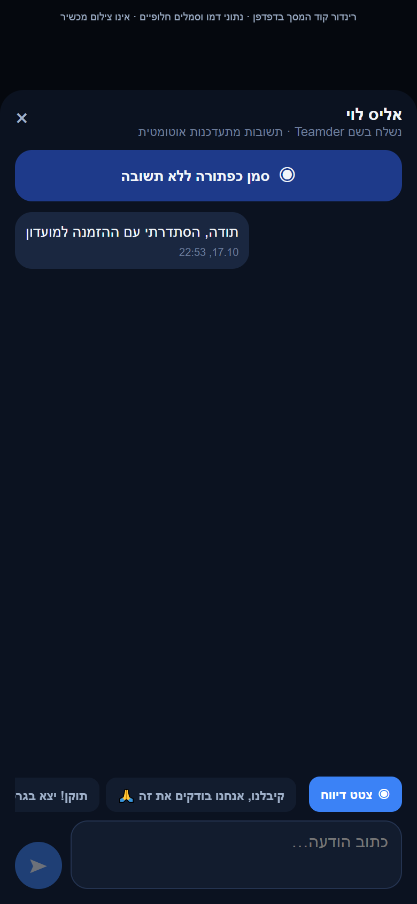
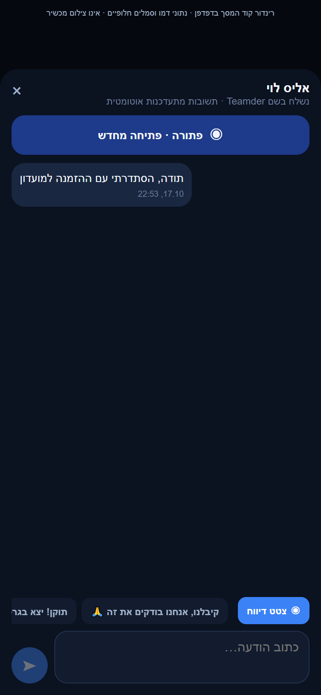
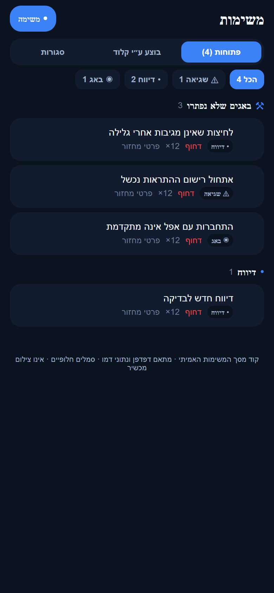

# לוח המשימות המאוחד בפולס

## חלון הצעות בכניסה, 27.10.2026

הצעות מחלון הכניסה משתמשות באוסף feedback הקיים ובסיווג suggestion/feature. `pulse/src/services/screenNames.ts` מתרגם FeedbackPrompt למה חסר לכם באפליקציה. `pulse/src/services/workItems.ts` ממשיך לקרוא את הדיווח עם שם המשתמש והמלל בלוח המאוחד; אין העתקה למשימות ואין סגירה אוטומטית. אין הוכחת דיווח ייצור חדש שנוצר מהרכיב במשימה זו. אין מזהה משימה קיימת למסירת שינוי הקוד, ולכן נשמרת מסירה מקומית.

נצפתה תצוגת רכיב המקור בדפדפן באמצעות מתאמים מפורשים, כולל רוחב 320, כשל והצלחה. אין אימות מקלדת מקורית, אנדרואיד או אייפון, ואין כאן פריסה או אישור מסירה חיה לפולס. [דוח השינוי והבדיקות](../../changes/2026-10-27-feedback-prompt.md).

## הרחבת אבחון דיווחים, 27.10.2026

נוספה מעטפת אבחון מקומית עם מצב בזמן הכשל, שלבים בעלי מזהה ותזמון, מצב רשת ובנייה ומופעים נפרדים לשגיאה. נקודת הכניסה לתעבורת השרת עוברת כעת דרך העטיפה המשותפת; תשובות, חריגות, אפשרויות קריאה ומדיניות הפיצר נשמרות. אין כאן שינוי בהרשאות או בחישובי המוצר. הבדיקות המלאות ומגבלות האימות מתועדות בדוח המקושר; אין טענה לאימות מכשיר או להפצה. [היקף, ראיות ומגבלות](../../changes/2026-10-27-diagnostic-context.md).

באימות הסופי עברו כל 6,231 הבדיקות ב-555 חבילות, ובדיקות הטיפוסים של הלקוח, השרת והפולס נקיות. צילום הדפדפן והידור מקורות האנדרואיד הם בדיקות מקומיות; אין הוכחת מכשיר, הידור אייפון או מסירה חיה של הבנייה החדשה. רישום יומן השחרור נחשב מאומת רק לפי קבלת הקריאה החוזרת בדוח השינוי.

## טיפול מלא בפריטי הפולס הפתוחים, 27.10.2026

נקראו 33 הפריטים הפעילים שנמצאו בלוח החי לאורך הסבב ושיחות החשבון הרשמי. נמסרו ונקראו חזרה 12 פריטים לביקורת הבעלים: שני תיקונים, שבע תוצאות מחקר, אימות מימוש קיים ושני מסלולי פעילות שהושבתו לבקשתו. 21 פריטים נשארו פתוחים עם סיבה וצעד הבא. סטטוס המקור וצילומי המקור נשמרים; אין סגירה סופית בשם הבעלים. קבלת השמירה בתיקיית העבודה היא הראיה לשמירה בפועל. [ממצאים, בדיקות ומסירה](../../changes/2026-10-27-pulse-completion.md). [תוצאות המחקר והאפיון](../../audits/2026-10-27-pulse-product-decisions.md).

## הפצה פנימית 1.1.61 - 25.10.2026

הבינארי `1.1.61/295` הופץ ואומת במסלול הפנימי באנדרואיד. תיקוני הלקוח נכללים בו, ושירות הפרופיל נפרס ואומת בנפרד. גם תיקוני הסגל, שמירת התוצאה והתראת השגיאה בשרת נפרסו ואומתו באישור מפורש. שינויי יישום הפולס עצמו טרם הופצו. אין שינוי כללי הרשאה או הסבת נתונים. ניסוחי המצב המקומי בסעיפים הקודמים נכתבו לפני ההפצה; [דוח ההפצה](../../changes/2026-10-25-internal-1.1.61.md) מפרט בדיוק מה נכלל, מה נבדק ומה עדיין מקומי.

מקורות ממוקדים בסבב: `pulse/src/services/errorPresentation.ts`, `pulse/src/services/workItems.ts`.

## תיקוני הפולס - 25.10.2026

`workItems.fromError` משתמש ב-`errorPresentation` עבור הכותרת; ההיטל מוסיף `lastCode` כדי להסביר את הסיבה בלי לכלול מזהה קוד בכותרת. גוף המקור, המזהה, המסך והמסמכים נשמרים. אין שינוי בנרמול הסטטוס, סדר הקטגוריות, רעיונות שמורים או פעולות בעלים. מסירת תיקון משתמשת רק בשדות הטיפול, עם תנאי גרסה וקריאה חוזרת.

[מקורות, בדיקות, צילומים ומגבלות](../../changes/2026-10-25-pulse-fixes.md).

## ניסיונות שחזור עם חשבון ייצור — 23.10.2026

באישור הבעלים נוצר חשבון בדיקות אחד נוסף והרשאתו אומתה מול קריאת הפרופיל שלו בייצור. לא נמחקו החשבונות הקודמים ולא נוספה חברות או הרשאת ניהול. גוף שירות ההרשמה וקוד שירותי הקריאה הורצו במתאמי Node מול Firebase client SDK אמיתי. אין הרצת מסכי מוצר, אפל, שירות native או משתמש מנהל. פרטי ההתחברות מוצפנים מחוץ למאגר לפי [רישום חשבון הבדיקות](../../knowledge/production-qa.md).

עברו עשרה תרחישים: התחברות וקריאת פרופיל; שלוש קריאות שעון אמיתיות; שמירת היסט תחת שלוש חריגות זמן מקומיות; חריגה מקומית אחת ואז שתי קריאות אמיתיות; שגיאת קריאה בניתוק SDK; ניסיון חוזר לאחר חיבור הרשת; שגיאה אמיתית תחת ניתוק מתמשך; הפסקת בקשה ישנה לאחר יציאה מהחשבון; קריאת הגדרות פרסומות לאחר ניתוק וחיבור; `getInboxCount` עם שירותי המקור וארבע שאילתות לקוח אמיתיות. האפס במונה הוא תוצאה תקינה לחשבון החדש ללא חברות, ולא החלפה של שגיאה בתוצאה ריקה. לא בוצעו כתיבות עסקיות במהלך התרחישים.

נשמרו ונקראו חזרה תוצאות השחזור והצעד החסר בכל שבעת פריטי הלא־פתורים, תוך שימור מצב, הערת התיקון וצילומים. לא נסגר פריט ולא סומן פתרון חדש לאירוע המקורי. מועדון הבדיקה נשמר לפי 48 השוואות קריאה בלבד; בדיקת העונה נותרה בהמתנה לחלון המקורי.

עברו 471 חבילות ו־5,245 בדיקות, ועוד 16 בדיקות ממוקדות בשני קובצי מנגנון ההתחברות והניסיון החוזר; בדיקת הטיפוסים נקייה. קבלות ב־`artifacts/pulse-repro-current`: `live-results.json`, `inbox-results.json`, `pulse-write-receipt.json`, `season-preservation.log`. [סוגי השחזור, הכנת הבדיקה ומגבלות](../../changes/2026-10-23-pulse-live-reproduction.md).

## באגים לא פתורים וסיבת אי־סגירה — 23.10.2026

`workCategory` ב־`pulse/src/services/unresolvedWork.ts` מחזיר `unresolved` רק לפריט `state=open` עם `unresolved` ובסוג `bug`, `report` או `error`. זהו שיוך תצוגה, בלי שינוי `kind`, אוסף או מצב סופי. `groupWorkSections` מרכז את הפריטים האלה פעם אחת, אחרי הבאגים הרגילים ולפני הפיצ׳רים, ו־`boardSections` ממיין כל קבוצה לפי `createdAt` יורד. פריט שנמסר לבדיקה או נסגר חוזר לקבוצת הסוג המקורי בלשונית המתאימה גם אם נשמר בו דגל היסטורי. פיצ׳רים, עיצוב ורעיונות אינם מועברים לקבוצה זו בגלל דגל בלבד.

מסנן הסוג, המונים והקבוצות ב־`TasksScreen` משתמשים כולם ב־`workCategory`, כדי למנוע ספירה כפולה או מסנן שאינו תואם לקבוצה. נוספה אפשרות ״באגים לא פתורים״. החיפוש כולל גם `reviewReason`, `unresolved.reason` ו־`unresolved.nextStep`. בפירוט מופיעה תיבה ״למה הפריט עדיין פתוח״ אם נשמרה סיבה. `reviewReason` נוסף ל־`LIST_FIELDS` בשלושת המקורות `tasks`, `errors`, `feedback` ולממירי הקריאה שלהם; בלי זאת כתיבת השדה אינה מספיקה להצגתו.

סקירה חיה: נקראו 39 פריטים שלא נסגרו במקורות הלוח בלבד — 4 באגים מתוך `tasks`, 11 דיווחים ו־24 שגיאות. מתוכם 32 כבר מסומנים `claudeStatus=done`, ו־7 ללא פתרון מאומת. נפתחו כל 11 צילומי הדיווחים וצילום ההתראה המצורף למשימה; שוחזרו נתוני ההקשר של ששת אירועי השגיאה הפעילים ונבדקו קוד הכניסה, שעון השרת, מונה הבקשות והגדרות הפרסומות. לא נמצא תיקון נוסף מוכח לאירועים ההיסטוריים האלה. אין ייחוס מחדש של תיקונים קודמים לסבב הנוכחי.

נשמרו `reviewReason` ו־`reviewAt` לכל 39 הפריטים; לשבעת הפעילים נשמרו גם `unresolved`, `unresolvedAt`, `unresolvedReason`, `unresolvedNextStep`. לכל אחד סיבה פרטנית וצעד בדיקה. הכתיבה הותנתה ב־`updateTime` מתמונת הקריאה, השתמשה במסכת שדות מצומצמת ונבדקה בקריאה חוזרת של כל מסמך. `status`, `claudeStatus`, `claudeNote` וצילומי המקור/התיקון לא נכתבו; מצבים והערות קודמות הושוו ונמצאו שמורים. 32 פריטי המסירה נשארו בתור אישור הבעלים, ואינם מוצגים כלא־פתורים.

בדיקות: כל 468 חבילות ו־5,236 הבדיקות עברו; בדיקות הטיפוסים של טימדר ושל הפולס נקיות. `pulseWorkBoard` מכסה קבוצה נפרדת, סדר כרונולוגי, העדר כפילות, שמירת הסוג המקורי והחרגת רעיון ומסירה לבדיקה. `pulseUnresolvedWork` מאמת קריאה דרך השירות עם היטל `reviewReason` ושימור הסיבה. אין צילום חדש של התצוגה ואין בניית התקנה או פריסה. קבלת כתיבה וסקירה פרטנית: `artifacts/pulse-review-current/write-receipt.json`, `audit.json`, `snapshot.json`, `details.json`; יומני הבדיקות באותה תיקייה. [ממצאים ומגבלות](../../changes/2026-10-23-pulse-unresolved-review.md).

## משימות קומפקטיות ומיון קבוע — 23.10.2026

לפי המשוב אחרי מסירת `1.0.101`, `boardSections(items)` ממיין כעת בכל קטגוריה רק לפי `createdAt` יורד, ללא קידום לפי `priority` או `unresolved`. סדר `KIND_ORDER`, ההפרדה ללשוניות, חיפוש, סינון ומגבלת 40 פריטים בקבוצה נשמרים. תאריך חסר ממשיך לקבל את הערך שהממיר סיפק; לא שונו שדות המקור או משמעות התאריך בכל זרם. תאריכים זהים שומרים על סדר הקלט באמצעות המיון היציב. הוסרו מצב `newest` ובורר אפשרויות המיון; לצד סינון הסוג מוצג ״מהחדש לישן״.

בשורות `TasksScreen` הריווח השתנה מ־16 בכל הצדדים ל־12 אופקית ו־9 אנכית; המרווח בין רכיבים ירד מ־12 ל־8 ובין שורות הטקסט מ־5 ל־3. הסמל ירד מ־32 ל־28, ותגית הסוג הועברה לשורת המטא־נתונים מתחת לכותרת, במקום לתפוס שורה משלה מעליה. הכותרת נשארה עד שתי שורות; שמות, ספירות, זמן, עדיפות וסימון המתנה נשמרו. אזור השורה נשאר בגובה מזערי 48, ופתיחת פירוט מלא נשמרה. אין שינוי בניווט, בהורדת צילומים, במצבי המסירה או בכתיבה למסד.

`tests/logic/pulseWorkBoard.test.ts` עודכן לאמת שפריט חדש מקדים פריט ישן דחוף ופריט שלא נפתר, שאין כפילות ושהקלט אינו משתנה. כל 464 חבילות ו־5,219 הבדיקות עברו; בדיקת הטיפוסים של הפולס נקייה. בדיקת הטיפוסים הראשית נכשלה בארבע הפניות ל־`global.__DEV__` ב־`tests/logic/crashlyticsTest.test.ts`, קובץ שלא נערך במשימה זו. בדיקת התיעוד הכללית אינה נקייה בשל הפניות היסטוריות חסרות וחותמות מקורות מחוץ לשינוי הפולס; לא דווח כשל בזוגות הפולס שעודכנו. יומנים: `artifacts/pulse-compact-jest.log`, `pulse-compact-tsc.log`, `pulse-compact-main-tsc.log`, `pulse-compact-docs.log`.

המראה החדש ומספר השורות הנראות במכשיר טרם אומתו בצילום. השינוי מקומי, אחרי קובץ ההתקנה `1.0.101 / 108`; לא נבנה קובץ חדש עבורו, ואין לייחס לו את אימות התוצר מהסעיף הבא.

## קובץ התקנה 1.0.101 — 23.10.2026

נבנה קובץ התקנה חתום `1.0.101 / 108` הכולל את סדר הקטגוריות. מספר הגרסה, החתימה ושלושת קובצי השינוי אומתו בתוצר הבנייה; כל 5,202 הבדיקות ובדיקות הטיפוסים של שני היישומים עברו. זה מחליף את מגבלת התלויות החסרות המתוארת בסעיף הקודם. אין אימות התקנה או צילום של המיון במכשיר. מסירת המשימה ורישום תיקון חזותי בייצור עדיין ממתינים למזהה ולהוכחת צילום. [מקור, בדיקות ומגבלות](../../changes/2026-10-23-pulse-apk-1.0.101.md).

## מיון לפי קטגוריות — 23.10.2026

`pulse/src/services/workBoard.ts` מחלק את הפריטים לפי `WorkItem.kind` בסדר `KIND_ORDER` מתוך `pulse/src/services/workItems.ts`: שגיאות, דיווחים, באגים, פיצ׳ר, עיצוב, רעיון ולבסוף שיחות ממתינות. קבוצות ריקות אינן מוצגות. הסדר חל בשלוש הלשוניות, אחרי חיפוש וסינון; המונים ומגבלת 40 הפריטים בכל קבוצה נשמרים. אין שינוי במסמכי המקור או בסיווג השמור: משימות משתמשות ב־`category`, ושאר המקורות בסוג שממיר הקריאה קובע.

`boardSections(items, newest)` ממיין בתוך כל קטגוריה: בברירת המחדל פריטים פתוחים בעדיפות גבוהה או עם `unresolved` מופיעים קודם, ובתוך כל דרגה לפי `createdAt` יורד. בבחירת עדכניות משתמשים רק בזמן בתוך הקטגוריה. בניגוד להתנהגות מ־18.10, אין קבוצת דחופים החוצה קטגוריות ואין תצוגת עדכניות שמאחדת את כל הסוגים. כותרת הבורר ב־`pulse/src/screens/TasksScreen.tsx` הובהרה ל״מיון בתוך קטגוריה״. נתיבי ניווט, כתיבות, מצבי מסירה והרשאות לא השתנו.

אימות: כל 461 חבילות ו־5,202 בדיקות עברו. `tests/logic/pulseWorkBoard.test.ts` מכסה את סדר שבע הקטגוריות בשלוש לשוניות ובשתי אפשרויות המיון, שיוך יחיד, קבוצות ריקות ושימור דחיפות ועדכניות בתוך קבוצה. בדיקת הטיפוסים של טימדר עברה; הבדיקה הנוספת של הפולס נכשלה בקבצים שלא שונו: `App.tsx` ותלויות חסרות `expo-background-fetch`, `expo-task-manager`, `dayjs`, `fflate`.

מגבלת ראיה חזותית: הוכן רינדור סטטי של קוד המסך עם מתאם ונתוני הדגמה ב־`artifacts/pulse-category-preview`, אך פתיחת הקובץ המקומי נחסמה במדיניות הדפדפן. אין צילום חדש ואין טענה לאימות חזותי או כיווניות בפועל. אין בנייה, התקנה או פריסה. מסירה ורישום יומן ממתינים מקומית; אין מזהה משימה מאומת לבקשה זו ואין הוכחת צילום לרישום חזותי בייצור.

## תיעוד כשלים — 20.10.2026

נוספו תצפיות דיווח בנקודות הכשל של המקורות המשויכים לפיצ׳ר, במסגרת הרחבה רוחבית. נשמרו ערכי החזרה, הזריקות ותנאי הפעולה הקיימים; נוסף מקור קוד והקשר לדיווח. כיסוי תחבירי אינו הוכחת הרצה של כל מצב. השינוי מקומי וטרם הופץ; בדיקות המסירה, מגבלות מניעת הכפילויות והמסלולים שטרם חוברו מתועדים בדוח המשותף.

[דוח דיווח השגיאות והראיות](../../changes/2026-10-20-error-reporting-audit.md).

## עיצוב הלוח ומסירה לבדיקה — 18.10.2026

הלוח הוא כניסת העבודה היחידה למשימות, שגיאות, דיווחי QA, פיצ׳רים, רעיונות ושיחות הממתינות למענה. קישורי ״אבחון ודיווחים״ ו״תכנון ורעיונות״ הוסרו מהתפריט. מסלולים ישנים ממשיכים לפעול ככינויים ללוח; מסך אבחון של פריט יחיד נשמר עבור קישורים קיימים.

`boardBuckets` מחלק לשלוש תצוגות: פתוחות, בוצע ע״י רובנס וסגורות. רעיונות שמורים נשארים בפתוחות ומסוננים לפי סוג; שיחה שממתינה למענה נשארת לטיפול גם אם אינה משימה שמותר לסוכן לבצע. מפירוט רעיון ניתן לקדם לאפיון או לביצוע, למחוק לאחר אישור או לסגור. `boardSections` מציג קודם פריטים דחופים או לא פתורים, ואז יתר העבודה; אפשר להחליף למיון לפי עדכניות. מוצגים עד 40 פריטים בכל קבוצה בכל פעם וניתן להרחיב. החיפוש והספירות מבוססים על הנתונים שנטענו, עם אזהרת מקורות חסרים. סגורות הן חלון הנתונים שהשירות מחזיר, לא ארכיון מלא חדש.

פתיחת שורה מציגה פירוט במסך מלא: תיאור, צילום הדיווח/המשימה, סיכום תיקון והוכחה נפרדת, אבחון ופעולות. החזרה שומרת את מצב הלוח. הכיתוב ״בוצע ע״י רובנס״ מחליף את השם הקודם; לשונית ״בוצע ע״י רובנס״ מכילה את הפריטים הללו, ורק אישור הבעלים סוגר סופית. מסירה חדשה חייבת לכלול 2–3 משפטים בעברית פשוטה: מה תוקן ומה השתנה, כולל מגבלה מהותית. אין קיצור אוטומטי של הסברים ישנים שעלול להשמיט מידע. הוראות העבודה נשמרו בשני קובצי AGENTS.

שדות `claudeStatus`, `claudeNote`, `claudeImages`, `claudeAt` וערך המצב הפנימי `claude` נשמרו לתאימות. `markDoneByRubens` הוא שם נוסף לכותב הקיים. אין שינוי הרשאות, העברת אוספים או הסבת נתונים. מסירה אינה כותבת `status: done`; היא משאירה את הפריט פתוח עד שהבעלים מאשר. החזרה לבדיקה פתוחה משנה את התצוגה רק לאחר הצלחת הכתיבה.

`loadItemImages` קורא רק בפתיחת הפריט. הוא מציג גם `image` יחיד וגם `images`, וכשיש `sourceReportId` הוא קורא את צילום דיווח המקור ומסיר תמונות זהות. `claudeImages` מוצגות בנפרד כהוכחת תיקון. כשל קריאה מציג שגיאה וכפתור ניסיון חוזר, ואינו מתחזה ל״לא צורף צילום״. אין הורדת צילומים ברשימת המשימות. תצוגת צילום מלאה והגדלה נשמרו; בדיקת מחוות במכשיר אמיתי עדיין נדרשת.

דיווח צילום מסך הוא כלי לבודקי QA בלבד. קריסות ושגיאות יכולות להגיע ממשתמשים רגילים. רצף האירועים נשאר בתוך האבחון ולא יוצר משימה עבור כל אירוע. מספר מופעי שגיאה אינו מספר משתמשים שנפגעו. מידע שאינו קיים במקור לא הומצא למסך.

בדיקות: חלוקת רעיונות/שיחות, מיון ללא כפילות, טעינת צילום המשימה וצילום המקור, הפרדה מצילום תיקון, כשל קריאה, תאימות שדות מסירה ושמירת מצב לאחר כשל בכתיבה. צילומי דפדפן ברוחבי 320 ו־390 כוללים את שלוש התצוגות ופירוט עם צילום וסיכום. הראיות ב־`docs/audits/evidence/pulse-task-board`.

שינוי מקומי בלבד. אין בנייה, התקנה, פריסה או עדכון רשומת ייצור בסבב זה.

## ארגון הפולס — 18.10.2026

`listWorkSnapshot` מחזיר תמונה חלקית מסומנת; `retainFailedWork` שומר מקורות שנכשלו. `sourceId` נכלל בהיטל ונהפך לקישור מקור, ללא איחוד מצבים. `ErrorDetail` נפתח עם `{id, collection}`. הודעות תמיכה אינן מסומנות כרעיונות לאפיון. [מסלול נתונים, מצבים ובדיקות](pulse-management.md).

שינוי מקומי, טרם בנייה והתקנה.

## קובץ התקנה 1.0.96 — 17.10.2026

נבנה קובץ התקנה של הפולס 1.0.96, מספר בנייה 103, עם סימון שיחה כפתורה ללא תשובה, פתיחה מחדש וחזרה לטיפול בהודעה חדשה. החתימה זהה לגרסה 1.0.95 ולכן הקובץ מתאים לעדכון מעל ההתקנה הקודמת. לא בוצעו התקנה במכשיר הבעלים או שינוי של שיחות אמיתיות.

הושוו 179 קובצי מקור, תצורה, משאבים וחתימה לצילום המקור ללא שינוי. שבעת קובצי הפיצ׳ר הושוו גם למפת המקור של החבילה; שדות הסימון נמצאו בקוד המהודר. לא נמצאו בחבילה האישורים המנהליים הישנים. גודל הקובץ 68,623,004 בתים; SHA-256: `4d83f5f8a2337883d86a87d28a7d1aa78f20ae623fddea528189404191acd841`. הבנייה עברה עם כלי AAPT2 המקומי מ־build-tools/36.0.0 לאחר כשל בהפעלת עותק המטמון. זו דריסת בנייה מקומית, ללא שינוי התנהגות או הרשאות. קבלות: artifacts/pulse-resolution-build-receipt.json ו־artifacts/pulse-resolution-apk-verified.json.

## סימון שיחה כפתורה ללא תשובה — 17.10.2026

fromThread שומר ב־WorkItem.chatMessageId את מזהה ההודעה האחרונה ואת זמנה ב־createdAt. closeItem במסלול chat קורא resolveSupportThread במקום לסרב לסגירה; reopenItem מאפס את הסימון. TasksScreen מפריד בין לחיצה על תוכן השורה לפתיחת השיחה לבין לחיצה על סימן האישור לסגירה. אירוע הלחיצה אינו ממשיך לשורת האב. WorkRow מציג שמירה ומשבית את האישור, ונעילת savingItems מונעת בקשה כפולה לאותו פריט. saveState מעדכן את מצב הפריט רק אחרי הצלחה; false או חריגה מציגים הודעת כשל ומשאירים את הפריט במצבו הקודם. ההגנה חלה גם על סגירה ופתיחה מחדש בשאר הזרמים. השיחות הסגורות נשארות נגישות דרך מסך השיחות ומסנן ״פתורות״; שאילתת המשימות ממשיכה לכלול רק שיחות ממתינות.

אימות: כל 384 חבילות / 4,553 בדיקות הפרויקט עברו; בדיקת הטיפוסים בטימדר ובפולס נקייה. pulseSupportResolution מריץ את שירות הקריאה והכתיבה עם מתאם מסד: סגירה בלי יצירת הודעה, הודעה חדשה באותו זמן, קריאת גיבוי, פתיחה מחדש, כשל ויעד לא תקין. pulseWorkStatusSave מריץ את callback השמירה של המסך ומאמת כשל, חריגה, חסימת לחיצה כפולה ועדכון מצב רק אחרי אישור. בדיקת התיעוד הכוללת עברה. קוד המסכים רונדר במתאם דפדפן עם נתוני דמו וסמלים חלופיים. הצילומים אינם צילום מיישום הפולס המותקן ואינם מוכיחים מגע או כתיבה חיה. אין בנייה, פריסה או סגירה של שיחת משתמש אמיתית במשימה זו.

[הסבר פשוט](pulse-work-inbox.simple.md)

## מסכים ומקורות

`pulse/src/screens/TasksScreen.tsx` מציג תיבה משותפת של `tasks`, `feedback`, `errors`, `pulseFeatures`, `pulseIdeas` ושיחות שממתינות לתשובה. `pulse/src/services/workItems.ts` מנרמל אותם ל־`WorkItem`. זהו סקשן במסך קיים, ללא מסך או נתיב ניווט חדשים.

## סיווג תקלות מתמשכות — 15.10.2026

`pulse/src/services/unresolvedWork.ts` קורא ארבעה שדות: `unresolved=true`, `unresolvedAt` במילישניות, `unresolvedReason`, `unresolvedNextStep`. שדות אלה נכללים גם בהיטל הקריאה המצומצם, אחרת הכותרת לא תופיע למרות העדכון במסד. אין החלפת אוסף, שינוי הרשאה או המצאת ערך חדש בשדה `status`.

`groupWorkSections` מוציא רק פריטים במצב `open` עם סימון מפורש לקבוצת ״באגים שלא נפתרו״. היא מוצגת לפני השגיאות הרגילות, ובפתיחת פריט מוצגים סיבת העיכוב והבדיקה הבאה. הסינון והמונה נשארים אותם מנגנונים: הסקשן מסווג עבודה פתוחה ואינו מפחית אותה. תיקון עם `claudeStatus=done` עובר לבדיקת הבעלים ואינו נשאר בסקשן; רק הבעלים מאשר סגירה. הסרת הסימון מחזירה פריט לקבוצה המקורית בלי למחוק היסטוריה.

לא סווג כל פריט ישן כבאג: רעיונות שמורים, הצעות לפיצ׳רים והחלטות מוצר נשארים בתור המתאים. בסבב זה סומנו שלושת דיווחי הלחיצות והמשימה שהועתקה מאחד מהם, כניסת אפל שלא אומתה במכשיר המדווח, ושגיאת רכיב רישום ההתראות החוזרת. שישה מסמכים מייצגים שלוש משפחות תקלה; המשימה והדיווח שלה הם כפילות ידועה.

## מצבים, בדיקות ומגבלות

- השגיאה נשארת פתוחה גם אם יש תיקון קודם שלא אומת; בהערה נכתב מה ידוע ומה חסר.
- `pulseUnresolvedWork.test.ts` בודק היטל, נרמול של שלושת המקורות, קיבוץ, ספירה ומעבר לבדיקת הבעלים/סגירה.
- `workItemsMock.ts` כולל שגיאה פתוחה מסומנת. `MOCK_WORK` נשאר כבוי בהגדרת היישום הרגילה.
- צילום המסך נוצר מקוד `TasksScreen` עם מתאם דפדפן ומצבי דמו. אינו הוכחה ליישום מותקן או לכניסת מנהל חיה.
- הכנת המסך מקומית; הסימונים וההערות במסד ניתנים לעדכון בלי פריסה. הכותרת החדשה תופיע ביישום הפולס רק לאחר בניית והתקנת גרסה המכילה את השינוי. לא נבנתה גרסה במשימה זו.

[דוח הסבב](../../changes/2026-10-15-pulse-sweep.md)

## עיצוב ואיחוד — 18.10.2026

נוסף חיפוש בתור לפי פנייה, משתמש ומסך. מונה העבודה מתעדכן מהתור ללא קריאות נוספות למסד. סגירה ופתיחה מחדש מבטלות מטמון רק לאחר הצלחת הכתיבה.

[התנהגות, קריאות, צילומים ומגבלות](pulse-management.md#עיצוב-פחם-ואיחוד-מרכזי-העבודה--18102026). שינוי מקומי; לא נבנה או נפרס.

השלמת מבנה המסכים, פירוט השינויים והראיות העדכניות: [ניהול הפולס](pulse-management.md#השלמת-מבנה-העבודה--18102026).

הבהרת הבעלים: הלוח כולל שלוש לשוניות בלבד. רעיונות אינם לשונית נפרדת; הרעיון נשאר פתוח ומוגן מביצוע עד החלטת הבעלים. הכינוי הישן `Ideas` פותח את הפתוחות עם מסנן רעיונות.

### התאמה לסקיצות — 18.10.2026

מסכי המשימות, פרטי השחקן והגרסאות הושוו לסקיצות המקור. במשימות נוספו שני תפריטי בחירה במקום רשימת תגיות, חיפוש עם אייקון, סוג פריט מעל הכותרת, חץ פתיחה וספירת קבוצות בתג. נשמרו שלוש הלשוניות שהבעלים הגדיר. בגרסאות שונו סידור כרטיסי החנויות, אייקוני הפלטפורמה, תגי גרסה מלאים, בחירת מערכת הפעלה וסינון/מיון. הסבר מקור הנתונים נמצא בפירוט נפתח; כשלים וחוסרים נשארים גלויים. בכרטיס השחקן השיחה עברה לשורת הזהות, המדדים קובצו, והמועדונים מוצגים בכרטיס עם שורות נפתחות, תפקיד ומועד הצטרפות, ללא תמונות מועדונים ומחזורים. דיווחי משתמש מופיעים רק לבודק או כשיש דיווח מתועד.

השינוי הוא תצוגתי: לא נוספו שאילתות, סריקות או כתיבות אוטומטיות. בחירת סוג, גרסה, מיון וחיפוש עובדת על המידע שכבר נטען. טעינת מלאי המכשירים נשארת יזומה ומשותפת בין לשוניות הגרסאות. רשימות ופרטי מידע ששויכו למשתמש נשמרו; מספרי ההדגמה ותמונות המועדונים מהסקיצה לא הועתקו למסכי הייצור. יחידת הספירה בכרטיס היא מחזור עם הגעה מתועדת, ולא מספר המשחקים בתוכו.

ראיות: `docs/audits/evidence/pulse-sketch-match/`. צילומי דפדפן ברוחב 390 ו־320, עם רכיבי המסכים, נתוני הדגמה ואייקוני הגופן המקוריים. צילום אינו בדיקת מכשיר: הניווט המקורי, הגופן המערכתי והשטחים הבטוחים לא אומתו במכשיר. הסקיצות הן תמונות רעיון ולא מפרט מדידות, ולכן אין כאן אישור לזהות פיקסלית. התיקון מקומי ולא הופץ.

## תיקון כיווניות במנוע המקורי — 18.10.2026

הצילומים ממכשיר הבעלים ב־1.0.98 חשפו שכותרות, שמות, תיאורים וציר הפעילות נצמדו לשמאל אף שהשורות והסמלים סודרו מימין. הוסרו יישור פיזי מפורש ו־writingDirection:rtl מתוויות הממשק. theme.ts מגדיר RTL_LABEL_ALIGN כ־left במנוע המקורי וכ־right בדפדפן, ו־RTL_VALUE_ALIGN בכיוון הנגדי. פסקאות התוויות משתמשות ב־direction:rtl; קוד וכתובות בעלי כיוון כתיבה שמאל־לימין נשמרו. שמות שחקנים מוקפים במבודדי כיווניות בלי לשנות את הערך השמור. מפרידי שלושת מדדי השחקן הם borderEnd במקום borderLeft.

הסדר של הלשוניות, השורות, הנתונים, הסינונים והפעולות נשמר; לא שונו שאילתות, הרשאות או חישובים. הביקורת נוגעת לכל קובצי המסכים שהשתמשו ביישור מפורש ולרכיבים המשותפים, ולא רק למסכי הצילומים. בניית פיתוח מקומית1.0.99/106 הוכנה לאימולטור בלבד, ללא הפצה. [רשימת המסכים, בדיקות וראיות](../../audits/2026-10-18-pulse-rtl.md).

אימות נוסף ב־19.10.2026: RtlTextInput מגדיר יישור פיזי לימין בנפרד מתוויות, ושומר הפניות ואירועים. הוסר טקסט רווח לא חוקי מתוך View ב־PlayerOverview ונוספה בדיקת מניעה. עברו 5,078 בדיקות ו־13 מדידות פריסה מקוריות; ההיקף והמגבלות בדוח המקושר לעיל. נקודת הכניסה הזמנית הוסרה; אין שינוי מסלולי ניווט או נתונים.

סבב סגירה מ־23.10.2026 לפי אישור מפורש: נסגרו 12 שגיאות בעלות תיקון ממוקד שנבדק, ו־15 נשארו פתוחות עם סיבה. בכל סגירה צוינה מגבלת תיקון מקומי שטרם הופץ. אי־שחזור לבדו לא שימש עילת סגירה. [פירוט והוכחות](../../changes/2026-10-23-pulse-error-closure.md).

## השלמת סגירת שגיאות — 23.10.2026

לפי הנחיית הבעלים, תיקון בקוד ובדיקות תומכות מספיקים לסגירה גם כשלא שוחזר האירוע ההיסטורי. עוד שמונה שגיאות הועברו לבוצע ונסגרו, אחרי 26 בדיקות ממוקדות ואימות קריאה חוזרת. בסך הכול נסגרו 20 בשני הסבבים ונותרו שבע ללא תיקון מתאים מאומת. התיקונים עדיין מקומיים וטרם הופצו. [פירוט וקבלות](../../changes/2026-10-23-pulse-error-closure.md).

## תיקון מצב התור — 23.10.2026

הסגירה הסופית של 20 הפריטים שכבר היו בבוצע בוטלה לפי הבהרת הבעלים; הם שוב ממתינים לאישורו. מתוך שמונה פתוחים בפועל הועברו ארבעה לבוצע ע״י רובנס: התחברות אפל, שעון ושני מוני בקשות. ארבעה נותרו פתוחים ללא תיקון מזוהה מתאים. נשמרו הערות ומגבלות, וכל השדות נקראו חזרה. עדכון זה מחליף את ספירות הסגירה הקודמות. [פירוט התיקון והקבלה](../../changes/2026-10-23-pulse-error-closure.md).

## טיפול בארבע שגיאות פתוחות — 23.10.2026

שלוש שגיאות קריאה קיבלו תיקון התאוששות מוגבל ונבדקו גם מול חשבון הבדיקות. הן הועברו לבוצע ע״י רובנס ואומתו בקריאה חוזרת; שגיאת יצירת המחזור נשארה פתוחה עם סיבה ובדיקה הבאה, לאחר הוספת הגנת החלפת חשבון ואבחון. במהלך העבודה נכנסה שגיאת מעקב מועדונים חדשה והיא נשארה פתוחה בנפרד. עברו 5,261 בדיקות ב־472 חבילות ובדיקת הטיפוסים נקייה. אין סגירה סופית או הפצה; שני התיקונים נרשמו ביומן כגרסה הבאה. [מסירה וראיות](../../changes/2026-10-23-four-open-errors.md).

## תיקון מסבב הפולס החוזר — 23.10.2026

נבדקו התקלות מול צילומי הדיווח והמקורות. רשת זמינות ותיקה מתרחבת לכל השעות כאשר נשמרו ימים ללא שעות; רשת מפורשת ריקה אינה משתנה. שכבות הקרוסלה ממלאות מסגרת אחת שנמדדת לפי הטיפ הגבוה ביותר. חלונית שמירת עונה משתמשת בעיצוב הכדורגל הקיים, תוך שימור חסימת השמירה. העשרת תמונת מועדונים מקבלת ניסיון נוסף בכשל זמני ומבטלת תוצאה של חשבון או דור ישן. כשל ספק כתובות אנדרואיד המסוים נשאר בגיבוי מיקום ועיר ולא מוצג כתקלה באפליקציה. פירוט נקודות החיבור, המקרים שלא השתנו והבדיקות נמצא ב[דוח הסבב](../../changes/2026-10-23-pulse-resweep.md); אין להסיק שכל הפעולות בפיצ׳ר שונו.

הצילומים `pulse-resweep-before-2026-10-23.png`, `pulse-resweep-after-2026-10-23.png`, `pulse-dialog-before-2026-10-23.png`, `pulse-dialog-after-2026-10-23.png` רשומים במניפסט. הם מרכיבי מקור עם נתוני דמה, ולא מסכי ייצור. הקוד מקומי וטרם הופץ.

## שני מסלולי התאוששות שנוספו בסבב הפולס — 23.10.2026

src/components/games/LocationSearchSheet.tsx שומר את בחירת המיקום והודעת החלופה כשה־GPS עובר את מגבלת 15 השניות; LOCATION_TIMEOUT הפנימי אינו מדווח כקריסה, ושגיאת ספק אחרת ממשיכה להיות נצפית. src/services/eveningVerifyService.ts מחיל ניסיון חוזר מוגבל עם בדיקת זהות רק על listUnverified; setPlayed נשאר כתיבה ללא חזרה אחרי כשל עמום. אין שינוי בהרשאות, החלטת מנהל, סטטוס מחזור או עונה. 11 בדיקות ממוקדות עברו. הקוד מקומי וטרם הופץ. [ראיות ומגבלות](../../changes/2026-10-23-pulse-resweep.md).

## תוצאת הסבב החוזר — 23.10.2026

בסבב טופלו 25 פריטים פעילים, כולל שני אירועים שנכנסו במהלך העבודה. שבעה קיבלו תיקון ונבדקו; 18 האחרים קיבלו סיבה פרטנית לאי־השלמה ולא נסגרו סופית. מלוא 475 חבילות ו־5,289 בדיקות עברו, ובדיקת הטיפוסים נקייה. שלושה תיקונים חזותיים נבדקו בתצוגת דמה באימולטור וצילומיהם שמורים בנפרד ממקורות הדיווח. הקוד מקומי וטרם הופץ. [פירוט, קבלות ומגבלות](../../changes/2026-10-23-pulse-resweep.md).

## קריסות מקוריות באותו לוח — 24.10.2026

`functions/src/crashlyticsBridge.ts` סורק כל חמש דקות את זרם האירועים הרשמי, עם נעילה, דפדוף וחלון חופף. `functions/src/crashlyticsIngest.ts` מאמת אירוע ומבצע עסקה של קבלת קליטה וצבירה ב־`errors`, כך ש־`pulse/src/services/workItems.ts` ו־`pulse/src/services/errorsService.ts` קוראים אותו ללא תור עבודה נוסף. `crashlyticsEvents` משמש קבלות ותור פוש בלבד. מונה מופעים עולה רק לאירוע מקור חדש, ולא לניסיון משלוח חוזר; אירוע ישן אינו מחליף את פרטי החדש. קישור המסוף נשמר בהודעה ובהקשר הטכני. שליחה לנמענים הקיימים מכבדת השתקה, מונעת פוש כפול מהטריגר הישן ומנסה שוב כשל חלקי לפי מזהה מכשיר מגובב. לא שונו כללי מסד, מבנה המסכים או ניווט. `tests/logic/crashlyticsPulseBridge.test.ts` מכסה תשעה תרחישי מקור מול תחליפי מסד, ספק יומנים ושירות משלוח; אין לייחס לבדיקה זו קליטה חיה או הצגה במכשיר. [מצב פריסה, ראיות ומגבלות](../../changes/2026-10-24-crashlytics-pulse.md).

## המשך חיפוש מדורג ביומני הקריסות — 24.10.2026

בהרצה החיה הראשונה התגלה שספק היומנים יכול להחזיר עמוד ריק עם מזהה המשך. הגשר שומר כעת חלון חיפוש ומזהה המשך בין הרצות, עד 20 עמודים בכל הרצה; רק השלמה מלאה מקדמת את נקודת הסריקה. עשר בדיקות ממוקדות עברו, כולל המשך כזה. אין בכך הוכחה שקליטת קריסה והתראה במכשיר הושלמו. [מצב הפעלה והחסם](../../changes/2026-10-24-crashlytics-pulse.md).

## גבול זמן לחיפוש ביומן — 24.10.2026

לצד חלון זמן הקליטה נוסף גבול `timestamp` של 30 ימים, בהתאם לשימור היומן, כדי שהחיפוש ישתמש באינדקס הזמן. חלון ומזהה המשך נשמרים עם גרסת מסנן; מסנן חדש אינו משתמש במזהה שנוצר למסנן הישן. שאילתת המסנן המדויקת אומתה מול השירות והסתיימה בתוך 4.78 שניות, ללא אירועים וללא המשך, לפני הפעלת הייצוא. [המקור, התוצאות והחסם](../../changes/2026-10-24-crashlytics-pulse.md).

## שרת פעיל, ייצוא ממתין לאישור — 24.10.2026

רכיב הסנכרון ושומר הפוש הכפול נפרסו ומקורותיהם אומתו. ההרצה החיה הסופית הסתיימה בתשובה 200, בעמוד יחיד וללא אירועים, ואומתה הפעלת המתזמן ללא שינוי בשאר המתזמנים. כל 5,299 הבדיקות ובדיקות הטיפוסים עברו. ייצוא הקריסות עצמו עדיין ממתין לאישור בעקבות דחיית הבקרה האוטומטית; טרם אומתו קליטת קריסה בפולס או הצגת פוש במכשיר, ואין טענת השלמה מקצה לקצה. [הקבלה והשלב שנותר](../../changes/2026-10-24-crashlytics-pulse.md).
