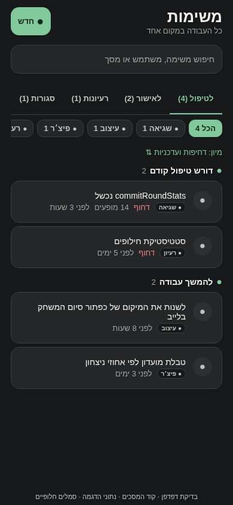
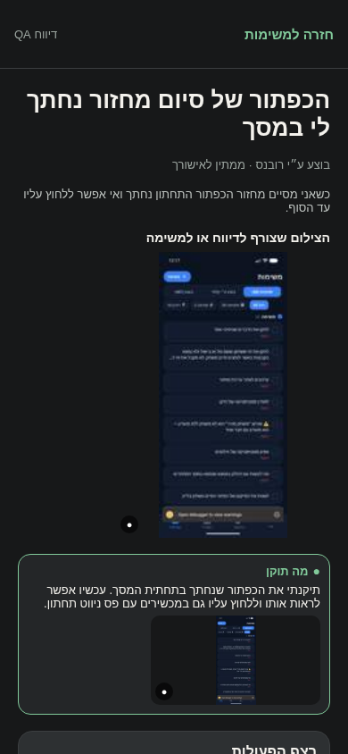

# לוח המשימות בפולס

## ניסיונות שחזור מול השרת — 23.10.2026

נוצר באישורך חשבון בדיקות נוסף, בלי למחוק חשבונות או לשנות את מועדון הבדיקות. עברו עשרה תרחישים של התחברות, ניתוק וחזרת רשת, קריאות מידע, שעון שרת והגדרות פרסומות. חלק מהכשלים נוצרו מקומית לצורך הבדיקה, ולכן אין להציג אותם כשחזור התקלה המקורית במכשיר.

בשבעת פריטי הפולס נשמר ונקרא חזרה מה בדיוק נבדק ומה עדיין חסר. הפריטים לא נסגרו: חסרים אימות מסך במכשיר, ספק אפל חי באייפון ובדיקת יצירת מחזור כחשבון מנהל. [תוצאות ומגבלות](../../changes/2026-10-23-pulse-live-reproduction.md).

## באגים לא פתורים וסיבת אי־סגירה — 23.10.2026

נוספה בקוד קטגוריה ״באגים לא פתורים״, אחרי הבאגים הרגילים. היא מרכזת שגיאות, דיווחים ובאגים שנבדקו אך עדיין אין להם פתרון מאומת. הפריטים אינם נספרים פעמיים, והחדשים מופיעים לפני הישנים. פריט שכבר תוקן וממתין לאישורך נשאר בלשונית ״בוצע ע״י רובנס״.

בפירוט נוסף הסבר ״למה הפריט עדיין פתוח״, ואפשר לחפש גם לפי הסיבה והצעד הבא. בסקירה הנוכחית נשמרו ונקראו חזרה סיבות לכל 39 הפריטים: 7 עדיין ללא פתרון מאומת ו־32 ממתינים לאישורך. שום פריט לא נסגר, והערות הטיפול וצילומי המקור נשמרו. הקטגוריה והתצוגה החדשות טרם נבנו להתקנה וטרם אומתו בצילום חדש; הסיבות עצמן נשמרו בפולס.

## משימות קומפקטיות ומיון קבוע — 23.10.2026

שורות המשימות צומצמו בריווח ובגודל הסמל, ותגית הסוג מוצגת לצד יתר הפרטים במקום בשורה נפרדת. כותרת המשימה נשארת עד שתי שורות, והפירוט המלא עדיין נפתח בלחיצה.

בכל קטגוריה המשימות מוצגות תמיד מהחדש לישן, מלמעלה למטה. משימה ישנה בעדיפות גבוהה אינה מקדימה עוד משימה חדשה. השינוי מקומי ואינו כלול בקובץ ההתקנה `1.0.101` שכבר נמסר; מספר המשימות הנראות במכשיר טרם אומת בצילום חדש.

## קובץ התקנה מעודכן — 23.10.2026

הוכן קובץ התקנה לגרסה `1.0.101`, הכולל את חלוקת המשימות לקטגוריות בסדר שביקשת. הקובץ נחתם במפתח שסיפקת, ותוכן השינוי נבדק בתוך החבילה. ההתקנה והצגת המיון במכשיר עדיין לא נבדקו בסבב הזה. [פרטים ומגבלות](../../changes/2026-10-23-pulse-apk-1.0.101.md).

## מיון לפי קטגוריות — 23.10.2026

המשימות מחולקות לקבוצות בסדר קבוע: שגיאות, דיווחים, באגים, פיצ׳ר, עיצוב ורעיון. כל פריט מוצג בקבוצה שלו; שיחות ממתינות מוצגות בקבוצה נפרדת בסוף. אפשר למיין לפי דחיפות ועדכניות או לפי עדכניות בתוך הקבוצה, בלי לערבב קטגוריות.

השינוי מקומי וטרם הופץ. בדיקות הלוגיקה עברו; המראה בפועל טרם אומת משום שפתיחת התצוגה המקומית נחסמה במדיניות הדפדפן.

## תיעוד כשלים — 20.10.2026

נוסף תיעוד אוטומטי לנקודות כשל במסלול הזה, עם מקור התקלה. הפעולה המקורית שומרת על ערכי החזרה והודעות השגיאה שלה. השינוי מקומי, טרם הופץ, ואין אימות מסירה חיה לפולס.

[דוח דיווח השגיאות והראיות](../../changes/2026-10-20-error-reporting-audit.md).

## העיצוב הנוכחי — 18.10.2026

כל העבודה מרוכזת במסך ״משימות״. אפשר לעבור בין פתוחות, בוצע ע״י רובנס וסגורות, לחפש ולסנן לפי סוג. הפריטים הדחופים מופיעים קודם; רעיון שמור אינו עובר לביצוע עד שמקדמים אותו.

פתיחת פריט מציגה את התיאור והצילום שצורף אליו. במשימה שנוצרה מדיווח מופיע גם צילום המקור. צילום התיקון מופיע בנפרד, כדי שאפשר יהיה להשוות. אם טעינת הצילום נכשלה אפשר לנסות שוב.

בסיום טיפול הפריט מסומן ״בוצע ע״י רובנס״ ומופיע בלשונית באותו שם. ההסבר החדש ייכתב בעברית פשוטה ב־2–3 משפטים. אתם בודקים את ההסבר וההוכחה, ואז מאשרים וסוגרים או מחזירים לטיפול.

דיווחי צילום מסך שייכים לבודקי QA. קריסות שנאספות אוטומטית ממשתמשים אחרים מוצגות באותו לוח, עם האבחון הקיים שלהן.

הצילומים הם רינדור של הקוד בדפדפן עם נתוני הדגמה וסמלים חלופיים. העדכון עדיין מקומי ולא הותקן במכשיר. [הסבר טכני](pulse-work-inbox.md).

## תיעוד קודם

# באגים שלא נפתרו בפולס

## ארגון הפולס — 18.10.2026

בגרסה הקודמת מסך המשימות נקרא ״לטיפול״. כאשר מקור נתונים לא נטען, מוצגת הודעה והמידע הקודם שלו נשמר אם היה. בתוך פריט אפשר לפתוח את המשתמש או את האבחון; משימה שהועתקה מדיווח כוללת קישור למקור. אין מחיקה או סגירה אוטומטית של כפילויות.

שינוי מקומי, טרם בנייה והתקנה.

## קובץ התקנה 1.0.96 — 17.10.2026

נבנה קובץ התקנה של הפולס 1.0.96, מספר בנייה 103, עם סימון שיחה כפתורה ללא תשובה, פתיחה מחדש וחזרה לטיפול בהודעה חדשה. החתימה זהה לגרסה 1.0.95 ולכן הקובץ מתאים לעדכון מעל ההתקנה הקודמת. לא בוצעו התקנה במכשיר הבעלים או שינוי של שיחות אמיתיות.

## סימון שיחה כפתורה ללא תשובה — 17.10.2026

ליד הודעת צ׳אט במשימות אפשר ללחוץ על סימן האישור כדי לסמן אותה כפתורה בלי להשיב. לחיצה על תוכן השורה ממשיכה לפתוח את השיחה. הסימון מסיר אותה מהממתינים; אם המשתמש שולח הודעה חדשה היא חוזרת לטיפול.

[מאחורי הקלעים](pulse-work-inbox.md)

במסך המשימות נוסף אזור ״באגים שלא נפתרו״ לתקלות שחוזרות או שטרם הצלחנו לאמת את פתרונן. בפתיחת תקלה רואים למה היא עדיין פתוחה ומה צריך לבדוק כדי להתקדם.

העברה לאזור אינה סגירה: התקלה ממשיכה להיספר כפתוחה. תיקון שמוכן לבדיקה עובר לרשימת התיקונים שבוצעו, ורק אתם מאשרים את סגירתו.

בסבב הנוכחי נכללים דיווחי הלחיצות הוותיקים, בעיית התחברות דרך אפל שדורשת אימות במכשיר, ושגיאה חוזרת ברכיב ההתראות. בקשות לפיצ׳רים אינן מסווגות כבאג רק משום שהן ישנות.

העיצוב הוכן בקוד הפולס ונבדק בתצוגת דמו בדפדפן. הוא יופיע באפליקציה המותקנת לאחר בנייה והתקנה של גרסה חדשה; לא נבנתה גרסה בסבב זה.

## עיצוב ואיחוד — 18.10.2026

נוסף חיפוש בתור לפי פנייה, משתמש ומסך. מונה העבודה מתעדכן מהתור ללא קריאות נוספות למסד. סגירה ופתיחה מחדש מבטלות מטמון רק לאחר הצלחת הכתיבה.

[התנהגות, קריאות, צילומים ומגבלות](pulse-management.md#עיצוב-פחם-ואיחוד-מרכזי-העבודה--18102026). שינוי מקומי; לא נבנה או נפרס.

השלמת מבנה המסכים, פירוט השינויים והראיות העדכניות: [ניהול הפולס](pulse-management.md#השלמת-מבנה-העבודה--18102026).

הבהרת הבעלים: הלוח כולל שלוש לשוניות בלבד. רעיונות אינם לשונית נפרדת; הרעיון נשאר פתוח ומוגן מביצוע עד החלטת הבעלים. הכינוי הישן `Ideas` פותח את הפתוחות עם מסנן רעיונות.

### התאמה לסקיצות — 18.10.2026

מסכי המשימות, הגרסאות וכרטיס השחקן סודרו לפי הסקיצות: רווחים, כותרות, אייקונים, תגיות ושורות סינון. פרטי המועדון נפתחים בלחיצה על השורה, וכפתור השיחה נמצא לצד שם השחקן. צילום הדיווח וסיכום התיקון נשמרים בנפרד בפרטי המשימה.

נבדקו תצוגות מובייל בדפדפן עם נתוני הדגמה. התיקון עדיין מקומי; נדרשת בדיקה באפליקציה המותקנת לפני שאפשר לאשר התאמה פיקסלית.

## יישור עברית — 18.10.2026

תוקן יישור הכותרות, השמות, הטקסט והמסננים במסכי הפולס החדשים. גם ערכים שמופיעים מול כותרת ושמות באנגלית מקבלים כיוון מתאים. אין שינוי בנתונים או בפעולות; השינוי עדיין מקומי וצריך להיכלל בהתקנה חדשה כדי שיופיע בטלפון. [פירוט הבדיקה](../../audits/2026-10-18-pulse-rtl.md).

אימות נוסף ב־19.10.2026: נבדקו באימולטור מסך המשתמשים, שלוש לשוניות פרטי השחקן, החיפוש והסינון. תוקנו גם כיוון ההקלדה ושגיאת תצוגה בסקירת השחקן. יתר המסכים נבדקו בקוד; התיקונים טרם הופצו.

סבב סגירה מ־23.10.2026 לפי אישור מפורש: נסגרו 12 שגיאות בעלות תיקון ממוקד שנבדק, ו־15 נשארו פתוחות עם סיבה. בכל סגירה צוינה מגבלת תיקון מקומי שטרם הופץ. אי־שחזור לבדו לא שימש עילת סגירה. [פירוט והוכחות](../../changes/2026-10-23-pulse-error-closure.md).

## השלמת סגירת שגיאות — 23.10.2026

לפי הנחיית הבעלים, תיקון בקוד ובדיקות תומכות מספיקים לסגירה גם כשלא שוחזר האירוע ההיסטורי. עוד שמונה שגיאות הועברו לבוצע ונסגרו, אחרי 26 בדיקות ממוקדות ואימות קריאה חוזרת. בסך הכול נסגרו 20 בשני הסבבים ונותרו שבע ללא תיקון מתאים מאומת. התיקונים עדיין מקומיים וטרם הופצו. [פירוט וקבלות](../../changes/2026-10-23-pulse-error-closure.md).

## תיקון מצב התור — 23.10.2026

הסגירה הסופית של 20 הפריטים שכבר היו בבוצע בוטלה לפי הבהרת הבעלים; הם שוב ממתינים לאישורו. מתוך שמונה פתוחים בפועל הועברו ארבעה לבוצע ע״י רובנס: התחברות אפל, שעון ושני מוני בקשות. ארבעה נותרו פתוחים ללא תיקון מזוהה מתאים. נשמרו הערות ומגבלות, וכל השדות נקראו חזרה. עדכון זה מחליף את ספירות הסגירה הקודמות. [פירוט התיקון והקבלה](../../changes/2026-10-23-pulse-error-closure.md).

## טיפול בארבע שגיאות פתוחות — 23.10.2026

שלוש שגיאות קריאה קיבלו תיקון התאוששות מוגבל ונבדקו גם מול חשבון הבדיקות. הן הועברו לבוצע ע״י רובנס ואומתו בקריאה חוזרת; שגיאת יצירת המחזור נשארה פתוחה עם סיבה ובדיקה הבאה, לאחר הוספת הגנת החלפת חשבון ואבחון. במהלך העבודה נכנסה שגיאת מעקב מועדונים חדשה והיא נשארה פתוחה בנפרד. עברו 5,261 בדיקות ב־472 חבילות ובדיקת הטיפוסים נקייה. אין סגירה סופית או הפצה; שני התיקונים נרשמו ביומן כגרסה הבאה. [מסירה וראיות](../../changes/2026-10-23-four-open-errors.md).

## עדכון מסבב הפולס — 23.10.2026

תוקנה הצגת זמינות ישנה בכרטיס שחקן, פריסת הטקסט בקרוסלת הטיפים ועיצוב חלונית שמירת העונה. נוסף טיפול מוגבל בתקלות זמניות בטעינת מועדונים ובספק הכתובת באנדרואיד. אלו שינויים ברכיבים משותפים; לא כל פעולה במסך השתנתה. התיקונים מקומיים וטרם הופצו. [בדיקות, צילומים ומגבלות](../../changes/2026-10-23-pulse-resweep.md).

## התאוששות מיקום וטעינת מחזורים לאימות — 23.10.2026

אם חיישן המיקום לא עונה בזמן, נשמרת האפשרות לבחור נקודה במפה או לנסות שוב. טעינת מחזורים שממתינים לאימות יכולה לנסות פעם נוספת בכשל זמני, בלי לשנות את החלטת המנהל ובלי להציג כשל כאילו אין מחזורים. התיקונים מקומיים וטרם הופצו. [בדיקות ומגבלות](../../changes/2026-10-23-pulse-resweep.md).

## תוצאת הסבב החוזר — 23.10.2026

בסבב טופלו 25 פריטים פעילים, כולל שני אירועים שנכנסו במהלך העבודה. שבעה קיבלו תיקון ונבדקו; 18 האחרים קיבלו סיבה פרטנית לאי־השלמה ולא נסגרו סופית. מלוא 475 חבילות ו־5,289 בדיקות עברו, ובדיקת הטיפוסים נקייה. שלושה תיקונים חזותיים נבדקו בתצוגת דמה באימולטור וצילומיהם שמורים בנפרד ממקורות הדיווח. הקוד מקומי וטרם הופץ. [פירוט, קבלות ומגבלות](../../changes/2026-10-23-pulse-resweep.md).

## קריסות מקוריות באותו לוח — 24.10.2026

קריסות שמתקבלות בפיירבייס ייכנסו לאותו לוח שגיאות בפולס, עם גרסה, פרטי מכשיר וקישור לדוח. מופעים חוזרים נספרים באותו פריט; קריסה חדשה אחרי סגירת התקלה מחזירה אותה לטיפול. ההתראות מכבדות את הגדרות הפולס, מאחדות התראות תכופות מאותה תקלה ומנסות שוב משלוח שנכשל. ההפעלה החיה והבדיקות המדויקות מתועדות בדוח החיבור; קוד מוכן אינו הוכחת הפעלה. [מצב פריסה, ראיות ומגבלות](../../changes/2026-10-24-crashlytics-pulse.md).

## המשך חיפוש מדורג ביומני הקריסות — 24.10.2026

בהרצה החיה הראשונה התגלה שספק היומנים יכול להחזיר עמוד ריק עם מזהה המשך. הגשר שומר כעת חלון חיפוש ומזהה המשך בין הרצות, עד 20 עמודים בכל הרצה; רק השלמה מלאה מקדמת את נקודת הסריקה. עשר בדיקות ממוקדות עברו, כולל המשך כזה. אין בכך הוכחה שקליטת קריסה והתראה במכשיר הושלמו. [מצב הפעלה והחסם](../../changes/2026-10-24-crashlytics-pulse.md).

## גבול זמן לחיפוש ביומן — 24.10.2026

לצד חלון זמן הקליטה נוסף גבול `timestamp` של 30 ימים, בהתאם לשימור היומן, כדי שהחיפוש ישתמש באינדקס הזמן. חלון ומזהה המשך נשמרים עם גרסת מסנן; מסנן חדש אינו משתמש במזהה שנוצר למסנן הישן. שאילתת המסנן המדויקת אומתה מול השירות והסתיימה בתוך 4.78 שניות, ללא אירועים וללא המשך, לפני הפעלת הייצוא. [המקור, התוצאות והחסם](../../changes/2026-10-24-crashlytics-pulse.md).

## שרת פעיל, ייצוא ממתין לאישור — 24.10.2026

רכיב הסנכרון ושומר הפוש הכפול נפרסו ומקורותיהם אומתו. ההרצה החיה הסופית הסתיימה בתשובה 200, בעמוד יחיד וללא אירועים, ואומתה הפעלת המתזמן ללא שינוי בשאר המתזמנים. כל 5,299 הבדיקות ובדיקות הטיפוסים עברו. ייצוא הקריסות עצמו עדיין ממתין לאישור בעקבות דחיית הבקרה האוטומטית; טרם אומתו קליטת קריסה בפולס או הצגת פוש במכשיר, ואין טענת השלמה מקצה לקצה. [הקבלה והשלב שנותר](../../changes/2026-10-24-crashlytics-pulse.md).
