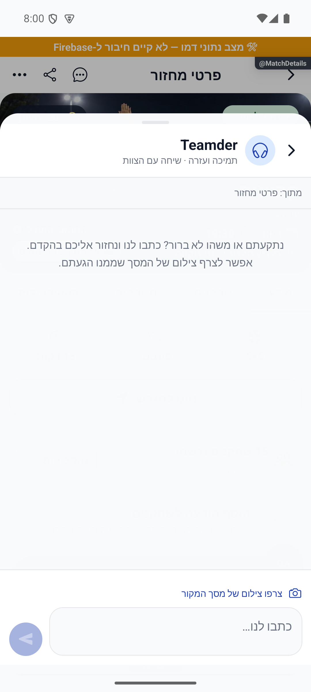
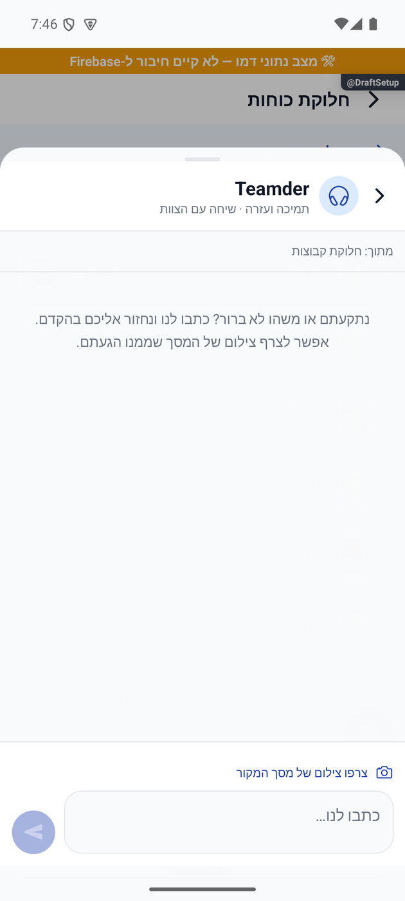
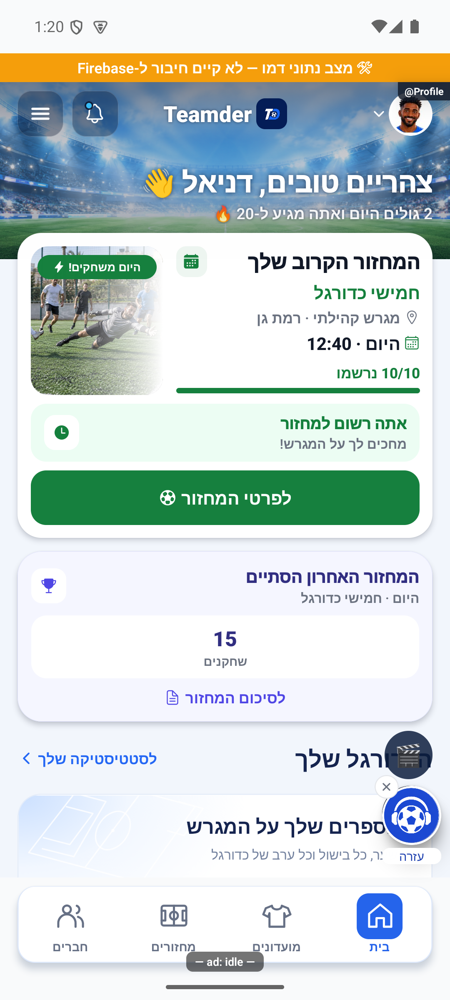

# שיחה עם צוות התמיכה

## תיעוד כשלים — 20.10.2026

נוספו תצפיות דיווח בנקודות הכשל של המקורות המשויכים לפיצ׳ר, במסגרת הרחבה רוחבית. נשמרו ערכי החזרה, הזריקות ותנאי הפעולה הקיימים; נוסף מקור קוד והקשר לדיווח. כיסוי תחבירי אינו הוכחת הרצה של כל מצב. השינוי מקומי וטרם הופץ; בדיקות המסירה, מגבלות מניעת הכפילויות והמסלולים שטרם חוברו מתועדים בדוח המשותף.

[דוח דיווח השגיאות והראיות](../../changes/2026-10-20-error-reporting-audit.md).

## אימות פתיחת החלונית ותיקון ייחוס השגיאה — 17.10.2026

בדיקה חוזרת באמולטור אנדרואיד בנתוני דמו: העזרה נפתחה ממסך פרטי מחזור, אפשר היה להקליד, לסגור ולפתוח בלי לאבד את הטיוטה, לצרף צילום ולהגדיל אותו. לא נשלחה הודעה אמיתית לצוות.

השגיאה שתועדה קודם יוחסה בטעות לחלונית הזאת. מקורה בכלי הדמיית מסך התמיכה בפולס שהופעל באותו אמולטור; כלי הבדיקה תוקן, ללא שינוי בקוד חלונית העזרה של טימדר.

[הבדיקות, המקור והגבולות](../../changes/2026-10-17-support-open-verification.md).

### מקור התקלה המדויק

`artifacts/roster-actions-pulse-2026-10-17/prepare-pulse-preview.cjs` המיר את `pulse/src/components/TeamderChatSheet.tsx` לקוד עם `React.default.createElement`, אך מתאם ההדמיה העביר את יצוא CommonJS של React ללא `default`. זה משחזר את `Cannot read property 'createElement' of undefined`. אין רכיב בשם `TeamderChatSheet` בחבילת טימדר שנקראה בבדיקה; נטען `src/components/support/SupportChatHost.tsx` בלבד.

ההמרה רוכזה ב־`scripts/audits/compile-native-preview.cjs` עם `esModuleInterop: true`; כלי ההדמיה משתמש בו. `pulseNativePreviewInterop.test.ts` מפעיל את המהדר ואת מקור רכיב הפולס המלא עם יצוא React ללא default: המצב הישן קורס בדיוק ב־createElement; המצב המתוקן מחזיר Modal גלוי עם שם המשתמש וכותרת השיחה. זו בדיקת מתאם בקוד, לא בדיקת יישום פולס מותקן.

לא השתנו `SupportChatHost`, מצב הטיוטות, `sendSupportDraft`, השירותים, הכתיבה או הרשאות. במצב דמו `sendSupportDraft` זורק לפני פנייה לשרת; הכשל המקומי נבדק כדי לוודא שהטיוטה והצילום נשמרים. הצלחת מסירה ומענה מול ייצור לא נבדקה במשימה זו.

[הסבר פשוט](support-chat.simple.md). עודכן 15.10.2026 מול `4a3cb346` ושינויים מקומיים. נכלל בהפצה הפנימית `1.1.50/283`; `sendSupportMessage` נפרסה ופולס `1.0.95/102` נבנה. [דוח ההפצה והגבולות](../../changes/2026-10-15-internal-1.1.50.md).

## כניסה ותצוגה

`App.tsx` מרכיב את `SupportChatHost` בתוך מכל הניווט. בועת כדורגל עם אוזניות מוצגת אחרי מסך הפתיחה, מעל הניווט התחתון; סגירה באיקס מסתירה אותה עד ההפעלה הבאה או חזרה מרקע לאחר יותר מ־30 דקות. `ChatInbox` מציג כניסת תמיכה קבועה בראש הרשימה, גם ללא שיחה קיימת, ומונע כפילות של אותה שיחה בשורות הרגילות. פתיחה מהתראת שיחה רשמית או `goToDirectChat` משתמשת באותה חלונית. אין מסלול ניווט חדש ואין יצירת מועדון, חשבון או שיחה רק מעצם הפתיחה.

החלונית תופסת 88% מגובה האזור הבטוח מעל המסך הקיים, עם רקע מעומעם, שם באנגלית, מקור הפנייה ושיחה אחת עם צוות התמיכה. שורת כתיבה בגובה 64–135, הקטנה לפי המקלדת, תמונת תצוגה מקדימה ומסך הגדלה נפרד. אין חיווי מקוון או אישור קריאה מומצא. מוצגות 100 ההודעות האחרונות; גלילה אוטומטית רק בטווח 90 פיקסלים מסוף הרשימה.

## מצבים ומסלול המידע

| מצב | התנהגות | כתיבה |
|---|---|---|
| פתיחה | מקור ושם מסך נתפסים; טיוטה קיימת שומרת את מקורה | זיכרון המכשיר בלבד |
| צילום לפי בקשה | המקלדת והחלונית מוסתרות לפני צילום המסך; בדיקת מקור לפני ואחרי | צילום בזיכרון בלבד |
| הסרה/הגדלה | אפשר לבדוק את הצילום ולמחוק אותו לפני שליחה | זיכרון בלבד |
| אורח שולח | חלונית ההתחברות הקיימת; טיוטה נשמרת במהלך ההתחברות שביקש | ללא הודעת תמיכה עד שליחה מחדש |
| שליחה לצוות | פונקציית `sendSupportMessage`; זהות מאומתת והורה קנוני | הודעה בצ׳אט הרשמי |
| כשל שליחה | טקסט, צילום ומזהה ניסיון נשמרים | ניסיון חוזר משתמש באותו מזהה |
| שינוי חשבון | טיוטות והיסטוריה מקומית נמחקות | אין העברת תוכן לחשבון אחר |

`captureSupportContext` מעביר רק שם מסלול, תווית, שלב, מזהי מועדון/מחזור מפורשים, גרסת יישום ופלטפורמה. ערכי שדות טופס, סיסמה, דוא״ל או רשימת פרמטרים חופשית אינם מועתקים. `useSupportStep` מחובר לשלב הנוכחי של טופסי מועדון ומחזור, ורק כאשר הטופס ממוקד. מסך לא ממופה מוצג כ״מסך באפליקציה״; שם המסלול המקורי עדיין נשלח.

## הודעות לצוות וצילום

`functions/src/supportMessagePolicy.ts` מגביל טקסט ל־1,000 תווים ותמונה למחרוזת JPEG בבסיס 64 עד 180,000 תווים. צילום: איכות 0.35 ורוחב מרבי 540; באנדרואיד נבחר PixelCopy הקיים, ובשאר המצבים יש נסיגה ל־`captureScreen`. צילום גדול או שינוי מקור מציגים שגיאה ואינם נשלחים. הגבלת הגודל גם משאירה חלון של 100 צילומים מתחת למגבלת התגובה של תיווך הפולס. צילום מבוצע רק אחרי לחיצה, ללא לכידה אוטומטית בתחילת ביקור.

השרת כותב בעסקה להורה `[uid,'teamder'].sort().join('__')` ולהודעה שמזהה מתחיל ב־`support-`. הוא אינו מקבל יעד אחר. חשבון אנונימי נדחה; `expectedUid` הוא בדיקת שינוי זהות בלבד, והזהות האמיתית נגזרת מהאימות. שם השולח נקרא מהפרופיל בשרת. 20 הודעות בדקה למשתמש; ניסיון חוזר זהה אינו צורך מכסה נוספת. שימוש באותו מזהה לתוכן אחר נדחה; השוואת ההקשר אינה תלויה בסדר מפת השדות שמסד הנתונים מחזיר.

השדות החדשים הם `supportContext` ו־`supportImage` במסמך ההודעה. `chatMessageConverter.fromFirestore` תוקן מקומית לשימור שני השדות: בגרסה הפנימית 1.1.50 הוא השמיט אותם, ולכן צילום שמור לא הוצג. בדיקה חדשה מפעילה את הממיר האמיתי מול המסד. קורא הפולס וממיר REST נבדקו במפורש. `onDmChatMessage` ממשיך לעדכן תקציר ולהתריע על תשובת משתמש; אין טריגר שני או התראה כפולה. `ChatView` יכול להציג ולהגדיל צילום גם בנתיב השיחה הישן. אין שינוי ב־`firestore.rules`, בתיווך המנהלי או בהרשאות קיימות.

היסטוריית תמיכה מעורבת מכילה זמן מספרי וחותמת זמן. `subscribeMessages` פותח בשיחה הרשמית שתי שאילתות לפי סוג, מאה לכל היותר בכל שאילתה, וממתין לשתיהן. `mergeSupportMessages` מסיר כפילויות לפי מזהה, ממיין לפי מילישניות ומזהה ושומר את מאה האחרונות. סגירה או שגיאה מפסיקות את שתי ההאזנות. שיחות אחרות נשארות במסלול הקיים. `supportDayLabel` מוסיף מפריד לפי יום מקומי, ״היום״, ״אתמול״ או תאריך כולל שנה. [תיקון מקומי, בדיקות וצילומי הוכחה](../../changes/2026-10-15-support-history-photo.md); אינו כלול עדיין בגרסה 1.1.50 שהופצה. עברו 3,830 בדיקות ו־11 בדיקות שילוב לכל אחת משתי גרסאות הכללים.

## שמירה ובדיקות

תיקון לשליחת טקסט ללא צילום: מקודד הקריאות של הלקוח הפנימי הופך `image: undefined` ל־`null`. השרת מקבל את שניהם כהיעדר צילום; הודעה ריקה ותמונה פגומה עדיין נדחות. לקוח המקור משמיט את השדה אם אין תמונה. בדיקת שילוב משתמשת במקודד האמיתי לפני כתיבה למסד וקריאה בפולס. התיקון נפרס ואומת מול מקור הפריסה; אין צורך בהתקנה חדשה. עברו 3,826 בדיקות יישום ועשר בדיקות שילוב מול כל אחת משתי גרסאות הכללים. שליחה מהמכשיר החי לאחר התיקון טרם נצפתה. [השחזור וגבולות הבדיקה](../../changes/2026-10-15-support-text-only.md).

הטיוטה והצילום נשמרים בזיכרון המכשיר ונמחקים בשליחה מוצלחת או בהחלפת חשבון. שיחת הצוות נשמרת במאגר הצ׳אט הקיים. הודעות משתמש מגיעות ל־`onDmChatMessage`, המתראה לפולס באמצעות `teamderReply`; מענה מהפולס נקרא באותה שיחה רשמית. אין נמען חופשי בפונקציית שליחת התמיכה ואין שליחה רק מעצם פתיחת החלונית.

נשארו רק הודעות אל צוות Teamder. בחירת המסלול הוסרה, ושורת הכתיבה זמינה מיד. `supportHumanOnly` בודק שלא נשארו רכיבים, הגדרות או נקודות כניסה מהמסלול שהוסר. `supportDraft`, `supportMessage`, `pulseSupportMessaging` ו־`pulseSupportTransport` בודקים טיוטה, אימות, ולידציה וקריאה בפולס. `supportMessaging.firestore.cjs` בודק בפועל מול מסד מקומי מבודד את הכתיבה, התמונה, מקור הפנייה, ההתראה לפולס, מענה וניסיון חוזר, לצד חסימת צד שלישי והתחזות.

הראיות העדכניות והגבולות ב־[דוח התמיכה האנושית](../../changes/2026-10-15-human-support-only.md). בהפצה הפנימית עברו 3,824 בדיקות יישום, 346 בדיקות הרשאות ותשע בדיקות שילוב מול הכללים המקומיים ועוד תשע מול מלוא הכללים הפעילים. בקשת שרת ללא התחברות נדחתה ב־401. אין בסבב זה הוכחת מסירה לשני מכשירי ייצור או בדיקת אייפון.

## כיווניות שורת הכתיבה בתמיכה — 15.10.2026

ב־SupportChatHost שדה TextInput משתמש ב־writingDirection:'rtl' וב־textAlign:'right' פיזי, ללא RTL_LABEL_ALIGN באותו שדה. סמל send משתקף באמצעות scaleX:-1. סדר הילדים, שמירת הטיוטה, חובת התחברות, אימות התוכן ופעולת השליחה נשמרו. לא נשלחה הודעה במהלך האימות. בדיקת טיפוסים נקייה; 328 חבילות / 3,881 בדיקות עברו. מקור: artifacts/release-1.1.52/tests.log. נבדק באימולטור אנדרואיד בדמו מנותק. אייפון, מכשיר פיזי וגופן מוגדל לא נבדקו.

הפצה 15.10.2026: השינויים המקומיים המתוארים בסבב זה נכללו בגרסה הפנימית 1.1.52 / 285 באנדרואיד. [ראיות וגבולות](../../changes/2026-10-15-internal-1.1.52.md).

## עזרה במסך משחק — 16.10.2026

במסלול הלייב הבועה הצפה מוסתרת כדי לא לכסות פעולות משחק. מגיעים לאותה שיחה דרך האוזנייה בכותרת, או דרך ״עזרה״ בתפריט ״עוד״ כשמוצג. `App` מעביר `hideBubble` לפי המסלול הפעיל; החלונית, הטיוטה והשליחה אינן מוסתרות או נמחקות. פתיחת העזרה אינה שולחת הודעה. [בדיקה וצילום](../../changes/2026-10-16-live-game-redesign.md).

## סמל הבועה — 17.10.2026

`SupportFootballIcon.tsx` מציג באמצעות `Image` את `src/assets/images/support-football-headphones-original.png`: עותק זהה ברמת הבתים של הסקיצה המקורית שנוצרה בשיחה. המימוש הווקטורי הראשוני הוחלף לבקשת הבעלים משום שצורתו הייתה שונה. אין יצירת תמונה חדשה או שחזור של הסמל. מקור הסקיצה: `exec-04912f82-6d75-45ec-a0f0-2d41d76547b2.png`; חותמת SHA256: `ae6dd096eacffd712befba80665c9d0260613a984f23df3be956ba1ef71d75a5`.

הקובץ המקורי בגודל 1024×1536 נשמר בשלמותו. חלון תצוגה עגול בגודל 50×50, בתוך כפתור 54×54, מציג רק את פנים העיגול הגדול: תחום מקור ממורכז ברוחב 564, מגובה 194. קנה המידה הוא `size / 564`; התמונה מוצגת ברוחב `1024 * scale`, בגובה `1536 * scale` ובהיסט אנכי `-194 * scale`. `alignSelf: 'center'` שומר על המרכוז גם תחת `forceRTL`; `overflow: 'hidden'` מסתיר את הכיתוב והדוגמה הקטנה שבקובץ. הצבע הכחול והצורות נשמרים מפיקסלי הסקיצה. התמונה דקורטיבית ונגישות נשארת בכפתור ההורה.

תנאי ההצגה, `hideBubble`, `dismissed`, `state.open(uid)`, הכיתוב, מיקום הבועה, הטיוטה, הניווט ומסלול הנתונים לא השתנו. אייקוני הכותרת, תיבת הצ׳אטים ומסכי המשחק נשארו כפי שהיו. אין חישוב עסקי, קריאת מסד או כתיבה חדשה ברכיב.

נצפה באנדרואיד באמולטור במצב דמו, במסך הבית תחת הכיווניות הקיימת; נבדקו המסך המלא וחיתוך הבועה. הוסתרו כרזות פיתוח לצילום בלבד. אייפון, מכשיר פיזי וגופן מוגדל לא נבדקו. [דוח החלפת התמונה והבדיקות](../../changes/2026-10-17-support-original-image.md).

## הפצה פנימית — 17.10.2026

שינויי הלקוח האחרונים המתועדים כאן נכללו בבינארי הפנימי `1.1.53 / 286` באנדרואיד. המסלול אומת בגוגל; הייצור נשאר בגרסה הקודמת. זה אינו אימות חדש של תרחיש ייצור או של מכשיר אפל. [מקור הבינארי, פריסת השרת, בדיקות ומגבלות](../../changes/2026-10-17-internal-1.1.53.md).

## דיווחים ושגיאות וסגירה לפי גיל — 24.10.2026

אפקט הצילום ב־`src/components/support/SupportChatHost.tsx` בודק ביטול, חיבור רכיב ובעלות לפני הפעלת המצלם ולפני טיפול בכשל. אי התאמת `sameSource` לפני או אחרי צילום ומגבלת גודל הן תוצאה צפויה עם הודעת הצילום הקיימת, ללא זריקת שגיאת מערכת. כשל צילום נוכחי אמיתי עדיין מדווח; טיוטה אינה מתעדכנת מתשובה מיושנת. ארבע בדיקות גוף האפקט עברו, ללא צילום או משלוח תמיכה בייצור.

[מקור הדיווחים, הבדיקות ומגבלות הסבב](../../changes/2026-10-24-pulse-age-pass.md). השינויים מקומיים וטרם הופצו.
