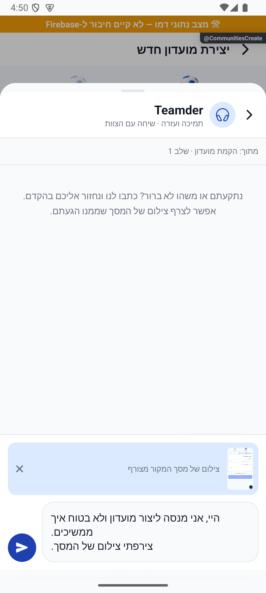

# מדברים עם צוות Teamder

## תיעוד כשלים — 20.10.2026

נוסף תיעוד אוטומטי לנקודות כשל במסלול הזה, עם מקור התקלה. הפעולה המקורית שומרת על ערכי החזרה והודעות השגיאה שלה. השינוי מקומי, טרם הופץ, ואין אימות מסירה חיה לפולס.

[דוח דיווח השגיאות והראיות](../../changes/2026-10-20-error-reporting-audit.md).

## אימות פתיחת החלונית ותיקון ייחוס השגיאה — 17.10.2026

בדיקה חוזרת באמולטור אנדרואיד בנתוני דמו: העזרה נפתחה ממסך פרטי מחזור, אפשר היה להקליד, לסגור ולפתוח בלי לאבד את הטיוטה, לצרף צילום ולהגדיל אותו. לא נשלחה הודעה אמיתית לצוות.

השגיאה שתועדה קודם יוחסה בטעות לחלונית הזאת. מקורה בכלי הדמיית מסך התמיכה בפולס שהופעל באותו אמולטור; כלי הבדיקה תוקן, ללא שינוי בקוד חלונית העזרה של טימדר.

[הבדיקות, המקור והגבולות](../../changes/2026-10-17-support-open-verification.md).

בועת הכדורגל עם האוזניות והכיתוב ״עזרה״ פותחת שיחה עם הצוות מעל המסך שבו נמצאים. אפשר לסגור ולחזור לטופס בלי לאבד את ההודעה, ולצרף צילום של המסך לאחר בדיקה והסרה לפי הצורך.

הפנייה מגיעה לצוות בפולס יחד עם מסך הפנייה והשלב שבו נתקעתם. מענה מהצוות מופיע באותה שיחה, שנמצאת גם בראש רשימת הצ׳אטים. אורח מתחבר לפני השליחה.

הוכן תיקון להצגת הצילום בתוך בועת ההודעה, עם אפשרות הגדלה, ולסידור ההודעות לפי זמן עם חלוקה לימים. צילום שכבר נשלח נשמר ואין צורך לשלוח אותו מחדש. תיקון התצוגה דורש גרסת יישום חדשה ואינו נמצא עדיין בגרסה הפנימית 1.1.50. [צילומים ובדיקות התיקון](../../changes/2026-10-15-support-history-photo.md).

ההודעה והצילום נשמרים כטיוטה במהלך הביקור עד השליחה; החלפת חשבון מנקה אותם. אין התחייבות לזמינות מיידית או חיווי מקוון.

אפשר לשלוח גם טקסט בלבד, ללא צילום. תיקון לזיהוי שדה תמונה ריק נפרס בשרת ואינו דורש התקנה חדשה; אפשר לנסות לשלוח שוב את הטיוטה. הודעה שאין בה טקסט או צילום לא נשלחת.

התמיכה זמינה בגרסה הפנימית 1.1.50, ושירות השליחה לצוות נפרס. יש להתקין גם את פולס 1.0.95 להצגת צילום ומקור הפנייה. מסירת הודעה והתראה בין מכשירים אמיתיים עדיין דורשת בדיקה. [פרטים, בדיקות ומגבלות](support-chat.md).

## כיווניות שורת הכתיבה בתמיכה — 15.10.2026

הטקסט וההנחיה בשדה ההודעה מיושרים לימין, וחץ השליחה פונה שמאלה.

הפצה 15.10.2026: השינויים המקומיים המתוארים בסבב זה נכללו בגרסה הפנימית 1.1.52 / 285 באנדרואיד. [ראיות וגבולות](../../changes/2026-10-15-internal-1.1.52.md).

## עזרה במסך משחק — 16.10.2026

במסלול הלייב הבועה הצפה מוסתרת כדי לא לכסות פעולות משחק. מגיעים לאותה שיחה דרך האוזנייה בכותרת, או דרך ״עזרה״ בתפריט ״עוד״ כשמוצג. `App` מעביר `hideBubble` לפי המסלול הפעיל; החלונית, הטיוטה והשליחה אינן מוסתרות או נמחקות. פתיחת העזרה אינה שולחת הודעה. [בדיקה וצילום](../../changes/2026-10-16-live-game-redesign.md).

## סמל העזרה — 17.10.2026

הבועה מציגה את תמונת הכדורגל עם האוזניות המקורית שנבחרה, במקום הציור הווקטורי שנוסה תחילה. הכיתוב ״עזרה״, מיקום הבועה ופתיחת השיחה נשארו כפי שהיו. השינוי מקומי וטרם הופץ.

## הפצה פנימית — 17.10.2026

שינויי הלקוח האחרונים המתועדים כאן נכללו בבינארי הפנימי `1.1.53 / 286` באנדרואיד. המסלול אומת בגוגל; הייצור נשאר בגרסה הקודמת. זה אינו אימות חדש של תרחיש ייצור או של מכשיר אפל. [מקור הבינארי, פריסת השרת, בדיקות ומגבלות](../../changes/2026-10-17-internal-1.1.53.md).
