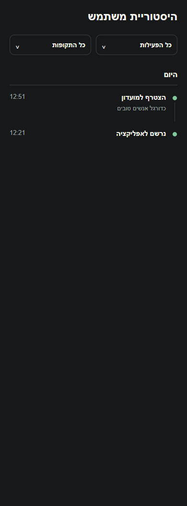
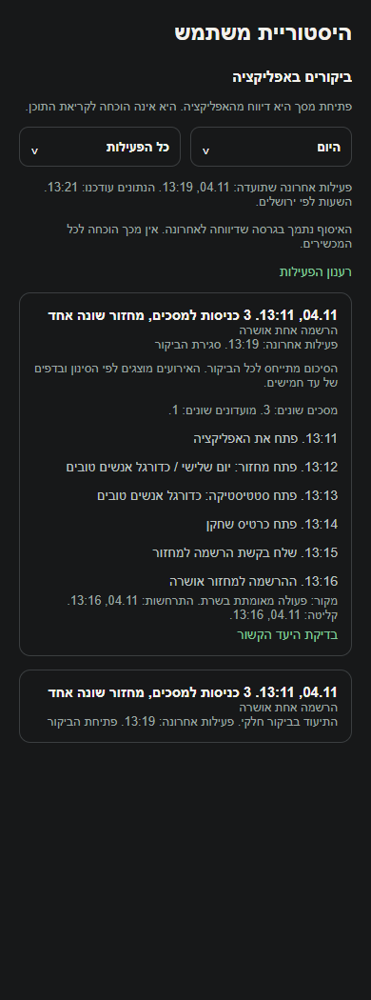
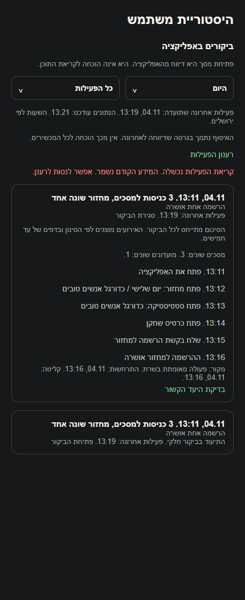
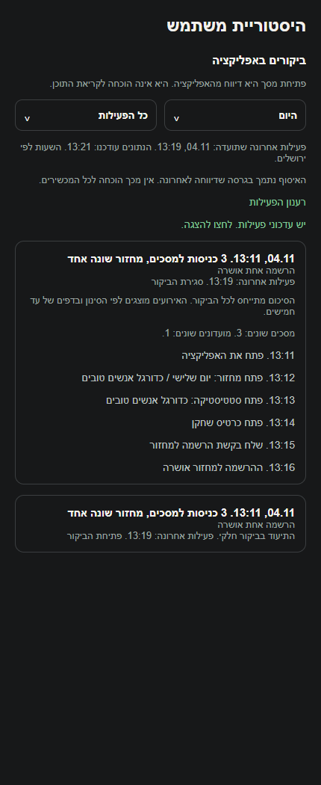

# ציר ביקורים ופעילות משתמשים בפולס

## עצירת מחזור קבוע ללא פעילות, 6.11.2026

נבדק השינוי התחום ב-`functions/src/index.ts`: בדיקת חוסר פעילות לפני יצירת מחזור קבוע ושמירת שלוש החלטות בזמן ניקוי מחזורים ריקים. ההכרעה משתמשת במקור הקיים לקיום מחזור ומגינה על מחזור עם הרשמה שנותר לא מוכרע. עסקאות היצירה והניקוי נשארות מוגנות מפני שינוי מקביל ומועדון חסר. אין שינוי מכוון בחישובים, במכנים, בהרשאות, בניווט או בפעולות העצמאיות האחרות של הפיצר הזה. בדיקות מקור השרת הורצו במאגר זיכרון; הפריסה הממוקדת של שני שירותי התזמון אומתה בייצור מול המקור שנבדק, ותועדה הרצת שירות חמש הדקות ללא שגיאות. אין בכך אימות חדש של המסך או של יתר פעולות הפיצר. [ההתנהגות, מסלול הנתונים, הבדיקות ומגבלות ההפעלה](../../changes/2026-11-06-inactive-recurring-rounds.md).

## דירוג בסיס לשחקן ללא דירוג, 6.11.2026

נבדק שינוי תחום במקורות המשותפים של הכוחות האוטומטיים: שחקן ללא דירוג מחושב כ-2.5 מתוך 5, וההסברים תואמים. דירוג מפורש נשמר. אין כאן אימות חדש של כל מצבי הפיצר העצמאי; השינוי מקומי וטרם הופץ. המקורות המשותפים שנבדקו בהפרש זה: `functions/src/index.ts`, `src/screens/games/MatchDetailsScreen.tsx`. [ההתנהגות, הבדיקות ומגבלות האימות](../rounds/draft-setup.md#דירוג-בסיס-לשחקן-ללא-דירוג-6112026).

## הפעלה מוגבלת ופריסה, 5.11.2026

`functions/src/usageActivity.ts` בודקת כעת גם `USAGE_ACTIVITY_UIDS`: כאשר הרשימה אינה ריקה, רק זהויות האימות המופיעות בה מורשות לקליטה, לקליטת קבלת הרשמה ולמימוש תוצאה. המתג הכללי נשאר תנאי נפרד. רשימה חסרה או ריקה שומרת את מדיניות המתג הכללי הקודמת; הרחבה נעשית במפורש בהגדרות השרת. `tests/logic/usageActivityServer.test.ts` מכסה קליטה ברשימה ודחיית קליטה או תוצאה של חשבון מחוץ לה ללא כתיבה.

בפריסה הפעילה הרשימה כוללת שני מנהלי פולס וחשבון בדיקה קיימים בלבד. הלקוח נבנה עם `EXPO_PUBLIC_USAGE_ACTIVITY_ENABLED=true`; ברירת המחדל בקוד ובדוגמת ההגדרות נשארת כבויה. נפרסו ארבע פונקציות השימוש, שני מקורות קבלת ההרשמה עודכנו בהוכחת יצירה ומחיקת חשבון מנקה גם שימוש. שלושת האינדקסים מוכנים ומשימת השמירה המתוזמנת רצה בהצלחה. לא השתנו כללי המסד או הגישה המנהלית.

טימדר 1.1.76/308 אומתה בפנימי באנדרואיד ופולס 1.0.105/112 נבנתה בחתימה הקודמת ונקראה חזרה מהורדה. התור וקריאת הפולס נבדקו מול השרת: ארבעה אירועים, מניעת כפילות ותווית יעד מאומתת. חשבון הבדיקה נדחה מקריאת שער הניהול. הצילום מרנדר תשובת שרת בדפדפן. אין אימות מכשיר, הרשמה עסקית חיה חדשה, תקורת מכשיר או בניית אייפון. [פריסה, הוראות וראיות](../../changes/2026-11-05-usage-activity-activation.md). מצב זה מחליף את הערות האיסוף הכבוי בסעיפים הישנים עבור החשבונות שהוגדרו בלבד.

## גבול זיכרון משותף לתוצאות הרשמה, 5.11.2026

נמצא שבזמן שאחסון מקומי אינו מסיים כתיבה, `record` הגביל את הזיכרון אך פונקציית הסיום של `beginRegistration` הוסיפה ישירות ל-`pending`. בניסוי של 800 ניסיונות ותוצאות מיידיות נותרו בזיכרון 1,051 אירועים. לאחר תיקון צר, שתי נקודות הכניסה משתמשות ב-`append`, המאמת אירוע, מגביל את `pending` ל-500 ושומר סימון `coverage_gap` לכל ביקור שנפגע. אותם 800 ניסיונות הותירו 500 אירועים.

פונקציית הסיום ממשיכה להשתמש ב-`ownerUid`, ב-`visitId`, ב-`sequence` ובמזהה האירוע שנלכדו בתחילת ההרשמה. היא אינה משייכת תוצאה לחשבון הנוכחי בעת השלמתה. בבדיקה שבה הכתיבה הושהתה, בוצעו 800 ניסיונות, החשבון הוחלף והאחסון חזר, נבדקו תור שמור של עד 500 אירועים, פער תקין, מסירה נפרדת לכל בעלים והיעדר מזהי אירוע כפולים.

עברו 26 בדיקות בשלוש חבילות ממוקדות. הבדיקות הפעילו את התור ואת האוסף המקומי עם שעון ואחסון נשלטים, ללא רשת ייצור או מכשיר. [דוח הביקורת והראיות](../../audits/2026-11-04-system-night/queue-review.md). המתגים ומדיניות האיסוף נשארו כפי שהיו.

## תיקוני לילה ובדיקת הפעולות, 5.11.2026

נוסף product_action עם productKey מקטלוג סגור. אין בו פרטי מסך, מועדון או שחקן יעד. השרת קובע את בעל האירוע מטוקן הבקשה, דוחה אנונימיים ומונע מסירה כפולה. הקורא משתמש בתצלום מסד קבוע, מחשב קבוצות חשבונות לכל פעולה ומסמן גבולות כיסוי. הגדרות ההפעלה, מסלול הנתונים, המדדים, השימור והבדיקות מפורטים בדוח המדידה המקושר. השינוי מקומי. [ראיות ומגבלות](../../audits/2026-11-04-system-night/product-measurement.md).

## מדידת פעולות ואמינות נתונים, 5.11.2026

במיפוי מקור הרכיבים המוזכרים במסמך נמצאו 86 נקודות מטפל ו-84 מזהי פעולה. הספירה מתארת קוד וכוללת רכיבים משותפים; אין לחבר אותה לספירות של מסמכים אחרים ואין לראות בה הרצת כל המסך. המדידה מפורטת לפי גבול פקד מקורי, פעולה עסקית ומצב חשבון. תשובה מאוחרת נבדקת מול בעל הפעולה, ומצב קיים או בקשה חוזרת אינם תמיד הצלחה חדשה. רשימת המקרים שהורצו ומגבלות המסד, המכשיר והכיסוי נשמרות [בדוח המדידה](../../audits/2026-11-04-system-night/product-measurement.md) ובדוחות המקושרים אליו. המימוש מקומי; לא בוצעה בדיקה חדשה של כל מצבי הפיצר.

## בדיקת לילה, 4.11.2026

`recordUsageScreen` שומר רק את הקשר המסך מתוך הקטלוג ואת זהות החשבון בעת פתיחתו. `replayRoute` בודקת את הזהות במיקוד, בחזרה מהרקע ובהחלפת חשבון, ומשליכה את ההקשר ואת הלשוניות כאשר בעליו השתנה. יציאה מפורשת מנקה את ההקשר לפני איפוס הביקור. כשהאיסוף כבוי, הקשר המסך והלשונית אינם נשמרים במודול. נבדקו מעבר ישיר, יציאה וכניסה, חזרה מהרקע, טקסט שיחה וחיפוש. [מבחנים, תוצאות ומגבלות](../../audits/2026-11-04-system-night/privacy.md).

## חיפוש שחקנים וזמני טעינה, 4.11.2026

קריאת מחזורים עתידיים של מועדון יכולה להעביר כשל גישה לחלונית ההזמנה כשהיא מבקשת תשובה מאומתת. ברירת המחדל של יתר הקוראים נשמרת. נקודת הכניסה מייצאת את מעדכן מפתח השמות הפרטי. אירוע זה דורש פריסה נפרדת. בדיקה זו תחומה למקור המשותף, ללא הרצה חדשה של כל המסך העצמאי. מימוש מקומי שטרם הופץ. [השינוי, המדידות והבדיקות](../../changes/2026-11-04-player-discovery-speed.md).

[הסבר פשוט](usage-activity.simple.md)

עודכן: 4.11.2026. מקור העבודה: `06417f6132f4c7636aaee25574354ed7722966b9` עם שינויים מקומיים. אין קומיט חדש או הפצה. [האפיון המקורי](../../specs/2026-11-04-user-activity-timeline.md) נשמר כהצעה היסטורית; בקשת הבעלים להמשיך במימוש התקבלה באותה שיחה.

## מסלול וגישה

פולס, אנשים, משתמש, היסטוריה. `pulse/src/screens/UserDetailScreen.tsx` מציג את `pulse/src/components/UserUsageTimeline.tsx` בנפרד מטעינת המידע העסקי הכבד. אין מסך או נתיב חדש. האזור פעיל רק כשהלשונית פתוחה והמסך ממוקד. `PlayerHistory` הישן, אירועיו, מסנניו ואזהרת שיוך התקלות שלו נשמרו.

הקריאה משתמשת בשער המנהלי הקיים, `pulse/src/services/adminTransport.ts` ו-`functions/src/pulseAdminProxy.ts`. מדיניות הגישה לא נערכה. ללקוח אין קריאה או כתיבה ישירה לאוספי השימוש. לא שונו `firestore.rules` או הרשאות אחרות. אין כאן אישור לגישה של מנהל מועדון או להצגת הציר בטימדר.

## הפעלה

שני מתגים נפרדים כבויים כברירת מחדל: `EXPO_PUBLIC_USAGE_ACTIVITY_ENABLED` בלקוח ו-`USAGE_ACTIVITY_ENABLED` בשרת. ערך ההפעלה הוא `true`. לא שונו הגדרות אמת או קובצי סודות. הדוגמה מופיעה ב-`.env.example`.

לפני הפעלה יש להשלים הסבר למשתמשים על האיסוף, לאמת את בעלי הגישה לפולס, לפרוס את ארבע הפונקציות החדשות והאינדקסים ואת שני מפעילי ההרשמה הקיימים `onJoinRequestCreated` ו-`reconcileJoinsTask`, לבדוק לקוחות ישנים ולבדוק במכשיר ובמסד הדגמה. המימוש המקומי אינו מפעיל איסוף חדש בייצור. אין הערכת התאמה משפטית במסמך זה.

## ביקור ותור

`src/services/usageActivity.ts` מחבר את חיי האפליקציה, האימות והניווט. `src/services/usageActivityQueue.ts` מחזיק את מצב הביקור ואת התור. `src/utils/usageActivity.ts` הוא קטלוג סגור עם עותקים זהים ב-`functions/src/usageActivityCatalog.ts` וב-`pulse/src/services/usageActivityCatalog.ts`.

| מצב | הכרעה ותוצאה |
|---|---|
| תהליך חדש בחזית | ביקור אקראי חדש ואירוע פתיחה אחד |
| הרכבה ברקע | אין פתיחה או צפייה עד הגעה לחזית |
| מצב לא פעיל של חלון מערכת | אינו מפצל ביקור ואינו אירוע חזרה |
| רקע פחות משלושים שניות | אותו ביקור, ללא אירוע חזרה |
| רקע משלושים שניות ועד פחות משלושים דקות | אותו ביקור, אירוע חזרה |
| רקע משלושים דקות | ביקור חדש ופתיחה |
| חוסר לחיצות בחזית | אינו מפצל ביקור |
| החלפת מזהה אימות או יציאה מפורשת | ביקור חדש; תור קודם שומר את בעליו |
| שדרוג חשבון עם אותו מזהה | נשמר הביקור |
| אירוע לפני אימות בתהליך הנוכחי | נקשר רק לזהות הראשונה של אותו ביקור בתהליך |
| אירוע ללא בעלים מתהליך קודם | אינו מועבר לחשבון הנוכחי |
| שני מכשירים | מזהי ביקור אקראיים ומונים מקומיים נפרדים |

מזהה ביקור אינו נשמר לצורך חידוש בהפעלה הבאה. `eventId` הוא צירוף הביקור והמספר הסידורי. המפתח במסד כולל גם את זהות האימות. ביקור השימוש אינו מזהה מסלול ההצטרפות, ואין קישור משוער ביניהם.

התור נשמר ב-`AsyncStorage` במפתח `teamder:usage-activity:v1`. הוא מוגבל לחמש מאות אירועים ולשבעה ימים. צפיות ישנות מוסרות לפני פעולות, ונוסף אירוע חוסר לביקור שנפגע. כשל אחסון משאיר אירועים בזיכרון עד ניסיון השמירה הבא, שגם הוא מוגבל. קריסה לפני השלמת כתיבה יכולה לאבד את האירועים שטרם נשמרו. קיטוע קיצוני שבו יותר מחמש מאות ביקורים נפרדים דורשים סימון בבת אחת מוגבל גם הוא; אין הבטחת שחזור לכל ביקור שאבד מעבר לתקרה.

השליחה היא מחוץ למסלול הקריטי: עד עשרים אירועים, אחרי עשר שניות או בהגעה לעשרים, ובמאמץ מיטבי במעבר לרקע. שידור חוזר משמר מזהה ושעת התרחשות. מוסרות רק רשומות שאושרו במפורש, או רשומות שנדחו לצמיתות במסלול חוסר נפרד. חריגת מכסה משמרת את האירועים ומעכבת עד חלון הניסיון הבא. התור ומנגנון ההתראות של ההצטרפות אינם משותפים לזרם זה.

כשל בתור נרשם באבחון המקומי בלבד. `scripts/error-catch-audit.cjs` מתעד את גבול מניעת הדיווח החוזר. הלקוח משתמש בקריאה הישירה, ללא מעטפת אבחון המדווחת על המדווח עצמו. אין הודעת שגיאה לשחקן.

## מסכים ולשוניות

`App.tsx` מעביר את המסך הפעיל גם כשהשתנה רק ההקשר. `usageScreenKey` מורכב ממסך, לשונית, מועדון, מחזור, שחקן ועונה. שם תצוגה, ציור חוזר ורענון מידע אינם חלק מהמפתח. מעבר למסך אחר וחזרה מאפשר כניסה נוספת לאותו יעד. מסך שאינו בקטלוג מסיים את רצף ההשוואה, אך אינו מייצר צפייה לא מוכרת.

| מסכים | הקשר |
|---|---|
| `Profile`, `GuestHome`, `GamesList`, `CommunitiesFeed`, `PublicGroupsFeed`, `Players`, `History` | שם המסך בלבד; ערך בקטלוג אינו הוכחה שקיים נתיב מותקן באותו שם |
| `MatchDetails`, `MatchPlayers`, `MatchRounds`, `LiveMatch`, `EveningSummary` | `gameId`, ולשונית כשהיא קיימת |
| `CommunityDetails`, `CommunityDetailsPublic`, `CommunityStats`, `CommunityPlayers`, `CommunityHistory` | `groupId`, ולשונית כשהיא קיימת |
| `ManagerDashboard` | `groupId` והלשונית הפעילה |
| `PlayerCard`, `PlayerCompare` | שחקן מתוך `userId` או `otherUid`, ומועדון כשנמסר |
| `SeasonSummary` | `groupId`, `seasonId` כשנמסר |
| `Statistics`, `Achievements`, `MyActivity` | שם המסך והקשר נתמך שנמסר |

`src/hooks/useUsageSection.ts` מחבר לשוניות ב-`src/screens/communities/CommunityDetailsScreen.tsx`, ב-`src/screens/communities/ManagerDashboardScreen.tsx` וב-`src/screens/games/MatchDetailsScreen.tsx`. הוא פועל רק במסך ממוקד. מצב הלשונית נשמר לפי מפתח הנתיב וזהות ההקשר, כדי שלא להעביר לשונית של מועדון קודם ליעד חדש באותו נתיב. חלון מעל אותו מסך אינו מייצר כניסה מחודשת באמצעות ציור חוזר בלבד.

מזהי היעד נלקחים מהפרמטרים הקיימים. לא נוסף מאזין רשת או שליפת מועדון או משתמש לכל פתיחה. פתיחת מסך אינה אישור לכך שתוכנו נטען.

## הרשמה, מקור ואיחוד

`src/services/gameService.ts` מחבר את `requestJoinGame`. `beginUsageRegistration` לוכד את הביקור והבעלים לפני פעולה אסינכרונית. ניסיון מקבל מספר סידורי, ומספר נוסף שמור לתוצאה. מעבר חשבון או ביקור בזמן ההמתנה אינו מעביר את התוצאה לבעלים אחרים.

מזהה הפעולה נגזר באמצעות `joinDiagnosticId` ממזהה המחזור, המשתמש ושעת הלחיצה. זהו קישור מפורש למקור הקיים; אינו הרשאה ואינו מפתח פעולה עסקית. לא נוסף שדה לבקשת הלקוח ולא נערכו הרשאותיה. תוצאת השרת מקבלת `registrationCreated`, מתוך מצב הסגל לפני ההשמה, כדי להבדיל בין הרשמה חדשה לבין תשובה על מצב קיים.

`onUsageJoinReceipt` קוראת את תמונת השרת של `games/{gameId}/joinRequests/{uid}` לאחר השמה או דחייה, ושומרת תוצאה ב-`usageOperations`. `materializeUsageOperation` מחברת ניסיון ותוצאת שרת בכל סדר הגעה. התוצאה משתמשת במספר הסידורי השמור, ונשמרת פעם אחת גם אם הלקוח והשרת מדווחים עליה. כשל לקוח יכול להיפתר לאחר קבלת תוצאת שרת מאוחרת; אין הסקת הצלחה מחלוף זמן. רשומת הניסיון נשארת.

תוצאת לקוח חיובית ללא מקור עסקי אינה יוצרת הצלחה מאומתת. מצב `pending` מוצג כהמתנה לאישור, `waitlist` כרשימת המתנה ו-`players` כהרשמה שאושרה. ניסיון החוזר למחזור שבו המשתמש כבר רשום אינו ממציא פעולה עסקית חדשה ללא קבלה תואמת. הזרם אינו מתעד כל פעולה מנהלית מאוחרת על ההרשמה; ההיסטוריה העסקית הקיימת נשארת במקורה. יצירת מועדון, יצירת מחזור והתחברות נשמרות בחלק ההיסטוריה הקיים, ללא שיוך משוער לביקור.

`registrationState` באירוע שרת הוא `created`, `existing` או `unknown`. רק `created` מוסיף למונה הצלחות או המתנה. קבלה חדשה על מצב שכבר קיים מוצגת כמצב מאומת בלי לספור הרשמה נוספת. קבלה ישנה שחסר בה סימון המעבר מציגה את המצב ומסמנת את הסיכום כחלקי; אין מסיקים מכך שנוצרה הרשמה חדשה. השדה נכתב על ידי השרת, ויצירת בקשת לקוח מוגבלת לשדות המקוריים בכללים הקיימים.

## קליטה, תוויות וסיכומים

`functions/src/usageActivity.ts`, הפונקציה `recordUsageActivity`, מאמתת את האסימון ואת `expectedUid`. היא מקבלת עד עשרים רשומות ובודקת סכימה, גדלים, מזהים וקטלוג. שדות חופשיים, שמות הלקוח וטענות מקור אינם מועתקים. אין שליחת תוויות לספקי אנליטיקה חיצוניים ואין התראות על צפיות.

האוספים: `usageActivity`, `usageSessions`, `usageOperations`, `usageActivityLimits`, `usageCoverage`. אירוע כולל שעת מכשיר, שעת קליטה, מספר סידורי, גרסה, מערכת, מקור ותווית היסטורית. התווית נפתרת בשרת לפי חברות, השתתפות או המסמך הציבורי המוקרן. דגל נראות ציבורית לבדו אינו מאמת גישה לשם פרטי. חסר נשמר במפורש. ניסיון חוזר אינו מחליף את השם ההיסטורי בשם החדש.

אותו מזהה אירוע לאותו משתמש נכתב פעם אחת בעסקה עם הסיכום והמכסה. מכסת שש מאות דיווחי לקוח בשעה נפרדת מההצטרפות. אירוע כפול שאושר אינו צורך שוב מכסה. תוצאת שרת מאומתת לניסיון שכבר נקלט אינה נחסמת בגלל מכסת צפיות; היא יכולה להוסיף רשומה מעבר למכסת דיווחי הלקוח. מערכי המזהים השונים מוגבלים לאלף בסיכום; חריגה מסמנת אותו כחלקי.

| מונה | חישוב |
|---|---|
| כניסות למסכים | תוספת אחת לכל `screen_view` חדש לאחר מניעת כפילויות |
| מסכים שונים | גודל קבוצת מפתחות המסך וההקשר |
| מחזורים ומועדונים שונים | מספר המזהים השונים באירועי צפייה |
| הרשמות שאושרו | מספר מזהי פעולה שונים עם תוצאת שרת `players` וסימון יצירה מפורש |
| הרשמות להמתנה | מספר מזהי פעולה שונים עם תוצאת שרת `waitlist` וסימון יצירה מפורש |
| תחילת ביקור ופעילות אחרונה | המינימום והמקסימום של זמני ההתרחשות התקפים; זמן קליטה מסומן משמש לשעון בלתי אמין |

לדוגמה, שלוש צפיות באותו מחזור הן שלוש כניסות ומחזור שונה אחד. אותו אירוע שנמסר שלוש פעמים הוא כניסה אחת. אין אחוזים, מכנה סמוי, זמן שהייה משוער או קביעה שהמשתמש מחובר.

## קריאה ותצוגה

`pulse/src/services/usageActivity.ts` משתמשת ב-`runQuery` ממוינת: ביקורים לפי `lastActivityAt` ושם המסמך בסדר יורד, אירועים לפי `sequence` ושם המסמך בסדר עולה. סמן מכיל ערך מיון, נתיב מסמך ו-`readTime` של מסד הנתונים. הדף הבא נשלף מאותה תמונת מסד, כך שעדכון מקביל אינו מזיז רשומות בין דפים. נשלפת רשומה נוספת כדי לזהות שיש עוד. `firestore.indexes.json` כולל את שני האינדקסים; הם לא נפרסו.

זמן תמונת המסד נלקח מתשובת הזמן האחרונה בזרם הדף הראשון, משום שהיא מכסה גם את הרשומות הקודמות בזרם. המשך הדפדוף תקף לשעה בלי מדיניות שחזור נוספת; לאחר פקיעתו יש לרענן את הרשימה. [חוזה הקריאה הרשמי](https://firebase.google.com/docs/firestore/reference/rest/v1/projects.databases.documents/runQuery).

ברירת המחדל היא היום בירושלים, עשרים ביקורים וחמישים אירועים בכל דף ביקור. יש שבוע, שלושים יום ותשעים יום לסיכומים. הפירוט שנטען מסונן לפי הטווח; המונים הם של כל הביקור ומסומנים כך. תקרת הדף וטעינה נוספת מוצגות במפורש.

רענון אוטומטי מתבצע כל חמש עשרה שניות רק כשהאזור פתוח והאפליקציה בחזית. אין שימוש במטמון של שלוש הדקות בכרטיס העסקי. תשובה חדשה נשמרת כחיווי ואינה מחליפה ביקורים פתוחים. רענון ידני טוען פעילות בלבד. מספרי דור ובקשה מונעים תשובות ישנות לאחר החלפת משתמש, טווח או רענון מפורש.

| מצב | תצוגה |
|---|---|
| טרם נטען | חיווי טעינה, ללא אפס |
| אין רשומות בטווח | אין פעילות מתועדת בטווח, עם הסבר מגבלת הכיסוי |
| כיסוי לא ידוע או לקוח ישן | אין מסיקים שהגרסה תומכת או שלא היה שימוש |
| דיווח כיסוי כבוי | מצב כבוי מפורש |
| כשל קריאה | מידע קודם באותו הקשר נשאר וניסיון חוזר זמין |
| תור שנקטע | ביקור מסומן חלקי |
| מסירה מאוחרת | פרטי ההתרחשות והקליטה נפרדים וסימון עיכוב |
| שעון עתידי ביותר מחמש דקות או ישן ביותר משלושים יום | זמן לא אמין מסומן; פרטי זמן המכשיר נשמרים |
| שם או יעד חסר | חוסר מפורש; יעד אינו מוחלף ביעד אחר |

לחיצה על אירוע פותחת את פרטי מקורו. לחיצה על היעד בודקת את המסמך בהרשאה המנהלית הנוכחית לפני מעבר למסך המחזור, המועדון או המשתמש הקיים. היעד נשמר לפי המזהה המקורי, לא לפי שם. תקלות מההיסטוריה הישנה אינן מצורפות לביקור על בסיס קרבה בזמן או המשתמש האחרון.

באירוע כרטיס או השוואת שחקן, השחקן הוא היעד גם אם האירוע מכיל הקשר מועדון. מזהה שחקן חסר או מסמך שנמחק אינם מוחלפים במועדון מתוך אותו הקשר. בדיקת הקריאה מריצה גם את בורר היעד האמיתי מתוך מסך המשתמש.

## שמירה ומחיקה

פירוט וקישורי פעולות פגים לאחר שלושים יום, וסיכומי ביקורים וכיסוי לאחר תשעים יום. `cleanupUsageActivity` מוחקת בקבוצות מוגבלות מדי יום; מחיקה בפועל יכולה להתעכב עד הריצה הבאה, ובפיגור גדול יותר מגבול עשרת אלפים מסמכים לאוסף בכל ריצה תמשיך בריצה הבאה. אין תלות במדיניות תפוגה שאינה מוגדרת.

`deleteUsageForUser` מחוברת למסלול מחיקת החשבון ב-`functions/src/index.ts`, לאחר סימון החשבון כמחוק ולפני מחיקת זהות האימות. ניקוי נכשל משאיר את המסלול בר ניסיון חוזר. קליטת אירוע, קבלה עסקית וכתיבת כיסוי בודקות את סימון המחיקה כדי שלא ליצור מחדש נתוני שימוש אחרי הניקוי. אין שיחזור פעילות היסטורית.

לאחר אישור מחיקת החשבון, `src/services/userService.ts` מפעילה גם `forgetUsageUser`. נמחקים התור והאירועים הממתינים בזיכרון של אותו חשבון, ותוצאה אסינכרונית מאוחרת נחסמת. אירועי חשבון אחר נשמרים. הניקוי מתבצע גם כשהאיסוף כבוי. כשל אחסון מקומי מאובחן מקומית במאמץ מיטבי, ואינו מבטל מחיקת חשבון שכבר אושרה בשרת; אין הבטחת מחיקה פיזית כשמערכת האחסון עצמה אינה זמינה.

תוצאת שרת מאוחרת שהגיעה לאחר מחיקת החשבון מסתיימת ללא יצירה מחודשת וללא ניסיון לעדכן מסמך פעולה שכבר נמחק. עסקת סיום בודקת שהמסמך עדיין קיים ושהחשבון אינו מחוק, כדי לא ליצור לולאת ניסיונות חוזרים על מחיקה תקינה.

## בדיקות וראיות

`tests/logic/usageActivityQueue.test.ts` בודקת ביקור, ספי רקע, תהליך ברקע, הפרדת חשבונות, תוצאה אסינכרונית, הפעלה מחדש, כשל אחסון ורשת, אישור חלקי, מכסה, תפוגה וקיטוע. `tests/logic/usageActivityServer.test.ts` בודקת זהות, אימות סכימה, תוויות, מניעת כפילויות, מונים, סדר הגעת ניסיון וקבלה, תוצאות שונות ומחיקה. `tests/logic/usageActivityRead.test.ts` בודקת שאילתה, סמן תמונת מסד וגבולות יום ושעון קיץ בירושלים. `tests/logic/joinConfirmationAnalytics.test.ts` שומרת את בדיקת השלמת ההרשמה מול תשובת השרת.

`tests/logic/usageActivityIsolation.test.ts` בודקת כשל יצירת מזהה, מתג כבוי והחלפת מועדון באותו נתיב. `tests/logic/pulseCurrentJoinDispatch.test.ts` מריצה את גוף מנגנון ההרשמה הקיים ומאמתת את סימון היצירה מול מצב קיים. בדיקות השרת כוללות שתי קבלות עם מזהי ניסיון שונים לאותה הרשמה וקבלה ישנה ללא הוכחת מעבר.

`scripts/audits/usage-activity-proof.cjs` מרנדרת רכיבי מקור עם מתאמי דפדפן ונתוני הדגמה. נבדקו שלושה רוחבים, מצב ריק, איסוף כבוי, שמירת ביקור פתוח בכשל, דחיית תשובת משתמש קודם, חיווי עדכונים ושקט כשהאזור אינו פעיל. זו אינה הרצת מכשיר, חשבון בדיקה או מסד הדגמה. יעד שלושים השניות ותקורת ביצועים במכשיר טרם נמדדו. [מסירת המשימה ותוצאות הבדיקות](../../changes/2026-11-04-user-activity-timeline.md).

## עדכון מקור משותף לבקשות השלמה, 4.11.2026

שינוי הסינון והטיפול בבקשות השלמה תועד בפיצר המחזורים. אין שינוי מכוון במסלול העצמאי המתועד כאן ולא נערך לו אימות מכשיר חדש. מקורות משותפים שהשתנו במסגרת התיקון: functions/src/index.ts, src/screens/games/MatchDetailsScreen.tsx. [הראיות והמגבלות](../../changes/2026-11-04-filler-requests.md).

## תיקו בשתיים או בשלוש קבוצות, 6.11.2026

נבדק שינוי תחום במקורות המשותפים `functions/src/index.ts`, `src/services/gameService.ts`: נוסף מסלול סיום משחק בתיקו בשתיים או בשלוש קבוצות, עם בחירה ידנית של הקבוצה שנשארת ושמירה במוני התיקו הקיימים. אין שינוי מכוון בפעולות העצמאיות של הפיצר המתועד כאן. בדיקות המסלול מפעילות שירות לקוח, ממירים וגוף שרת במאגר זיכרון; אין בכך הרצה חדשה של מסך זה. המימוש מקומי, ללא הפצה או פריסת שירות השמירה החדש. [התנהגות, נתונים, בדיקות ומגבלות](../../changes/2026-11-06-manual-draw.md).

## תלות משותפת בציון המחזור החדש, 6.11.2026

נוספה תמיכה מקומית בגרסת ציון למחזורי העתיד ובקריאת הרף הקפוא, תוך שמירת המודל של מחזורים קודמים. השינוי כאן תחום לתלות במקורות המשותפים, ואינו אימות חדש של כל המסלול העצמאי. המקורות המשותפים שנבדקו בהפרש התחום: functions/src/index.ts. אין פריסה, הסבת נתונים או שינוי ציוני עבר. [התנהגות, בדיקות ומגבלות](../../changes/2026-11-06-shared-evening-score.md).
