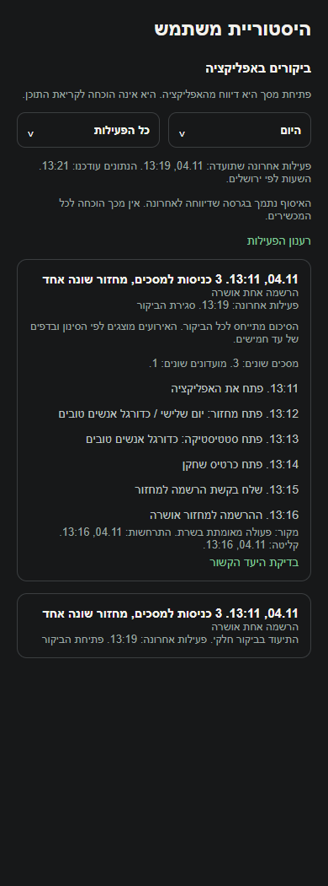

# ביקורים ופעילות בכרטיס המשתמש בפולס

## עצירת מחזור קבוע ללא פעילות, 6.11.2026

נוספה במנגנון השרת עצירה של מחזור קבוע לאחר שלושה מחזורים רצופים ללא פעילות. ההשפעה כאן תחומה לתלות המשותפת בפתיחת מחזורים וניקוי מחזורים ריקים; אין אימות חדש של כל פעולות המסך. מנגנון השרת נפרס והופעל באישור הבעלים; אין צורך בגרסת טלפון חדשה להפעלתו. [ההתנהגות, מסלול הנתונים, הבדיקות ומגבלות ההפעלה](../../changes/2026-11-06-inactive-recurring-rounds.md).

## דירוג בסיס לשחקן ללא דירוג, 6.11.2026

נבדק שינוי תחום במקורות המשותפים של הכוחות האוטומטיים: שחקן ללא דירוג מחושב כ-2.5 מתוך 5, וההסברים תואמים. דירוג מפורש נשמר. אין כאן אימות חדש של כל מצבי הפיצר העצמאי; השינוי מקומי וטרם הופץ. [ההתנהגות, הבדיקות ומגבלות האימות](../rounds/draft-setup.md#דירוג-בסיס-לשחקן-ללא-דירוג-6112026).

## הפעלה לבדיקות שלנו, 5.11.2026

האיסוף הופעל בשרת לשני חשבונות הניהול הקיימים ולחשבון הבדיקה. טימדר 1.1.76 זמינה במסלול הבדיקות הפנימי באנדרואיד ופולס 1.0.105 זמינה לעדכון. אחרי עדכון שני היישומים פותחים מסכים בטימדר; בפולס בוחרים את אותו חשבון ברשימת המשתמשים ופותחים היסטוריה וביקור. משתמשים אחרים וגרסאות ישנות אינם מתחילים לתעד מכוח ההפעלה הזו.

ארבעה אירועים נקלטו ונקראו דרך השרת ושער הניהול, ומשלוח חוזר לא הגדיל את המונים. אין עדיין אימות התקנה וניווט בטלפון או הפצה לאייפון. ההפעלה מחליפה את המצב הכבוי שמתואר בסעיפים הישנים להלן עבור שלושת החשבונות בלבד. [גרסאות, בדיקה וראיות](../../changes/2026-11-05-usage-activity-activation.md).

## תור מדידה בזמן תקלה באחסון, 5.11.2026

גם רצף ניסיונות הרשמה ותוצאותיהם נשמר כעת בתוך גבול הזיכרון של תור המדידה. אם האחסון המקומי נתקע או המקום בתור נגמר, נשמר סימון שחלק מהתיעוד חסר. כשהאחסון חוזר, תוצאות החשבון הקודם נשארות משויכות אליו ואינן נשלחות בשם החשבון החדש. התיקון מקומי והאיסוף החדש עדיין כבוי.

## תיקוני לילה ובדיקת הפעולות, 5.11.2026

נוספה הכנה למדידת חשבונות ייחודיים לכל פעולה, גם כאשר אותו חשבון משתמש בכמה מכשירים. הדוח נטען לפי בחירת מפעיל הפולס ואינו מציג רשימת מבצעים. האיסוף החדש כבוי. השינוי מקומי. [ראיות ומגבלות](../../audits/2026-11-04-system-night/product-measurement.md).

## מדידת פעולות ואמינות נתונים, 5.11.2026

נוספה הכנה למדידת הפעולות ברכיבים המתועדים כאן. בפולס אפשר לראות ביצועים וחשבונות ייחודיים לפי פעולה ותקופה, כאשר קיים כיסוי מדידה. איסוף החשבונות החדש עדיין כבוי והמימוש מקומי. [פירוט והיקף הבדיקות](../../audits/2026-11-04-system-night/product-measurement.md).

## בדיקת לילה, 4.11.2026

אחרי החלפת חשבון על אותו מכשיר, מסך שהיה פתוח בחשבון הראשון אינו נרשם כביקור של החשבון השני. תוכן שיחה ומונח שהוקלד בחיפוש לא הופיעו בתור הבדיקה. האיסוף כבוי כברירת מחדל. [בדיקות עם נתוני הדגמה](../../audits/2026-11-04-system-night/privacy.md).

## חיפוש שחקנים וזמני טעינה, 4.11.2026

שופרה טעינת חיפוש השחקנים, כרטיס שחקן אחר ואיתור פנויים למחזור ברכיבים המשותפים למסך זה. מימוש מקומי שטרם הופץ. [השינוי, המדידות והבדיקות](../../changes/2026-11-04-player-discovery-speed.md).

עודכן: 4.11.2026. מומש מקומית, והאיסוף החדש כבוי כברירת מחדל.

בכרטיס המשתמש, בלשונית ההיסטוריה, נוסף אזור ביקורים שאפשר לפתוח ולסגור. רואים כניסות למסכים, את המחזור והמועדון הקשורים, וניסיון הרשמה בנפרד מהתוצאה. ההיסטוריה העסקית והמסננים שהיו קיימים נשארו.

אפשר לבחור היום, שבוע, שלושים יום או תשעים יום עם סיכומים. העמודים הנוספים נקראים מאותה תמונת נתונים כדי שעדכון לא יזיז רשומות ביניהם. הרשמה חדשה נספרת רק לאחר תוצאה מפורשת מהשרת; תשובה על מצב קיים אינה מוסיפה הרשמה. פתיחת מסך אינה הוכחה לקריאת התוכן, ומידע חסר אינו מוצג כהוכחה שלא היה שימוש.

עדכונים חדשים מופיעים בחיווי שאפשר לפתוח. תקלה בקריאה שומרת את המידע הקודם של אותו משתמש. מעבר למשתמש אחר מונע מתשובה ישנה להחליף את המידע שלו.

מחיקת חשבון מנקה גם את תיעוד השימוש בשרת ואת התור המקומי של החשבון. תוצאה מאוחרת אינה מחזירה את האירוע לתור.

אירוע של כרטיס שחקן נשאר מקושר לאותו שחקן. יעד חסר אינו מוחלף במועדון או בשחקן אחר.

האיסוף נכתב ונבדק מקומית בלבד. הפעלה דורשת הסבר איסוף מתאים, בדיקת הגישה, פריסת השרת והאינדקסים ולקוח תומך. אין שינוי בהרשאות, בנייה או הפצה במשימה זו. לא נערכה בדיקת מכשיר או בדיקה מול שרת פרוס.

[התנהגות, חישובים ובדיקות](usage-activity.md)

הצילום מציג רכיבי מקור עם נתוני הדגמה ומתאם דפדפן. הוא אינו צילום ממכשיר או מנתוני משתמש אמיתי.

## עדכון מקור משותף לבקשות השלמה, 4.11.2026

שינוי הסינון והטיפול בבקשות השלמה תועד בפיצר המחזורים. אין שינוי מכוון במסלול העצמאי המתועד כאן ולא נערך לו אימות מכשיר חדש. [הראיות והמגבלות](../../changes/2026-11-04-filler-requests.md).

## תיקו בשתיים או בשלוש קבוצות, 6.11.2026

נבדק שינוי תחום במקורות המשותפים `functions/src/index.ts`, `src/services/gameService.ts`: נוסף מסלול סיום משחק בתיקו בשתיים או בשלוש קבוצות, עם בחירה ידנית של הקבוצה שנשארת ושמירה במוני התיקו הקיימים. אין שינוי מכוון בפעולות העצמאיות של הפיצר המתועד כאן. בדיקות המסלול מפעילות שירות לקוח, ממירים וגוף שרת במאגר זיכרון; אין בכך הרצה חדשה של מסך זה. המימוש מקומי, ללא הפצה או פריסת שירות השמירה החדש. [התנהגות, נתונים, בדיקות ומגבלות](../../changes/2026-11-06-manual-draw.md).

## תלות משותפת בציון המחזור החדש, 6.11.2026

נוספה תמיכה מקומית בגרסת ציון למחזורי העתיד ובקריאת הרף הקפוא, תוך שמירת המודל של מחזורים קודמים. השינוי כאן תחום לתלות במקורות המשותפים, ואינו אימות חדש של כל המסלול העצמאי. אין פריסה, הסבת נתונים או שינוי ציוני עבר. [התנהגות, בדיקות ומגבלות](../../changes/2026-11-06-shared-evening-score.md).
