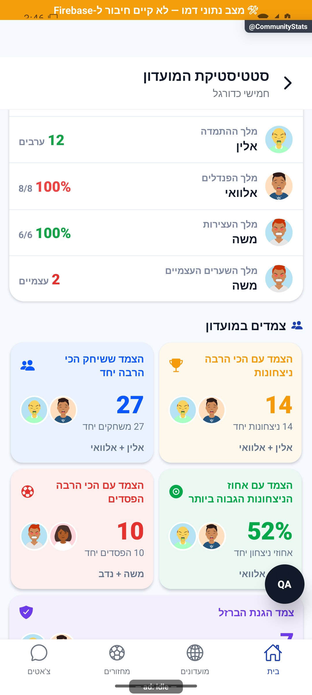
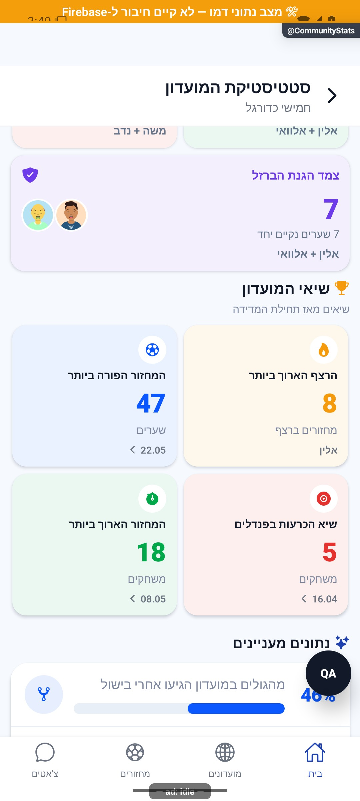
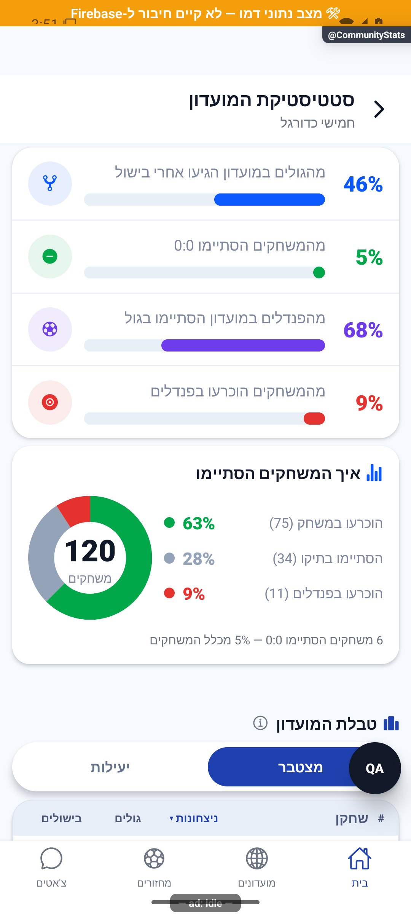
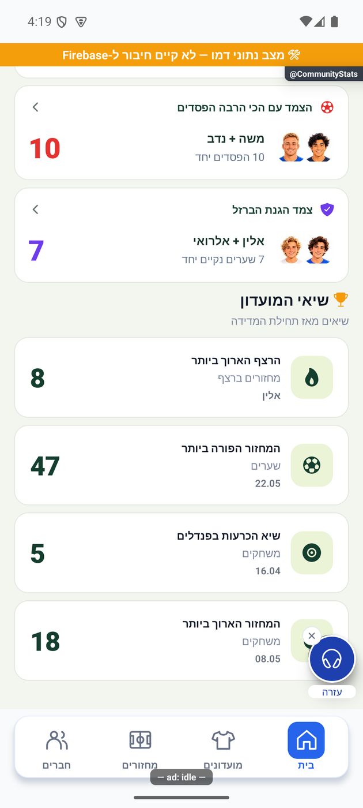
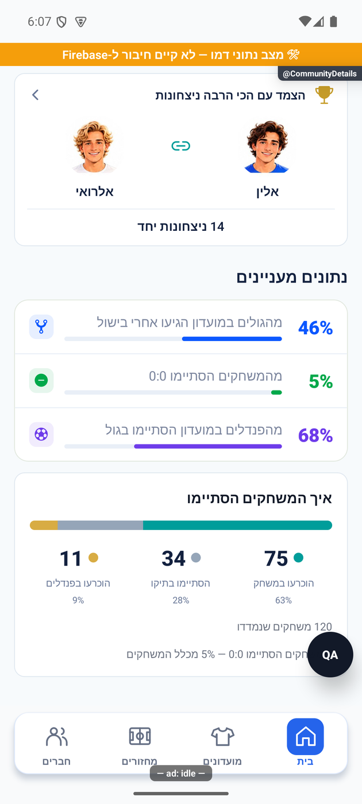

# כימיה, שיאים ונתונים מעניינים

## סבב פולס מאושר — 16.10.2026

PairCard שומר את pairKey, pairMembers, assistsAToB, assistsBToA, winsA, winsB ואת תנאי המדגם. השמות מוצגים בשני תאים נפרדים במקום שורה מעורבת עם סימן כפל. נוסף כפתור סגירה נגיש ו־ScrollSurface בגובה מוגבל. לא נוספו נתונים מחושבים ולא שונה כיוון שיוך הבישולים. הצמדים והשיאים אינם מותנים עוד ב־section=records; מקורות עונה וארכיון נשמרו.

השינוי מקומי וטרם הופץ. [דוח, בדיקות וראיות](../../changes/2026-10-16-pulse-sweep.md).

[להסבר הקצר והפשוט](chemistry-and-records.simple.md)

עודכן: 07.10.2026; מקור: `8e8fde5`. אזורים בתוך `CommunityStats`; חלון צמד `src/components/chemistry/PairCard.tsx`.

## ניווט קודם, הוחלף ב־16.10 — 15.10.2026

הכימיה והשיאים מרוכזים כעת באזור ״צמדים ושיאים״ בתוך מסך הסטטיסטיקות הקיים, במקום באמצע העמוד הארוך. `section='records'` מציג את `ChemistrySection` ואת `ClubRecords`; הנתונים המעניינים ו־`ResultsBreakdown` מוצגים בסקירה. בחירת העונה, מקורות הזוגות, המכנים, גבולות המדגם, תנאי הכיסוי וניווט חלון הצמד/פרטי המחזור נשמרו. המעבר אינו כותב למסד. הגעה לאזור הצמדים צולמה בדמו באנדרואיד; שיאים בהמשך הגלילה, חלון צמד, תקלת רשת ואייפון לא נבדקו מחדש. [המבנה, הבדיקות והראיות](club-leaders-and-table.md).

## כימיה

הרשת מציגה חמש קטגוריות לפי סדר: צמד מנצח, משחקים יחד, אחוז ניצחון יחד, הפסדים יחד ושערים נקיים יחד. זוגות בשוויון נשמרים; קטגוריה ללא מדגם מספק אינה מוצגת. במסך המועדון כל צמד מוצג בשורה ברוחב מלא. תצוגת הרשת נשמרת לקריאות ללא `appearance="club"`. יש שמונה סוגי תואר בחישוב ובחלון הצמד, ולכן הערות ״שישה״ בקוד אינן מקור למספר הכרטיסים.

| סוג חישוב | סף נוכחי | יחידה |
|---|---|---|
| ניצחונות יחד | 5 | משחקונים |
| משחקונים יחד | 10 | משחקונים באותה קבוצה |
| בישולים הדדיים | 3 | בישולים כיווניים בין השניים |
| שער נקי יחד | 5 | משחקונים ללא ספיגה |
| יריבות/יריבות מאוזנת | 10 | משחקונים בקבוצות מנוגדות |
| אחוז ניצחון יחד | 50% ומדגם של 10 | היחס הנבחר בקוד |
| הפסדים יחד | 5 | משחקונים |

אין ״ציון כימיה״ מאוחד. נתוני צמד במועדון מגיעים מ־`communityPairStats`, לא מ־`pairStats` הגלובלי. סדר מזהים קנוני קובע למי שייכים `winsA` ו־`assistsAToB`. חלון הצמד מציג מידע כיווני, נתוני יחד ומול, ואת התארים שהוא מחזיק; השמות נטענים באצווה.

`pairs === undefined` פירושו לקרוא נתונים חיים. `pairs === null` פירושו שהטווח הנבחר עוד לא הגיע, ואסור ליפול לקריאה של העונה הנוכחית תחת כותרת עונה סגורה. איחוד ארכיונים מחבר אותם מדדים. תאריך תחילת כיסוי מוצג כשאין טווח עונה שמסביר אותו. מספר בישולים היסטורי ללא כיוון אינו משולב בפירוט כיווני כאילו הוא סכומו.

## שיאים ומדגם

השיאים הפעילים מגיעים מ־`buildClubRecords`: רצף **נוכחות** במחזורים, המחזור עם הכי הרבה שערים, המחזור עם הכי הרבה הכרעות פנדלים והמחזור עם הכי הרבה משחקים. הרצף אינו רצף ניצחונות, ו״המחזור הארוך״ נמדד במספר משחקים ולא בדקות. אין כאן שיא בישולים או שיא שערים נקיים למחזור. נתוני מחזור מגיעים מסיכומים ומכיסוי ידוע; אין לשחזר מתוך מוני חיים בלבד. כרטיסים עם מזהה מחזור פותחים את המחזור; רצף עם מחזיק יכול לפתוח כרטיס שחקן. ערך חסר/לא חיובי אינו יוצר שיא, ושם מחזיק חסר מסיר את הרצף. רצף החיים אינו מוצג כאילו הוא שיא עונה נבחרת.

שלושה נתונים מעניינים כוללים יחסי שערים/בישולים, משחקונים ללא שערים והבקעת פנדלים מתוך ניסיונות. הכרעות פנדלים מוצגות בתרשים התוצאות בלבד. המכנה `countedRounds` נשמר בחישוב; אין שימוש עיוור ב־`totalRounds` כמכנה לכל המדדים. מדדי מועדון אינם מציגים עוגת ניצחונות מול הפסדים של כל הקבוצות כאילו היא הישג אחד.

## קבצים ובדיקות

`src/utils/clubChemistry.ts`, `pairOrientation.ts`, `eveningRecords.ts`, `clubRecords.ts`; `src/services/clubChemistryService.ts`, `roundSummaryService.ts`; `src/components/chemistry/ChemistrySection.tsx`, `PairCard.tsx`, `src/components/club/ClubRecords.tsx`; `src/screens/communities/CommunityStatsScreen.tsx`. בדיקות `clubChemistry`, `clubChemistryReal`, `clubChemistryParity`, `shoshiChemistryScopes`, `seasonArchivePairs`, `pairOrientation`, `seasonCoverage` ב־`tests/logic`.

## ראיות ופערים

הקוד נקרא ובהשלמת המיפוי צולמו גם הכימיה, חלון הצמד והשיאים בדמו. אין צילום נוכחי של צמד שוויון או אורח. מאז 13.10.2026 גם ChemistrySection משתמש בקריאה מחמירה ומפריד כשל מתוצאה ריקה. ראו תיקון הטעינה להלן; לא הורץ כשל רשת חי.

בדמו הצמד מציג 27 משחקים יחד, 14 ניצחונות, 9 הפסדים, 7 שערים נקיים ו־9 בישולים בכיוונים 6 ו־3. בשיאים נראים רצף נוכחות 8, מחזור עם 47 שערים, 5 משחקים שהוכרעו בפנדלים ו־18 משחקים במחזור. אלה מדדי דמו ולא נתוני ייצור.

גרירה ארוכה מהידית בחלון הצמד לא סגרה אותו בצילום הבדיקה; כפתור חזרה סגר. [צילום אחרי גרירה](../screenshots/CommunityStats-pair-after-drag.jpg) מתעד את חלון PairCard, שממומש באמצעות Modal ולא באמצעות SpringSheet. אין בכך בדיקת כל החלונות המשותפים או קביעה לגבי גרירה בתוך התוכן.

מקורות 084/085 הם אפיון, כולל רעיונות שלא מומשו. אין להציג ״שערים יחד״ כמקור נתונים קיים רק מפני שהופיע בסקיצה. מקור 083 כלל שיאים מצומצמים, והוחלף בתוספות 082; סדר המספרים של הארכיון אינו סדר תאריכי ההחלטות.

## הצעות בלבד

לצרף הגדרת מדגם ומדד בלחיצה, במקום טקסט ארוך בכל כרטיס; להנפיש פסים ומדדים רק עם מידע סופי; להוסיף הדגשה קצרה לשיא חדש מאומת. לא להכתיר צמד אחרי משחקון יחיד ולא להמציא דירוג כימיה מספרי.

בדמו תרשים התוצאות מחלק 120 משחקונים מתועדים לשלוש קבוצות נפרדות: 75 הוכרעו במשחק, 34 בתיקו ו־11 בפנדלים. ששת משחקוני 0:0 נכללים בקבוצות הללו ואינם פלח נוסף. הרצף בטווח עונה מגיע מנתוני אותה עונה; בכל השנים מגיע רצף החיים.

## פירוט טכני נוסף — זרימה, חישוב ונקודות שינוי

`pairsFromRounds` בונה צמדים מכל קבוצה במשחקון; `pairKey` ממיין את המזהים, ו־`mergePairs` מחבר מונים בלי לאבד כיוון בישול. שער עצמי אינו בישול ושחקן אינו מבשל לעצמו. שער נקי נגזר מאפס שערי יריבה; גם תיקו 0:0 שהוכרע בפנדלים יכול להיחשב נקי.

ספי `CHEMISTRY_MIN`: צמד מנצח 5 ניצחונות יחד, קבועים 10 הופעות יחד, קטלני 3 בישולים, חומה 5 נקיים, יריבות 10 מפגשים. אחוז הצמד בקטגוריית היעילות מחייב לפחות 10 יחד ומשתמש ב־`winsTogether/sameTeam`; 11 ניצחונות מתוך 20 יחד הם 55%, בעוד 9 מתוך 9 אינם מדגם מספיק. אין להעתיק לכאן את מכנה ההשוואה שמוציא תיקו.

`pickChemistry` מונע מאותו צמד להיבחר גם כצמד מנצח וגם כמפסיד; שוויון יכול להחזיר כמה צמדים. יריבות מאוזנת מצמצמת הפרש ניצחונות ומעדיפה מדגם גדול. `undefined` במקור הצמדים מפעיל קריאה חיה, ואילו `null` מסמן טעינה; שינוי ההבחנה יכול לגרום קריאה מיותרת או נתונים מהטווח הלא נכון. בדיקות `clubChemistry`, `pairOrientation` ו־`seasonArchivePairs` מנויות לעיל.

הפירוט מתאר את הקוד שנקרא, ולא בדיקת כתיבה או הרשאות בסביבת הייצור. יש לקרוא את הקוד הממוקד וההפרש מאז מקור המיפוי לפני תיקון; בדיקות המוזכרות כאן לא הורצו מחדש לצורך עריכת התיעוד.

## עדכון 8.10.2026 — תנועה ותיקוני דיווחים

הוסרה רק שורת `shootout` מרשימת הנתונים המעניינים ב־`CommunityStatsScreen`, וגם התנאי שלה מ־`funRowCount`. `ResultsBreakdown`, `shootoutRounds`, `countedRounds` וחישוב אחוז ההבקעה נשארו ללא שינוי. בדמו: 75 הכרעות במשחק, 34 תיקו ו־11 בפנדלים מתוך 120; 68% הבקעת פנדלים הם מדד אחר.

**ראיה ומגבלות:** האזור הורץ ונצפה בדמו. התרשים נשמר והכפילות הוסרה; אין אימות מספרי מול חשבון הייצור.

בדיקת הטיפוסים ו־183 חבילות הבדיקות עברו, 2,752 בדיקות. מצב המקור: `9ec0dfd` עם שינויים מקומיים; אין גרסה חדשה שפורסמה. [יומן השינוי וההקלטות](../../changes/2026-10-08-motion-and-pulse.md).

### קריאה מחמירה לסכום היסטורי — 10.10.2026

נוסף פרמטר `strict=false` ל־`clubChemistryService.get`. במצב מחמיר כל כשל נזרק במקום להפוך לתוצאה ריקה. סטטיסטיקת כל הזמנים משתמשת ב־`true` כדי לא לסכם ארכיונים בלי הזוגות של העונה החיה. שאר הצרכנים שומרים את ההתנהגות הקיימת. בדיקות שירות מכסות כשל מול תוצאה ריקה אמיתית: `tests/logic/clubChemistryStrict.test.ts`.

## תיקון טעינה — 13.10.2026

ChemistrySection קורא get(groupId,true). כשל מציג ChemistryLoadNotice עם ניסיון חוזר, ולא chemistryEmpty. מצב תוצאה כולל groupId ומקור pairs; שינוי מועדון/חלון מסתיר תוצאה ישנה כבר ברינדור לפני אפקט הניקוי. אפקט חדש מאפס שמות וכרטיס פתוח; alive חוסם תשובה מאוחרת. null נשאר טעינה ללא קריאה חיה; מפה ריקה שהתקבלה בהצלחה נשארת ריקה אמיתית. אין שינוי במונים, בספים או בכותרות התארים.

חמש בדיקות chemistrySectionLoading מפעילות את הרכיב והאפקטים עם כפילי React/שירות: כשל וניסיון חוזר, תשובות בסדר הפוך, מעבר מועדון לפני אפקט, היסטוריה בהמתנה וארכיון ריק אמיתי. [הודעת שגיאה](../screenshots/overlays-final-chemistry-error-2026-10-13.png) נצפתה כמציג אמיתי בכלי הדמו; אינה הוכחת כשל שאילתה במסך המלא.

## עיצוב מלא — 15.10.2026

`CommunityStatsScreen` מעביר `appearance="club"` לצמדים, שיאים ותוצאות. הצמדים מקבלים כותרת, צמד דיוקנאות, שמות וערך בשורה רחבה. לחיצה עדיין מתעדת פתיחת `PairCard` ופותחת את אותו חלון עם `data.pairs`, `data.picks`, `person` ו־`since`. שיאים ברצועות לבנות משתמשים באותה הכרעת `gameId` לעומת `holderUid` לניווט, ובאותו איסור לחיצה כשהיעד חסר. תוצאות מוצגות בפס מקטעים על פי `arcs.fraction`; המקרא משתמש באותו `pctOf`, ונתון משחקים ללא שערים נשאר נפרד מן המקטעים.

לא שונו ספי מדגם, חישובים, נתוני מקור, גבולות עונה או התנהגות חסר/כשל. נצפו הצמדים בגלילה באנדרואיד בדמו; מקור הראיות והמגבלות ב[תיעוד המסך](club-leaders-and-table.md). חלון צמד וניווט משיא לא הורצו מחדש. תצוגת ארבעה שיאים נצפתה בפועל: רצף 8 מחזורים, מחזור פורה עם 47 שערים, 5 משחקים שהוכרעו בפנדלים ומחזור של 18 משחקים. אלה נתוני דמו בלבד. 

## מימוש הסקיצה בלשונית הסטטיסטיקה — 15.10.2026

`appearance="club"` מציג את שני דיוקנאות השחקנים וסמל `link-outline` ביניהם, ללא חץ מסירה. הכותרת והערך מגיעים מן `CHEMISTRY_LABEL`, `headline` ו־`metricText`. לחיצה מפעילה את אותו אירוע מדידה ופותחת `PairCard` עם אותם מזהים, זוגות, תארים ותאריך כיסוי. `preview=true` מסנן את ההצגה בלבד ל־`winningDuo` בסקירה; אין שינוי ב־`GRID_KINDS`, בספי `pickChemistry` או במקור הנתונים. כאשר אין זוכה לתצוגה המקוצרת מוחזר מקטע ריק, לא מערך נתונים ריק ולא טענת קריאה שהצליחה. מצבי כשל/טעינה נשארים של השירות הקיים.

`ClubRecords` מציג רשימה משותפת ופס דשא; תנאי היעד נשארים `gameId` או `holderUid`. `ResultsBreakdown` משתמש באותם `arcs`, עם צבע עקבי בין המקטע למקרא, מספרים, אחוזים ומספר המשחקים שנמדדו. כלל אי־הכללת 0:0 כמקטע רביעי נשמר. מקור כל הנתונים והמכנים לא השתנה. [מסלול הבדיקה, צילומים ומגבלות](club-leaders-and-table.md).

## ניצול רוחב כרטיס הצמד — 15.10.2026

בענף `appearance="club"` של `ChemistrySection` הדיוקנאות גדלו מ־38 ל־72. `clubPairBody` ממלא את רוחב הכרטיס; שני `clubPairPlayer` עם `flex: 1` ו־`minWidth: 0` מציגים כל אחד דיוקן ושם עד שתי שורות. `clubPairLink` ברוחב 28 ובגובה 72 ממורכז בין הדיוקנאות. השם המשולב הוסר מהתצוגה החזותית, אך שני השמות עדיין מופיעים בתווית הנגישות. סמל התואר והחץ ממוקמים בשורת הכותרת, וההישג בפס תחתון מופרד בקו דק. אין חץ מוחלט שתופס את מרכז הכרטיס לצד שחקן.

הפריסה משותפת לצמדים המלאים ול־`preview` בסקירה. שוויון נשאר בשורה נפרדת. לא השתנו `pairMembers`, `pickChemistry`, `GRID_KINDS`, `headline`, `metricText`, הספים, המכנים, מקור הנתונים, טעינה, שגיאות או פתיחת `PairCard`. אין כתיבה לנתוני המועדון. תצוגת הרשת ללא `appearance="club"` נשארת כפי שהייתה.

מקור הבדיקות: `artifacts/club-pair-layout-tests.log`. הצילומים מהלשונית המוטמעת ב־`CommunityDetails` באימולטור אנדרואיד בדמו. אייפון, מכשיר פיזי, שמות ארוכים וגופן מוגדל לא הורצו בבדיקה זו.

אימות השינוי: בדיקת טיפוסים נקייה, 327 חבילות / 3,876 בדיקות עברו, ובדיקת התיעוד ללא כשלים. נצפו שתי התצוגות באימולטור אנדרואיד בדמו: אזור הצמדים והצמד המנצח בסקירה.

## סמל לחיצת יד קודם — 15.10.2026

סמל החוליות הוחלף בלחיצת יד בקו טורקיז, בין שני הדיוקנאות הגדולים. הסידור והשמות נשמרו, וגם הצמד המנצח בסקירה משתמש באותו סמל.

מימוש: `MaterialCommunityIcons` עם `name="handshake-outline"`, גודל 26 וצבע `#009D9A`, בתוך `clubPairLink` הקיים ברוחב 28 וגובה 72. זו החלפת קישוט בלבד בענף `appearance="club"`; לא שונו מקורות, ספים, נוסחאות, נגישות הכרטיס או ניווט. מקור בדיקות: `artifacts/club-pair-icon-tests.log`. צילום מתוך `CommunityDetails > stats` בדמו באנדרואיד; אייפון ומכשיר פיזי לא נבדקו.

## סגנון קודם: לחיצת יד עם תנועה — 15.10.2026

הסמל הוחלף ללחיצת יד אופקית וברורה יותר, בתוך עיגול טורקיז בהיר. הידיים מבצעות לחיצה ונענוע קצר ואז נחות. הפריסה נשמרת גם בצמד המנצח בסקירה. כשהלשונית מוסתרת, היישום ברקע, גוללים או מוגדרת הפחתת תנועה — מוצג סמל יציב.

`PairHandshake.tsx` מציג `FontAwesome5 name="handshake"`, בגודל 27 ובעיגול 42. `clubPairLink` הורחב מ־28 ל־44 כדי להכיל את הסמל; הדיוקנאות נשארו 72. `motionEnabled` מועבר מ־`CommunityStatsScreen` בשתי הקריאות בהתאם ל־`props.active !== false`. רכיב התנועה משתמש ב־`useAmbientMotion` וב־`cancelAnimation` בכל שינוי ובפירוק.

התנועה סופית: השהיה של 400 ועוד 120 אלפיות שנייה לכל אינדקס כרטיס, ואז `withTiming` מ־0 ל־1 במשך 1,600 אלפיות שנייה. מעטפת סינוס מחזירה את הסמל למנוחה; נענוע עד 2.5, סיבוב עד 5 מעלות ולחיצה אופקית עד 6%. אין לולאה, אין טיימר מחזורי ואין שינוי נתונים או פעולה עסקית בסיום התנועה. אין מעקב חיתוך לפי פיקסלים בחלון הגלילה; גם כרטיס מחוץ לחלון יכול לקבל את הפעימה הסופית, ללא עבודה רציפה.

נבדקו שני פריימים אמיתיים של הסמל בזווית/לחיצה שונות. [השוואת פריימים](../screenshots/club-pairs-handshake-motion-frames-2026-10-15.png) היא חיתוך והגדלה מתוך צילום האימולטור. רצף מקור בן 16 פריימים והדגמה נמצאים ב־`artifacts/club-pair-handshake-motion.gif`; החזרתיות בקובץ ההדגמה אינה לולאת אנימציה ביישום. הגדרת הפחתת תנועה לא הופעלה ידנית באנדרואיד, אך הגנות התנועה והביטול נבדקו ביחידות ב־`tests/logic/pairHandshakeMotion.test.tsx`. מבחן טעינת הצמדים מדמה רק את רכיב הקישוט כדי לא לטעון תלויות מקוריות; בדיקות טעינה, שגיאות וביטול בקשה נשמרו.

מקור הבדיקות המלאות: `artifacts/club-pair-handshake-motion-tests.log`. לא שונו חישובים, מכנים, ספי צמדים, זוכים, ניווט או נתוני מסד. אייפון, מכשיר פיזי, גופן מוגדל ושמות ארוכים לא נבדקו.

אימות סופי: בדיקת טיפוסים נקייה, 328 חבילות / 3,880 בדיקות עברו, ובדיקת התיעוד ללא כשלים. בדיקות התנועה מכסות לשונית מוסתרת, שער הגבלת תנועה ותנועה סופית עם ביטול בפירוק.

## סמל ההישג בין השחקנים — 15.10.2026, התצוגה הנוכחית

בין הדיוקנאות מופיע כעת סמל קטן שמייצג את ההישג: גביע לניצחונות, מגרש למשחקים יחד, מטרה לאחוז ניצחון, שער לשערים נקיים, וריבוע מעוגל עם סימן × להפסדים. כל הסמלים באותו טורקיז ובמעט פרטים. הסמל הוסר מהכותרת כדי שלא יופיע פעמיים. הדיוקנאות הגדולים, השמות וההישג בתחתית נשמרו, גם בצמד המנצח שבסקירה.

`PairChemistryIcon.tsx` החליף את `PairHandshake.tsx` שהוסר. `kind` נלקח ישירות מן הקטגוריה הקיימת ב־`ChemistrySection`, ללא חישוב נוסף. הרכיב מצייר צורות SVG מקומיות בגודל 32, בצבע `#009D9A`, בתוך תא שקוף בגודל 36; אין תמונת סקיצה, גופן חיצוני או רקע עיגול. `winningDuo` מצייר גביע, `regulars` מגרש, `bestRatio` מטרה, `wall` שער ו־`mostLosses` ריבוע עם X. שאר הקריאות ללא `appearance="club"` נשארו כפי שהיו.

`motionEnabled` והגנות `useAmbientMotion` נשמרו. לסמלים החיוביים הדגשה סופית ועדינה: גודל גדל עד 6% וחוזר, ובגביע עלייה עד יחידה אחת. אין עוד נענוע לחיצת יד. סמל הפסדים תמיד יציב. השהיה 400 ועוד 120 לאינדקס; משך 1,600 אלפיות שנייה; ביטול בשינוי נראות/רקע/גלילה/הפחתת תנועה ובפירוק. אין לולאה או פעולה עסקית בסיום.

המבחן `pairChemistryIconMotion.test.tsx` החליף את מבחן לחיצת היד ומכסה תצוגה מוסתרת, הגבלת תנועה, ביטול ותנועה סופית; נוסף מקרה הפסדים יציב. מבחני טעינת הצמדים ממשיכים לדמות רק את רכיב הקישוט. לא שונו נתונים, מכנים, זכאות, שוויון, סדר הקטגוריות, נגישות הכרטיס או פתיחת `PairCard`. מקור הבדיקות: `artifacts/club-pair-category-icons-tests.log`. הצילומים מתוך לשונית הסטטיסטיקה ב־`CommunityDetails` באימולטור אנדרואיד בדמו; אייפון, מכשיר פיזי, שמות ארוכים וגופן מוגדל לא הורצו.

אימות: בדיקת טיפוסים נקייה, 328 חבילות / 3,881 בדיקות עברו. נצפו חמשת הסמלים בכרטיסי הצמדים בדמו באנדרואיד.

## סגנון קודם: שפה אחידה לסמלי הנתונים המעניינים — 15.10.2026

`FootballStatGlyph` הוא כעת ייצוא סטטי מתוך `PairChemistryIcon.tsx`, עם `kind`, `size` ו־`color`. נתוני הבישולים משתמשים ב־`assist` (כדור ומסירה), משחקים ללא שערים ב־`wall` (שער ריק), והבקעת פנדלים ב־`bestRatio` (מטרה). אלו שמות צורות בלבד, לא מיון נתונים או חישוב חדש. `FunDonutRow` מצייר את הסמל בגודל 24 ובצבע `#009D9A`, ללא הרקע הצבעוני הישן; כששיעור לא ידוע נשמר צבע אפור `#94A3B8`.

שימוש חוזר באותן צורות שער ומטרה שומר התאמה לסמלי הצמדים. הייצוא הסטטי אינו מפעיל תנועה או hooks. קריאת הצמדים ממשיכה להשתמש במעטפת התנועתית הקיימת עם ברירת מחדל בגודל 32 ובטורקיז. אחוזים, פסי המדדים, צבעי הפס/מספר, תנאי `measured`, `countOnly`, סינון שורות ריקות, מכנים וטקסטים לא השתנו. אין כתיבה או ניווט חדש.

צילום מתוך סקירת לשונית הסטטיסטיקה ב־`CommunityDetails` באנדרואיד בדמו: 46% בישולים, 5% משחקים ללא שערים ו־68% הבקעת פנדלים. מקור הבדיקות: `artifacts/club-interesting-fact-icons-tests.log`. אייפון, מכשיר פיזי, גופן מוגדל ומצב מכנה חסר לא הורצו ידנית בבדיקה זו.

אימות סופי: בדיקת טיפוסים נקייה, 328 חבילות / 3,881 בדיקות עברו, ובדיקת התיעוד ללא כשלים.

## הסקיצה המאושרת לנתונים המעניינים — 15.10.2026

מחליפה את סמלי המסירה, השער הריק והמטרה מהסבב הקודם. `FootballStatGlyph` מצייר כעת `assist` כנעל עם כדור וקשת מסירה; `scoreless` כלוח תוצאה 0:0 באמצעות צורות מקומיות, ללא תלות בכיווניות טקסט; ו־`penalty` כשער עם כדור וסימן אישור. `FunDonutRow` משתמש בשלוש צורות אלו בגודל 24 ובצבע `#009D9A`; כששיעור אינו ידוע הצבע נשאר `#94A3B8`. אין אנימציה בסמלים אלו. צורות `wall` ו־`bestRatio` שבצמדים לא שונו.

מסלול הכניסה: פרטי מועדון > סטטיסטיקה > סקירה > נתונים מעניינים. מקורות הנתונים, אחוזים, מכנים, צבעי המספרים והפסים, `measured`, `countOnly`, סינון שורות, טעינה ושגיאות נשמרו. אין כתיבה, הרשאה או ניווט חדש.

בדיקת טיפוסים נקייה; 328 חבילות ו־3,881 בדיקות עברו, מקור: `artifacts/club-fact-semantic-icons-tests.log`. נצפו הסמלים וכיווניות השורות באימולטור אנדרואיד במצב דמו מנותק: 46% בישולים, 5% משחקים ללא שערים, 68% פנדלים. אייפון, מכשיר פיזי, גופן מוגדל ומכנה חסר לא הורצו ידנית בסבב זה. שינוי מקומי שטרם הופץ.

הפצה 15.10.2026: השינויים המקומיים המתוארים בסבב זה נכללו בגרסה הפנימית 1.1.52 / 285 באנדרואיד. [ראיות וגבולות](../../changes/2026-10-15-internal-1.1.52.md).

## צילומי הסבב המאושר — 16.10.2026

