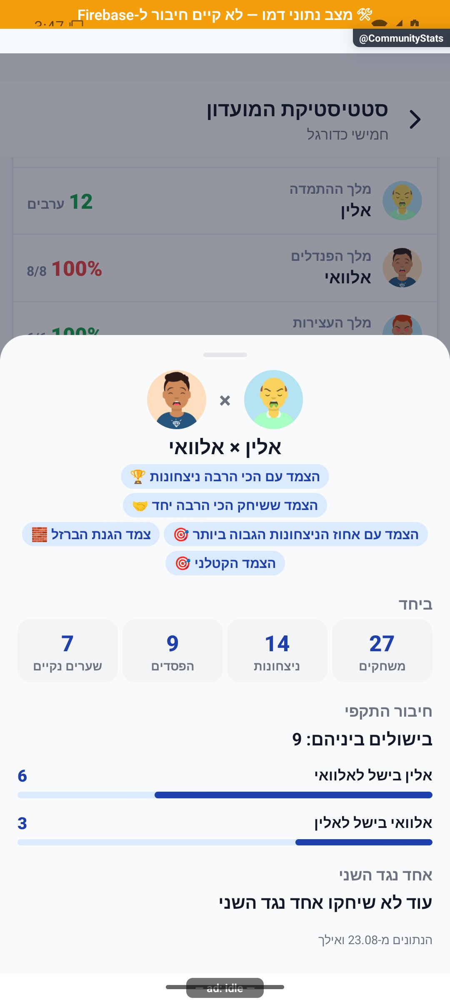
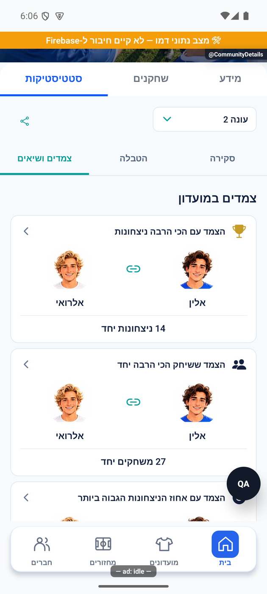
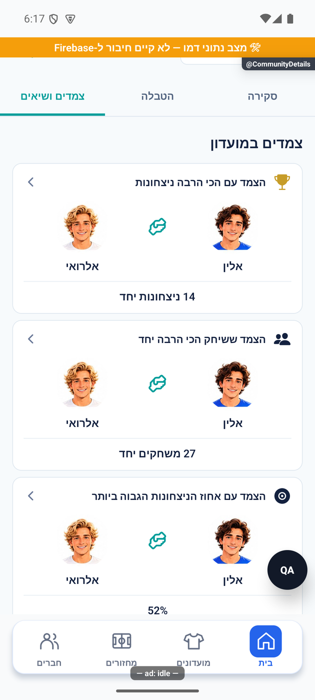
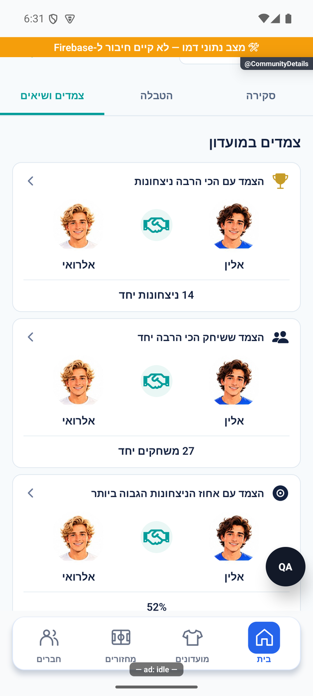
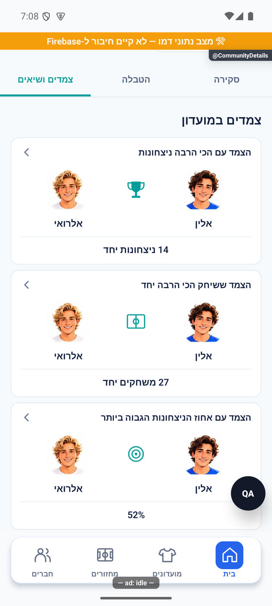
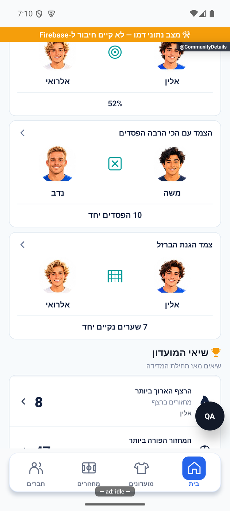
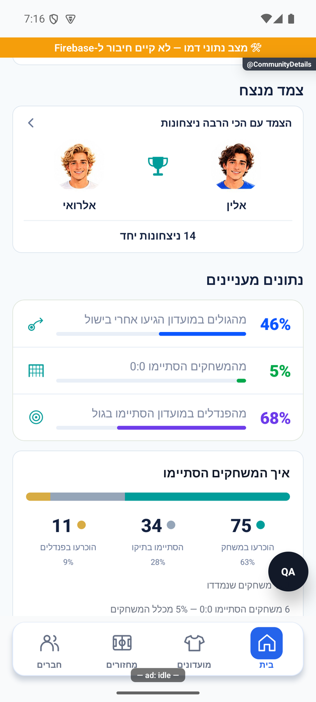
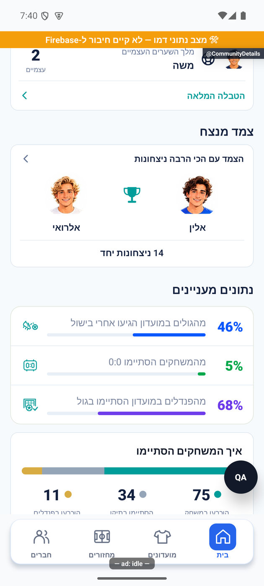
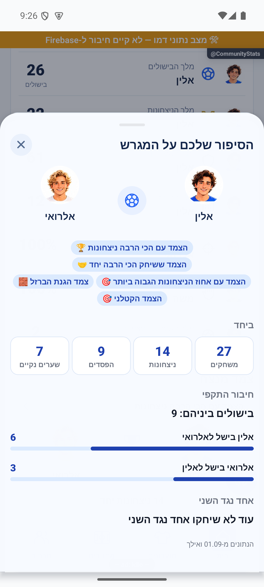

# הצמדים והשיאים של המועדון

## אימות מול שרת אמיתי והגבלת המתנה — 20.10.2026

במועדון הבדיקות נבדקו מול השרת האמיתי הפעלת עונה עם שבעה מחזורים, סגירה ידנית, חלוקת שמונה תארים ופתיחת עונה שנייה ריקה. הנתונים נשמרו בארכיון ובכל הזמנים. שירותי העונות נפרסו באישור; תיקון נוסף בלקוח מציג אפשרות לנסות שוב אחרי30 שניות של קריאה תקועה, והוא עדיין דורש הפצת לקוח. לא המתנו24 שעות בפועל ולא בדקנו כאן סגירה של עונה קצרה.

[הבדיקה, המקור, הצילומים והמגבלות](../reviews/2026-10-20-seasons-live.md).

## תיקון פערי העונות — 20.10.2026

כל חמשת הפערים בביקורת טופלו מקומית: אכיפת סוף חלון התיקונים, חסימת הארכה מאוחרת, אימות ללא מועד, התאמת מועד לשיוך ורענון הסטטיסטיקות. תוקנה גם פתיחת סיכום עונה פעילה שנכשלה מול ההרשאות. אין שינוי בכללי התארים או בשלוש בחירות ההפעלה. אפשר לדחות מחזור שלא התקיים גם בלי להמציא לו תאריך; אישור שהתקיים עדיין דורש מועד. התיקון טרם הופץ.

[דוח תיקונים, בדיקות ומגבלות](../reviews/2026-10-20-seasons-fixes.md).

## סבב פולס מאושר — 16.10.2026

הצמדים והשיאים זמינים בגלילה בתוך הסטטיסטיקות, ללא לשונית פנימית נפרדת. חלון הצמד מציג שמות נפרדים, תמונות, נתונים וכפתור סגירה ברור. אפשר לגלול בתוך החלון בעת הצורך.

השינוי מקומי וטרם הופץ. [דוח, בדיקות וראיות](../../changes/2026-10-16-pulse-sweep.md).

כאן מגלים אילו צמדים מצליחים יחד ומי קבעו שיאים במועדון. אפשר לפתוח כרטיס צמד ולראות את הנתונים שעליהם מבוסס ההישג.

בתוך לשונית הסטטיסטיקה בפרטי המועדון בוחרים ״צמדים ושיאים״ כדי להגיע לנתונים האלה ישירות. נתונים מעניינים ותרשים תוצאות המשחקים נמצאים באזור ״סקירה״. בחירת העונה משותפת לכל האזורים.

[לפירוט המעמיק](chemistry-and-records.md)

## עדכון 8.10.2026 — תנועה ותיקוני דיווחים

נתון המשחקים שהוכרעו בפנדלים מופיע רק בתרשים. הנתונים המעניינים מציגים בישולים, משחקים ללא שערים ואחוז הבקעת פנדלים.

### עדכון 10.10.2026

בסיכום כל הזמנים, תקלה בטעינת צמדי העונה הנוכחית לא תוצג בטעות כאילו לא היו צמדים.

### תיקון 13.10.2026

אם נתוני הצמדים לא נטענו, מוצגת הודעה עם ״נסה שוב״. התקלה אינה מוצגת כאילו לא שיחקתם מספיק. מעבר למועדון או לעונה אחרת לא מציג לרגע את הצמדים הקודמים.

## עיצוב המסך — 15.10.2026

הצמדים מוצגים כעת בשורות רחבות עם שני דיוקנאות, שמות ומספר בולט. גם שיאי המועדון מקבלים שורה מלאה. תרשים התוצאות בסקירה הוא פס צבעוני עם מספרים ואחוזים. בחירת העונה, תנאי ההצגה והחישובים נשמרו.

## הסקיצה המאושרת — 15.10.2026

כרטיסי הצמדים מציגים שני דיוקנאות וביניהם סמל חיבור בטורקיז, ואת השמות וההישג מתחתיהם. הצמד המנצח מופיע גם בסקירה כאשר יש לו מספיק נתונים. כל הקטגוריות הזכאיות נשמרות, כולל הפסדים יחד. השיאים מופיעים כרשימה עם פס דשא קטן, ותרשים התוצאות בסקירה כולל מספרים ואחוזים לפי המשחקים שנמדדו.

## דיוקנאות גדולים וניצול רוחב — 15.10.2026

בכרטיסי הצמדים לכל שחקן יש כעת דיוקן גדול ושם מתחתיו. שני השחקנים פרוסים לרוחב הכרטיס, עם סמל החיבור ביניהם, וההישג מופיע בפס נפרד בתחתית. אותו סידור מופיע גם בצמד המנצח שבסקירה.

## סמל לחיצת יד קודם — 15.10.2026

סמל החוליות הוחלף בלחיצת יד בקו טורקיז, בין שני הדיוקנאות הגדולים. הסידור והשמות נשמרו, וגם הצמד המנצח בסקירה משתמש באותו סמל.

## סגנון קודם: לחיצת יד עם תנועה — 15.10.2026

הסמל הוחלף ללחיצת יד אופקית וברורה יותר, בתוך עיגול טורקיז בהיר. הידיים מבצעות לחיצה ונענוע קצר ואז נחות. הפריסה נשמרת גם בצמד המנצח בסקירה. כשהלשונית מוסתרת, היישום ברקע, גוללים או מוגדרת הפחתת תנועה — מוצג סמל יציב.

## סמל ההישג בין השחקנים — 15.10.2026, התצוגה הנוכחית

בין הדיוקנאות מופיע כעת סמל קטן שמייצג את ההישג: גביע לניצחונות, מגרש למשחקים יחד, מטרה לאחוז ניצחון, שער לשערים נקיים, וריבוע מעוגל עם סימן × להפסדים. כל הסמלים באותו טורקיז ובמעט פרטים. הסמל הוסר מהכותרת כדי שלא יופיע פעמיים. הדיוקנאות הגדולים, השמות וההישג בתחתית נשמרו, גם בצמד המנצח שבסקירה.

## סגנון קודם: סמלי הנתונים המעניינים — 15.10.2026

גם סמלי הנתונים המעניינים בסקירה עודכנו: כדור עם מסירה לבישולים, שער ריק למשחקים ללא שערים ומטרה לפנדלים. הסמלים קטנים ובאותו טורקיז של הצמדים, ללא רקעים צבעוניים. האחוזים ופסי המדדים נשמרו.

## הסמלים המאושרים לנתונים המעניינים — 15.10.2026

הסגנון הקודם הוחלף לפי הסקיצה שאושרה: נעל וכדור לשערים מבישול, לוח 0:0 למשחקים ללא שערים, ושער עם כדור וסימן אישור להבקעת פנדלים. הסמלים קטנים, נקיים ובטורקיז אחיד. המספרים והפסים נשמרו.

הפצה 15.10.2026: השינויים המקומיים המתוארים בסבב זה נכללו בגרסה הפנימית 1.1.52 / 285 באנדרואיד. [ראיות וגבולות](../../changes/2026-10-15-internal-1.1.52.md).

## צילומי הסבב המאושר — 16.10.2026

## צמדי העונה — 18.10.2026

אותם צמדים וחישובים זמינים גם בלשונית המועדון בסיכום העונה, בתצוגת שורות קומפקטית. בעונה שהסתיימה הנתונים והשמות נשארים של אותה עונה. קטגוריה ללא מספיק נתונים אינה מוצגת. [לסיכום העונה](season-summary.simple.md). העדכון מקומי וטרם הופץ.

שורות הצמדים בסיכום העונה הוקטנו כדי שיותר צמדים יופיעו יחד על המסך, עם תמונות שחקנים קטנות וסמל צבעוני בין השניים. המספרים, ספי ההשתתפות והפתיחה לפירוט נשמרו.

## הבהרת התצוגה וסיכום אישי — 19.10.2026

הרכיבים והמלל המשותפים של סיכום העונה עודכנו: ניסוח ברור לניצחונות ולהפסדים, אוואטרים למובילים וכפתור ״סיכום העונה שלי״ בעיצוב כרטיס. [פירוט וראיות בסיכום העונה](../statistics/season-summary.md). השינוי מקומי וטרם הופץ.

## מלך הניצחונות לפי אחוז — 19.10.2026

תואר מלך הניצחונות עבר לאחוז ניצחונות עם סף השתתפות במחצית ממחזורי העונה. היחידה מועברת במידע המשותף; ספירות היסטוריות נשמרות. [החוזה והראיות בסיכום העונה](../statistics/season-summary.md). השינוי מקומי וטרם הופץ.
