# סטטיסטיקת מועדון — מונים, מובילים ואליפות

## קריאת סטטיסטיקה אמינה — 18.10.2026

קריאות `getCommunityTotals/getCommunityChampionship` אינן מחליפות שגיאה באפס או במערך ריק. צרכני הסטטיסטיקות מטפלים בכשל; לא שונו יחידות, מיון, עונות או נוסחאות. אימות הנתונים החדש עוקב משמירת המשחק דרך `gamePlayerStats`, `communityPlayerStats`, היסטוריות וסיכום חתום. אורחים נכללים בשערים/בישולים לפי החוזה הקיים; נתוני פנדלים אישיים לאורחים עדיין אינם נזקפים אוטומטית, אף שהבעיטות נשמרות בהיסטוריה. זו מגבלת מדיניות שיש להכריע בה, ולא תיקון שנעשה בסבב. ראיות קוד: `finalStatsAuditContracts` ו־`finalStatsAuditCommunityRead`.

[דוח הביקורת, הבדיקות וגבולות האימות](../../changes/2026-10-18-preproduction-end-to-end.md).

## רכיבי תצוגה משותפים עם סטטיסטיקות המחזור — 17.10.2026

`ClubStatsSummary` ו־`ClubStatsAwards` משמשים כעת גם את `MatchStatsTab`. המועדון ממשיך להעביר `evenings`, משחקים, שערים ובישולים, עם אותה תצוגה וחישוב; מצב המחזור מעביר `shootouts` במקום `evenings`, ושני המצבים בלעדיים בטיפוס. הסיכום תומך גם במקף לצורך תצוגה מקדימה של מחזור, בלי לפרש אותו כאפס.

`ClubStatsAward` שומר את חוזה המובילים הקיים ומרחיב אותו ב־`tiedUsers` ובזהות אופציונלית למציין מקום. במועדון כל פריט ממשיך להכיל שחקן יחיד וערך מספרי; לחיצה פותחת את אותו מזהה. במחזור שוויון מציג מספר אחד וכל השמות, ללא לחיצה על פרופיל, ומציין מקום אינו כולל שחקן. שמות עטופים במבודדי כיווניות. תפקיד ״מעורבות״ מקבל ברק כחול; יתר מיפוי הסמלים והצבעים נשמר. תוויות הסיכום רשאיות להישבר לשורות במסך צר; גופן אינו נחסם מהגדלה. אין שינוי בנתוני המועדון, מכנים, שירותים, טבלאות, חיתוך תקופה או הרשאות.

בדיקות הרכיב מאמתות 4 מחזורים ו־10 משחקים במצב המועדון בלי תווית פנדלים, ופתיחת מזהה השחקן היחיד. הבדיקה המקורית במשימה זו התמקדה בלשונית המחזור ובתצוגתה המקדימה; מסך המועדון עצמו לא נבדק מחדש במכשיר. [הדוח](../../changes/2026-10-17-round-stats-style.md), [מסלול המחזור והמקורות](../rounds/match-stats.md#עיצוב-משותף-עם-המועדון--17102026).

## השלמת דיווחי הפולס — 17.10.2026

CommunityStatsScreen מציג את ClubStatusOverview compact בתוך overviewHeading. שורת הבורר מוצגת רק אם יש עונות פעילות או ארכיונים. הסיכום והשיתוף משתמשים באותו scope ובאותם מונים; אין שינוי מכנים, נוסחאות, שאילתות או פעולת השיתוף. נצפה בנתוני דמו לעונה פעילה, ללא שיתוף בפועל.

[צילומים, בדיקות ומגבלות](../../changes/2026-10-17-roster-recruitment-and-pulse.md).

## מספרי דירוג ושימוש המחזור ברכיב המשותף — 17.10.2026

`CommunityStatsTable` מציג מספר דירוג בשורה אחת עם `adjustsFontSizeToFit` ו־`minimumFontScale=0.75`; רוחב המספר וכותרת `#` הוא 24 עם `flexShrink=0`, במקום 18 שאפשר שבירת מספר דו־ספרתי. `NAME_W=172` ו־`ROW_H=56` נשמרו, כמו סדר המיון, המדליות, נתוני השורה והתנהגות ניווט משתמש/אורח. ברירת `limit=30` בטבלאות המועדון נשמרה. רק `GameChampionship`, העושה שימוש באותו רכיב למחזור בודד, מעביר את אורך התשובה כגבול כדי שלא להסתיר את השורות 31–33; אין שינוי בחוזה המשתתפים או במיון המועדון.

`communityStatsRankResponsive.test.tsx` בודק את הרכיב עם 33 זהויות במצבים מצטבר ויעילות, מיון לפי שערים ללא שינוי הקלט, התנהגות אורח, והמסלול דרך `GameChampionship` עם שורת אפסים אחרונה. הקריאות במבחן מוחלפות ואינן קריאות למשתמשים אמיתיים. ארבע החבילות הממוקדות של הסבב, כולל מוני הבית ותצוגת הסיכום, עברו עם 81 בדיקות. ממצא המקור הוא צילום טבלת המחזור `tmp/live-action-production/shots/eleven-standings-final.png`, לפני התיקון. לאחר פתיחה קרה של מחזור הבדיקה בייצור ברוחב 411 ובגופן רגיל נצפו דירוגים 10/11 בשורה אחת וסוף הטבלה בשורות 31–33. גם בבדיקה הסופית ב־320×569/140% נראו דירוגי סוף הטבלה בשורה אחת ושורות עד 33; הצילומים נפתחו ונבחנו גם בנפרד ונשמרו קנונית. [פירוט ראיות המחזור](../rounds/match-stats.md#תוויות-מלאות-כל-הסגל-ומספרי-דירוג--17102026). אין בכך בדיקה חזותית של כל מסכי המועדון או שינוי ברירת מגבלת השורות שלהם.

## סבב פולס מאושר — 16.10.2026

CommunityStatsScreen אינו מחזיק עוד section או ClubStatsSections. כל האזורים מרונדרים באותו ScrollSurface; הוסרה תצוגת preview הכפולה בלבד, ו־ChemistrySection המלא נשמר. CommunityChampionship נשאר באותו תחום scope עם אותם rows, attended ו־eveningsInScope. לא השתנו נוסחאות, מכנים, סדרי מיון או תנאי כיסוי. מצב ללא עונות אינו מציג תווית כל הזמנים מיותרת; בורר תקופה פעיל עדיין מציג scopeTitle. הדגשות הוחלפו לכחול; צבעים סמנטיים אחרים נשמרו. שיפור keyboardShouldPersistTaps=handled נוסף; מדידת club_share_in/out/open/measure נועדה לאבחון התקלה החוזרת ואינה הוכחה לפתרונה.

השינוי מקומי וטרם הופץ. [דוח, בדיקות וראיות](../../changes/2026-10-16-pulse-sweep.md).

[להסבר הקצר והפשוט](club-leaders-and-table.simple.md)

עודכן: 07.10.2026; מקור: `8e8fde5`. מסך `src/screens/communities/CommunityStatsScreen.tsx`, מסלול `CommunityStats` עם `groupId`, וכן לשונית סטטיסטיקה בפרטי מועדון.

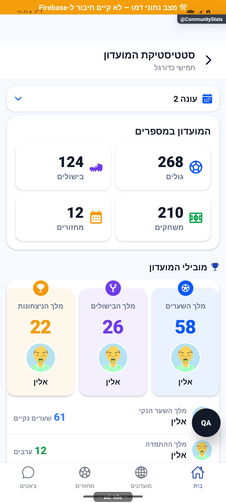

## אזורי המסך

בחירת עונה/כל השנים ושלושה אזורים פנימיים: ״סקירה״ מציגה מגרש עם ארבעה מונים ורשימת כל התארים הזמינים, תארים נוספים, נתונים מעניינים ותרשים תוצאות; ״הטבלה״ מציגה את טבלת המועדון; ״צמדים ושיאים״ מציגים כימיה ושיאי מועדון. תצוגת צילום ושיתוף היא חלונית בתוך המסך, ללא מסלול ניווט חדש. רכיבי הפרטים המקוצרים אינם מציגים תמיד את כל המסך המפורט.

שלושת התארים הראשיים מופיעים יחד בסקירה ובתמונת השיתוף: מלך שערים, מלך בישולים ומלך ניצחונות, כאשר יש לכל קטגוריה נתונים. לכל תואר שורה עם דיוקן, סמל תפקיד, תואר, שם, מספר ויחידה. כל השורות לבנות ושוות מעמד. אין פודיום או דרגה משותפת בין הקטגוריות. יתר התארים נבנים מן הנתונים הזמינים, לרבות שער נקי והתמדה, ומופיעים בשורות משניות מתחת לכרטיס.

| פעולה | מקור/תנאי | התנהגות |
|---|---|---|
| החלפת טווח | `SeasonScopeBar` | מונים, מובילים וטבלה חייבים לשנות אותו חלון |
| לחיצה על שחקן | מזהה חשבון אמיתי | כרטיס שחקן; אורח/זהות חסרה אינם פרופיל מלא |
| מצב מצטבר | נתוני שחקן במועדון | סך מדדים בטבלה |
| מצב יעילות | אותם נתונים ומכנה השתתפות | אין להציג אחוז כשמכנה אינו ידוע |
| מיון טבלה | עמודה והקשר | סדר יציב, כולל שוויון; לא מיון אקראי בכל רענון |

טבלת האליפות משתמשת בניצחונות, שערים, בישולים ואז מזהה יציב לשוויון, לפי מודל הדירוג. מוני שחקן במועדון אינם הנתונים הגלובליים שלו. טבלת השתתפות יכולה לקבל תיקון מהחלון המתאים; מכנה חסר אינו ניחוש מכמות משחקונים.

## פריסה ותלות

`src/components/community/CommunityStatsTable.tsx` שומר עמודת שם רחבה ועמודות נתונים בגודל עקבי; מדדי יעילות צריכים יותר רוחב ממונים. `CommunityChampionship.tsx`, `CommunityStatsGrid.tsx`; `src/utils/championship.ts`, `efficiencyStats.ts`; `src/services/gameService.ts`; `src/data/clubAchievements.ts`; הממירים ב־`src/firebase/firestore.ts`.

אנימציית מונים קיימת באמצעות רכיבי `CountUp`. צילום מיד אחרי ניווט הציג אפסים; צילום אחרי המתנה הציג 268 שערים, 124 בישולים, 210 משחקונים, 12 מחזורים ומובילים 58/26/22. אלה נתוני דמה. האפס הראשוני אינו ראיה לעונה ריקה או למחיקת נתונים.

## בדיקות ומצבים שלא צולמו

`tests/logic/championshipPenalty.test.ts`, `efficiencyStats.test.ts`, `seasonArchiveTable.test.ts`, `seasonScopedStats.test.ts`, `seasonPersonal.test.ts`. לא הורצו בדיקות חדשות לתיעוד. דרושים צילום טבלה בגלילה אופקית, שוויון, סגל עם אורחים, ריק, ארכיון, יעילות ללא מכנה, טעינה ושגיאה. הצילום הראשי אינו מכסה את כל חלקי המסך הארוך.

## היסטוריה והצעות בלבד

מקור 088 תיאר פודיום; 080 עבר לכרטיסים לבנים ו־081 החזיר גוון קטגוריה עדין. אלו עיצובים היסטוריים; העיצוב הנוכחי מתועד בעדכון 15.10.2026 להלן. אין ליישם שוב שינוי ישן בלי לבדוק התוצאה. הצעה: הסבר בלחיצה על כותרת מדד, מיון עם חיווי ברור, הופעת שורות קצרה. מומלץ לאפשר הפחתת תנועה ולמנוע הצגת אפס נתפס כנתון בעת טעינה.

## השלמת צילומי הטבלה

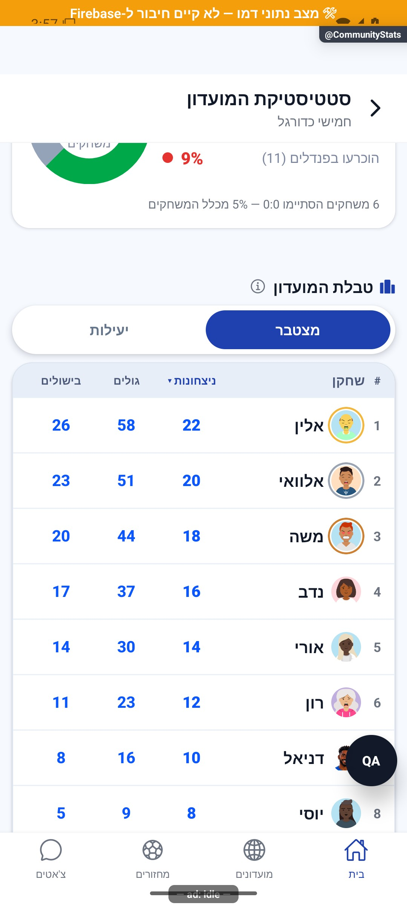
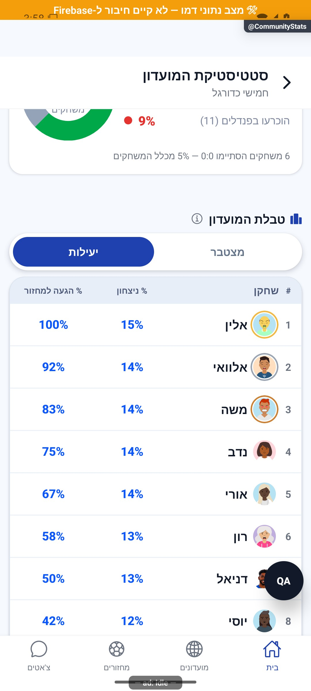

החלפת מצב מצטבר ליעילות אומתה בדמו. השורה הראשונה מציגה 22 ניצחונות, 58 שערים ו־26 בישולים; במצב יעילות 15% ניצחון ו־100% הגעה. אלו נתוני דמו, ולא בדיקת הנתונים האמיתיים או כלל מצבי הארכיון.

## פירוט טכני נוסף — זרימה, חישוב ונקודות שינוי

`championshipScore` נותן שתי נקודות לכל שער ונקודה לכל בישול: 3 שערים ו־2 בישולים נותנים 8. `perGameScore` מחלק ב־`rounds` של משחקונים; בארבעה משחקונים התוצאה 2, ובאפס משחקונים התוצאה 0. אין לבלבל זאת עם סדר טבלת הניצחונות: `comparePoints` ממיין לפי ניצחונות, שערים, בישולים ולבסוף מזהה.

`toEfficiencyRow` מחשב אחוז ניצחון כ־`100*wins/rounds`, כולל תיקו במכנה; שערים למשחקון `goals/rounds`; בישולים `assists/asRounds`; מעורבות `(goals+assists)/asRounds`; שער נקי `100*cleanSheets/csRounds`. מכנה אפס נותן `null`. לדוגמה 40 משחקונים, 18 ניצחונות, 10 שערים, 6 בישולים בכיסוי 30 ו־8 נקיים בכיסוי 20 נותנים 45%, 0.25, 0.20, 0.53 ו־40%.

הגעה היא `min(100,100*games/clubEvenings)` רק כששני המונים חיוביים; 8 מתוך 12 מוצג 67%, ואפס אינו טענה ל־0% במסלול זה. סף דירוג הוא `ceil(0.1*clubRounds)`: מועדון עם 210 משחקונים דורש 21. אם איש אינו עומד בסף, `eligibleForRanking` מחזיר את כל השורות. מיון יעילות שם ערכים חסרים בסוף, ואז מדגם גדול ומזהה. שינוי נוסחה דורש בדיקת המכנה והכיסוי, לא רק עיצוב עמודה.

הפירוט מתאר את הקוד שנקרא, ולא בדיקת כתיבה או הרשאות בסביבת הייצור. יש לקרוא את הקוד הממוקד וההפרש מאז מקור המיפוי לפני תיקון; בדיקות המוזכרות כאן לא הורצו מחדש לצורך עריכת התיעוד.

## עדכון 8.10.2026 — תנועה ותיקוני דיווחים

`ReorderMotion` מקבל את אותו אינדקס ואותו `ROW_H=56` בשני חצאי השורה, עם מפתח מזהה משתמש יציב. היסט התחלתי הוא (אינדקס קודם פחות חדש) כפול גובה השורה, מוגבל לשש שורות, ומגיע לאפס תוך 260 אלפיות שנייה. לא מתאפסים מונים ולא משתנים מיון, מכנים או יעילות.

**ראיה ומגבלות:** המסך הורץ והטבלה נצפתה לאחר הגלילה. צילום זה מציג את האזור שמעליה; שינוי המיון עצמו עדיין אינו מאומת בהקלטה.

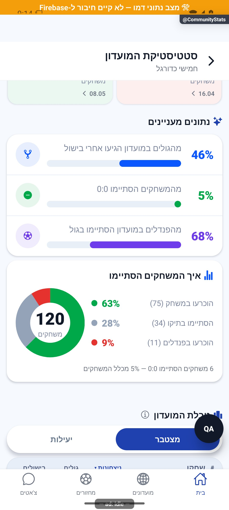

בדיקת הטיפוסים ו־183 חבילות הבדיקות עברו, 2,752 בדיקות. מצב המקור: `9ec0dfd` עם שינויים מקומיים; אין גרסה חדשה שפורסמה. [יומן השינוי וההקלטות](../../changes/2026-10-08-motion-and-pulse.md).

## עבודת ציור וגלילה — 9.10.2026

מקור: שינויים מקומיים מעל `a348b9f`, טרם פורסמו. תשתית `ScrollSurface` מחוברת לפרטי מועדון, ללשוניות פרטי מחזור, לסטטיסטיקות מועדון ולסיכום האישי. היא מסמנת תחילת/סוף מחווה ותנופה בלבד; אין שינוי נתונים או עדכון מצב בכל פריים. `CountUp` ו־`StatDonut` מתייצבים לערך הסופי במהלך גלילה; שורות ללא שינוי מיקום אינן מתזמנות תנועה. אנימציות `LivingIcon` ו־`Breathing` נעצרות כשמסך המקור מאבד מיקוד, כשהיישום ברקע, בזמן גלילה ובהגדרת צמצום תנועה. תמונות פרופיל ורקע משתמשות ב־`resizeMethod=resize`, לצמצום פענוח באנדרואיד לפי גודל התצוגה.

אין שינוי בחישובים, במכנים, בשדות המסד או בהרשאות. [התנהגות, בדיקות ומגבלות](../shared/menus-and-motion.md) · [מדידות וראיות](../reviews/scroll-performance-2026-10-09.md). הבדיקה בדמו אינה אימות גרסת חנות במכשיר פיזי.

## מצב פתיחה מעוצב — 10.10.2026

`CommunityStatsWelcome` מחליף את ההודעה הריקה בתוך `CommunityStatsScreen`. רכיב האיור מצויר באמצעות `react-native-svg`; האייקונים משתמשים בחבילות הקיימות. אין תלות בתמונה מרוחקת. המספרים 3 משחקים, 8 שערים ו־2 בישולים הם קבועי המחשה מקומיים, מסומנים כדוגמה ואינם מוזנים לחישובים או למסד.

התנאי `isEmpty` דורש טעינה מוצלחת של `champ` ו־`stats`, טווח נוכחי, ללא עונות בארכיון, ללא משחקונים ושערים בנתונים הנגזרים, ללא מחזורים שהסתיימו בנתונים הנוכחיים ובנתוני כל הזמנים וללא שורות שחקנים. מחזור שהסתיים ללא שערים אינו הופך אוטומטית למועדון חדש. כאשר יש ארכיון, התצוגה הרגילה ובורר העונות נשארים זמינים.

`viewerId` מגיע מ־`useUserStore`; `adminIds` נשמר מתוצאת `groupService.get` הקיימת, ללא שאילתה נוספת. רק מנהל מקבל `onCreate`, המנווט אל `GameCreate` עם `groupId`. אין כתיבה בלחיצה על הכרטיס עצמו; היצירה מתבצעת במסך היצירה הרגיל. חבר רגיל אינו מקבל כפתור יצירה. שלוש שורות ההסבר התחתונות אינן כפתורים.

תצוגת הבדיקה `footy://qa/_stats_welcome` מוגבלת לפיתוח, להפעלה מפורשת של כלי הבדיקה ולנתוני דמו. היא מציגה את הרכיב האמיתי בנפרד, ואינה הוכחה לנתוני מועדון בייצור או להרשאותיו. צילום ובדיקות מפורטים ברשומת התמונות; אין שינוי בנוסחאות הסטטיסטיקה או בהרשאות המסד.

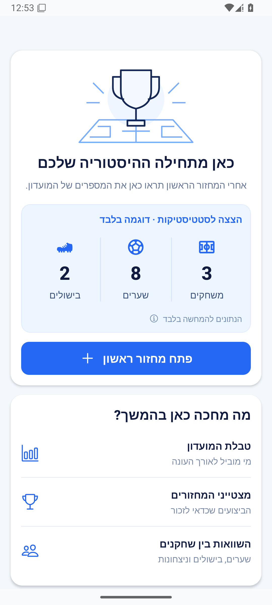

אימות 10.10.2026: 231 חבילות, 3,259 בדיקות עברו; בדיקת טיפוסים נקייה. כיווניות נבדקה בצילום אנדרואיד של הרכיב בפיתוח. לא נבדקו אייפון או מועדון ריק מול הייצור.

## הגנת טעינה וסיכום היסטורי — 10.10.2026

`CommunityStatsScreen` קורא ל־`getCommunityChampionship(groupId, undefined, true)` ול־`getCommunityStats(groupId, season, true)`. כשל מהותי מציג ניסיון חוזר; רענון שנכשל משמר נתונים קודמים עם חיווי. מעבר למועדון אחר מאפס את המידע כדי לא להציג מועדון קודם. עונת ארכיון שנכשלת נשארת נבחרת עם הודעת כשל ואפשרות חזרה מפורשת לעונה הנוכחית.

סכום כל הזמנים מותר רק כאשר `completeSeasonHistory` מאמת שכל כרטיסי העונות הצפויים וכל טבלאות הארכיון קיימים. הכימיה החיה נקראת עם `clubChemistryService.get(groupId, true)`; כשל אינו מוחלף במפת זוגות ריקה. גבול שיאי העונה אינו מחושב מהיסטוריה חסרה; רשומות המחזור הקודם מתאפסות בהחלפת חלון הנתונים. בדיקות: `completeSeasonHistory.test.ts`, `clubChemistryStrict.test.ts`. טבלאות אפס שנקראו בהצלחה הן מידע תקין. אין השלמת מספרים ממידע חלקי.

צילומי תצפית: `screenshots/release-ui-club-stats-2026-10-10.png` מציג נתוני דמו. מקור החבילה הפעילה אינו מאומת מול כל השינויים המקומיים; אין זו הוכחת הרצה למצבי הכשל והארכיון המחמירים. מצבים אלו נבדקו בבדיקות השירות והחישוב.

### בעלות נתונים במעבר מועדון
`ownsClubData` משווה את `loadedGroup.current` ל־`groupId` ברינדור. לפני שה־effect מאפס את הנתונים, נתוני המועדון הקודם מוסתרים באמצעות `bootLoading`; גם הודעת כשל קודמת אינה שייכת למועדון החדש. בדיקה סמנטית בביטויי המסך בפועל: `tests/logic/summaryOwnership.test.ts`, כולל מעבר עם נתונים קודמים וכשל קודם. מצב מעבר זה לא צולם; אין להסיק מהצילום הקיים שנבדק מעבר בין מועדונים.

## תיקוני דיווחים — 10.10.2026, אחרי גרסה 1.1.45

CommunityStatsWelcome מוסיף שורת ועוד אחרי רשימת התכונות; המספרים לדוגמה נשארים מסומנים כהמחשה בלבד.

שינוי מקומי מעל bcca0886; לא נבנתה גרסה בסבב הזה. נבדק בקוד ובבדיקות אוטומטיות. צילומי אנדרואיד בנתוני דמו בלבד; אין אימות באייפון או בטלפון המדווח.

## החלטות הבעלים — 13.10.2026

שערים ובישולים למשחק מוצגים יחד רק כשהכיסוי תואם. כשאינו תואם מופיע מקף. מצטייני הפנדלים במועדון נבחרים לפי הצלחה וכמות ניסיונות; תארי העונה לפי מספר הבקעות או עצירות.

`efficiencyStats` מחייב `asRounds===rounds` עבור `(goals+assists)/rounds`; כיסוי נעדר או גדול ממספר המשחקים אינו תקין. בדוגמה 12 שערים ו־8 בישולים ב־50 משחקים נותנים 0.40; כיסוי בישולים 40 נותן null במדד המשולב. בישולים לבדם נשארים 8/40. `communityPenaltyRankingNote` מסביר את אלגוריתם המועדון ללא שינויו. שמות תארי העונה מבהירים הבקעות/עצירות.

השינוי מקומי וטרם נפרס. [פירוט הבדיקות והמעבר](../../changes/2026-10-13-approved-statistics-policy.md).

## תיקון ממוצעי ציונים בעקבות השלמת שערים — 14.10.2026

ההכנה המקומית של `prepareRetroScores` מתקנת את תרומת המחזור ל־`eveningScoreSum` באמצעות הפרש ציונים בלבד; `eveningScoreCount` ומכנה הממוצע אינם משתנים. לפיכך חישוב תואר השחקן לפי ממוצע יראה את התרומה המתוקנת אחרי פריסת התיקון. אין שינוי בנוסחת התואר או בדירוגי המנהל הפנימיים. נתוני המחזור האחרון שהתבקש כבר תוקנו בייצור באופן ממוקד; האוטומציה נפרסה בהמשך אותה משימה באישור הבעלים; הרענון בלקוח מקומי עד להפצת גרסה. [מסלול הנתונים והבדיקות](personal-statistics.md).

סיכום המחזור הכללי מתעדכן באותה עסקת השלמת השערים: סכומי שערים/בישולים, מלכי המחזור ומעורבות, כולל שוויונות, וקשרי הצמד שהושלמו. מספר המשחקים ותוצאות הקבוצות נשמרים מההיסטוריה. בסיס השוואה מקורי נשמר לחתימות חדשות; מגבלות מסמכים ישנים מפורטות ב־[פרטי המחזור](../rounds/match-details.md#סיכום-כללי-לאחר-השלמות--14102026). המקור למסך הוא `roundSummaryService.get`, ולא סכימה מקומית אחרת.

תיקון השרת נפרס ואומת מול המקור שנבדק ב־14.10.2026, בשלוש הפונקציות שאושרו בלבד. [פרטי הפריסה והמגבלות](../rounds/match-details.md#אישור-ופריסה-ממוקדת--14102026). הרענון בלקוח עדיין מקומי; נתוני המחזור האחרון מתוקנים בייצור.

## סבב פולס — 15.10.2026

`CommunityStatsScreen` אינו מצייר `he.communityPenaltyRankingNote`. אין שינוי בנתוני פנדלים, בכיסוי, בניקוד או במכנים. נבדקה תצוגת אנדרואיד בדמו; אין טענה לשינוי חישוב.

השינויים בסבב זה מקומיים וטרם הופצו. [דוח הסבב](../../changes/2026-10-15-pulse-sweep.md).

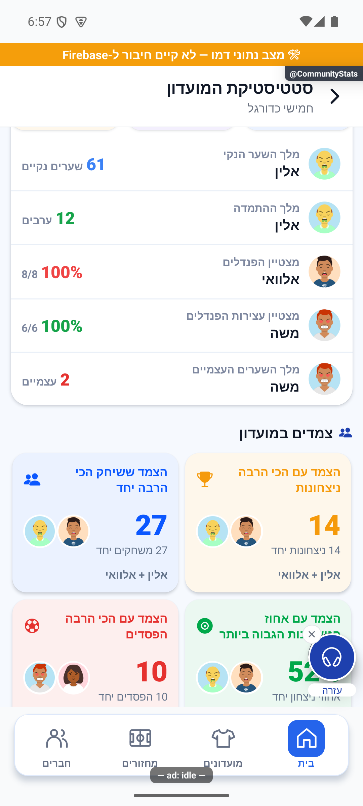

## שלב עיצוב ראשון — 15.10.2026, הוחלף בעיצוב הכדורגל להלן

מקור: שינויים מקומיים מעל `4a3cb346b1792b7e84cd71a8b9723bf6af88e500`. לא נבנתה או הופצה גרסה במשימה זו.

`CommunityStatsScreen` משתמש ב־`LinearGradient` הקיים בפרויקט עבור סיכום כחול כהה. `heroGridRow` יוצר שתי שורות מפורשות עם שני תאי `flex:1` בכל שורה: שערים ובישולים, משחקים ומחזורים. כך הריווח והמסגרת אינם גורמים לגלישת כל תא לשורה נפרדת. `scopeTitle` מופיע בכותרת הסיכום כאשר יש עונות; ללא עונות מופיע ״כל הזמנים״. בורר העונות נשאר באותו מקום ובאותם תנאים.

`LeaderTrio` מציג שלוש קטגוריות שוות: רקע לבן, פס עליון ואייקון בצבע הקטגוריה, מספר ויחידה, מפריד, תמונה בגודל 44 ושם מלא מוגבל לשורה. `LeaderRow` מציג תמונה מימין, תואר ושם במרכז ומדד משמאל. המעטפת החיצונית הוחלפה מ־`Card` ל־`View` כדי להסיר כרטיס מקונן. סדר התוכן והקטגוריות נשמר. `SectionTitle` ו־`CommunityChampionship` מציגים כותרת בגודל 18 וקו מפריד. הוסר `writingDirection` מהסברים המיושרים ב־`RTL_LABEL_ALIGN` ומכותרת הטבלה כדי למנוע יישור סותר.

מסלול הנתונים והחישובים נשמר: `derived.totalGoals`, `derived.totalAssists`, `derived.totalRounds` ו־`eveningsInScope`; אותם דירוגי מובילים, כיסוי יעילות ומכנים המתוארים לעיל. אין שינוי בשירותים, בממיר, במסד, בהרשאות או ברישום מסכים. ניווט לפרטי מחזור, כרטיס שחקן וסיכום עונה נשמר; מצבי טעינה, שגיאה, ריק ועונה חדשה לא שונו ולא הורצו מחדש לצורך הצילום.

בדיקת טיפוסים נקייה; כל 324 חבילות הבדיקות עברו, 3,849 בדיקות. נצפו בפועל המונים 268/124/210/12, מובילים 58/26/22, סדר קריאה עברי והטבלה המצטברת. הנתונים סינתטיים באימולטור אנדרואיד עם חיווי דמו מנותק מהמסד. אין הוכחת אייפון, מכשיר פיזי, שמות ארוכים, ארכיון או חשבון ייצור.

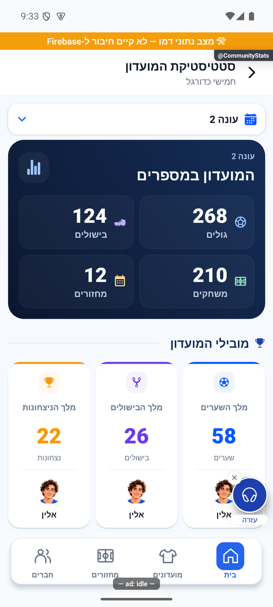
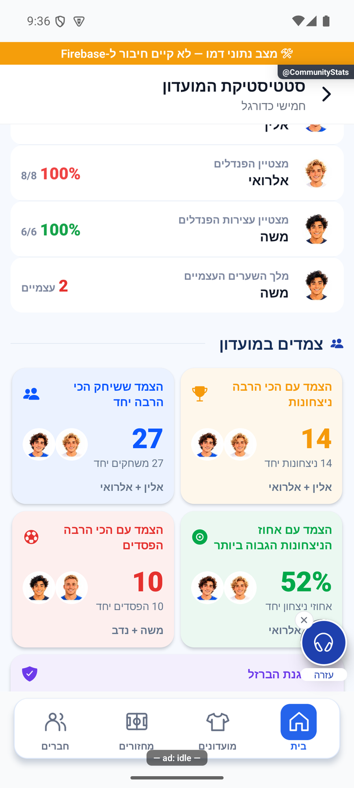
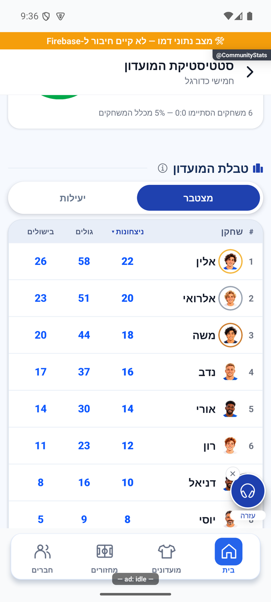

[יומן השינוי](../../changes/2026-10-15-club-statistics-redesign.md)

## אווירת כדורגל כהה — 15.10.2026, הוחלף בעיצוב הבהיר להלן

הבעלים ביקש לחזק את נראות המסך עבור מודעות וסרטונים שיווקיים. `FootballStatsBackdrop` מצייר מגרש עם פסי כיסוח, קו אמצע, עיגול מרכז ורחבת שער מעל מעבר ירוק כהה. תאי המונים כהים ושקופים חלקית, והמספרים בגודל 38 עם גוון בהיר. מתחתיהם הנוסח ״כל מחזור. כל שער. כל המועדון.״. הרקע קישוטי: `pointerEvents="none"`, מוסתר מקוראי מסך, ללא בקשות תמונה או אנימציה מחזורית.

`LeaderTrio` מציג שלושה קלפי שחקן כהים, עם פס קטגוריה, סמל תואר, מספר בגודל 38, יחידה, דיוקן בגודל 52 ושם. `TRIO_SURFACE` מגדיר מעברי כחול, סגול וזהב כהים; `TRIO_ACCENT` מגדיר צבעי טקסט בהירים. גרסת `player` של הרקע מוסיפה קווי מסגרת וחולצת כדורגל; אינה מייצגת קבוצה, מספר חולצה או דירוג. הכרטיסים שווי ממדים, ללא מדרגות או מיקומי ניצחון. המספר נשאר לפני הדיוקן. גובה הכותרת המשותף נשמר כדי שכותרת הנפרסת לשתי שורות לא תיצור דרגה חזותית.

החישובים, מקורות הנתונים, הכיסוי, המכנים, חלונות העונה, מצבי הטעינה והכשל והניווט המתוארים לעיל נשארו ללא שינוי. בדיקת טיפוסים נקייה; 324 חבילות ו־3,850 בדיקות עברו. נצפו בפועל המונים 268 שערים, 124 בישולים, 210 משחקים ו־12 מחזורים, והמובילים 58/26/22, כולל יישור עברי ודיוקנאות ושמות בתצוגת הפתיחה באימולטור. אין הסקה מכך לגבי גדלי מסך אחרים, גופן מוגדל או שמות ארוכים.

מקור: שינויים מקומיים מעל `4a3cb346b1792b7e84cd71a8b9723bf6af88e500`. הצילומים מאימולטור אנדרואיד בדמו מנותק מהמסד; כלי הבדיקה וכרזת הדמו גלויים. לא נבדקו אייפון, מכשיר פיזי, ארכיון, חשבון ייצור או מצבי כשל. לא נוצר סרטון או חומר פרסומי במשימה זו. השינוי מקומי ולא הופץ.

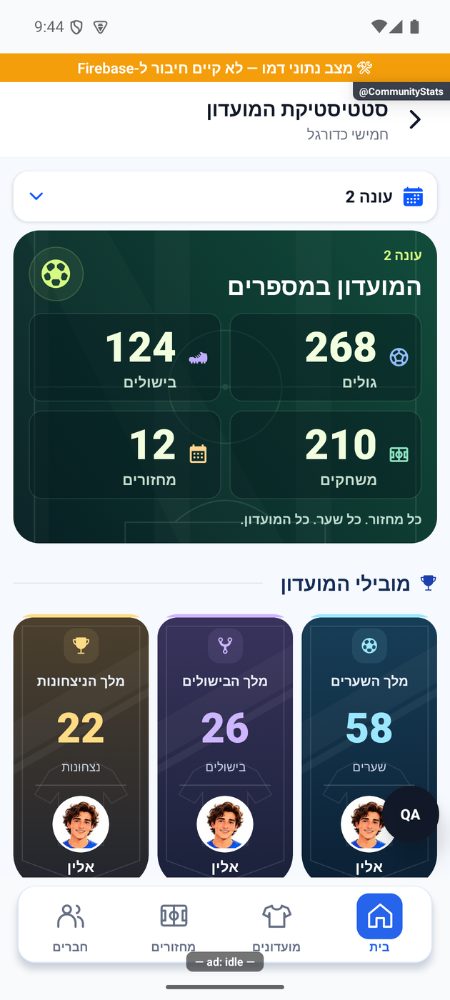
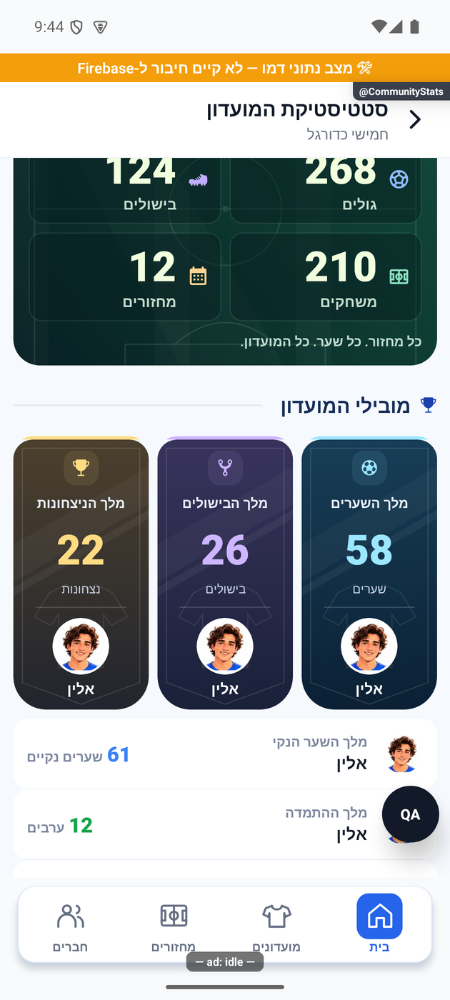

[יומן השינוי](../../changes/2026-10-15-club-statistics-football.md)

## עיצוב כדורגל בהיר — 15.10.2026, הוחלף במבנה החדש להלן

הבעלים דחה את הגרסה הכהה וביקש עיצוב בהיר, מושך ונועז יותר. סיכום המועדון משתמש במעבר ליים `#D5FF72`–`#F1FFCE`, עם קווי מגרש, פסי כיסוח לבנים וכדור במשטח לבן מוטה. כל תא מונה מציג תחילה אייקון ותווית בשורה, ואחריהם מספר גדול בגודל 38. `HeroTile.tint` צובע מספר ואייקון לפי הקטגוריה: כחול לשערים, סגול לבישולים, ירוק למשחקים וכתום למחזורים. התאים לבנים בשקיפות גבוהה; הכותרות והתוויות כהות. סדר המקור של שתי השורות נשמר בעברית.

`TRIO_SURFACE` משתמש במעברים בהירים בתכלת, סגול וזהב. `TRIO_ACCENT` מכיל צבעים כהים לקריאות על המשטחים הבהירים. `FootballStatsBackdrop.player` מצייר פסים אלכסוניים לבנים, קווי מסגרת, איור חולצה וסימני קישוט. תגי התארים לבנים, ושמות השחקנים מופיעים על תוויות בהירות. שלושת הכרטיסים שווי גודל; המספר קודם לדיוקן בגודל 52. צומצמו רווחים וגובה תגים כדי שהשמות ייכנסו לתצוגת הפתיחה באימולטור שנבדק. אין הסקה מכך לגבי גדלי מסך אחרים או גופן מוגדל.

מסלול הנתונים והחישובים לא השתנה: אותם `derived.totalGoals`, `derived.totalAssists`, `derived.totalRounds`, `eveningsInScope`, דירוגי המובילים, מכנים וכיסוי. העונות, הניווט, מצבי טעינה, שגיאה וריק נשמרו ולא הורצו מחדש לצורך עיצוב זה. הרקע קישוטי, ללא כתיבה, חסימת מגע, בקשות תמונה או אנימציה מחזורית. לא השתנו כללים, הרשאות או שירותי שרת.

בדיקת טיפוסים נקייה; 325 חבילות ו־3,864 בדיקות עברו. נצפו בפועל מונים 268/124/210/12, מובילים 58/26/22, דיוקנאות, שמות ויישור עברי בראש המסך ובהמשך. מקור: שינויים מקומיים מעל `4a3cb346b1792b7e84cd71a8b9723bf6af88e500`. הצילומים מאימולטור אנדרואיד בדמו מנותק מהמסד; כלי הבדיקה וכרזת הדמו גלויים. אין הוכחת אייפון, מכשיר פיזי, שמות ארוכים, ארכיון, כשל או חשבון ייצור. השינוי מקומי וטרם הופץ.

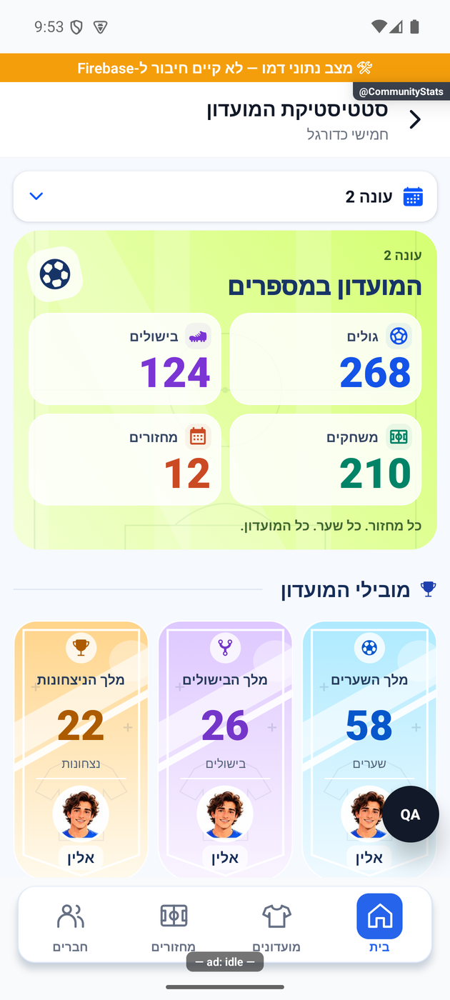
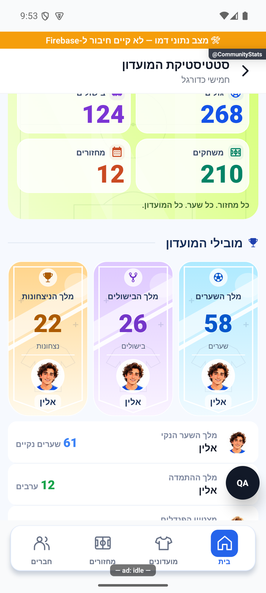

[יומן השינוי](../../changes/2026-10-15-club-statistics-bright.md)

## מבנה מחולק ללשוניות — 15.10.2026, תצוגת הסקירה הוחלפה בגלריה להלן

`ClubStatsDashboard.tsx` מחליף את רשת המונים ואת קלפי השחקן. `ClubStatsSummary` מציג כותרת ופס של ארבעה מונים בשורה אחת: שערים, בישולים, משחקים ומחזורים. הטווח מופיע בבורר הקיים; אם אין ארכיון ובורר, הוא מופיע בכותרת הסיכום. הערכים נשארים `derived.totalGoals`, `derived.totalAssists`, `derived.totalRounds`, `eveningsInScope`. כל השורות והמונים כתובים בסדר קריאה עברי.

`ClubStatsSections` מציג שלוש בחירות בתפקיד נגיש `tab`, עם `selected`: `overview` — סקירה; `table` — הטבלה; `records` — צמדים ושיאים. `section` הוא מצב מקומי המתחיל בסקירה ומתאפס בהחלפת מועדון. `selectSection` מחליף אזור וגולל לראש באמצעות ההפניה הקיימת של `ScrollSurface`. בחירת העונה משותפת לכל האזורים ואינה מתאפסת במעבר פנימי. אין מסך או רישום ניווט חדשים.

| אזור | תוכן | מצב במעבר |
|---|---|---|
| סקירה | שלוש שורות מובילים ראשיות, שורות תארים נוספות, נתונים מעניינים ותרשים תוצאות | המובילים נשענים על אותם תנאי נתונים ודירוגים; המספרים מתייצבים לאחר הופעה |
| הטבלה | `CommunityChampionship`, מצטבר ויעילות | נשאר מורכב בתוך מעטפת `display:none` כשהוא מוסתר; הנתונים, המיון ומצב היעילות נשמרים במעבר פנימי |
| צמדים ושיאים | `ChemistrySection` ו־`ClubRecords` | אותם זוגות, מכנים, חלונות ומסלולי פרטים; אין כתיבה במעבר אזור |

`ClubSpotlights` מציג שלוש שורות שוות בגודלן: דיוקן בגודל 60 וסמל תואר מימין, תואר ושם במרכז, מספר בגודל 36 ויחידה משמאל על בלוק רווי בצבע הקטגוריה. אין פודיום או דרגה משותפת בין התארים. הבסיס לבן; צבע מופיע במונים, בסמלים ובמספרי המובילים. `HeroTile`, `LeaderTrio` ו־`FootballStatsBackdrop` הוסרו מהמבנה הנוכחי. תנאי טעינה, שגיאה, ריק ועונה חדשה נשמרו; לא נבדקו מחדש בצילום. ניווט לכרטיס שחקן, פרטי מחזור וסיכום עונה נשמר. אין שינוי בשירותים, בממירים, בחישובים, בכיסוי, במכנים או בהרשאות.

בדיקת טיפוסים נקייה; הריצה הסופית עברה עם 325 חבילות ו־3,864 בדיקות. באימולטור אנדרואיד בדמו נצפו הסקירה, הטבלה המצטברת, מעבר ליעילות, מעבר לסקירה ולצמדים וחזרה לטבלה כשהיעילות נשמרת. בשורה הראשונה נצפו 22 ניצחונות, 58 שערים ו־26 בישולים; ביעילות 15% ניצחון ו־100% הגעה. בדיקת הצמדים מציגה 14 ניצחונות יחד ו־27 משחקים יחד. שיאים נמוכים יותר באותו אזור לא צולמו מחדש. מקור: שינויים מקומיים מעל `4a3cb346b1792b7e84cd71a8b9723bf6af88e500`. אין בדיקת אייפון, טלפון פיזי, גופן מוגדל, שמות ארוכים, מעבר מועדון/עונה או ייצור. השינוי מקומי וטרם הופץ.

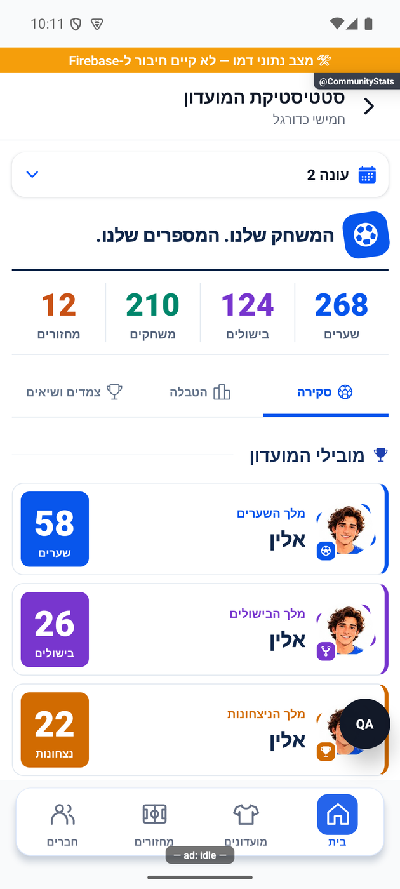
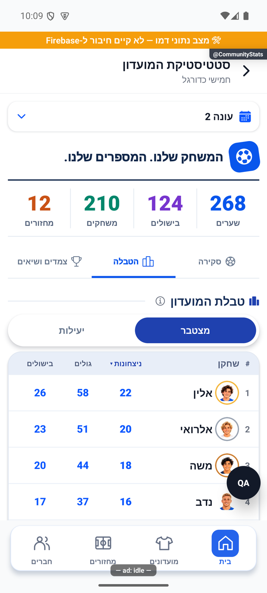
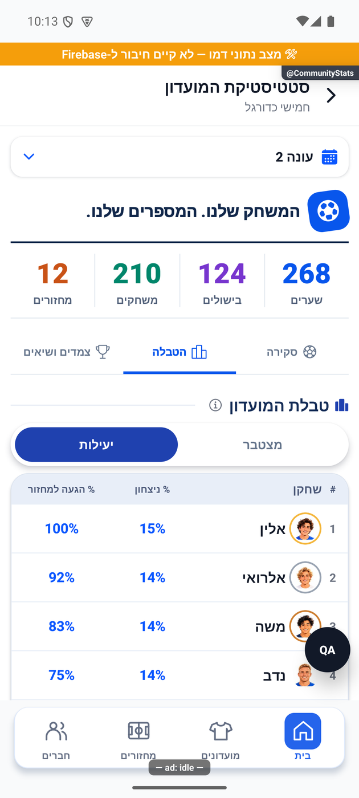
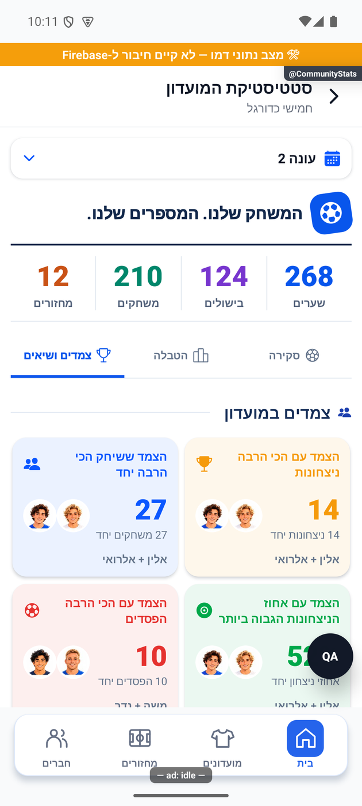

[יומן השינוי](../../changes/2026-10-15-club-statistics-dashboard.md)

## גלריית תארים ולוח תוצאות — 15.10.2026, הוחלף בכרטיס המצב להלן

החלוקה ללשוניות נשמרה לבקשת הבעלים. `ClubStatsSummary` משתמש כעת במעבר כחול רווי `#0755EC`–`#367BFF`, עם ארבעה מונים לבנים באותה שורה וקווי מגרש קישוטיים. איור הקווים מוסתר מקוראי מסך ואינו מקבל מגע. הטווח, מקורות המספרים ותנאי טעינה/שגיאה/ריק נשמרו. אין שינוי ב־`ClubStatsSections`, במצב הבחירה, במעטפת הטבלה המוסתרת או במצב המצטבר/יעילות שלה.

`ClubSpotlights` מציג גלריה אופקית מקורית של `ScrollSurface`, עם `nestedScrollEnabled`, האטה מהירה ועצירה לפי `snapToInterval=cardWidth+12`. רוחב כרטיס הוא `min(windowWidth-64,360)`; הרווח בין כרטיסים הוא 12. כך נראית הצצה לתואר הבא. כאשר יש יותר מתואר אחד, מופיע ״החליקו בין התארים״. כל הכרטיסים שווי ממדים, ואינם מיקומים באותה תחרות.

בכל כרטיס: תואר וסמל, מספר גדול ויחידה מימין, דיוקן בגודל 100 משמאל ושם בתחתית. הצבע מייצג קטגוריה בלבד: כחול, סגול וכתום. גודל מספר רגיל 64, ובארבע ספרות ומעלה 48. שלושת הנתונים והאנשים נשארים אותה רשימת מובילים; יתר התארים מופיעים בשורות משניות מתחת לגלריה. הגלריה מורכבת מחדש כאשר חוזרים לסקירה, ומתחילה בתואר הראשון; אין שמירת בחירת תואר בין לשוניות. אנימציית המונים הקיימת מכבדת גלילה וצמצום תנועה. אין אנימציה מחזורית חדשה, בקשת תמונה חדשה או שדה חדש במסד.

בדיקת טיפוסים נקייה; 325 חבילות ו־3,864 בדיקות עברו. נצפו בפועל באנדרואיד בדמו: פתיחה במלך השערים 58, החלקה למלך הבישולים 26 ולמלך הניצחונות 22, פתיחת הטבלה וחזרה לסקירה. המונים 268/124/210/12 נשמרו. העברית, סדר התארים וההחלקה נבדקו בצילומים. אין בדיקת אייפון, מכשיר פיזי, רוחבים אחרים, גופן מוגדל, שמות ארוכים, עונות/מועדונים אחרים או מצבי כשל. כפתור כלי הבדיקה וכרזת הדמו גלויים; אינם חלק מממשק החנות. מקור: שינויים מקומיים מעל `4a3cb346b1792b7e84cd71a8b9723bf6af88e500`. השינוי מקומי וטרם הופץ.

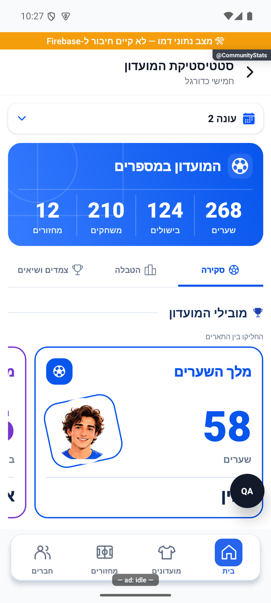
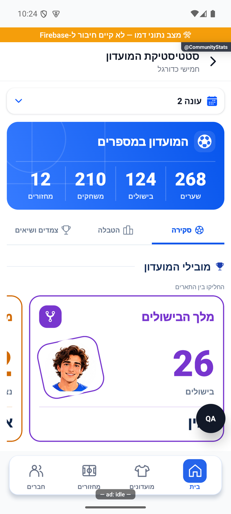
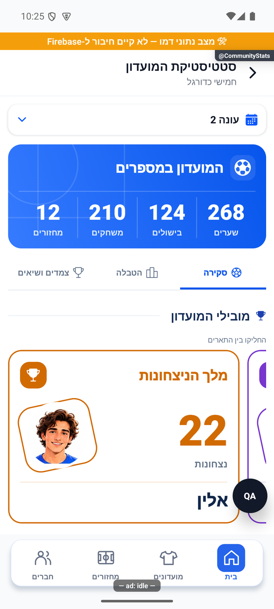
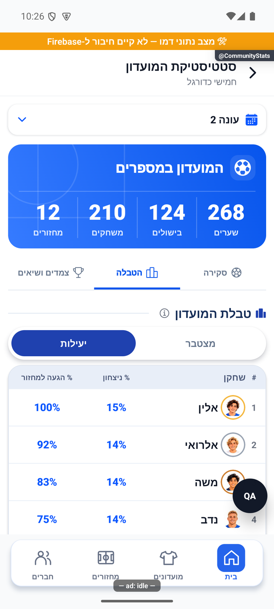

[יומן השינוי](../../changes/2026-10-15-club-statistics-gallery.md)

## כרטיס מצב לצילום ולשיתוף — 15.10.2026, הסגנון הוחלף בכרזה להלן

`ClubStatusCard.tsx` מציג כרטיס עצמאי ברקע בהיר ומסגרת כהה: שם המועדון, טווח הנתונים, ארבעה מונים, שלושת המובילים ותאריך הצילום. שערים ובישולים מוצגים במספרים גדולים; משחקים ומחזורים בשורה נוספת. שלושת התארים מופיעים יחד בעמודות שוות עם ערך, יחידה, תמונה ושם. אין צורך בהחלקה כדי לראות את שלושתם בצילום אחד. הסימן המסחרי והתקופה בתוך הכרטיס, ולכן תמונה שנחתכה מתוך המסך נשארת בעלת הקשר.

`leaderItems` נשלף מאותה רשימת תארים שהייתה בסקירה: הסדר, תנאי הצגת הקטגוריות, הדירוג, הכיסוי והיחידות נשמרו. `ClubStatusOverview` מקבל `subtitle` כשם המועדון, `scopeTitle` או ״כל הזמנים״ כטווח, את `derived.totalGoals`, `derived.totalAssists`, `derived.totalRounds`, `eveningsInScope`, ואת שלושת המובילים הראשונים עם `resolved(uid)`. כשאין נתוני הבקעות, המובילים אינם מוצגים לפי התנאי הקיים `hasScoring`. יתר התארים ממשיכים תחת ״תארים נוספים״. מצב טעינה/כשל/ריק נשאר במעטפת הקיימת, ולכן כרטיס השיתוף אינו מוצג כתחליף לכשל או למידע שטרם נטען.

הלשוניות נשמרו ומופיעות לפני התוכן. הסקירה מציגה את הכרטיס; הטבלה והצמדים מקבלים את הסיכום המקוצר הקיים. מצב הטבלה ממשיך להישמר כשהיא מוסתרת. הגלריה האופקית ו־`ClubSpotlights` הוסרו. אין מסלול ניווט חדש, שינוי הרשאות, שירות, ממיר, מסד, חישוב או מכנה.

### תצוגת צילום וייצוא

״כרטיס לצילום ולשיתוף״ פותח `SafeModal` עם אותו `ClubStatusCard`. הכרטיס עצמו מחובר להפניה באמצעות `forwardRef` ו־`collapsable=false`. כפתורי הסגירה והשיתוף, כרזות פיתוח, סרגלי מערכת וניווט האפליקציה מחוץ להפניה, ולכן אינם מצולמים. כל המספרים בכרטיס הם `Text` סטטי, ללא אפסים זמניים של הנפשה. התאריך מגיע משעון המכשיר בתבנית `he-IL` עם בידוד כיווניות; זהו תאריך התמונה, לא חותמת עדכון מהשרת. אין הבטחה למועד רענון הנתונים מעבר לחוזי הטעינה הקיימים.

פעולת השיתוף בודקת `Sharing.isAvailableAsync`, ממתינה לשני פריימים, מצלמת רק את הכרטיס באמצעות `captureRef` לתמונת `PNG` זמנית וקוראת ל־`Sharing.shareAsync`. מודול השיתוף נטען רק בלחיצה. בחירת נמען ושליחה הן פעולות המשתמש בחלונית המכשיר; אין שליחה אוטומטית. `busy.current` מונע לחיצה כפולה, ומצב `sharing` חוסם סגירה בזמן הפעולה. בסיום או בכשל לאחר צילום, `releaseCapture` מנקה את הקובץ הזמני והנעילה משתחררת. בהיעדר יכולת שיתוף לא נוצר קובץ; כשל מציג אפשרות לנסות שוב או לצלם ידנית. הצילום אינו מוסיף שאילתות או כתיבה למסד.

### ראיות ובדיקות

בדיקת טיפוסים נקייה; 326 חבילות ו־3,868 בדיקות עברו. `tests/logic/clubStatusShare.test.ts` מאמת מניעת צילום ושיתוף כפולים, צילום הפניית הכרטיס בלבד, היעדר צילום כשהשיתוף אינו זמין, ניקוי קובץ בכשל שיתוף ואפשרות לניסיון חוזר.

באימולטור אנדרואיד בדמו נצפו הכרטיס בסקירה, תצוגת צילום נקייה, קובץ `PNG` שנוצר בפועל, פתיחת חלונית השיתוף וביטול ללא שליחה. קובץ המקור הזמני נוקה לאחר ביטול. בתמונה נצפו 268 שערים, 124 בישולים, 210 משחקים, 12 מחזורים ומובילים 58/26/22. הקובץ בתיעוד הועתק מייצוא האפליקציה לפני ביטול השיתוף, ללא עריכה. חזרה לטבלה נבדקה לאחר סגירת התצוגה.

מקור: שינויים מקומיים מעל `4a3cb346b1792b7e84cd71a8b9723bf6af88e500`. הנתונים והדיוקנאות בדמו בלבד; אין בדיקת ייצור, אייפון, מכשיר פיזי, שמות ארוכים, גופן מוגדל, תמונות מרוחקות איטיות, עונות/מועדונים אחרים או כשל רשת חי. השינוי מקומי וטרם הופץ.

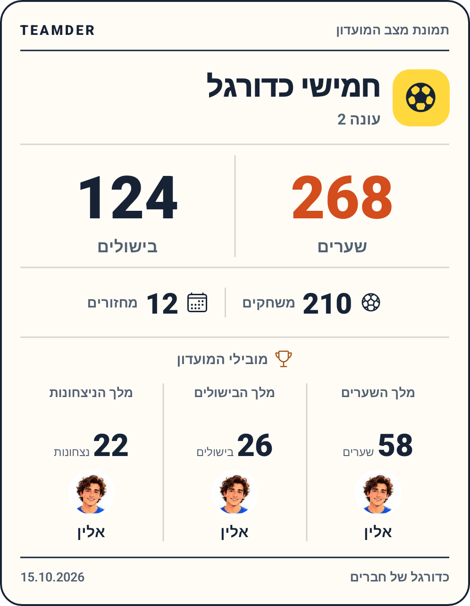
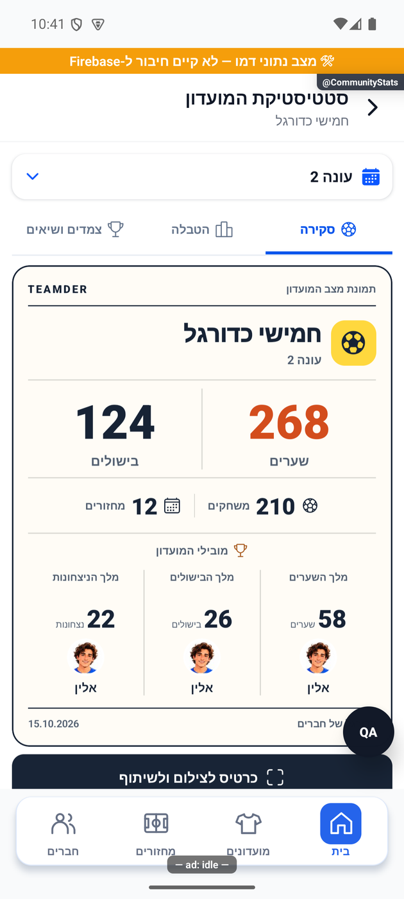
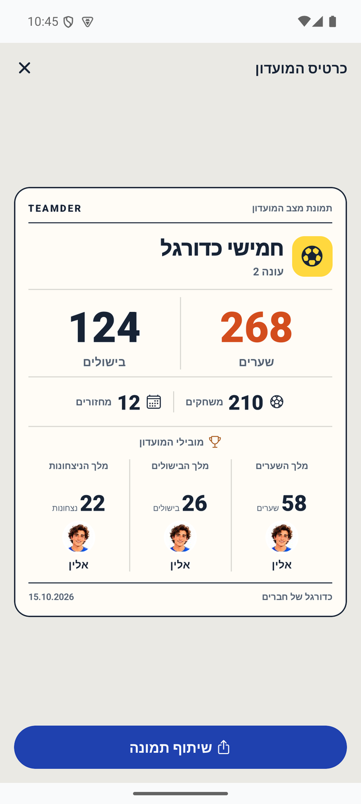

[יומן השינוי](../../changes/2026-10-15-club-statistics-status-card.md)

## כרזת ספורט — 15.10.2026, סגנון קודם, הוחלף בעיצוב המלא

`ClubStatusCard` נשאר אותו כרטיס עצמאי לצילום ולשיתוף, בסגנון כחול, לבן וצהוב. שם המועדון והעונה מופיעים על מסגרת כחולה `#0755EC`; ארבעת המונים בשורה אחת על רקע לבן, במקום שני מונים גדולים ושורת פעילות נפרדת. גודל מספר רגיל 30, ובחמש ספרות ומעלה 23. סדר עברי מימין: שערים, בישולים, משחקים ומחזורים. הכותרת ״מובילי המועדון״ מופיעה בפס צהוב `#FFE342`.

שלושת המובילים מופיעים יחד בשורות שוות מעמד: דיוקן בגודל 44 מימין, תואר ושם במרכז, ומספר בגודל 30 עם יחידה משמאל. צבע המספר מזהה קטגוריה בלבד. התאריך והסימן המסחרי נשמרו בתוך הכרזה. אין שינוי בבחירת המובילים, בשמות, בערכים, במכנים, במקורות, בהרשאות, בניווט או בלשוניות. מסלול השיתוף, נעילת הכפילות וניקוי הקובץ הזמני נשמרו כפי שתועדו לעיל; השינוי הוא בפריסה ובסגנון הרכיב המוצג והמצולם.

בדיקת טיפוסים נקייה; 327 חבילות ו־3,876 בדיקות עברו. הכרזה נצפתה בסקירה ובתצוגה הנקייה באימולטור אנדרואיד בדמו. תמונת `PNG` חדשה נוצרה בפועל בכפתור השיתוף, הועתקה ללא עריכה, וחלונית השיתוף בוטלה ללא שליחה. נבדק ניקוי הקובץ הזמני. המספרים נשמרו: 268 שערים, 124 בישולים, 210 משחקים, 12 מחזורים ומובילים 58/26/22. אין בדיקת אייפון, מכשיר פיזי, גופן מוגדל, שמות ארוכים, רשת חיה או נתוני ייצור. המקור הוא שינויים מקומיים מעל `4a3cb346b1792b7e84cd71a8b9723bf6af88e500`; לא נבנתה או הופצה גרסה.

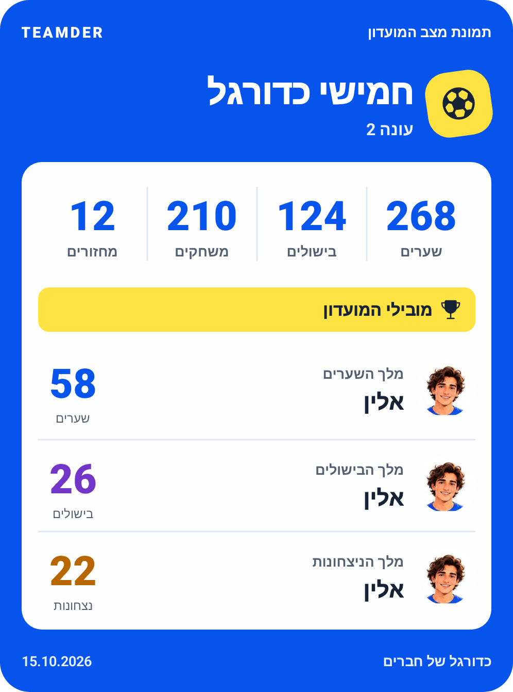
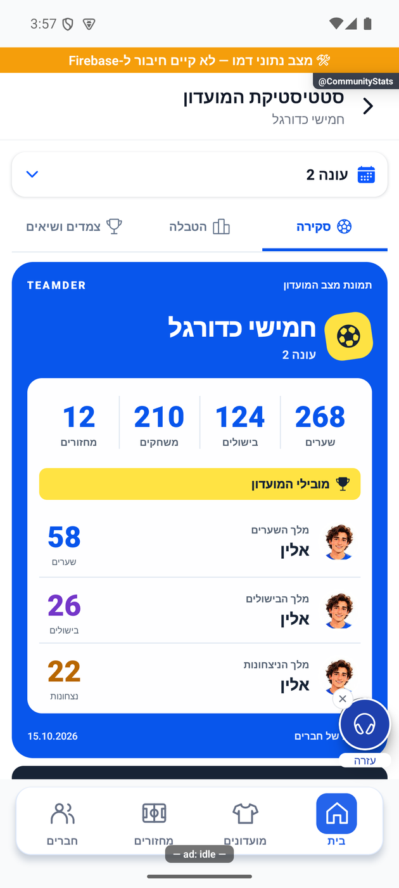
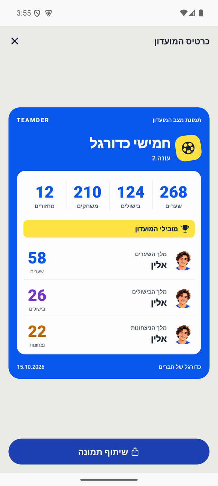

[יומן השינוי](../../changes/2026-10-15-club-statistics-poster.md)

## עיצוב קודם של המסך — 15.10.2026, הוחלף לאחר אישור סקיצות

השינוי המקומי מול `4a3cb346b1792b7e84cd71a8b9723bf6af88e500` מחליף את מעטפת המסך ואת התוכן בשלוש הלשוניות. `ClubStatsHero` מציג תמונת מגרש מקומית קישוטית (`daylight-pitch.jpg`, אינה תמונה של מגרש המועדון), שם המועדון וכפתור חזרה. במצב מוטמע נשמרת כותרת מעטפת המועדון שהועברה ב־`props.header`.

`ClubStatsSummary` מציג מונים סטטיים לקריאות בצילום, ללא רגע שבו אנימציה מציגה אפס. `ClubStatsAwards` מציג עד שלושה מובילים מן `leaderItems` הקיים. הבחירה בין הלשוניות נשארת מקומית; מעבר מאפס את הגלילה אך משאיר את `CommunityChampionship` מורכב כדי לשמר מיון ומצב מצטבר/יעילות. אין שינוי במסלולים או בכתיבה לנתוני המועדון.

הרכיבים `SeasonScopeBar`, `CommunityChampionship`, `CommunityStatsTable`, `ChemistrySection`, `ClubRecords` ו־`ResultsBreakdown` מקבלים `appearance="club"` רק במסך הזה. הקריאות האחרות שומרות את התצוגה הקיימת. הטבלה מקבלת פסים מתחלפים ומתג מצטבר/יעילות חדש; הצמדים והשיאים מוצגים בשורות מלאות; התוצאות בפס מחולק ונתוני מקרא. `splitRoundResults`, המכנה `countedRounds`, ספי הצמדים, מיון השחקנים, יחידות מחזור/משחק ומקורות העונות לא השתנו.

`ClubStatusOverview compact` מציג פעולת שיתוף קטנה, ולא כרזה נוספת בתוך העמוד. החלונית מייצאת את `ClubStatusCard` בלבד, עם תמונת מגרש, שם, תקופה, מונים, מובילים ותאריך. שימוש חוזר ברכיבי המונים והמובילים מונע הבדלי עיצוב ונתונים בין המסך לתמונה. מנגנון נעילה, בדיקת זמינות, שני פריימים לפני צילום, טיפול בכשל וניקוי הקובץ הזמני נשמרו.

### ראיות ומגבלות

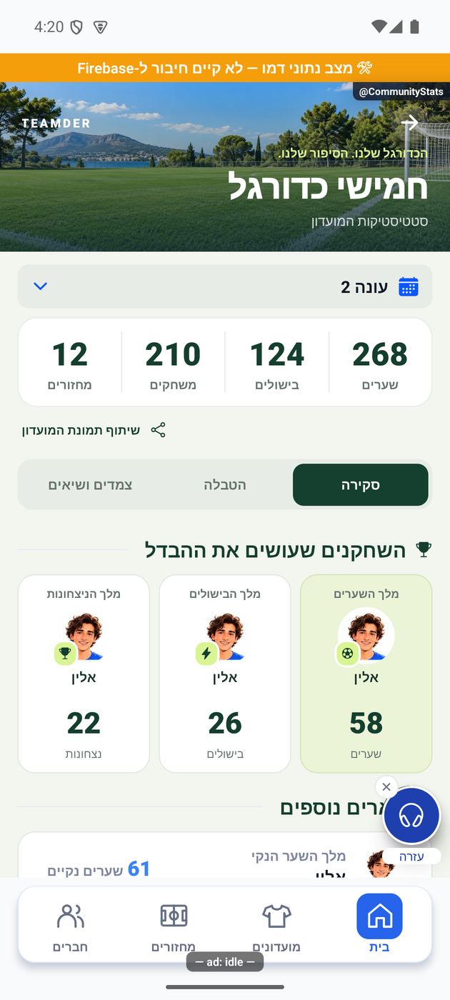
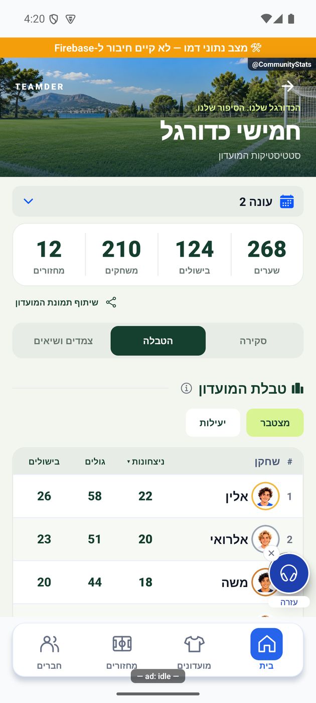
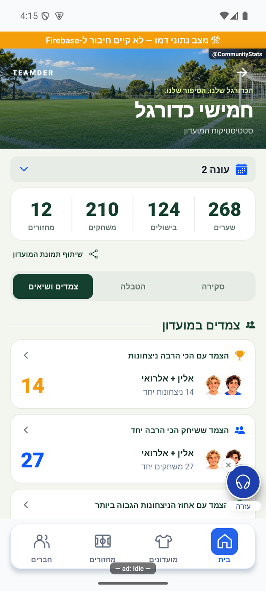
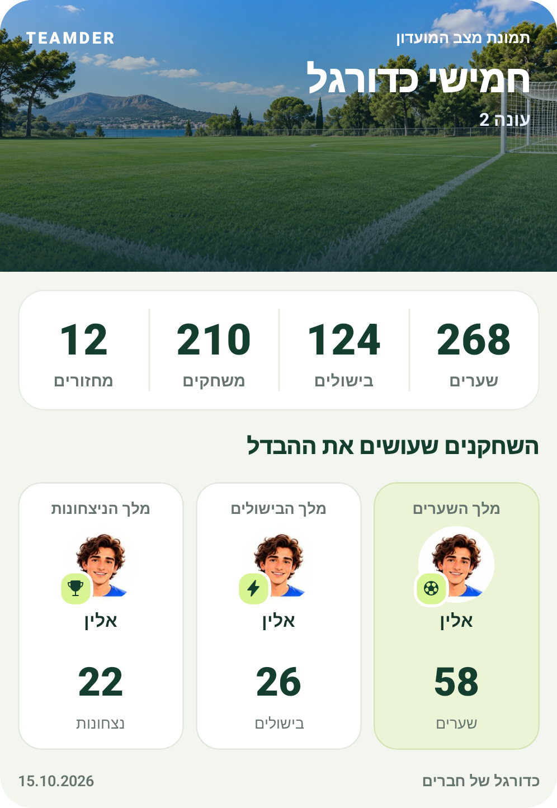

נבדקו באימולטור אנדרואיד מנותק מהמסד: שלוש הלשוניות, כיווניות, גלילה, ייצוא תמונה וביטול ללא שליחה. 327 חבילות ו־3,876 בדיקות עברו; `npx tsc --noEmit` נקי. מקור התוצאות: `artifacts/club-stats-experience-tests.log`. אייפון, מכשיר פיזי, מצב מוטמע, נתוני ייצור, גופן מוגדל, שמות ארוכים ושגיאות רשת לא הורצו בבדיקה זו. אין כאן אישור להפצה.

נבדקו גם מעבר מצטבר/יעילות, שיאים ותרשים תוצאות בגלילה. דוגמת תרשים בדמו: 75 משחקים הוכרעו במשחק, 34 הסתיימו בתיקו ו־11 בפנדלים; המכנה 120 משחקים מדודים, והאחוזים המעוגלים 63%, 28%, 9%. מקטעי הפס נשארים לפי השברים הלא מעוגלים, ולכן מילוי הפס אינו מושפע מסכום האחוזים המעוגלים.

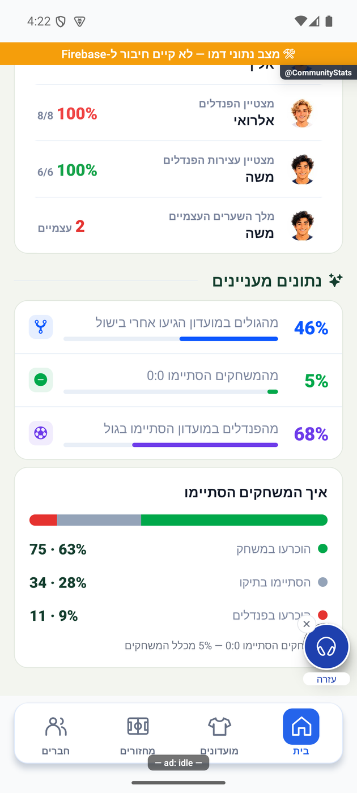
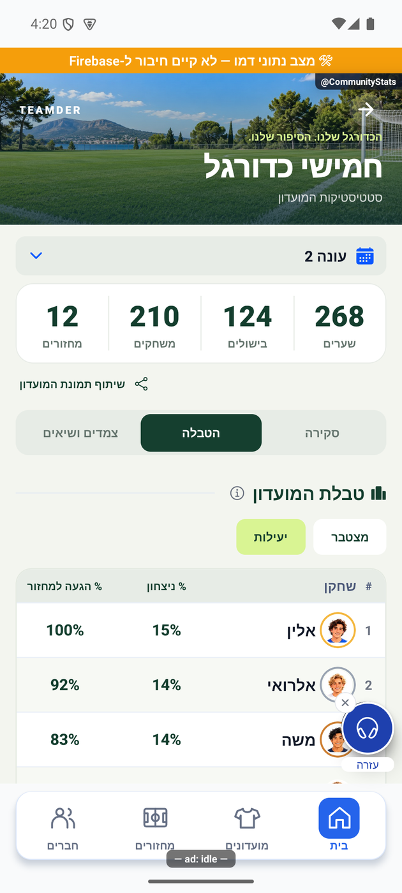

## מימוש הסקיצות המאושרות בלשונית המועדון — 15.10.2026

כניסת המוצר היא `CommunityDetails` עם `groupId`, ואז `tab='stats'`. `CommunityDetailsScreen` ממשיך להעביר את `header` ל־`CommunityStatsScreen`, ועכשיו מעביר גם `active={tab === 'stats'}`. כותרת המועדון, התמונה ולשוניות מידע/שחקנים/סטטיסטיקות נשמרות במעטפת המקורית. אין כותרת מועדון כפולה, אין מסך מוצר חדש ואין שינוי בניווט הרשום. מסלול `CommunityStats` הישן נשאר תואם לקריאות קיימות, אך אינו הכניסה שנבדקה במשימה זו.

### מבנה ותפקוד

- `ClubStatsSections`: שלוש לשוניות פנימיות עם קו טורקיז פעיל. מעבר מאפס גלילה ומשמר את הטבלה מורכבת, לרבות מיון ומצב מצטבר/יעילות.
- `SeasonScopeBar appearance="club"`: בורר עונה קומפקטי בשורה אחת עם פעולת שיתוף. אפשרויות הטווח, תנאי הופעת הבורר, הערות כיסוי, טעינת ארכיון והחזרה מעונה ריקה נשמרו.
- `ClubStatsSummary`: מגרש וקטורי בהיר עם ארבעת המונים המקוריים. מחזורים ומשחקים בפס העליון; שערים ובישולים במגרש. `GoalMark` הוא רשת שער וקטורית. `ClubStatsGrass` מצייר פס דשא מקומי יציב, ללא תמונה מרוחקת או נתונים אקראיים.
- `ClubStatsAwards`: כל `leaderItems` הזמינים ברשימה, ללא חיתוך לשלושה וללא כפתור הרחבה. הערכים, הזוכים, סדר התארים ותנאי המדגם נשארים מהחישובים הקיימים; לא הוספו חישובי שוויון חדשים. ״הטבלה המלאה״ בוחר את אזור הטבלה המקומי. יחידת ההתמדה נקראת מחזורים, ומקורה באותו מספר ערבי השתתפות.
- `ChemistrySection preview`: בסקירה מופיע הצמד המנצח הקיים אם יש זכאות ל־`winningDuo`. ההכרעה אינה חישוב חדש: אותו `pickChemistry`, אותו מקור זוגות, ואותו חלון `PairCard`. אם אין צמד זכאי אין כרטיס מדומה. כשל קריאה נשאר הודעת ניסיון חוזר, והעדר נתונים אינו מוצג בטעות כהצלחה.
- הטבלה משתמשת באותם שחקנים, מיון ומכנים, עם כותרת מגרש ופס דשא, סמלי מדדים ותצוגת יעילות באותו מבנה. הרכיבים המשותפים האחרים ממשיכים לקבל את תצוגת ברירת המחדל.
- הצמדים מוצגים בכרטיסים לבנים: כותרת, שני דיוקנאות וביניהם `link-outline` בטורקיז, שמות והמדד. חמש הקטגוריות האמיתיות נשמרו, כולל הפסדים יחד גם אם אינם מופיעים בכל סקיצה.
- השיאים ברשימה לבנה משותפת עם פס דשא בתחתית; נתוני מחזור מובילים לאותו `MatchDetails`, ורצף נוכחות לאותו כרטיס מחזיק כאשר יש יעד.
- התוצאות מוצגות בפס צבעוני ומקרא אופקי. צבע כל מקטע תואם לצבעו במקרא. `splitRoundResults`, המכנה `countedRounds`, סינון אפסים, עיגול האחוזים ושורת המשחקים ללא שערים נשמרו. שורת ״משחקים שנמדדו״ מבהירה מדוע הסכום עשוי להיות קטן מסך משחקי המועדון.

### תנועה ושיתוף

`PitchBall` מבצע רבע סיבוב אחד במשך 1,800 אלפיות שנייה אחרי השהיה של 300. אין לולאה. `useAmbientMotion` מכבד הפחתת תנועה, מיקוד מסך, מצב היישום וגלילה. `active` של המעטפת עוצר את התנועה כאשר לשונית המועדון מוסתרת. במעבר לקטע הטבלה או הצמדים המגרש אינו מורכב. הגבלת נראות לפי פיקסלים בתוך חלון הגלילה אינה מיושמת; התנועה קצרה וסופית, ללא עבודה מתמשכת מחוץ למסך.

`ClubStatusCard` משתמש באותו מגרש ובאותה רשימת תארים, עם שם/טווח/תאריך. בייצוא `animate=false`, ולכן המספרים והקישוטים יציבים. צילום רכיב הכרטיס, מניעת לחיצה כפולה, זמינות שיתוף, טיפול בכשל וניקוי קובץ זמני נשמרו; אין בחירת נמען אוטומטית. תמונת הסקיצה אינה נכס באפליקציה: כל התוכן נבנה ברכיבי ממשק וקטוריים ונתונים אמיתיים מן השירותים הקיימים.

### בדיקות וראיות

הבדיקה מתבצעת ב־`CommunityDetails` באימולטור אנדרואיד בדמו מנותק, ולא בכניסה הישנה `CommunityStats`. מקור תוצאות הבדיקות: `artifacts/club-stats-approved-tests.log`. אייפון, מכשיר פיזי, גופן מוגדל, שמות ארוכים, כשל רשת והרשאות ייצור לא הורצו. הגדרת הפחתת תנועה נבדקה בקוד ולא הופעלה ידנית במכשיר. הצילומים נלקחו מתוך האפליקציה; כרזת הדמו וכפתור כלי הבדיקה אינם חלק מממשק החנות.

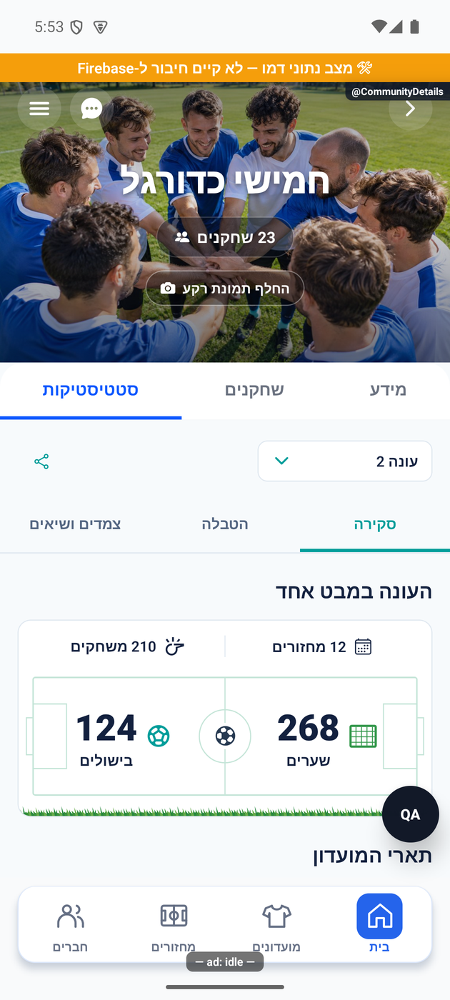
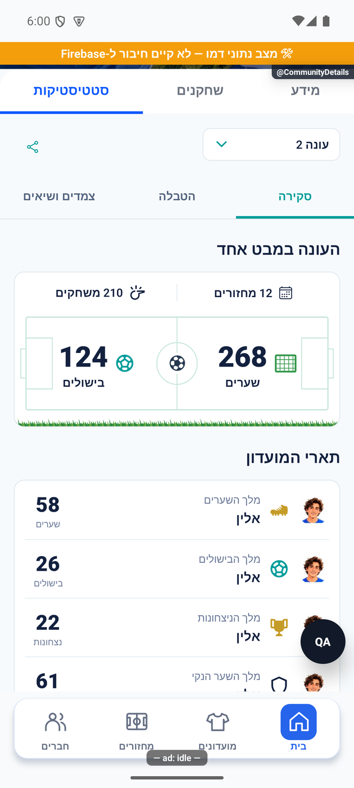
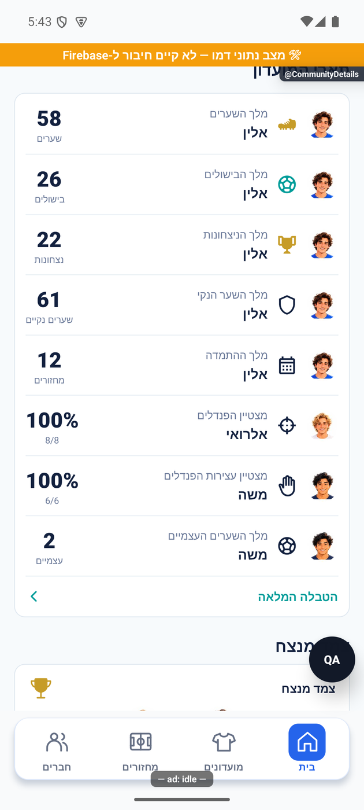
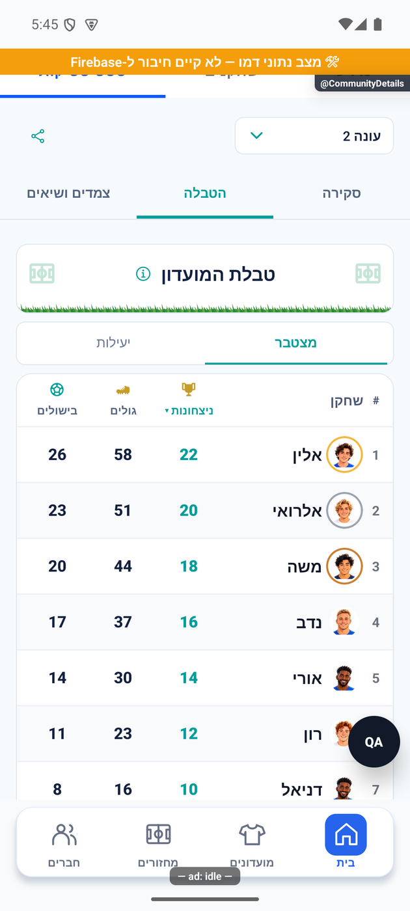
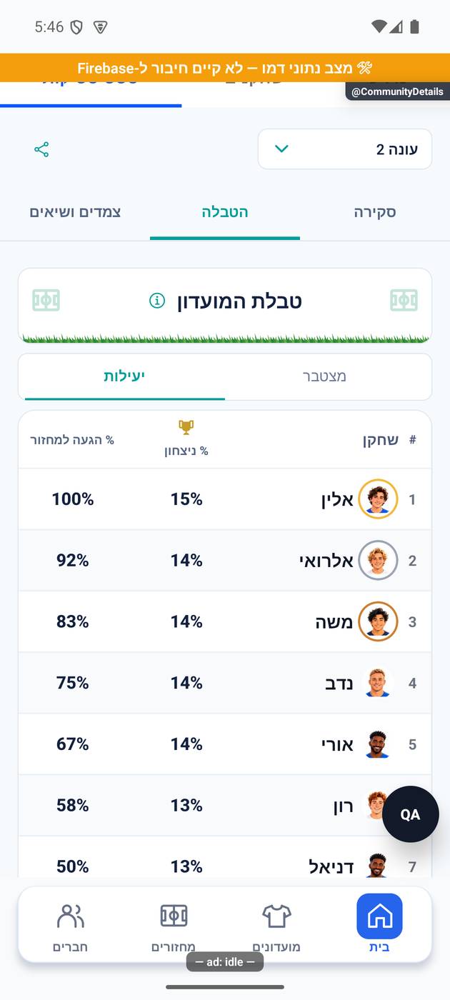
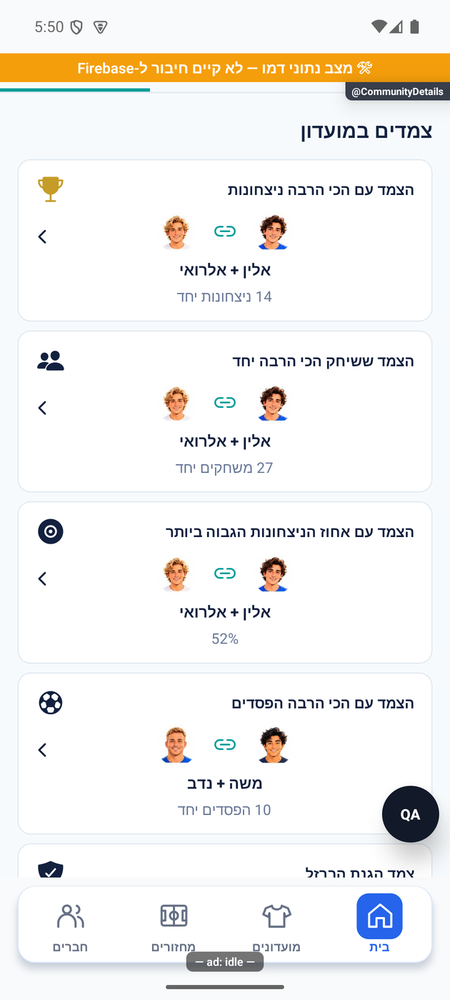
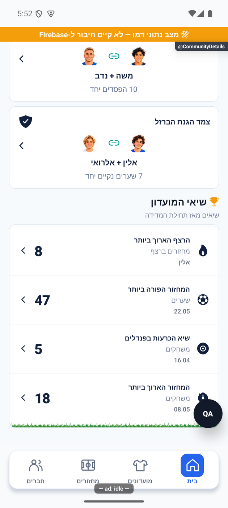
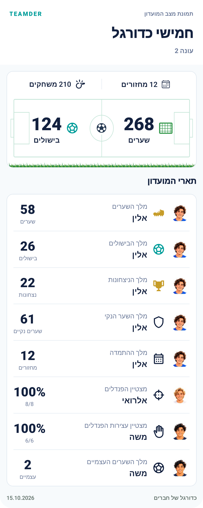

אימות החלפת טווח בדמו: בעונה הפעילה הוצגו 268 שערים, 124 בישולים, 210 משחקים ו־12 מחזורים; בכל הזמנים 910 שערים, 192 בישולים, 328 משחקים ו־42 מחזורים. בורר הטווח נשאר מעל ההסבר הייעודי לטווח כדי שלא יזוז בעת הבחירה. אין כאן אישור לנכונות נתוני ייצור. נפתח בפועל חלון הצמד אלין + אלרואי: 27 משחקים יחד, 14 ניצחונות, 9 הפסדים ו־7 שערים נקיים; החלון הקיים נשמר.

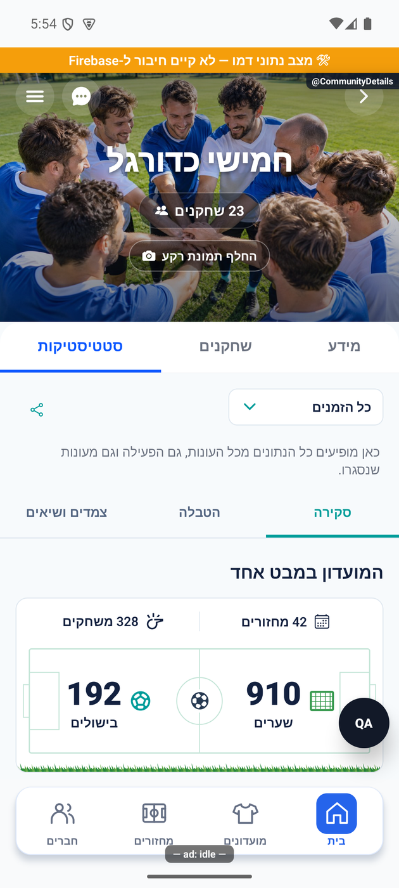
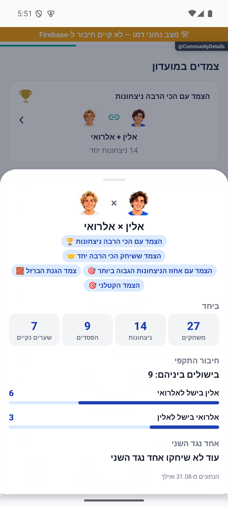

ייצוא תמונה נבדק בפועל: קובץ PNG של המגרש ושמונת התארים נשמר בשלמותו, כולל תאריך ושם המועדון. החלונית המקורית של המכשיר נפתחה, בוטלה ללא שליחה והקובץ הזמני נוקה. מניעת לחיצה כפולה וכשל/חוסר זמינות שיתוף מכוסים ב־`tests/logic/clubStatusShare.test.ts`. 327 חבילות / 3,876 בדיקות עברו ובדיקת טיפוסים נקייה.

תנועת הכדור נצפתה בשני פריימים אמיתיים באימולטור: ההפרש המבודד באזור המרכז הוא 48×48 פיקסלים, ומראה את אותו כדור בשתי זוויות, ללא שינוי בנתונים. [זוג הפריימים החתוכים](../screenshots/club-stats-approved-motion-2026-10-15.png). מקור: `artifacts/check-approved-motion.py`; תמונת ההשוואה היא חיתוך והגדלה משני צילומי מסך מקוריים, לא איור. הפחתת תנועה במכשיר עצמו לא הופעלה בבדיקה זו.

עדכון ריווח הצמדים, 15.10.2026: הצמד המנצח בסקירה משתמש באותה פריסה חדשה של שני דיוקנאות 72, שמות נפרדים, סמל חיבור באמצע והישג בפס תחתון. [מימוש וראיות](chemistry-and-records.md). יתר תוכן הסקירה, המונים והתארים לא השתנו.

עדכון 15.10.2026 — הצמד המנצח בסקירה מציג בין הדיוקנאות גביע קטן בטורקיז, בהתאם למערכת סמלי ההישג החדשה. סמל לחיצת היד והסמל הכפול בכותרת הוסרו. החישוב ומקור `winningDuo` נשמרו. [מערכת הסמלים והראיות](chemistry-and-records.md).

סגנון קודם, 15.10.2026 — סמלי הנתונים המעניינים בסקירה הותאמו לצמדים: מסירה, שער ריק ומטרה, בקו טורקיז נקי. המספרים ופסי המדדים נשמרו. [תיעוד וצילום](chemistry-and-records.md).

עדכון מאושר 15.10.2026 — הנתונים המעניינים מציגים נעל וכדור לבישולים, לוח 0:0 למשחקים ללא שערים ושער עם כדור וסימן אישור לפנדלים. [מימוש, בדיקות וצילום](chemistry-and-records.md).

הפצה 15.10.2026: השינויים המקומיים המתוארים בסבב זה נכללו בגרסה הפנימית 1.1.52 / 285 באנדרואיד. [ראיות וגבולות](../../changes/2026-10-15-internal-1.1.52.md).

## צילומי הסבב המאושר — 16.10.2026

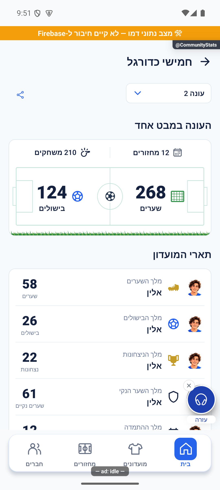

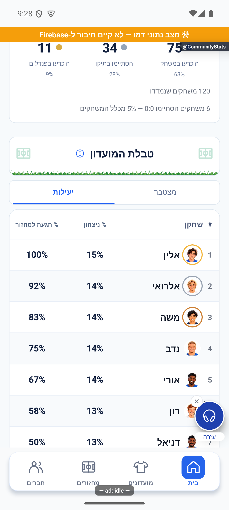
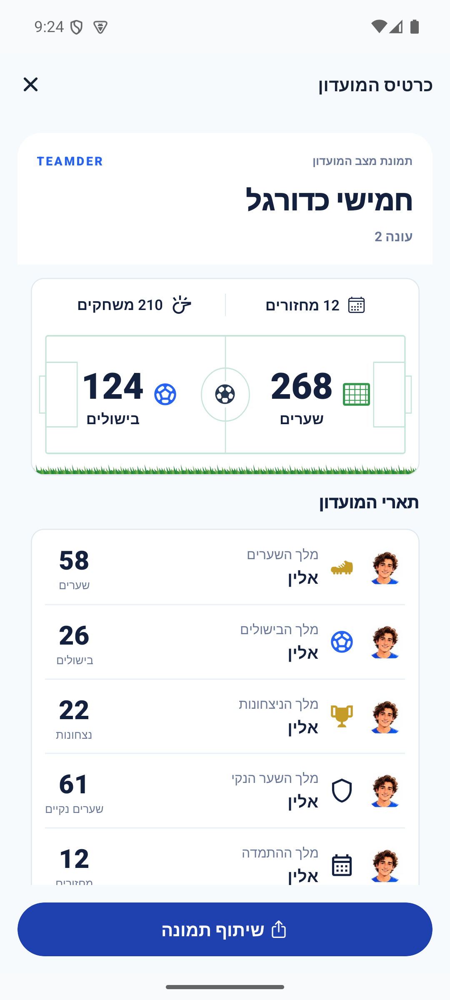
