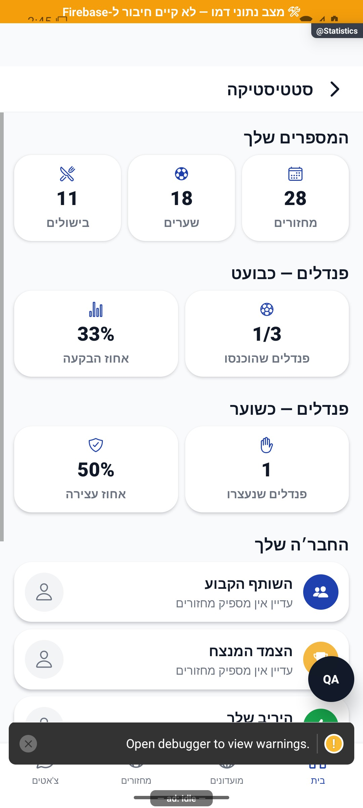
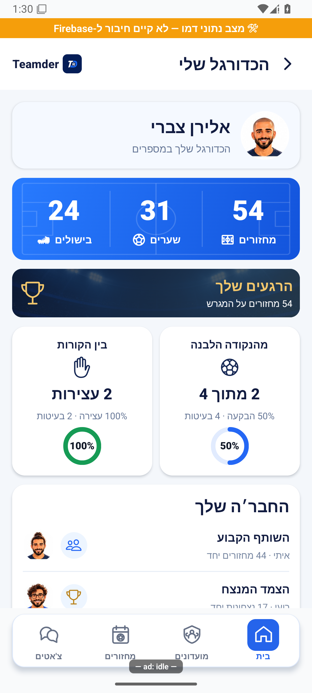
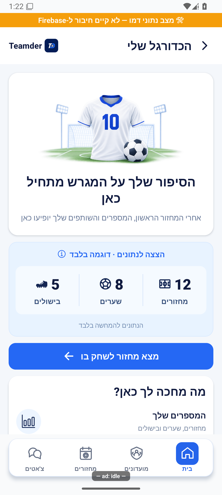
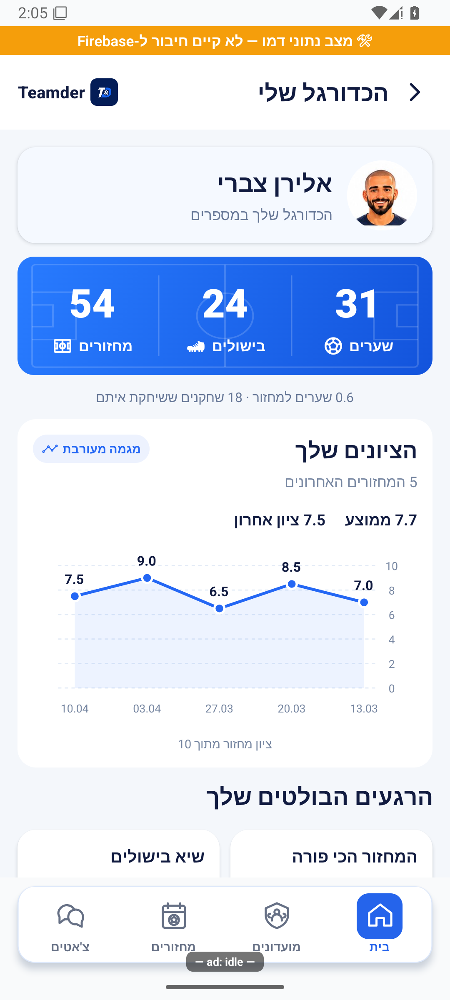
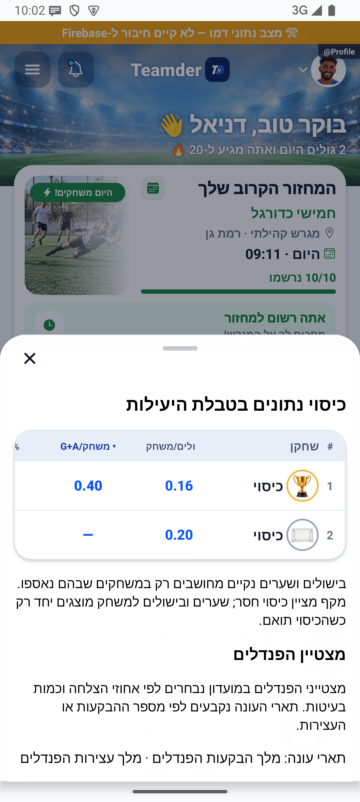
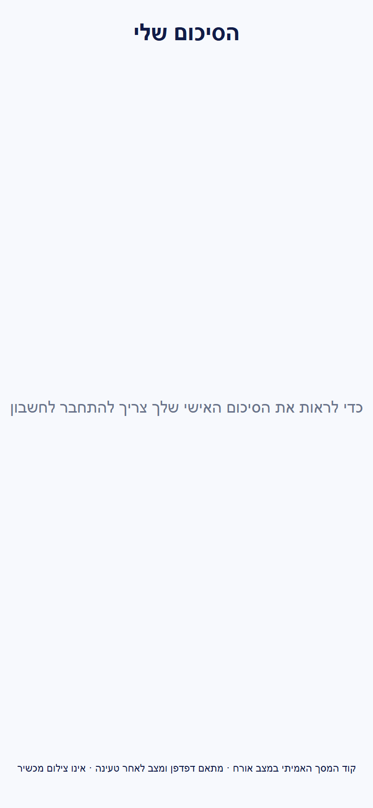
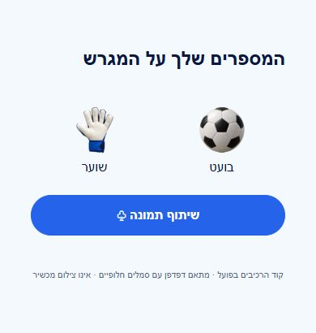

# סטטיסטיקה אישית

## בדיקת סיום וסיכומים אחרי החלפת קבוצות — 24.10.2026

`tests/logic/liveTeamsEndToEnd.test.ts` מוסיף 33 בדיקות שמפעילות את `gameService` המלא, ממיר המסמך האמיתי, גוף `commitRoundStats` ושלבי סיום המחזור המקוריים, לרבות `sealRoundSummary`, `rollUpClubPairs` וקריאת הארכיון. נבדקים כתיבה וקריאה חוזרת של ההיסטוריה, המונים האישיים והמועדוניים, דירוגי הערב והסיכום האישי והחתום. כל גדלי ההרכב מ־3 עד 11 בצד עוברים תרחיש של משחק שמור, משחק שאופס ומשחק חלופי: נשמרים בדיוק 2 משחקים, 2 שערים ו־2 בישולים. המכנה האישי הוא הופעות במשחקים שנשמרו; נוכחות במחזור נזקפת פעם אחת, ללא מי שסומן כמי שלא הגיע.

`tests/logic/matchStatsReadState.test.tsx` מוסיף בדיקה שמעבירה את הנתונים שנשמרו דרך קוראי המוצר אל `MatchStatsTab` ואל `RoundCard` ו־`RosterRow`: מספר המשחק, הקבוצות, המנצחת, הכובש, המבשל וההרכב תואמים. זו בדיקת עץ רכיבים וטקסט; אינה צילום או בדיקת כיווניות חדשה במכשיר.

נבדקו סיום מיד אחרי איפוס ללא 0:0 מדומה, תור בלבד, החלפות רצופות, היפוך צדדים, שלושת סוגי ההשלמה, אורח, פנדלים, שער עצמי ולא מזוהה, תיקו, כשל כתיבה, אובדן תשובה, בקשה מיושנת והתאוששות כל שלב סיום ללא כפילות. ארכיון עונה קודם נשאר זהה ונקרא לסיכום הקריירה. שתי החבילות הממוקדות עברו, 61 בדיקות; גם כל 485 חבילות הפרויקט ו־5,530 הבדיקות עברו ובדיקת הטיפוסים נקייה. לא נמצא כשל נוסף בקוד המוצר. [מסלול הנתונים, התרחישים המספריים, הראיות והמגבלות](../../audits/2026-10-24-live-teams-end-to-end.md). ללא מסד חי, אימות מעטפת אירועי הענן או בדיקת סגירת עונה אוטומטית; לא נפרס דבר.

## תיעוד כשלים — 20.10.2026

נוספו תצפיות דיווח בנקודות הכשל של המקורות המשויכים לפיצ׳ר, במסגרת הרחבה רוחבית. נשמרו ערכי החזרה, הזריקות ותנאי הפעולה הקיימים; נוסף מקור קוד והקשר לדיווח. כיסוי תחבירי אינו הוכחת הרצה של כל מצב. השינוי מקומי וטרם הופץ; בדיקות המסירה, מגבלות מניעת הכפילויות והמסלולים שטרם חוברו מתועדים בדוח המשותף.

[דוח דיווח השגיאות והראיות](../../changes/2026-10-20-error-reporting-audit.md).

## תיקון הבחנה בין עצירה להחטאה — 17.10.2026

ביקורת פיתוח הלייב מ־16.10.2026 מצאה ש־`reduceRounds` בתוך `src/utils/eveningStats.ts` עדיין זקף כל בעיטה שלא נכנסה כעצירה, אף ש־`outcome` כבר הבחין בין התוצאות. כעת `goal` מוסיף ספיגה, `save` מוסיף עצירה ו־`miss` אינו מוסיף אף אחד מהם. בעיטה היסטורית ללא סיווג שומרת את הפירוש הקודם; לא בוצעה הסבה של נתונים קיימים. מכנה אחוז העצירות נשאר כל הבעיטות מול השוער, כולל החטאות, לפי אישור הבעלים. לדוגמה: גול, עצירה והחטאה מול אותו שוער הם שלוש בעיטות, ספיגה אחת ועצירה אחת — אחוז העצירות הוא שליש.

החוזה נבדק ב־`dataLiveAudit.test.ts`, `dataLiveAuditServerCommit.test.ts` ובבדיקות ההיסטוריה והפנדלים הקיימות. הפעלת קוד השרת מול מסד מבודד אינה הוכחת פריסה או נתוני ייצור. אין שינוי חזותי במסך הסטטיסטיקה עצמו. [היקף הביקורת, הרצות ומגבלות](../../changes/2026-10-17-live-action-pitch.md).

## עדכון מקומי — 10.10.2026

`playerStatsService.compute` מפסיק להמיר כשל בשאילתות המחזורים או הצמדים למערכים ריקים. `StatisticsScreen` מגדיר `failed` ומפעיל ניסיון חוזר; קריאת משתמש טרי אינה בולעת שגיאה. כשל ראשון אינו מציג כרטיסי אפס, וכשל רענון שומר את `stats` שכבר התקבלו. תגובה לחשבון קודם נזרקת באמצעות ניקוי האפקט. `statsOwnerRef` מנקה מונים, פנדלים וזהויות כשהחשבון מתחלף; כשל החשבון החדש אינו מציג מידע מקודמו. חישובי השתתפות, פנדלים, צמדים והמכנים הקיימים לא שונו.

נבדקו מקור כושל, השארת נתון קודם וניסיון חוזר בהפעלת השירות ואפקט המקור המבודדים. אין אימות מספרים חדש מול מסד או צילום כשל רשת ממכשיר.

**מצב האימות:** תיקון מקומי, 10.10.2026. ראיות השירותים ופונקציות המקור ב־`tests/logic/clientAuditRecovery.test.ts`; הריצה הממוקדת המתועדת עברה 417 בדיקות ב־8 חבילות; השלמת שחזור מאוחר תועדה בדוח התיקון. [דוח התיקון והגבולות](../../../artifacts/pre-release-2026-10-10/client-fixes.md). לא הורצו כאן פעולות מול מסד אמיתי ולא צולמו מצבי כשל רשת חדשים; התמונות ההיסטוריות אינן הוכחה לתיקון זה.

[להסבר הקצר והפשוט](personal-statistics.simple.md)

עודכן: 07.10.2026; מקור: `8e8fde5`. מסך `src/screens/profile/StatisticsScreen.tsx`; מסלול `Statistics` מהבית/פרופיל לפי רישום הניווט.

## אזורים

״המספרים שלך״: מחזורים שבהם השתתפת, שערים ובישולים. שערים עצמיים מוצגים כשיש נתון מתאים. פנדלים כבועט: שהובקעו מתוך ניסיונות ואחוז הבקעה; פנדלים כשוער: עצירות ואחוז עצירה. ״החבר׳ה שלך״ כולל שש קטגוריות חברתיות המבוססות על צמדים גלובליים, עם מצב שאין מספיק מחזורים. אין במסך הראשי הנוכחי אריח עצמאי של ניצחונות/הפסדים או אריח שערים למחזור שהוסר.

| נתון/פעולה | מקור | תנאי |
|---|---|---|
| מונים אישיים | נתוני המשתמש | חיים אישיים; אינם מוני העונה במועדון שנבחר |
| השתתפות אישית | `playerStats` לפי `participantIds` | מחזור שנחשב כהשתתפות בפועל |
| חברים וצמדים | `pairStats` בשני כיווני מזהה | יכול לכלול פעילות ביותר ממועדון אחד |
| כרטיס אדם | זהות חשבון קיימת | שורת מידע ללא ניווט; היעדר נתונים מקבל הסבר |
| שיעורי פנדלים | ניסיונות/עצירות | אין לחלק באפס או לייחס היעדר מדגם להצלחה/כישלון |

## תלות ומצבים

`src/services/gameService.ts`, השירותים הייעודיים לנתונים אישיים וצמדים, `src/utils/penaltyStats.ts`, `src/utils/eveningPlayed.ts`, `src/components/UserAvatar.tsx`, `src/firebase/firestore.ts`. בדיקות `tests/logic/personalHistory.test.ts`, `penaltyStats.test.ts`, `pairOrientation.test.ts` רלוונטיות להגדרות, אך אינן בדיקת מסך מלאה.

טעינה, אדם בלי פעילות, פנדלים ללא ניסיון, מידע חלקי, זוג בלי סף נתונים וכשל קריאה. במסלול הכשל מוצגת תקלה עם ניסיון חוזר והנתון הקודם נשמר; אין להסיק חוסר פעילות ממקור שלא הגיע.

## ראיות

צילום נתוני דמה: 28 מחזורים, 18 שערים, 11 בישולים, 1 מתוך 3 פנדלים ואחוז 33, עצירה אחת ואחוז 50. ההתראה התחתונה וכלי הבדיקה מסתירים חלק מרשימת החבר׳ה; לכן הצילום אינו ראיה לכל שש הקטגוריות. לא אומתו מספרים מול מסד, שתי שאילתות צמד, מצב ריק אמיתי או כשל רשת.

## הצעות בלבד

להגדיר ״מחזורים״ במגע על האייקון; להוסיף מסגרת תקופתית אם רוצים השוואת מגמה בעתיד, רק אחרי אפיון מקור נתונים; להציג כשל מידע בנפרד מחוסר פעילות. הופעת כרטיסי חברים יכולה להיות קצרה ומדורגת, בלי להאריך טעינה.

## פירוט טכני נוסף — זרימה, חישוב ונקודות שינוי

המונים האישיים הם מצטברים לחשבון, ואינם הטבלה העונתית של המועדון הנבחר. הנתונים החברתיים קוראים `pairStats`, ולא `communityPairStats`; מעבר בין מועדונים אינו משנה את משמעותם לחיים האישיים.

בפנדלים: `penTaken = penScored + penMissed`, ו־`penFaced = penSaved + penConceded`; `pctOf` מעגל `100*success/attempts`, ובמכנה אפס מחזיר אפס ברמת הפונקציה. 1 הצלחה מתוך 3 היא 33%, ועצירה אחת מתוך 2 היא 50%. `aggregatePenalties` מקבל רק מזהים אמיתיים שעל המגרש, לכל היותר 16 בעיטות למשחקון; הבועט והשוער נבדקים בנפרד. פנדל אינו נוסף למונה השערים. הלוגיקה משוקפת ב־`commitRoundStats`, ולכן שינוי מימוש צריך לעדכן ולבדוק את שני הצדדים, כולל `penaltyStats.test.ts`.

הפירוט מתאר את הקוד שנקרא, ולא בדיקת כתיבה או הרשאות בסביבת הייצור. יש לקרוא את הקוד הממוקד וההפרש מאז מקור המיפוי לפני תיקון; בדיקות המוזכרות כאן לא הורצו מחדש לצורך עריכת התיעוד.

## עיצוב הכדורגל שלי — 10.10.2026

`StatisticsScreen` שומר את אפקט הטעינה, ביטול בקשות ישנות, `statsOwnerRef` וניסיון הרענון הקיימים. רכיבי התצוגה הועברו אל `src/components/stats/PersonalStatisticsCard.tsx`. השירותים, שאילתות המסד והממירים אינם משתנים; אין כתיבה או פריסה כחלק מהעיצוב. המידע גלובלי לחשבון: אין תווית או בורר טווח: הסטטיסטיקה האישית תמיד מצטברת מכל המועדונים.

`PersonalStatisticsCard` מציג שם ותמונה אמיתיים, `attendedGames`, `goals`, `assists`; אייקון נעל מחליף את אייקון כלי האוכל. שערים עצמיים נשמרים כש־`ownGoals>0`; תיקו אינו מוצג ללא מכנה ניצחונות/הפסדים מתאים. שש הקטגוריות החברתיות נשמרות, עם כותרות ותיאורים קיימים ובלי כפתורי ניווט מדומים. אי־פתרון זהות החבר אינו מוחק את הנתון החברתי שהתקבל. מספר הניצחונות המשותפים נשאר מספר ולא הופך לאחוז ללא מכנה. כרטיס ״הרגעים שלך״ מציג מחזורים על המגרש, ולא שיא שערים שאינו חלק מתוצאת השירות.

`PenaltyCard` מציג שתי יחידות נפרדות: כבועט `penScored` מתוך `penTaken` ובשער `penSaved` מתוך `penFaced`. האחוז הוא `Math.round(100*successes/attempts)` רק כשהמכנה חיובי; `StatDonut` הקיים מצייר אותו. למשל 2 מתוך 4 נותן 50%, שתי עצירות משתי בעיטות נותנות 100%. בהיעדר ניסיונות מוצג הסבר במקום מד הצלחה מדומה. עצירות אינן שוות לכלל הבעיטות שנבעטו החוצה; החישוב הקיים נשמר.

מצב מלא מופיע אם יש מחזורים, שערים, בישולים, פנדלים כבועט/שוער או שערים עצמיים, כדי לא להסתיר מוני עבר כשהיסטוריית מחזורים חסרה. כשל טעינה ראשון מקבל ניסיון חוזר; כשל רענון משאיר נתונים קודמים. המצב הריק `PersonalStatisticsWelcome` מציג איור מקומי, שלושה קבועי דוגמה 12/8/5, שתי הודעות המחשה ופעולת מעבר אל `GameTab` / `GamesList` דרך הנווט האב. הדוגמאות אינן עוברות לשירות או לאחסון. אין שינוי במסלול `Statistics`.

השיתוף לוכד `shareRef` באמצעות `captureRef` כקובץ תמונה זמני, כולל הנתונים ולוגו אך ללא כפתור השיתוף והניווט. `expo-sharing` נטען בעת הלחיצה. `sharingRef` מונע לכידה כפולה מיידית; כשל מוצג באמצעות הודעת שגיאה ונרשם ביומן שגיאות. מידע חברתי גלוי במסך כלול בתמונה המשותפת לפי בחירת המשתמש.

נתיבי הבדיקה `StatisticsPopulated` ו־`StatisticsEmpty` פותחים את אותו מסך עם פרמטר פיתוח; הוא נקרא רק כאשר שלושת התנאים `__DEV__`, `EXPO_PUBLIC_QA_ROUTES=1`, `EXPO_PUBLIC_FOOTY_FORCE_MOCK=1` מתקיימים. נתוני `src/dev/personalStatisticsFixture.ts` מקומיים בלבד, אינם נשמרים ואינם מקור למוני משתמש אמיתיים. הצילומים הללו מאמתים תצוגה וכיווניות ולא מסד ייצור, אייפון או גרסת חנות.

### ראיות העיצוב החדש

[כל שש הקטגוריות לאחר גלילה](../screenshots/personal-statistics-details-2026-10-10.png) · [תמונת השיתוף המלאה](../screenshots/personal-statistics-shared-card-2026-10-10.png) · [יעד כפתור מציאת המחזור](../screenshots/personal-statistics-find-round-2026-10-10.png).

אומתו 231 חבילות בדיקות, 3,260 בדיקות ובדיקת טיפוסים נקייה. חלון השיתוף נפתח, תמונת הלכידה המלאה נבדקה ובוטלה השליחה. כפתור מציאת מחזור עבר למסך GamesList. זו בדיקת דמו באנדרואיד, ולא אימות אייפון, גרסת חנות או מספרי ייצור.

## עדכון סדר החשיבות וגרף ציונים — 10.10.2026

העדכון הזה מחליף את תיאור הסידור החזותי הקודם: המסך מכיל סטטיסטיקה אישית בלבד, ללא רשימת מועדונים או מחזורים קרובים. בראשו שערים, בישולים ומחזורים; לאחריהם גרף ציונים, רגעים בולטים, ממוצעים, תוצאות משחקים מתועדות, שש השוואות השחקנים ופנדלים בשתי עמודות קומפקטיות. שערים עצמיים מוצגים כאשר קיימים. השיתוף ממשיך ללכוד את כל הכרטיס.

### מקור הנתונים והחישובים

`playerStatsService.compute` שומר את מזהי המחזורים שעברו את `isAttendedGame` מתוך שאילתת המשחקים הקיימת, ומעביר אותם ל־`loadPersonalHighlights`. ההעשרה קוראת `eveningStandings` בסינון `userId` של השחקן המחובר בלבד, ו־`gamePlayerStats` בסינון `gameId` ו־`userId` לכל מחזור, עד ארבע בקשות מקבילות. אין שינוי הרשאות, כתיבה למסד, דירוג מנהל או חישוב מחדש של הציון. העלות הנוספת היא שאילתת ציונים אחת ושאילתה אחת לכל מחזור שהשתתף בו; אין מטמון שחוצה חשבונות. שאילתה ריקה היא חוסר תיעוד, כשל קריאה מסומן כמידע חלקי. מעטפת המסך הקיימת ממשיכה לבטל תוצאות מבקשות של חשבון קודם.

`personalHighlights` ממיין לפי תאריך ומזהה, בוחר את חמשת המחזורים האחרונים ורק אז בודק את הציונים: מחזור חסר ציון אינו מוחלף במחזור ישן ואינו הופך לאפס. מתקבלים רק ציונים סופיים בין 0 ל־10. ממוצע הגרף מחולק במספר הציונים הידועים; ״ציון אחרון״ הוא הציון המתועד האחרון במקטע. מספר המחזורים עם ציון מופיע כשהכיסוי חלקי. `PersonalScoreChart` משתמש בציר קבוע 0–10, הישן מימין והחדש משמאל. עליות בלבד בירוק, ירידות בלבד בענבר, תערובת בכחול; שינוי קטן מ־0.05 נחשב ללא שינוי. נקודה יחידה אינה מקבלת טענת מגמה. לא מוצגת המלצה לשנות דירוג מנהל.

שיא שערים/בישולים הוא המקסימום בשורות המתועדות, עם מספר המחזורים המתועדים לידו, ולא טענה להיסטוריה שמעולם לא נאספה. כשל באחת מקריאות ההעשרה מסתיר את השיאים כדי לא להציג מקסימום מטעה. מחזורים ללא מסמך אינם מייצרים שיא. השיאים מופיעים רק כשערכם חיובי.

תוצאות משחקים מחושבות רק משורות עם מכנה `rounds` תקין וחיובי. זהו מספר המשחקים בתוך המחזור, לא מספר המחזורים. `wins` ו־`losses` חסרים הם אפס לפי חוזה הכתיבה המצטברת של השרת; ערכים שליליים, לא שלמים או סכום העולה על המכנה נפסלים. תיקו = `rounds - wins - losses`. אחוז ניצחונות = סכום הניצחונות / סכום המשחקים התקינים, ומוצג מספר המחזורים שמהם הגיע החישוב. אין ערבוב עם מוני עונה.

ממוצע בישולים = בישולים מצטברים / מחזורים שהשתתף בהם. שערים ובישולים למחזור = סכומם / אותו מכנה. כשאין מחזורים מופיע מקף. אחוז השתתפות משתמש במכנה ההרשמות למחזורי העבר הקיים בשירות, לא בכלל מחזורי המועדון. בפנדלים מוצגים כיבושים מתוך בעיטות ואחוזם, ועצירות מתוך בעיטות מול השוער ואחוזן. מכנה אפס מוצג כחוסר פעילות, ללא אחוז מומצא. שש ההשוואות והכיווניות שלהן נשמרו.

### אימות

בדיקות `tests/logic/personalStatistics.test.ts` מכסות מגמה מעורבת/עולה/יורדת/יציבה, ציונים חסרים ואפס, טווח לא תקין, כיסוי חלקי, שיאים ותוצאות משחקים, מונים דלילים ומכנה חסר. הצילומים החדשים מאמולטור אנדרואיד בנתוני דמו; הם אינם אימות הרשאות או מספרים בייצור, ואייפון לא הורץ בסבב זה.

[שיאים, ממוצעים ותוצאות](../screenshots/personal-statistics-trend-middle-2026-10-10.png) · [השוואות עם שחקנים](../screenshots/personal-statistics-trend-people-2026-10-10.png) · [פנדלים ושיתוף](../screenshots/personal-statistics-trend-bottom-2026-10-10.png).

בדיקת הטיפוסים נקייה. בסבב המלא 3,268 בדיקות עברו ובדיקת זמן אחת בחלוקת הכוחות נכשלה תחת עומס; כל 16 הבדיקות בקובץ שלה עברו בהרצה נפרדת ללא שינוי הסף.

### עידון העיצוב — 10.10.2026
המסך משתמש בכרטיסים לבנים, רקעים עדינים לשיאים ואיורי גביע, נעל, כדור וכפפה קטנים. האיורים נבנים ברכיב `StatisticsIllustration` באמצעות נתיבים וקטוריים. גרף הציונים הונמך מ־185 ל־128 נקודות גובה. פס תוצאות מציג את היחס בין ניצחונות, הפסדים ותיקו. כל הנתונים האישיים, שש השוואות השחקנים ונתוני הפנדלים נשמרו.

[ראש המסך](../screenshots/personal-statistics-refined-top-2026-10-10.png) · [שיאים וממוצעים](../screenshots/personal-statistics-refined-middle-2026-10-10.png) · [קשרי שחקנים ופנדלים](../screenshots/personal-statistics-refined-bottom-2026-10-10.png).

התצוגה והכיווניות נבדקו באמולטור אנדרואיד עם נתוני דמו בלבד; אייפון וקריאות נתוני ייצור לא נבדקו בסבב זה. בדיקת הטיפוסים נקייה וכל 3,270 הבדיקות ב־232 חבילות עברו.

הגרף הורחב לרוחב הזמין בכרטיס בלי להגדיל את גובהו (128). הרכיב משתמש כעת ב־`preserveAspectRatio="none"` כדי למנוע שוליים שנבעו משמירת יחס הממדים. [צילום בדמו באנדרואיד](../screenshots/personal-chart-wide-2026-10-10.png).

### תיקוני סקירת השחרור — 10.10.2026

הנתונים הבסיסיים מוצגים לפני השלמת טעינת ההיסטוריה. ציוני המחזורים נטענים בהמשך, והמחזורים החדשים נקראים תחילה. במהלך הטעינה מופיע חיווי; כשל חלקי מאפשר ניסיון חוזר בלי לצאת מהמסך. שיא אישי אינו מוצג כמקסימום מלא בזמן שהקריאות טרם הושלמו. אין צמצום שקט של ההיסטוריה לחמישה מחזורים.

מכנה ההשתתפות כולל רק מחזורים שהתקיימו לפי `didEveningHappen`; אי־הגעה מתועדת במחזור שהתקיים נכללת במכנה אך לא במונה. מחזור לא מאומת או שאושר כלא מתקיים אינו מוריד את האחוז. בדיקה עם מחזור תקין, מחזור אוטומטי לא מאומת, מחזור שלא התקיים ואי־הגעה נותנת השתתפות 1 מתוך 2, כלומר 50%.

`compute` מוסר `onBase` לפני קריאת ההעשרה. `onHighlights` מפרסם ציונים ותוצאות חלקיות, ו־`isCurrent` מפסיק אצוות חדשות אחרי עזיבת המסך או החלפת חשבון. ארבע קריאות מחזור לכל היותר מתבצעות במקביל; לכל ההיסטוריה עדיין יש עלות קריאה, אך היא אינה חוסמת את הצגת הסיכום הבסיסי. המקסימום מופיע רק לאחר השלמת כל הקריאות בהצלחה.

רוחב הגרף נמדד ב־`onLayout`, והנקודות מחושבות ברוחב האמיתי. הגובה נשאר 128; אין מתיחה של טקסט או עיגולים. תיאור נגיש של כל נקודה כולל תאריך וציון מתוך 10. מבחני הרגרסיה ב־`personalStatisticsLoading.test.ts` מאמתים פרסום בסיס לפני בקשה איטית, מכנה השתתפות וביטול אצוות של בקשה ישנה. צילום ובדיקות מלאות של הסבב יתועדו בדוח התיקונים.

## התאמת גרף הציונים לטקסט מוגדל — 10.10.2026

`PersonalScoreChart` קורא `fontScale` דרך `useWindowDimensions`. תוויות SVG גדלות בפועל באמצעות `fontSize` לפי ההעדפה, ומרווחי הגרף וגובהו מחושבים מחדש; העיגולים נשארים עגולים משום שמידות ה־SVG וה־viewBox תואמות ואין מתיחה של הציור. בהגדרה הרגילה גובה בד הציור נשאר 128.

כאשר ההגדלה מעל 1.6 או שאין מרווח מספיק בין חמש התוויות ברוחב הזמין, הגרף מוחלף ברשימת ציונים עם תאריכים ברכיבי טקסט טבעיים שמתגדלים ונשברים לשורות. הממוצע, הציון האחרון, המגמה וכל הנקודות נשארים מוצגים. הכותרת וסיכום הגרף מאפשרים גלישת שורה. אין שינוי בחישובי הציונים.

נוספו בדיקות גאומטריה להגדלה, גובה רגיל וגבול חלופת הטקסט. בדיקת הטיפוסים עברה ו־14 בדיקות ממוקדות עברו. מצבי הטקסט המוגדל לא נצפו באמולטור בסבב זה; אין צילום חדש ואין לייחס לצילומים הקודמים הוכחת נגישות להגדלה.

אימות מעודכן: [גרף רגיל](../screenshots/release-fixes-chart-top-2026-10-10.png) ו[טקסט130%](../screenshots/release-fixes-chart-font130-clean-2026-10-10.png) נצפו בדמו5556 מהחבילה המקומית החדשה. גודל הגופן הוחזר1.0; שינוי גופן באמצע תהליך פיתוח הצריך הפעלה נקייה כדי למנוע מדידות טקסט ישנות. לא נבדק קורא מסך או אייפון.

## תיקוני דיווחים — 10.10.2026, אחרי גרסה 1.1.45

PersonalStatisticsCard משנה את סדר הכותרת והמספר בשני כרטיסי השיאים. StatisticsScreen מסיר shareBrand מתחת לכרטיס; המיתוג בכותרת נשאר. צילום השיתוף אינו כולל עוד את שורת המיתוג התחתונה.

שינוי מקומי מעל bcca0886; לא נבנתה גרסה בסבב הזה. נבדק בקוד ובבדיקות אוטומטיות. צילומי אנדרואיד בנתוני דמו בלבד; אין אימות באייפון או בטלפון המדווח.

## שימוש בנתונים בבית — 11.10.2026

`HomePersonalStats` משתמש באותו `playerStatsService.compute` עם אפשרות חדשה `recentHighlightsOnly`. ברירת המחדל היא `false`, ולכן `StatisticsScreen` ממשיך לקבל פירוט היסטורי מלא ללא שינוי. כאשר האפשרות פעילה רק רשימת המחזורים הנמסרת ל־`loadPersonalHighlights` מוגבלת לחמשת האחרונים; המונים והשותף נשארים מחושבים מכל ההיסטוריה. אין שינוי מכנים, הרשאות, ממירים או נתיבי כתיבה. אין להשתמש במקסימום מחמשת המחזורים כשיא אישי לכל הזמנים. [התנהגות, מסלול נתונים וצילומים](../home/dashboard.md).

נתוני הבית הורחבו ב־`regularPartnerResults` אופציונלי, מאותה רשומת צמד של `mostPlayedWith`. `personalPartnerResults` מאמת את שדות המשחקים באותה קבוצה ומחשב תיקו ואחוז ניצחון; שדה חסר אינו מתורגם לאפס. אין שינוי בתצוגת מסך הסטטיסטיקה המלא. [החישובים והראיות](../home/dashboard.md).

## עדכון 11.10.2026 — חברים וחיפוש שחקנים

האפיון והמימוש המעודכנים נמצאים ב[גילוי שחקנים ופרטיות](../profile/player-discovery.md). זהו עדכון מקומי, והוא גובר על תיאור ההתנהגות הישן כאשר קיימת סתירה. `PlayerCard` ו־`Statistics` נשארים המסלולים הקיימים; `ChatsList` מארח שתי לשוניות. ברירת המחדל לסטטיסטיקה היא חברים, ולתהליך החדש נשלח היטל מצומצם מהשרת. נצפו תצוגות נתוני המחשה באימולטור ונבדקו הפונקציות במסד מקומי. בהמשך התקבל אישור מפורש והושלמה הקשחת ההרשאות מקומית, לרבות התאמת קוראי הזהות הישנים. טרם נפרס; תלות עדכון הלקוחות מפורטת במסמך החדש.

### השלמת הרשאות מקומית — 11.10.2026

המדיניות המאושרת וקוראי הנתונים מפורטים ב[גילוי שחקנים ופרטיות](../profile/player-discovery.md). `userService.getUserById` מחזיר זהות בלבד לשחקן אחר; רק העצמי מקבל מסמך פרטי. טבלאות מועדון נשארו במסלול הרשאות המועדון. כללי ההודעות נאכפים גם בכתיבה ישירה, חברות מאושרת מוגנת, והיסטוריה נשמרת. אין כאן שינוי חזותי נוסף; הצילומים הקודמים הם מנתוני המחשה, ולא בדיקת שרת ייצור.

## ניסוח בעת צפייה בשחקן אחר — 11.10.2026

מסלול הסטטיסטיקה הקיים מעביר לרכיב הכרטיס את `isOwn={!otherPlayer}`. בצפייה בשחקן אחר הכותרות ניטרליות: המספרים על המגרש, ציוני המחזורים, הרגעים הבולטים, תוצאות המשחקים, שותפים ויריבים. גם הסברי ההשתתפות, הפנדלים והצמדים אינם פונים לצופה. שם בעל הנתונים נשאר בראש הכרטיס. בצפייה עצמית נשמר הניסוח האישי. אין שינוי במקור הנתונים, בחישובים או בהרשאות; מצב ללא נתונים של שחקן אחר אינו משתמש במסך ההסבר האישי.

[צילום הניסוח בצפייה בחבר](../screenshots/friend-statistics-copy-2026-10-11.png). נצפה באמולטור הדמו במסלול הרגיל מתוך פרופיל חבר.

## החלטות הבעלים — 13.10.2026

מידע שלא נאסף אינו אפס. אין להציג שיעור שערים נקיים או בישולים כאילו הכיסוי מלא כשמונה הכיסוי חסר.

`seasonPersonal` מאמת מוני כיסוי מספריים סופיים בטווח 0 עד rounds. נעדר/פגום הופך לאפס מכוסה; ממוצע ללא מכנה ידוע אינו מוצג. המכנה של ניצחונות כולל תיקו. אין שינוי במוני החיים האישיים. צילום טבלת היעילות מדגים את החוזה המשותף, ואינו הוכחה להרצת המסך האישי.

השינוי מקומי וטרם נפרס. [פירוט הבדיקות והמעבר](../../changes/2026-10-13-approved-statistics-policy.md).

## ציונים אחרי השלמת שערים — 14.10.2026

התיקון המקומי ב־`functions/src/retroScores.ts` וב־`retroScorePlan.ts` מחשב מחדש את ציוני המחזור בעת הוספה או מחיקה של שער שהושלם. ההשלמה, הציונים והממוצעים נכתבים באותה עסקה דרך `addRetroGoal`/`removeRetroGoal`. ניסיון חוזר עם אותו מזהה אינו מוסיף שער או ציון נוסף. `onGameRosterChanged` שומר מעתה בסיום את ספי הציון המקוריים ב־`finishStages/standings.scoreCalibration`, ובכל שורת `eveningStandings` גם `scoreBasis` עם הציון הקודם והאם המחזור נכלל בממוצע.

נוסחת הציון אינה משתנה: אותו `eveningScoreServer`, אותם ספי דירוג של המחזור ואותם ניצחונות/משחקים/פנדלים. הוספת שער אינה משנה את סרגל ההשוואה של האחרים. סדר `scoreRank` מחושב מחדש לכל המשתתפים לפי ציון וחותך שוויון במזהה, כמו בחישוב הסיום הקיים. `scoreDelta` מתעדכן מול הציון הקודם שנשמר; אם כבר קיים מחזור מאוחר יותר, רק ההשוואה של המחזור הבא מתעדכנת, בלי לשנות את הציון שלו.

תיקון הממוצע הוא `eveningScoreSum += newScore - oldScore`; `eveningScoreCount` אינו משתנה. רק מחזור שנכלל מלכתחילה בממוצע מקבל הפרש; מחזור ללא משחקים רשומים אינו נכנס לממוצע בעקבות השלמת שער. `lastEveningScore` מתעדכן רק אם `lastEveningAt` שייך למחזור המתוקן. אין זקיפה חוזרת של משחקים, מחזורים, ניצחונות, שערים או בישולים במהלך תיקון הציון עצמו. אין שינוי בתוצאות המשחקים. בהמשך אותה משימה הבעלים ביקש ואישר שגם סיכום המחזור הכללי יתעדכן; ההתנהגות המעודכנת מפורטת להלן.

כל הקריאות מתבצעות לפני כתיבות העסקה. בדיקת העונה הקיימת נשמרת בתוך העסקה, כדי לא לשנות ממוצע של עונה אחרת בזמן סגירה. סיכום שטרם נחתם מחזיר `score-summary:pending` בלי לשמור חצי פעולה. ההכנה מוגבלת ל־1,000 שורות ציונים במועדון ול־100 משתתפים למחזור; חריגה נכשלת לפני כתיבה. חלונות ההשלמה והרשאותיהם לא השתנו במשימה זו.

במחזור ישן ללא ספי מקור, הוכן שחזור מוגבל למחזור האחרון שנגמר, ורק אם ספי המועדון הנוכחיים משחזרים בדיוק את כל הציונים המקוריים לאחר הסרת השלמות שנוספו אחרי החתימה. אם אין הוכחה, ההכנה מחזירה `score-calibration:missing` ואינה מנחשת. הבעלים אישר פרטנית חסימת השלמה במקרה הזה וכן פריסה ממוקדת של שלוש פונקציות השרת. אין להסיק מהקוד המקומי שהמנגנון כבר פעיל בייצור.

לבקשת הבעלים תוקנו בפועל נתוני המחזור האחרון של ״כדורגל אנשים טובים״: 12 ציונים ודירוגיהם נבדקו, 9 ציונים השתנו ו־3 נשארו. תוקנו סכומי הממוצע והציון האחרון, וכל מוני המחזורים נשארו זהים. הכתיבה הממוקדת הותנתה בזמני עדכון של נתוני המקור והקריאה החוזרת אימתה כל שורה. לא שונו שערים, תוצאות משחקים, עונות או הרשאות. ראיות מקומיות: `artifacts/retro-score-repair-plan.json`, `retro-score-repair-receipt.json`, `retro-score-repair-after.json`.

בדיקות: `tests/logic/retroScoreCorrection.test.ts` מפעיל את קוד הקריאות בפועל עם עסקאות מבודדות, כולל הוספה, מחיקה, ניסיון חוזר, ממוצע, נעילת עונה וכשל חתימה בלי פעולה חלקית. כל 315 הסוויטות / 3,810 הבדיקות עברו, טיפוסי לקוח ושרת נקיים. מקורות פריסה מבודדים הוכנו על בסיס המקור הקיים של כל פונקציה, והורכבו בהצלחה ללא שינויים מקומיים אחרים (`artifacts/retro-score-deploy-proof.json`). בהמשך אותה משימה, לאחר אישור הבעלים, נפרסו שלוש הפונקציות המפורטות להלן. לא הורץ תיקון נוסף דרך יישום בטלפון; ההוכחה לתיקון הנתונים היא קריאה חוזרת מהמסד.

### אישור ופריסה ממוקדת — 14.10.2026

הבעלים אישר גם את העצירה במחזור ישן שאין הוכחה לבסיס חישובו, וגם פריסה של `addRetroGoal`, `removeRetroGoal`, `onGameRosterChanged` בלבד. שלושתן נפרסו והוחזרו במצב `ACTIVE`: שתי קריאות ההשלמות בשעה 20:07, וטריגר הסיום בשעה 20:10 לפי זמן אוניברסלי. הורד המקור שנפרס בפועל, גופי הפונקציות הושוו למקורות הפריסה המבודדים, וכל עזרי החישוב של קריאות ההשלמות הושוו לקוד שנבדק. ראיה: `artifacts/retro-score-verified-all.json` ומקורות `retro-score-*-after.zip`. לא נפרס קובץ העבודה המשותף עם שינויים לא קשורים: כל הכנה התבססה על המקור הקודם של הפונקציה המתאימה. לא נפרסו כללים ולא נבנתה גרסת חנות. רענון המסך בלקוח נשאר מקומי עד להפצת גרסה חדשה.

לפני הפריסה נקראו שש שגיאות פתוחות בפולס: שני דיווחי הרשאות על פתיחת סיכום תחת מסלול אורח, כשל תאריך ברכיב ההתראות המקורי, שתי קבוצות של התנגשות גרסת הרכב, והמרת מספר עשרוני ברכיב דירוג בגרסה ישנה. הן תועדו ב־`artifacts/retro-score-release-errors.json`, נשארו פתוחות ולא הוכנסו תיקונים לא קשורים לפריסה שאושרה. כלי הפריסה גם דיווח על סיום תמיכה קרוב בסביבת הריצה הקיימת; שדרוגה לא בוצע במשימה הממוקדת.

## סבב פולס — 15.10.2026

`EveningSummaryScreen` עוצר לפני `getEveningSummary` כאשר אין משתמש או `isGuest=true`, ומסיים טעינה ללא רישום שגיאת הרשאות צפויה. תלות האפקט כוללת `isGuest`. שלוש בדיקות מפעילות את האפקט האמיתי לאורח, ללא משתמש ולמשתמש רשום; רק האחרון קורא נתונים. צילום ההסבר הוא רינדור של קוד המסך במתאם דפדפן, לא בדיקת ניווט מקורית באייפון או באנדרואיד.

השינויים בסבב זה מקומיים וטרם הופצו. [דוח הסבב](../../changes/2026-10-15-pulse-sweep.md).

## סבב פולס — 18.10.2026

`StatisticsIllustration` משתמש ב־Image עבור ball/glove עם resizeMode=contain ובאותו size שהעביר הקורא. תמונת הכדור הקיימת: `src/assets/images/match-football.png`; הכפפה: `assets/season-summary/goalkeeper-glove.png`. אין שינוי ב־penTaken/penFaced או בחישובים. מקור הכפפה והנחיית יצירתה מתועדים בקובץ מקור נפרד.

השינויים מקומיים וטרם הופצו. לא שונו הרשאות ולא נשלחו הזמנות או הודעות. בדיקת הדפדפן משתמשת בקוד הרכיבים בפועל, במתאם סגנונות, בסמלים חלופיים ובנתוני הדגמה; אינה הוכחת אנדרואיד או אייפון. שני האמולטורים לא הגיבו לפקודות או לצילום בסבב זה.

## תלות בעדכון העונות — 19.10.2026

נבדק ההפרש בקבצים המשותפים הרשומים כאן: `src/firebase/firestore.ts`, `src/services/gameService.ts`, `src/utils/eveningPlayed.ts`. השינוי ממוקד במדיניות העונות, קריאת מצבן, שיוך מחזור ופקודות ניהולן; אין שינוי מכוון בחוזה העצמאי המתואר במסמך זה. אין להסיק מכך שהמסך הזה הורץ מחדש.

[מצב המימוש, הבדיקות ומגבלות האימות של העונות](../clubs/seasons.md). מקומי בלבד; לא בוצעה פריסה במסגרת המשימה.

## תלות במידע על סגירת עונה — 23.10.2026

בדיקת ההבדל ב־`src/firebase/firestore.ts` וב־`src/types/index.ts` מראה שהשינוי מוגבל לקריאת `seasons.closureStatus` בחוזה `GroupSeasons`. יתר ממירי הנתונים והמסלולים המתועדים כאן לא שונו במשימה זו. אימות הריצה החדש מתייחס להתאוששות ולכרטיס העונה, ולא להרצה חדשה של כל מצבי המסך הזה. [המסלול, הבדיקות והמגבלות](../../changes/2026-10-23-season-automatic-recovery.md).

## עדכון תלות משותפת בקריאות מידע — 23.10.2026

בקובצי השירות המשותפים נוספה אפשרות מפורשת לניסיון חוזר אחד בקריאה זמנית שנכשלה, תוך עצירה אם החשבון מתחלף. החיבור מוגבל ל־14 נקודות קריאה המפורטות בדוח; אין כאן טענה שכל פעולה בפיצ׳ר קיבלה ניסיון חוזר או שנבדק מסך חדש. בדיקות המאגר המלאות עברו (5,261 בדיקות ב־472 חבילות), אך אינן הוכחת הרצה במכשיר. הקוד מקומי וטרם הופץ. [מסלול, ראיות ומגבלות](../../changes/2026-10-23-four-open-errors.md).

## תלות בשמירת צבעי המחזור — 24.10.2026

במסגרת בחירת צבעים לפני שיבוץ עודכנו מקורות משותפים הרשומים לפיצ׳ר: `src/firebase/firestore.ts`, `src/services/gameService.ts`, `src/types/index.ts`. השינוי מוסיף מפת צבעים למחזור, קריאה וכתיבה שלה ושימורה במסלולי הכוחות וההכנה. אין כאן פעולת ממשק חדשה במסך זה. זו בדיקת השפעת התוספת הממוקדת, ולא חקירה או אימות חזותי מחודש של הפיצ׳ר. כל 480 חבילות הבדיקה ו־5,343 הבדיקות עברו; טיפוסי הלקוח והשרת נקיים. השינוי מקומי וטרם הופץ. [מסלול הנתונים, ראיות ומגבלות](../rounds/draft-setup.md#צבעים-לפני-שיבוץ-ובכל-שיטת-חלוקה--24102026).

## תלות בעריכת קבוצות בלייב — 24.10.2026

בקובץ השירות המשותף נוסף מסלול לעריכת הקבוצות והתור במשחק חי, כולל איפוס המשחק הנוכחי בלבד בעת החלפת קבוצה. לא שונו מסלולי הפיצ׳ר הזה במסגרת התוספת ולא בוצע לו אימות מסך חדש. [מסלול השינוי, הבדיקות והמגבלות](../rounds/live-advanced.md#עריכת-הקבוצות-והתור-בזמן-הלייב--24102026). מקומי וטרם הופץ.

## בדיקת עומק לעריכת הקבוצות — 24.10.2026

בקובץ השירות המשותף תוקן שימור זהות המשחק במחזור ישן בעת שינוי תור בלייב. הדיווח על הצלחת החלפה נשלח כעת רק אחרי שמירה. מסלולי הפיצ׳ר הזה לא שונו ולא בוצעה לו בדיקת מסך חדשה. כל 5,496 בדיקות הפרויקט עברו; אין בכך הוכחת מסד חי או הפצה. [הראיות ומגבלות הבדיקה](../../audits/2026-10-24-live-teams.md). מקומי וטרם הופץ.

## טיפול בפולס — 24.10.2026

האפקט ב־`StatisticsScreen` מחזיר `null` כאשר קריאת משתמש התיישנה, ובודק `alive` גם לפני דיווח ב־catch. אין חישוב או עדכון מצב על תשובה מיושנת; כשל נוכחי עדיין מדווח ומציג ניסיון חוזר. ארבע בדיקות `pulseCurrentStatistics.test.ts` עם תשובות מושהות עברו. אין שינוי בנוסחאות או במכנים; לא נבדקה שגיאת הרשאה חדשה מול שרת חי.

[פירוט התיקונים, הבדיקות והמגבלות](../../changes/2026-10-24-pulse-current.md). התיקונים מקומיים וטרם הופצו.
